# Mark Schemes — Respiration
**12. Respiration** · Cambridge (CIE) IGCSE biology (0610 & 0970)

## Alternative To Practical Questions (4 questions)

### Q1
(i)

*start *

- 44 / 45 / 46 (mm)

*and after 30 minutes *

- 4 / 5 / 6 (mm); **[1 mark]**

(ii)

- 40 (mm); **[1 mark]**

(iii)

1.3 mm per minute; **[1 mark]**

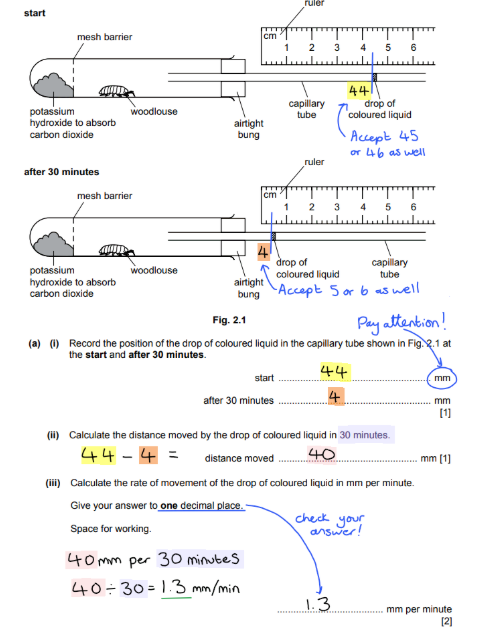

**[Total: 4 marks]**
(i)

1.5; **[1 mark]**

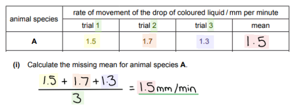

(ii)

- Axes labelled as animal species **and** mean rate of movement (of the drop of coloured liquid) / mm per minute; **[1 mark]**
- Suitable scale and occupies at least half the grid on both axes;**[1 mark]**
- All bars plotted accurately ± half a small square, bars do not touch and are the same width; **[1 mark]**

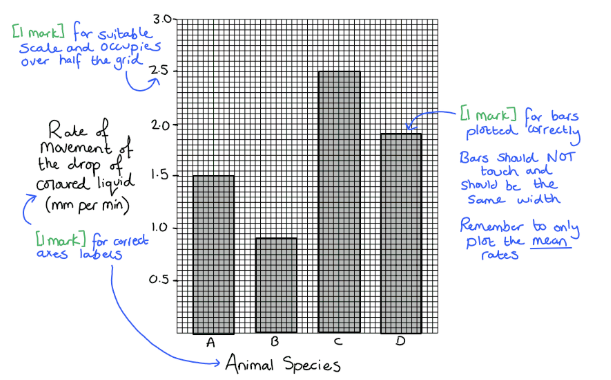

(iii)

- C; **[1 mark]**

(iv)

- Replace the woodlice with inert material (in the respirometer);**[1 mark]**

Remember that a control is an investigation that is identical to the original but with the factor you are investigating removed. This allows for comparison in order to determine that the factor that is being investigated is the thing that is causing the results.

(v)

- Measure the mass of the animal; **[1 mark]**
- Divide the rate of respiration / movement of bubble by the mass (in grams); **[1 mark]**

**[Total: 8 marks]**
(i)

- Outline: single clear line and no shading; **[1 mark]**
- Size: equal to / larger than, original;  **[1 mark]**
- Detail 1: at least eight distinct segments;  **[1 mark]**
- Detail 2: two projections at the front and two at the back;  **[1 mark]**

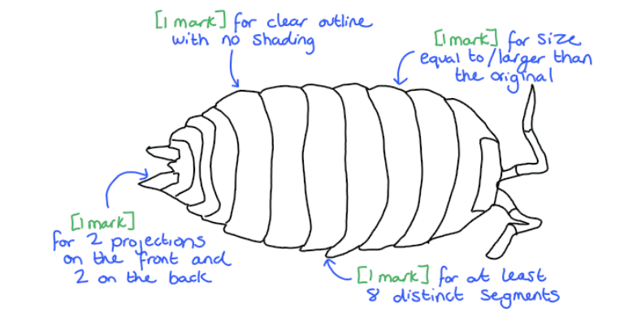

(ii)

- Length of PQ 48 (mm) ± 1 mm;  **[1 mark]**
- 5.22–5.44 (mm);  **[1 mark]**

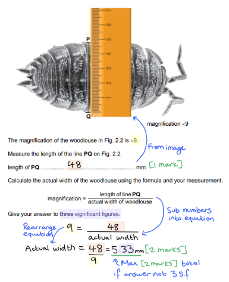

**[Total: 7 marks]**

### Q2
(i) The students' results table of the date in Fig. 2 should contain the following features:

- One table drawn with (ruled) header line and minimum two columns;** [1 mark]**
- Appropriate headings;** [1 mark]**
- Number of bubbles recorded for warm 19 and cool 7; **[1 mark]**

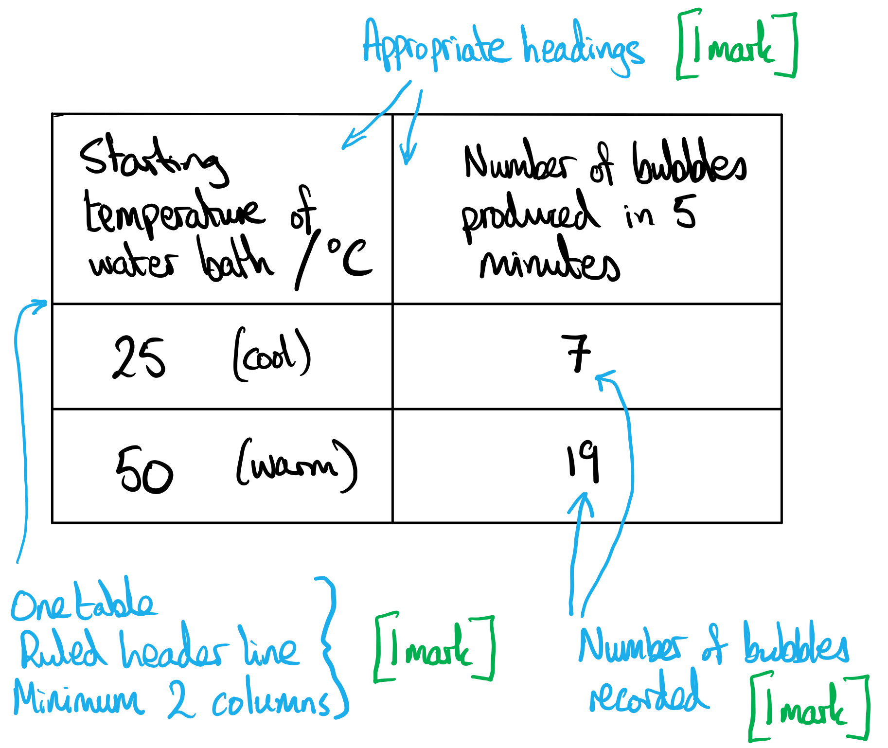

(ii) The completed table 1 would look as follows:

| Water bath | Starting temperature / °C | Final temperature / °C |
|---|---|---|
| Warm | 50 | 43 |
| Cool | 25 | 21 |

**[1 mark]** for fully correct, completed table

**[Total: 4 marks]**

> *In your table for part (i) you need to make sure that the heading has the units (°C) but that the units are **not** written next to each temperature value. If you include the units next to the number then you will loose the mark. *
(i) A conclusion for the results is...

**Final answer:** **Any**** one ****from the following:**

- The higher/warmer the temperature the more bubbles are produced / (rate of) respiration is greater at higher temperatures; **[1 mark]**
- The lower/cooler/colder the temperature the fewer bubbles are produced / (rate of) respiration is lower at lower temperatures; **[1 mark]**

(ii) Counting the number of gas bubbles produced may not be an accurate method of measurement because...

*Explanation*

**Final answer:** **Any**** one ****from the following:**

- It's easy to miscount bubbles; **[1 mark]**
- Bubbles may be different sizes; **[1 mark]**
- Volume of gas produced is unknown;** [1 mark]**

*Improvement*

- A method to collect gas (eg. gas syringe, upturned measuring cylinder over water) and measure volume described / measure height of foam; **[1 mark]**

(iii) A variable that should have been kept constant during this investigation but was not is...

*Variable*

- <u>Temperature</u> (of each water-bath / test-tube); **[1 mark]**

*How this variable could have been kept constant*

- Using a thermostatically controlled water bath / description of method that could be used to keep the temperature constant; **[1 mark]**

(iv)  The variable that was changed (independent variable) was...

- Temperature; **[1 mark]**

The variable that was measured (dependent variable) was...

- The number / amount of bubbles (produced); **[1 mark]**

**[Total: 7 marks]**
(i) The average volume of carbon dioxide produced in 5 minutes is...

**Final answer:** **Any ****one ****from the following:**

- (Mean rate) $\frac{13.6+14.3+12.9}{3}=\frac{40.8}{3}=13.6\mathrm{cm}^{3}$; **[1 mark]**
- (Median rate) 12.9 < 13.6 < 14.3 so 13.6 cm3 is the median (middle value); **[1 mark]**

The average rate of carbon dioxide produced in 5 minutes is...

- $\frac{13.6}{5}=2.72OR2.7cm^{3}min^{-1}$;** [1 mark]**

> *The average volume could be a median or mean, and in this case, gives the same answer of 13.6 cm**3**. The average rate has to be a mean value because we don't know how much gas was produced in each minute of the 5-minute experiment. The rate would typically start higher and tail off towards the end of the experiment. In most cases, in a science exam, the term **average** denotes the **mean**. *

(ii) The graph from data in Table 1.3 would have the following features:

- Axes – labelled with units i.e. percentage concentration of glucose and <u>average</u> rate of carbon dioxide production / cm3 per minute; **[1 mark]**
- Scale – suitable even scale and data occupies more than half the grid in both directions; **[1 mark]**
- Plot – all points plotted accurately ± half a small square; **[1 mark]**
- Lines – suitable line drawn (point to point or a smoothed curve); **[1 mark]**

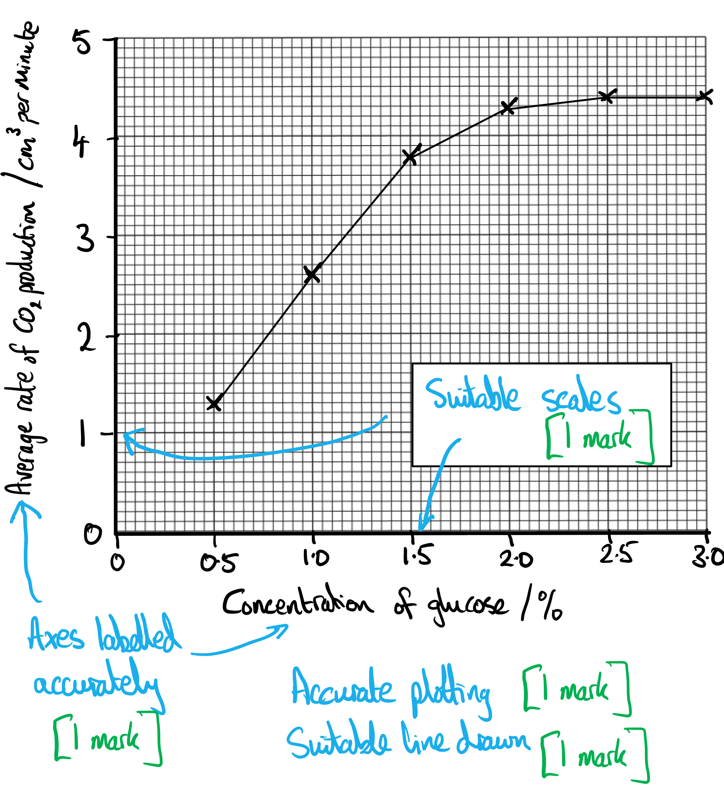

> *Avoid the temptation to extend the plot line down to (0, 0). There is no data point in the experiment for a concentration of 0% glucose, so extending the line beyond our data points would be pure guesswork. *

(iii) The effect of glucose concentration on the rate of carbon dioxide production by respiring yeast cells, shown in the graph from part c) ii) is...

- As concentration (of glucose) increases the rate (of CO2 production) increases; **[1 mark]**
- Levels off (at 2.0 or 2.5%) / rate of carbon dioxide production decreases (at 1.5–2.0%); **[1 mark]**
- Data quote with units e.g. rises from 1.3 cm3 per min to 4.3 / 4.4 cm3 per min **OR** levels off at 2.0 / 2.5% (glucose) **OR** levels off at 4.3 / 4.4 cm3 per min (of carbon dioxide); **[1 mark]**

> *Pay close attention to the command word, in this case, it is 'describe'. To describe, you just need to paint a mental picture of the graph to someone who can't see it. You don't need to go into details about the reasons why the plot is shaped the way it is. *

(iv) An estimate of the concentration of glucose the scientists used to test their method is...

- Using answer to c) i) and your graph, 1.05%;** [1 mark]**

**[Total: 10 marks]**

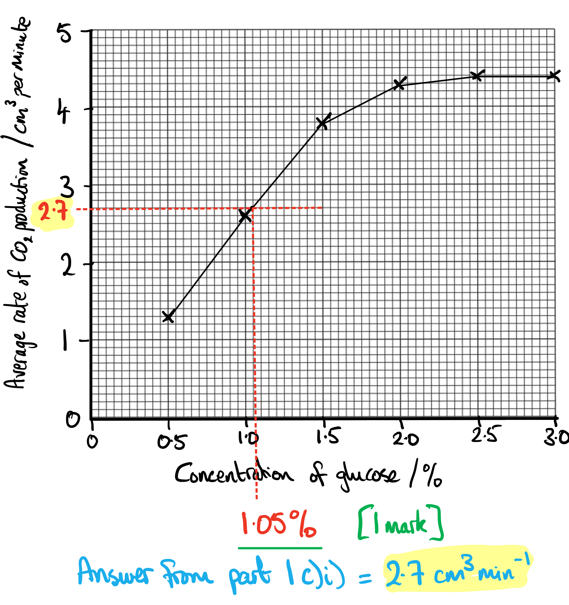
(i) The student could show that the glucose used in the investigation is a simple (reducing) sugar by...

- Adding Benedict’s reagent; **[1 mark]**
- (Adding) heat / heating; **[1 mark]**
- If the final colour is green / orange / yellow / red colour, this shows the presence of reducing sugars;** [1 mark]**

(ii) One hazard when testing for simple reducing sugars is...

**Final answer:** **Any ****pair**** of points from the following:**

- (Hazard =) Benedict's solution; **[1 mark]**
- (Precaution =) goggles / gloves worn;** [1 mark]**

**OR**

- (Hazard =) hot water / could cause burns; **[1 mark]**
- (Precaution =) use a thermostatically controlled water-bath for heating;** [1 mark]**

**[Total: 5 marks]**

### Q3
(i) The rate of respiration at 60°C can be calculated as follows...

- (1 ÷ 583) = 0.0017 (s-1); **[1 mark]**

> *The clue is in the unit of this column; s**-1** indicates that 1 was divided by the time taken for the colour change to occur(s). You can confirm this by looking at the other values for the rate of respiration and you will see they were all calculated by 1 ÷ s.*

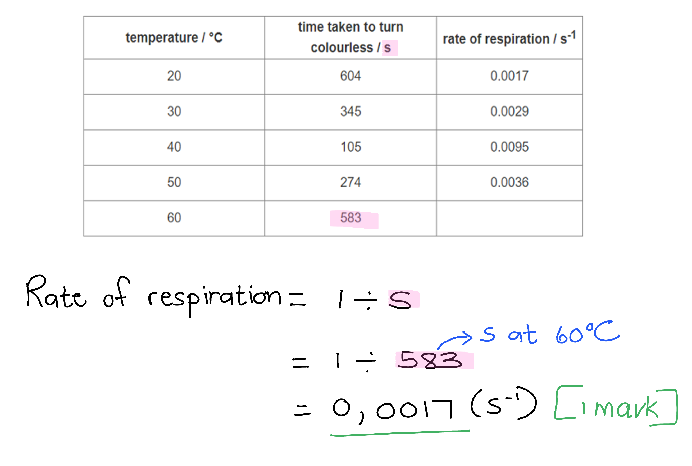

(ii) The source of error in step 7, as well as a possible improvement is...

**Error:**

- Judging colour change / subjectivity in determining when the solution is colourless / determining the end point of the colour change; **[1 mark]**

**Improvement:**

Any **one** of the following:

- Place next to a test tube containing only yeast and glucose / no methylene blue (for comparison); **[1 mark]**
- Place test tube against a white background; **[1 mark]**

**OR**

**Error:**

- Timing three test tubes simultaneously; **[1 mark]**

**Improvement:**

- Repeat experiment with only one test tube at a time (for each temperature); **[1 mark]**

> *You can remember this one for any experiment that involves judging a colour change. It is not always easy to determine when the colour change is complete, particularly when colour is disappearing from a reaction, so having a white background or a control test tube next to the one you are measuring may help.*

**[Total: 3 marks]**
(i) A conclusion for the results would include...

- As the temperature increases to 40°C, there is an increase in the rate of respiration / decrease in the time taken for methylene blue to turn colourless; **[1 mark]**
- At temperatures above 40°C the rate of respiration decreases / the time taken for methylene blue to turn colourless increases; **[1 mark]**

> *Make sure that your conclusion covers the results across the entire range of temperatures across which the experiment was conducted.*

(ii) Variables that should be kept constant and ways in which this was achieved include the following...

Any **two** variables and their relevant description:

- Volume / concentration of methylene blue solution added to test tube; **[1 mark]**
- Count the same number of drops added to the test tube **OR** use from the same methylene blue solution for each test tube; **[1 mark]**

**OR**

- Volume / concentration of yeast suspension added to the test tube; **[1 mark]**
- Measure the same volume of yeast suspension using a graduated measuring cylinder / syringe **OR** use from the same yeast solution for each test tube; **[1 mark]**

**OR**

- Concentration of glucose; **[1 mark]**
- Use from the same glucose solution for each test tube **OR** add a constant mass of glucose powder to a constant volume of distilled water when mixing the glucose solution (for the experiment); **[1 mark]**

**OR**

- pH of the solution; **[1 mark]**
- Add a constant volume of buffer solution to each test tube; **[1 mark]**

> *These control variables are important to keep constant in order to ensure that no other factor is affecting the rate of respiration.*

(iii) A dropper pipette is not the most accurate method because...

Any **one** of the following:

- The drops may not be equal in size; **[1 mark]**
- More than one drop may be (accidentally) released at a time; **[1 mark]**
- The volume of methylene blue added is unknown; **[1 mark]**

**AND**

**Improvement:**

- A method to measure the volume of methylene blue to be added e.g. using a graduated pipette / (1 cm3) syringe; **[1 mark]**

(iv) The dependent variable in this experiment would be...

- Time taken for colour change to occur / rate of respiration; **[1 mark]**

> *Remember that the dependent variable is always the one that is measured by the investigator.*

**[Total: 9 marks]**
(i) The mark allocation for the graph would be as follows...

- Both axes labelled **and** units included (**x** = temperature / °C, **y** = rate of respiration / s-1); **[1 mark]**
- Even scale and plot area occupying at least half the grid; **[1 mark]**
- All points plotted correctly; **[1 mark]**
- Smooth line connecting plotted points only; **[1 mark]**

*Error carried forward for point plotted at 60°C if the rate of respiration was calculated incorrectly at part (a)(i)*

(ii) The rate of respiration at 36°C would be...

- 0.007 (s-1); **[1 mark]**

**[Total: 5 marks]**

> *The graph would look as follows:*

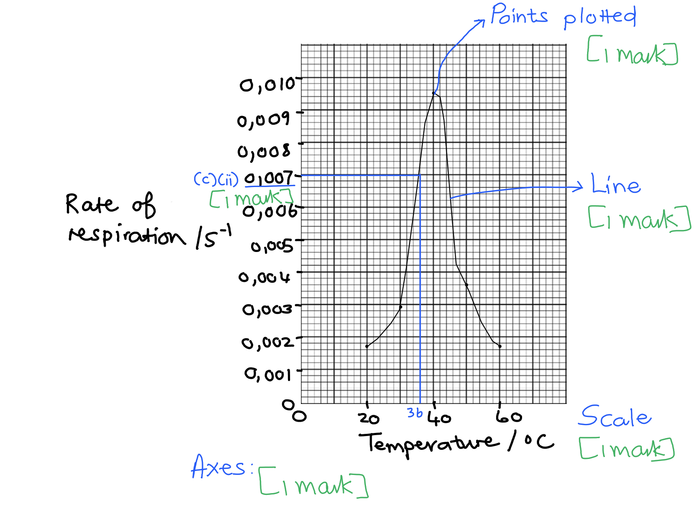
The importance of repeating the experiment includes...

Any **two** of the following:

- Increase the reliability of results; **[1 mark]**
- To identify (and eliminate) anomalous data points; **[1 mark]**
- To calculate a reliable mean (time taken for methylene blue to turn colourless); **[1 mark]**

**[Total: 2 marks]**

### Q4
(i) The position of the drop of coloured liquid would be as follows...

- (At the start =) 44/45/46 (mm) **AND **(after 30 minutes =) 4/5/6 (mm);** [1 mark]**

(ii) The distance moved by the drop in 30 minutes would be...

- (44/45/46 - 4/5/6 =) 40 (mm); **[1 mark]**

***Accept**** error carried forward here, meaning that correct calculations involving incorrect readings from 2 a) i) can still be credited.*

(iii) The rate of movement can be calculated as follows...

- 1.3 recurring (or use of the recurring symbol / 1.333...); **[1 mark]**
- 1.3 (mm per minute); **[1 mark]**

*Full marks can be awarded for the correct answer in the absence of the unrounded value.*

***Accept ****error carried forward here, meaning that an incorrect answer from 2 a) ii) correctly divided by 30 and rounded to one decimal place can be credited.*

**[Total: 4 marks]**

> *Reading the position of the drop for a) i):*

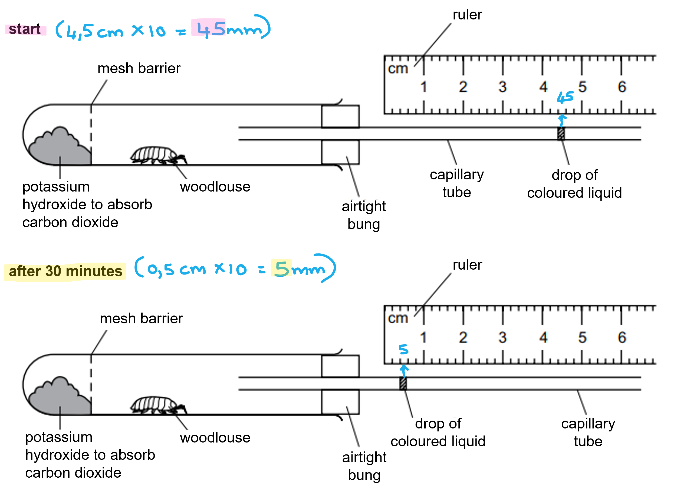

> *For the calculations at a) ii) and a) iii):*

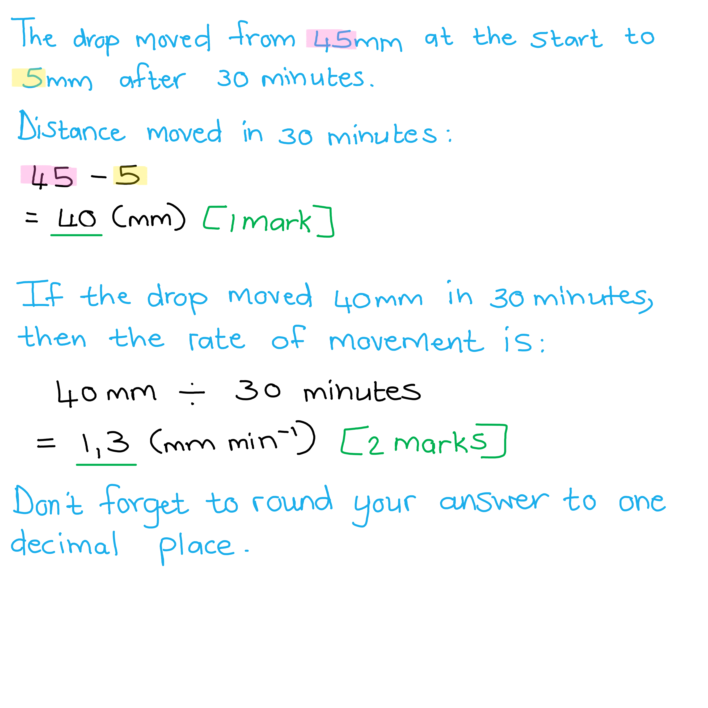
(i) The mean for animal species **A** can be calculated as follows...

- ((1.5 + 1.7 + 1.3) ÷ 3 =) 1.5;** [1 mark]**

(ii) The mark allocation for the bar chart is as follows...

- Axes labelled as 'animal species' **AND** 'mean rate of movement (of the drop of coloured liquid) / mm per minute'; **[1 mark]**
- A suitable scale is used that occupies at least half the grid on both axes; **[1 mark]**
- All bars plotted accurately ± half a small square **AND** bars do not touch **AND** bars are the same width; **[1 mark]**

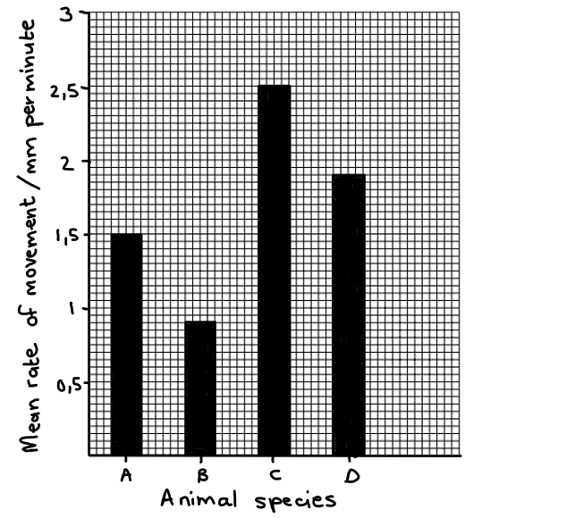

***Accept**** error carried forward for the plotting of the bar for species A here, meaning that a correctly plotted bar from an incorrectly calculated value from 2 b) i) can be credited.*

(iii) The animal species with the highest rate of respiration is...

- C; **[1 mark]**

(iv) A suitable control for the investigation would be...

- Replace the woodlice with an inert / non-living material (in the respirometer);** [1 mark]**

(v) The respiration rate per gram of animal can be determined as follows...

- Measure the mass of the animal;** [1 mark]**
- Divide the rate of respiration / distance moved by the bubble by the mass (in grams);** [1 mark]**

**[Total: 8 marks]**

> *Remember that you will very often be asked to draw a graph in an alternative to practical paper, so make sure you know how to gain marks when drawing graphs; marks will frequently be available for:*

- *Correct axis labels and units*
- *Correct scale*
- *Good use of the space provided*
- *Correct plotting of data*
- *Correct line through the points (where relevant)*

## Multiple Choice Questions (28 questions)

### Q1
**Final answer:** **The correct answer is A.**

- Anaerobic respiration in yeast breaks down glucose to produce alcohol and carbon dioxide

**B** is incorrect as glucose → lactic acid is the word equation for anaerobic respiration in humans, not yeast.

**C** is incorrect as glucose + oxygen → carbon dioxide + water is the word equation for aerobic respiration.

**D** is incorrect as this is the word equation for photosynthesis.

### Q2
**Final answer:** **The correct answer is D.**

- Aerobic respiration releases more energy per glucose molecule than anaerobic respiration

**A** is incorrect as anaerobic respiration in humans does not produce carbon dioxide. Carbon dioxide is only produced in anaerobic respiration in yeast.

**B** is incorrect as anaerobic respiration in humans produces lactic acid, not alcohol. This is a products of anaerobic respiration in yeast.

**C** is incorrect as the products of aerobic and anaerobic respiration have been swapped. Aerobic respiration produces carbon dioxide and water, whereas anaerobic respiration in humans produces lactic acid.

### Q3
**Final answer:** **The correct answer is D.**

- Volume of yeast and volume of oil added are both control variables — they are specific, measurable quantities that would need to be kept constant to ensure a fair test

**A** is incorrect as temperature is the independent variable in this experiment, not a control variable. Glucose concentration is a control variable, but pairing it with temperature is incorrect.

**B** is incorrect as the volume of carbon dioxide produced is the dependent variable, not a control variable.

**C** is incorrect as "amount" is an imprecise term. Control variables should be described using specific, measurable quantities such as volume, concentration or mass.

### Q4
**Final answer:** **The correct answer is A.**

- Aerobic respiration is a chemical reaction in cells that uses oxygen to break down nutrient molecules to release energy

**B** is incorrect as this describes anaerobic respiration, which does not require oxygen.

**C** is incorrect as this describes ventilation, not respiration. Respiration is a chemical process occurring in cells, not a mechanical process of breathing.

**D** is incorrect as aerobic respiration *releases* energy rather than producing it. Energy cannot be created; it is released from the breakdown of nutrient molecules.

### Q5
**Final answer:** **The correct answer is ****A.**

- Anaerobic respiration in yeast converts **glucose into ethanol and carbon dioxide**:

C6H12O6 →  2C2H5OH + 2CO₂

> **[exam-tip]**
> You must memorise the **balanced chemical equation **for **aerobic respiration** and **anaerobic respiration in yeast**.
> 
> You should also know the **word equations** for:
> 
> - aerobic respiration
> - anaerobic respiration in yeast
> - anaerobic respiration in muscle cells
> 
> Remember that anaerobic respiration in **muscles **forms **lactic acid**, while anaerobic respiration in **yeast **forms **ethanol and carbon dioxide.**

### Q6
**Final answer:** **The correct answer is ****C.**

- In aerobic respiration, glucose (C6H12O6) and oxygen (6O2) react to produce carbon dioxide (6CO2) and water (6H2O), releasing energy.

**A **is incorrect because it represents photosynthesis, where carbon dioxide and water are converted into glucose and oxygen using light energy.

**B **is incorrect because it incorrectly shows oxygen and carbon dioxide reacting to form water and glucose, which does not represent a biological process.

**D **is incorrect because it represents anaerobic respiration in yeast, where glucose breaks down to form ethanol and carbon dioxide, not aerobic respiration.

### Q7
**Final answer:** **The correct answer is ****C****.**

- This is because the balanced chemical equation for anaerobic respiration in yeast is C6H12O6  →  2C2H5OH + 2CO2
- The word equation for anaerobic respiration in yeast is glucose → ethanol + carbon dioxide

**A**, **B** and **D** are incorrect because they do not show the correct equation for anaerobic respiration in yeast because it does not produce water.

### Q8
**Final answer:** **The correct answer is ****D****.**

- This is because at 20 °C the oxygen uptake is 0.36, which is four times greater than the oxygen uptake at 10 °C, which is 0.09
- 0.09 x 4 = 0.36

**A** is incorrect because at 5 minutes at 20 °C the oxygen uptake is 0.1, which is not four times greater than the oxygen uptake at 10 °C, which is 0.06.

**B** is incorrect because at 10 minutes at 20 °C the oxygen uptake is 0.19, which is not four times greater than the oxygen uptake at 10 °C, which is 0.07.

**C** is incorrect because at 15 minutes at 20 °C the oxygen uptake is 0.255, which is not four times greater than the oxygen uptake at 10 °C, which is 0.085.

### Q9
**Final answer:** **The correct answer is ****C****.**

- This is because glucose and oxygen are both the reactants of aerobic respiration, meaning that they are used during the reaction
- The word equation for aerobic respiration is: glucose + oxygen → carbon dioxide + water

**A** is incorrect because carbon dioxide is a product of aerobic respiration.

**B** is incorrect because carbon dioxide and water are both products of aerobic respiration.

**D** is incorrect because water is a product of aerobic respiration.

### Q10
**Final answer:** **The correct answer is ****C****.**

- Anaerobic respiration occurs in humans during vigorous exercise when oxygen supply is insufficient for aerobic respiration. It is represented by the following equation:

Glucose → Lactic acid

**A **is incorrect because carbon dioxide is a product of aerobic respiration and anaerobic respiration in yeast, but not anaerobic respiration in humans.

**B **is incorrect because alcohol and carbon dioxide are products of anaerobic respiration in yeast but not humans.

**D** is incorrect because alcohol is a product of anaerobic respiration in yeast but not humans.

### Q11
**Final answer:** **The correct answer is ****A.**

- The production of new red blood cells (Process 1) requires energy for cell division and the transmission of nerve impulses (Process 2) requires energy to transmit signals.

**B, C **and** D **are all incorrect because the diffusion of gases (Process 3) is a passive process that doesn’t require energy.

### Q12
**Final answer:** **The correct answer is ****B ****because:**

Lactic acid is produced from the incomplete breakdown of glucose in anaerobic respiration. When lactic acid is oxidised (reacted with oxygen) the remaining energy is released.

Remember ethanol (an alcohol) is produced as a waste product of anaerobic respiration in yeast cells, and neither gas (carbon dioxide or oxygen) is involved as a reactant or product in anaerobic respiration.

### Q13
**Final answer:** **The correct answer is ****D ****because:**

Respiration occurs in **ALL** plant cells **ALL** the time, regardless of where in the plant they are. Light only affects the rate of photosynthesis in plant cells, and obviously being underground root hair cells do not photosynthesise (but that’s irrelevant here).

### Q14
**Final answer:** **The correct answer is ****D**** (all of them) because:**

Humans need energy from respiration for many processes and reactions to thrive.

These include:

- Contraction of muscles
- To synthesise proteins
- Cell division (to make new cells)
- Growth
- Enable active transport to take place
- Allow nerve impulses to be generated
- Maintain a constant internal body temperature

### Q15
**Final answer:** **The correct answer is ****A**** (enzyme activity is higher at 30 °C because more frequent collisions are occurring than at 10 °C) because:**

Increasing the temperature of an enzyme to its optimum increases the rate of the chemical reaction it catalyses as enzymes and substrates will have more kinetic energy and therefore will collide successfully more often.

**B** is incorrect because the graph shows the rate of the enzyme’s activity increasing up to 40°C, so the bonds holding the structure together cannot have been altered.

**C** is incorrect because the optimum for the enzyme is somewhere between 30°C and 50°C.

**D** is incorrect because enzymes are denatured at temperatures above their optimum, not at low temperatures.

### Q16
**Final answer:** **The correct answer is ****B**** (moves to the left) because:**

As the yeast respires anaerobically, it produces carbon dioxide gas which would be released into the tube, increasing the pressure inside the tube and pushing the drop of coloured liquid to the left.

### Q17
**Final answer:** **The correct answer is ****D ****because:**

- The purpose of any form of respiration is to release energy stored in the chemical bonds of molecules like glucose, so all types of respiration release energy
- The overall equation for aerobic respiration is (energy released is not shown)

Lactic acid is not produced as a waste product in aerobic respiration, but in anaerobic respiration (animals only).

### Q18
**Final answer:** **The correct answer is ****C**** (aerobic respiration of lactic acid in the liver) because:**

- Lactic acid builds up in skeletal muscle cells during vigorous exercise
- It is mainly excreted into the blood, and when the blood passes through the liver lactic acid is taken up by liver cells where it reacts with oxygen, forming carbon dioxide and water (and releasing energy)
- As lactic acid is therefore being broken down with oxygen (and energy is being released), this is an example of aerobic respiration

**A** is incorrect because the kidneys can also break down lactic acid (using oxygen to form carbon dioxide and water) but they do not excrete lactic acid.

**B** is incorrect because anaerobic respiration in the muscles produces lactic acid.

**D** is incorrect because lactic acid is not excreted by the lungs (the carbon dioxide produced in aerobic respiration is).

### Q19
**Final answer:** **The correct answer is ****A**** (glucose + oxygen →  carbon dioxide + water) because:**

- Plants, like all living organisms, respire to release energy (not shown in the above equations), therefore the process of aerobic respiration is the same in plants as it is in other organisms
- Plants also photosynthesise, but only when conditions allow it to (such as when light is available and the temperature is appropriate)

**B** is incorrect because this is the equation for photosynthesis in plants. Photosynthesis is not the reverse reaction of respiration, although the reactants and products are the opposite way around in each reaction.

**C** and **D **are incorrect because the reactants and products have been mixed up.

### Q20
**Final answer:** **The correct answer is ****C ****because:**

The independent variable, the temperature of water, is what is changed during an experiment. The dependent variable, the number of bubbles, is what is measured and **depends **on the independent variable.

The other answers are incorrect because the time and the volume of water are **control variables** and are something that needs to be kept the same throughout the experiment.

### Q21
**Final answer:** **The correct answer is ****B ****because:**

- The word equation for anaerobic respiration in yeast is:

glucose $\rightarrow$alcohol + carbon dioxide

- The word equation for anaerobic respiration in animals is:

glucose $\rightarrow$ lactic acid

### Q22
**Final answer:** **The correct answer is ****C**** (1, 2 and 4) because:**

- Enzymes are proteins that act as biological catalysts, speeding up reaction times
- All cellular reactions in living cells are catalyzed by enzymes such as respiration and the breakdown of glucose to lactic acid

Osmosis is not a reaction, it is the diffusion of water from high to lower water potential through a partially permeable membrane, and therefore it does not require the action of an enzyme to occur.

### Q23
**Final answer:** **The correct answer is ****D ****because:**

- Equation 2 represents anaerobic respiration that occurs in animal cells (such as muscle cells)
- Equation 3 represents aerobic respiration which occurs in all living cells (providing oxygen is available)
- Equation 4 represents anaerobic respiration that occurs in yeast cells

Equation 1 is photosynthesis which occurs in green plant and algal cells when light is available.

### Q24
**Final answer:** **The correct answer is ****A**** (C****6****H****12****O****6****   +  6 O****2**** →  6 CO****2**** + 6 H****2****O) because:**

In a balanced equation for aerobic respiration in any cell; one molecule of glucose reacts with 6 molecules of oxygen, forming 6 molecules of carbon dioxide and 6 molecules of water. Energy is also released but this is not shown in an equation.

**B** is incorrect because this equation is the balanced symbol equation for anaerobic respiration in animals (you don’t need to know this).

**C** is incorrect because this equation is the balanced symbol equation for photosynthesis.

**D** is incorrect because this equation is the balanced symbol equation for anaerobic respiration in yeast, not aerobic respiration.

### Q25
**Final answer:** **The correct answer is ****D**** (all of the above) because:**

The process of aerobic respiration is essentially the same in all eukaryotic cells, so the theoretical energy released will be the same when one molecule of glucose is broken down in any of the above cells.

### Q26
**Final answer:** **The correct answer is ****D**** (1 and 4) because:**

- Reaction 1 is the balanced symbol equation for aerobic respiration, which occurs in almost all eukaryotic cells (therefore yeast) when oxygen is available
- Reaction 4 is the balanced symbol equation for anaerobic respiration in yeast, the incomplete breakdown of glucose produces an alcohol (ethanol) and carbon dioxide

**A **is incorrect because reaction 2 is the equation for anaerobic respiration in animals.

**B **&** C** are incorrect because reaction 3 is the balanced symbol equation for photosynthesis in plant and algal cells (which does not release energy), yeast does not photosynthesise.

### Q27
**Final answer:** **The correct answer is ****B ****because:**

The yeast cells would largely be respiring **anaerobically **after oxygen in the flask was used up. The reaction for this is:

glucose $\rightarrow$ alcohol + carbon dioxide

The other answers are incorrect because oxygen is never a gas produced in a respiration reaction. Lactic acid is only produced in animal cells when oxygen is not available.

### Q28
**Final answer:** **The correct answer is ****C ****because:**

- The leaf will **not** **photosynthesise** as there is a black cover around the tube,  meaning no light can get in
- The leaf will **respire** as all living cells must respire to release energy
- Available oxygen in the tube will be absorbed by the plant for aerobic respiration and the waste gas carbon dioxide will be produced. This is absorbed by the substance at the bottom of the tube
- The ink drop in the tube will move to the right as the air pressure in the test tube will decrease as the number of gas molecules decreases (because any carbon dioxide is absorbed)

When answering a question like this, it is important to consider all the information in the diagram before making your choice of answer.

## Theory Questions (17 questions)

### Q1
> **[mark-scheme]**
> - Glucose → lactic acid
> 
> Accept -> for →.

> **[exam-tip]**
> Many students accidentally give the equation for yeast. In mammals, the only product is **lactic acid**.
> **[mark-scheme]**
> - There is an oxygen debt **[1 mark]**
> - Lactic acid has built up in the muscles / blood (due to anaerobic respiration) **[1 mark]**
> - High heart rate transports the lactic acid to the liver **[1 mark]**
> - High breathing rate supplies the blood with extra oxygen **[1 mark]**
> - Aerobic respiration / breakdown of lactic acid occurs in the liver **[1 mark]**

### Q2
> **[mark-scheme]**
> - A chemical reaction **[1 mark]**
> - Uses oxygen to break down nutrient / glucose molecules **[1 mark]**
> - To release energy **[1 mark]**
> 
> Reject references to energy being made or produced.

### Q3
(i)

- The yeast cells produced a total of **7.4** g of carbon dioxide during 1200 minutes; **[1 mark]**
- The yeast cells stopped producing carbon dioxide at **300** minute;**[1 mark]**

(ii)

*Prediction:*

- A decrease in mass of carbon dioxide / no carbon dioxide is produced; **[1 mark]**

*Explanation:*

- Enzymes are inactive / yeast cells have been killed/destroyed; **[1 mark]**

(iii)

- Alcohol / ethanol; **[1 mark]**

**[Total: 5 marks]**
- (Respiration) releases energy; **[1 mark]**
- (Respiration) uses glucose; **[1 mark]**

**[Total: 2 marks]**
- Oxygen; **[1 mark]**

**[Total: 1 mark]**
- Excretion ✓; **[1 mark]**
- Growth ✓; **[1 mark]**

**[Total: 2 marks]**

### Q4
- C6H12O6 + 6O2 → 6H2O + 6CO2; **[2 marks]**

**[Total: 2 marks]**

**[1 mark]** for the correct symbol equation but not balanced

### Q5
(i)

- Oxygen; **[1 mark]**

Remember that aerobic respiration requires oxygen and anaerobic respiration does not.

(ii)

- Mitochondria; **[1 mark] **

**[Total: 2 marks]**

### Q6
The percentage increase in the average rate of oxygen consumption as the horses change from walking to trotting is:

- Final answer of 150%;** [2 marks]**
- If the final answer is incorrect but has correct working (50-20)÷20; **[1 mark]**

**[Total: 2 marks]**

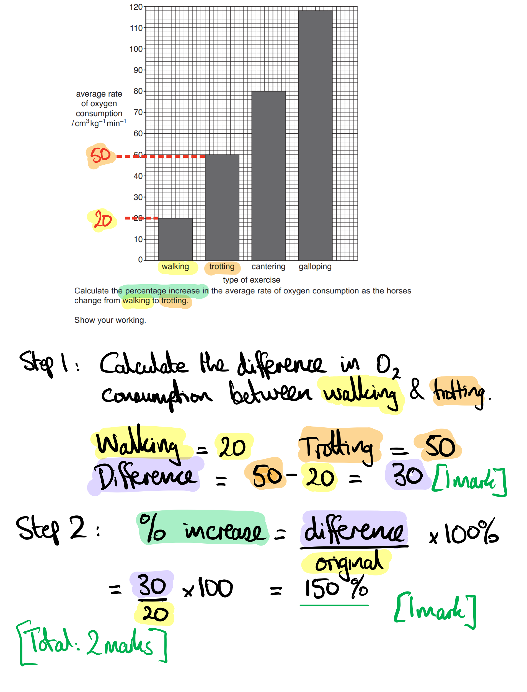

> *This question covers core knowledge taken from an extended only paper 4 question.*
The horses developed an oxygen debt when they exercised because:

Any **three** of the following from:

- Demand for, energy / oxygen, increases; **[1 mark]**
- (Rate of) respiration increases;** [1 mark]**
- Limited supply of oxygen to <u>muscle</u> (tissue); **[1 mark]**
- Idea that the heart / pulse / breathing rate cannot increase enough (to meet demand); **[1 mark]**
- (Therefore) muscles respire <u>anaerobic</u>ally; **[1 mark]**
- Lactic acid is produced;** [1 mark]**

**[Total: 3 marks]**
The horses would recover from an oxygen debt when they stop exercising by:

Any **four** of the following from:

- Horses continue to breathe, at high rate / deeper breaths / more volume per breath; **[1 mark]**
- Continue with a high heart / pulse rate; **[1 mark]**
- To provide enough oxygen (to ‘pay-off’ the debt); **[1 mark]**
- Lactic acid moves / diffuses (from muscle) into blood;**[1 mark]**
- Lactic acid transported to the liver; **[1 mark]**
- (In the liver) lactic acid is, broken down / oxidised / respired (aerobically); **[1 mark]**

**[Total: 4 marks]**

> *A misconception here is that lactic acid is broken down in the respiring cells. *

### Q7
The mark allocation for the word equation of aerobic respiration is as follows:

- (Reactants) Glucose + oxygen; **[1 mark] **
- (Products) Carbon dioxide + water;** [1 mark]**

*Reactants in either order; products in either order. *

**glucose + oxygen → carbon dioxide + water**

**[Total: 2 marks]**

> *During aerobic respiration, oxygen is used to break down glucose to release energy. In the process, carbon dioxide and water are produced as waste products.*
(i) The average energy requirement of a five-year-old female is:

- 6200 (kJ per day); **[1 mark]**

(ii) Two ways in which a diet of 8000 kJ would affect an eleven-year-old male includes:

Any **two** from the following:

- The energy input (for a male) would be (too) low / below their requirements/needs **OR** 8000 kJ would be suitable for / meet the requirements/needs of an eleven-year-old female;**[1 mark]**
- (This would result in) weight loss / they would become thin(ner); **[1 mark]**
- It would reduce / stop normal growth (in the male); **[1 mark]**
- (This would result in) fatigue / tiredness / weakness / being less active;**[1 mark]**
- (They may be) more susceptible to infection / disease **OR** their immune system may weaken; **[1 mark]**

**[Total: 3 marks]**

> *For (b) (i), the average energy requirement of a five-year-old female can be read from the graph:*

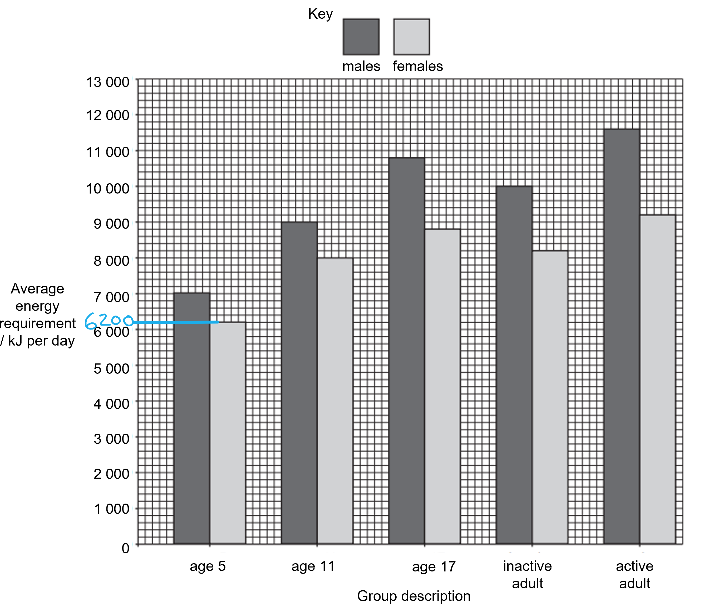
The following comparisons can be made between the 17 year-olds and adults:

- 17 year olds require more energy / have higher energy needs than inactive adults **OR** inactive adults require less energy / have lower energy needs than 17 year olds;** [1 mark]**
- 17 year olds require less energy / have lower energy needs than active adults **OR** active adults require more energy / have higher energy needs than 17 year olds; ** [1 mark]**
- Comparative data quote with the correct units in support of the previous two comparisons eg. 17 year old males require 10 800 kJ per day and 17 year old females require 8 800 kJ per day versus inactive adult males that require 10 000 kJ per day and inactive adult females that require 8 200 kJ per day; ** [1 mark]**

**[Total: 3 marks]**

> *The command word 'compare' requires you to comment on any similarities or differences between the energy requirements of 17 year olds and adults. Any comparisons involving other age groups would be ignored for this question.*

> *To earn the third mark, you must have quoted comparative data from the graph to illustrate your points in the other 2 marking points. *
The products of anaerobic respiration in yeast are used by humans in the following ways:

Any **two **from the following:

- (The carbon dioxide produced) can be used to make dough rise / to bake bread / in baking; ** [1 mark]**
- (The alcohol/ethanol produced) can be used in the brewing/production of alcoholic beverages/beer **OR** the carbon dioxide produced will give alcoholic beverages fizziness;** [1 mark]**
- (The alcohol/ethanol produced) can be used to produce biofuels / can be used as fuel;** [1 mark]**

**[Total: 2 marks]**** **

### Q8
(i) The gas required for aerobic respiration is oxygen:

- Oxygen/O2;** [1 mark]**

(ii) Aerobic respiration occurs in the:

- Mitochondria;** [1 mark]**

**[Total: 2 marks]**
(i) The word equation for anaerobic respiration in muscle cells is as follows:

- Glucose → lactic acid; **[1 mark]**

(ii) One advantage of using aerobic rather than anaerobic respiration is:

- (Aerobic respiration) releases more energy (per molecule of glucose);** [1 mark]**

**[Total: 2 marks]**

> *You cannot get the marks for putting symbols in your equation because the question specifically asks for a **word **equation. *

### Q9
The completed sentence is as follows...

Award **one** **mark** for each correct answer:

- Aerobic respiration is the chemical reactions in **cells**** **that use **oxygen**** **to break down **nutrient**** **molecules to release energy; **[3 marks]**

**[Total: 3 marks]**

> *Remember that you must use the words from the list only, any other word, such as glucose for the third word, will not be awarded a mark.*

### Q10
The balanced chemical equation for aerobic respiration is...

C6H12O6 + 6O2 → 6H2O + 6CO2

- C6H12O6 **AND **O2 **AND** H2O **AND** CO2; **[1 mark]**
- <u>1</u> molecule of glucose (C6H12O6) **AND** <u>6</u> molecules of oxygen (O2) **AND** <u>6</u> molecules of water (H2O) **AND** <u>6</u> molecules of carbon dioxide (CO2); **[1 mark]**

*Marking point 1 is awarded for the correct use of chemical symbols and marking point 2 is awarded for correct balancing of the equation.*

**[Total: 2 marks]**

> *You will not be awarded any marks for giving the word equation as the question specifically asks for a chemical equation. *
The crop plant would be the most suitable crop to grow to produce biofuel in the country which has a mean temperature range of 12 °C to 24 °C and a mean annual rainfall of 1000 mm is...

- Sugar beet; **[1 mark]**

This is because...

Any **two **of the following:

- It grows at an appropriate temperature; **[1 mark]**
- It grows at an appropriate level of rainfall;**[1 mark]**
- It has a greater energy yield than wheat/corn; **[1 mark]**
- Data quoted from the table to support any of the above points, e.g. it grows at 18 °C / within the temperature range of 12-24 °C **OR** it grows at a rainfall range of 360-1000 mm / at a rainfall level of 1000 mm **OR** it has an energy yield of 110-122 GJ per ha in comparison to 53-84 / 53-76 GJ per ha; **[1 mark]**

***Accept*** *correct explanations for marking points 2 and 3 even if the incorrect crop has been identified for marking point 1.*

**[Total: 3 marks]**

> *Sugar beet has the highest energy yield of the crops that will grow at the climate conditions described. While there are other crops with a higher energy yield these would require warmer temperatures or more rainfall.*

> *This question covers core knowledge but is taken from an extended paper 4 question.*

### Q11
Three uses of energy required by a living organism would include...

Any **three **from the following:

- Muscle contraction; **[1 mark]**
- Protein synthesis; **[1 mark]**
- Cell division; **[1 mark]**
- Active transport; **[1 mark]**
- Maintenance of a constant body temperature; **[1 mark]**
- Growth; **[1 mark]**
- The passage of nerve impulses; **[1 mark]**

**[Total: 3 marks]**

> *It is required by your specification that you need to know these examples specifically. *
The completed sentence is as follows:

**One **mark for each correct word:

- Aerobic respiration is a **chemical **reaction that takes place in **cells **of living **organisms**.
- It uses **oxygen **as part of the reaction to release **energy**.

**[Total: 5 marks]**

> *It is important to be able to recall the key facts about aerobic respiration assessed in this question. *
The mark allocation for the graph of the results would be...

- Axes labelled (x and y axis); **[1 mark]**
- Appropriate scale on y axis; **[1 mark]**
- Bars plotted correctly within +/- one small square; **[1 mark]**
- Bar chart (not a line graph); **[1 mark]**

**[Total: 4 marks]**

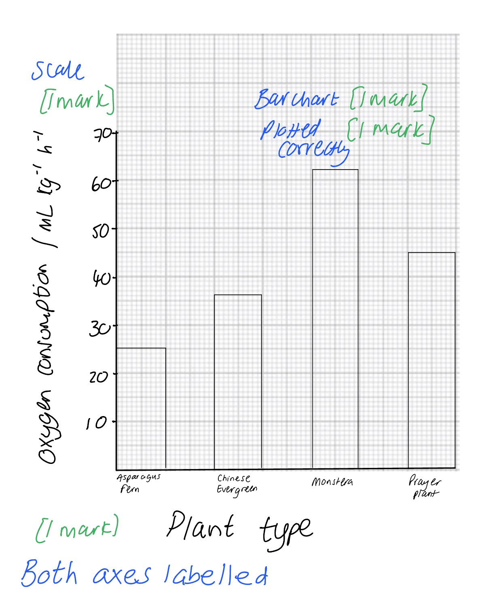
The missing reactants and products are...

- Missing reactant: oxygen; **[1 mark]**
- Missing product: carbon dioxide; **[1 mark]**

**[Total: 2 marks]**

> *The word equation would be as follows:*

> *oxygen + glucose → carbon dioxide + water + (energy)*

### Q12
The rate of carbon dioxide production can be calculated as follows:

- 50 ÷ 120 = 0.4166666
- 0.42 (ppm s–1); **[1 mark]**

**[Total: 1 mark]**

Your answer should be rounded to 2 significant figures so you cannot obtain the mark if you write 0.416
The reason for opening the jar is...

Any **two **from the following:

- To allow oxygen to enter the chamber;** [1 mark]**
- This will keep the crickets respiring aerobically; **[1 mark]**
- (Also) to remove carbon dioxide; **[1 mark]**
- This will prevent death of crickets; **[1 mark]**
- Ethical treatment of animals is necessary; **[1 mark]**
- Maintaining similar conditions / refreshing the air in the chamber / resetting for repeat readings; **[1 mark]**

**[Total: 2 marks]**
The temperature in the jar increased because:

Any **two **from the following:

- Heat (energy) is released by crickets; **[1 mark]**
- (Heat energy is released from) movement / reference to kinetic energy; **[1 mark]**
- There may be a pressure increase; **[1 mark]**
- Increased carbon dioxide leading to greenhouse effect; **[1 mark]**
- Small closed space (meaning greenhouse effect leads to temperature rise); **[1 mark]**

**[Total: 2 marks]**

> *This question covers core knowledge taken from an extended only paper 4 question.*
Two conclusions that may be drawn could include:

- The rate of oxygen consumption increases with body mass of crickets (for each temperature); **[1 mark]**
- Any suitable data quote comparing rate at different masses (at same temperature) e.g. at 17 °C, when body mass was 10 mg, oxygen consumption was 4 x 10-3 cm3h-1 and 78mg, the rate of oxygen consumption was 15 x 10-3cm3h-1; **[1 mark]**
- The rate of oxygen consumption increases with temperature; **[1 mark]**
- Any suitable data quote comparing rate at two temperatures (for the same body mass) e.g when body mass was 60 mg, the rate of oxygen consumption was 22 x 10-3cm3h-1 higher at 27 °C than at 7 °C;**[1 mark]**

**[Total: 4 marks]**

> *When quoting data in this way, you should make sure that the data is valuable. It is not useful just to quote random points unless they are being compared to other points on the same graph. As this question specifically asks for you to support your conclusions, you must quote data to obtain full marks.*

### Q13
(i) The temperature at which *Saccharomyces cerevisiae* carried out most respiration is...

- 35°C; **[1 mark]**

(ii) The volume of CO2 produced at 30 minutes when *Saccharomyces cerevisiae *was kept at 25°C is...

- 1 cm3; **[1 mark]**

***Do not accept ****an answer of 1 without units*

(iii) The total volume of CO2 produced by *Saccharomyces cerevisiae *at 30°C is...

- 3.3 cm3; **[1 mark]**

***Accept ****answers within a range of 3.3 to 3.4 cm**3**** Do not accept ****an answer within range without units*

**[Total: 3 marks]**

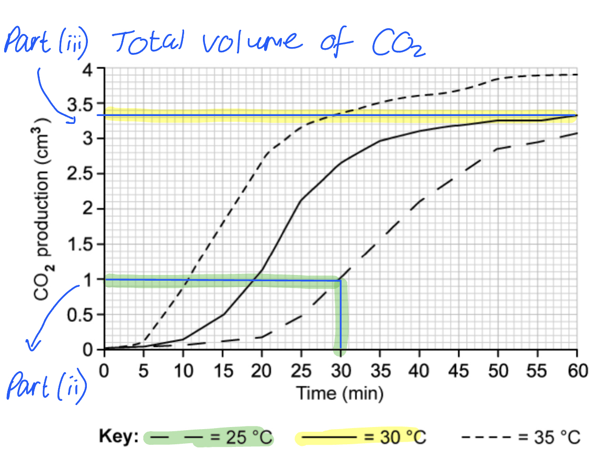
Evidence as to why the student is correct in their conclusion is...

- An example of a lower and higher temperature with corresponding volume of CO2 produced; **[1 mark]**
- Same time used for each temperature; **[1 mark]**

**[Total: 2 marks]**

> *An example answer could be:*

> *At 25°C the volume of CO**2** produced in 30 minutes is 1 cm**3**, whereas at 35°C the volume of CO**2** produced in 30 minutes is 3.4 cm**3**.*
The difference between aerobic and anaerobic respiration is...

- Aerobic respiration requires oxygen **AND **anaerobic respiration does not require oxygen; **[1 mark]**

**[Total: 1 mark]**
The type of respiration that releases the greatest amount of energy is...

- aerobic (respiration); **[1 mark]**

**[Total: 1 mark]**

### Q14
The cell structure where respiration takes place is....

- Y; **[1 mark]**
- (The) mitochondria;** [1 mark]**

**[Total: 2 marks]**
The sentence should be completed as follows:

- Respiration releases energy from **glucose**, to be used in life processes such as **chemical **reactions, **muscle **contraction and maintaining a constant body **temperature**.

*Award*** [1 mark] ***per correct answer.*

**[Total: 4 marks]**

> *The energy stored in glucose is chemical energy, this energy is transferred to other forms of energy once it is released during the process of respiration.*
The table should be completed as follows:

|   | **product** | **reactant** |
|---|---|---|
| oxygen | **Final answer:** **X** | **Final answer:** **X** |
| carbon dioxide | **Final answer:** **X** | **Final answer:** **X** |
| lactic acid | **Final answer:** **✔** | **Final answer:** **X** |
| glucose | **Final answer:** **X** | **Final answer:** **✔** |
| water | **Final answer:** **X** | **Final answer:** **X** |
| ethanol | **Final answer:** **X** | **Final answer:** **X** |

*Award ***[1 mark] ***for each correct column*

**[Total: 2 marks]**

> *It is important to make sure you read the instructions carefully and fill every box with either a  (**✔**) or a (**X**). Leaving blank spaces will result in the marks being lost.*
The process that occurs in the body during an oxygen debt is...

Any **three **from the following:

- Anaerobic respiration causes a build up of lactic acid (in the muscles) **OR **lactic acid builds up during vigorous exercise; **[1 mark]**
- Continuation of deeper and faster breathing to supply oxygen; **[1 mark]**
- Lactic acid is transported to the liver (from the muscles); **[1 mark]**
- Aerobic respiration of lactic acid in the liver **OR **Lactic acid is oxidised in the liver; **[1 mark]**

**[Total: 3 marks]**

### Q15
Visible features that distinguish adult insects from other arthropods include:

Any **three** from the following:

- Three pairs of legs; **[1 mark]**
- Three body segments** OR** the body is divided into a head, thorax and abdomen;**[1 mark]**
- (The presence of) wings; **[1 mark]**
- (A pair of) antennae; **[1 mark]**
- (The presence of) compound eyes; **[1 mark]**

**[1 mark]**

> *This question covers core knowledge but is taken from an extended paper 4 question.*
(i) The sentence can be completed using the following words:

- volume; **[1 mark]**
- distance/length; **[1 mark]**
- control/maintain/regulate/stabilise/keep constant/sustain; **[1 mark]**

*Words must be listed in the correct sequence to obtain marks.*

(ii) It is important to absorb carbon dioxide in the respirometer because:

Any **one** from the following:

- Carbon dioxide will affect the results / volume of gas (in the respirometer) **OR **to ensure that only (changes in) oxygen (levels) is measured;** [1 mark]**
- (High levels of) carbon dioxide could kill the larvae; **[1 mark]**

(iii) Energy is used in a fly larva for the following:

Any **two** from the following:

- Growth/development; **[1 mark]**
- Active transport; **[1 mark]**
- Protein synthesis; **[1 mark]**
- Cell division / mitosis; **[1 mark]**
- (For the) passage/conduction of nerve impulses;**[1 mark]**
- Muscle contraction; **[1 mark]**

***Accept ****references to the life processes for one mark, e.g. movement / breathing / egestion / digestion / excretion / metabolism.*

***Accept**** metamorphosis into an adult fly.*

**[Total: 6 marks]**

> *Respirometers are very useful in studying the rate of respiration of organisms. They measure the volume of oxygen used by the organisms so it is important to remove any carbon dioxide that is released in order to prevent this from affecting the results.*

> *This question covers core knowledge but is taken from an extended paper 4 question.*
A prediction and explanation of the results of this experiment are as follows...

Prediction

- As the temperature increases the respiration rate will increase **OR** as the temperature decreases the respiration rate will decrease; **[1 mark]**
- (The respiration rate will) then decrease (at high temperatures); **[1 mark]**

Explanation

A maximum of **three** from the following:

- There will be an <u>optimum</u> temperature for seed germination/respiration; **[1 mark]**
- (Respiration/germination is controlled by) <u>enzymes</u>; **[1 mark]**
- At high temperatures enzymes will denature / the shape of the enzyme active site will change / will not be complementary to the substrate; **[1 mark]**
- At low temperatures there is not enough (kinetic) energy / enzyme and substrate molecules move too slowly for effective collisions; **[1 mark]**

***Accept**** references to the effect of temperature on gas pressure, e.g. the temperature will affect the gas pressure in the respirometer / the gas pressure will increase at high temperatures / decrease at low temperatures.*

**[Total: 4 marks]**

> *This question requires you to refer back to your knowledge on enzymes. Remember that the rate of biochemical reactions (such as respiration) relies on the action of enzymes. There will be an increase in the rate of a reaction as the temperature increases toward the optimum as the enzyme and substrate molecules are moving faster and colliding more often. Above the optimum temperature the molecules would have so much kinetic energy that the chemical bonds holding the shape of the active site together break. At this point the enzyme is said to be denatured and it cannot catalyse the reaction any more.*

### Q16
Three uses of energy in the body are:

Any **three **from the following:

- Muscular contraction / movement / pump blood / maintain posture; **[1 mark]**
- Maintenance of body temperature; **[1 mark]**
- Active transport / example such as nerve impulses; **[1 mark]**
- Metabolic reactions / example eg. excretion / protein synthesis / digestion; **[1 mark]**
- Mitosis / nuclear division / cell division; **[1 mark]**
- Growth / replacement / repair; **[1 mark]**
- Making gametes / sperm;**[1 mark]**

**[Total: 3 marks]**

> *Try not to repeat yourself, for example, if you said 'keep the heart beating' and 'movement' they're both classed as the same marking point because they're both referring to muscle contraction. *

> *This question covers core knowledge taken from an extended only paper 4 question.*
(i) The process carried out by the person that releases energy is:

- Respiration; **[1 mark]**

(ii) The balanced chemical question that describes this process is:

- C6H12O6 + 6O2 → 6CO2 + 6H2O; **[1 mark]**

**[Total: 2 marks]**

> *An unbalanced equation would not get you the mark here. You need to make sure to read the question carefully. *

### Q17
The person's breathing rate and heart rate remain high because:

Any **four **from the following:

- Takes time for...; **[1 mark]**
- ...oxygen debt (to be repaid); **[1 mark]**
- More oxygen needed; **[1 mark]**
- Lactic acid / lactate; **[1 mark]**
- Builds up in muscles / needs to be cleared away; **[1 mark]**
- Lactic acid is broken down / respired;**[1 mark]**

**[Total: 4 marks]**

> *When lactic acid is broken down in the liver it reacts with oxygen to produce carbon dioxide and water, which can both be easily removed from the body. *
The changes happen because:

Any **five **from the following:

- As body temperature increases;** [1 mark]**
- Vasodilation; **[1 mark]**
- (Relaxation) of arterioles / arteries; **[1 mark]**
- Increase in supply of blood to skin capillaries; **[1 mark]**
- (Causes) loss of heat...; **[1 mark]**
- ...by conduction / convection / radiation; **[1 mark]**
- Increase in blood flow to sweat glands; **[1 mark]**
- Increased production of sweat;**[1 mark]**
- Loss of heat by evaporation; **[1 mark]**

**[Total: 5 marks]**
