# Exam Questions — Respiration
**12. Respiration** · Cambridge (CIE) IGCSE biology (0610 & 0970)
> Source: [https://www.savemyexams.com/igcse/biology/cie/23/topic-questions/](https://www.savemyexams.com/igcse/biology/cie/23/topic-questions/) · 49 questions across 3 sets

## Alternative To Practical Questions (4 questions)

### Q1 — medium — 13 marks

**Q1** [4 marks]

A woodlouse is a small animal.

The rate of respiration of a woodlouse can be measured using a simple respirometer as shown in Fig. 2.1.

As the woodlouse respires the drop of coloured liquid moves along the capillary tube.

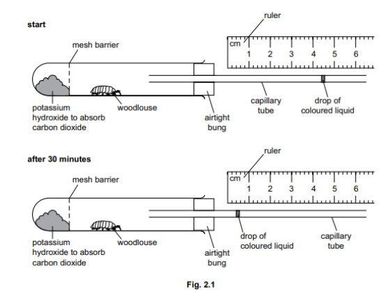

(i) Record the position of the drop of coloured liquid in the capillary tube shown in Fig. 2.1 at the **start** and** after 30 minutes**.

[1]

(ii) Calculate the distance moved by the drop of coloured liquid in 30 minutes.

[1]

(iii) Calculate the rate of movement of the drop of coloured liquid in mm per minute. Give your answer to one decimal place.

[2]

**Q1** [8 marks]

The rate of movement of the drop of coloured liquid along the respirometer can be used to estimate the rate of respiration.

A student used a respirometer to investigate the rate of respiration in four animal species.

The results are shown in Table 2.1.

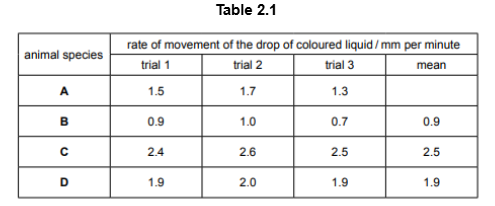

(i) Calculate the missing mean for animal species **A**.

Write your answer in Table 2.1.

[1]

(ii) Plot a bar chart on the grid to show the mean rate of movement of the drop of coloured liquid in the capillary tube for the four animal species.

[3]

(iii) State the letter of the animal species which has the highest rate of respiration.

[1]

(iv) Suggest a suitable control for the investigation described in (b).

[1]

(v) The student decided it would be better to calculate the rate of respiration per gram of animal so that the values could be compared.

Describe how the student could find out the rate of respiration per gram of animal.

[2]

*Source: specimen 2023 paper 6 Q2B*

**Q1** [1 mark]

**Extract:**

Fig. 2.2 shows a photograph of a woodlouse.

The magnification of the woodlouse in Fig. 2.2 is ×9.

Measure the length of the line PQ on Fig. 2.2.

length of PQ ............................................................ mm

Calculate the actual width of the woodlouse using the formula and your measurement.

magnification = length of line PQ / actual width of woodlouse

Give your answer to three significant figures.

Fig. 2.2 shows a photograph of a woodlouse.

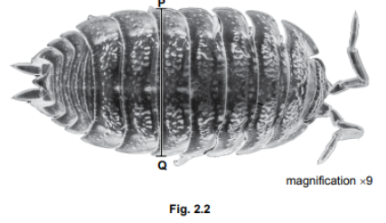

(i) Draw a large diagram of the woodlouse in Fig. 2.2.

[4]

(ii) The magnification of the woodlouse in Fig. 2.2 is ×9.

Measure the length of the line PQ on Fig. 2.2.

length of PQ ............................................................ mm

Calculate the actual width of the woodlouse using the formula and your measurement.

Give your answer to three significant figures.

Space for working.

[3]

*Source: specimen 2023 paper 6 Q2C*

### Q2 — medium — 26 marks

**Q2** [4 marks]

A student investigated the rate of respiration of yeast at two different temperatures.

| Step 1 | The student was provided with a yeast suspension which also contained glucose. Two identical sets of equipment were set up as shown in Fig. 1 |
|---|---|

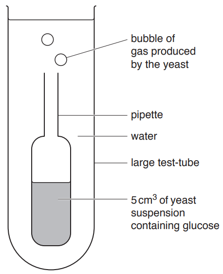

**Fig. 1**

| Step 2 | One set of the equipment shown in Fig. 1 was placed into a **warm** water-bath and the starting temperature of the water-bath was recorded as 50°C. The other set was placed into a **cool** water-bath which had a starting temperature of 25°C. The volume of water in each water bath was the same. |
|---|---|
|   |   |
| Step 3 | The student counted the number of gas bubbles produced by the yeast suspension in five minutes and recorded the results in a tally chart. This is shown in Fig. 2. |

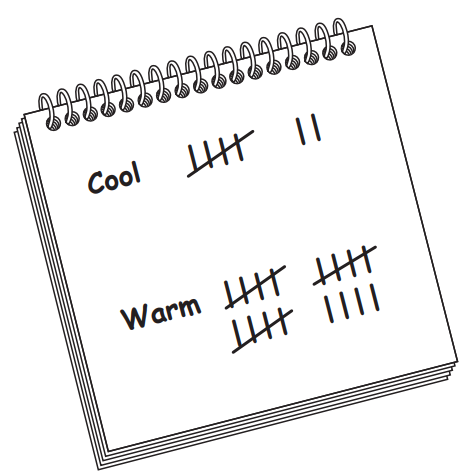

**Fig. 2**

(i)

Prepare a table and record the student’s results shown in Fig. 2.

[3]

| Step 4 | At the end of the investigation the final temperature of the water in both water baths was measured. The results are shown in Fig. 3 |
|---|---|

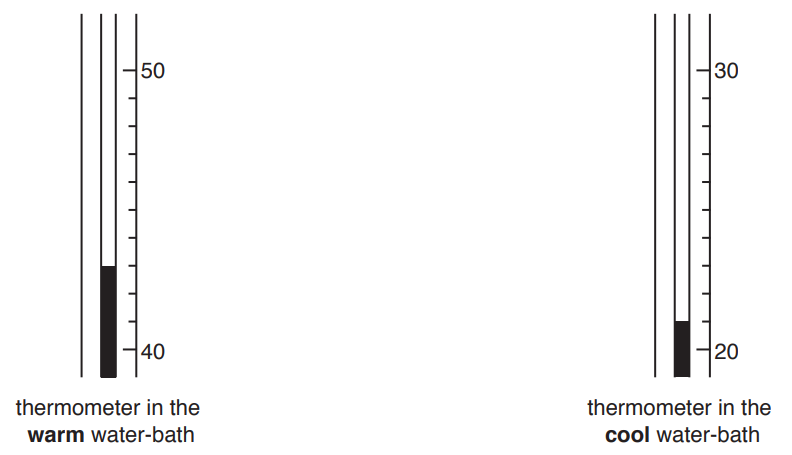

**Fig. 3**

(ii)

Use the information in step 2 and Fig. 3 to complete Table 1.

**Table 1**

| Water bath | Starting temperature / °C | Final temperature / °C |
|---|---|---|
| Warm |   |   |
| Cool |   |   |

[1]

*Source: 2018 0610/62 Q1A*

**Q2** [7 marks]

**Extract:**

A student investigated the rate of respiration of yeast at two different temperatures.

Step 1: The student was provided with a yeast suspension which also contained glucose. Two identical sets of equipment were set up as shown in Fig. 1

Step 2: One set of the equipment shown in Fig. 1 was placed into a warm water-bath and the starting temperature of the water-bath was recorded as 50°C. The other set was placed into a cool water-bath which had a starting temperature of 25°C. The volume of water in each water bath was the same.

Step 3: The student counted the number of gas bubbles produced by the yeast suspension in five minutes and recorded the results in a tally chart. Number of bubbles recorded for warm: 19 and cool: 7.

Step 4: At the end of the investigation the final temperature of the water in both water baths was measured. Warm: 43°C, Cool: 21°C.

(i)

State a conclusion for the results.

[1]

(ii)

Counting the number of gas bubbles produced may not be an accurate method of measurement.

Explain why **and **suggest an improvement.

[2]

(iii)

Identify a variable that **should **have been kept constant during this investigation but was not. Suggest how this variable could have been kept constant.

[2]

(iv)

Identify the variable that was changed (independent variable) **and** the variable that was measured (dependent variable) in this investigation.

[2]

*Source: 2018 0610/62 Q1B*

**Q2** [10 marks]

A group of scientists investigated the effect of different concentrations of glucose on the rate of carbon dioxide production in yeast cells. They measured the volume of carbon dioxide produced by the yeast cells in five minutes.

The scientists decided to test their method before beginning the investigation.

They performed three trials using one concentration of glucose.

The results are given in Table 2.

**Table 2**

| Trial | Volume of carbon dioxide produced in 5 minutes / cm3 |
|---|---|
| 1 | 13.6 |
| 2 | 14.3 |
| 3 | 12.9 |

(i)

Calculate the average volume of carbon dioxide produced in 5 minutes.

Give your answer in cm3

Calculate the average rate of carbon dioxide production per minute.

Give your answer in cm3 per minute

[2]

(ii)

The scientists performed the investigation. Their results are shown in Table 3.

**Table 3**

| Percentage concentration of glucose | Average rate of carbon dioxide production / cm3 per minute |
|---|---|
| 0.5 | 1.3 |
| 1.0 | 2.6 |
| 1.5 | 3.8 |
| 2.0 | 4.3 |
| 2.5 | 4.4 |
| 3.0 | 4.4 |

Plot a graph on the grid, using the data in Table 3, to show the effect of glucose concentration on the rate of carbon dioxide production. Include a line of best fit.

[4]

(iii)

Describe the effect of glucose concentration on the rate of carbon dioxide production by respiring yeast cells, shown in your graph.

[3]

(iv)

Estimate the concentration of glucose the scientists used to test their method. Use your answer for **c)i)** and your graph to find this value.

Give your answer using the unit %.

[1]

*Source: 2018 0610/62 Q1C*

**Q2** [5 marks]

**Extract:**

A group of scientists investigated the effect of different concentrations of glucose on the rate of carbon dioxide production in yeast cells. They measured the volume of carbon dioxide produced by the yeast cells in five minutes.

The scientists decided to test their method before beginning the investigation.

They performed three trials using one concentration of glucose.

The results are given in Table 2.

**Table 2**

| Trial | Volume of carbon dioxide produced in 5 minutes / cm3 |
|---|---|
| 1 | 13.6 |
| 2 | 14.3 |
| 3 | 12.9 |

(i)

Describe how the student could show that the glucose used in the investigation is a simple (reducing) sugar.

[3]

(ii)

Identify one hazard when testing for simple (reducing) sugars.

Describe one precaution that could be taken to reduce the risk.

[2]

*Source: 2018 0610/62 Q1D*

### Q3 — medium — 19 marks

**Q3** [3 marks]

An investigation was conducted to determine the effect of temperature on the rate of respiration in yeast.

The experimental procedure was conducted as follows:

1. A thermostatically controlled water bath was set up at 20°C
2. The investigators added 10 cm3 of a yeast suspension and 20 cm3 of a 10% glucose solution to each of three test-tubes
3. The test-tubes were placed in the water bath and left for 10 minutes
4. After 10 minutes, five drops of methylene blue were added to each test-tube using a dropper pipette and the test-tubes were then shaken for 10 seconds to mix
5. The test-tubes were returned to the water bath
6. A stop watch was started when the drops were added
7. The time taken for the methylene blue to turn colourless in each test tube was recorded
8. Steps 1 to 7 were repeated at temperatures of 30°C, 40°C, 50°C and 60°C

Fig. 1 shows the experimental set up of one test tube.

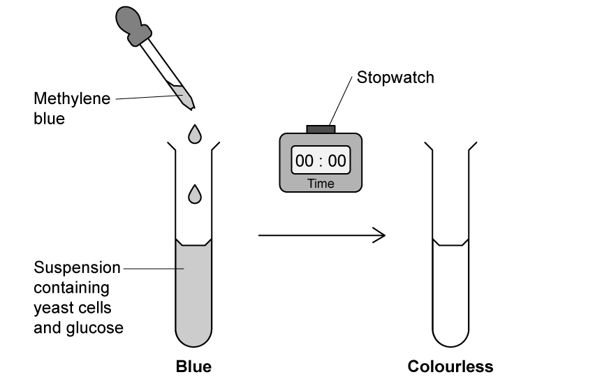

**Fig. 1**

The mean time taken for a colour change to occur was calculated at each temperature and this was used to calculate the rate of respiration.

Table 1 shows the results of the investigation.

**Table 1**

| **temperature / °C** | **time taken to turn colourless / s** | **rate of respiration / s****-1** |
|---|---|---|
| 20 | 604 | 0.0017 |
| 30 | 345 | 0.0029 |
| 40 | 105 | 0.0095 |
| 50 | 274 | 0.0036 |
| 60 | 583 |   |

(i)

Calculate the rate of respiration at 60°C.

[1]

(ii)

Identify a potential source of error in step 7 and suggest a possible improvement.

[2]

**Q3** [9 marks]

**Extract:**

An investigation was conducted to determine the effect of temperature on the rate of respiration in yeast.

The experimental procedure was conducted as follows:

1. A thermostatically controlled water bath was set up at 20°C
2. The investigators added 10 cm^3^ of a yeast suspension and 20 cm^3^ of a 10% glucose solution to each of three test-tubes
3. The test-tubes were placed in the water bath and left for 10 minutes
4. After 10 minutes, five drops of methylene blue were added to each test-tube using a dropper pipette and the test-tubes were then shaken for 10 seconds to mix
5. The test-tubes were returned to the water bath
6. A stop watch was started when the drops were added
7. The time taken for the methylene blue to turn colourless in each test tube was recorded
8. Steps 1 to 7 were repeated at temperatures of 30°C, 40°C, 50°C and 60°C

The mean time taken for a colour change to occur was calculated at each temperature and this was used to calculate the rate of respiration.

Table 1 shows the results of the investigation.

Table 1
| temperature / °C | time taken to turn colourless / s | rate of respiration / s^-1^ |
| 20 | 604 | 0.0017 |
| 30 | 345 | 0.0029 |
| 40 | 105 | 0.0095 |
| 50 | 274 | 0.0036 |
| 60 | 583 |   |

(i)

State a conclusion for the results.

[2]

(ii)

Identify **two** variables that should be kept constant and describe how this would be achieved for each.

[4]

(iii)

Using a dropper pipette to add the methylene blue may not be the most accurate method.

Explain why and suggest an improvement.

[2]

(iv)

Identify the dependent variable in this investigation.

[1]

**Q3** [5 marks]

**Extract:**

Table 1

temperature / °C | time taken to turn colourless / s | rate of respiration / s^-1^
20 | 604 | 0.0017
30 | 345 | 0.0029
40 | 105 | 0.0095
50 | 274 | 0.0036
60 | 583 |

(i)

Use the data in Table 1 to plot a line graph on the grid to show the effect of temperature on the rate of respiration.

[4]

(ii)

Estimate the rate of respiration at 36°C.

Indicate on your graph to show how the answer was obtained.

[1]

**Q3** [2 marks]

**Extract:**

An investigation was conducted to determine the effect of temperature on the rate of respiration in yeast.

The experimental procedure was conducted as follows:

1. A thermostatically controlled water bath was set up at 20°C
2. The investigators added 10 cm^3^ of a yeast suspension and 20 cm^3^ of a 10% glucose solution to each of three test-tubes
3. The test-tubes were placed in the water bath and left for 10 minutes
4. After 10 minutes, five drops of methylene blue were added to each test-tube using a dropper pipette and the test-tubes were then shaken for 10 seconds to mix
5. The test-tubes were returned to the water bath
6. A stop watch was started when the drops were added
7. The time taken for the methylene blue to turn colourless in each test tube was recorded
8. Steps 1 to 7 were repeated at temperatures of 30°C, 40°C, 50°C and 60°C

The mean time taken for a colour change to occur was calculated at each temperature and this was used to calculate the rate of respiration.

Explain the importance of repeating this experiment at least three times.

### Q4 — medium — 12 marks

**Q4** [4 marks]

A woodlouse is a small animal.

The rate of respiration of a woodlouse can be measured using a simple respirometer as shown in Fig. 1.

As the woodlouse respires the drop of coloured liquid moves along the capillary tube.

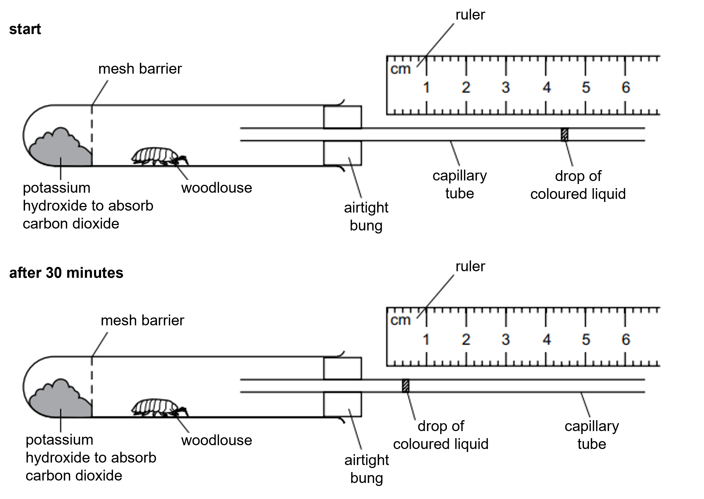

**Fig. 1**

(i)

Record the position of the drop of coloured liquid in the capillary tube shown in Fig. 1 at the start **and** after 30 minutes.

Give your answer in mm.

[1]

(ii)

Calculate the distance moved by the drop of coloured liquid in 30 minutes.

Give your answer in mm.

[1]

(iii)

Calculate the rate of movement of the drop of coloured liquid in mm per minute.

Give your answer in mm per minute and to **one** decimal place.

[2]

*Source: 2023 0970/06 Q2A*

**Q4** [8 marks]

**Extract:**

A woodlouse is a small animal.

The rate of respiration of a woodlouse can be measured using a simple respirometer as shown in Fig. 1.

As the woodlouse respires the drop of coloured liquid moves along the capillary tube.

The rate of movement of the drop of coloured liquid along the respirometer can be used to estimate the rate of respiration.

A student used a respirometer to investigate the rate of respiration in four animal species.

The results are shown in Table 1.

**Table 1**

| **Animal species** | **Rate of movement of the drop of coloured liquid / mm per minute** |   |   |   |
|---|---|---|---|---|
| **Trial 1** | **Trial 2** | **Trial 3** | **Mean** |   |
| **A** | 1.5 | 1.7 | 1.3 |   |
| **B** | 0.9 | 1.0 | 0.7 | 0.9 |
| **C** | 2.4 | 2.6 | 2.5 | 2.5 |
| **D** | 1.9 | 2.0 | 1.9 | 1.9 |

(i)

Calculate the missing mean for animal species **A**.

[1]

(ii)

Plot a bar chart on the grid to show the **mean** rate of movement of the drop of coloured liquid in the capillary tube for the four animal species.

[3]

(iii)

State the letter of the animal species which has the highest rate of respiration.

[1]

(iv)

Suggest a suitable control for the investigation described in **1b)**.

[1]

(v)

The student decided it would be better to calculate the rate of respiration per gram of animal so that the values could be compared.

Describe how the student could find out the rate of respiration per gram of animal.

[2]

*Source: 2023 0970/06 Q2B*

## Multiple Choice Questions (28 questions)

### Q1 — medium — 1 marks

**Q1** [1 mark]

Which of the following shows the word equation for anaerobic respiration in yeast?

### Q2 — hard — 1 marks

**Q2** [1 mark]

Which statement correctly compares aerobic and anaerobic respiration in humans?

### Q3 — easy — 1 marks

**Q3** [1 mark]

An experiment was conducted to investigate the effect of temperature on respiration in yeast.

- 10 cm³ of glucose solution was added to 5 g of yeast
- A thin layer of oil was added on top of the mixture
- The tube was placed in a water bath for 10 minutes and a delivery tube was connected to a gas syringe

Which of the following correctly identify control variables?

### Q4 — medium — 1 marks

**Q4** [1 mark]

Which of the following correctly describes aerobic respiration?

### Q5 — hard — 1 marks

**Q5** [1 mark]

Which row correctly completes the balanced equation for anaerobic respiration in yeast?

C6H12O6 →  X + Y

|   | X | Y |
|---|---|---|
| A | 2C2H5OH | 2CO₂ |
| B | 2C₃H₆O2 | 2O₂ |
| C | 2C2H5OH | 2H2O  |
| D | C₃H₆O2 | C₃H₆O4 |

### Q6 — easy — 1 marks

**Q6** [1 mark]

Which equation is aerobic respiration?

*Source: June 2021 0970/21 Q24*

### Q7 — easy — 1 marks

**Q7** [1 mark]

What is the balanced chemical equation for anaerobic respiration in yeast?

*Source: June 2022  paper 2 Q22*

### Q8 — hard — 1 marks

**Q8** [1 mark]

The diagram shows the oxygen uptake by germinating seeds at two different temperatures.

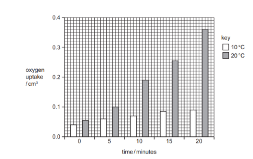

At which time is the oxygen uptake at 20 °C four times greater than at 10 °C?

*Source: june 2022 paper 1 Q24*

### Q9 — easy — 1 marks

**Q9** [1 mark]

Substances involved in aerobic respiration are listed.

1   carbon dioxide

2   glucose

3   oxygen

4   water

Which substances are used during aerobic respiration?

*Source: June 2022 paper 1 Q23*

### Q10 — easy — 1 marks

**Q10** [1 mark]

What is produced by anaerobic respiration in humans?

|   | alcohol | carbon dioxide | lactic acid |
|---|---|---|---|
| **A** | x | ✔ | ✔ |
| **B** | ✔ | ✔ | x |
| **C** | x | x | ✔ |
| **D** | ✔ | x | x |

key    ✔ = yes    x = no

*Source: June 2021 0970/11 Q24*

### Q11 — medium — 1 marks

**Q11** [1 mark]

The list shows some processes that take place in a human body.

1. production of new red blood cells
2. transmission of nerve impulses from the eyes to the brain
3. diffusion of gases into and out of the lungs

Which processes use energy released by respiration?

*Source: June 2021 0970/11 Q23*

### Q12 — medium — 1 marks

**Q12** [1 mark]

Why does anaerobic respiration of glucose release less energy in muscle cells than aerobic respiration?

1. Energy is lost in oxygen.
2. Energy remains trapped in the chemical bonds in the molecule lactic acid.
3. Energy remains trapped in the chemical bonds in the molecule ethanol.
4. Energy is lost in carbon dioxide.

### Q13 — hard — 1 marks

**Q13** [1 mark]

In which conditions would the cells of a dicotyledonous green plant respire?

|   | mesophyll cell | root hair cell |   |   |
|---|---|---|---|---|
| darkness | bright light | darkness | bright light |   |
| **A** | ✔ | X | ✔ | X |
| **B** | X | ✔ | X | X |
| **C** | X | X | X | X |
| **D** | ✔ | ✔ | ✔ | ✔ |

### Q14 — easy — 1 marks

**Q14** [1 mark]

Which of the following do humans require energy for?

1. Producing proteins
2. Cell division
3. Generation of nerve impulses
4. Maintaining body temperature

### Q15 — medium — 1 marks

**Q15** [1 mark]

The graph below shows the results of an investigation into how the rate of respiration of an organism is affected by changing the temperature.

Which of the following statements would explain the difference between the rate of respiration at 10 °C and that at 30 °C?

### Q16 — medium — 1 marks

**Q16** [1 mark]

The diagram below shows an experiment set up by a teacher to demonstrate how an investigation into anaerobic respiration in yeast cells can be carried out.

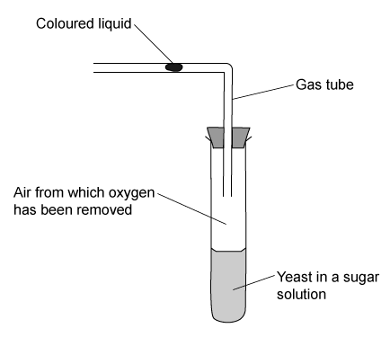

Predict what would happen to the coloured liquid in the glass tube.

### Q17 — easy — 1 marks

**Q17** [1 mark]

Glucose is broken down in the chemical processes of aerobic respiration.

Which row of the table below shows the correct products of this breakdown?

|   | energy | water | lactic acid | carbon dioxide |
|---|---|---|---|---|
| **A** | **X** | **X** | **✔** | **X** |
| **B** | **✔** | **X** | **X** | **✔** |
| **C** | **X** | **✔** | **X** | **✔** |
| **D** | **✔** | **✔** | **X** | **✔** |

### Q18 — medium — 1 marks

**Q18** [1 mark]

#### Extended only

During vigorous exercise, such as cycling uphill, lactic acid builds up in the muscles.

How is this lactic acid removed during recovery?

### Q19 — easy — 1 marks

**Q19** [1 mark]

Which of the following is the correct word equation for aerobic respiration in plants?

### Q20 — easy — 1 marks

**Q20** [1 mark]

A student investigated respiration in yeast. They set up the experiment as shown in the diagram below.

Every 30 minutes they replaced the water with the same volume but it was 10 oC warmer and counted the bubbles given off in 2 minutes.

What are the independent and dependent variables in this experiment?

|   | independent | dependent |
|---|---|---|
| **A** | number of bubbles | time |
| **B** | time | number of bubbles |
| **C** | water temperature | number of bubbles |
| **D** | water temperature | volume of water |

### Q21 — medium — 1 marks

**Q21** [1 mark]

Which row in the table below shows the correct products produced by anaerobic respiration in yeast and in animals?

|   | animals | yeast |   |   |
|---|---|---|---|---|
| lactic acid | carbon dioxide | lactic acid | carbon dioxide |   |
| **A** | **X** | **✔** | **X** | **X** |
| **B** | **✔** | **X** | **X** | **✔** |
| **C** | **X** | **✔** | **✔** | **X** |
| **D** | **✔** | **✔** | **✔** | **X** |

### Q22 — easy — 1 marks

**Q22** [1 mark]

Which of the following processes require, and are dependent on, the activity of enzymes?

1. aerobic respiration
2. glucose → lactic acid
3. osmosis
4. anaerobic respiration in yeast

### Q23 — hard — 1 marks

**Q23** [1 mark]

The list below shows four metabolic processes that can occur in living cells.

1. carbon dioxide + water →  glucose + oxygen
2. glucose → lactic acid
3. glucose + oxygen →  carbon dioxide + water
4. glucose →  alcohol + carbon dioxide

Which row of the table correctly represents the processes that can occur in muscle cells and yeast cells.

|   | in muscles | in yeast |
|---|---|---|
| **A** | 3 only | 1 & 4 |
| **B** | 3 & 4 | 2 & 3 |
| **C** | 2 only | 1, 3 & 4 |
| **D** | 2 & 3 | 3 & 4 |

### Q24 — hard — 1 marks

**Q24** [1 mark]

#### Extended only

Which of the following is the correct balanced symbol equation for aerobic respiration in yeast cells?

### Q25 — hard — 1 marks

**Q25** [1 mark]

Which of the following processes would release the most energy in a cell from one molecule of glucose?

1. Aerobic respiration in yeast
2. Aerobic respiration in animals
3. Aerobic respiration in plants

### Q26 — hard — 1 marks

**Q26** [1 mark]

#### Extended only

Four metabolic reactions that can occur in living organisms are shown below:

1. C6H12O6 + 6O2 → 6CO2+ 6H2O
2. glucose → lactic acid
3. 6CO2+ 6H2O → C6H12O6 + 6O2
4. C6H12O6 → 2C2H5OH + 2CO2

Which of the above reactions take place in yeast cells to release energy?

### Q27 — medium — 1 marks

**Q27** [1 mark]

The diagram below shows an experiment set up by a group of students to investigate respiration in yeast.

Which row of the table below correctly describes the contents of the flask after 20 hours?

|   | new compound | gas produced |
|---|---|---|
| **A** | ethanol (alcohol) | oxygen |
| **B** | ethanol (alcohol) | carbon dioxide |
| **C** | lactic acid | oxygen |
| **D** | lactic acid | carbon dioxide |

### Q28 — medium — 1 marks

**Q28** [1 mark]

The diagram below shows an experimental set-up which can be used to investigate gas exchange in a plant leaf.

In which direction would the ink drop move and for what reason?

|   | direction | reason |
|---|---|---|
| **A** | to the right | photosynthesis |
| **B** | to the left | photosynthesis |
| **C** | to the right | respiration |
| **D** | to the left | respiration |

## Theory Questions (17 questions)

### Q1 — very_hard — 6 marks

**Q1** [1 mark]

Blue whales can dive for up to 20 minutes. During these dives, the whale's heart rate slows significantly, and the muscle cells switch to anaerobic respiration.

State the word equation for anaerobic respiration in a whale's muscle cells.

**Q1** [5 marks]

**Extract:**

Blue whales can dive for up to 20 minutes. During these dives, the whale's heart rate slows significantly, and the muscle cells switch to anaerobic respiration.

After the whale returns to the surface, its heart rate and breathing rate remain high for a period of time.

Explain why this is the case.

### Q2 — medium — 3 marks

**Q2** [3 marks]

Aerobic respiration occurs in the cells of the athlete.

Define the term *aerobic respiration*.

### Q3 — easy — 10 marks

**Q3** [5 marks]

A scientist measured the mass of carbon dioxide produced by anaerobic respiration in yeast cells for 1200 minutes.

Fig. 7.1 shows the results.

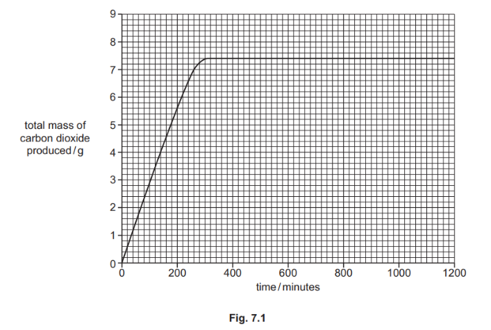

(i) Complete the sentences to describe the results shown in Fig. 7.1.

The yeast cells produced a total of .............................. g of carbon dioxide during 1200 minutes.

The yeast cells stopped producing carbon dioxide at .............................. minutes.

[2]

(ii) The investigation was repeated with boiled yeast cells.

Predict the effect on the mass of carbon dioxide produced and explain your prediction.

[2]

(iii) State the name of **one other** product of anaerobic respiration in yeast cells.

[1]

*Source: june 2022 paper 3 Q7A*

**Q3** [2 marks]

The box on the left contains the term ‘Respiration’.

The boxes on the right contain sentence endings. 

Draw **two** lines to join the term ‘Respiration’ to two boxes on the right to make** two** correct sentences.

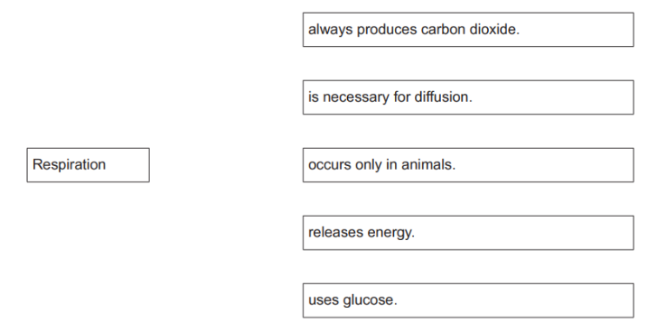

*Source: june 2022 paper 3 Q7B*

**Q3** [1 mark]

State **one** substance required for aerobic respiration that is not required for anaerobic respiration.

*Source: june 2022 paper 3 Q7C*

**Q3** [2 marks]

Respiration is one of the characteristics of living things. 

Tick (**✓**) **two** boxes to show two other characteristics of **all** living things.

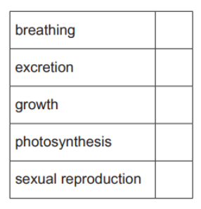

*Source: june 2022 paper 3 Q7D*

### Q4 — hard — 2 marks

**Q4** [2 marks]

Yeast can respire aerobically and anaerobically.

State the balanced chemical equation for aerobic respiration

*Source: Specimen 2023 0970/04 Q4A*

### Q5 — easy — 2 marks

**Q5** [2 marks]

Aerobic respiration increases during exercise.

(i)

State the name of the gas required for aerobic respiration.

[1]

(ii)

State where aerobic respiration occurs in a cell.

[1]

*Source: Specimen 2023 0970/03 Q2D*

### Q6 — medium — 9 marks

**Q6** [2 marks]

Researchers in the Czech Republic investigated oxygen consumption in horses.

They measured the oxygen consumption of the horses while they were exercising at four different paces: walking, trotting, cantering and galloping.

The results are shown in Fig. 1.

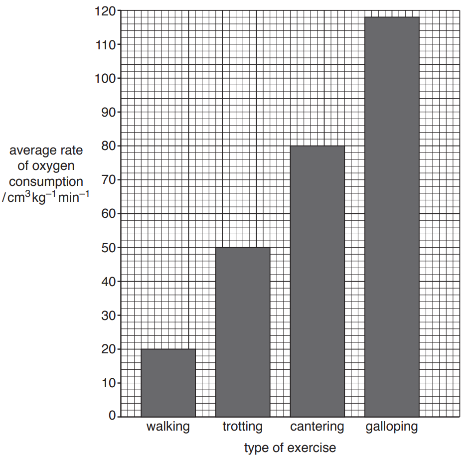

**Fig. 1**

Calculate the percentage increase in the average rate of oxygen consumption as the horses change from walking to trotting.

Show your working.

** **____________%** **

*Source: 2018 0610/41 Q5B*

**Q6** [3 marks]

#### Extended Only

The researchers also calculated the oxygen debt for each type of exercise.

They found that the horses developed a larger oxygen debt when they exercised by galloping and cantering rather than when they walked.

Explain why the horses developed an oxygen debt when they exercised.

*Source: 2018 0610/41 Q5C*

**Q6** [4 marks]

**Extract:**

The horses developed an oxygen debt when they exercised because:

Any three of the following from:

- Demand for, energy / oxygen, increases; [1 mark]
- (Rate of) respiration increases; [1 mark]
- Limited supply of oxygen to muscle (tissue); [1 mark]
- Idea that the heart / pulse / breathing rate cannot increase enough (to meet demand); [1 mark]
- (Therefore) muscles respire anaerobically; [1 mark]
- Lactic acid is produced; [1 mark]

#### Extended Only

Describe how the horses would recover from an oxygen debt when they stop exercising.

*Source: 2018 0610/41 Q5D*

### Q7 — hard — 10 marks

**Q7** [2 marks]

Respiration releases energy.

Write the word equation for aerobic respiration.

*Source: 2018 0610/31 Q4A*

**Q7** [3 marks]

Fig. 1 shows the average daily energy requirement of different groups of males and females.

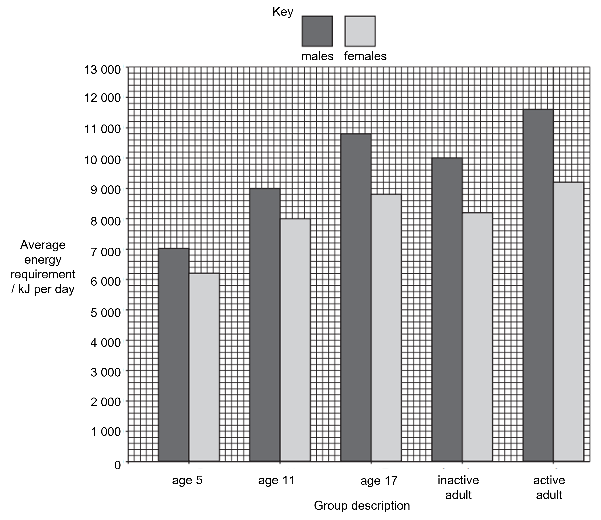

**Fig. 1**

(i)

State the average energy requirement of a five-year-old female. Give your answer in kJ per day.

[1]

(ii)

An eleven-year-old male received only 8000 kJ per day for four months.

Use the data in Fig. 1 to suggest **two** ways this could affect him.

[2]

*Source: 2018 0610/31 Q4B*

**Q7** [3 marks]

**Extract:**

Fig. 1 shows the average daily energy requirement of different groups of males and females.

[Graph not included, but referenced for energy values of 17 year olds and adults, including inactive and active adults, and males and females.]

Use the data in Fig. 1 to make **three** comparisons between the energy requirements of individuals aged 17 years and adults.

*Source: 2018 0610/31 Q4C*

**Q7** [2 marks]

Yeast cells can respire anaerobically.

Biotechnology makes use of this.

State **two** ways that the products of anaerobic respiration in yeast are used by humans.

*Source: 2018 0610/31 Q4D*

### Q8 — medium — 4 marks

**Q8** [2 marks]

Aerobic respiration increases during exercise.

(i)

State the name of the gas required for aerobic respiration.

[1]

(ii)

State where aerobic respiration occurs in a cell.

[1]

*Source: 2023 3/1/0970 Q2D*

**Q8** [2 marks]

Anaerobic respiration can occur when exercising vigorously.

(i)

State the word equation for anaerobic respiration in muscle cells.

[1]

(ii)

State **one **advantage of using aerobic rather than anaerobic respiration in humans.

[1]

*Source: 2023 3/1/0970 Q2E*

### Q9 — medium — 3 marks

**Q9** [3 marks]

Aerobic respiration increases during exercise.

Use the words from the list to complete the definition of *aerobic respiration*.

Each word or phrase may be used once, more than once or not at all.

**cells                  carbon dioxide                    DNA                    oxygen**

**the heart                     the brain                    nutrient **

Aerobic respiration is the chemical reactions in ....................................... that use ....................................... to break down ....................................... molecules to release energy.

*Source: 2018 (Series 1) 0610/31 Q3D*

### Q10 — hard — 5 marks

**Q10** [2 marks]

#### Extended Only

Yeast can respire aerobically and anaerobically.

State the balanced chemical equation for aerobic respiration.

*Source: 2023 970/04 Q4A*

**Q10** [3 marks]

When yeast respires anaerobically, ethanol is produced.

Ethanol is a type of sustainable resource that can be made from a wide range of crop plants.

It can be used as a biofuel.

Table 1 summarises some information about crop plants that are used to make biofuel.

**Table 1**

| **crop plant** | **biofuel produced** | **energy yield / GJ per ha** | **optimum growth temperature / °C** | **optimum annual rainfall range / mm** |
|---|---|---|---|---|
| wheat | ethanol | 53-84 | 24 | 800-1200 |
| corn | ethanol | 63-76 | 18 | 360-1000 |
| sugar beet | ethanol | 110-122 | 18 | 360-1000 |
| sugarcane | ethanol | 110-140 | 28 | 800-1200 |
| oil palm | oil | 150-166 | 28 | 1100-2500 |

A country has a mean temperature range of 12 °C to 24 °C. The country has a mean annual rainfall of 1000 mm.

Suggest **and** explain which crop plant would be the **most** suitable crop to grow to produce biofuel in the country.

Use the information in Table 1 to support your choice.

*Source: 2023 970/04 Q4B*

### Q11 — easy — 14 marks

**Q11** [3 marks]

State **three **uses of energy required by a living organism.

**Q11** [5 marks]

Give the missing answers in the following sentences using words from the box.  Each word may only be used once.

| energy        oxygen      organisms     chemical        cells |
|---|

Aerobic respiration is a ____________ reaction that takes place in ___________of living ____________.

It uses ______________ as part of the reaction to release _________.

**Q11** [4 marks]

**Extract:**

Table 1

| plant type         | oxygen consumption / mL kg^−1 h^−1 |
|--------------------|------------------------------------|
| Asparagus Fern     | 25                                 |
| Chinese Evergreen  | 36                                 |
| Monstera           | 62                                 |
| Prayer Plant       | 45                                 |

The oxygen consumption of a range of indoor plants was measured to give an indication of the rate of respiration.

Table 1 shows the results recorded.

**Table 1**

| **plant type** | **oxygen consumption / mL kg****−1**** h****−1** |
|---|---|
| Asparagus Fern | 25 |
| Chinese Evergreen | 36 |
| Monstera | 62 |
| Prayer Plant | 45 |

Draw a graph of the results on the grid shown in Fig. 1

**Fig. 1**

**Q11** [2 marks]

Identify the missing reactants and products from the word equation for aerobic respiration.

____________ + glucose → ____________ + water + (energy)

### Q12 — medium — 9 marks

**Q12** [1 mark]

#### Extended only

Students investigated the rate of respiration of crickets (a type of insect) using a carbon dioxide sensor and laptop as shown in Fig. 1. The sensor was fitted inside an airtight glass jar. The apparatus was set up in a room with a constant temperature of 17°C.

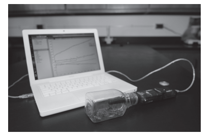

**Fig. 1**

The students found that the concentration of carbon dioxide inside the jar increased by 50ppm in 120 seconds.

Calculate the rate of carbon dioxide production as ppm per second.

Show your working and express your answer to two significant figures.

Give your answer in ppm s-1.

*Source: 2018 0610/43 Q5B*

**Q12** [2 marks]

**Extract:**

Students investigated the rate of respiration of crickets (a type of insect) using a carbon dioxide sensor and laptop as shown in Fig. 1. The sensor was fitted inside an airtight glass jar. The apparatus was set up in a room with a constant temperature of 17°C.

#### Extended only

After 10 minutes, the students opened the jar by removing the sensor. They left the jar open for 5 minutes but made sure that the crickets remained in the jar. They then replaced the sensor and took more readings for another 10 minutes.

State **and** explain one reason for opening the jar after 10 minutes

*Source: 2018 0610/43 Q5C*

**Q12** [2 marks]

**Extract:**

Students investigated the rate of respiration of crickets (a type of insect) using a carbon dioxide sensor and laptop as shown in Fig. 1. The sensor was fitted inside an airtight glass jar. The apparatus was set up in a room with a constant temperature of 17°C.

During the investigation the temperature inside the jar increased. The temperature outside the jar remained constant.

Explain why the temperature inside the jar increased.

*Source: 2018 0610/43 Q5D*

**Q12** [4 marks]

Researchers in Chile also investigated the rate of respiration in crickets.

They investigated the effect of temperature and body mass on the rate of respiration. They measured the rate of oxygen consumption in crickets with different body masses, at different temperatures.

The researchers’ results are shown in Fig. 2.

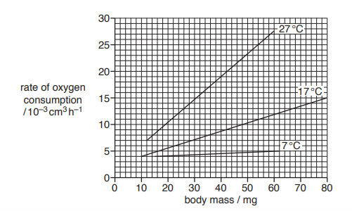

**Fig. 2**

State **two** conclusions that can be made from the data in Fig. 2 **and** support each conclusion with evidence from the graph.

*Source: 2018 0610/43 Q5E*

### Q13 — easy — 7 marks

**Q13** [3 marks]

At student investigated the effect of temperature on respiration in yeast over 1 hour. They used three different temperatures on the yeast species *Saccharomyces cerevisiae.*

They collected data and drew a graph of their results shown in Fig. 1.

**Fig. 1**

(i)

State the temperature at which *Saccharomyces cerevisiae* carried out most respiration.

[1]

(ii)

State the volume of CO2 produced at 30 minutes when *Saccharomyces cerevisiae *was kept at 25°C.

[1]

(iii)

State the total volume of CO2 produced by *Saccharomyces cerevisiae *at 30°C.

[1]

**Q13** [2 marks]

**Extract:**

At student investigated the effect of temperature on respiration in yeast over 1 hour. They used three different temperatures on the yeast species Saccharomyces cerevisiae.   They collected data and drew a graph of their results shown in Fig. 1.  (i) The temperature at which Saccharomyces cerevisiae carried out most respiration is... - 35°C; (ii) The volume of CO2 produced at 30 minutes when Saccharomyces cerevisiae was kept at 25°C is... - 1 cm^3^; (iii) The total volume of CO2 produced by Saccharomyces cerevisiae at 30°C is... - 3.3 cm^3^; Accept answers within a range of 3.3 to 3.4 cm^3^

A student wrote the following conclusion for the data shown in Fig. 1:

*As temperature increases the rate of respiration increases. *

Using data from Fig. 1, give evidence as to why the student is correct in their conclusion.

**Q13** [1 mark]

Yeast respire anaerobically.

With reference to oxygen, describe the difference between aerobic and anaerobic respiration.

**Q13** [1 mark]

State which type of respiration releases the greatest amount of energy.

### Q14 — easy — 11 marks

**Q14** [2 marks]

Fig. 1 shows an animal cell.

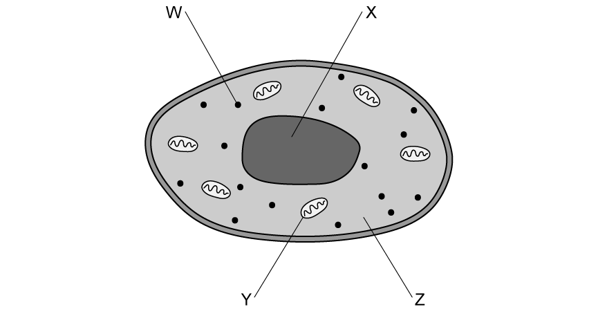

**Fig. 1**

Identify which letter represents the cell structure where respiration takes place **and** name the cell structure.

**Q14** [4 marks]

Complete the following sentence about respiration:

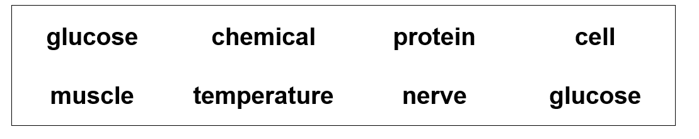

Respiration releases energy from __________ to be used in life processes such as ___________ reactions, __________ contraction and maintaining a constant body ____________.

**Q14** [2 marks]

Complete Table 1 with a (**✔**) or a (**X**) to show the products and reactants of anaerobic respiration in animals.

**Table 1**

|   | **product** | **reactant** |
|---|---|---|
| oxygen |   |   |
| carbon dioxide |   |   |
| lactic acid |   |   |
| glucose |   |   |
| water |   |   |
| ethanol |   |   |

[2]

**Q14** [3 marks]

#### Extended only

An oxygen debt is often associated with anaerobic respiration.

Describe the process that occurs in the body during an oxygen debt.

### Q15 — medium — 13 marks

**Q15** [3 marks]

Fig. 1 shows an adult fly, *Chrysomya megacephala*.

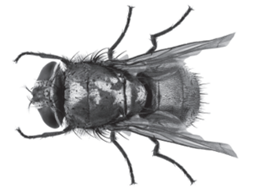

**Fig. 1**

State **three** visible features from Fig. 1 that could be used to distinguish adult insects from other arthropods.

*Source: 2018 0610/42 Q5A*

**Q15** [6 marks]

A respirometer is shown in Fig. 2. It can be used to estimate an organism’s rate of respiration.

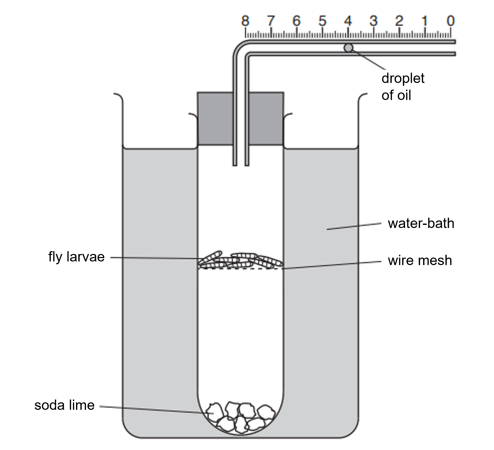

**Fig. 2**

(i)

Complete the sentences:

A respirometer can be used to calculate the ............................. of oxygen used by the fly larvae by measuring the ............................. the droplet of oil moves in one minute. A water-bath is used to ............................. the temperature of the apparatus.

[3]

(ii)

The soda lime in the respirometer absorbs carbon dioxide.

Explain why this is important in this investigation.

[1]

(iii)

Fly larvae respire to release energy.

State **two** uses of energy in a fly larva.

[2]

*Source: 2018 0610/42 Q5C*

**Q15** [4 marks]

#### Extended only

A student used a respirometer to investigate the effect of temperature on the rate of respiration of germinating seeds.

Predict the results of this investigation and explain your prediction.

*Source: 2018 0610/42 Q5D*

### Q16 — medium — 5 marks

**Q16** [3 marks]

Fig. 1 shows a person sitting in a room.

A thermometer shows the temperature of the room.

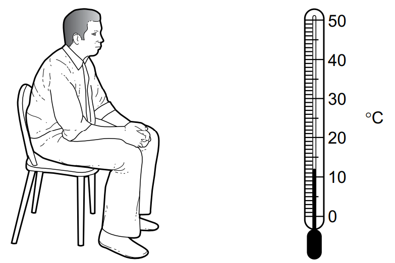

**Fig. 1**

Give **three **uses of energy in the body of the person in Fig. 1.

*Source: 2020 0610/04 Q2A*

**Q16** [2 marks]

#### Extended Only

(i)

Name the process carried out by the person in Fig. 1 that releases energy.

[1]

(ii)

State the balanced chemical equation that describes this process.

[1]

*Source: 2020 0610/04 Q2B*

### Q17 — hard — 9 marks

**Q17** [4 marks]

#### Extended Only

A person leaves a room and runs very fast for 200m. When the person stops running, his breathing rate and his heart rate remain high for several minutes.

Explain why the person’s breathing rate and heart rate remain high.

*Source: 2020 0610/04 Q2C*

**Q17** [5 marks]

#### Extended Only

The run results in changes in the skin involving the blood vessels and the sweat glands.

Describe what happens to the blood vessels and sweat glands during the run.

Explain why these changes happen.

*Source: 2020 0610/04 Q2D*

