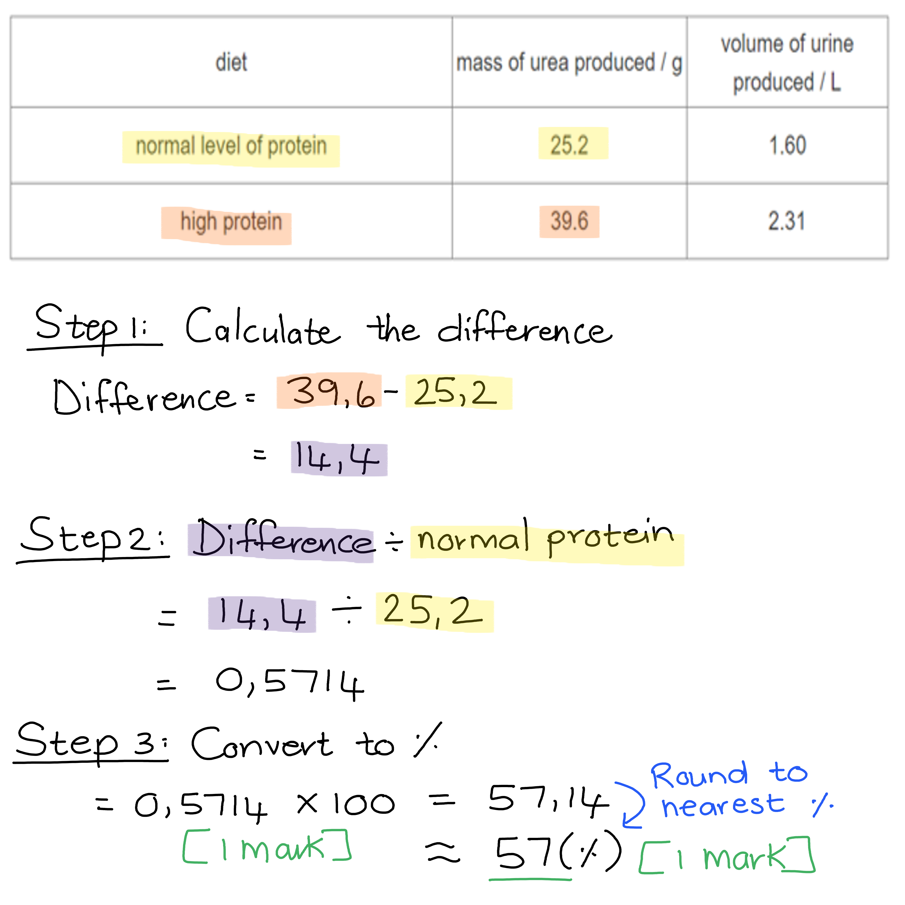

# Mark Schemes — Excretion in Humans
**13. Excretion in Humans** · Cambridge (CIE) IGCSE biology (0610 & 0970)

## Multiple Choice Questions (22 questions)

### Q1
**Final answer:** **The correct answer is B.**

- The kidneys excrete urea and excess water from the body
- Ions are also excreted by the kidneys, but their omission does not make this statement incorrect

**A** is incorrect as, although carbon dioxide and some water vapour are excreted through the lungs, ions are not — they are excreted by the kidneys.

**C** is incorrect as urea leaves the kidneys in the urine, which is transported to the bladder via the ureters. The urethra connects the bladder to the exterior.

**D** is incorrect as the bladder does not connect the kidneys to anything. The kidneys are connected to the bladder via the ureters, and the bladder is connected to the exterior via the urethra.

### Q2
**Final answer:** **The correct answer is ****A.**

- Glucose is a small molecule and is filtered from the blood** **into the nephron at the glomerulus
- In a healthy kidney **all of the glucose is reabsorbed **from the nephron** back into the blood**, so none appears in the urine

**B** is incorrect because glucose can pass through the filtration membrane in the glomerulus due to its small size.

**C** is incorrect because glucose is not converted into urea. Urea is produced in the liver from excess amino acids during deamination.

**D **is incorrect because glucose is not broken down in the kidney.

### Q3
**Final answer:** **The correct answer is ****B****.**

- This is because glucose is in a lower concentration in the tubule compared to the blood so the glucose must be actively transported out to ensure it is not lost in the urine

**A** is incorrect because glucose does not move by osmosis. Only water can move by osmosis.

**C** and** D **are incorrect because glucose does not move into the kidney tubule, it moves out to ensure glucose is not lost in urine.

### Q4
**Final answer:** **The correct answer is ****D****.**

- This is because on a hot day the person loses more water through sweating as part of thermoregulation. This means that water needs to be conserved in the body
- To conserve water, the volume of urine decreases and the concentration of urea and other waste products increases as a result

**A** is incorrect because this describes how urine is produced if a person is over-hydrated, for example if they drink too much water. This is not likely to occur on a hot day due to losing water via sweat.

**B** is incorrect because the volume of urine should be smaller on a hot day as the body tries to conserve water for sweating.

**C** is incorrect because when the volume of urine decreases it causes the concentration to increase as a result.

### Q5
**Final answer:** **The correct answer is ****D****.**

- Urea is formed from excess amino acids in the liver and is excreted by the kidneys.

**A** is incorrect because urea is formed from excess amino acids in the liver, not in the kidneys, and it is excreted by the kidneys, not the liver.

**B** is incorrect because urea is not formed from glucose; it is formed from excess amino acids in the liver, and it is excreted by the kidneys, not egested.

**C** is incorrect because urea is formed from excess amino acids, not glucose, and it is produced in the liver, not the kidneys.

### Q6
**Final answer:** **The correct answer is D**

- This is because the proteins leave the glomerulus after ultrafiltration, causing the blood that leaves the glomerulus after ultrafiltration to have a high concentration of proteins

**A** is incorrect because proteins do not leave the glomerulus during ultrafiltration and is therefore not found in the filtrate in the nephron

**B **and **C** are incorrect because the higher levels of water in the blood before ultrafiltration decreases the overall protein concentration

### Q7
**Final answer:** **The correct answer is C because:**

X shows the ureter, which carries urine from the kidneys to the bladder

**A** is incorrect because the bladder is the upside down pear-shaped organ below the ureter.

**B** is incorrect because the kidneys are above the ureters.

**D** is incorrect because the urethra is below the bladder and leads to the outside of the body.

### Q8
**Final answer:** **The correct answer is ****D ****because:**

The liquid is urine as it contains urea and salts, but not glucose, proteins, or amino acids which would be found in the bloodstream. **D **is a ureter, which carries the urine (formed in the kidneys) to the bladder where it is stored.

### Q9
**Final answer:** **The correct answer is ****D ****because:**

- Arterioles branch off the renal artery and lead to each nephron, where they form a knot of capillaries (a glomerulus) sitting inside a cup known as the Bowman’s capsule - this is labelled **1** on the diagram and is where filtration occurs
- Reabsorption occurs throughout the tubule, with **selective reabsorption** of all of the glucose largely in the part labelled **3** on the diagram (the proximal convoluted tubule). Throughout the remaining part of the tubule, most of the water and some salts are absorbed back into the blood from the filtrate, leading to the formation of concentrated urea in the urine (with excess water and salts)

**A**, **B** and **C** are incorrect because **2 **is a venule that eventually joins the renal vein while **4** is the collecting duct which eventually joins to one of the ureters, transporting urine (urea, salts and water) to the bladder where it is stored before it is excreted from the body through the urethra.

### Q10
**Final answer:** **The correct answer is ****A ****because:**

A healthy individual with good kidney function will not produce urine with any glucose or protein in it. However, there should obviously be urea present in urine and it will be of a higher concentration than the urea in the blood.

**B** is incorrect because proteins, being relatively large molecules, should not be filtered out of the bloodstream by the kidneys, and if they are they should be reabsorbed.

**C** is incorrect because glucose and protein should not be present in urine, and urea should be.

**D** is incorrect because glucose and protein should not be present in urine, and urea should be.

### Q11
**Final answer:** **The correct answer is ****C ****(Amino acids) because:**

- The breakdown of amino acids to form urea is known as ‘deamination’
- This process takes place in the liver
- The liver is also involved in assimilating amino acids (as well as other digested food molecules absorbed from the digestive system) into usable molecules like the protein fibrinogen

The capillaries of the small intestine end up feeding into the hepatic portal vein which delivers blood to the liver to process molecules absorbed from the digestive system.

### Q12
**Final answer:** **The correct answer is ****B ****because:**

The process by which amino acids are broken down is called deamination. The liver (X) is responsible for this and will convert the products of deamination into urea, which is then secreted into the blood. When the blood passes through the kidneys (Y) it is removed from the bloodstream and excreted from the body in urine.

**A** is incorrect because assimilation refers to the movement of soluble food molecules across the cell membrane into the cells. The kidneys (Y) are responsible for removing urea from the blood, while the bladder (Z) will temporarily store the urine produced by the kidneys until it leaves the body through the urethra.

**C** is incorrect because the breakdown of amino acids is called deamination, not assimilation. The kidneys (Y) removes urea from the blood while the liver (X) is responsible for making urea.

**D** is incorrect because the bladder (Z) will temporarily store urine until it is excreted from the body, it does not remove urea from the blood.

### Q13
**Final answer:** **The correct answer is ****D**** (all 3 of the above) because:**

- **High water intake **results in more water needing to be removed from the body. A low water intake produces the opposite effect
- **High temperature** leads to more water loss through sweat, so less water is lost (and more will be reabsorbed) by the kidneys. Exercising leads to an increase in body temperature and therefore has the same effect

### Q14
**Final answer:** **The correct answer is ****C ****because:**

- Urea is one of the substances forced out of the blood in the kidneys; this occurs in the glomerulus (capillary network) where urea passes into the Bowman’s capsule at the start of a kidney tubule (nephron) and is not reabsorbed back into the bloodstream
- Excess amino acids are broken down primarily by the liver, the nitrogen part (called an amine group) is converted into urea and then secreted back into the bloodstream. The remaining part of the amino acid can be converted into a number of substances that can be used in respiration or stored
- The lungs are responsible for excreting carbon dioxide; there is a diffusion gradient between blood passing through the lungs from the heart which contains carbon dioxide that has diffused into the blood from respiring tissues, and the air in the lungs

**A** is incorrect because the liver does not excrete amino acids; it breaks them down into a number of substances of which urea is a waste product which is then secreted into the bloodstream to be removed by the kidneys.

**B** is incorrect because the lungs do not excrete urea and the kidneys do not excrete carbon dioxide.

**D** is incorrect because the kidneys are not involved in the excretion of urine; they **produce** urine by filtering the blood which is excreted by the urinary system of which the kidneys are a part. Excretion is defined as ‘the removal from organisms of toxic materials and substances in excess of requirements’. It is better to say that the kidneys excrete urea, excess salts and water than urine.

### Q15
**Final answer:** **The correct answer is ****C**** (to breakdown toxins) because:**

The liver is primarily responsible for the breakdown of toxic substances in the body. The kidney can produce some urea but this is not it’s primary role.

### Q16
**Final answer:** **The correct answer is ****C**** (salts and glucose) because:**

The kidneys reabsorb all the glucose that enters the tubules (by active transport in selective reabsorption) and some salts, depending on the concentration of salts in the blood and how much water needs to be reabsorbed.

Urea is not reabsorbed back into the bloodstream from the kidney tubules, and glycogen would not be present in the filtrate in the first place (it is a relatively large molecule and isn’t usually present in the blood).

### Q17
**Final answer:** **The correct answer is ****B**** (kidneys and lungs) because:**

The kidneys remove urea, excess salts and water from the blood. The lungs remove carbon dioxide from the blood due to the concentration gradient set up between the air in the lungs and the carbon dioxide in the blood. This is maintained by breathing.

**A** is incorrect because the bladder is not responsible for removing excretory products from the **blood**, it removes it from the body.

**C** is incorrect because the liver is responsible for producing many of the excretory products, but it is not directly responsible for the excretion of these products.

**D** is incorrect because neither the bladder nor liver will remove excretory products from the blood for excretion as mentioned above.

### Q18
**Final answer:** **The correct answer is ****B ****because:**

- **W** is the renal artery, which is formed from one of the main branches off of the aorta, delivering blood to the kidneys
- The body has two ureters; one connecting each kidney to the bladder, therefore represented by **Y** on the image. Ureters transport urine to the bladder
- The urethra is the tube through which urine passes out of the bladder (and eventually the body), represented by **Z** in the image

### Q19
**Final answer:** **The correct answer is ****B****:**

- Excretion is the **removal** of:

  - the **waste** **products of metabolism**
  - **toxic **materials
  - **substances present in excess**
- **Excess** salts are** removed** from the bloodstream by the kidneys; if this did not occur then too much water would be reabsorbed in the nephron by osmosis, due to the high solute concentration of the blood

**A** is incorrect because, while carbon dioxide *is* a waste product of metabolism, the description here only refers to its *production *during aerobic respiration, and not to its removal from the body in the lungs.

**C** is incorrect because although undigested food is ‘waste’ and needs to be removed from the body, it is not produced as a result of chemical reactions inside cells and therefore is not technically an example of excretion.

**D** is incorrect because hormones secreted by glands are not waste products (although excess hormones can eventually be broken down by the liver, forming urea which is eventually excreted).

### Q20
**Final answer:** **The correct answer is ****A ****(water) because:**

Both the kidneys and the lungs are involved in the loss of water from the body.

**B** is incorrect because carbon dioxide is not excreted by the kidneys. Carbon dioxide is mainly excreted by the lungs.

**C** is incorrect because glucose is not excreted (under normal conditions) by either the kidneys or the lungs. Excess glucose is transported to the liver to be converted into glycogen for storage.

**D** is incorrect because the lungs do not excrete urea, that is the role of the kidneys.

### Q21
**Final answer:** **The correct answer is ****A**** (reabsorbing glucose and removing urea) because:**

The kidneys are responsible for filtering the blood and reabsorbing useful products that do not need to be lost, such as glucose.

**B** is incorrect because glucose is forced out of the blood into the kidney tubules during filtration but is then selectively reabsorbed back into the bloodstream. Salts can be reabsorbed but not all of them will be (the concentration in the bloodstream and blood pressure determine this).

**C** and **D** are incorrect because deamination (making urea) is largely a function of the liver.

### Q22
**Final answer:** **The correct answer is ****D ****(excretion of urea) because:**

- The **liver** does not excrete urea from the body; it **produces** **urea** by **deamination** (the processes involved in removing the amine group from excess amino acids)
- Remember **excretion** is defined as the **removal** from organisms of the **waste** products of metabolism (chemical reactions in cells), toxic materials and substances in excess of requirements

**A** is incorrect because the liver is responsible for assimilation (chemically modifying) of amino acids absorbed into the bloodstream by the digestive system.

**B** is incorrect because the liver produces an enzyme known as alcohol dehydrogenase which can break down (as the name suggests) alcohol.

**C** is incorrect because the liver is primarily responsible for deamination (although the kidneys can do a little of this too).

## Theory Questions (10 questions)

### Q1
(i) A hormone is:

- (A) chemical substance produced by a (endocrine) gland; **[1 mark]**
- (They are) carried/transported by the blood; **[1 mark]**
- (A hormone) alters/changes/affects the activity of specific target organs; **[1 mark]**

(ii) The liver responds to an increase in insulin concentration by:

Any **two **from the following:

- (Insulin) stimulates (the production of) enzymes; **[1 mark]**
- (Responsible for the) conversion of glucose to glycogen; **[1 mark]**
- Glycogen is stored / insoluble; **[1 mark]**
- (It stimulates the) increased uptake / absorption / respiration of glucose by liver (cells); **[1 mark]**

**[Total: 5 marks]**

> *Remember that you do not need to give examples as part of a definition unless you are asked to do so. *

> *Try not to get confused between glucagon and glycogen. Glycogen is a storage carbohydrate, glucagon is a hormone released when the **gluc**ose (in the blood) is **gon**e. *

> *This question covers core knowledge taken from an extended only paper 4 question.*
(i) Excess amino acids are broken down by:

Any **two **from the following:

- Deamination / removal of nitrogen containing part (of amino acids); **[1 mark]**
- To form urea; **[1 mark]**
- (Part of the) amino acid is converted to ammonia; **[1 mark]**
- Ammonia is converted to urea; **[1 mark]**

(ii) The name of the process that assembles amino acids to form proteins is:

- (Protein) synthesis; **[1 mark]**

**[Total: 3 marks]**

> *Try not to get confused between the digestion of proteins and deamination. Protein digestion involved taking large proteins and breaking them down to amino acids, whereas deamination involves breaking down amino acids to form urea.*
(i) Lactic acid is processed by:

Any **two **from the following:

- (The processing of lactic acid) is aerobic / uses/requires oxygen; **[1 mark]**
- (It is used/oxidised during) respiration / (to produce) carbon dioxide and water; **[1 mark]**
- Enzymes catalyse the reaction; **[1 mark]**

(ii) A description of the results is:

Any **four **from the following:

- As alcohol consumption increases, the risk of dying of liver disease increases; **[1 mark]**
- (The graph shows a) similar trend in males and females; **[1 mark]**
- Comparative data quote <u>with units for g per day;</u> **[1 mark]**
- (For) men (the increase in risk is) exponential / (for) women (the increase in risk is) not exponential; **[1 mark]**
- At low (alcohol) consumption females have a higher risk (of dying from liver disease than men); **[1 mark]**
- (Men and women have the) same risk at (an alcohol consumption of) 112 g per day; **[1 mark]**

**[Total: 6 marks]**

> *Although an understanding of the effects of alcohol on the body is not part of your specification, this question has been included in your pack because it exclusively assesses your graph interpretation skills. *

> *Always make sure to include units when quoting figures from a graph or table. *

### Q2
The difference in the concentration of protein in the blood plasma and filtrate can be explained as follows...

- There is no protein in the filtrate / nephron; **[1 mark]**
- (This is because) protein molecules are too large to leave the blood in the glomerulus during ultrafiltration; **[1 mark]**

**[Total: 2 marks]**

> *Remember that the question is asking you to explain the difference in protein concentration between the blood plasma and filtrate, so you will not gain full marks for simply stating that there is no protein in the filtrate. You would also need to provide an explanation for why protein molecules are not able to enter the nephron.*
(i) The reason why there should be no glucose present in the urine is...

- Glucose is a useful substance needed by the cells (for aerobic respiration); **[1 mark]**
- It is therefore completely reabsorbed back into the blood (as it moves through the proximal convoluted tubule); **[1 mark]**

(ii) If glucose is present in the urine, an explanation for this could be...

- The person may have diabetes / be diabetic; **[1 mark]**
- (This is because) the blood glucose levels are so high that not all of the glucose can be reabsorbed (back into the blood); **[1 mark]**

**[Total: 4 marks]**

> *If a person is diabetic it means that glucose is unable to enter the cells to be used during aerobic respiration. This leads to very high blood glucose levels, which will prevent all of the glucose that filters out of the glomerulus to be reabsorbed back into the blood once it enters the proximal convoluted tubule. This results in glucose forming part of the urine that is excreted from the body and is a tell-tale sign to a doctor that something is wrong.*
The presence of structure **A** can be explained as follows...

- (Mitochondria) are the site of aerobic respiration / provides energy/ATP; **[1 mark]**
- For the active transport of glucose out of the proximal convoluted tubule / into the blood; **[1 mark]**

**[Total: 2 marks]**

> *You should remember from Topic 2 on cell structure that mitochondria are the site of aerobic respiration. This provides energy in the form of ATP that can be used to drive the carrier proteins involved with active transport. In this case, glucose molecules are actively moved against their concentration gradient from the filtrate in the proximal convoluted tubule into the blood of the capillaries.*
(i) Substance **X** can be considered a...

- Useful (substance); **[1 mark]**

(ii) The reason for this is...

- Most of substance **X** was reabsorbed (back into the blood) **OR** very little of substance **X** was excreted in urine; **[1 mark]**
- (This means that) substance **X** is required by the body/cells; **[1 mark]**

**[Total: 3 marks]**

> *Even though some of substance **X** is present in the urine, the fact that most of it was reabsorbed back into the blood indicates that it is needed by the cells, therefore making it a useful substance. Had it been a waste product, then most or all of it would have been excreted in the urine.*

### Q3
The part of the amino acid that is removed during deamination is...

- Circle around the amino group; **[1 mark]**

**[Total: 1 mark]**

Once urea is produced by the liver, the following happens...

Any **three** of the following:

- It dissolves in the blood and is transported to the kidneys; **[1 mark]**
- Urea is removed from the blood during ultrafiltration; **[1 mark]**
- Before it is excreted in the urine; **[1 mark]**
- Some urea is also (transported to the skin and) excreted in sweat; **[1 mark]**

**[Total: 3 marks]**

> *Urea is a toxic substance and must be excreted once it is produced by the liver. If it is allowed to accumulate in the body, it can have serious consequences.*
High urea levels in the body may have the following consequences...

Any **two** of the following:

- (It may lead to) cell death; **[1 mark]**
- (There could be a) reduced (cell) response to insulin / may lead to the development of diabetes; **[1 mark]**
- (Excess urea may) form deposits inside blood vessels; **[1 mark]**

**[Total: 2 marks]**
Examples of proteins in the body include...

Any **two** of the following:

- Fibrinogen / fibrin; **[1 mark]**
- Enzymes / named example e.g. lipase/protease/amylase; **[1 mark]**
- Membrane/carrier/channel proteins; **[1 mark]**
- Structural proteins / collagen/keratin; **[1 mark]**

*Accept any other example of a protein found in the body e.g. haemoglobin*

**[Total: 2 marks]**

### Q4
(i) Structure **1** is the:

- Glomerulus; **[1 mark]**

(ii) The process taking place at Structure **1** can be described as follows:

- Small molecules are forced out of the capillaries / the blood into the Bowman's capsule; **[1 mark]**
- Due to high pressure in the capillaries /  high blood pressure **OR** by ultrafiltration; **[1 mark]**

**[Total: 3 marks]**

> *During ultrafiltration, all small molecules are forced out of the blood in the glomerulus into the Bowman's capsule. Some of these molecules are useful to other organs, cells and tissues and must be reabsorbed back into the blood as the filtrate moves through the nephron.*
Substances found in the filtrate in structure **2** include...

Any **two** of the following:

- Water; **[1 mark]**
- Salts; **[1 mark]**
- Glucose; **[1 mark]**
- Urea; **[1 mark]**

**[Total: 2 marks]**
(i) Structure **3** is known as the:

- Loop of Henle; **[1 mark]**

(ii) Water is reabsorbed into the blood in structure 3 by:

- Osmosis; **[1 mark]**

**[Total: 2 marks]**

> *The Loop of Henle will actively pump salts out of the nephron, which creates a very concentrated solution outside the nephron. This will cause water to move out of the Loop of Henle by osmosis.*
The sentences could be completed as follows...

- On a hot, sunny day, the body will <u>**lose**</u>; **[1 mark] **more water due to sweating.
- In order to conserve water, the collecting duct will reabsorb <u>**more**</u>; **[1 mark]** water into the blood.
- This results in the excretion of <u>**less**</u>; **[1 mark]** urine that is more concentrated.

**[Total: 3 marks]**

> *On days when more water is lost from the body, the collecting duct will reabsorb more water into the blood to prevent dehydration. This means that less water will be excreted in the form of urine which results in more concentrated urine being produced.*

### Q5
The sentences can be completed using the following words in the order given...

- Ureter; **[1 mark]**
- Bladder; **[1 mark]**
- Urethra; **[1 mark]**

**[Total: 3 marks]**

> *Ensure that you know the difference between the uret**er** and the uret**hra**! A silly way to remember it is that the urine leaves the body THRough the ureTHRa, a silly play on letters here as a memory jog!*

### Q6
The effects that glomerulonephritis may have on ultrafiltration include...

- (The walls may become) less permeable to substances (due to the thickening / presence of extra endothelial cells); **[1 mark]**
- Leading to a decrease in the rate of ultrafiltration; **[1 mark]**
- (This means that) less waste products / urea is removed/excreted/filtered from the blood **OR **more waste products / urea remains in the blood (of the glomerulus); **[1 mark]**

**[Total: 3 marks]**

> *The fact that the capillary walls are only one cell thick makes it easy for small molecules to be pushed out of the glomerulus during ultrafiltration. If the walls thicken due to the presence of more cells, it will make the walls less permeable to these molecules and therefore have a negative impact on the process of ultrafiltration.*
Kidney failure will lead to swelling of the legs, ankles and feet because...

Any **two** of the following:

- The kidneys are unable to excrete excess water (from the body) **OR** the kidneys are not able to regulate the amount of water excreted; **[1 mark]**
- (This leads to) excess water remaining in the blood / an increase in blood volume; **[1 mark]**
- Which accumulates in the legs, ankles and feet due to (the force of) gravity; **[1 mark]**

**[Total: 2 marks]**
The composition of the dialysate would be...

- It would contain no urea / waste products to ensure that these substances are removed from the blood; **[1 mark]**
- Useful substances/glucose/salts/ions would be present in the same concentration as the blood (plasma) to ensure none is lost/removed from the blood; **[1 mark]**
- The dialysate should have the same water content as the blood to avoid changes in blood volume/pressure; **[1 mark]**

**[Total: 3 marks]**

> *Even though you are not expected to be familiar with the process of kidney dialysis, you can apply your knowledge of the kidney and nephron to this unfamiliar scenario. The dialysate would have the same composition as blood plasma, except that it would not contain any urea.*
Constantly replacing the dialysate with a fresh solution is important because...

- It maintains the concentration gradient of substances/urea/salts/glucose/water between the blood and the dialysate; **[1 mark]**
- To ensure that diffusion of substances / osmosis of water molecules occurs (between the blood and dialysate); **[1 mark]**

**[Total: 2 marks]**

> *Remember that the dialysis membrane is not a living membrane and therefore do not contain any carrier proteins to assist with active transport. Kidney dialysis will therefore only rely on passive transport mechanisms such as diffusion and osmosis for the movement of substances between the blood and dialysate. These mechanisms rely heavily on the maintenance of a concentration gradient in order to occur, which is achieved by constantly replacing the dialysate surrounding the dialysis membrane.*

### Q7
The structure of the Bowman's capsule and glomerulus and how it facilitates the removal of urea from the bloodstream can be explained as follows...

Any **four** of the following:

- The glomerulus consists of a knot/network of capillaries; **[1 mark]**
- The glomerulus sits inside the cup-shaped Bowman's capsule; **[1 mark]**
- The capillaries (of the glomerulus) are narrow which increase the pressure of the blood (moving through them); **[1 mark]**
- The Bowman's capsule and glomerulus let small molecules (such as urea) pass into the tubules (of the nephron); **[1 mark]**
- During the process of <u>ultra</u>filtration; **[1 mark]**

**[Total: 4 marks]**

> *It is very important to be able to relate the structure of the parts of the nephron to its function so make sure you familiarise yourself with this.*
(i) The percentage increase in the mass of urea produced can be calculated as follows...

- (14.4 ÷ 25.2) x 100; **[1 mark]**
- 57(%); **[1 mark]**

*Full marks awarded for the correct answer, rounded to the nearest percent, in the absence of other calculations* *Award a maximum of ***[1 mark]*** if the answer is not correctly rounded to the nearest percent*

(ii) The reason why a high protein diet would result in a greater mass of urea being produced is...

- More amino acids present due to the digestion / chemical breakdown of (more) proteins; **[1 mark]**
- (This leads to) deamination of more (excess) amino acids in the liver / more nitrogen containing parts (of amino acids) being converted into ammonia by the liver; **[1 mark]**
- (This results in) more ammonia being converted into urea (leading to a greater mass of urea produced); **[1 mark]**

**[Total: 3 marks]**

> *A good understanding of the process of deamination will help you to formulate a sensible answer for this question. More proteins = more amino acids = more deamination taking place = more urea produced.*
A reason why consuming too much protein over a period of time leads to dehydration may be...

- An increase in protein consumption leads to an increase in the volume of urine produced; **[1 mark]**
- (This may be) because more urea/waste products (being produced) requires more water to dissolve in (for excretion); **[1 mark]**

**[Total: 2 marks]**

> *You know that the kidneys excrete urine, which is a liquid. Waste products and substances in excess must be dissolved in water in order to be excreted. Therefore, the more waste produced the more water is required to dissolve it for the purpose of excretion.*
The importance of osmoregulation to the cells include...

Any **three** of the following:

- It ensures that the water potential / concentration of the solutions inside and outside the cells are similar; **[1 mark]**
- If tissue fluid / blood plasma was more dilute than the cells, water would move into the cells by osmosis; **[1 mark]**
- Which would cause the cells to burst / undergo lysis; **[1 mark]**
- If tissue fluid / blood plasma was more concentrated than the cells, water would move out of the cells (by osmosis); **[1 mark]**
- Which would cause the cells to become shrivelled / crenated; **[1 mark]**

**[Total: 3 marks]**

> *This question requires you to refer back to Topic 3 that covers osmosis in animal cells. Osmoregulation is crucial to keep the internal environment suitable for cells to function as normal. Neither a burst nor a shrivelled cell will be able to perform its function normally and this could have lethal consequences for the organism involved.*

### Q8
Structure **A**, **B** and **D** can be identified as follows...

- **A** = kidney; **[1 mark]**
- **B** = ureter; **[1 mark]**
- **D** = urethra; **[1 mark]**

**[Total: 3 marks]**

> *Pay attention to the spelling of ureter and urethra as it is easy to confuse the two structures. The ureters connect the kidneys to the bladder while the urethra allows urine to flow from the bladder out of the body.*
The name and function of organ **C** is...

- **C** = bladder; **[1 mark]**
- (The bladder) stores urine / excess water/salts/urea; **[1 mark]**

**[Total: 2 marks]**
Excretion is...

- The removal of waste substances of <u>metabolic reactions</u>; **[1 mark]**
- As well as toxic materials **OR** substances in excess of requirements; **[1 mark]**

**[Total: 2 marks]**

> **[exam-tip]**
> Vague definitions such as removal of waste or toxins do not say where the waste comes from.

> *Knowing your terminology in Biology is an easy way to gain marks in an exam paper as it only requires you to recall knowledge.*
Excreting carbon dioxide is important because...

Any **three** of the following:

- It dissolves easily in water / it is very soluble; **[1 mark]**
- To form a acidic solution (in the body); **[1 mark]**
- This lowers the pH of the cells; **[1 mark]**
- Which may reduce the activity of enzymes **OR** may denature the enzymes (controlling metabolic reactions); **[1 mark]**

**[Total: 3 marks]**

> *When carbon dioxide dissolves in water it forms a weak acidic solution called carbonic acid. When a solution becomes more acidic the pH of that solution will decrease. You may recall from Topic 5 on enzymes that they are very sensitive to changes in pH, so any decrease in the pH of the cells will cause the enzymes to denature. This means that the active site changes shape and will no longer be complementary to the shape of the substrate. Denatured enzyme can no longer catalyse the reactions that they are involved in, which is bad news for cells.*

### Q9
**One other** substance that is excreted from the lungs and** **the kidneys are:

- Lungs: carbon dioxide; **[1 mark]**
- Kidneys: urea / (excess) salts; **[1 mark]**

**[Total: 2 marks]**
Each change affects the volume and the concentration of urine by:

| changing condition | volume of urine | concentration of urine |
|---|---|---|
| increase in water intake | **Final answer:** **increase** | **Final answer:** **decrease** |
| increase in temperature | **Final answer:** **decrease** | **Final answer:** **increase** |
| increase in exercise | **Final answer:** **decrease** | **Final answer:** **increase** |

*Award* **[1 mark]** *for each correct row*

**[Total: 3 marks]**

> *Because people sweat and loose water whilst exercising this is what causes the volume of urine to decrease in this scenario. *
(i) Growth means:

- Permanent; **[1 mark]**
- Increase in size; **[1 mark]**

(ii) Three characteristics of living organisms other than excretion and growth are:

Any **three **from the following:

- Movement; **[1 mark]**
- Respiration; **[1 mark]**
- Sensitivity; **[1 mark]**
- Reproduction; **[1 mark]**
- Nutrition; **[1 mark]**

**[Total: 5 marks]**

> *If you're asked to define a word you can't use that same word in your definition, such as "when an organism **grows** in size".*

### Q10
**Two** other substances that are excreted by healthy kidneys are:

Any **two **from the following:

- Urea; **[1 mark]**
- Salt(s) / (named) ions / (named) minerals; **[1 mark]**
- Any other valid and correct substance e.g. hormones; **[1 mark]**

**[Total: 2 marks]**

> *Make sure you read all the question information carefully; it can be tempting to put water here as part of your answer but this has already been included for you in the question. *
(i) The volumes for each measurement are:

| description of measurement | volume / dm3 |
|---|---|
| total volume of urine produced 60 minutes after drinking solution **C** | **1.09** |
| volume of urine produced between 30 minutes and 60 minutes after drinking solution** B** | **0.05** |
| total volume of urine produced 150 minutes after drinking solution **A** | **1.29** |

**[1 mark]** *for each correct volume Accept correct figures if the answer is given in cm**3** Accept answers ± 0.005 dm**3*

(ii) The solution that contained the most sugar, with a reason, is:

- (Solution) **C**; **[1 mark]**
- The reason is it has the lowest volume of urine that was produced; **[1 mark]**

*Accept largest volume of urine produced as a reason if solution A was given for first marking point*

**[Total: 5 marks]**

> *The volumes from the graph are read off the y-axis, see the model answer below. *
**Two** factors that will affect the volume and concentration of urine produced are:

Any **two **from the following:

- Water (intake); **[1 mark]**
- Exercise / activity levels / sweat produced; **[1 mark]**
- The temperature (of the body or environment); **[1 mark]**
- Any other valid point that has the correct reference to diet / disease / medication; **[1 mark]**

**[Total: 2 marks]**
**Two** other ways in which the body loses water are:

Any **two **from the following:

- In sweat; **[1 mark]**
- In expired air / expired water vapour / exhalation / from breathing; **[1 mark]**
- In faeces / diarrhoea; **[1 mark]**
- In vomit / tears / mucus; **[1 mark]**

**[Total: 2 marks]**

> *Although water is made during respiration it is not lost from the body as part of the respiration process; breathing would be the way in which water is actually removed and therefore lost from the body.*
