# Exam Questions — Excretion in Humans
**13. Excretion in Humans** · Cambridge (CIE) IGCSE biology (0610 & 0970)
> Source: [https://www.savemyexams.com/igcse/biology/cie/23/topic-questions/](https://www.savemyexams.com/igcse/biology/cie/23/topic-questions/) · 32 questions across 2 sets

## Multiple Choice Questions (22 questions)

### Q1 — medium — 1 marks

**Q1** [1 mark]

Which of the following is a correct statement about excretion in humans?

### Q2 — medium — 1 marks

**Q2** [1 mark]

Glucose is filtered from the blood plasma at the glomerulus. Explain why glucose is not normally found in the urine of a healthy person.

### Q3 — medium — 1 marks

**Q3** [1 mark]

Which statement correctly explains the difference in glucose concentration in the kidney tubule between X and Y?

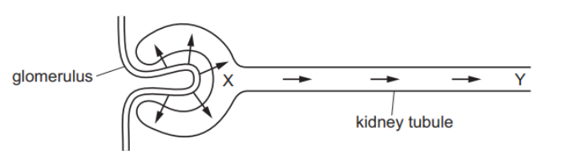

*Source: June 2022 paper 2 Q23*

### Q4 — medium — 1 marks

**Q4** [1 mark]

A person produced 1.75 dm3 of urine on a cool day.

How will the volume and concentration of urine change on a hot day, if fluid intake is the same as on the cool day?

|   | volume | concentration |
|---|---|---|
| **A** | increases | decreases |
| **B** | increases | increases |
| **C** | decreases | decreases |
| **D** | decreases | increases |

*Source: June 2022 paper 1 Q25*

### Q5 — medium — 1 marks

**Q5** [1 mark]

Which statement about urea is correct?

*Source: June 2021 0970/11 Q25*

### Q6 — hard — 1 marks

**Q6** [1 mark]

The diagram shows the first part of a kidney nephron and its blood supply.

During filtration, protein molecules do not pass through the wall of the glomerulus.

Which part contains the highest concentration of protein?

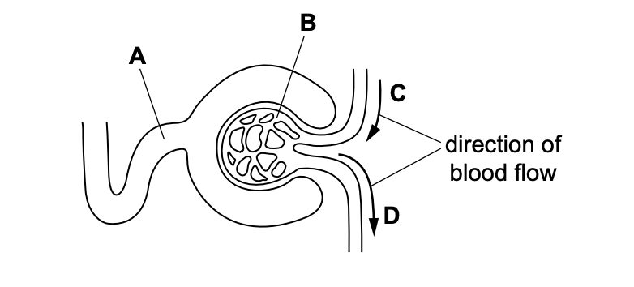

*Source: Specimen 2023 0970/02 Q27*

### Q7 — easy — 1 marks

**Q7** [1 mark]

The diagram shows part of the excretory system.

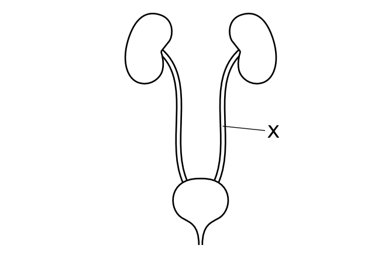

What is structure X?

*Source: Specimen 2023 0970/01 Q22*

### Q8 — hard — 1 marks

**Q8** [1 mark]

The table below shows the composition of a solution found in the human body.

| component | concentration / arbitrary units |
|---|---|
| glucose | 0.00 |
| urea | 4.00 |
| protein | 0.00 |
| salts | 3.00 |
| amino acids | 0.00 |

In a healthy person, which of the following structures would contain this solution?

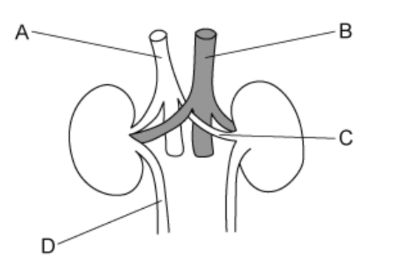

### Q9 — medium — 1 marks

**Q9** [1 mark]

#### Extended only

Each kidney contains one million kidney tubules called nephrons. A nephron is shown in the image below.

Which row of the table below correctly shows where filtration and selective reabsorption occur?

|   | filtration | selective reabsorption |
|---|---|---|
| **A** | 1 | 2 |
| **B** | 2 | 4 |
| **C** | 2 | 3 |
| **D** | 1 | 3 |

### Q10 — hard — 1 marks

**Q10** [1 mark]

The following table shows the composition of blood entering the kidneys of a healthy person.

| substance | % composition of blood entering the kidney |
|---|---|
| glucose | 0.20 |
| urea | 0.01 |
| protein | 7.00 |

Which row of the table below would show the percentage composition of blood of the same substances in the urine of a healthy person?

|   | composition of urine / % |   |   |
|---|---|---|---|
|   | glucose | urea | protein |
| **A** | 0.00 | 2.50 | 0.00 |
| **B** | 0.00 | 2.50 | 3.50 |
| **C** | 2.00 | 0.00 | 7.00 |
| **D** | 0.20 | 0.01 | 0.00 |

### Q11 — easy — 1 marks

**Q11** [1 mark]

What is urea produced from?

### Q12 — hard — 1 marks

**Q12** [1 mark]

#### Extended only

The image below shows a number of organs involved in helping rid the body of waste products.

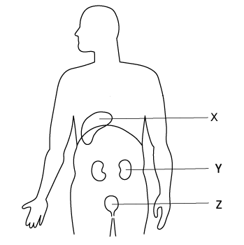

Excess amino acids from the diet cannot be stored by the body. One of the products of their breakdown is urea.

Which row of the table below is correct?

|   | name for breakdown of excess amino acids | makes urea | removes urea from the blood |
|---|---|---|---|
| **A** | assimilation | Y | Z |
| **B** | deamination | X | Y |
| **C** | assimilation | Y | X |
| **D** | deamination | X | Z |

### Q13 — hard — 1 marks

**Q13** [1 mark]

Which of the following factors would affect the volume and concentration of urine produced by the kidneys?

1. Exercise
2. Temperature
3. Water intake

### Q14 — hard — 1 marks

**Q14** [1 mark]

Which row of the table below correctly displays the correct roles of the following organs in processing waste in the human body?

|   | kidneys | liver | lungs |
|---|---|---|---|
| **A** | excretes urea | excretes amino acids | removes carbon dioxide |
| **B** | removes carbon dioxide | deamination of amino acids | excretes urea |
| **C** | removes urea from blood | deamination of amino acids | removes carbon dioxide |
| **D** | excretes urine | deamination of urea | removes carbon dioxide |

### Q15 — easy — 1 marks

**Q15** [1 mark]

Which of the following is **not **a main function of the kidneys in a healthy person?

### Q16 — medium — 1 marks

**Q16** [1 mark]

#### Extended only

Which of the following substances would be reabsorbed by the kidneys?

### Q17 — medium — 1 marks

**Q17** [1 mark]

Which of the following organs are responsible for removing excretory products from the blood?

### Q18 — easy — 1 marks

**Q18** [1 mark]

The image below shows the structure of the human urinary system.

Which row of the table below correctly matches the structures in the image to their names?

|   | renal artery | urethra | ureter |
|---|---|---|---|
| **A** | W | Z | X |
| **B** | W | Z | Y |
| **C** | X | Y | Z |
| **D** | X | W | Y |

### Q19 — easy — 1 marks

**Q19** [1 mark]

Which of the following is a correct example of excretion in mammals?

### Q20 — medium — 1 marks

**Q20** [1 mark]

To remain healthy, a person must be able to excrete a number of waste products produced as a result of metabolism.

A list of excretory products is given below.

Which of the following would be lost from both the kidneys **and** lungs?

### Q21 — medium — 1 marks

**Q21** [1 mark]

#### Extended only

Which of the following statements correctly describes the function of the kidneys?

### Q22 — easy — 1 marks

**Q22** [1 mark]

#### Extended only

Which of the following would **not **be a function of the liver?

## Theory Questions (10 questions)

### Q1 — medium — 14 marks

**Q1** [5 marks]

The liver is an important organ in many processes.

The liver responds to changes in insulin concentration.

Insulin is a hormone.

(i)

Define the term *hormone.*

[3]

(ii)

Describe how the liver responds to an increase in insulin concentration.

[2]

*Source: 2018 (Series 1) 0610/41 Q5A*

**Q1** [3 marks]

#### Extended Only

The liver is also involved in the processing of amino acids.

(i)

Describe how excess amino acids are broken down.

[2]

(ii)

State the name of the process that assembles amino acids to form proteins.

[1]

*Source: 2018 (Series 1) 0610/41 Q5B*

**Q1** [6 marks]

#### Extended Only

The liver is also involved in the processing of toxins.

(i)

Lactic acid is an example of a toxin that is produced during vigorous exercise and processed in the liver.

Describe how lactic acid is processed.

[2]

(ii)

Alcohol is another toxin that is processed in the liver.

The effect of alcohol consumption on the risk of dying from liver disease was investigated in men and women.

The results are shown in Fig. 1.

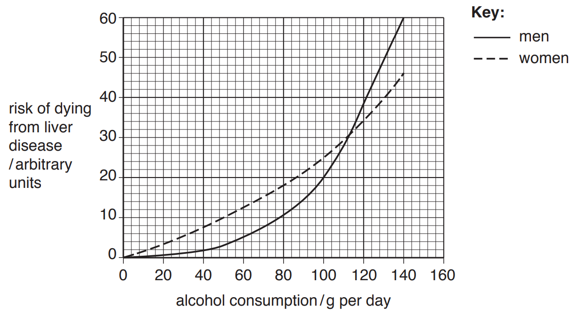

**Fig. 1**

Describe the results shown in Fig. 1.

*Source: 2018 (Series 1) 0610/41 Q5C*

### Q2 — hard — 11 marks

**Q2** [2 marks]

#### Extended only

Table 1 shows the concentration of different substances in blood plasma, filtrate entering the proximal convoluted tubule and urine.

**Table 1**

| substance | concentration in blood plasma / g dm-3 | concentration in the filtrate / g dm-3 | concentration in the urine / g dm-3 |
|---|---|---|---|
| glucose | 1.0 | 1.0 | 0.0 |
| protein | 80.0 | 0.0 | 0.0 |
| urea | 0.4 | 0.4 | 0.4 |
| substance X | 7.5 | 7.5 | 2.1 |

Explain the difference in concentration of protein in the blood plasma and filtrate.

**Q2** [4 marks]

#### Extended only

Under normal circumstances there should be no glucose present in urine.

(i)

Explain the reason for this.

[2]

(ii)

Suggest an explanation for the diagnosis that a doctor could make if glucose was present in the urine.

[2]

**Q2** [2 marks]

#### Extended only

Fig. 1 shows one of the cells found in the proximal convoluted tubule of the nephron.

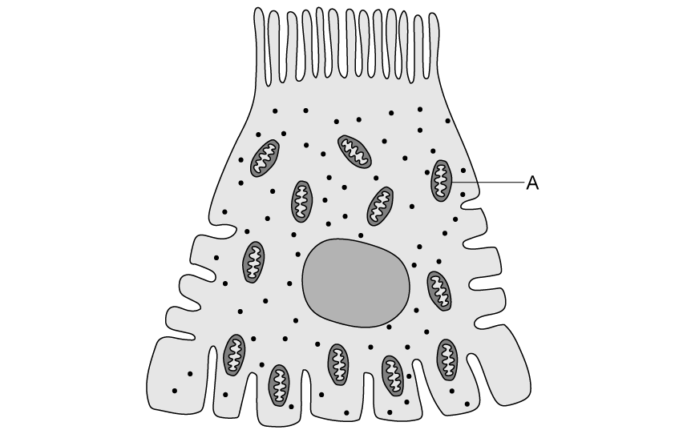

**Fig. 1**

Explain the presence of structure **A** in Fig. 1.

**Q2** [3 marks]

**Extract:**

Table 1 shows the concentration of different substances in blood plasma, filtrate entering the proximal convoluted tubule and urine.

Table 1

| substance | concentration in blood plasma / g dm^-3^ | concentration in the filtrate / g dm^-3^ | concentration in the urine / g dm^-3^ |
| glucose | 1.0 | 1.0 | 0.0 |
| protein | 80.0 | 0.0 | 0.0 |
| urea | 0.4 | 0.4 | 0.4 |
| substance X | 7.5 | 7.5 | 2.1 |

#### Extended only

The concentration of substance **X** in different parts of the urinary system is shown in Table 1 at part (a).

(i)

Identify whether substance **X** can be considered a waste product or a useful substance to the body.

[1]

(ii)

Use the information in Table 1 to explain your answer at part (i).

[2]

### Q3 — easy — 8 marks

**Q3** [1 mark]

#### Extended only

Fig. 1 shows the general structure of an amino acid.

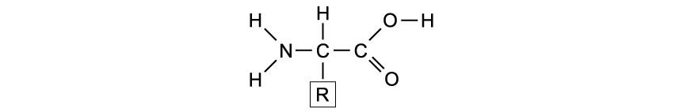

**Fig. 1**

During the process of deamination, the liver removes part of the amino acid.

Identify the part of the amino acid that is removed during deamination by circling it on Fig. 1.

[1]

**Q3** [3 marks]

#### Extended only

One of the products of deamination is urea.

Describe the fate of urea once it is produced by the liver.

**Q3** [2 marks]

**Extract:**

Urea is a toxic substance and must be excreted once it is produced by the liver. If it is allowed to accumulate in the body, it can have serious consequences.

#### Extended only

Urea is a toxic substance that should not be allowed to accumulate in the body.

State **two** consequences of high urea levels in the body.

**Q3** [2 marks]

#### Extended only

Amino acids are the building blocks of proteins.

Give **two** examples of proteins found in the body.

### Q4 — easy — 10 marks

**Q4** [3 marks]

#### Extended only

Fig. 1 shows the structure of a nephron in the kidneys.

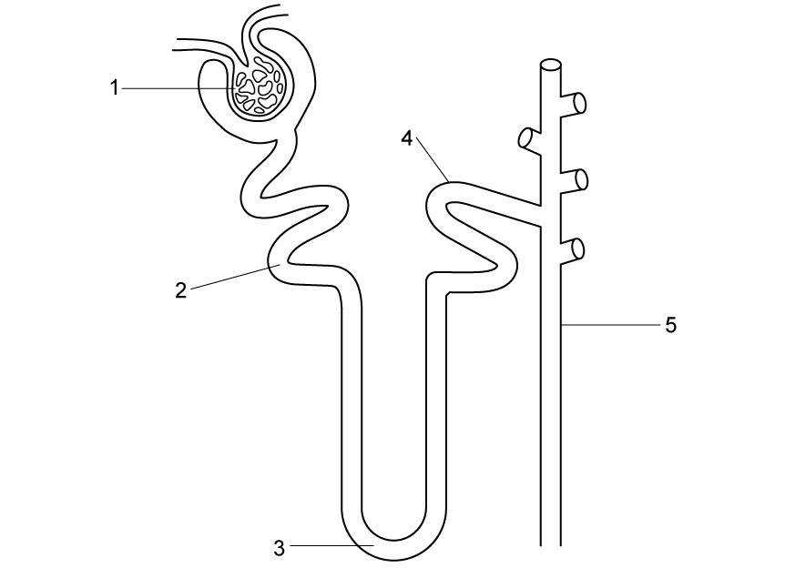

**Fig. 1**

(i) Identify structure **1** in Fig. 1.

[1]

(ii) Describe the process taking place at structure **1**.

[2]

**Q4** [2 marks]

#### Extended only

The fluid moving along structure **2** of the nephron in Fig. 1 is known as filtrate and it consists of various substances.

State **two** substances that will form part of the filtrate in Structure **2**.

**Q4** [2 marks]

#### Extended only

Water is reabsorbed from the filtrate back into the blood at various points along the nephron, such as structure **3** in Fig. 1.

(i) Identify structure **3** in Fig. 1.

[1]

(ii) Name the membrane transport process by which water is reabsorbed into the blood in structure 3.

[1]

**Q4** [3 marks]

#### Extended only

Structure **5** represents the collecting duct, which will adjust the amount of water reabsorbed into the blood depending on the needs of the body.

Complete the following sentences on reabsorption and excretion of water in the collecting duct.

On a hot, sunny day, the body will _________________ more water due to sweating. In order to conserve water, the collecting duct will reabsorb ____________________ water into the blood. This results in the excretion of _______________ urine that is more concentrated.

### Q5 — medium — 3 marks

**Q5** [3 marks]

Complete the sentences using words from the list.

You may use the words once, more than once or not at all.

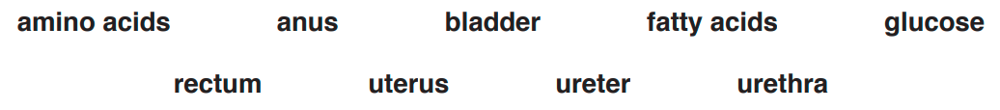

Urea passes through the kidney and forms part of the urine.

Urine leaves the kidney in the ............................................. . This tube takes the urine to the .............................................. where the urine is stored until it leaves the body. It leaves the body through the ................................................... .

*Source: 2018 0610/33 Q8B*

### Q6 — hard — 10 marks

**Q6** [3 marks]

#### Extended only

Glomerulonephritis is a set of kidney diseases that affect the glomeruli in the kidneys. One of the effects of glomerulonephritis is a thickening of the capillary walls of the glomerulus due to the presence of extra endothelial cells.

Suggest an explanation for the effect that this may have on the process of ultrafiltration.

**Q6** [2 marks]

**Extract:**

Glomerulonephritis is a set of kidney diseases that affect the glomeruli in the kidneys. One of the effects of glomerulonephritis is a thickening of the capillary walls of the glomerulus due to the presence of extra endothelial cells.

#### Extended only

If left untreated, glomerulonephritis may lead to kidney failure. One of the symptoms of kidney failure is swelling of the legs, ankles and feet.

Explain this symptom.

**Q6** [3 marks]

#### Extended only

Patients suffering from kidney failure will have to undergo kidney dialysis on a regular basis while waiting for a kidney transplant.

During the process of dialysis, blood from the patient flows through a dialysis machine which contains a series of convoluted tubes. These tubes are made from a selectively permeable substance called a dialysis membrane.

The tubes are surrounded by a solution called dialysate, which ensures that the dialysis machine performs the same function as normal kidneys. Once the blood has flowed through the entire dialysis machine, it returns back to the body.

Fig. 1 shows the process of kidney dialysis.

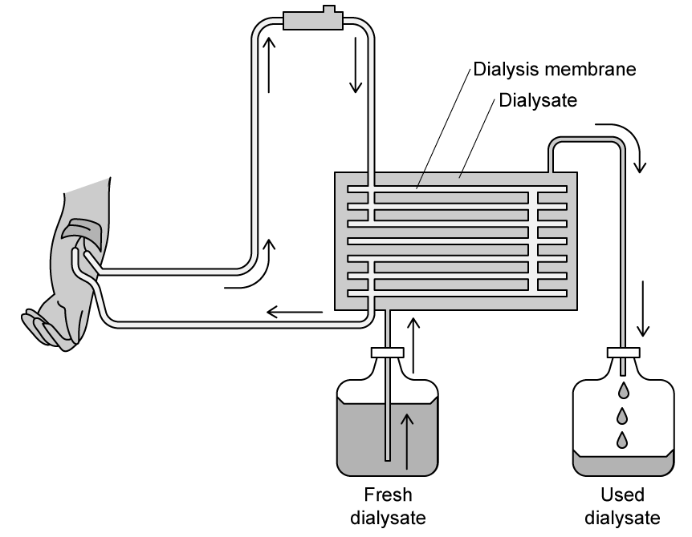

**Fig. 1**

Describe and explain the possible composition of the dialysate.

**Q6** [2 marks]

**Extract:**

During the process of dialysis, blood from the patient flows through a dialysis machine which contains a series of convoluted tubes. These tubes are made from a selectively permeable substance called a dialysis membrane. The tubes are surrounded by a solution called dialysate, which ensures that the dialysis machine performs the same function as normal kidneys. Once the blood has flowed through the entire dialysis machine, it returns back to the body.

The composition of the dialysate would be...
- It would contain no urea / waste products to ensure that these substances are removed from the blood;
- Useful substances/glucose/salts/ions would be present in the same concentration as the blood (plasma) to ensure none is lost/removed from the blood;
- The dialysate should have the same water content as the blood to avoid changes in blood volume/pressure;

#### Extended only

In order for kidney dialysis to be effective, the dialysate must be constantly replaced with a fresh solution.

Suggest a reason for this.

### Q7 — hard — 14 marks

**Q7** [4 marks]

#### Extended only

The nephron consists of several different structures such as the Bowman's capsule and glomerulus.

Describe and explain how the structure of the glomerulus and Bowman's capsule help to remove urea from the bloodstream.

**Q7** [5 marks]

#### Extended only

Table 1 shows the results of an investigation of the effects of a high protein diet on the synthesis of urea and the production of urine.

**Table 1**

| diet | mass of urea produced / g | volume of urine produced / L |
|---|---|---|
| normal level of protein | 25.2 | 1.60 |
| high protein | 39.6 | 2.31 |

(i)

Calculate the percentage increase in the mass of urea produced when switching from a normal diet to a high protein diet.

Show your working and give your answer to the nearest percent.

[2]

(ii)

Explain why a high protein diet would result in a greater mass of urea being produced.

[3]

**Q7** [2 marks]

**Extract:**

Table 1 shows the results of an investigation of the effects of a high protein diet on the synthesis of urea and the production of urine.

Table 1

diet | mass of urea produced / g | volume of urine produced / L
normal level of protein | 25.2 | 1.60
high protein | 39.6 | 2.31

#### Extended only

One of the symptoms of consuming too much protein for extended periods of time is dehydration.

Use the information in Table 1 to suggest an explanation for this.

**Q7** [3 marks]

#### Extended only

The kidneys are responsible for osmoregulation, which involves maintaining the balance of water and mineral salts in the body.

Explain the importance of osmoregulation to cells.

### Q8 — easy — 10 marks

**Q8** [3 marks]

Fig. 1 shows the urinary system in humans.

**Fig. 1**

Identify structure **A**, **B** and **D** in Fig. 1.

**Q8** [2 marks]

Give the name of organ **C** and describe its function in the urinary system.

**Q8** [2 marks]

The urinary system is responsible for the process of excretion.

Define the term *excretion*.

**Q8** [3 marks]

Carbon dioxide is one of the substances that is excreted by the body.

Explain the importance of excreting carbon dioxide.

### Q9 — medium — 10 marks

**Q9** [2 marks]

Excretion is the removal of toxic substances or substances in excess, from the body.

Excess water is excreted from the lungs and the kidneys.

State the name of **one other** substance that is excreted from

- The lungs

  - The kidneys.

*Source: 2018 (Series 2) 0610/32 Q7A*

**Q9** [3 marks]

The volume and concentration of urine varies with changing conditions.

Table 1 shows three changing conditions.

Write **increase** or **decrease** in each of the boxes in Table 1 to show how each change affects the volume and the concentration of urine.

**Table 1**

| changing condition | volume of urine | concentration of urine |
|---|---|---|
| increase in water intake |   |   |
| increase in temperature |   |   |
| increase in exercise |   |   |

*Source: 2018 (Series 2) 0610/32 Q7B*

**Q9** [5 marks]

Excretion is a characteristic of living organisms.

Growth is another characteristic of living organisms.

(i)

Define the term *growth*.

[2]

(ii)

State **three** characteristics of living organisms other than excretion and growth.

[3]

*Source: 2018 (Series 2) 0610/32 Q7C*

### Q10 — medium — 11 marks

**Q10** [2 marks]

The kidneys excrete excess water in urine.

The main component of urine is water.

State **two** other substances that are excreted by healthy kidneys.

*Source: 2018 0610/32 Q4A*

**Q10** [5 marks]

**Extract:**

A scientist investigated the effect of drinking sugar solutions, of different concentrations, on the volume of urine produced.

- 1.5 dm^3^ of sugar solution A was consumed by a healthy adult.
- Urine was collected at thirty minute intervals for 150 minutes.
- The volume of urine produced every thirty minutes was added to the previous total volume.
- This procedure was repeated with sugar solutions B and C.

The results are shown in Fig. 1.

(i)
Complete Table 1 using the information in Fig. 1.

Table 1
| description of measurement | volume / dm^3^ |
| total volume of urine produced 60 minutes after drinking solution C |   |
| volume of urine produced between 30 minutes and 60 minutes after drinking solution B |   |
| total volume of urine produced 150 minutes after drinking solution A |   |

(ii)
Suggest which of the three solutions, A, B or C, contained the most sugar.
Give a reason for your suggestion.

A scientist investigated the effect of drinking sugar solutions, of different concentrations, on the volume of urine produced.

- 1.5 dm3 of sugar solution **A** was consumed by a healthy adult.
- Urine was collected at thirty minute intervals for 150 minutes.
- The volume of urine produced every thirty minutes was added to the previous total volume.
- This procedure was repeated with sugar solutions **B** and **C**.

The results are shown in Fig. 1.

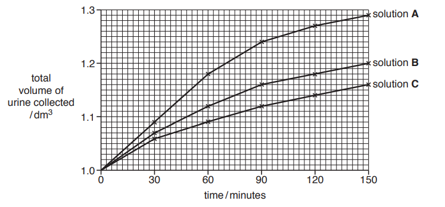

**Fig. 1**

(i)

Complete Table 1 using the information in Fig. 1.

**Table 1**

| description of measurement | volume / dm3 |
|---|---|
| total volume of urine produced 60 minutes after drinking solution **C** |   |
| volume of urine produced between 30 minutes and 60 minutes after drinking solution **B** |   |
| total volume of urine produced 150 minutes after drinking solution **A** |   |

[3]

(ii)

Suggest which of the three solutions, **A**, **B** or **C**, contained the most sugar.

Give a reason for your suggestion.

[2]

*Source: 2018 0610/32 Q4B*

**Q10** [2 marks]

List **two** factors that will affect the volume and concentration of urine produced.

*Source: 2018 0610/32 Q4C*

**Q10** [2 marks]

The body loses water in the urine.

State **two** other ways in which the body loses water.

*Source: 2018 0610/32 Q4C*

