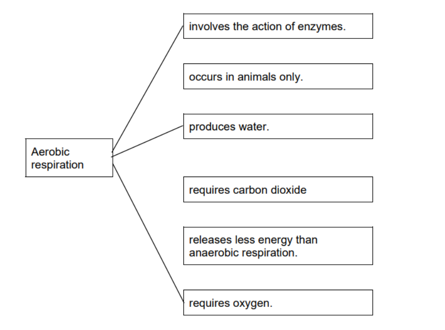
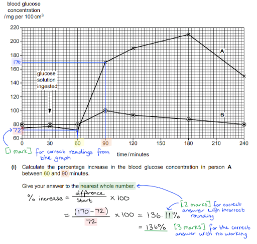
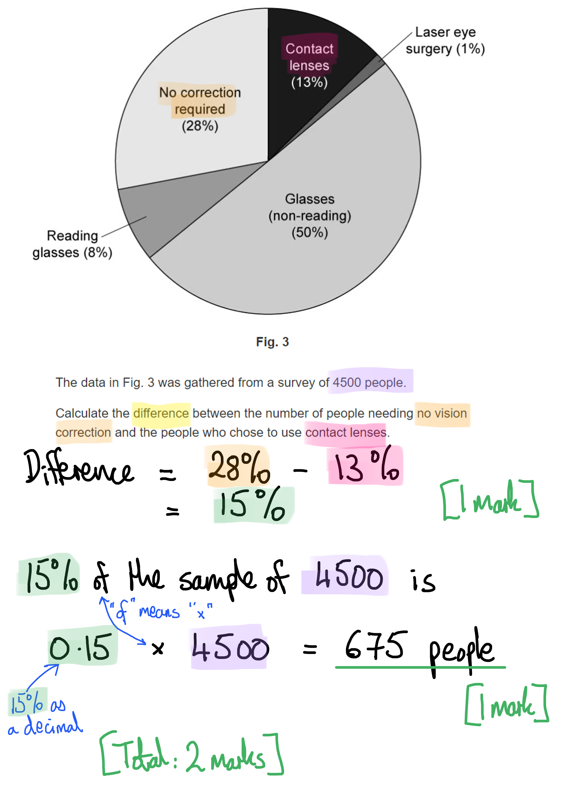
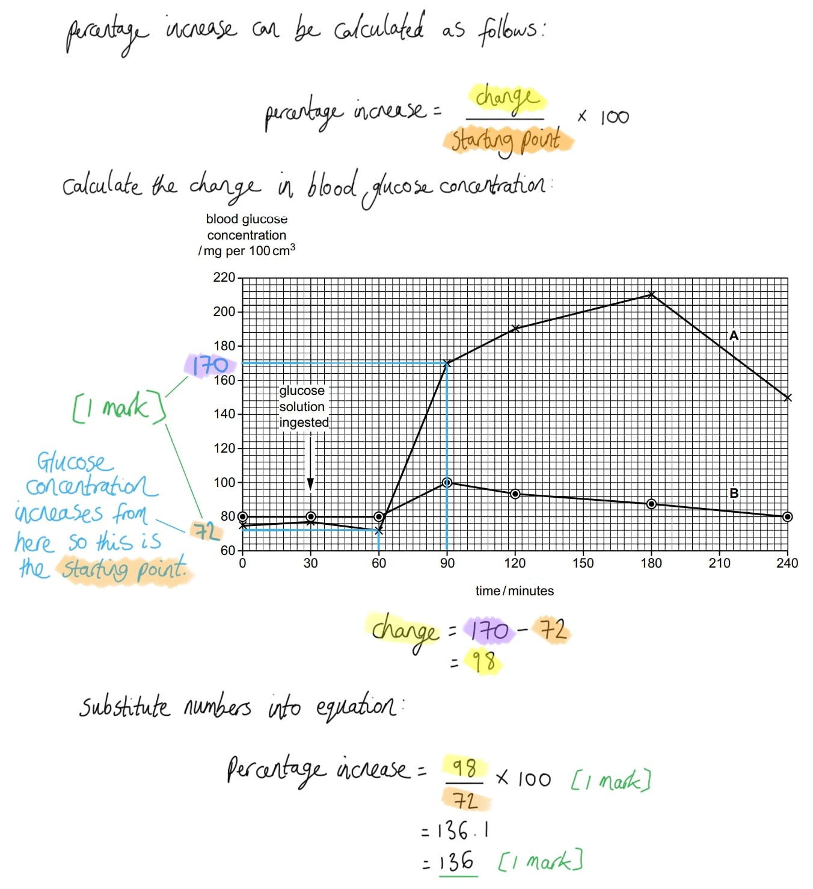
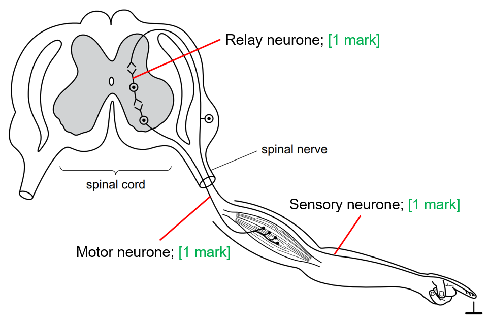
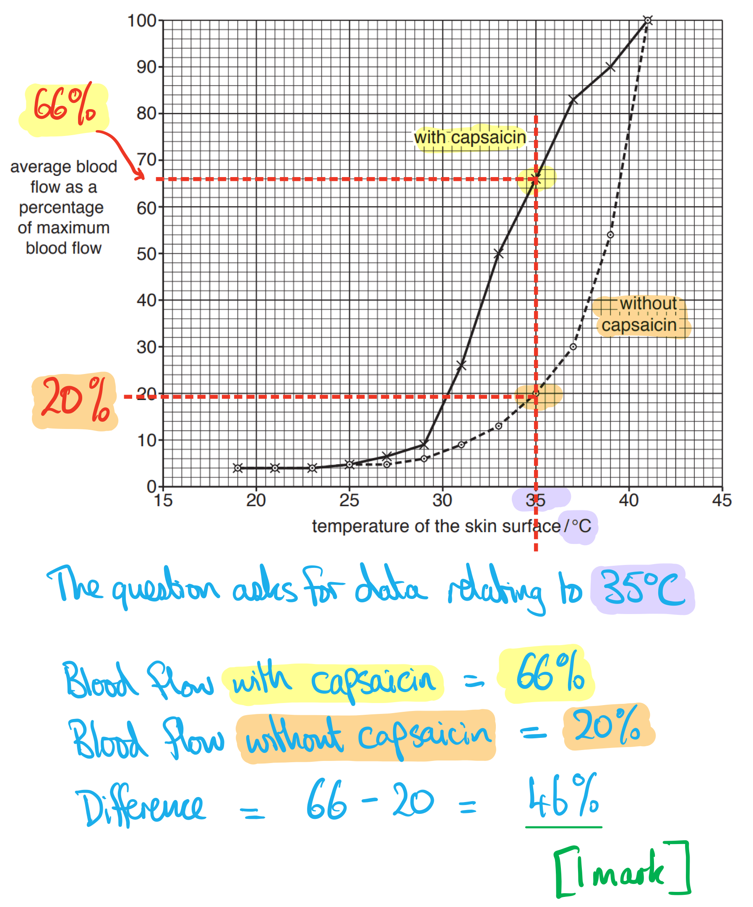
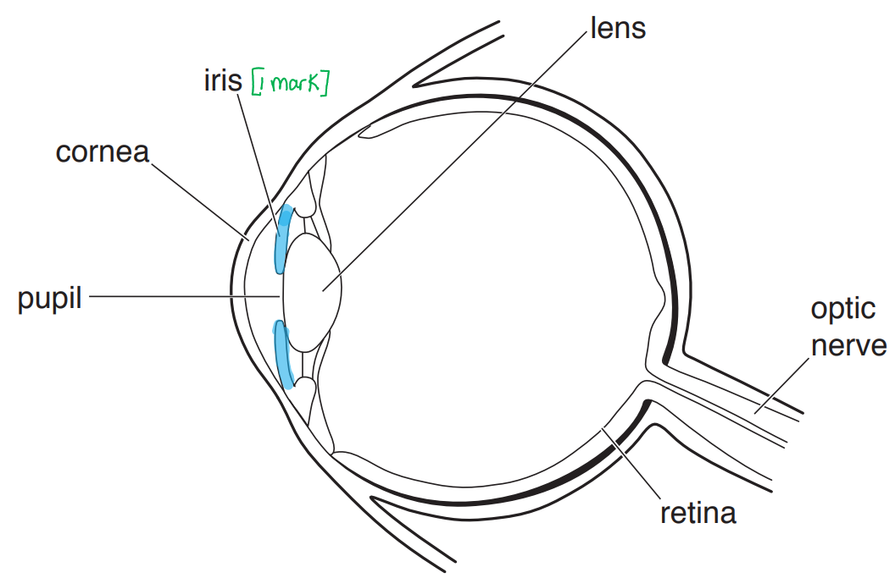
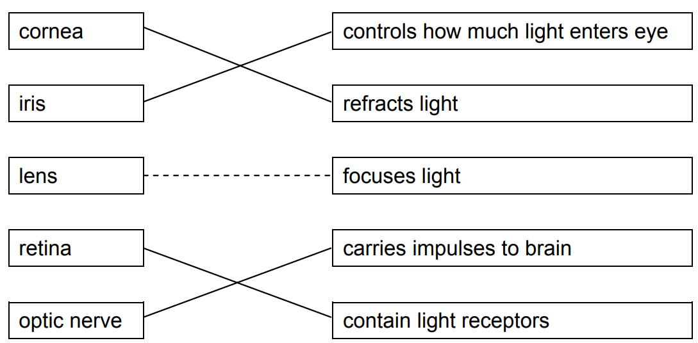

# Mark Schemes — Coordination, Response & Homeostasis
**14. Coordination & Response** · Cambridge (CIE) IGCSE biology (0610 & 0970)

## Multiple Choice Questions (44 questions)

### Q1
**Final answer:** **The correct answer is B.**

- A plant shoot will grow away from gravity (negative gravitropism) and towards light (positive phototropism)

**A** is incorrect as growth towards light is not gravitropism and growth towards gravity is not phototropism.

**C** is incorrect as shoots grow away from gravity so cannot show positive gravitropism.

**D** is incorrect as shoots grow towards light so cannot show negative phototropism. Shoots also grow away from gravity so cannot show positive gravitropism.

### Q2
**Final answer:** **The correct answer is A.**

- When a finger touches a pin, touch receptors detect the stimulus and a nerve impulse is sent along the sensory neurone to the relay neurone in the spinal cord
- The relay neurone passes the impulse to the motor neurone, which carries it to the effector, causing the arm muscles to contract and withdraw the finger

**B** is incorrect as the impulse travels along the sensory neurone first, not the motor neurone. Motor neurones carry impulses away from the CNS to the effector. A helpful way to remember this is that **sensory** neurones connect to **sense** organs, such as the skin.

**C** is incorrect as the impulse travels along the sensory neurone before reaching the relay neurone, not the other way round.

**D** is incorrect as the sequence begins at the receptor, not the effector. Receptors detect stimuli at the start of the reflex arc, whereas effectors, such as muscles, produce the response at the end.

### Q3
**Final answer:** **The correct answer is C.**

- The position of the cell body in the middle of the axon identifies this as a sensory neurone
- Sensory neurones carry electrical impulses from receptors towards the CNS

**A** is incorrect as this is not a motor neurone. Motor neurones have their cell body at one end, not in the middle, and carry impulses from the CNS to effectors.

**B** is incorrect as this is not a relay neurone. Relay neurones are typically located entirely within the CNS, whereas this neurone has long extensions, suggesting that it connects to structures outside the CNS.

**D** is incorrect as sensory neurones carry electrical impulses from receptors to the CNS, not from receptors directly to effectors.

### Q4
**Final answer:** **The correct answer is ****A.**

- Nervous control involves **electrical impulses travelling along neurones**, so responses are **very fast** and usually **short-lived**

**B** is incorrect because signals carried in the blood describe hormonal control, not nervous control.

**C **is incorrect because nervous signals do travel along neurones, but they are fast, not slow.

**D** is incorrect because signals carried in the blood describe hormonal control, not nervous control.

### Q5
**Final answer:** **The correct answer is ****D.**

- **Auxin **is a plant growth hormone produced in the shoot tip. When light shines from one side, auxin becomes **unevenly distributed**, moving to the **shaded side of the shoot**
- Auxin **stimulates cell elongation**, so cells on the shaded side grow longer
- This causes the shoot to **bend towards the light**, which is the** phototropic response**

**A** is incorrect because glucose is used in respiration and growth, but it does not control the bending of the shoot.

**B** is incorrect because chlorophyll is the green pigment used for photosynthesis; it absorbs light but does not control growth direction.

**C **is incorrect because cellulose forms the cell walls of plant cells and provides support; it does not control plant growth responses.

### Q6
**Final answer:** **The correct answer is ****A.**

- In bright light, the **pupil reflex** reduces the amount of light entering the eye. The **circular muscles of the iris contract**, which makes the pupil **smaller** (constricts) and therefore reduces the amount of light reaching the retina

**B** is incorrect because when the radial muscles contract, the pupil becomes larger (dilates), which happens in dim light to allow more light into the eye.

**C** is incorrect because when the circular muscles relax, the radial muscles contract as described above.

**D **is incorrect because the ciliary muscles control the shape of the lens, helping focus on near or distant objects; they do not control pupil size.

### Q7
**Final answer:** **The correct answer is ****B.**

- A reflex arc follows a fixed sequence:

  1. A **receptor** detects a **stimulus** (for example heat or pain) and generates a nerve impulse
  2. The impulse travels along a **sensory neurone** to the central nervous system (usually the spinal cord)
  3. The impulse passes across a **synapse** to a** relay neurone** within the spinal cord
  4. The relay neurone passes the impulse across another synapse to a **motor neurone**
  5. The motor neurone carries the impulse to an **effector** (a muscles or gland), which produces the response

### Q8
**Final answer:** **The correct answer is**** D****.**

- Auxin is produced in the tips of shoots where it causes cells to elongate. The distribution of auxin in the shoot is influenced by light and gravity which often results in unequal distribution in plant tissues.
- Under a light stimulus, auxin moves to the shaded part of the shoot causing elongation in those cells and resulting in growth towards the light source.

**A** is incorrect because auxin is primarily made in the tips of shoots and roots, not in all cells, and it moves by diffusion or active transport, not osmosis. Osmosis refers to the movement of water particles only.

**B** is incorrect because auxin is not made in all cells, though it can be unequally distributed, especially in response to light and gravity.

**C** is incorrect because while auxin causes cell elongation, it moves between cells by diffusion or active transport, not osmosis. Osmosis refers to the movement of water particles only.

### Q9
**Final answer:** **The correct answer is ****D****.**

- Adrenaline increases pulse rate in order to move more blood to the respiring muscle tissues and increases blood glucose concentration to drive respiration in preparation for 'fight or flight' responses.

**A** is incorrect because adrenaline increases both pulse rate and blood glucose concentration, not decreases them. Decreasing both would reduce the rate of respiration in vital muscle tissues and not allow the body to prepare for fight or flight.

**B** is incorrect because decreasing the pulse rate would reduce the speed at which blood is delivered to the respiring muscle tissues. This would decrease the oxygen and glucose supply and prevent the body from preparing for fight or flight.

**C** is incorrect because although adrenaline increases pulse rate, it also increases blood glucose concentration. If blood glucose were to decrease, this would lead to a reduced respiration rate and prevent the body from preparing for fight or flight.

### Q10
**Final answer:** **The correct answer is ****C****.**

- The radial and circular muscles of the iris work as an antagonistic pair, In bright light, the radial muscles relax and the circular muscles contract to decrease pupil size. This reduces the amount of light entering the eye to prevent damage to the retina.

**A** is incorrect because in bright light, the radial muscles relax while the circular muscles contract to reduce the pupil size.

**B** is incorrect because in bright light, the circular muscles contract, not relax, to constrict the pupil.

**D** is incorrect because both radial and circular muscles cannot relax simultaneously in bright light, as this would not reduce the pupil size effectively.

### Q11
**Final answer:** **The correct answer is ****D****.**

- This is because the shoot on the left would carry out normal phototropism and bend towards the light stimulus
- The shoot in the middle has the tip removed and so there is no auxin present and so there is no cell elongation that occurs and the shoot remains the same height
- The shoot on the right because the tip is not exposed to the light so the auxin diffuses equally in all parts of the shoot and causes all the cells to elongate evenly and the shoot grows straight upwards

### Q12
**Final answer:** **The correct answer is ****B****.**

- This is because vasoconstriction is a response to a drop in body temperature that causes blood vessels close to the skin to get narrower, reducing blood flow to the surface of the skin and reducing radiation of heat from the blood into the atmosphere from the skin's surface

**A** is incorrect because vasoconstriction reduces blood flow to the skin.

**C** and **D** are incorrect because vasodilation is a response that occurs when the body temperature is too high, not too low.

### Q13
**Final answer:** **The correct answer is ****C.**

- This is because C is the the fovea in the centre of the retina
- The fovea has the greatest concentration of cells that allow humans to see colour (cone cells)

**A** and **B** are incorrect because these areas of the retina have fewer colour detecting cells.

**D** is incorrect because this is the blind spot and does not contain any light detecting cells.

### Q14
**Final answer:** **The correct answer is ****C****.**

- This is because plant shoots show positive phototropism, meaning that they grow towards the light stimulus

**A** is incorrect because it is not the case that all parts of the plant grow towards the light, only the shoots.

**B** is incorrect because it is not the case that all parts of the plant grow away from the light, only the roots.

**D** is incorrect because plant roots show negative phototropism, meaning that they grow away from the light stimulus.

### Q15
**Final answer:** **The correct answer is ****A****.**

- This is because the brain acts as a coordinator in the nervous system that detects and coordinates the response to changes in internal body temperature

**B** is incorrect because the role of the heart is to pump blood around the body, not to detect and coordinate changes in internal body temperature.

**C** is incorrect because the role of the liver is to produce bile and help with the breakdown and processing of waste products in the body, not to detect and coordinate changes in internal body temperature.

**D** is incorrect because the role of the skin is to act as a barrier to protect the body, not to detect and coordinate changes in internal body temperature.

### Q16
**Final answer:** **The correct answer is ****C****.**

- This is because adrenaline triggers the fight or flight response.

**A** is incorrect because testosterone controls secondary sexual characteristics in males.

**B** is incorrect because oestrogen controls secondary sexual characteristics in women.

**D** is incorrect because insulin helps to lower blood glucose.

### Q17
**Final answer:** **The correct answer is ****D****.**

- Testosterone is responsible for the secondary sexual characteristics in males which includes the growth of facial hair.
- Insulin is responsible for blood glucose regulation as it causes the storage of glucose as glycogen in cells.
- Oestrogen is responsible for repairing the uterus lining as part of the menstrual cycle in women.
- Adrenaline is the fight or flight hormone which prepares the body for dealing with danger, including dilation of the pupils.

**A, B** and **C** are incorrect as they do not correctly link all hormones with the correct function.

### Q18
**Final answer:** **The correct answer is ****B****.**

- B is the iris which contains muscles that can contract and relax to control how much light enters the eye through the pupil.
- Extended students also need to be able to explain how the antagonistic action of radial and circular muscles in the iris control the pupil reflex.

**A** is the cornea which refracts light as it enters the eye.

**C** is the lens which focuses light onto the retina.

**D** is the optic nerve that carries impulses to the brain.

### Q19
**Final answer:** **The correct answer is ****D****.**

- The pathway in a reflex arc goes from a sensory neuron (which detects the stimulus), to a relay neuron (which processes the signal in the spinal cord), and then to a motor neuron (which activates the effector).

All other options are incorrect because they do not give the correct sequence of neurones.

### Q20
**Final answer:** **The correct answer is B**

- This is because when a person exercises the level of glucose in the blood decreases, causing more glucagon to be released (5)
- The glucagon is released from the pancreas and moves to the liver via the blood
- This causes glycogen in the liver to breakdown, reducing the quantity of stored glycogen (4)
- The glucose from the breakdown of the glycogen is released into the blood, increasing the quantity of glucose in the blood (1)

**A** is incorrect because glucagon causes glycogen in the liver to breakdown, not to be synthesised

**C **and **D** are incorrect because more glucagon is released after exercise, not less

### Q21
**Final answer:** **The correct answer is C**

- This is because the piece of glass in X is placed on the shaded side of the seedling therefore it does block the auxin from being able to diffuse down that side

**A** and **B** are incorrect because glass does not destroy auxin

**D **is incorrect because the glass in X was on the side of the seedling away from the light so it would not stop the auxin diffusing down the side of the seedling facing the light

### Q22
**Final answer:** **The correct answer is B**

- This is because circular muscles contract and the radial muscles relax in order to make the pupil smaller

**A** is incorrect because the circular and radial muscles are antagonistic, meaning that when one contracts the other must be relaxed. They cannot both contract at the same time

**C **is incorrect because circular muscles relax and the radial muscles contract in order to make the pupil dilate (get larger), not to make the pupil smaller

**D **is incorrect because the circular and radial muscles are antagonistic, meaning that when one contracts the other must be relaxed. They cannot both relax at the same time

### Q23
**Final answer:** **The correct answer is A because:**

A is the cornea, which refracts light entering the eye

**B** is incorrect because it shows the iris. Light does not pass through this part of the eye.

**C** is incorrect because it shows the optic nerve. Light does not pass through this part of the eye.

**D** is incorrect because it shows the retina, which absorbs light, it does not refract it.

### Q24
**Final answer:** **The correct answer is A because:**

**B** is incorrect because it shows the relay neurone.

**C** is incorrect because it shows the motor neurone.

**D** is incorrect because it shows the receptor.

### Q25
**Final answer:** **The correct answer is ****D**** because:**

- The density of rod and cone cells (photoreceptors) varies across the retina of the eye
- Rod cells are found all over the retina, whereas cone cells are most densely packed in a distinct area of the retina called the **fovea **(there are no rod cells here). The number of cone cells reduces drastically away from this fovea
- The optic nerve is attached to the retina, connecting the retina to the brain. There are no photoreceptors (rod or cone) cells in the region of the retina where the optic nerve is attached, this is the blind spot and must be region R on the graph

**A** is incorrect because this option suggests that the density of cone cells is more significant across the retina than rod cells, when in reality their density outside the fovea is much lower than the density of rod cells.

**B** is incorrect because although the distribution of rod and cone cells is correct, area R in the graph has no photoreceptor cells. The fovea contains a very high density of cone cells, so this answer is wrong.

**C** is incorrect because this option merges the incorrect aspects of answers **A **and **B**.

### Q26
**Final answer:** **The correct answer is ****B**** because:**

- We can divide the shoot into two halves; the side in the light and the side in the shade. Auxins accumulate on the shaded side of a shoot strongly exposed to light from one direction (in this case through the window of a box)
- In the shoots, auxin promotes cell growth and elongation; if the shaded side has more auxin than the side exposed to the light then it will grow at a faster rate and the shoot exhibits positive phototropism, growing towards the light source

**A** is incorrect because auxin would accumulate on the shaded side (as auxins diffuse away from light) and the shaded side would grow at a faster rate.

**C** is incorrect because although shoots do show negative gravitropism, this factor does not impact the shoots growth response to light. Auxins are strongly affected by light so would not be evenly distributed and there would not therefore be even growth.

**D** is incorrect because there would be more auxin on the shaded side of the shoot and faster growth in this region, not the region exposed to light.

### Q27
**Final answer:** **The correct answer is ****A**** because:**

- Receptor cells are found in sense organs. They pick up on the stimulus which generates an electrical impulse that is then sent along a sensory neurone (Z) to the coordinator (the brain or spinal cord)
- The impulse is then passed to a relay neurone (X) which is a short neurone found inside the coordinator and connects sensory neurones to motor neurones
- The impulse is then passed on to a motor neurone (Y) which connects to an effector, in this case a muscle, stimulating it to contract and bring about a response

**B** is incorrect because a reflex action cannot start with the relay neurone (X).

**C** is incorrect because the order of neurones is back-to-front from effector (muscle) to receptor, only effectors can carry out a response when signalled by an impulse from a motor neurone (Y) which requires impulses originating from the receptor.

**D** is incorrect because impulses pass along neurones in sequential order, an impulse cannot jump from a sensory neurone to a motor neurone.

### Q28
**Final answer:** **The correct answer is ****C ****because:**

- The skin senses stimuli of both pressure **and **heat, using different receptor cells within the skin's tissues
- The ears detect sound stimuli using the eardrum and cochlea, though also detect orientation stimuli to assist balance, using the semi-circular canals of the inner ear
- The nose detects gaseous (vapour) molecules that diffuse into the nostrils and fall on sensory receptors in the nasal passages

The only incorrect cells of the table are in the 'Nose' column, shown greyed out below:

|   | **Skin** | **Ears** | **Nose** |
|---|---|---|---|
| **A** | pressure | sound | chemical (in solution) |
| **B** | heat | balance | chemical (in solution) |
| **Final answer:** **C** | **Final answer:** **pressure** | **Final answer:** **balance** | **Final answer:** **chemical (vapours)** |
| **D** | heat | sound | temperature |

### Q29
**Final answer:** **The correct answer is ****C ****because:**

Sweating is an important process that helps cool the body by increasing heat loss to the environment. When a person’s core body temperature increases above the normal range, sweat glands in the skin release sweat (a solution of water and salts). Water molecules in sweat can evaporate (change state from a liquid to a gas); this results in a cooling effect as heat energy is lost from the body in this process.

**A **is incorrect because this statement implies that the purpose of water loss through the skin is to lose water! The release of sweat containing water is to cool the body.

**B** is incorrect because the loss of water from the kidneys is not a reason why people sweat. Indeed when a person sweats their kidneys may need to respond by losing less water to maintain blood pressure and prevent dehydration.

**D** is incorrect because sweating does not reduce blood glucose levels!

### Q30
**Final answer:** **The correct answer is ****B**** because:**

The cell in the image above is a sensory neurone. If the impulse moves along the neurone from Q to P, then Q must be a receptor cell in a sense organ and P must be a relay neurone in the central nervous system (CNS).

**A** is incorrect because this answer would only be correct if the impulse travelled along the neurone from left to right (the question specifies it travels in the opposite direction).

**C** is incorrect because the relay neurone synapses with the motor neurone directly in a reflex arc; there is no neurone in between them.

**D** is incorrect because this would be correct if the cell shown was a motor neurone. Notice that the cell body is found strongly at one end of the motor neurone.

### Q31
**Final answer:** **The correct answer is ****B**** (1 and 2 are correct) because:**

- **Statement 1** (to prevent harm or damage to an organism) is correct because an automatic, rapid response to a dangerous stimulus cuts the reaction time and allows less damage to be sustained before a response takes place
- **Statement 2** (to provide a rapid response to dangerous situations) is correct, linked to the explanation for **Statement 1**

**Statement 3** (to allow a degree of choice to an organism about response) is incorrect because reflexes are involuntary - they take place with no choice of conscious thought.

**Statement 4** (to allow certain stimuli to be ignored/eliminated) is incorrect because a dangerous stimulus cannot be ignored, nor can one be eliminated; that would be outside an organism's ability to control events!

### Q32
**Final answer:** **The correct answer is ****A ****because:**

- The brain and spinal cord together comprise the **central nervous system** (CNS)
- The network of neurones that extends to all parts of the body makes up the **peripheral nervous system**

### Q33
**Final answer:** **The correct answer is ****B**** because:**

- Both hormones which control blood glucose concentration are made by cells in the pancreas. Insulin is secreted in response to blood glucose levels rising; insulin stimulates the liver (and muscle cells) to take up excess glucose and convert it into the polymer glycogen so that it can be stored
- Too much glucose in cells lowers the water potential, which if left unchecked could lead to too much water being drawn into the cell by osmosis which could result in the cell bursting. The control of blood glucose levels is an example of *negative feedback*
- Glucagon is produced by different cells in the pancreas when blood glucose levels fall below the ideal range, this hormone stimulates liver and muscle cells to convert stored glycogen back into glucose which can then be released into the blood

**A** is incorrect because this would be the effect in the body when the blood sugar level decreases below the healthy range.

**C** and **D** are incorrect because the hormones are the wrong way around.

### Q34
**Final answer:** **The correct answer is ****C**** because:**

- In dim light the pupil needs to dilate to allow more light to reach the retina. To achieve this, the radial muscles must contract and the circular muscles must relax (as they work <u>antagonistically</u>)
- In bright light the circular muscles contract, constricting (the 3 C’s!) the pupil to reduce the amount of light entering the eye so that the photoreceptor cells of the retina are not damaged

**A** is incorrect because this would be the correct response of the muscles in the eyes if the person were in bright light.

**B** is incorrect because when circular muscles contract and the radial muscles relax, the iris becomes thicker so that the pupil constricts.

**D** is incorrect because when the radial muscles contract the iris is pulled thin to allow the pupil to dilate so that more light can enter the eye.

### Q35
**Final answer:** **The correct answer is ****A**** because:**

Receptor cells (S) are found in sense organs. They pick up on the stimulus which generates an electrical impulse that travels along a sensory neurone (U) to the central nervous system (the brain or spinal cord) where it synapses with a relay neurone (V) which allows the impulse to pass rapidly from the sensory neurone to a motor neurone. Motor neurones synapse with effectors, in this case a muscle (T), stimulating it to contract and bring about a response.

**B** is incorrect because T is the effector (muscle) and U is the sensory neurone; the sensory neurone does not connect to the effector via a synapse.

**C** is incorrect because the receptor cells (S) are connected to sensory neurones (U) only.

**D** is incorrect because a reflex arc cannot begin with an effector!

### Q36
**Final answer:** **The correct answer is ****A**** because:**

- When the body is cold, heat loss needs to be reduced to maintain a core body temperature around 37°C
- To reduce heat loss: Hair effector muscles contract, trapping a layer of insulating air close to the surface of the skin. Blood vessels (arterioles) constrict so that less blood flows close to the skin, reducing the loss of heat through the skin by radiation (the blood is vitally important in dissipating heat energy to the air surrounding the body)

**B **is incorrect because when the hair effector muscles contract, more air is trapped against the skin. Dilation of the blood vessels would cool the body further by increasing heat loss, when the idea is to reduce heat loss.

**C** and **D** are incorrect because when a person is cold, their hair effector muscles need to contract to pull the hairs up to trap a thicker layer of insulating air. The effects of the blood vessels in the skin is also incorrect in both options.

### Q37
**Final answer:** **The correct answer is ****C**** because:**

The release of a neurotransmitter at a synapse is not an example of negative feedback. Negative feedback mechanisms are the responses that occur in the body when a factor/system moves away from the normal range in which it should fall.

**A** is incorrect because maintenance of a core body temperature within a narrow range is a key example of negative feedback.

**B** is incorrect because vasoconstriction (constriction of arterioles in the skin) is part of a negative feedback response to a decrease in body temperature and is an action to reduce heat loss.

**D** is incorrect because the hormones insulin and glucagon act to maintain blood glucose levels within a narrow range, another key example of negative feedback.

### Q38
**Final answer:** **The correct answer is ****B ****because:**

By rotating the plant the effect of gravity is ‘removed’ because gravity will affect all parts of the plant equally, as opposed to acting on the plant in just one direction. The stem will still exhibit growth, but that growth will not be strongly upwards away from gravity as the effect of gravity has been negated (gravity acts in all directions when the plant is rotated). Therefore the stem will continue to grow in the direction it was growing.

**A** is incorrect because the shoot will not grow upwards if the plant is continually rotated. This would be the correct response if the plant was placed on its side but not rotated.

**C** is incorrect because the shoot is likely to have exhibited some growth in response to a lack of light (this is called etiolation) as auxins are still being produced by the tip of the shoot.

**D** is incorrect because shoots show negative gravitropism. The shoot would not grow downwards if gravity acted equally over the whole plant.

### Q39
**Final answer:** **The correct answer is ****A ****because:**

In the endocrine (hormonal) system, the pancreas is responsible for producing insulin in response to elevated blood glucose levels. The cells in the pancreas of a type 1 diabetic are unable to produce insulin, and so to maintain a blood glucose concentration within a normal range a person must regularly monitor their blood glucose level and inject insulin when it is raised.

**B** is incorrect because diet and exercise are ways to control blood sugar levels in type 2 diabetics.

**C** is incorrect because, although glucagon injections exist to help raise a diabetics blood sugar level when it is too low, control of blood sugar levels in diabetics is primarily achieved by insulin injection.

**D** is incorrect because the liver does not produce insulin, but it does respond to it.

### Q40
**Final answer:** **The correct answer is ****B ****because:**

This kind of multi-choice question is best solved by **eliminating **of the wrong answers, as follows:

The best-understood effect among students will usually be the pupil reflex (third and fourth columns of the table). In bright light, we can relate to the pupil closing; this is through <u>contraction of circular muscles</u> (doughnut-shaped) in the iris. Eliminate rows **A **and **C**.

When an object is far away, the <u>ciliary muscles relax</u> (the ring of muscle increases in diameter); this causes the <u>suspensory ligaments to tighten</u>. Only **B **and **C **agree with these statements (eliminate **D**), and we have already eliminated **C**, so the answer is left as **B**.

### Q41
**Final answer:** **The correct answer is ****C**** (the ****false ****statements are 1, 4, 5 and 6) because:**

To deal with the statements in turn:

1. Glucagon reverses the effect of the hormone glycogen - FALSE - glycogen is not a hormone; glucagon reverses the effects of the hormone **insulin**
2. Glucagon is produced in the pancreas - TRUE
3. Glucagon is secreted when blood glucose levels fall - TRUE
4. Glucagon stimulates liver and muscle cells to convert glucose into stored glycogen - FALSE; glucagon has the opposite effect to release glucose from stored glycogen in the liver and muscles
5. Glucagon is a polysaccharide - FALSE - glucagon, like most hormones, is a protein
6. Glucagon is usually secreted soon after ingestion of carbohydrate-rich food - FALSE, this is when insulin is usually secreted

### Q42
**Final answer:** **The correct answer is ****D ****because:**

- See the key concept link for the series of events that occur when an impulse arrives at the end of a neurone
- **D** is the only possible correct answer as the other three options begin with either the neurotransmitter being released (before an impulse has arrived at the end of the presynaptic neurone) or with an impulse in the postsynaptic neurone
- Remember that ‘pre’ means before and ‘post’ means after

### Q43
**Final answer:** **The correct answer is ****C ****because:**

- Adrenaline is known as the 'fight or flight' hormone because it is produced in situations where the organism may be in danger. It causes a range of different things to happen in the body, all designed to prepare it for movement (i.e. fight or flight)

Some of the effects of adrenaline include:

- Increasing blood glucose concentration for increased respiration in muscle cells
- Increasing pulse rate and breathing rate so glucose and oxygen can be delivered to muscle cells and carbon dioxide taken away from muscle cells more quickly
- Both of these effects maximise the ability of the muscles to contract to bring about rapid movement

Other effects of adrenaline include:

- Diverting blood flow towards muscles and away from non-essential parts of the body such as the alimentary canal
- Dilating pupils to allow as much light as possible to reach the retina so more information can be sent to the brain

### Q44
**Final answer:** **The correct answer is ****D**** because:**

- During strenuous exercise the body temperature will rise (due to increased muscle activity) and therefore sweat will be produced to help cool the body down as evaporation of water from the skin results in increased heat loss leading to a cooling effect
- This increases the volume of water lost through the skin. To prevent dehydration and maintain blood pressure, less water will need to be lost from the kidneys in the production of urine. As such, more water would be reabsorbed back into the bloodstream from the kidney tubules (resulting in a smaller volume of more concentrated urine being produced)
- As body temperature rises, the skin responds by relaxing effector muscles so that the hairs on the skin lie flat. Less air is trapped against the skin, reducing the insulting effect so that more heat loss can occur

## Theory Questions (18 questions)

### Q1
> **[mark-scheme]**
> (i) The hormone and the glands are:
> 
> - Adrenaline **[1 mark]**
> - Adrenal (glands) **[1 mark]**
> 
> (ii) One effect other than an increased heart rate is:
> 
> Any **one** from:
> 
> - increased breathing rate
> - widened pupils / increased pupil diameter
> 
> **[1 mark]**
> 
> Accept references to increased blood glucose.

### Q2
To calculate the rate of pupil constriction between 0.5 seconds and 2.5 seconds:

- Determine the time that has passed, i.e. the change in the Y axis:

= 2.5 - 0.5

= 2 seconds

- Determine the change in pupil diameter, i.e. the change in the X-axis:

= 8 - 2

= 6 mm

- Determine the change in pupil diameter per second:

  - Divide the change in diameter by the number of seconds

= 6 ÷ 2

= **3 mm/s**

> **[mark-scheme]**
> Award marks as follows:
> 
> - 2 (seconds) **AND** 6 (mm) **[1 mark]**
> - 3 **[1 mark]**
> - mm/s **OR **mm s-1 **[1 mark]**
> 
> Award full marks for the correct answer and units in the absence of other calculations.
> **[mark-scheme]**
> Any **four** from:
> 
> - Neurotransmitter does not diffuse across the synaptic gap / cleft
> - Neurotransmitter molecules do not bind with receptor proteins on the next neurone
> - The next neurone is not stimulated / no impulse is generated in the next neurone
> - No impulse is transmitted to the circular muscles of the iris
> - The circular muscles do not contract
> 
> **[4 marks]**

> **[exam-tip]**
> You must use the word **diffuse**. Impulses do not "jump" across the gap, and saying that the neurotransmitters "move" across is too vague for a mark.
> 
> Here you should be sure to follow the chain of reasoning through to the pupil, i.e. linking the events at the synapse to the circular muscles of the iris.
> **[mark-scheme]**
> - Ciliary muscles relax** [1 mark]**
> - Suspensory ligaments are pulled tight / taut **[1 mark]**
> - The lens becomes thinner / less convex **[1 mark]**
> - Light is refracted less (to focus the image on the fovea/retina)** [1 mark]**

> **[exam-tip]**
> The most common mistake is confusing near and distant vision — for distant objects ciliary muscles relax, for near objects they contract.
> 
> Make sure to mention refraction - the purpose of changing the lens shape is to change how much the light is bent. For a distant object, light needs to be refracted less.
> **[mark-scheme]**
> Any **three** from:
> 
> - Nervous response is faster **OR** hormonal response is slower
> - Nervous response is short-lived **WHILE** hormonal response is long-lasting
> - Nervous signals are electrical impulses **WHILE** hormonal signals are chemicals
> - Nervous signals travel via neurones **WHILE** hormonal signals travel in the blood
> 
> **[3 marks]**

### Q3

- [1 mark] for each correct line

*Note that marks will be deducted for any additional lines*
| change in the genotype |   |
|---|---|
| decreased breathing rate |   |
| development of lung cancer |   |
| increased pulse rate | ✓; [1 mark] |
| widened pupils | ✓; [1 mark] |

*Note that marks will be deducted for any additional ticks*

(ii)

- The adrenal (gland); [1 mark]

(iii)

- (In the) blood **OR** in the plasma; [1 mark]

### Q4
- Gravitropism; **[1 mark] **
- Idea of negating the effect of gravitational pull / gravity on one side of the plant (only); **[1 mark] **
- (Used as a control) to compare with (the response of) plant **B**;  **[1 mark] **
(i)

- Auxin;  **[1 mark] **

(ii)

Any three from:

- (Auxin / hormone produced in the tip);  **[1 mark] **
- Moves / diffuses away from tip / down the stem *or* shoot *or* plant;  **[1 mark] **
- Moves to / collects on one / lower side (of the stem / plant);  **[1 mark] **
- Stimulates <u>cell</u> elongation;  **[1 mark] **
- Stem / plant bends / grows / turns upwards; **[1 mark] **

There is flexibility here to gain extra marks for other valid answers that are not specifically named on the mark scheme.
Any three from:

- Reach light for photosynthesis;  **[1 mark] **
- (Reach air for) carbon dioxide for photosynthesis;  **[1 mark] **
- (Reach air for) oxygen for respiration;  **[1 mark] **
- Idea that they grow tall so that flowers are exposed for, (wind / insect) pollination;  **[1 mark] **
- Roots grow downwards / towards (direction of) gravity;  **[1 mark] **
- To reach water / ions or minerals;  **[1 mark] **
- To anchor plant in the soil; **[1 mark] **

There is flexibility here to gain extra marks for other valid answers that are not specifically named on the mark scheme.

### Q5
- J = liver; [1 mark]
- K = gallbladder; [1 mark]
- L = duodenum / small intestine; [1 mark]
*Hormones*

- Insulin; [1 mark]
- Glucagon; [1 mark]

*Enzymes*

- Amylase / carbohydrase; [1 mark]
- Trypsin / protease; [1 mark]
- Lipase; [1 mark]
Any three from:

- Active transport; [1 mark]
- Movement occurs against a concentration gradient / from low concentration to high concentration; [1 mark]
- The CFTR protein changes shape to move (chloride) ions; [1 mark]
- Energy is needed; [1 mark]

Note that you are not expected to know anything about cystic fibrosis, but instead you should be able to apply your knowledge of active transport to this context.
Any three from:

- Chloride ions (in duct) decrease water potential; [1 mark]
- Water moves by <u>osmosis</u>; [1 mark]
- Water moves down a water potential gradient / from high water potential to low water potential; [1 mark]
- Water moves through a partially permeable membrane; [1 mark]

### Q6
- Chemical substance produced by a (endocrine) gland;** [1 mark]**
- Carried by the blood;** [1 mark]**
- Alters the activity of specific target organs; **[1 mark]**

**[Total: 3 marks]**

> *Always make sure you are really confident on your key definitions like this. They are easy marks if you’ve done your revision correctly.*
(i) 136(%); **[3 marks]**

**[1 mark]** for correct readings from the graph, 72 and 170

**[1 mark]** for the correct calculation

**[1 mark]** for correct rounding to a whole number

> *You can still get the second and third marks if you picked the incorrect numbers from the graph but did the correct calculation*

(ii) Any **three** from:

- Similar response first 30 minutes (after the glucose ingestion); **[1 mark]**
- (Person A) increases / decreases more steeply / faster; **[1 mark]**
- (Person A) increases to / has a higher concentration;** [1 mark]**
- (Person A) reaches a peak / decreases (much) later; **[1 mark]**
- (Person A) does not return to starting concentration / original value / normal;** [1 mark]**
- Any comparative use of figures with correct units e.g. blood glucose concentration peak of person A is 210 mg per 100 cm3 whereas peak of person B is 100 mg per 100 cm3; **[1 mark]**

(iii) Increase in glucose concentration causes secretion of insulin; [1 mark]

- (Secretion) by the pancreas; **[1 mark]**
- Insulin causes the liver to take up glucose from the blood; **[1 mark]**
- Glucose is converted to glycogen;** [1 mark]**

> *You can also get a mark for any other correct answers, such as a reference to the detection of increased glucose by the pancreas OR the activation of enzymes in the liver.*

(iv) Any **two** from:

- Taking of insulin; **[1 mark]**
- Injections / pump; **[1 mark]**
- (Regular) monitoring of blood glucose concentration;** [1 mark]**
- Controlling carbohydrate intake; **[1 mark]**
- Exercise regularly; **[1 mark]**
- Maintain a healthy mass; **[1 mark]**

**[Total: 12 marks]**

### Q7
Advantages and disadvantages of changing to treatment F include...

**Advantages**

A maximum of **three** of the following:

- Lower (dry) mass of weeds (after treatment F in comparison to C); **[1 mark]**
- Lower weed density / fewer weeds (after treatment F in comparison to C); **[1 mark]**
- (Fewer weeds means that crops have) less competition; **[1 mark]**
- (Less competition will give a) higher crop yield; **[1 mark]**

**Disadvantages**

A maximum of **three** of the following:

- More treatments / repeat treatments (are required in treatment F compared to C); **[1 mark]**
- (More treatments will mean) increased cost/time/effort; **[1 mark]**
- (More treatments will mean) increased environmental impact; **[1 mark]**
- (More treatments will mean) increased health risks; **[1 mark]**

**[Total: 4 marks]**

> *Aim to give a reasonable balance of advantages and disadvantages in questions like this. Statements here should involve **comparative** terms such as 'lower', 'less', 'increased', and 'higher' because two treatments are being compared.*

> *Note that while the use of weedkiller 2,4-D is no longer in the CIE IGCSE syllabus for 2023-2025, this question is about dealing with data and making reasonable suggestions about the consequences of weedkiller use and therefore does not require any specialist knowledge of 2,4-D. *

> *This question does not require extended knowledge but is taken from an extended paper 4 question.*
The name of the response during which shoots of a plant grow away from gravity is...

- Gravi/geo; **[1 mark]**
- Tropism;** [1 mark]**

**[Total: 2 marks]**

> *This question covers core knowledge but is taken from an extended paper 4 question.*

### Q8
The effect a less flexible lens would have on the path of light is as follows...

Any **three **from the following:

- The light is refracted by a smaller amount / narrower angle; **[1 mark]**
- As the lens is thin / stretched; **[1 mark]**
- Images / light rays are brought into focus behind the retina; **[1 mark]**
- So (close objects) appear blurred/fuzzy; **[1 mark]**

**[Total: 3 marks]**

> *To help you answer this question, think of the lens and path of light as being similar to when looking at a distant object but as the person is looking at a near object, the amount of light refraction is not sufficient. This condition is known as presbyopia and can be corrected by wearing reading glasses. *
The changes that occur in the normal human eye to focus on near and distant objects are...

**Process/eye structure:**

Up to **two** from the following:

- Key term accommodation used; **[1 mark]**
- Lens held in place by suspensory ligaments that are attached to the ciliary muscles; **[1 mark]**
- Accommodation achieved by changing the shape of the lens; **[1 mark]**
- Which alters the path of / refracts light rays; **[1 mark]**
- So that they focus on the retina; **[1 mark]**

**Looking at near objects:**

Up to **two** from the following:

- The ciliary muscles contract; **[1 mark]**
- The suspensory ligaments slacken / loosen; **[1 mark]**
- Making the lens thicker / lens is fat; **[1 mark]**
- So that light is refracted strongly; **[1 mark]**

**Looking at distant objects:**

Up to **two** from the following:

- The ciliary muscles relax; **[1 mark]**
- The suspensory ligaments are taut / stretched / tighten; **[1 mark]**
- Making the lens thinner / lens is pulled thin; **[1 mark]**
- So that light is only refracted slightly; **[1 mark]**

*Credit any other valid points made but ignore any irrelevant points*

**[Total: 6 marks]**
People with long-sightedness cannot see nearby objects clearly because...

- In long-sightedness the light rays do not focus on the retina **OR** they focus behind the retina; **[1 mark]**
- Image would be blurred / out-of-focus; **[1 mark]**

**[Total: 2 marks]**
The difference between the number of people needing no vision correction and the people who chose to use contact lenses is calculated as follows:

- No correction: 4 500 × 0.28 = 1 260 **AND** contact lenses: 4 500 × 0.13 = 585; **[1 mark]**
- Difference: 1 260 - 585 = 675 people; **[1 mark]**

**OR**

- 28% - 13% = 15%; **[1 mark]**
- 4 500 × 0.15 = 675; **[1 mark]**

**[Total: 2 marks]**

### Q9
The five sentences about the eye and the nervous system should be completed using the following words:

- Accommodation; **[1 mark]**
- Antagonistic; **[1 mark]**
- Peripheral; **[1 mark]**
- Optic; **[1 mark]**
- Brain; **[1 mark]**

**[Total: 5 marks]**

> *Be careful to use the correct terms for **accommodation** and **antagonistic**, as students often get these wrong - for example, using ‘focusing’ instead of accommodation, or ‘opposing’ instead of antagonistic, would **not** gain marks.*
Ions are moved across membranes by active transport in the following way:

Any **three **from the following:

- (In a process that) involves proteins/carriers/pumps (in neurone membrane); **[1 mark]**
- Ion(s) bind to proteins/carriers/pumps to be transported; **[1 mark]**
- Ions are moved against their concentration gradient / from low to high concentration; **[1 mark]**
- (This) requires energy/ATP; **[1 mark]**

***Accept**** a reference to a change in the shape of the carrier (protein) in order to transport an ion across the membrane.*

**[Total: 3 marks]**
The effects of these two drugs on the nervous system can be explained as follows:

- Neurotransmitters move across synapse/gap/junction;  **[1 mark]**

A maximum of **four** from the following:

Atropine

- Neurotransmitter cannot bind to/enter/reach receptors; **[1 mark]**
- (Therefore) no impulses are transmitted (along next neurone/postsynaptic neurone) / reach the CNS; **[1 mark]**
- (This could result in) no/reduced sensitivity to stimuli / feels no/reduced pain / acts as a painkiller; **[1 mark]**
- (This could result in) no contraction of muscle / no response / longer reaction time / no reflex action; **[1 mark]**
- (This drug could act as a) depressant; **[1 mark]**

A maximum of **four** from the following:

Eserine

- Neurotransmitter stays in synapse/synaptic gap; **[1 mark]**
- Neurotransmitter can bind to receptor; **[1 mark]**
- (This means that the neurotransmitter can continuously) stimulate the next neurone/postsynaptic neurone; **[1 mark]**
- (More) impulses are sent (in next neurone/postsynaptic neurone); **[1 mark]**
- (This could lead to) repeated contraction of muscle / response; **[1 mark]**
- (This drug could act as a) stimulant; **[1 mark]**

**[Total: 6 marks]**

> *While knowledge of the effects of drugs on synapses is no longer covered in the 2023-25 specification, this question does not actually require any knowledge of the effects of drugs to gain the available marks. This question requires you to use your knowledge of the events at a synapse to explain how disruption of these events would affect nerve transmission.*

### Q10
The term hormone refers to...

- A chemical (substance) produced by an endocrine gland; **[1 mark]**
- Transported/carried by the blood; **[1 mark]**
- It affects/alters the activity of target organs/cells; **[1 mark]**

**[Total: 3 marks]**

> *This question covers core knowledge but is taken from an extended paper 4 question.*
(i) The percentage increase in the blood glucose concentration in person **A** between 60 and 90 minutes can be calculated as follows...

- 72 and 170 read correctly from graph; **[1 mark]**
- (98 ÷ 72) x 100; **[1 mark]**
- 136 (%); **[1 mark]**

*Full marks can be awarded for the correct answer in the absence of any other calculations.*

***Accept**** error carried forward for marking points 2 and 3, i.e. if the numbers are read from the graph incorrectly but the correct calculation is carried out.*

(ii) The response of person **A** can be compared with the response of person **B** as follows...

Any **three **of the following:

- Responses are similar for the first 30 minutes / between 30 and 60 minutes; **[1 mark]**
- (The response of person **A**) increases / decreases at a faster rate / more steeply / more quickly; **[1 mark]**
- (The response of person **A**) increases to / has a higher maximum glucose concentration; **[1 mark]**
- The decrease in blood glucose (for person **A**) occurs later (than for person **B**) **OR** the peak blood glucose (for person **A**) occurs later (than for person **B**); **[1 mark]**
- (The response of person **A**) does not return to the starting level/value/concentration/normal level; **[1 mark]**
- Any correctly compared pair of equivalent values for **A** and **B** **AND** correct units are used; **[1 mark]**

***Accept ****reverse statements for any of the marking points, i.e. where person ****B**** is compared to person ****A****.*

(iii) The response of person **B** after 90 minutes can be explained as follows...

- Increase in blood glucose causes secretion of insulin; **[1 mark]**
- (Insulin is secreted) by the pancreas; **[1 mark]**
- Insulin causes the liver (cells) to take up/in / remove glucose from the blood; **[1 mark]**
- Glucose is converted to glycogen (inside liver cells); **[1 mark]**

***Accept ****references to:*

- *The pancreas detecting changes in blood glucose.*
- *Insulin activating enzymes inside liver cells.*

(iv) The treatment of type 1 diabetes involves...

Any **two **of the following:

- (Taking) insulin; **[1 mark]**
- (Insulin can be taken by) injection / insulin pump; **[1 mark]**
- Monitoring of blood glucose levels/concentration; **[1 mark]**
- Regulating/controlling carbohydrate intake (in diet); **[1 mark]**

***Accept ****references to:*

- *Regular exercise.*
- *Maintenance of a healthy body mass/weight.*
- *Insulin ****not**** being taken orally.*

**[Total: 12 marks]**

> *Remember when answering 'compare' questions to include both similarities and differences. Statements of difference should include a direct comparison.*

> *The response of person **B** is that of a healthy individual with a normal response to raised blood glucose so your explanation in part iii) should explain how insulin works to lower blood glucose.*

### Q11
The the correct order of components during a nervous response is...

1. Stimulus
2. Receptor
3. Coordinator
4. Effector
5. Response

- 5 correct; **[3 marks]**
- 3 or 4 correct; **[2 marks]**
- 1 or 2 correct; **[1 mark]**

**[Total: 3 marks]**
The sense organ that contains receptor cells that respond to changes in light is the...

- Eye; **[1 mark]**

**[Total: 1 mark]**
The name of this junction is:

- Synapse; **[1 mark]**

**[Total: 1 mark]**
The impact that a general anaesthetic would have on the nerve signal...

Any **three **of the following:

- A nerve/electrical impulse arrives at the end of the neurone; **[1 mark]**
- (But), anaesthetic stops/inhibits the release of chemicals/neurotransmitters; **[1 mark]**
- (So) no/fewer chemicals/neurotransmitters diffuse across / crosses the gap between neurones; **[1 mark]**
- No / a reduced impulse is triggered/sent to the next neurone; **[1 mark]**
- (Thus) stopping/disrupting the transmission of nerve/electrical impulse; **[1 mark]**

**[Total: 3 marks]**

### Q12
Sensitivity is...

- Ability to <u>detect</u> and <u>respond</u> to changes in the environment; **[1 mark]**

**[Total: 1 mark]**

> *When a word is underlined in a mark scheme it means that it is essential in order to get the mark. *

> *This question covers core knowledge taken from an extended only paper 4 question.*
The three types of neurone shown are:

- Sensory neurone; **[1 mark]**
- Relay / connector / intermediate neurone; **[1 mark]**
- Motor / effector neurone; **[1 mark]**

**[Total: 3 marks]**

> *Check the exact place your label lines join to the diagram. You need to be accurate otherwise you can lose the mark. *

> *This question covers core knowledge taken from an extended only paper 4 question.*
An involuntary action is:

- Automatic / no thought required / not a conscious action / no (higher centres in) brain involved; **[1 mark]**
- Stimulus always leads to the same response / fixed response; **[1 mark]**

**[Total: 2 marks]**

> *Any reference to the speed of the response will not gain you a mark in this question. *

> *This question covers core knowledge taken from an extended only paper 4 question.*
(i) A synapse is:

- A <u>junction</u> between two <u>neurones</u>; **[1 mark]**

(ii) Impulses are transmitted across a synapse by:

Any **three **from the following:

- (An impulse triggers) the release of <u>neurotransmitters</u> (into the gap); **[1 mark]**
- Diffuse across the gap; **[1 mark]**
- Binds to receptors...; **[1 mark]**
- ...which allows the passage of the impulse; **[1 mark]**

**[Total: 4 marks]**

> *Underlined words are essential in order to gain marks. These are the words it is important to focus on when you are revising. *
The hormone adrenaline affects the body by:

Any **two **from the following:

- Heart beats faster / increased pulse;** [1 mark]**
- Increased rate of breathing;** [1 mark]**
- Stimulates breakdown of glycogen in the liver;** [1 mark]**
- Increases blood glucose concentration;** [1 mark]**
- Dilate pupils;** [1 mark]**
- Heightened sensitivity / increased mental awareness / sharper senses / more alert; **[1 mark]**

**[Total: 2 marks]**

> *This question covers core knowledge taken from an extended only paper 4 question.*
One difference between nervous and hormonal control systems is:

Any **one **from the following:

- Nervous control is faster / hormonal control is slower; **[1 mark]**
- Hormonal control is longer-lasting / nervous control is shorter-lasting; **[1 mark]**

**[Total: 1 mark]**

> *In order to gain the mark here you must compare the two systems. For example, a statement of "nervous control is fast" could not gain the mark because it is not comparing to hormonal control. *

> *This question covers core knowledge taken from an extended only paper 4 question.*

### Q13
(i) Cell **P **is:

Any **one **of the following:

- Sensory neurone; **[1 mark]**
- Temperature / thermo- receptor (neurone); **[1 mark]**

(ii) Blood vessels **Q**, **S** and **T** are:

- **Q** - Venule; **[1 mark]**
- **S**- Arteriole; **[1 mark]**
- **T** - Capillary; **[1 mark]**

> *Be sure to state 'venule' and 'arteriole' rather than 'vein' and 'artery' here. *

(iii) Tissue **R** that provides insulation is:

- Fat / fatty tissue; **[1 mark]**

**[Total: 5 marks]**
(i) The effect of increasing the temperature of the skin surface on blood flow to the skin without capsaicin is:

Any** three **of the following:

- Blood flow remains constant and then increases; **[1 mark]**
- Blood flow remains at, 4 / 5%; **[1 mark]**
- Increase in blood flow from 25 (±2) ºC;** [1 mark]**
- (To) a maximum / 100%, at 41ºC; **[1 mark]**

(ii) The mechanism that increases blood flow through the skin is:

Any** three **of the following:

- Detection by, sensory neurone / receptor (in skin); **[1 mark]**
- Brain / hypothalamus, as control centre;** [1 mark]**
- <u>Impulses</u> in, motor / effector, neurones; **[1 mark]**
- <u>Muscles</u> in shunt vessels contract / arterioles relax;** [1 mark]**
- (So) shunt vessels constrict / close; **[1 mark]**
- Arterioles dilate / <u>vasodilation</u>; **[1 mark]**
- Increased / more blood flow into capillaries / near surface (of skin); **[1 mark]**

> *A common error is to state that blood capillaries 'move up towards the surface of the skin'. Another is that 'capillaries dilate'. Neither of these things happen! Make sure to use accurate language to convey your meaning here. *

(iii) The difference between the average blood flow for the treatments (with and without capsaicin) at 35°C is:

- 66% - 20% = 46%; **[1 mark]**

(iv) The process by which capsaicin could reach receptors in the skin is:

Any** three **of the following from:

- <u>Diffusion</u>; **[1 mark]**
- Down concentration gradient / high to low concentration; **[1 mark]**
- Active transport; **[1 mark]**
- Through epidermis; **[1 mark]**
- Between / into / through, cells; **[1 mark]**
- Across cell membranes; **[1 mark]**

**[Total: 10 marks]**
The importance of regulating body temperature in humans is:

Any** four **of the following from:

- (So that) enzymes do not denature / enzymes remain active / maintains optimum temperature for enzymes; **[1 mark]**
- Idea of maintaining a constant rate of reactions / metabolism / respiration; **[1 mark]**
- Avoids to damage to other named (type of) protein eg. hormone, haemoglobin etc; **[1 mark]**
- Avoids damage to cell membranes;** [1 mark]**
- Avoids, heatstroke / hyperthermia / overheating / dehydration / freezing / chills / becoming too cold / hypothermia;** [1 mark]**
- At high temperature sperm production, reduced / harmed; **[1 mark]**

***Allow ****other valid points such as: temperature regulation permits colonisation of different parts of the world / different climates active in, both day and night / different seasons. *

**[Total: 4 marks]**

> *Ensure you read the question carefully, it would an easy mistake to make if you explained **how** the body temperature is controlled rather than explaining its importance. *
Coordination by hormones differs from coordination by nerves as follows:

Any** three **of the following** **from:

- Hormones are chemicals / hormonal coordination is only chemical; **[1 mark]**
- Transported in the blood / circulatory system; **[1 mark]**
- (Effects are) slow<u>er</u> (than nerves); **[1 mark]**
- (Effects are) long<u>er</u> lasting (than nerves); **[1 mark]**
- Each hormone may have more than one target, organ / tissue / cells; **[1 mark]**

***Allow ****reverse arguments in each case eg. effects of nerves are faster than hormonal effects.*

**[Total: 3 marks]**

> *It is important here to write "er" statements, slower and longer, rather than just slow or long. This then answers the question fully by giving context to the difference to nerves.*

> *This question covers core knowledge taken from an extended only paper 4 question.*

### Q14
The completed table is as follows:

| function | name of part | letter on **Fig. 1** |
|---|---|---|
| carries impulses to the brain | optic nerve | **Y**; **[1 mark]** |
| focuses light onto the back of the eye | lens | **S**; **[1 mark]** |
| controls the tension of the suspensory ligaments | ciliary muscles/body | **Q**; **[1 mark]** |
| tissue that detects light and colour | retina | **W**; **[1 mark]** |
| location of most of the cone cells | fovea | **X**; **[1 mark]** |

**[Total: 5 marks]**

> *You must get both the name of the part and the letter correct for each eye part in order to get the mark. *

> *This question covers core knowledge but is taken from an extended paper 4 question.*
(i) The term that describes the action of a pair of muscles working in opposition to each other is:

- Antagonistic; **[1 mark] **

(ii) The name of the process that allows the eye to view objects at different distances is:

- Accommodation; **[1 mark] **

**[Total: 2 marks]**
The eye cannot easily identify different colours in low levels of light because:

Any **two **from the following:

- <u>Cones</u> are less sensitive in <u>low</u> light; **[1 mark]**
- <u>Cones</u> detect colour; **[1 mark]**
- Rods work in low light but can’t detect colour; **[1 mark]**

**[Total: 2 marks]**

### Q15
The part of the eye that gives people different eye colours is:

- Iris shaded on the diagram; **[1 mark]**

**[Total: 1 mark]**
The correct ways to link the functions to the different part of the eye are:

**[1 mark] **for 1 correct line** [2 marks]** for 2 / 3 correct lines** [3 marks] **for 4 correct lines

**[Total: 3 marks]**

> *Make sure to always draw straight lines with a ruler. If you draw a wiggly line that is not clear to an examiner then you risk getting zero marks. *
(i) The stimulus for the response shown in Fig. 2 is:

- (Change in) temperature / cold / fear;** [1 mark]**

(ii) The effector that causes the response shown in Fig. 2 is:

- (Hair) erector muscles;** [1 mark]**

**[Total: 2 marks]**

### Q16
(i) The plant hormone that stimulates cell elongation in stems is:

- Auxin; **[1 mark]**

(ii) The way in which the response of stems to gravity is controlled can be explained as follows:

Any **four **from the following:

- (Auxin / the hormone) is made in the shoot tip / stem tip; **[1 mark]**
- (Auxin) moves away from the tip; **[1 mark]**
- (Auxin) moves to / collects on the lower side of the stem; **[1 mark]**
- (Auxin) stimulates cell elongation; **[1 mark]**
- (The) stem bends/grows upwards; **[1 mark]**

**[Total: 5 marks]**

### Q17
A hormone can be defined as follows:

Any **two **from the following:

- (A hormone is) a chemical / substance produced by a gland; **[1 mark]**
- They are transported in the blood (plasma); **[1 mark]**
- (Hormones) alter the activity of one of more specific target organs / tissues / cells; **[1 mark]**

**[Total: 2 marks]**

> *This question covers core knowledge taken from an extended only paper 4 question.*
(i) The tissue in the eye is:

- The retina; ** [1 mark]**

(ii)  The part of the eye that has the most light sensitive cells is:

- The fovea; **[1 mark]**

(iii) The neurone that conducts impulses from the eye to the brain is:

- The sensory (neurone / nerve cell); **[1 mark]**

(iv) The nerve that contains these neurones is:

- The optic (nerve); **[1 mark]**

(v) The organ labelled P is:

- The spinal cord; **[1 mark]**

*Ignore ' the spine'*

(vi) The gland labelled Q is:

- The adrenal (gland); **[1 mark]**

**[Total: 6 marks]**

> *Specificity of your terminology may affect your marks here. For example, the spinal cord must not be referred to as the spine (as this implies a part of the skeleton which protects the spinal cord).*

> *This question covers core knowledge taken from an extended only paper 4 question.*
The table should be completed as follows:

| organ | effect of the hormone |
|---|---|
| heart | Increased, pulse / heart, rate / beat; **[1 mark]** |
| liver | Conversion of glycogen to glucose (concentration); **[1 mark]** |
| lungs | Increase rate/depth of breathing; **[1 mark]** |
| eyes | Dilated pupils / radial muscles (in iris) contract; **[1 mark]** |

**[Total: 4 marks]**

> *Note that when describing the effect on the eyes, be sure to refer to the dilation of the **pupils** and not the eyes.*
The advantages of controlling a response with both the nervous system and the endocrine system is as follows:

Any **four **from the following:

- The nervous system responds quickly / immediately; **[1 mark]**
- (Nerve) impulses travel to (specific) muscles / (adrenal) glands / effector(s); **[1 mark]**
- The effects of endocrine system / hormones are long lasting; **[1 mark]**
- Hormones / adrenaline travels throughout the body / allows multiple (target) organs to respond (to same signal) ;  **[1 mark]**
- Less energy is required (for the endocrine system) than to have nerves going to every, cell / tissue ; **[1 mark]**
- (Responding with both endocrine and nervous systems) stimulate both voluntary and involuntary responses (simultaneously); **[1 mark]**
- This leads to a more effective / enhanced response (than using one system alone); **[1 mark]**

**[Total: 4 marks]**

> *Clarity is important to obtain full marks in this question. You should make it obvious whether you are referring to the nervous system or the endocrine system for each statement you make.*
One hormone made by plants is

- Auxin; **[1 mark]**

**[Total: 1 mark]**

> *This question covers core knowledge taken from an extended only paper 4 question.*

### Q18
The correct words to complete the sentence is as follows:

- (i) Nervous; **[1 mark]**
- (ii) Motor; **[1 mark]**
- (iii) Impulses; **[1 mark]**
- (iv) Synapses; **[1 mark]**
- (v) Fast; **[1 mark]**

**[Total: 5 marks]**

*Neurones are cells that are part of the ***nervous*** system.*

*There are three types of neurone involved in a simple reflex action: a sensory neurone, a relay neurone and a ***motor*** neurone.*

*The nerves conduct electrical ***impulses***. These are transmitted from one neurone to the next at junctions called ***synapses***. *

*A reflex action is automatic, co-ordinated and ***fast***.*
