# Exam Questions — Coordination, Response & Homeostasis
**14. Coordination & Response** · Cambridge (CIE) IGCSE biology (0610 & 0970)
> Source: [https://www.savemyexams.com/igcse/biology/cie/23/topic-questions/](https://www.savemyexams.com/igcse/biology/cie/23/topic-questions/) · 62 questions across 2 sets

## Multiple Choice Questions (44 questions)

### Q1 — medium — 1 marks

**Q1** [1 mark]

Plants respond to changes in their environment.

Which row correctly describes the responses of a plant shoot to light and gravity?

|   | **Light** | **Gravity** |
|---|---|---|
| **A** | negative gravitropism | negative phototropism |
| **B** | positive phototropism | negative gravitropism |
| **C** | positive phototropism | positive gravitropism |
| **D** | negative phototropism | positive  gravitropism |

### Q2 — hard — 1 marks

**Q2** [1 mark]

A person touches a pin. Which of the following correctly describes the sequence of events in the resulting reflex arc?

### Q3 — hard — 1 marks

**Q3** [1 mark]

The image below shows a neurone.

Which of the following statements about the neurone is correct?

### Q4 — medium — 1 marks

**Q4** [1 mark]

The table shows features of four body control systems.

Which row is the nervous system?

|   | Response speed | Carried by | Duration of effect |
|---|---|---|---|
| A | fast | neurones | short |
| B | slow | blood | long |
| C | slow | neurones | long |
| D | fast | blood | long |

### Q5 — hard — 1 marks

**Q5** [1 mark]

The diagram shows a plant shoot.

What substance is X?

### Q6 — medium — 1 marks

**Q6** [1 mark]

Which muscle action causes the pupil to become smaller in bright light?

### Q7 — medium — 1 marks

**Q7** [1 mark]

What is the sequence of a reflex arc?

### Q8 — medium — 1 marks

**Q8** [1 mark]

Which statements about auxin are correct?

1. Auxin is made in all cells in plants.
2. Auxin causes cells to elongate.
3. Auxin moves between the cells by osmosis.
4. Auxin is unequally distributed.

*Source: June 2021 0970/21 Q28*

### Q9 — easy — 1 marks

**Q9** [1 mark]

What is the effect of adrenaline on pulse rate and blood glucose concentration?

|   | pulse rate | blood glucose |
|---|---|---|
| **A** | decreases | decreases |
| **B** | decreases | increases |
| **C** | increases | decreases |
| **D** | increases | increases |

*Source: June 2021 0970/21 Q27*

### Q10 — medium — 1 marks

**Q10** [1 mark]

The diagram shows the appearance of an eye when in bright light.

Which row gives the correct states of the iris muscles in bright light?

|   | radial muscles | circular muscles |
|---|---|---|
| **A** | contracted | contracted |
| **B** | contracted | relaxed |
| **C** | relaxed | contracted |
| **D** | relaxed | relaxed |

*Source: June 2021 0970/21 Q26*

### Q11 — hard — 1 marks

**Q11** [1 mark]

An experiment was set up to investigate the growth of shoots in different conditions, as shown.

Which diagram shows the results that would be seen a few days later?

*Source: june 2022 paper 2 Q26*

### Q12 — hard — 1 marks

**Q12** [1 mark]

A scientist investigated the effect of drinking iced water on skin temperature. They drank a large volume of iced water and monitored the temperature of their skin.

Which explanation of the change in skin temperature during the first 10 minutes is correct?

*Source: june 2022 paper 2 Q25*

### Q13 — medium — 1 marks

**Q13** [1 mark]

Where in the eye is the greatest concentration of cells that allow humans to see colour?

*Source: june 2022 paper 2 Q24*

### Q14 — easy — 1 marks

**Q14** [1 mark]

Which statement describes the plant response known as phototropism?

*Source: june 2022 paper 1 Q28*

### Q15 — easy — 1 marks

**Q15** [1 mark]

Which organ detects and coordinates the response to changes in internal body temperature?

*Source: june 2022 paper 1 Q27*

### Q16 — easy — 1 marks

**Q16** [1 mark]

Which hormone triggers the ‘fight or flight’ response?

*Source: June 2022 Paper 1 Q26*

### Q17 — medium — 1 marks

**Q17** [1 mark]

Which row matches each hormone to its function?

|   | causes the growth of facial hair | reduces blood glucose concentration | repairs the lining of the uterus | widens the pupils |
|---|---|---|---|---|
| **A** | oestrogen | insulin | testosterone | adrenaline |
| **B** | oestrogen | insulin | insulin | testosterone |
| **C** | testosterone | adrenaline | insulin | oestrogen |
| **D** | testosterone | insulin | oestrogen | adrenaline |

*Source: June 2021 0970/11 Q28*

### Q18 — easy — 1 marks

**Q18** [1 mark]

What controls how much light enters the eye?

*Source: June 2021 0970/11 Q27*

### Q19 — easy — 1 marks

**Q19** [1 mark]

What is the sequence of neurones connecting a receptor to an effector in a reflex arc?

*Source: June 2021 0970/11 Q26*

### Q20 — medium — 1 marks

**Q20** [1 mark]

The diagram shows part of the mechanism that controls blood sugar concentration.

A person does one hour of exercise.

Starting with the pancreas, what is the sequence of events in which the hormone glucagon is involved?

*Source: Specimen 2023 0970/02 Q26*

### Q21 — hard — 1 marks

**Q21** [1 mark]

A student used two seedlings X and Y to investigate phototropism.

The diagram shows their investigation.

Which statement explains the difference in results between X and Y?

*Source: Specimen 2023 0970/02 Q25*

### Q22 — medium — 1 marks

**Q22** [1 mark]

What happens to the muscles in the iris, to make the pupil smaller?

|   | circular muscles | radial muscles |
|---|---|---|
| **A** | contract | contract |
| **B** | contract | relax |
| **C** | relax | contract |
| **D** | relax | relax |

*Source: Specimen 2023 0970/02 Q24*

### Q23 — medium — 1 marks

**Q23** [1 mark]

The diagram shows the structure of the eye.

Which structure refracts light?

*Source: Specimen 2023 0970/01 Q24*

### Q24 — easy — 1 marks

**Q24** [1 mark]

The diagram shows a reflex arc.

Which structure is the sensory neurone?

*Source: Specimen 2023 0970/01 Q23*

### Q25 — hard — 1 marks

**Q25** [1 mark]

#### Extended only

The image below shows the density of the two types of photoreceptor across a horizontal section of the retina.

Which row of the table below correctly identifies the structures present in the eye according to the image above?

|   | **P** | **Q** | **R** | **S** |
|---|---|---|---|---|
| **A** | cone cells | rod cells | retina | cone cells |
| **B** | rod cells | cone cells | fovea | rod cells |
| **C** | cone cells | rod cells | fovea | cone cells |
| **D** | rod cells | cone cells | retina | rod cells |

### Q26 — medium — 1 marks

**Q26** [1 mark]

A group of students set up an experiment to investigate growth responses in plants.

In one of the experiments, they placed a plant shoot in a box with a small window allowing light to fall on one side of the shoot only.

Which of the following options correctly describes and explains what happened in the student’s experiment?

|   | **response** | **cause** | **effect** |
|---|---|---|---|
| **A** | positive phototropism | more auxin on side of shoot exposed to light | slower growth on shaded side of shoot |
| **B** | positive phototropism | more auxin on shaded side of shoot | slower growth on side of shoot exposed to light |
| **C** | negative gravitropism | even distribution of auxins | equal rates of growth |
| **D** | positive phototropism | less auxin on shaded side of shoot | faster growth on side of shoot exposed to light |

### Q27 — medium — 1 marks

**Q27** [1 mark]

The image below shows a simple reflex arc.

Which of the following sequences correctly shows the order of cells that an impulse passes through during a reflex action?

|   | **first  →  last** |
|---|---|
| **A** | Z   →    X   →    Y |
| **B** | X   →   Y    →   Z |
| **C** | Y  →     X   →    Z |
| **D** | Z   →    Y   →    X |

### Q28 — easy — 1 marks

**Q28** [1 mark]

Which row of the table best describes receptor organs and their respective stimuli in the human body?

|   | **Skin** | **Ears** | **Nose** |
|---|---|---|---|
| **A** | pressure | sound | chemical (in solution) |
| **B** | heat | balance | chemical (in solution) |
| **C** | pressure | balance | chemical (vapours) |
| **D** | heat | sound | temperature |

### Q29 — easy — 1 marks

**Q29** [1 mark]

#### Extended only

Which of the following statements is a correct reason that humans sweat?

### Q30 — medium — 1 marks

**Q30** [1 mark]

The image below shows a cell from the nervous system. The cell forms part of a reflex arc.

An impulse moves along the neurone from Q to P.

What structures would be found at P and Q?

|   | **P** | **Q** |
|---|---|---|
| **A** | receptor | relay neurone |
| **B** | relay neurone | receptor |
| **C** | motor neurone | relay neurone |
| **D** | gland | relay neurone |

### Q31 — easy — 1 marks

**Q31** [1 mark]

Which of the following statements are reasons for the evolution of reflex arcs in the mammalian nervous system?

1. To prevent harm or damage to an organism.
2. To provide a rapid response to dangerous situations.
3. To allow a degree of choice to an organism about response.
4. To allow certain stimuli to be ignored/eliminated.

### Q32 — easy — 1 marks

**Q32** [1 mark]

Which row of the table best summarises the parts of the nervous system?

|   | **brain** | **neurones** | **spinal cord** |
|---|---|---|---|
| **A** | central | peripheral | central |
| **B** | peripheral | peripheral | central |
| **C** | central | central | central |
| **D** | peripheral | central | peripheral |

### Q33 — medium — 1 marks

**Q33** [1 mark]

#### Extended only

Which row of the following table correctly describes what happens in the body after a person consumes a can of sugary drink?

|   | **role of the pancreas** | **role of the liver** | **effect** |
|---|---|---|---|
| **A** | releases glucagon | converts glycogen into glucose | blood sugar levels rise |
| **B** | releases insulin | converts excess glucose into glycogen | blood sugar level falls |
| **C** | releases glucagon | converts excess glucose into glycogen | blood sugar level falls |
| **D** | releases insulin | converts glycogen into glucose | blood sugar levels rise |

### Q34 — medium — 1 marks

**Q34** [1 mark]

#### Extended only

The image below shows some of the structures in the eye.

The circular and radial muscles can control the size of the pupil in the eye.

How would they respond in the eye of a person walking from a brightly lit room into a dark one?

|   | **radial muscles** | **circular muscles** | **pupil ** |
|---|---|---|---|
| **A** | relaxes | contracts | constricts |
| **B** | relaxes | contracts | dilated |
| **C** | contracts | relaxes | dilated |
| **D** | contracts | relaxes | constricts |

### Q35 — medium — 1 marks

**Q35** [1 mark]

The image below shows the structures involved in a simple reflex arc.

Which of the following sequences correctly shows the order that an impulse passes through during a reflex action?

### Q36 — hard — 1 marks

**Q36** [1 mark]

#### Extended only

What changes occur in the skin when a person becomes very cold?

|   | **hair effector muscles** | **effect** | **blood vessels** | **effect** |
|---|---|---|---|---|
| **A** | contract | air trapped against skin | constrict | less heat loss by radiation |
| **B** | contract | less air trapped against skin | dilate | more heat loss by radiation |
| **C** | relax | air trapped against skin | dilate | less heat loss by radiation |
| **D** | relax | less air trapped against skin | constrict | more heat loss by radiation |

### Q37 — easy — 1 marks

**Q37** [1 mark]

#### Extended only

Which of the following statements would **not **be a correct example of negative feedback?

### Q38 — hard — 1 marks

**Q38** [1 mark]

A group of students wanted to set up an experiment to investigate plant growth.

They attached a plant pot to a clinostat and placed it in a dark room as shown in the image below:

Which of the following images would show the expected result of this experiment after two days?

### Q39 — medium — 1 marks

**Q39** [1 mark]

#### Extended only

Which row of the table correctly outlines the cause of, and treatment for, type 1 diabetes?

|   | **cause** | **treatment** |
|---|---|---|
| **A** | inability of the pancreas to produce insulin | insulin injection |
| **B** | inability of the pancreas to produce insulin | controlling diet and regular exercise |
| **C** | inability of the liver to produce glucagon | glucagon injection |
| **D** | inability of the liver to produce insulin | insulin injection |

### Q40 — hard — 1 marks

**Q40** [1 mark]

#### Extended only

Which row of the table best summarises the ways that the eye adjusts to different stimuli?

| ** ** | **looking at near objects** | **looking at far objects** | **bright light** | **dim light** |
|---|---|---|---|---|
| **A** | lens becomes flat | suspensory ligaments loosen | circular muscles relax | radial muscles contract |
| **B** | suspensory ligaments loosen | ciliary muscles relax | circular muscles contract | radial muscles contract |
| **C** | suspensory ligaments tighten | suspensory ligaments tighten | circular muscles relax | radial muscles contract |
| **D** | lens becomes round | ciliary muscles contract | circular muscles contract | circular muscles relax |

### Q41 — hard — 1 marks

**Q41** [1 mark]

#### Extended only

Which of the following statements about glucagon are **false**?

1. Glucagon reverses the effect of the hormone glycogen
2. Glucagon is produced in the pancreas
3. Glucagon is secreted when blood glucose levels fall
4. Glucagon stimulates liver and muscle cells to convert glucose into stored glycogen
5. Glucagon is a polysaccharide
6. Glucagon is usually secreted soon after ingestion of carbohydrate-rich food

### Q42 — medium — 1 marks

**Q42** [1 mark]

#### Extended only

Four statements are given below.

1. Neurotransmitters are released from vesicles.
2. An impulse is generated in the postsynaptic neurone.
3. An impulse arrives at the end of a neurone.
4. Neurotransmitters diffuse across the synaptic cleft.

Which of the following options correctly describes the sequence of events that occurs at a synapse?

### Q43 — medium — 1 marks

**Q43** [1 mark]

#### Extended only

Which row of the following table correctly describes the effect of adrenaline in the body?

|   | **pulse rate** | **blood glucose concentration ** | **breathing rate** |
|---|---|---|---|
| **A** | increases | remains constant | increases |
| **B** | increases | decreases | decreases |
| **C** | increases | increases | increases |
| **D** | decreases | increases | increases |

### Q44 — medium — 1 marks

**Q44** [1 mark]

#### Extended only

An athlete takes part in a marathon.

What would be the effect of an athlete taking part in a marathon race on a hot, sunny day?

|   | **volume of water reabsorbed in the kidneys** | **volume of water lost from the skin** | **effect on hairs on the skin** |
|---|---|---|---|
| **A** | less | decreases | lie flat |
| **B** | more | decreases | erect |
| **C** | less | increases | lie flat |
| **D** | more | increases | lie flat |

## Theory Questions (18 questions)

### Q1 — hard — 3 marks

**Q1** [3 marks]

A patient visited a medical clinic to receive a vaccination.

While waiting in the clinic, the patient felt nervous about the injection. A hormone was secreted that prepared their body for a 'fight or flight' response, causing their heart rate to increase.

(i) State the name of this hormone and the specific glands that secrete it.

[2]

(ii) State one effect that this hormone has on the body, other than an increased heart rate.

[1]

### Q2 — hard — 14 marks

**Q2** [3 marks]

A volunteer participated in a study looking at the pupil reflex. Fig. 5.1 shows the change in the volunteer's pupil diameter when a high-intensity light is switched on after 0.5 seconds.

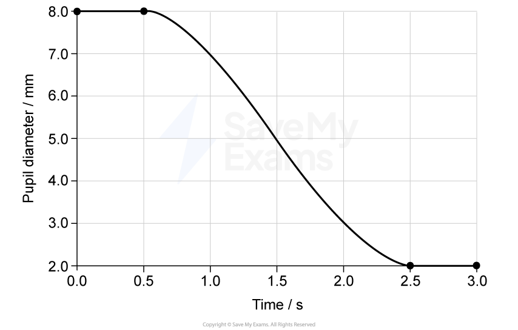

**Fig. 5.1**

Calculate the rate of pupil constriction between 0.5 seconds and 2.5 seconds.

Show your working and provide the correct units.

**Q2** [4 marks]

During a study, a volunteer was given a drug that prevents the presynaptic neurone from releasing neurotransmitter.

Explain how this could prevent the pupil from constricting.

**Q2** [4 marks]

A person is reading a book and then looks up to see a car in the distance.

Explain the changes that occur in the eye to allow the person to focus on the distant car.

**Q2** [3 marks]

The car suddenly makes a loud noise, causing the person to quickly turn their head in response. During this event the endocrine system also releases adrenaline.

The nervous system coordinated the head movement and the endocrine, or hormone, system coordinated the adrenaline release.

State **three** differences between how these two systems work.

### Q3 — easy — 7 marks

**Q3** [3 marks]

The box on the left contains the words ‘Aerobic respiration’.

The boxes on the right show some sentence endings.

Draw lines to make **three **correct sentences about aerobic respiration.

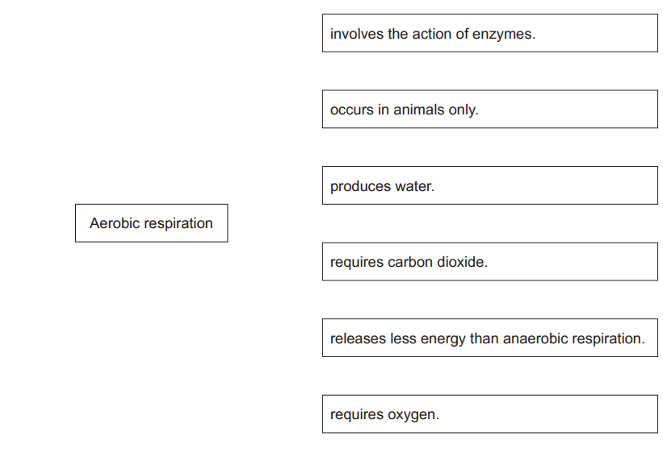

[3]

*Source: June 2021 0970/31 Q4A*

**Q3** [4 marks]

One effect of the release of the hormone adrenaline is to increase blood glucose concentration. This allows more aerobic respiration to occur.

(i) Place ticks (✓) in the correct boxes to show other effects of the release of adrenaline on the body.

| change in the genotype |   |
|---|---|
| decreased breathing rate |   |
| development of lung cancer |   |
| increased pulse rate |   |
| widened pupils |   |

[2]

(ii) State the name of the gland that releases adrenaline.

[1]

(iii) State how adrenaline is transported to its target organs.

[1]

### Q4 — medium — 10 marks

**Q4** [1 mark]

Two identical potted plants were used to investigate plant responses.

Plant A was placed on a clinostat that continually rotated. Plant B was not rotated.

Both plants were then placed on their sides and kept in the dark.

Fig. 4.1 shows the two plants at the start of the experiment and after seven days.

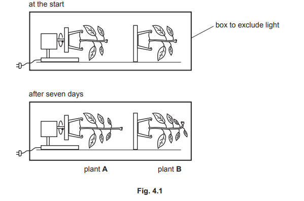

State the name of the response shown by the shoot of plant **B**.

*Source: June 2021 0610/41 Q4A*

**Q4** [2 marks]

**Extract:**

Two identical potted plants were used to investigate plant responses. 

Plant A was placed on a clinostat that continually rotated. Plant B was not rotated.

Both plants were then placed on their sides and kept in the dark.

Explain the reason for constantly rotating plant **A**.

*Source: June 2021 0610/41 Q4B*

**Q4** [4 marks]

**Extract:**

Two identical potted plants were used to investigate plant responses. 

Plant A was placed on a clinostat that continually rotated. Plant B was not rotated.

Both plants were then placed on their sides and kept in the dark.

Fig. 4.1 shows the two plants at the start of the experiment and after seven days.

State the name of the response shown by the shoot of plant **B**.

(i)

State the name of the plant hormone that causes the response of the shoot of plant **B**.

[1]

(ii)

Explain how the plant hormone causes the response of plant **B**

[3]

*Source: June 2021 0610/41 Q4C*

**Q4** [3 marks]

**Extract:**

Plant A was placed on a clinostat that continually rotated. Plant B was not rotated. Both plants were then placed on their sides and kept in the dark. Fig. 4.1 shows the two plants at the start of the experiment and after seven days. State the name of the response shown by the shoot of plant B. - Gravitropism;

Seeds germinate in the soil. The seedlings that grow from seeds show the same response as shown by plant B in Fig. 4.1.

Explain the advantages of this response to the survival of seedlings and mature plants.

*Source: June 2021 0610/41 Q4D*

### Q5 — easy — 14 marks

**Q5** [3 marks]

The pancreas is an organ that has roles in the digestive and hormonal systems of humans.

Fig. 3.1 shows part of the alimentary canal and some of the associated organs

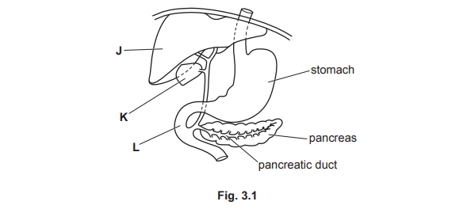

State the names of organs J, K and L.

J ................................................................

K .................................................................

L ...............................................................

**Q5** [5 marks]

The pancreas secretes hormones into the blood and enzymes into the pancreatic duct. The enzymes are released into the alimentary canal.

Complete Table 3.1 by stating the hormones and enzymes that are secreted by the pancreas.

Table 3.1

| hormones secreted by the pancreas | enzymes secreted by the pancreas |
|---|---|
| ...............................................  ................................... | ................................................  ................................. |

**Q5** [3 marks]

Chloride ions also move along the pancreatic duct.

CFTR proteins in the cells lining the pancreatic duct move chloride ions out of the cells into the duct.

Fig. 3.2 is a diagram of a cell from the lining of the pancreatic duct showing the location and activity of CFTR proteins.

Explain how CFTR proteins move chloride ions across the membrane of the cell shown in Fig. 3.2.

**Q5** [3 marks]

**Extract:**

CFTR proteins in the cells lining the pancreatic duct move chloride ions out of the cells into the duct. Fig. 3.2 is a diagram of a cell from the lining of the pancreatic duct showing the location and activity of CFTR proteins.

The movement of chloride ions into the pancreatic duct causes water to move from the cells into the duct to help the flow of liquid in the duct.

Explain how water moves from the cell shown in Fig. 3.2 into the pancreatic duct.

### Q6 — medium — 15 marks

**Q6** [3 marks]

Insulin is a hormone that regulates the concentration of glucose in the blood.

Describe what is meant by the term hormone.

*Source: Specimen 2023 0970/04 Q2A*

**Q6** [12 marks]

**Extract:**

Person A and person B were monitored to see how well they could control their blood glucose concentration. They did not eat or drink anything other than water for eight hours before the monitoring began. They then drank a glucose solution. Blood samples were taken at 30-minute intervals. The blood samples were tested for glucose concentration. The results are shown in Fig. 2.1. (i) Calculate the percentage increase in the blood glucose concentration in person A between 60 and 90 minutes. (ii) Using Fig. 2.1, compare the response of person A with the response of person B after the ingestion of glucose. (iii) Using Fig. 2.1, explain the response of person B after 90 minutes. (iv) Person A had Type 1 diabetes. Outline the treatment of Type 1 diabetes. From the mark scheme: [1 mark] for correct readings from the graph, 72 and 170. [1 mark] for the correct calculation. [1 mark] for correct rounding to a whole number. (ii) Comparative points: similar response first 30 minutes, person A increases/decreases more steeply/faster, person A increases to/has a higher concentration, person A reaches a peak/decreases much later, person A does not return to starting concentration/original value/normal, comparative use of figures with correct units (e.g. blood glucose concentration peak of person A is 210 mg per 100 cm^3 whereas peak of person B is 100 mg per 100 cm^3). (iii) Increase in glucose concentration causes secretion of insulin by the pancreas; insulin causes the liver to take up glucose from the blood; glucose is converted to glycogen. (iv) Treatment of Type 1 diabetes: taking of insulin, injections/pump, (regular) monitoring of blood glucose concentration, controlling carbohydrate intake, exercise regularly, maintain a healthy mass.

Person **A** and person **B** were monitored to see how well they could control their blood glucose concentration.

They did not eat or drink anything other than water for eight hours before the monitoring began. They then drank a glucose solution.

Blood samples were taken at 30-minute intervals.

The blood samples were tested for glucose concentration.

The results are shown in Fig. 2.1

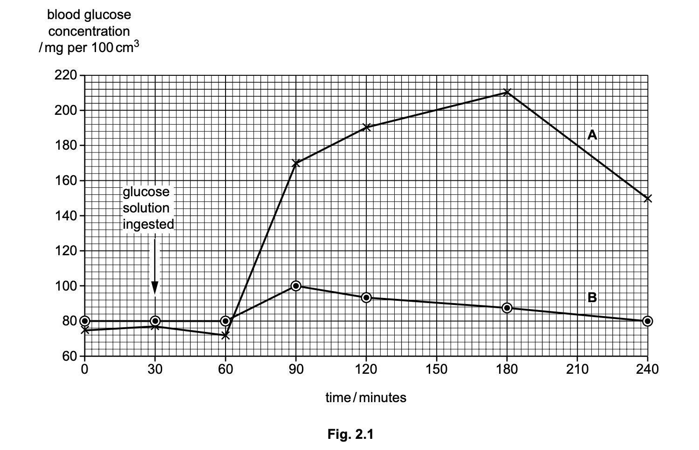

(i)

Calculate the percentage increase in the blood glucose concentration in person **A** between 60 and 90 minutes.

Give your answer to the nearest whole number

. .............................................................% [3]

(ii)

Using Fig. 2.1, compare the response of person A with the response of person **B** after the ingestion of glucose.

[3]

(iii)

Using Fig. 2.1, explain the response of person **B** after 90 minutes.

[4]

(iv)

Person **A** had Type 1 diabetes.

Outline the treatment of Type 1 diabetes

[2]

*Source: Specimen 2023 0970/04 Q2B*

### Q7 — medium — 6 marks

**Q7** [4 marks]

2,4-D is a synthetic plant auxin that is used as a weedkiller.

Researchers investigated the effectiveness of different treatments of 2,4-D on the control of the weed *Conyza canadensis* in fields of maize, *Zea mays*.

The results are shown in Table 1.

**Table 1**

| treatment | time of treatment | mean dry mass of weeds / g per m2 | weed density / number of weeds per m2 |   |   |
|---|---|---|---|---|---|
| Day 7 | Day 23 | Day 33 |   |   |   |
| **A** | ✔ |   |   | 7.40 | 6.20 |
| **B** |   | ✔ |   | 3.90 | 4.90 |
| **C** |   |   | ✔ | 0.50 | 1.20 |
| **D** | ✔ | ✔ |   | 0.66 | 1.90 |
| **E** | ✔ |   | ✔ | 0.18 | 0.98 |
| **F** |   | ✔ | ✔ | 0.07 | 0.29 |
| **G** | ✔ | ✔ | ✔ | 0.08 | 0.51 |

Maize farmers that had been using treatment **C** were advised by the researchers to change to treatment **F**.

Discuss the advantages and disadvantages of changing to treatment **F**.

*Source: 2018 0610/42 Q5A*

**Q7** [2 marks]

Auxin causes the shoots of a plant to grow away from gravity.

State the name of this response.

*Source: 2018 0610/42 Q5B*

### Q8 — hard — 13 marks

**Q8** [3 marks]

#### Extended only

**Fig. 1** shows the path of light entering the front part of the eye of a person with normal vision, whilst looking at a close object.

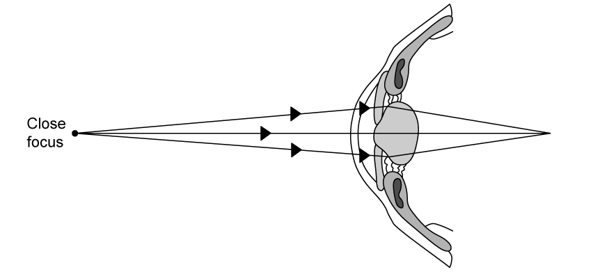

**Fig. 1**

As people get older (typically 40+), their lenses lose flexibility and can't spring back into a round shape when looking at close objects.

Explain what effect a less flexible lens would have on the path of light.

**Q8** [6 marks]

#### Extended only

Explain the changes that occur in the normal human eye to focus on near and distant objects.

**Q8** [2 marks]

#### Extended only

**Fig. 2** shows the light path into the eye of a person with normal vision and into that of a person with long-sightedness.

Sufferers of long-sightedness are not able to see nearby objects clearly e.g. when reading, although this can be corrected using glasses.

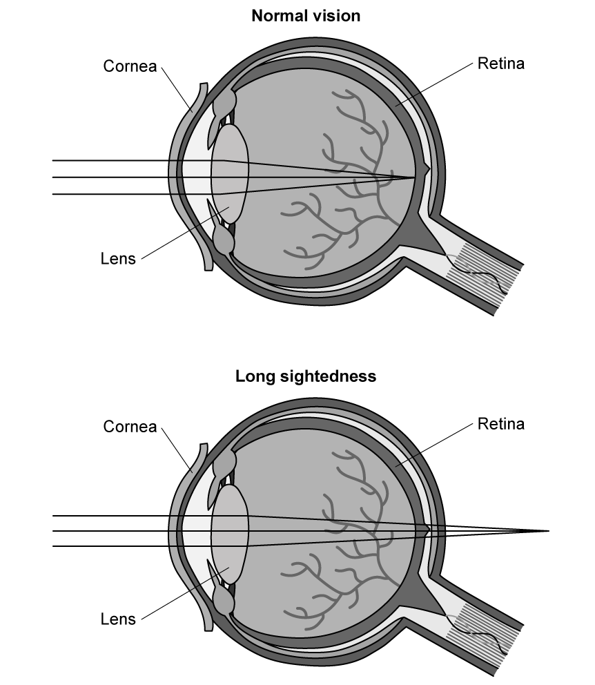

**Fig. 2**

Use the diagrams in **Fig. 2** to explain why people with long-sightedness cannot see nearby objects clearly.

**Q8** [2 marks]

**Extract:**

The data in Fig. 3 was gathered from a survey of 4500 people. No correction required (28%), Contact lenses (13%).

#### Extended only

As people age, their vision tends to deteriorate.

The majority of adults choose to wear glasses to correct their vision as shown in **Fig. 3**.

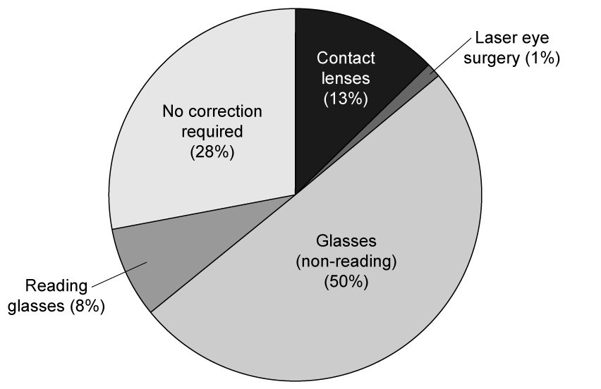

**Fig. 3**

The data in **Fig. 3** was gathered from a survey of 4500 people.

Calculate the difference between the number of people needing no vision correction and the people who chose to use contact lenses.

### Q9 — hard — 14 marks

**Q9** [5 marks]

#### Extended only

Complete the **five **sentences about the eye and the nervous system.

Structures in the eye change the shape of the lens so that the eye can focus on near and distant objects. This is called ............................................... .

The radial and circular muscles in the iris of the eye are a pair of .............................................. muscles that work against each other.

Muscles in the eye are controlled by the nervous system.

The .............................................. nervous system contains only sensory and motor neurones.

The .............................................. nerve from the eye contains sensory neurones that conduct impulses to the ............................................... .

*Source: 2019 0970/41 Q3A*

**Q9** [3 marks]

#### Extended only

Transmission of impulses relies on the flow of ions through the cell membranes of neurones down their concentration gradients. Active transport is responsible for maintaining the concentration gradients of ions across the membranes of neurones.

Explain how ions are moved across membranes by active transport.

*Source: 2019 0970/41 Q3B*

**Q9** [6 marks]

**Extract:**

Many drugs interfere with the action of neurotransmitters at the junctions between neurones.

Two drugs that influence the transmission of impulses between neurones are atropine and eserine. The actions of these drugs are shown in Table 1.

Table 1

drug | action at junctions between neurones
atropine | blocks receptor molecules for neurotransmitters
eserine | blocks the enzyme that breaks down neurotransmitters

Fig. 1 shows the junction between two neurones.

[Diagram: presynaptic neurone, postsynaptic neurone, enzyme that breaks down neurotransmitter molecules, receptor molecules]

Neurotransmitters move across synapse/gap/junction.

#### Extended only

**Fig. 1** shows the junction between two neurones.

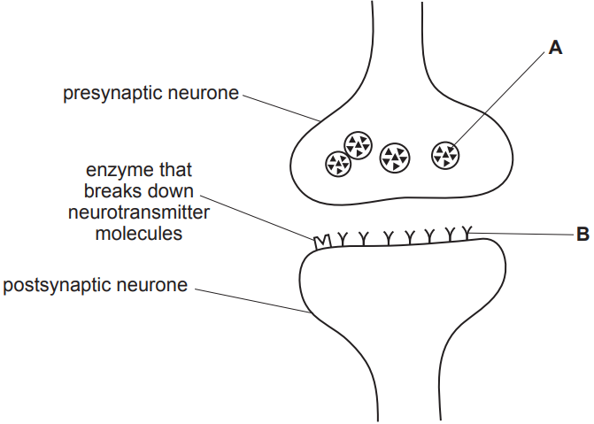

**Fig. 1**

Many drugs interfere with the action of neurotransmitters at the junctions between neurones.

Two drugs that influence the transmission of impulses between neurones are atropine and eserine. The actions of these drugs are shown in Table 1.

**Table 1**

| drug | action at junctions between neurones |
|---|---|
| atropine | blocks receptor molecules for neurotransmitters |
| eserine | blocks the enzyme that breaks down neurotransmitters |

Explain the effects of these two drugs on the nervous system using the information in Fig. 1 and Table 1.

*Source: 2019 0970/41 Q3C*

### Q10 — hard — 15 marks

**Q10** [3 marks]

Insulin is a hormone that regulates the concentration of glucose in the blood.

Describe what is meant by the term **hormone**.

*Source: 2023 970/04 Q2A*

**Q10** [12 marks]

**Extract:**

Person A and person B were monitored to see how well they could control their blood glucose concentration. They did not eat or drink anything other than water for eight hours before the monitoring began. They then drank a glucose solution. Blood samples were taken at 30-minute intervals. The blood samples were tested for glucose concentration. The results are shown in Fig. 1. [Graph shows blood glucose concentration (mg per 100 cm³) over time (minutes) for persons A and B, with values such as 72 mg/100 cm³ at 60 minutes and 170 mg/100 cm³ at 90 minutes for person A.] Person A had Type 1 diabetes.

#### Extended only

Person **A** and person **B** were monitored to see how well they could control their blood glucose concentration.

They did not eat or drink anything other than water for eight hours before the monitoring began. They then drank a glucose solution.

Blood samples were taken at 30-minute intervals.

The blood samples were tested for glucose concentration.

The results are shown in Fig. 1.

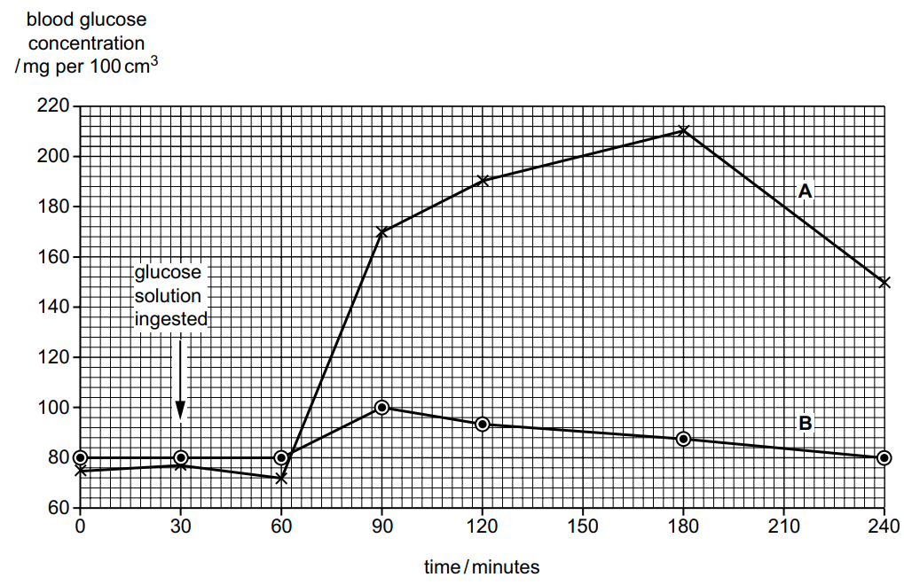

**Fig. 1**

(i)

Calculate the percentage increase in the blood glucose concentration in person **A** between 60 and 90 minutes.

Give your answer as a percentage and to the nearest whole number.

[3]

(ii)

Using Fig. 1, compare the response of person **A** with the response of person **B** after the ingestion of glucose.

[3]

(iii)

Using Fig. 1, explain the response of person **B** after 90 minutes.

[4]

(iv)

Person **A** had Type 1 diabetes.

Outline the treatment of Type 1 diabetes.

[2]

*Source: 2023 970/04 Q2B*

### Q11 — easy — 8 marks

**Q11** [3 marks]

The following terms are all components involved in passing a signal along the nervous system.

| coordinator                       receptor                   response  effector                            stimulus |
|---|

State the correct order of components during a nervous response.

**Q11** [1 mark]

State the name of the sense organ that contains receptor cells that respond to changes in light?

**Q11** [1 mark]

**Fig. 1** shows the junction between two neurones.

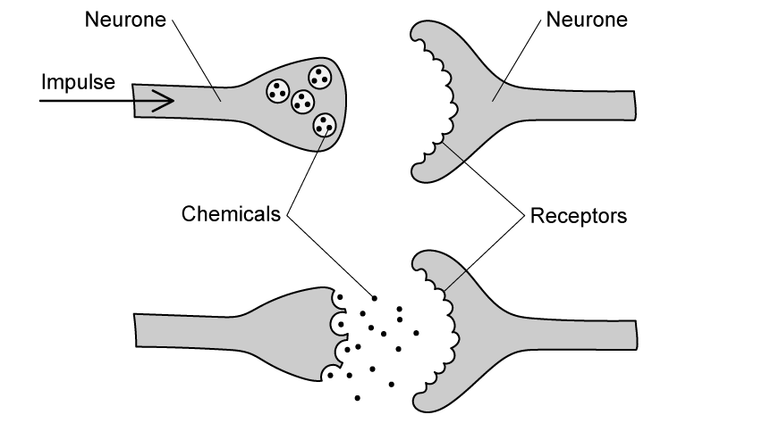

**Fig. 1**

State the name of this junction.

**Q11** [3 marks]

**Extract:**

Fig. 1 shows the junction between two neurones.
The name of this junction is:
- Synapse;

Many general anaesthetics inhibit the release of signalling chemicals (called neurotransmitters) across some junctions like the one shown in Fig. 1.

Explain what impact this would have on the nerve impulse.

### Q12 — medium — 13 marks

**Q12** [1 mark]

Define the term *sensitivity*.

*Source: 2020 0610/04 Q3A*

**Q12** [3 marks]

**Fig. 1** shows the reflex arc involved in a simple reflex action.

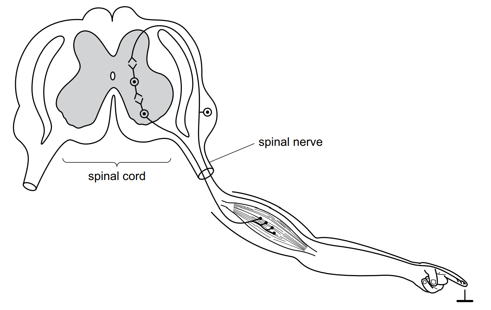

**Fig. 1**

On Fig. 1, use label lines to identify and name the **three **types of neurone shown.

*Source: 2020 0610/04 Q3B*

**Q12** [2 marks]

A reflex is an involuntary action.

Explain what is meant by the term *involuntary action.*

*Source: 2020 0610/04 Q3C*

**Q12** [4 marks]

#### Extended only

(i)

Define the term *synapse*.

[1]

(ii)

Describe how impulses are transmitted across a synapse.

[3]

*Source: 2020 0610/04 Q3D*

**Q12** [2 marks]

#### Extended only

When a body senses danger, more adrenaline is secreted from the adrenal glands.

Describe** two** ways in which the hormone adrenaline affects the body in preparation for action.

*Source: 2020 0610/04 Q3E*

**Q12** [1 mark]

State **one** difference between nervous and hormonal control systems.

*Source: 2020 0610/04 Q3F*

### Q13 — hard — 22 marks

**Q13** [5 marks]

#### Extended only

The flow of blood through the skin can be investigated by using a flow-meter.

Fig. 1 shows a flow-meter above a section through the skin.

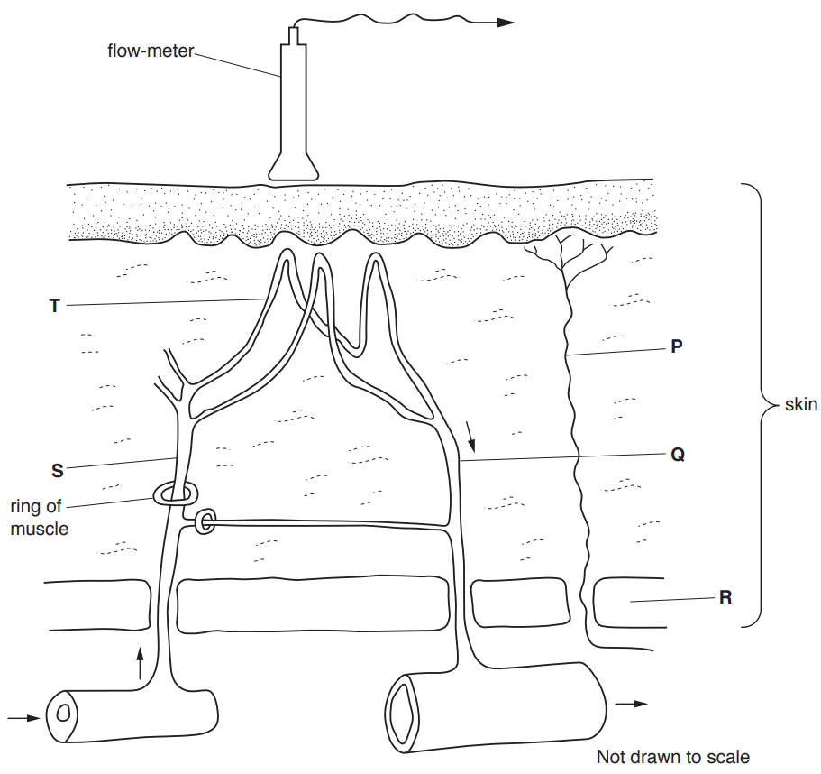

**Fig. 1**

(i)

State the name of cell **P**.

[1]

(ii)

State the types of blood vessel labelled **Q**,** S** and **T**.

[3]

(iii)

State the name of the tissue at **R** that provides insulation.

[1]

*Source: 2018 0610/41 Q4A*

**Q13** [10 marks]

#### Extended only

The blood flow through the skin of some volunteers was measured with a flow-meter when their skin was exposed to different temperatures.

Capsaicin is a compound that gives people the sensation of feeling hot when it is put on the skin. Researchers applied capsaicin to the skin of the volunteers and again measured the blood flow through their skin at different temperatures.

Fig. 2 shows the results.

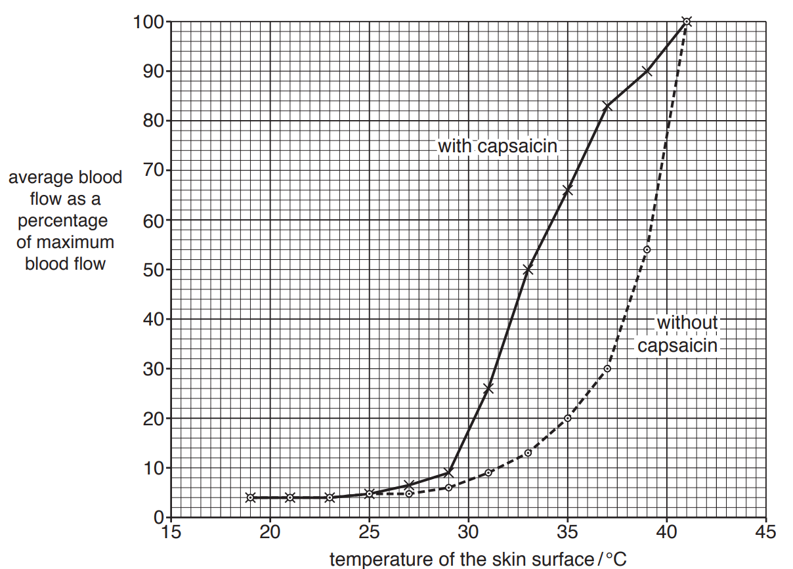

**Fig. 2**

(i)

Use the information in Fig. 2 to describe the effect of increasing the temperature of the skin surface on blood flow to the skin **without** capsaicin.

[3]

(ii)

Explain the mechanism that increases blood flow through the skin.

[3]

(iii)

State the difference between the average blood flow for the treatments (with and without capsaicin) at 35°C.

Space for working.

__________% [1]

(iv)

The researchers thought that capsaicin stimulated receptors in the skin.

Explain the process by which capsaicin could reach these receptors.

[3]

*Source: 2018 0610/41 Q4B*

**Q13** [4 marks]

#### Extended only

Explain the importance of regulating body temperature in humans.

*Source: 2018 0610/41 Q4C*

**Q13** [3 marks]

Body temperature is controlled by both hormones and nerves.

Explain how coordination by hormones differs from coordination by nerves.

*Source: 2018 0610/41 Q4D*

### Q14 — medium — 9 marks

**Q14** [5 marks]

The eye is a sense organ that responds to light.

Fig. 1 is a diagram of a section through the human eye.

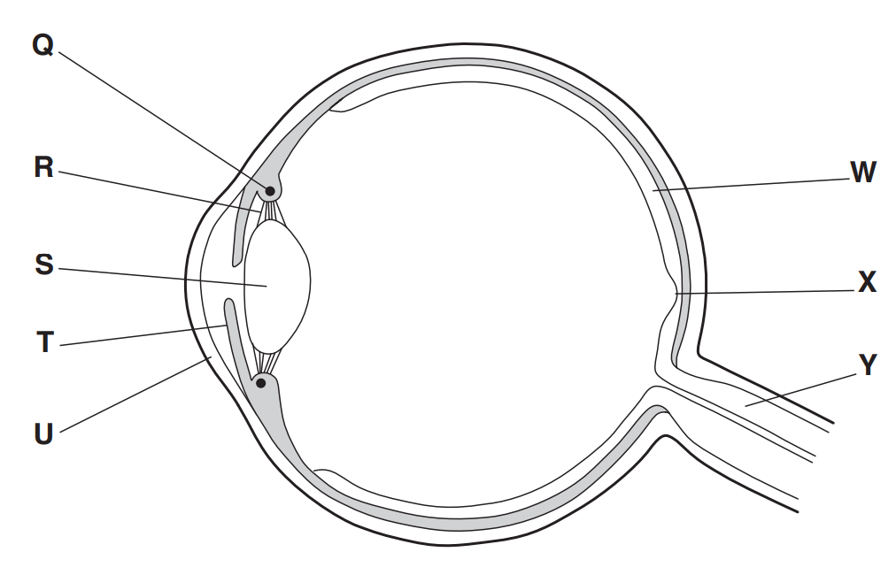

**Fig. 1**

Table 1 describes some of the functions of the parts of the eye.

Complete the table by:

- Naming the parts of the eye
- Using the letters on Fig. 1 to identify the parts of the eye.

**Table 1**

| function | name of part | letter on** Fig. 1** |
|---|---|---|
| carries impulses to the brain |   |   |
| focuses light onto the back of the eye |   |   |
| controls the tension of the suspensory ligaments |   |   |
| tissue that detects light and colour |   |   |
| location of most of the cone cells |   |   |

*Source: 2018 (Series 1) 0610/41 Q4A*

**Q14** [2 marks]

#### Extended only

(i)

A pair of muscles in the eye work in opposition to each other to adjust the amount of light entering the pupil.

State the term that describes the action of a pair of muscles working in opposition to each other.

[1]

(ii)

A different pair of muscles in the eye work in opposition to each other to view objects at different distances from the eye.

State the name of the process that allows the eye to view objects at different distances.

[1]

*Source: 2018 (Series 1) 0610/41 Q4B*

**Q14** [2 marks]

#### Extended Only

Explain why the eye cannot easily identify different colours in **low** levels of light.

*Source: 2018 (Series 1) 0610/41 Q4C*

### Q15 — easy — 6 marks

**Q15** [1 mark]

The eye is a sense organ.

**Fig. 1** is a diagram of a section through the eye.

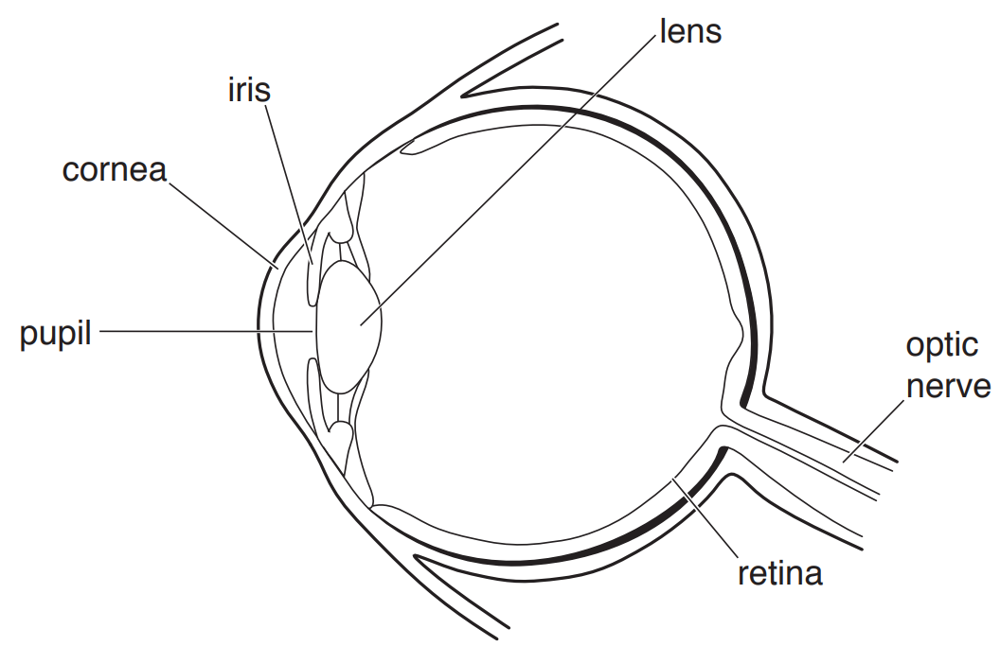

**Fig. 1**

Label the part of the eye that gives people different eye colours by shading in the correct area on Fig. 1

*Source: 2018 (Series 2) 0610/32 Q4A*

**Q15** [3 marks]

The boxes on the left show parts of the eye.

The boxes on the right show the functions of different parts of the eye.

Draw **four **lines to link the part of the eye with its correct function.

One has been done for you.

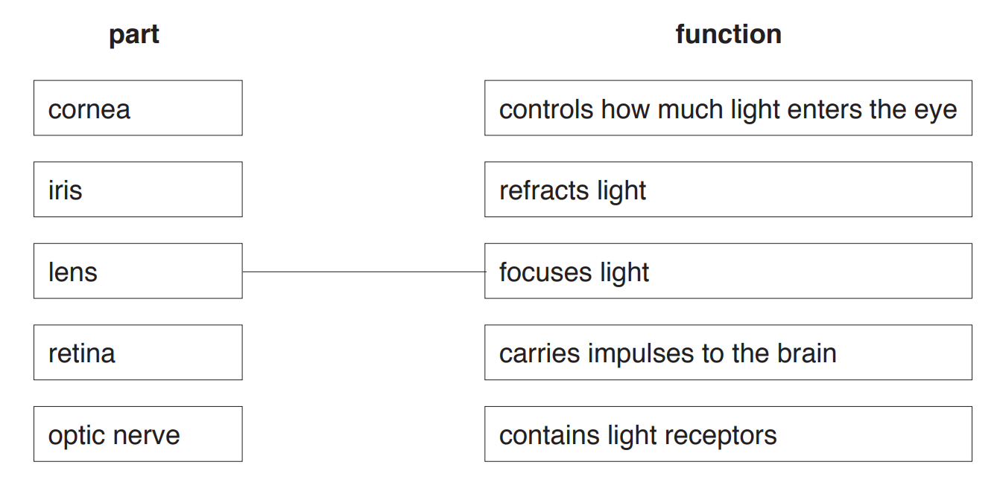

*Source: 2018 (Series 2) 0610/32 Q4B*

**Q15** [2 marks]

The skin is another sense organ.

**Fig. 2** shows a photograph of the skin on a person’s arm.

The skin of the person is responding to a stimulus.

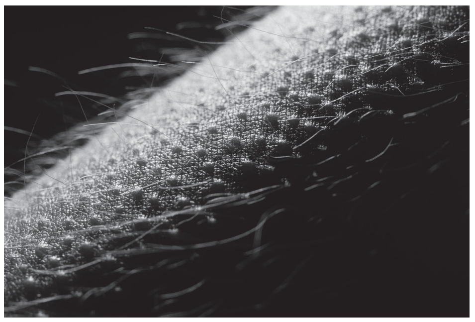

**Fig. 2**

(i)

State the stimulus for the response shown in **Fig. 2**.

[1]

(ii)

State the effector that causes the response shown in **Fig. 2**.

[1]

*Source: 2018 (Series 2) 0610/32 Q4C*

### Q16 — medium — 5 marks

**Q16** [5 marks]

#### Extended only

Cells just behind a shoot tip absorb water and grow in length. A plant hormone stimulates cell elongation and controls the response of stems to gravity.

(i)

State the name of the plant hormone that stimulates cell elongation in stems.

[1]

(ii)

Explain how the response of stems to gravity is controlled.

[4]

*Source: 2019 0970/41 Q6C*

### Q17 — easy — 17 marks

**Q17** [2 marks]

The endocrine system in mammals produces hormones.

Define the term *hormone*.

*Source: 2018 0610/43 Q4A*

**Q17** [6 marks]

The responses of the human body to danger are coordinated by the nervous and endocrine systems.

**Fig. 1** shows the sequence of events that occurs in response to a dangerous situation that is detected by the eyes.

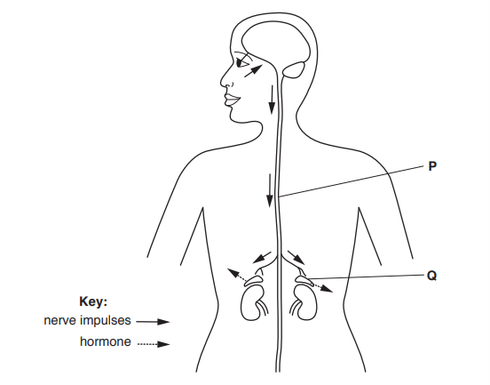

**Fig. 1**

(i)

State the tissue in the eye that converts light energy into nerve impulses.

[1]

(ii)

State the part of the eye that has the highest concentration of light-sensitive cells and gives the most detailed image.

[1]

(iii)

State the type of neurone that conducts impulses from the eye to the brain.

[1]

(iv)

State the nerve that contains these neurones that conduct impulses from the eye to the brain.

[1]

(v)

Identify the organ labelled **P**.

[1]

(vi)

Identify the gland labelled **Q.**

[1]

*Source: 2018 0610/43 Q4B*

**Q17** [4 marks]

**Extract:**

The responses of the human body to danger are coordinated by the nervous and endocrine systems.

(vi)

Identify the gland labelled Q.

The gland labelled Q is:

- The adrenal (gland); [1 mark]

#### Extended Only

Complete **Table 1** to describe the effects of the hormone released when a person is in a dangerous situation.

**Table 1**

| organ | effect of the hormone |
|---|---|
| heart |   |
| liver |   |
| lungs |   |
| eyes |   |

*Source: 2018 0610/43 Q4C*

**Q17** [4 marks]

**Extract:**

The responses of the human body to danger are coordinated by the nervous and endocrine systems.

The gland labelled Q is: The adrenal (gland).

The table should be completed as follows:

| organ | effect of the hormone |
| heart | Increased, pulse / heart, rate / beat; |
| liver | Conversion of glycogen to glucose (concentration); |
| lungs | Increase rate/depth of breathing; |
| eyes | Dilated pupils / radial muscles (in iris) contract; |

#### Extended only

Explain the advantages of coordinating the response to a dangerous situation using both the nervous system and the endocrine system.

*Source: 2018 0610/43 Q4D*

**Q17** [1 mark]

Plants also make hormones.

State the name of **one **hormone made by plants.

*Source: 2018 0610/43 Q4E*

### Q18 — medium — 5 marks

**Q18** [5 marks]

This question is about neurones and reflex actions.

Choose words from the list to complete the sentences.

Each word may be used once, more than once, or not at all.

**endocrine                      fast                           impulses**

**motor                       nervous                         receptor                       sensory**

**slow                        stimuli                         synapses**

Neurones are cells that are part of the **(i)**............................................... system.

There are three types of neurone involved in a simple reflex action: a sensory neurone, a relay neurone and a **(ii)**............................................... neurone.

The nerves conduct electrical **(iii)**............................................... . These are transmitted from one neurone to the next at junctions called **(iv)**............................................... .

A reflex action is automatic, co-ordinated and **(v)**............................................... .

*Source: 2018 0610/31 Q3A*

