# Exam Questions — Coordination, Response & Homeostasis
**14. Coordination & Response** · Cambridge (CIE) IGCSE biology (0610 & 0970)
> Source: [https://www.savemyexams.com/igcse/biology/cie/23/topic-questions/](https://www.savemyexams.com/igcse/biology/cie/23/topic-questions/) · 44 questions across 1 sets

## Multiple Choice Questions (44 questions)

### Q1 — medium — 1 marks

**Q1** [1 mark]

Plants respond to changes in their environment.

Which row correctly describes the responses of a plant shoot to light and gravity?

|   | **Light** | **Gravity** |
|---|---|---|
| **A** | negative gravitropism | negative phototropism |
| **B** | positive phototropism | negative gravitropism |
| **C** | positive phototropism | positive gravitropism |
| **D** | negative phototropism | positive  gravitropism |

### Q2 — hard — 1 marks

**Q2** [1 mark]

A person touches a pin. Which of the following correctly describes the sequence of events in the resulting reflex arc?

### Q3 — hard — 1 marks

**Q3** [1 mark]

The image below shows a neurone.

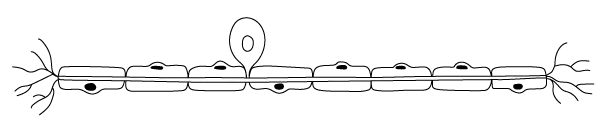

Which of the following statements about the neurone is correct?

### Q4 — medium — 1 marks

**Q4** [1 mark]

The table shows features of four body control systems.

Which row is the nervous system?

|   | Response speed | Carried by | Duration of effect |
|---|---|---|---|
| A | fast | neurones | short |
| B | slow | blood | long |
| C | slow | neurones | long |
| D | fast | blood | long |

### Q5 — hard — 1 marks

**Q5** [1 mark]

The diagram shows a plant shoot.

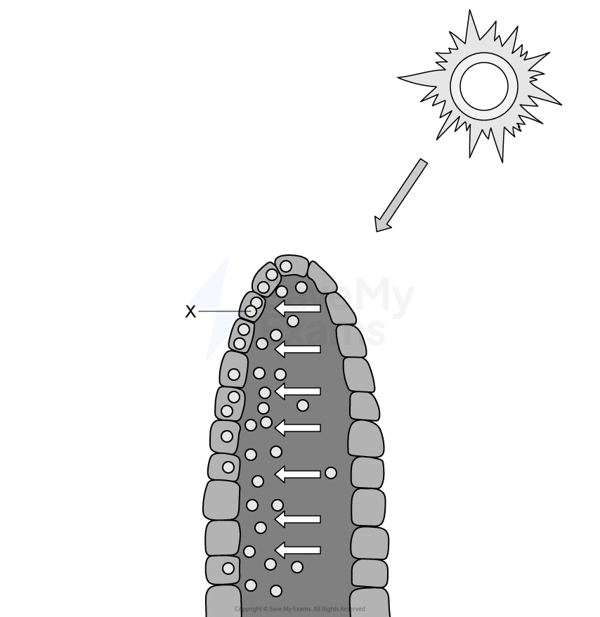

What substance is X?

### Q6 — medium — 1 marks

**Q6** [1 mark]

Which muscle action causes the pupil to become smaller in bright light?

### Q7 — medium — 1 marks

**Q7** [1 mark]

What is the sequence of a reflex arc?

### Q8 — medium — 1 marks

**Q8** [1 mark]

Which statements about auxin are correct?

1. Auxin is made in all cells in plants.
2. Auxin causes cells to elongate.
3. Auxin moves between the cells by osmosis.
4. Auxin is unequally distributed.

*Source: June 2021 0970/21 Q28*

### Q9 — easy — 1 marks

**Q9** [1 mark]

What is the effect of adrenaline on pulse rate and blood glucose concentration?

|   | pulse rate | blood glucose |
|---|---|---|
| **A** | decreases | decreases |
| **B** | decreases | increases |
| **C** | increases | decreases |
| **D** | increases | increases |

*Source: June 2021 0970/21 Q27*

### Q10 — medium — 1 marks

**Q10** [1 mark]

The diagram shows the appearance of an eye when in bright light.

Which row gives the correct states of the iris muscles in bright light?

|   | radial muscles | circular muscles |
|---|---|---|
| **A** | contracted | contracted |
| **B** | contracted | relaxed |
| **C** | relaxed | contracted |
| **D** | relaxed | relaxed |

*Source: June 2021 0970/21 Q26*

### Q11 — hard — 1 marks

**Q11** [1 mark]

An experiment was set up to investigate the growth of shoots in different conditions, as shown.

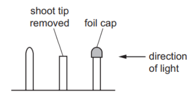

Which diagram shows the results that would be seen a few days later?

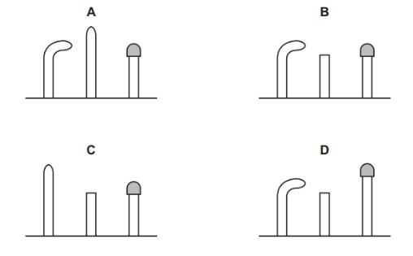

*Source: june 2022 paper 2 Q26*

### Q12 — hard — 1 marks

**Q12** [1 mark]

A scientist investigated the effect of drinking iced water on skin temperature. They drank a large volume of iced water and monitored the temperature of their skin.

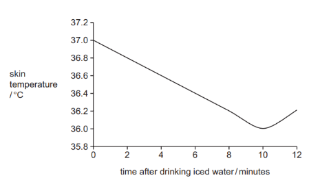

Which explanation of the change in skin temperature during the first 10 minutes is correct?

*Source: june 2022 paper 2 Q25*

### Q13 — medium — 1 marks

**Q13** [1 mark]

Where in the eye is the greatest concentration of cells that allow humans to see colour?

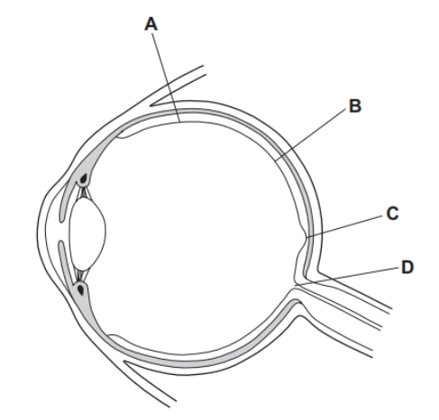

*Source: june 2022 paper 2 Q24*

### Q14 — easy — 1 marks

**Q14** [1 mark]

Which statement describes the plant response known as phototropism?

*Source: june 2022 paper 1 Q28*

### Q15 — easy — 1 marks

**Q15** [1 mark]

Which organ detects and coordinates the response to changes in internal body temperature?

*Source: june 2022 paper 1 Q27*

### Q16 — easy — 1 marks

**Q16** [1 mark]

Which hormone triggers the ‘fight or flight’ response?

*Source: June 2022 Paper 1 Q26*

### Q17 — medium — 1 marks

**Q17** [1 mark]

Which row matches each hormone to its function?

|   | causes the growth of facial hair | reduces blood glucose concentration | repairs the lining of the uterus | widens the pupils |
|---|---|---|---|---|
| **A** | oestrogen | insulin | testosterone | adrenaline |
| **B** | oestrogen | insulin | insulin | testosterone |
| **C** | testosterone | adrenaline | insulin | oestrogen |
| **D** | testosterone | insulin | oestrogen | adrenaline |

*Source: June 2021 0970/11 Q28*

### Q18 — easy — 1 marks

**Q18** [1 mark]

What controls how much light enters the eye?

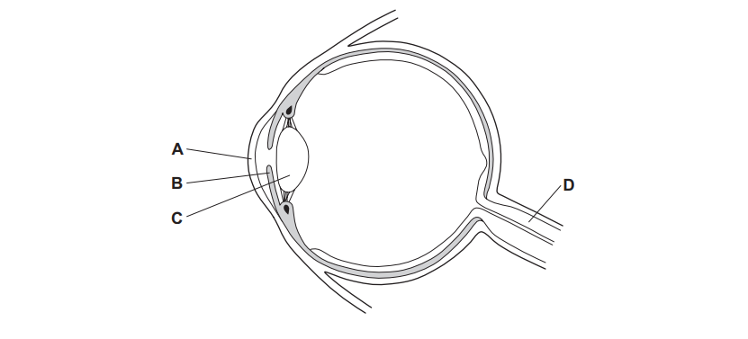

*Source: June 2021 0970/11 Q27*

### Q19 — easy — 1 marks

**Q19** [1 mark]

What is the sequence of neurones connecting a receptor to an effector in a reflex arc?

*Source: June 2021 0970/11 Q26*

### Q20 — medium — 1 marks

**Q20** [1 mark]

The diagram shows part of the mechanism that controls blood sugar concentration.

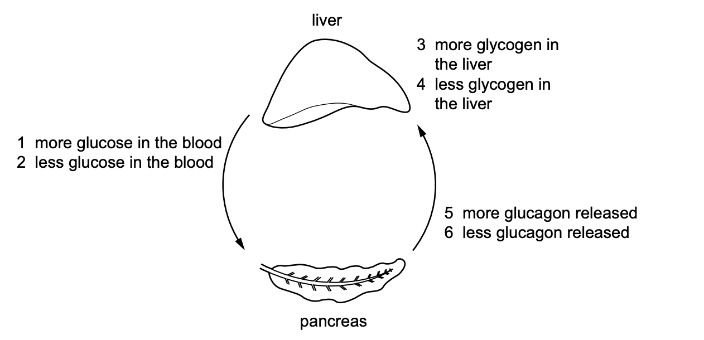

A person does one hour of exercise.

Starting with the pancreas, what is the sequence of events in which the hormone glucagon is involved?

*Source: Specimen 2023 0970/02 Q26*

### Q21 — hard — 1 marks

**Q21** [1 mark]

A student used two seedlings X and Y to investigate phototropism.

The diagram shows their investigation.

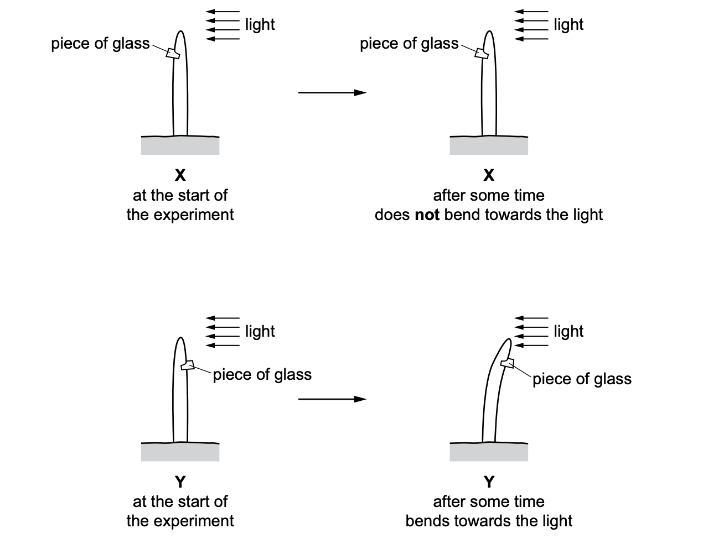

Which statement explains the difference in results between X and Y?

*Source: Specimen 2023 0970/02 Q25*

### Q22 — medium — 1 marks

**Q22** [1 mark]

What happens to the muscles in the iris, to make the pupil smaller?

|   | circular muscles | radial muscles |
|---|---|---|
| **A** | contract | contract |
| **B** | contract | relax |
| **C** | relax | contract |
| **D** | relax | relax |

*Source: Specimen 2023 0970/02 Q24*

### Q23 — medium — 1 marks

**Q23** [1 mark]

The diagram shows the structure of the eye.

Which structure refracts light?

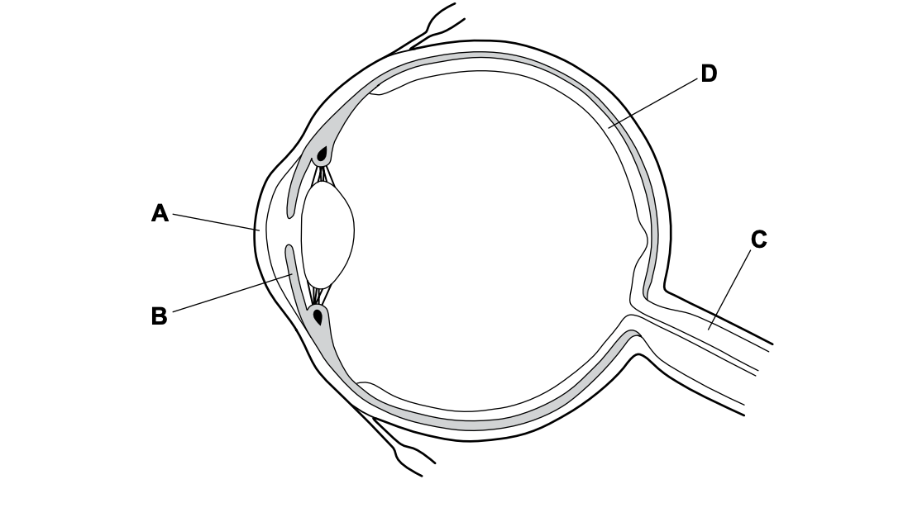

*Source: Specimen 2023 0970/01 Q24*

### Q24 — easy — 1 marks

**Q24** [1 mark]

The diagram shows a reflex arc.

Which structure is the sensory neurone?

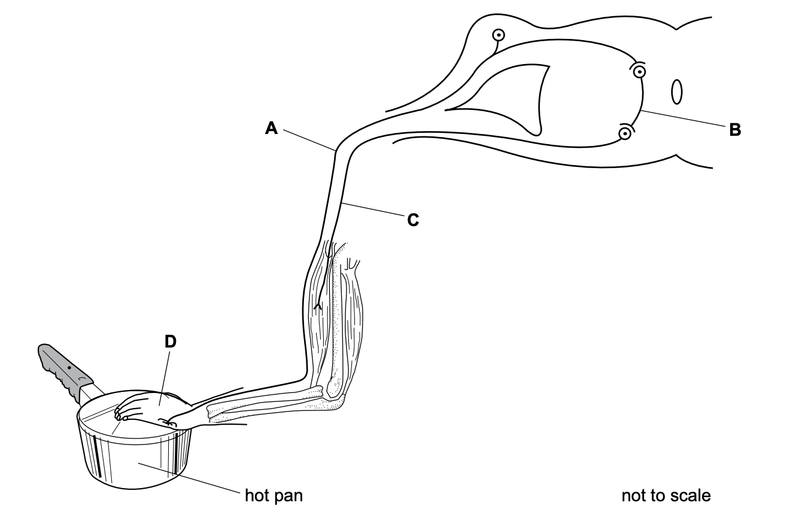

*Source: Specimen 2023 0970/01 Q23*

### Q25 — hard — 1 marks

**Q25** [1 mark]

#### Extended only

The image below shows the density of the two types of photoreceptor across a horizontal section of the retina.

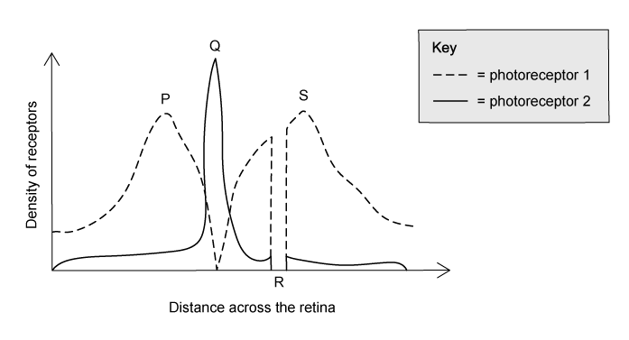

Which row of the table below correctly identifies the structures present in the eye according to the image above?

|   | **P** | **Q** | **R** | **S** |
|---|---|---|---|---|
| **A** | cone cells | rod cells | retina | cone cells |
| **B** | rod cells | cone cells | fovea | rod cells |
| **C** | cone cells | rod cells | fovea | cone cells |
| **D** | rod cells | cone cells | retina | rod cells |

### Q26 — medium — 1 marks

**Q26** [1 mark]

A group of students set up an experiment to investigate growth responses in plants.

In one of the experiments, they placed a plant shoot in a box with a small window allowing light to fall on one side of the shoot only.

Which of the following options correctly describes and explains what happened in the student’s experiment?

|   | **response** | **cause** | **effect** |
|---|---|---|---|
| **A** | positive phototropism | more auxin on side of shoot exposed to light | slower growth on shaded side of shoot |
| **B** | positive phototropism | more auxin on shaded side of shoot | slower growth on side of shoot exposed to light |
| **C** | negative gravitropism | even distribution of auxins | equal rates of growth |
| **D** | positive phototropism | less auxin on shaded side of shoot | faster growth on side of shoot exposed to light |

### Q27 — medium — 1 marks

**Q27** [1 mark]

The image below shows a simple reflex arc.

Which of the following sequences correctly shows the order of cells that an impulse passes through during a reflex action?

|   | **first  →  last** |
|---|---|
| **A** | Z   →    X   →    Y |
| **B** | X   →   Y    →   Z |
| **C** | Y  →     X   →    Z |
| **D** | Z   →    Y   →    X |

### Q28 — easy — 1 marks

**Q28** [1 mark]

Which row of the table best describes receptor organs and their respective stimuli in the human body?

|   | **Skin** | **Ears** | **Nose** |
|---|---|---|---|
| **A** | pressure | sound | chemical (in solution) |
| **B** | heat | balance | chemical (in solution) |
| **C** | pressure | balance | chemical (vapours) |
| **D** | heat | sound | temperature |

### Q29 — easy — 1 marks

**Q29** [1 mark]

#### Extended only

Which of the following statements is a correct reason that humans sweat?

### Q30 — medium — 1 marks

**Q30** [1 mark]

The image below shows a cell from the nervous system. The cell forms part of a reflex arc.

An impulse moves along the neurone from Q to P.

What structures would be found at P and Q?

|   | **P** | **Q** |
|---|---|---|
| **A** | receptor | relay neurone |
| **B** | relay neurone | receptor |
| **C** | motor neurone | relay neurone |
| **D** | gland | relay neurone |

### Q31 — easy — 1 marks

**Q31** [1 mark]

Which of the following statements are reasons for the evolution of reflex arcs in the mammalian nervous system?

1. To prevent harm or damage to an organism.
2. To provide a rapid response to dangerous situations.
3. To allow a degree of choice to an organism about response.
4. To allow certain stimuli to be ignored/eliminated.

### Q32 — easy — 1 marks

**Q32** [1 mark]

Which row of the table best summarises the parts of the nervous system?

|   | **brain** | **neurones** | **spinal cord** |
|---|---|---|---|
| **A** | central | peripheral | central |
| **B** | peripheral | peripheral | central |
| **C** | central | central | central |
| **D** | peripheral | central | peripheral |

### Q33 — medium — 1 marks

**Q33** [1 mark]

#### Extended only

Which row of the following table correctly describes what happens in the body after a person consumes a can of sugary drink?

|   | **role of the pancreas** | **role of the liver** | **effect** |
|---|---|---|---|
| **A** | releases glucagon | converts glycogen into glucose | blood sugar levels rise |
| **B** | releases insulin | converts excess glucose into glycogen | blood sugar level falls |
| **C** | releases glucagon | converts excess glucose into glycogen | blood sugar level falls |
| **D** | releases insulin | converts glycogen into glucose | blood sugar levels rise |

### Q34 — medium — 1 marks

**Q34** [1 mark]

#### Extended only

The image below shows some of the structures in the eye.

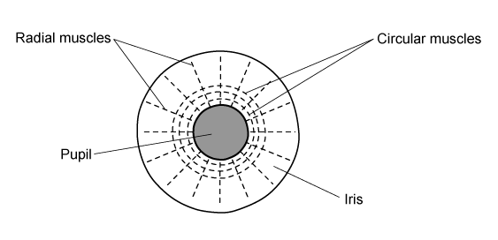

The circular and radial muscles can control the size of the pupil in the eye.

How would they respond in the eye of a person walking from a brightly lit room into a dark one?

|   | **radial muscles** | **circular muscles** | **pupil ** |
|---|---|---|---|
| **A** | relaxes | contracts | constricts |
| **B** | relaxes | contracts | dilated |
| **C** | contracts | relaxes | dilated |
| **D** | contracts | relaxes | constricts |

### Q35 — medium — 1 marks

**Q35** [1 mark]

The image below shows the structures involved in a simple reflex arc.

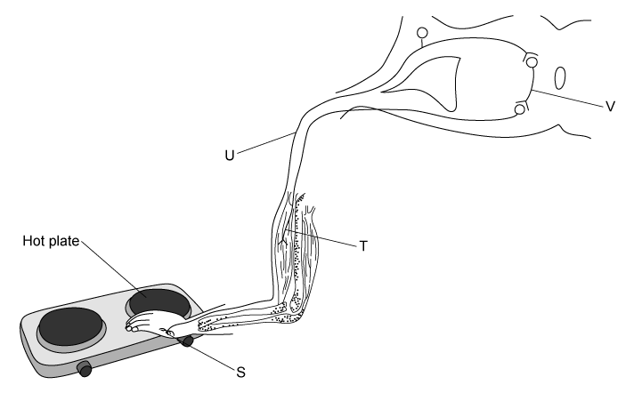

Which of the following sequences correctly shows the order that an impulse passes through during a reflex action?

### Q36 — hard — 1 marks

**Q36** [1 mark]

#### Extended only

What changes occur in the skin when a person becomes very cold?

|   | **hair effector muscles** | **effect** | **blood vessels** | **effect** |
|---|---|---|---|---|
| **A** | contract | air trapped against skin | constrict | less heat loss by radiation |
| **B** | contract | less air trapped against skin | dilate | more heat loss by radiation |
| **C** | relax | air trapped against skin | dilate | less heat loss by radiation |
| **D** | relax | less air trapped against skin | constrict | more heat loss by radiation |

### Q37 — easy — 1 marks

**Q37** [1 mark]

#### Extended only

Which of the following statements would **not **be a correct example of negative feedback?

### Q38 — hard — 1 marks

**Q38** [1 mark]

A group of students wanted to set up an experiment to investigate plant growth.

They attached a plant pot to a clinostat and placed it in a dark room as shown in the image below:

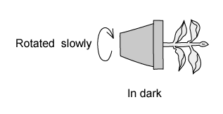

Which of the following images would show the expected result of this experiment after two days?

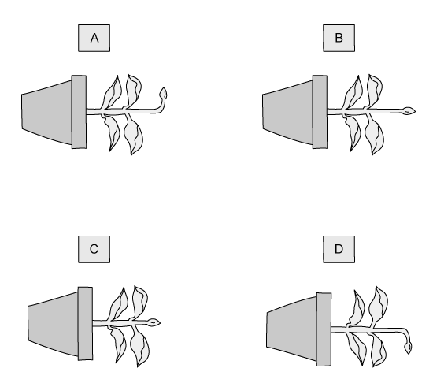

### Q39 — medium — 1 marks

**Q39** [1 mark]

#### Extended only

Which row of the table correctly outlines the cause of, and treatment for, type 1 diabetes?

|   | **cause** | **treatment** |
|---|---|---|
| **A** | inability of the pancreas to produce insulin | insulin injection |
| **B** | inability of the pancreas to produce insulin | controlling diet and regular exercise |
| **C** | inability of the liver to produce glucagon | glucagon injection |
| **D** | inability of the liver to produce insulin | insulin injection |

### Q40 — hard — 1 marks

**Q40** [1 mark]

#### Extended only

Which row of the table best summarises the ways that the eye adjusts to different stimuli?

| ** ** | **looking at near objects** | **looking at far objects** | **bright light** | **dim light** |
|---|---|---|---|---|
| **A** | lens becomes flat | suspensory ligaments loosen | circular muscles relax | radial muscles contract |
| **B** | suspensory ligaments loosen | ciliary muscles relax | circular muscles contract | radial muscles contract |
| **C** | suspensory ligaments tighten | suspensory ligaments tighten | circular muscles relax | radial muscles contract |
| **D** | lens becomes round | ciliary muscles contract | circular muscles contract | circular muscles relax |

### Q41 — hard — 1 marks

**Q41** [1 mark]

#### Extended only

Which of the following statements about glucagon are **false**?

1. Glucagon reverses the effect of the hormone glycogen
2. Glucagon is produced in the pancreas
3. Glucagon is secreted when blood glucose levels fall
4. Glucagon stimulates liver and muscle cells to convert glucose into stored glycogen
5. Glucagon is a polysaccharide
6. Glucagon is usually secreted soon after ingestion of carbohydrate-rich food

### Q42 — medium — 1 marks

**Q42** [1 mark]

#### Extended only

Four statements are given below.

1. Neurotransmitters are released from vesicles.
2. An impulse is generated in the postsynaptic neurone.
3. An impulse arrives at the end of a neurone.
4. Neurotransmitters diffuse across the synaptic cleft.

Which of the following options correctly describes the sequence of events that occurs at a synapse?

### Q43 — medium — 1 marks

**Q43** [1 mark]

#### Extended only

Which row of the following table correctly describes the effect of adrenaline in the body?

|   | **pulse rate** | **blood glucose concentration ** | **breathing rate** |
|---|---|---|---|
| **A** | increases | remains constant | increases |
| **B** | increases | decreases | decreases |
| **C** | increases | increases | increases |
| **D** | decreases | increases | increases |

### Q44 — medium — 1 marks

**Q44** [1 mark]

#### Extended only

An athlete takes part in a marathon.

What would be the effect of an athlete taking part in a marathon race on a hot, sunny day?

|   | **volume of water reabsorbed in the kidneys** | **volume of water lost from the skin** | **effect on hairs on the skin** |
|---|---|---|---|
| **A** | less | decreases | lie flat |
| **B** | more | decreases | erect |
| **C** | less | increases | lie flat |
| **D** | more | increases | lie flat |
