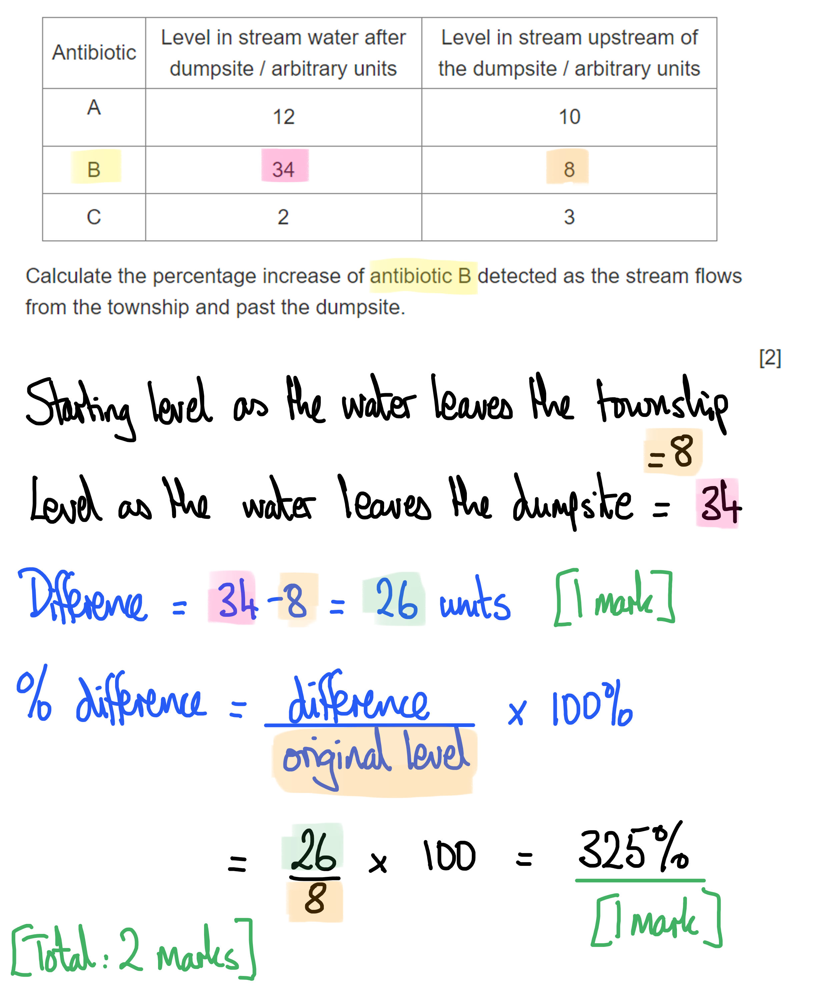

# Mark Schemes — Drugs in Medicine
**15. Drugs** · Cambridge (CIE) IGCSE biology (0610 & 0970)

## Multiple Choice Questions (12 questions)

### Q1
**Final answer:** **The correct answer is ****A.**

- **Natural selection** occurs when bacteria with mutations that make them resistant to an antibiotic survive treatment
- These resistant bacteria **reproduce **and pass the** resistance genes** to their offspring
- Over time, **the proportion of resistant bacteria increases**, so the antibiotic becomes **less effective**

**B** is incorrect because bacteria do not have immune systems.

**C** is is incorrect because behavioural adaptation refers to changes in animal behaviour that improve survival, such as migration or hunting strategies.

**D** is incorrect because toxin production refers to bacteria producing harmful chemicals that damage host tissues, not antibiotics.

### Q2
**Final answer:** **The correct answer is ****D**** (1, 2 and 4) because:**

- **Statement 1** is correct because farmers often protect their whole herd by using antibiotics, to prevent the spread of disease, even when none of the animals are sick. This practice is now not in use widely as it encourages antibiotic resistance
- **Statement 2 **is correct because if a person stops taking antibiotics before the end of the course, some pathogens may still be alive in their body, but not in sufficient numbers to cause symptoms. If antibiotics are stopped, these few bacteria can multiply freely, produce high levels of toxins and cause the disease to reappear in that individual
- **Statement 4** is correct because the definition of antibiotics is that they work **against bacteria only** (not other types of microorganism)

**Statement 3** is incorrect because antibiotics are used routinely, with care, very effectively against bacterial infections.

### Q3
**Final answer:** **The correct answer is ****A ****because:**

It is most likely that the decrease in number of deaths from MRSA over time is a result of new or different antibiotics being used that are effective at treating MRSA infections; as a result, the death rate will fall.

**B** is incorrect because a decrease in the population would not affect the death rate.

**C** is incorrect because over-65’s are still dying from MRSA infection so this cannot be true or likely.

**D** is incorrect because, while this is a true statement, it has nothing to do with the data shown.

### Q4
**Final answer:** **The correct answer is ****B**** (liver) because:**

The liver is the primary site for drug metabolism.

**A** is incorrect because although the stomach is involved in the digestion of some oral medications it does not fully metabolise the drug.

**C** and **D** are incorrect because the brain and kidneys are not the primary sites of drug metabolism.

### Q5
**Final answer:** **The correct answer is ****A ****because:**

Viruses are technically not living cells, this means that they are not affected by antibiotics. Viruses do not have cell walls or carry out cellular functions. Antibiotics work by disrupting cell chemical reactions or the production of cell walls.

**B** is incorrect because viruses do not contain cytoplasm, and antibiotics don’t affect cytoplasm.

**C** is incorrect because penicillin does not work on viruses.

**D** is incorrect because this is correct as viruses use the host cell to reproduce rapidly. It is not relevant to why penicillin will not work on viruses, however.

### Q6
**Final answer:** **The correct answer is ****B**** (a substance taken into the body that modifies or affects chemical reactions) because:**

Drugs always have their effect at a chemical level, by affecting chemical reactions in cells, tissues and organs.

**A** is incorrect because not all drugs are addictive or harmful; many have beneficial effects, though most would be harmful if taken at an excessive level (an 'overdose').

**C** is incorrect because not all drugs are plant extracts (some come from fungi and some are manufactured in a laboratory), and not all of them kill bacteria.

**D** is incorrect because not all drugs produce side effects, though many do.

### Q7
**Final answer:** **The correct answer is ****C**** (1 and 4) because:**

When an individual fails to complete an antibiotic course their body is less likely to clear the bacterial infection so there is more opportunity for resistance to evolve in the bacterial population. Antibiotics should never be used to treat viral infections as they are ineffective against viruses.

**A** is incorrect because antibiotics are vital for patient survival when they are suffering from serious bacterial infections.

**B** is incorrect because 4 has not been included in the answer.

**D** is incorrect because both 2 and 3 represent ways in which antibiotics should be used in order to minimise antibiotic resistance.

### Q8
**Final answer:** **The correct answer is ****D**** because:**

The bacterial population is increasing before the patient starts to take antibiotics. This can be seen in the graph.

**A** is incorrect because from the graph the bacteria population has decreased to 0 by 6.5 days after starting the treatment with antibiotics.

**B** is incorrect because you can’t see how the antibiotic works on the bacteria from the graph.

**C** is incorrect because antibiotics are not effective against viruses - the graph only shows the effect on bacterial populations.

### Q9
**Final answer:** **The correct answer is ****C**** because:**

Antibiotics do not work on viruses. Viruses insert their genetic material inside cells, the antibiotic doesn’t work inside cells. Antibiotics work on bacteria by either killing them or stopping or slowing their growth.

All the other answers are correct for antibiotics. Some of them are produced by fungi, including the first antibiotic penicillin, which is made in Nature by the fungus *Penicillium notatum*. These fungi produce the antibiotic to give them resistance to bacteria.

A patient should always finish the course once they have started taking them for an infection, in order to ensure that all the pathogenic bacteria are dead.

### Q10
**Final answer:** **The correct answer is ****C**** (0.71) because:**

- The overall decrease was from 13 to 8 deaths per 100 000 people, and this happened over a 7-year timescale (2005 to 2012)
- The question asks for an **average** annual rate of decrease, so we can assume that the graph fell in a straight line, even though it was a curved line. The gradient is therefore 5 ÷ 7 = <u>0.71</u>

### Q11
**Final answer:** **The correct answer is ****A ****because:**

Antibiotics are generally produced by fungi and by bacteria, and have their effect on (other) bacteria. Antibiotics work on bacteria by either killing them or stopping or slowing their growth.

All the other answers are incorrect for antibiotics. They only have their effect on bacteria, not on fungi or viruses.

### Q12
**Final answer:** **The correct answer is ****C ****because:**

Antibiotics are only effective against bacteria.

**A** is incorrect because sometimes, bacteria can survive antibiotics but if they cannot reproduce, this is effectively the same as death because of their short reproduction lifecycles.

**B** and **D** are incorrect because antibiotics are only effective against bacteria.

## Theory Questions (6 questions)

### Q1
The type of microorganism that produces penicillin is:

- Fungus; **[1 mark]**

**[Total: 1 mark]**
The evidence that suggests that the bacteria is dish **F** are resistant to penicillin is:

- Small / no clear area **OR** more bacteria are growing (in dish **F**); **[1 mark]**
- (Antibiotic in disc **F** is) not killing bacteria / bacteria (continue to) reproduce; **[1 mark]**

**[Total: 2 marks]**

> *Just comparing the two disks isn't enough to get full marks. You need to explain why there is a difference. *
(i) Bacteria become resistant to antibiotics by:

Any **six **from the following:

- A mutation occurs in bacteria / bacteria have (antibiotic) resistance gene; **[1 mark]**
- A mutation is a change in the DNA / base sequence; **[1 mark]**
- Mutations can be caused by (ionising) radiation / (named) chemicals (eg. benzene etc.); **[1 mark]**
- There is <u>variation</u> (in the ability of bacteria to survive antibiotic treatment); **[1 mark]**
- Reference to (natural) selection / evolution; **[1 mark]**
- Bacteria with resistance (survive and) reproduce / breed / produce offspring; **[1 mark]**
- Bacteria with no/little resistance die / do not reproduce; **[1 mark]**
- (Bacteria that survive) pass on resistance <u>allele/gene</u> to more bacteria; **[1 mark]**
- Bacteria reproduce quickly; **[1 mark]**
- Exposure to antibiotics acts as a selection pressure; **[1 mark]**
- Only use antibiotics when essential (to limit the development of resistant bacteria); **[1 mark]**
- Complete the full course of prescribed antibiotics (to ensure all pathogenic bacteria are killed); **[1 mark]**
- Isolation of patients with infections (to prevent the spread of resistant strains); **[1 mark]**
- Improved healthcare / sanitation / nutrition / good diet / hygiene / cleanliness;**[1 mark]**

(ii) Viral infections cannot be treated with antibiotics because:

Any **one **from the following:

- Viruses are not alive / not made of cells; **[1 mark]**
- Viruses do not have a cell wall / named cell component e.g. ribosomes;** [1 mark]**

**[Total: 7 marks]**

> *It is important to remember that it is not the antibiotic that causes mutations in bacteria. The mutations happen randomly (whether the antibiotic is present or not) but the presence of the antibiotic means that some bacteria die (the non-resistant ones) and some (carrying the random mutations) survive. *
Bacteria are useful in biotechnology because:

Any **three **from the following:

- (They are) small / take up little space; **[1 mark]**
- (Bacteria) reproduce rapidly / (they are) easy to grow; **[1 mark]**
- (Some bacteria) contain plasmids; **[1 mark]**
- Plasmids/bacteria can undergo transformation / genetic modification / have genes inserted;**[1 mark]**
- (There are) no ethical concerns (with using bacteria); **[1 mark]**
- (They have the) same genetic code as other organisms; **[1 mark]**
- (Bacteria contain the) same DNA (as other organisms); **[1 mark]**
- (They therefore) can make/synthesise/produce complex molecules;**[1 mark]**

**[Total: 3 marks]**

### Q2
Fig. 1 depicts:

Any **two** from the following:

- (An antibiotic) causing malformation of a <u>bacterial</u> <u>cell wall</u>; **[1 mark]**
- Cell ruptures / puncture(s); **[1 mark]**
- And so cannot reproduce; **[1 mark]**

**[Total: 2 marks]**
The doctor would deny this request and suggest other treatments because:

- Antibiotics are ineffective against viruses; **[1 mark]**

**[Total: 1 mark]**
Stopping taking the antibiotics is not advisable because:

- Not all the pathogens may be dead **OR** there may be some pathogens still alive but not enough to cause symptoms; **[1 mark]**
- The disease can reappear/reinfect **OR** finishing the dose will allow small residual numbers of bacteria to be killed off; **[1 mark]**

**[Total: 2 marks]**
The name of the small circular loop of DNA that can be passed between bacterial cells and can carry antibiotic resistance genes is:

- A <u>plasmid</u>; **[1 mark]**

**[Total: 1 mark]**

### Q3
A drug is:

- A substance/chemical taken into the body; **[1 mark]**
- That modifies / affects chemical reactions in cells/tissues/organs; **[1 mark]**

**[Total: 2 marks]**
The organ that is the primary site of drug metabolism is:

- The liver; **[1 mark]**

**[Total: 1 mark]**
The group of drugs that are used to treat the symptoms or causes of a disease are called:

- Medicines / medicinal drugs; **[1 mark]**

**[Total: 1 mark]**
The class of drugs that is used to treat bacterial infections is:

- Antibiotics; **[1 mark]**

**[Total: 1 mark]**

### Q4
The completed Table 1 is as follows:

| factor | contributes to antibiotics becoming less effective? |
|---|---|
| doctors prescribing antibiotics for viral infections | **Final answer:** **✓** |
| large scale use of antibiotics as disease prevention | **Final answer:** **✓** |
| doctors prescribing antibiotics for bacterial infections |   |
| bacteria evolving defence mechanisms | **Final answer:** **✓** |
| antibiotics 'wearing out' through overuse |   |
| patients always finishing their course of antibiotics |   |

**[1 mark] **for each correct tick

**[Total: 3 marks]**

| factor | contributes to antibiotics becoming less effective? |
|---|---|
| doctors prescribing antibiotics for viral infections | **Final answer:** **✓** |
| large scale use of antibiotics as disease prevention | **Final answer:** **✓** |
| doctors prescribing antibiotics for bacterial infections | > *This is acceptable; antibiotics, when used judiciously, still have a very important role to play in medicine* |
| bacteria evolving defence mechanisms | **Final answer:** **✓** |
| antibiotics 'wearing out' through overuse | > *This is a vague and unscientific term; antibiotics have a chemical effect on bacteria, and it is only changes in the bacteria that can render an antibiotic ineffective* |
| patients always finishing their course of antibiotics | > *Patients who finish their course will have a greater chance of eliminating all the bacterial pathogens in their bodies, so this is not a factor* |
Stopping the bacteria from reproducing is acceptable because:

Any **two** from the following:

- Bacteria have a very short life cycle / reproduce several times an hour/day; **[1 mark]**
- The live cells will die quickly (of natural causes) and not be replaced; **[1 mark]**
- Stopping them from reproducing is (almost) the same as killing the existing cells; **[1 mark]**

**[Total: 2 marks]**

> *Any species that is prevented from reproducing is either extinct or soon to be extinct. Remember the MRS GREN characteristics; all life forms need to be able to reproduce. *
Antibiotics tend to be effective against bacterial cells but not against animal cells because:

- Antibiotics target structures / processes of bacterial cells (that are not present in animal cells) eg. cell wall; **[1 mark]**
- No harm is done to animal cells which don't possess those structures/processes; **[1 mark]**

**[Total: 2 marks]**

### Q5
The percentage increase of antibiotic B detected as the stream flows from the township and past the dumpsite is:

- 34 - 8 = 26;** [1 mark]**
- (26 ÷ 8) × 100 = 325%; [**1 mark]**

**[Total: 2 marks]**

Two ways in which antibiotics may have found their way into the water as shown in Table 1 are:

Any **two **from the following:

- In sewage; **[1 mark]**
- From peoples' urine / faeces; **[1 mark]**
- From surplus antibiotics that had been disposed of improperly / flushed down the toilet / thrown in the garbage; **[1 mark]**

**[Total: 2 marks]**
Possible risks of antibiotics entering the environment such as in sewage and wastewater are:

Any **two** from the following:

- Bacteria developing antibiotic resistance; **[1 mark]**
- Antibiotics entering/affecting aquatic food chains; **[1 mark]**
- Impact on terrestrial wildlife / livestock; **[1 mark]**
- Contamination of food crops e.g. if water from streams are used for irrigation; **[1 mark]**

**[Total: 2 marks]**

> *Note that the antibiotics themselves don't **cause** antibiotic resistance to arise, but they do provide a selection pressure, killing non-resistant individuals and allowing any individuals with a random mutation that codes for resistance to survive and reproduce.*

### Q6
Paper disc 1 may have been soaked in:

- (Distilled) water; **[1 mark]**

**[Total:1 mark]**
Fig. 1** **shows that...

Any **two pairs** of points from the following:

- There is a zone of inhibition/area of no bacterial growth around disc 2 for strain A; **[1 mark]**
- Penicillin kills / prevents growth of strain A; **[1 mark]**

**AND/OR**

- There is no zone of inhibition/area of no bacterial growth around disc 2 for strain B **OR** there is no difference between disc 2 and the control for strain B; **[1 mark]**
- Strain B is resistant to penicillin;** [1 mark]**

**AND/OR**

- There is a zone of inhibition/area of no bacterial growth around disc 3 for strain A and B; **[1 mark]**
- Methicillin kills / prevents the growth of both strain A and B (to a similar level); **[1 mark]**

**AND/OR**

- The zone of inhibition/area of no bacterial growth is bigger around disc 2 than disc 3 for strain A; **[1 mark]**
- Penicillin is more effective than methicillin at killing / preventing the growth of bacteria A; **[1 mark]**

*This is a **describe** and **explain** question, so you cannot be awarded all ***[4 marks]*** without describing **and** explaining the results. The best way to achieve this is to describe and explain each result as you go.*

**[Total: 4 marks]**** **
A petri dish used to grow strain C would appear as follows:

- Full lawn of bacteria / 100% covered in colonies / no zones of inhibition; **[1 mark]**
(i) C may have evolved from the other strains as follows:

**One **from the following:

- A mutation / change in the DNA sequence would have occurred;** [1 mark]**
- The altered bacteria would have been more likely to survive / would not have been killed when exposed to / treated with the antibiotics;** [1 mark]**

(ii) Strain C is more likely to have evolved from:

- B; **[1 mark]**

This is because:

- B is already resistant to penicillin / one mutation occurring is more likely than two; **[1 mark]**

**[Total: 3 marks]**
