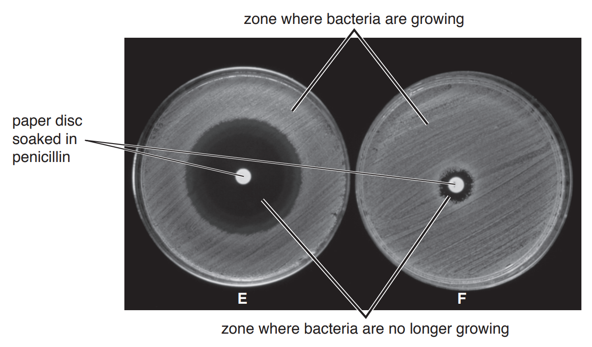
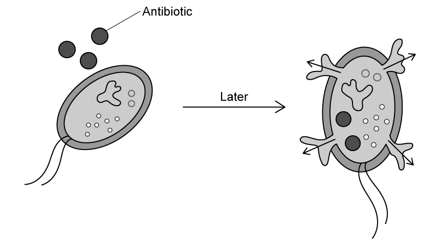
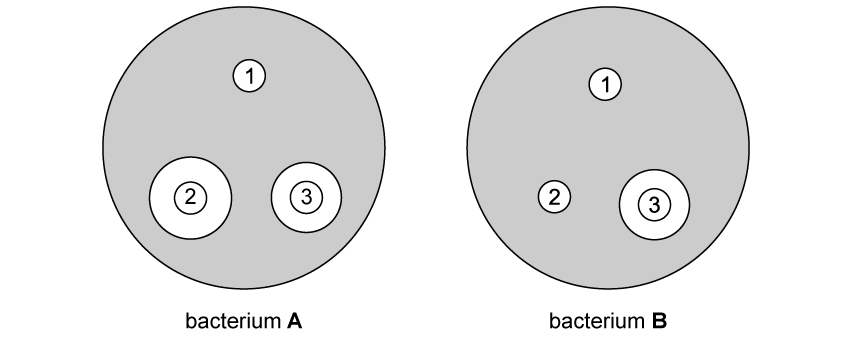

# Exam Questions — Drugs in Medicine
**15. Drugs** · Cambridge (CIE) IGCSE biology (0610 & 0970)
> Source: [https://www.savemyexams.com/igcse/biology/cie/23/topic-questions/](https://www.savemyexams.com/igcse/biology/cie/23/topic-questions/) · 18 questions across 2 sets

## Multiple Choice Questions (12 questions)

### Q1 — medium — 1 marks

**Q1** [1 mark]

A new antibiotic is introduced. Initially it is very effective at killing a bacterial pathogen. After many years, the antibiotic becomes much less effective.

Which process explains this change?

### Q2 — hard — 1 marks

**Q2** [1 mark]

#### Extended only

Which of the following practices have contributed to the fall in antibiotic effectiveness in the late 20th - early 21st centuries?

1. Large-scale use of preventative antibiotics in farm livestock
2. Failing to complete the full course of antibiotics prescribed by a doctor
3. Treatment of known bacterial infections with antibiotics
4. Treatment of viral infections with antibiotics

### Q3 — medium — 1 marks

**Q3** [1 mark]

#### Extended only

The graph below shows the number of deaths from MRSA per 100 000 people in a population of over-65’s from 2005 to 2012.

Which of the following statements are possible explanations for the trend shown in the graph?

### Q4 — medium — 1 marks

**Q4** [1 mark]

Which organ is involved in the metabolic breakdown of oral medication?

### Q5 — medium — 1 marks

**Q5** [1 mark]

Penicillin is an antibiotic that prevents bacteria growing by stopping them from forming cell walls.

Why does penicillin not affect viruses?

### Q6 — easy — 1 marks

**Q6** [1 mark]

Which of the following gives the most accurate definition of a drug?

### Q7 — medium — 1 marks

**Q7** [1 mark]

#### Extended only

In 1945, Sir Alexander Fleming warned about the evolution of antibiotic resistance in bacteria. There is currently an antibiotic resistance crisis.

Which of the following actions would worsen the situation?

1. Patients not completing the course of prescribed antibiotics.
2. The use of antibiotics for serious bacterial infections only.
3. The careful selection of antibiotics to match the bacterial strain.
4. Treating viral infections with broad-spectrum antibiotics.

### Q8 — hard — 1 marks

**Q8** [1 mark]

The data in the graph shows the effect of an antibiotic on the population of bacteria in the blood.

What can be concluded from the data in the graph?

### Q9 — medium — 1 marks

**Q9** [1 mark]

Which of the following statements about antibiotics is **not** correct?

### Q10 — hard — 1 marks

**Q10** [1 mark]

#### Extended only

The graph below shows the number of deaths from MRSA per 100 000 people in a population of over-65’s from 2005 to 2012.

Which of the following is the correct value of the average annual rate of decrease in the number of deaths from MRSA infections in the over-65s per 100 000 people from 2005 to 2012?

### Q11 — easy — 1 marks

**Q11** [1 mark]

Which table is correct in relation to antibiotics?

### Q12 — easy — 1 marks

**Q12** [1 mark]

Which statement best describes the mode of action of antibiotic drugs?

## Theory Questions (6 questions)

### Q1 — medium — 13 marks

**Q1** [1 mark]

#### Extended Only

Microbiologists test strains of bacteria for antibiotic resistance.

They do this by soaking paper discs in antibiotics and placing them on bacteria growing in Petri dishes.

The paper discs in the centre of Petri dishes **E** and **F** in Fig. 1 have been soaked in penicillin.

**Fig. 1**

State the **type **of microorganism that produces penicillin.

*Source: 2018 (Series 1) 0610/41 Q2A*

**Q1** [2 marks]

**Extract:**

Microbiologists test strains of bacteria for antibiotic resistance.

They do this by soaking paper discs in antibiotics and placing them on bacteria growing in Petri dishes.

The paper discs in the centre of Petri dishes E and F in Fig. 1 have been soaked in penicillin.

#### Extended Only

State** and** explain the evidence from Fig. 1 that suggests that the bacteria in dish **F** are resistant to penicillin.

*Source: 2018 (Series 1) 0610/41 Q2B*

**Q1** [7 marks]

#### Extended Only

(i)

Explain how bacteria become resistant to antibiotics **and** how humans can reduce the problem of antibiotic resistance.

[6]

(ii)

Explain why viral infections cannot be treated with antibiotics.

[1]

*Source: 2018 (Series 1) 0610/41 Q2C*

**Q1** [3 marks]

#### Extended Only

Some bacteria and viruses cause disease but many are useful to the biotechnology industry.

Explain why bacteria are useful in biotechnology.

*Source: 2018 (Series 1) 0610/41 Q2D*

### Q2 — easy — 6 marks

**Q2** [2 marks]

Fig. 1 shows events in the use of an antibiotic drug.

**Fig. 1**

Explain what **Fig. 1** depicts.

**Q2** [1 mark]

A patient in a doctor's surgery is diagnosed with the influenza virus and asks for antibiotics to be prescribed.

Explain why the doctor would deny this request and suggest other treatments.

**Q2** [2 marks]

A different patient is prescribed antibiotics for a skin infection.

After a few days, the patient has completed 3/4 of the dose and feels better, having experienced relief from the symptoms of the infection.

He decides to stop taking the antibiotics.

Explain why this is not advisable.

**Q2** [1 mark]

#### Extended only

State the name of the small circular loop of DNA that can be passed between bacterial cells and can carry antibiotic resistance genes.

### Q3 — easy — 5 marks

**Q3** [2 marks]

Define the term, 'drug'.

**Q3** [1 mark]

Identify the organ that is the primary site of drug metabolism.

**Q3** [1 mark]

State the name of the group of drugs that are used to treat the symptoms or causes of a disease.

**Q3** [1 mark]

State the name of the class of drugs that is used to treat bacterial infections.

### Q4 — medium — 7 marks

**Q4** [3 marks]

#### Extended only

Antibiotics have been widely used through the 20th and 21st centuries but are losing their effectiveness in medical and veterinary disease treatment.

Table 1 shows some of the reasons.

Place a tick (✓) in the boxes that are genuine factors why antibiotics can lose their effectiveness in combatting medical and veterinary diseases.

**Table 1**

| factor | contributes to antibiotics becoming less effective? |
|---|---|
| doctors prescribing antibiotics for viral infections |   |
| large scale use of antibiotics as disease prevention |   |
| doctors prescribing antibiotics for bacterial infections |   |
| bacteria evolving defence mechanisms |   |
| antibiotics 'wearing out' through overuse |   |
| patients always finishing their course of antibiotics |   |

**Q4** [2 marks]

Scientists developing new antibiotics sometimes find a molecule that does not kill the bacteria outright, but merely stops them from reproducing.

Explain why this is generally acceptable in the development of new antibiotics.

**Q4** [2 marks]

Suggest why antibiotics tend to be effective against bacterial cells but not against animal cells.

### Q5 — medium — 6 marks

**Q5** [2 marks]

A study in a large country analysed levels of three different antibiotics (A, B and C) in stream water leading towards and away from a large urban household waste dumpsite.

Prior to passing the dumpsite, the stream passes through a large urban township with limited sanitation.

The levels of antibiotics are found in Table 1.

**Table 1**

| Antibiotic | Level in stream water after dumpsite / arbitrary units | Level in stream upstream of the dumpsite / arbitrary units |
|---|---|---|
| A | 12 | 10 |
| B | 34 | 8 |
| C | 2 | 3 |

Calculate the percentage increase of antibiotic B detected as the stream flows from the township and past the dumpsite.

**Q5** [2 marks]

**Extract:**

A study in a large country analysed levels of three different antibiotics (A, B and C) in stream water leading towards and away from a large urban household waste dumpsite.

Prior to passing the dumpsite, the stream passes through a large urban township with limited sanitation. 

The levels of antibiotics are found in Table 1.

Table 1
| Antibiotic | Level in stream water after dumpsite / arbitrary units | Level in stream upstream of the dumpsite / arbitrary units |
| A | 12 | 10 |
| B | 34 | 8 |
| C | 2 | 3 |

Suggest **two** ways in which antibiotics may have found their way into the water as shown in Table 1.

**Q5** [2 marks]

#### Extended only

Suggest **two **possible risks of antibiotics entering the environment such as in sewage and wastewater.

### Q6 — medium — 9 marks

**Q6** [1 mark]

Some scientists investigated the effect of two antibiotics (methicillin and penicillin) on the growth of two different bacterial strains.

They used filter paper discs soaked in antibiotic solution and placed the discs on two agar plates; one had been spread with bacterial strain A and the other with strain B.

The filter paper discs were prepared as follows:

1. Control
2. Penicillin
3. Methicillin

Fig. 1** **shows the results from the investigation:

**Fig. 1**

Suggest what paper disc number 1 might have been soaked in.

**Q6** [4 marks]

**Extract:**

Some scientists investigated the effect of two antibiotics (methicillin and penicillin) on the growth of two different bacteria.

They used filter paper discs soaked in antibiotic solution and placed the discs on two agar plates, one had been spread with bacteria A and the other with bacteria B.

The filter paper discs were prepared as follows:

1. Control
2. Penicillin
3. Methicillin

Fig. 1 shows the results from the investigation:

Describe and explain the results in** **Fig. 1.

**Q6** [1 mark]

**Extract:**

Some scientists investigated the effect of two antibiotics (methicillin and penicillin) on the growth of two different bacteria.

They used filter paper discs soaked in antibiotic solution and placed the discs on two agar plates, one had been spread with bacteria A and the other with bacteria B.

The filter paper discs were prepared as follows:

1. Control
2. Penicillin
3. Methicillin

Fig. 1 shows the results from the investigation:

- There is a zone of inhibition/area of no bacterial growth around disc 2 for bacteria A (but not around the control);
- Penicillin is effective in killing / preventing growth of bacteria A;
- There is no zone of inhibition/area of no bacterial growth around disc 2 for bacteria B OR there is no difference between disc 2 and the control for bacteria B;
- Bacteria B has developed resistance to penicillin;
- There is a zone of inhibition/area of no bacterial growth around disc 3 for bacteria A and B (but not around the control);
- Methicillin is effective in treating / killing / preventing the growth of both bacteria A and B (to a similar level);
- The zone of inhibition/area of no bacterial growth is bigger around disc 2 than disc 3 for bacteria A;
- Penicillin is more effective than methicillin at killing / preventing the growth of bacteria A;

Another strain of bacteria, known as strain C, possesses resistance to methicillin and penicillin.

Predict the appearance of a petri dish that is used to grow strain C.

**Q6** [3 marks]

**Extract:**

Fig. 1 shows that... There is a zone of inhibition/area of no bacterial growth around disc 2 for bacteria A (but not around the control); Penicillin is effective in killing / preventing growth of bacteria A; There is no zone of inhibition/area of no bacterial growth around disc 2 for bacteria B OR there is no difference between disc 2 and the control for bacteria B; Bacteria B has developed resistance to penicillin; There is a zone of inhibition/area of no bacterial growth around disc 3 for bacteria A and B (but not around the control); Methicillin is effective in treating / killing / preventing the growth of both bacteria A and B (to a similar level); The zone of inhibition/area of no bacterial growth is bigger around disc 2 than disc 3 for bacteria A; Penicillin is more effective than methicillin at killing / preventing the growth of bacteria A.
A petri dish used to grow Bacteria C would appear: Full lawn of bacteria / 100% covered in colonies / no zones of inhibition; Resistance would not stop the bacteria from growing even in the presence of both antibiotics;

DNA analysis of the three strains of bacteria (A, B and C) suggests an evolutionary link between them.

Strain C is thought to have evolved from one of the other two strains.

(i) Suggest how strain C may have evolved from the other strains.

[2]

(ii) Predict and explain whether strain C is more likely to have evolved from strain A or B.

[2]
