# Mark Schemes — Reproduction in Plants & Humans
**16. Reproduction** · Cambridge (CIE) IGCSE biology (0610 & 0970)

## Multiple Choice Questions (35 questions)

### Q1
**Final answer:** **The correct answer is C.**

- Antibiotics are drugs that are used to treat bacterial infections, but do not affect viruses

**A** is incorrect as HIV is a viral infection and antibiotics do not affect viruses.

**B** is incorrect as antibiotic resistance develops in bacteria, not in humans.

**D** is incorrect as antibiotics treat bacterial infections and are not an effective method of controlling the spread of STIs.

### Q2
**Final answer:** **The correct answer is ****B.**

- **Luteinising hormone (LH)** shows a **sharp surge just before day 14**, which **triggers ovulation**, causing the ovary to release an egg
- This sudden peak in LH is known as the **LH surge**

**A **is incorrect because FSH (follicle-stimulating hormone) increases earlier in the cycle and stimulates the development of follicles in the ovary.

**C** is incorrect because oestrogen gradually increases during the first half of the cycle as the follicle develops.

**D** is incorrect because progesterone rises after ovulation and helps maintain the lining of the uterus in preparation for possible pregnancy.

### Q3
**Final answer:** **The correct answer is ****A.**

- The **anther** (**X**) is part of the **stamen** and its function is to **produce pollen grains**, which contain the **male gametes**
- The **stigma** (**Y**) is the top of the **carpel** and its role is to **receive pollen grains during pollination**. It is often sticky to help trap pollen
- The **ovary** (**Z**) is located at the base of the carpel and **contains ovules**, which hold the **female gametes**. After fertilisation, the ovules develop into **seeds**

### Q4
**Final answer:** **The correct answer is ****B**

- ** **The concentration of dissolved oxygen in the mothers blood decreases as it is transferred to the foetus within the placenta.
- The concentration of urea will increase as waste products from the foetus will move from the foetal blood into the mothers blood within the placenta.

**A** is incorrect because urea will increase as waste products move from the foetal blood to the maternal blood within the placenta.

**C** is incorrect because the changes described are the opposite of what actually occurs.

**D **is incorrect because the mother provides oxygen to the foetus and so oxygen concentration decreases as it moves from the maternal blood to the foetal blood.

### Q5
**Final answer:** **The correct answer is ****C****.**

- Body cells and embryo cells will both contain the diploid number of 10 chromosomes, while sperm cells are gametes and so only have 5 chromosomes, half of the diploid number.

**A **is incorrect because body cells and embryo cells in this species should both have the diploid number of 10 chromosomes, while sperm cells should have the haploid number of 5.

**B** is incorrect because sperm cells should have half the chromosomes of body cells, so they should have 5, not 10.

**D** is incorrect because embryo cells are diploid cells and so should have 10 chromosomes, not 20. They should match the chromosome number of the body cells.

### Q6
**Final answer:** **The correct answer is ****D****.**

- This is because the role of the progesterone is to maintain the thickness of the uterus lining, which happens at the end of the menstrual cycle while the body is preparing for a pregnancy

**A** is incorrect because the uterus lining is being shed during menstruation and so the progesterone level is at its lowest.

**B** is incorrect because the progesterone level is low at the start of the cycle while the uterus lining is building up. Oestrogen level is high at this point because this triggers the increase in the thickness of the uterus lining.

**C** is incorrect because progesterone levels start to rise after ovulation but will be lower at this point than later in the cycle.

### Q7
**Final answer:** **The correct answer is ****C****.**

- This is because the stigma is at the top of the carpel and is where the pollen grain attaches during pollination
- The style is below the stigma so when the pollen tube travels down it must pass through the style next, then the ovary and then finally the ovule is found inside the ovary and the pollen tube ends here when the pollen grain nucleus fuses with the female gamete during fertilisation

**A** is incorrect because the ovary and ovule are at the end of the pollen tube.

**B** is incorrect because the pollen tube does not start at the ovary, it starts at the stigma.

**D** is incorrect because the style is before the ovary.

### Q8
**Final answer:** **The correct answer is ****A****.**

- This is because A shows the stigma, which is found at the top of the female part of the flower called the carpel

**B** is incorrect because B shows the anther, which is part of the male part of the flower called the stamen.

**C** is incorrect because C shows the ovule, which contains the female gamete of the plant inside the ovary.

**D** is incorrect because D shows the sepal, which protects the unopened bud of the flower as it develops.

### Q9
**Final answer:** **The correct answer is ****C****.**

- This is because the pollen grain contains the male gamete and the ovule contains the female gamete and they fuse during the process of fertilisation, which is part of sexual reproduction.

**A** is incorrect because when one bacterial cell divides to produce two this is the process of asexual reproduction.

**B** is incorrect because one banana plant being divided into two banana plants is a form of asexual reproduction.

**D** is incorrect because when one yeast cell divides to produce two this is the process of asexual reproduction.

### Q10
**Final answer:** **The correct answer is ****C****.**

- The woman is most likely to become pregnant around the time of ovulation, between days 13 and 18.

**A **is incorrect because this is when menstruation is occurring and the lining of the uterus is shed.

**B **is incorrect as the egg has not been released from the ovary at this point.

**D** is incorrect as ovulation would have occurred too many days before and so the fertilisation window will have already passed and the egg will no longer be viable.

### Q11
**Final answer:** **The correct answer is ****C****.**

- The prostate gland produces a fluid that combines with sperm to form semen. This fluid provides a medium for sperm to swim in and contains nutrients that help sustain and protect sperm.

**A** is incorrect because the penis is the organ used to deliver semen out of the body, but it does not produce fluid for sperm.

**B** is incorrect because the scrotum is the sac that holds and protects the testes, but it does not produce any fluid for sperm.

**D** is incorrect because the testis produces sperm and testosterone, but it does not produce the fluid that sperm swim in.

### Q12
**Final answer:** **The correct answer is ****D****.**

- Runners are a form of asexual reproduction in plants. They grow horizontally from the parent plant and develop into new plants that are genetically identical
- Stem cuttings are also a method of asexual reproduction. When planted, they grow into new plants that are genetically identical to the parent

**A, B** and **C** are incorrect because they all include method 1 which would not produce plants genetically identical to the parent plant because seeds are produced through sexual reproduction. Sexual reproduction combines genetic material from two parent plants, resulting in genetic variation.

### Q13
**Final answer:** **The correct answer is C**

- This is because the placenta releases progesterone in order to support the lining of the uterus during the pregnancy and maintain the correct environment for the development of the fetus
- The placenta acts as an endocrine gland and can also release oestrogen

**A** is incorrect because adrenal glands secrete adrenaline and does not secrete any progesterone

**B **is incorrect because the ovary secretes progesterone during the normal menstrual cycle and up to about 10 weeks of the pregnancy, however during the majority of the pregnancy the placenta secretes more progesterone than the ovary

**D **is incorrect because the uterus cannot act as a gland and does not secrete hormones

### Q14
**Final answer:** **The correct answer is C**

- This is because all gametes are haploid (half the number of chromosomes as a diploid cell) because two gametes combine during fertilisation to produce a diploid cell
- The zygote is the diploid fertilised egg cell from the combination of the two haploid gametes during fertilisation
- The offspring are genetically different to both parents due to the random combination of chromosomes in each of the gametes

**A** is incorrect because the gametes are haploid, not diploid. Also the offspring are genetically different to the parents

**B **is incorrect because the gametes are haploid, not diploid. The zygote is diploid, not haploid. Also the offspring are genetically different to the parents

**D **is incorrect because the zygote is diploid, not haploid.

### Q15
**Final answer:** **The correct answer is C because:**

Blood and semen can transmit HIV

**A** is incorrect because saliva and tear fluid cannot transmit HIV.

**B **is incorrect because saliva cannot transmit HIV.

**D** is incorrect because blood is able to transmit HIV.

### Q16
**Final answer:** **The correct answer is C because:**

Ovulation typically takes place at day 14 of the menstrual cycle, but can vary

**A** is incorrect because this is when menstruation is taking place.

**B** is incorrect because this is when the uterus is building up a new lining in preparation for a potential pregnancy.

**D** is incorrect because this is too late in the menstrual cycle for ovulation.

### Q17
**Final answer:** **The correct answer is C because:**

It shows the uterus, which is where implantation normally takes place

**A** is incorrect because it shows the ovary, which produces and releases the egg cells during ovulation.

**B** is incorrect because it shows the oviduct, which is where fertilisation takes place, not implantation.

**D** is incorrect because it shows the vagina, which is where sperm cells enter the female reproductive system.

### Q18
**Final answer:** **The correct answer is D because:**

D shows the ovule, which contains the female gamete in plants

**A** is incorrect because it shows the anther, which is covered in pollen, the male gamete in plants.

**B** is incorrect because it shows the stigma, which is where the pollen grains bind during pollination.

**C** is incorrect because it shows the petals, which attract pollinators to the flower.

### Q19
**Final answer:** **The correct answer is D because:**

A zygote is a fertilised egg cell that forms after fertilisation and the fusion of the sperm and egg nuclei

**A** is incorrect because a gamete is a sex cell, in humans these are sperm and egg cells.

**B** is incorrect because an ovule contains the female gamete in plants.

**C** is incorrect because the stamen is the male reproductive part in a plant.

### Q20
**Final answer:** **The correct answer is D because:**

water, oxygen and warmth are all required for seed germination

**A** is incorrect because carbon dioxide is not required for seed germination.

**B **is incorrect because light is not required for seed germination.

**C** is incorrect because carbon dioxide is not required for seed germination.

### Q21
**Final answer:** **The correct answer is ****D.**** (1 and 3) because:**

- HIV infects **lymphocytes** (a type of white blood cell) eventually leading to a reduction in their number. As the **lymphocytes **produce **antibodies** which enhance an immune response to infection, the reduction in antibody production eventually results in a reduced ability to fight infection (at this point a person has AIDS)
- HIV is a sexually transmitted disease; that is the HIV virus is passed from one person to another via body fluids

**A** is incorrect because while HIV will reduce antibody production, it will not directly decrease the levels of red blood cells.

**B** is incorrect because neither of these statements would be correct for a direct effect of HIV.

**C** is incorrect because while HIV will reduce white blood cells it will not directly reduce the volume of plasma produced.

### Q22
**Final answer:** **The correct answer is ****C ****because:**

The seedling is tall and green in this sample indicating that it received enough light for the leaves to photosynthesise. The temperature was high enough to allow for enzyme activity.

**A** is incorrect because this sample is short and yellow, showing that it was not photosynthesising so grown in the dark and at low temperatures so had a reduced enzyme activity. This would be sample 3.

**B** is incorrect because this sample is tall and yellow, showing it was grown in the dark but at a higher temperature. This would be sample 1.

**D** is incorrect because this sample is short and green, showing that it had light but not a high enough temperature for optimum enzyme activity. This would be sample 4.

### Q23
**Final answer:** **The correct answer is ****B.**** (2 → 1 → 3) because:**

- Birth begins when the muscles in the wall of the uterus start **contracting**. This is the start of labour
- At first the contractions of the muscles stretch the cervix. This is the point that the amniotic sac breaks
- After a few hours, when the cervix is wide enough the head of the baby will pass through and the contractions will push the baby out through the vagina
- Once the baby is born it will start to breathe for itself and no longer need to get its oxygen from the **placenta **via the umbilical cord. The umbilical cord is cut just above the point it joins the baby (forming the belly button)

### Q24
**Final answer:** **The correct answer is ****B ****because:**

Three essential factors are needed for successful germination:

- **Water** - allows the seed to swell and start growing while also providing a solvent for essential nutrients to diffuse around the seed
- **Oxygen** - allows for aerobic respiration to release the energy from stored sugars (needed to fuel growth)
- **Warmth** - germination increases as the temperature increases (up to an optimum temperature), the number of successful collisions between enzymes and substrates increases

**A** is incorrect because the temperature is too low for successful collisions between **enzymes** and their **substrates.**

**C** is incorrect because there is no water for the stored sugars to dissolve in, and the temperature is too low.

**D** is incorrect because there is no oxygen for aerobic respiration to release energy to fuel growth.

### Q25
**Final answer:** **The correct answer is ****A.**** (Male and female gametes) because:**

- ‘Many, minute and motile’ refers to **sperm** cells. They are produced in very large numbers and are much smaller than the **ovum** (the egg) - they are much less energy intensive to produce which is why more of them can be made. They also have a** tail** to swim to the ovum
- ‘Few, fat and fixed’ refers to an ovum (egg cell). Generally, only one egg is released each month in the **menstrual cycle**. They are much larger than sperm cells and are unable to move independently, instead, they rely on the **ciliated** cells in the oviduct to waft them through to the **uterus**

A common misconception here is that these statements are referring to animal and plant cells, students often think of animal cells being smaller and motile and plant cells being large and fixed.

### Q26
**Final answer:** **The correct answer is ****B.**** (They release energy for movement) because:**

Mitochondria are the site of aerobic respiration which releases the energy needed to power the tail of the sperm so that it can make its journey to the ovum in the oviduct.

**A** is incorrect because the nucleus contains the genetic information from the male.

**C** is incorrect because the sperm cell has enzymes in the head (in the acrosome) to help it digest the outer layer of the egg so that it can release its nucleus into the egg.

**D** is incorrect because ribosomes are the site of protein synthesis.

### Q27
**Final answer:** **The correct answer is ****D ****because:**

- More **genetic variation** within a population / species means that the population / species is more likely to survive any changes in the environment due to **natural selection**. They may also be able to survive moving to new environments
- **Asexual reproduction** is faster as it only involves one parent, there is no need to find a suitable partner for reproduction

**A** is incorrect because while only one parent needed is an advantage of asexual reproduction, less population growth is not an advantage of sexual reproduction.

**B** and **C** are incorrect because none of these statements are scientifically correct.

### Q28
**Final answer:** **The correct answer is ****D ****because:**

- Pollination has taken place as there are **pollen **grains on the tops of the **stigma** and a pollen tub has grown down the **style**
- Fertilisation hasn’t taken place as the **pollen tube** has not connected with the **ovum** and there is no pollen grain nucleus visible in the **ovary**

### Q29
**Final answer:** **The correct answer is ****D.**** (At ovulation the thickness of the lining is highest) because:**

- **Ovulation** takes place generally around day 14 of the menstrual cycle. This is when the lining of the uterus is at its thickest
- **Progesterone** is produced by the corpus luteum to maintain the lining of the uterus if an egg is fertilised

**A** is incorrect because ovulation takes place at day 14 and 5 days from this would be day 19, the lining of the uterus doesn't get thinner until day 28.

**B** is incorrect because the uterus lining is at its thickest before the release of progesterone from the ovary (oestrogen promotes thickening of the lining). The lining stays thick until the levels of progesterone fall.

**C** is incorrect because there is a second increase of oestrogen around day 21 and the lining of the uterus doesn’t change.

### Q30
**Final answer:** **The correct answer is ****C.**** (2 only) because:**

Pollen grains that are transferred by **insect pollinators** are larger and have a spiky surface to attach to insects.

The pollen in picture 1 has a larger surface area with ‘wings’ and in picture 3 are small and light. These two features are more likely to be seen in wind pollinated seeds.

### Q31
**Final answer:** **The correct answer is ****C.**** (Days 13 - 16) because:**

- **Ovulation** happens after the LH surge which occurs around day 14 (if day 1 is the first day of a period in a new cycle)
- **Sperm** will survive in a woman's body for 2 -3 days so once the egg is released there may be sperm in the fallopian tube to fertilise the egg

**A** is incorrect because around this time the egg has not been released from the ovary.

**B** is incorrect because there is no egg released (it will be maturing at this point) and any sperm present at this time are unlikely to survive until the egg is released roughly 4 days later.

**D** is incorrect because the egg will have died by day 20 so there will be no egg for the sperm to fertilise.

### Q32
**Final answer:** **The correct answer is ****A.**** (Vagina →  cervix   → uterus  → oviduct) because:**

**Ejaculation** takes place in the vagina; from there sperm travels through the cervix, into the uterus and then to the oviduct where (if it has been released) an egg can be fertilised.

**B** and **D** are incorrect because they would both be correct paths of an egg that was not fertilised by a sperm cell.

**C** is incorrect because the sperm will need to go through the cervix before it can enter the uterus.

### Q33
**Final answer:** **The correct answer is ****B.**** (Progesterone) because:**

- Progesterone is produced by the **corpus luteum** after ovulation. This maintains the lining of the **uterus** until the **placenta** can be developed and continue the production of progesterone until birth
- If no fertilisation occurs, the corpus luteum breaks down which leads to a fall in progesterone so that the lining of the uterus is no longer maintained and is lost (a period)

**A** is incorrect because oestrogen stimulates the thickening of the uterus lining in the menstrual cycle.

**C** is incorrect because FSH stimulates the development of a follicle in the ovary.

**D** is incorrect because testosterone is a male sex hormone and has no role in the menstrual cycle.

### Q34
**Final answer:** **The correct answer is ****B.**** (2 and 4) because:**

Testosterone is the male hormone that causes **secondary sexual characteristics **during **puberty**. These include the development of stronger muscles and the voice to deepen.

**A** is incorrect because while it does cause the voice to deepen, testosterone is not produced by the pancreas (it’s produced in the testes).

**C** is incorrect because while it does promote the development of stronger muscles and is primarily thought of as a male hormone, women do produce small amounts of testosterone but it is not involved in the control of egg maturation in the ovaries.

**D** is incorrect because even though this is a correct statement, it is not the **only** correct statement (the question is asking you for all the statements).

### Q35
**Final answer:** **The correct answer is ****C.**** (It leads to increased genetic variation within a population) because:**

Only one parent is required to produce the offspring during asexual reproduction, so there is no fusion of gametes and therefore no mixing of different genetic information that occurs. All the offspring will be genetically identical to each other and the parent.

**A**, **B** and **D** all represent the advantages of asexual reproduction.

## Theory Questions (31 questions)

### Q1
> **[mark-scheme]**
> (i) The term sexually transmitted infection refers to:
> 
> - An infection that is transmitted through sexual contact **[1 mark]**
> 
> (ii) One method of preventing the transmission of HIV is:
> 
> Any **one** from:
> 
> - Use of condoms / barrier contraception
> - (sexual) abstinence
> - do not share needles
> - screen blood for transfusions
> 
> **[1 mark]**

### Q2
- Lumen or wall of left or right oviduct labelled **Q**; **[1 mark]**
- Area of uterus with darkest shading labelled **R**;  **[1 mark]**
- Ovary labelled** S**;  **[1 mark]**
- Vagina labelled **T**;  **[1 mark]**

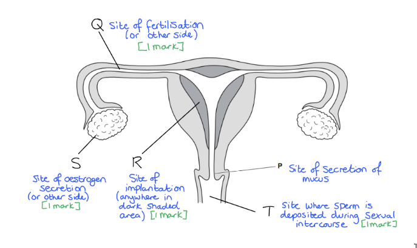
(i)

Any three from:

- They are needed for making new cells after fertilisation; **[1 mark]**
- They are needed for making membranes;  **[1 mark]**
- (Protein for) making enzymes;  **[1 mark]**
- They are needed for making new (named) cell structures / cytoplasm;  **[1 mark]**
- (Fat / protein) provide / source of energy;  **[1 mark]**
- Energy for cell division / mitosis / growth (of cell) / metabolism;  **[1 mark]**

(ii)

- Hardens / changes after fertilisation / entry of sperm; **[1 mark]**
- Prevents more sperm entering (after fertilisation); **[1 mark]**
Any four from:

- Chromosomes / DNA duplicate(s) / replicate(s);  **[1 mark]**
- Chromosomes separate;  **[1 mark]**
- Mitosis / nuclear division; **[1 mark]**
- (Zygote / fertilised egg) divides / splits (into two); **[1 mark]**
- (Nuclear / cell) division / mitosis, repeated;  **[1 mark]**
- Forming a ball / cluster of cells;  **[1 mark]**
- Cells are genetically identical;  **[1 mark]**

There is flexibility here to gain extra marks for other valid answers that are not specifically named on the mark scheme e.g. cell specialisation / differentiation, or a reference to stem cells.

Remember that the zygote is the first cell that is formed i.e. the fertilised egg cell, so in order to form an embryo with several cells then the cell needs to undergo mitosis to create multiple identical cells to the zygote.

### Q3
Any three from:

- **Both** asexual and sexual reproduction produce offspring; [1 mark]
- Asexual reproduction involves one parent, **whereas ** sexual reproduction requires two parents; [1 mark]
- Asexual reproduction results in genetically identical offspring / clones, **whereas **sexual reproduction produces genetically different offspring; [1 mark]
- Asexual reproduction does not involve gametes, **whereas ** sexual reproduction involves the fusion of gametes / egg and sperm / pollen and ovule; [1 mark]
- In asexual reproduction, there is no fertilisation,**whereas ** sexual reproduction includes the fertilisation/fusion of gametes; [1 mark]
- Asexual reproduction leads to no genetic variation, **whereas ** sexual reproduction introduces variation among offspring; [1 mark]
- Asexual reproduction is generally fast**er** than sexual reproduction; [1 mark]
- Asexual reproduction occurs through mitosis, **whereas ** sexual reproduction involves meiosis (and mitosis); [1 mark]
- Asexual reproduction requires less energy **compared to** sexual reproduction, which demands more energy (for processes like mating and gamete production); [1 mark]

*Note that comparative language is important to obtain the marks in this mark scheme. *

**[Total for question 2: 10 marks]**

### Q4
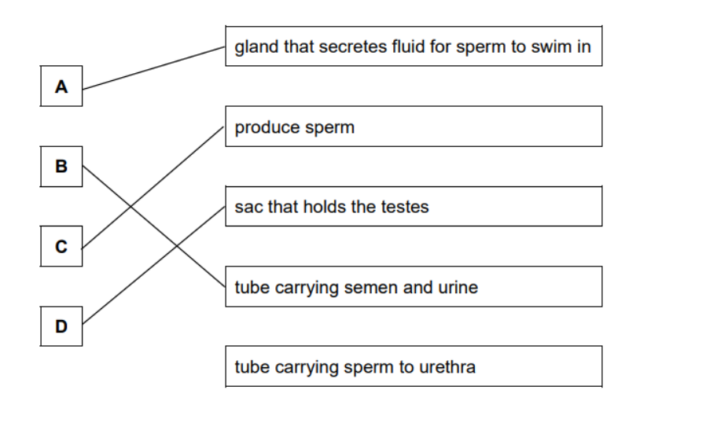

- [1 mark] for each correct line
(i)

- Egg cell / ovum / ova; [1 mark]

(ii)

- Zygote; [1 mark]

(iii)

- Oviduct; [1 mark]

### Q5
- P = testis; **[1 mark]**
- S = zygote;**[1 mark]**
- Q = meiosis; **[1 mark]**
- R = fertilisation;**[1 mark]**
- T = mitosis; **[1 mark]**
- U = implantation; **[1 mark]**
(i)

- To maintain the same number of chromosomes / so that the number of chromosomes does not double at fertilisation; **[1 mark]**ark]

(ii)

- To prevent more than one sperm fertilising / entering the egg; **[1 mark]**
- The placenta provides a large surface area for the **diffusion / exchange** of oxygen and carbon dioxide; **[1 mark]**
- Examples of dissolved nutrients are: **amino / fatty** acids; [1 mark]
- Other examples include a maximum of two from:

  - Glucose; **[1 mark]**
  - Vitamins / named vitamins, e.g. vitamin C; **[1 mark]**
  - Minerals / ions / salts / named mineral, e.g. calcium; **[1 mark]**
  - Glycerol; **[1 mark]**
  - Fatty acids / amino acids (whichever has not been used for the previous marking point); **[1 mark]**
- Antibodies pass from the maternal blood giving natural **passive** immunity; **[1 mark]**
- Each different type of vaccine contains one or more **antigens**;**[1 mark]**
- Taken from the **pathogen / (micro)organism** that causes the disease; **[1 mark]**

### Q6
(i)

- A = filament; **[1 mark]**
- C = petal; **[1 mark]**
- E = ovary; **[1 mark]**

(ii)

- Production of pollen/male gametes; **[1 mark]**

B indicates the anther of the flower; this is the site of pollen production and release.

(iii)

- D; **[1 mark]**

Remember that pollination is the transfer of pollen to the stigma; be careful not to get this confused with fertilisation.

**[Total: 5 marks]**
Any one from:

- Large petals;** [1 mark]**
- Sexual organ(s) / anthers / stigma are inside the flower / are internal; **[1 mark]**

**[Total: 1 mark]**
*Flower structure*

A maximum of two from:

- Petals are small / non-existent / dull / not colourful; **[1 mark]**
- Anthers / stigma hang outside the flower / are external; **[1 mark]**
- Feathery stigma; **[1 mark]**
- Pendulous / versatile anther; **[1 mark]**

*Pollen*

A maximum of two from:

- Large amounts of pollen produced/released; **[1 mark]**
- Light / small pollen; **[1 mark]**
- Smooth pollen; **[1 mark]**

**[Total: 3 marks]**
- Animal; **[1 mark]**

**[Total: 1 mark]**

### Q7
(i)

- A circle is drawn around an ovary; **[1 mark]**
- A line labelled **W** ends on an oviduct; **[1 mark]**
- A line labelled **X** ends inside the uterus / on the uterus lining; **[1 mark]**

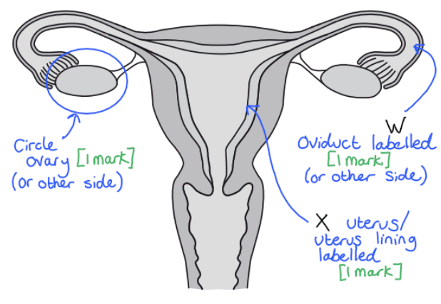

(ii)

- Meiosis; **[1 mark]**

(iii)

Any two from:

- Vagina; **[1 mark]**
- Cervix; **[1 mark]**
- Uterus; **[1 mark]**
- Oviduct; **[1 mark]**

**[Total: 6 marks]**
(i)

- 7 (days); **[1 mark]**

(ii)

- Straight line drawn horizontally on the graph as a continuation of the existing line **AND **line is drawn between day 16 and day 28;** [1 mark] **

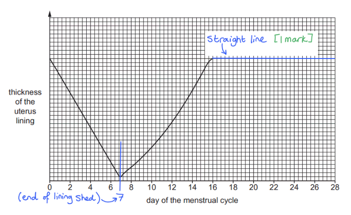

(iii)

- 13 / 14 / 15;** [1 mark]**

**[Total: 3 marks]**
Any three from:

- Voice deepens/breaks; **[1 mark]**
- Shoulders broaden; **[1 mark]**
- Growth spurt / getting taller; **[1 mark]**
- Sexual organs enlarge;**[1 mark]**
- Sperm production occurs; **[1 mark]**
- (Increased) production of testosterone; **[1 mark]**
- Facial hair grows; **[1 mark]**
- Pubic / body / underarm hair grows; **[1 mark]**
- Increase in muscle / bone (mass); **[1 mark]**

**[Total: 3 marks]**

### Q8
(i)

- Virus;** [1 mark]**

(ii)

Any three from:

- (Contaminated blood) transfusions; **[1 mark]**
- Blood to blood contact / exchange of blood; **[1 mark]**
- Sharing (contaminated) needles; **[1 mark]**
- Breastfeeding / breastmilk from an individual with HIV; **[1 mark]**
- During birth; **[1 mark]**
- Unprotected sex **OR** transfer / exchange of sexual fluids; **[1 mark]**
- Other correct descriptions of transmission method, e.g. sharing body fluids / being seriously bitten by an infected individual; **[1 mark]**

**[Total: 4 marks]**

### Q9
Any **three** from:

- Asexual reproduction;** [1 mark]**
- Minimises genetic variation / gives a uniform crop; **[1 mark]**
- Produces plants that all have the same features; **[1 mark]**
- Ensures consistency of product ; **[1 mark]**
- Faster production from cuttings than from seeds; **[1 mark]**

**[Total: 3 marks]**

> *Remember that using cuttings is a form of cloning plants. This is a useful tool for growers to create several genetically identical plants with favourable characteristics.*

### Q10
- C (testis); **[1 mark]**
- E (urethra); **[1 mark]**
- B (prostate gland); **[1 mark]**

**[Total: 3 marks]**
Any three from:

- Vagina; **[1 mark]**
- Cervix; **[1 mark]**
- Uterus; **[1 mark]**
- Oviduct; **[1 mark]**

The sperm does not enter the ovaries.

**[Total: 3 marks]**
Any three from:

- Tail / flagellum (help to move the sperm cells towards the egg); **[1 mark]**
- Enzymes / acrosome (digests the outer layer of the egg cell during fertilisation);**[1 mark]**
- Mitochondria (provide energy for movement); **[1 mark]**

There are marks available for any other correct point, for example a streamlined shape.

**[Total: 3 marks]**

### Q11
The part of the human body that produces male gametes and the part that produces female gametes are:

- (Male gametes are produced by the) testis/testes; **[1 mark]**
- (Female gametes are produced by the) ovary/ovaries; **[1 mark]**

**[Total: 2 marks]**
(i) The cells labelled **P**, **Q **and **S **in Fig. 1 are:

- **P **- Egg cell / ovum / ova; **[1 mark]**
- **Q**** **- Sperm; **[1 mark]**
- **S **- Zygote / fertilised egg cell;** [1 mark]**

(ii) The correct sex chromosomes in **P**, **Q **and **S **in Fig. 1 are:

- **P **- X; **[1 mark]**
- **Q**** **- X; **[1 mark]**
- **S **- XX;** [1 mark]**

> *Remember, a female embryo contains 2 X chromosomes, whereas a male embryo carries one X and one Y chromosome. *

> *Females - XX*

> *Males - XY*

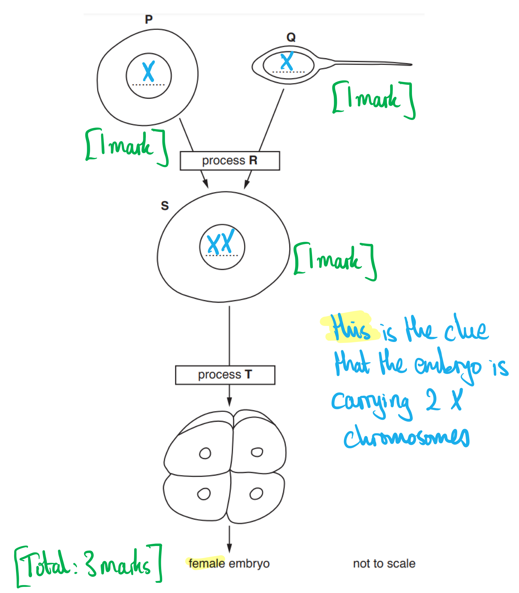

(iii) The names of processes **R** and **T** are:

- **R** - Fertilisation; **[1 mark]**
- **T** - Mitosis; **[1 mark]**

(iv) The the name of the organ in the body in which the female embryo develops is:

- Uterus; **[1 mark]**

**[Total: 9 marks]**

### Q12
The definition of *sexual reproduction* is:

- (The) fusion of the nuclei of two gametes / sperm and egg (cell); **[1 mark]**
- To form a zygote; **[1 mark]**
- (Which leads to the) production of genetically different offspring; **[1 mark]**

**[Total: 3 marks]**

> *The main pitfall in this question is to fail to mention that sexual reproduction produces genetically different offspring. Also, sexual reproduction and sexual intercourse are not the same thing!*
(i) The table can be completed as follows:

| **letter on Fig. 1** | **name of part** | **name of the substance or substances transported** |
|---|---|---|
| **A** | rectum / colon / large intestine; **[1 mark]** | faeces |
| **B** | sperm duct; **[1 mark]** | sperm |
| **C** | <u>urethra</u>; **[1 mark]** | sperm and urine |
| **D** | <u>ureter</u>; **[1 mark]** | urine |

(ii) The prostate gland can be identified as follows:

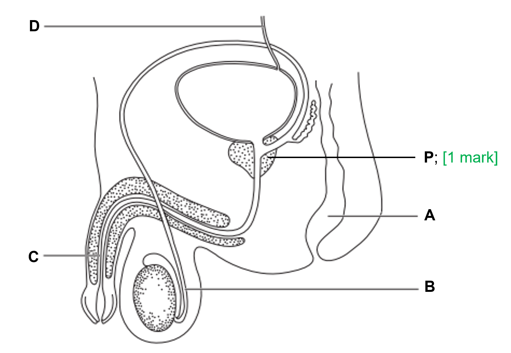

**[Total: 5 marks]**

> *You must make sure that you study the diagrams of the male and female reproductive systems very well in order to identify labelled structures on them. Be careful with your spelling of **ureter** and **urethra**; only precise spellings are allowed because of the similarity of the two words.*
The function of the scrotum is:

Any **one **from the following:

- (It) protects/holds/contains the testes; **[1 mark]**
- (It) maintains/keeps the testes at a <u>lower</u> temperature (than body temperature) ; **[1 mark]**

**[Total: 1 mark]**

> *Sperm production is negatively affected by higher temperatures, therefore it is advantageous to keep the testes outside the body in order to ensure that they are always at a lower temperature than the rest of the body.*

### Q13
(i) Sperm are made...

- In the part labelled **C**; **[1 mark]**

(ii) Urine and sperm are carried out of the body...

- Via the part labelled **E**; **[1 mark]**

(iii) The fluid that is added to the sperm is made...

- In the part labelled **B**; **[1 mark]**

**[Total: 3 marks]**
Three structures that the sperm travel through include:

Any **three **from the following:

- Vagina; **[1 mark]**
- Cervix; **[1 mark]**
- Uterus; **[1 mark]**
- Oviduct; **[1 mark]**

**[Total: 3 marks]**

> *You may also see the uterus being referred to as 'the womb' and the oviduct being referred to as 'the fallopian tube' but you should use the terms stated by the specification.*
Sperm are adapted in the following ways:

Any **three **from the following:

- They have a tail / flagellum; **[1 mark]**
- They have enzymes / acrosome / digestive enzymes; **[1 mark]**
- (Many) mitochondria; **[1 mark]**

***Accept**** any other valid adaptations e.g. references to streamlined shape.*

**[Total: 3 marks]**

> *This is also covered in the specialised cells topic.*
(i) The possible sex chromosomes contained in a sperm might be:

- X or Y; **[1 mark]**

*Both chromosomes must be stated to obtain the mark*

(ii) The sentence should be completed as follows:

- A gene is a length of <u>**DNA**</u>...; **[1 mark]**
- ...that codes for a <u>**protein**</u>; **[1 mark]**

**[Total: 3 marks]**

### Q14
(i) Identification of the flower parts from the figure are:

**Final answer:** **One**** mark for each of the following:**

| Petal | **Final answer:** **J ** |
|---|---|
| Anther | **Final answer:** **F** |
| Stigma | **Final answer:** **H** |
| A male part of the flower | **Final answer:** **F** |
| A part of the carpel | **Final answer:** **G / H** |
| Sepal | **Final answer:** **E** |

(ii) Evidence that the flower is pollinated by insects is:

Any **two** from the following:

- Large petals; **[1 mark]**
- Anthers or stigmas inside the petals; **[1 mark]**

*Allow: reference to lack of adaptations for wind pollination, e.g. no feathery stigma / no drooping anthers; ***[1 mark]**

**[Total: 8 marks]**
The pollen grains that come from insect-pollinated flowers are:

- K, L, N, P; **[2 marks]**

All **four** letters =** [2 marks] ****Three** correct =** [1 mark] **All **four** correct but with an additional letter =** [1 mark] **All **four** correct but with two or more additional letters =** [0 marks]**

**[Total: 2 marks]**

> *Insect pollinated flowers produce smaller amounts of larger, heavier pollen grains that often contain spikes or hooks on the outside so they are better able to stick to insects. Pollen grains M, O and Q do not have any spikes or hooks so must be pollinated by the wind or another mechanism. *

### Q15
The parts of the human female reproductive system can be identified as follows:

(i) Where eggs are made:

- **C**; **[1 mark]**

(ii) Where fertilisation occurs:

- **B**; **[1 mark]**

(iii) Where implantation of the zygote occurs:

- **A**;** [1 mark]**

**[Total: 3 marks]**
(i) The name of the part of the female reproductive system that secretes oestrogen is:

- (The) ovary; **[1 mark]**

(ii) Oestrogen is transferred to its target organs as follows:

- (It is transported) in plasma / the blood; **[1 mark]**

**[Total: 2 marks]**

> *Remember that all hormones are secreted directly into the bloodstream by structures known as endocrine glands. From there they will be transported to their target organs by the blood.*
The completed table would look as follows:

| **secondary sexual characteristic** | **boy** | **girl** |
|---|---|---|
| Breasts grow |   | ✓ |
| Growth of sex organs | ✓ | ✓ |
| Growth of pubic hair | ✓ | ✓ |
| Start of menstruation |   | ✓ |
| Voice deepens | ✓ |   |

**[1 mark]** *for each correct row.*

**[Total: 4 marks]**

### Q16
The letters for each part are:

- The cervix = G; **[1 mark]**
- The oviduct = D; **[1 mark]**
- The uterus = F; **[1 mark]**
- The vagina = H; **[1 mark]**

**[Total: 4 marks]**
The X should be drawn as follows:

- On / a line drawn to an ovary; **[1 mark]**

***Accept**** an X drawn/labelled on either ovary.*

**[Total: 1 mark]**

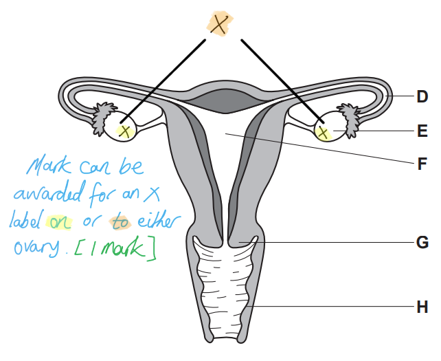
The structure where fertilisation normally takes place is the:

- Oviduct; **[1 mark]**

**[Total: 1 mark]**

### Q17
The letter and the name of each of the structures is...

| **function** | **letter** | **name** |
|---|---|---|
| releases oestrogen | F | ovary |
| site of fertilisation | A | oviduct |
| site of implantation | E | uterus lining |
| dilates during the process of birth | C/D | vagina (**C**) / cervix (**D**) |

*Award ***[1 mark]*** for each correct ****row****.*

**[Total: 4 marks]**

> *Note that it is the uterus** lining **into which implantation occurs; just stating 'uterus' here will not be enough for a mark.*
(i) The number of chromosomes present in a female gamete is...

- 23; **[1 mark]**

(ii) The number of chromosomes present in a zygote is...

- 46 / 23 pairs; **[1 mark]**

**[Total: 2 marks]**

> *Gametes are haploid cells, meaning that they contain half the normal chromosome number of an adult cell; in the case of humans, the haploid chromosome number is 23. When two gametes fuse in fertilisation to form a zygote the full chromosome number of 46 is restored.*
The results shown by the data in Fig. 2 can be described as follows...

Any **three **of the following:

- The number of (chlamydia) cases increases **THEN** decreases; **[1 mark]**
- The largest increase (in cases) occurs between the 10-14 age group and the 15-19 age group; **[1 mark]**
- The highest number of cases is in the 15-19 age group; **[1 mark]**
- From 15-19 upwards the number of cases decreases **OR** there is a steep decrease in the number of cases between 20-24 and 25-29; **[1 mark]**
- There are no cases in anyone older than 55 / in the 55-64 age group / in the 65+ age group; **[1 mark]**
- Correctly quoted data containing number of cases and age group (e.g. there are 10 000 cases in the 40-44 age group); **[1 mark]**

**[Total: 3 marks]**

> *Note that this question asks you to describe the results; this should include statements of general trends within the data as well as quoting data to support your description.*

> *No marks will be available for explaining the data in a 'describe' question like this.*
(i) A treatment for chlamydia could be...

- Antibiotics; **[1 mark]**

(ii) The name of one other STI is...

- HIV; **[1 mark]**

(iii) the sentences about the spread of STIs can be completed with the following words...

- Body fluid / bodily fluid / sexual fluid / semen / blood (via small cuts during sexual intercourse); **[1 mark]**
- Barrier; **[1 mark]**
- Condom / female condom/femidom/internal condom; **[1 mark]**

**[Total: 5 marks]**

> *Be careful not to confuse antibiotics with antibodies. Antibiotics are drugs used to kill bacteria in the treatment of bacterial infection while antibodies are produced by white blood cells in the immune response to fight pathogens.*

> *This question covers core knowledge but is taken from an extended paper 4 question.*

### Q18
The advantages of using cuttings rather than seeds to reproduce crop plants include...

Any **three **of the following:

- (This is an example of) asexual reproduction; **[1 mark]**
- Genetic variation in the offspring/new plants is minimised / the offspring/new plants are identical/uniform; **[1 mark]**
- The plants produced all have the same (favourable) features/characteristics; **[1 mark]**
- The (resulting) product will be consistent/the same (i.e. the harvest from the crop); **[1 mark]**
- Production is faster than sexual reproduction / from cuttings than it is from seeds; **[1 mark]**

**[Total: 3 marks]**

### Q19
(i) An ovule and a petal on flower **L** can be identified as follows:

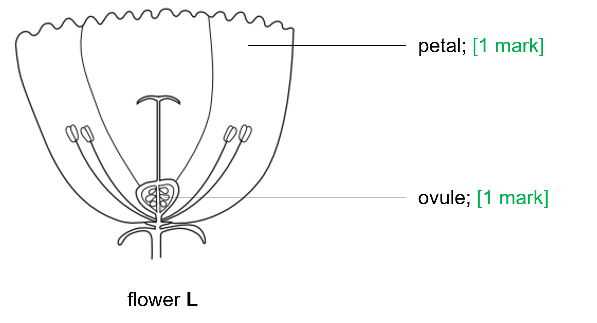

> *The most common error here is to label the ovary rather than the ovule; be sure to know the difference between the two. *

(ii) The names of the following flower parts are as follows:

- Produce ovules = carpel / ovary; **[1 mark]**
- Protect the bud on the flower = sepal; **[1 mark]**

> *The most common error here is to say that the petal protects the bud; the petal's job is to attract insect pollinators. *

**[Total: 4 marks]**
The pollen transfer from flower **K** to **L** can be represented as follows:

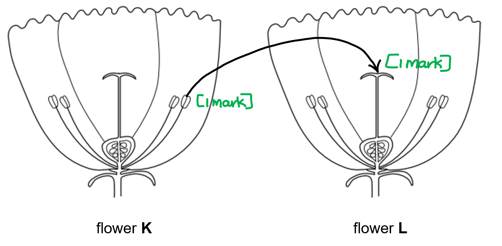

**[1 mark]** *for line starting at anther of flower**** K *****[1 mark]** *for line ending at / arrow pointing towards stigma of flower ****L***

**[Total: 2 marks]**

> *Pollen is produced in the anthers of a flower and is received by the stigma of another flower during pollination. In this case pollen is transferred from the anthers of flower **K** to the stigma of flower **L**.*
Visible features that indicates that these flowers are pollinated by insects include:

Any **two **from the following:

- (They have large) petals; **[1 mark]**
- (The) stamens / anthers / filaments are inside the flower **OR** they have short stamens / filaments **OR** they have small anthers; **[1 mark]**
- (The) stigma is inside the flower / (the flower has a) short style; **[1 mark]**
- (The) stigma is broad / wide / not feathery; **[1 mark]**

*Ignore any reference to features that are not visible in Fig. 1.*

**[Total: 2 marks]**

> *It is important to read the question carefully before answering. You are instructed to describe two features that are **visible** in the diagram, therefore mentioning features such as colourful petals, nectar or sticky stigmas will be ignored because they are not visible in this diagram. *
The pathway of water from the soil to a leaf in a plant can be described as follows:

Any **four **from the following:

- Water enters the root hair (cells); **[1 mark]**
- (Then moves) across / through the (root) cortex ; **[1 mark]**
- (After which) water moves into the xylem (vessels); **[1 mark]**
- (From there it) moves up the stem; **[1 mark]**
- (After which it leaves the xylem vessels and moves) into the mesophyll (cells); **[1 mark]**
- Any valid point referring to the movement of water by osmosis / water vapour by diffusion **OR** water moves up the xylem to replace the water lost due to transpiration; **[1 mark]**

*The marking points must be in the correct order to obtain marks.*

**[Total: 4 marks]**

> *The loss of water from the leaves due to transpiration results in water moving from the roots up the stem and into the leaves to replace the lost water. However, a detailed description of water loss from leaves is not part of this question, so it would be ignored. *

> *A good knowledge of plant structure is necessary to accurately describe the pathway of water. Common errors include mentioning the phloem as part of the pathway or stating that water enters the stomata and travels to the roots; these are both untrue. *

### Q20
The term pollination means:

- The transfer of pollen (grains) / male gamete; **[1 mark]**
- From the anther / stamen to the stigma; **[1 mark]**

**[Total: 2 marks]**

> *It is important to use the correctly named parts of the flower here rather than just saying that pollen is transferred from the male parts to the female parts.*
The ways in which the flower in Fig. 1 is adapted for wind-pollination are:

Any **two **from the following:

- The stigmas are large / feathery (to catch pollen floating in the air); **[1 mark]**
- The stigmas are exposed (to the wind); **[1 mark]**
- The filaments are long (to catch floating pollen grains); **[1 mark]**
- The anthers / stamens hang outside the flower structure (to catch floating pollen grains); **[1 mark]**
- The anthers are loosely attached to the filament (so it can be blown off by the wind); **[1 mark]**
- There are no / less / small petals (which would act as a wind break); **[1 mark]**

**[Total: 2 marks]**

> *The question specifically asks you to describe adaptations of the flower **in the diagram** so your answer can only include details of those you can see in the diagram above.  *
Pollen from an insect-pollinated flower is different to pollen from a wind-pollinated flower in the following ways:

**Final answer:** **Any ****three ****from the following comparisons:**

- *Answers do ****not**** need to be given in a table format but should show a comparison of each type of pollen grain.*

| **Insect-pollinated pollen grains** | **Wind-pollinated pollen grains** |
|---|---|
| Heavy | Light |
| Sticky | Not sticky |
| Large | Small |
| Spiky surface / surface has more air resistance | Smooth surface / surface has less air resistance |
| Produced in small numbers | Produced in large numbers |

**[1 mark]** *for each correct comparison.*

**[Total: 3 marks]**

> *This is a common exam question so do make sure you can compare both flower structure and pollen grains in insect and wind pollinated plants. *
**Three** conditions needed for the germination of seeds are:

- Oxygen; **[1 mark]**
- Water / humidity / moisture; **[1 mark]**
- (A suitable) temperature / warmth; **[1 mark]**

*Ignore any reference to air instead of oxygen.*

**[Total: 3 marks]**

> *A common misconception is that light is needed for germination, but the majority of plants germinate their seeds under ground and so light is not a requirement. Oxygen is required for the respiration of the cells inside the seed.*

### Q21
The difference between self-pollination and cross-pollination is:

Any **two **from the following:

- Pollination = transfer of pollen from anther/stamen to stigma; **[1 mark]**
- Self = within the same flower / between flowers on the same plant; **[1 mark]**
- Cross = between flowers on different plants (of the same species); **[1 mark]**

**[Total: 2 marks]**
The long-term effects of self-pollination on the evolution of plant species are:

Any **four **from the following:

- Limited variation / variation will not be generated;** [1 mark]**
- Offspring become homozygous (over time) / reference to inbreeding / limited gene pool;** [1 mark]**
- Variation will only be generated by mutation;** [1 mark]**
- Offspring will be well adapted to conditions <u>near parent</u>;** [1 mark]**
- Natural selection will occur more slowly; **[1 mark]**
- Will not be able to adapt to change in the environment / named example of environmental change, e.g. a new disease; **[1 mark]**

***Accept**** references to variation due to reassortment of chromosomes and crossing over during meiosis.*

**[Total: 4 marks]**

> *Self-pollination is generally not a great strategy for plants in the long-term, which is why many plants have mechanisms that block their own pollen if it binds to the stigma. *

### Q22
The table should be completed using the following terms in the given order:

| **structure** | **level of organisation** |
|---|---|
| epithelium | tissue; **[1 mark]** |
| nucleus | cell structure; **[1 mark]** |
| sperm | cell; **[1 mark]** |
| testis | organ; **[1 mark]** |

*Terms must appear in the given order for marks to be awarded.*

**[Total: 4 marks]**

> *This question part covers core content but is taken from an extended paper 4 question.*
The table should be completed as follows:

| **name of structure** | **function** | **letter in Fig. 1** |   |
|---|---|---|---|
| testis | production of sperm **OR** secretes/produces/releases testosterone | C | ; **[1 mark]** |
| sperm duct | transports sperm but not urine | D | ; **[1 mark]** |
| urethra | tube for urine and seminal fluid through the penis | A | ; **[1 mark]** |
| prostate gland | secretes/produces/releases seminal fluid / nutrient-rich fluid / alkaline fluid | E | ; **[1 mark]** |
| scrotum / scrotal sac | contains the testes | B | ; **[1 mark]** |

*Award* **[1 mark]** *for each correct row*

**[Total: 5 marks]**

> *This question part covers core content but is taken from an extended paper 4 question.*
An **X** should be drawn:

- On the testis **OR** label line on testis with X; **[1 mark]**

**[Total: 1 mark]**

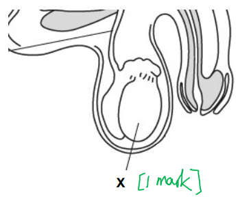
(i) The term *haploid nucleus *can be defined as:

- (A nucleus that contains) one set of chromosomes; **[1 mark]**

(ii) The number of chromosomes in a human haploid nucleus is:

- 23; **[1 mark]**

**[Total: 2 marks]**

> *Most human body cells are **diploid**, meaning they contain two sets of 23 chromosomes (one set from the father and one set from the mother), resulting in a total of **46** chromosomes. However, gametes (sperm and egg cells) are **haploid**, containing just **one set** of **23** chromosomes.*

### Q23
(i) A type of blood cell that is involved in the defence against disease is...

- White (blood cells); **[1 mark]**

(ii) Ways in which blood cells defend the body against disease include...

Any **two** of the following:

- Phagocytosis; **[1 mark]**
- Antibody production; **[1 mark]**
- (Blood) clotting; **[1 mark]**

**[Total: 3 marks]**
(i) The term sexually transmitted infection refers to...

- (An infection that is transmitted) via / in the body fluids; **[1 mark]**
- During/through sexual contact; **[1 mark]**

(ii) Antibiotics cannot be used to treat HIV infections because...

- Antibiotics are only effective against bacteria / do not affect viruses; **[1 mark]**
- HIV is a virus; **[1 mark]**

(iii) The spread of STIs can be controlled in the following ways...

Any **three** of the following:

- Use of condoms / female condoms / not having unprotected sex / reducing the number of sexual contacts / not having sexual intercourse; **[1 mark]**
- Tracing sexual contacts (of individuals with an STI); **[1 mark]**
- Testing for STIs; **[1 mark]**
- Treating infections; **[1 mark]**
- Educating people (about infections); **[1 mark]**

**[Total: 7 marks]**

> *Remember that STI spread can only be reduced by the use of contraceptive methods that function by providing a physical barrier between the body fluids of individuals, e.g. condoms. Other contraceptive methods, such as the contraceptive pill, will not provide this benefit.*

> *Antibiotics do not work on viruses, such as HIV, because the virus particles reside inside of the host's body cells where the antibiotic cannot reach and therefore is not effective. *

### Q24
(i) The reasons why **B** and **C** did not germinate were:

- **B** - it had no water; **[1 mark]**
- **C** - it had a low temperature / was too cold; **[1 mark]**

> *Remember - light is not necessary for germination to occur; light is only needed when photosynthesis begins. *

(ii) The prediction and explanation of the results after five days in the dark at 20°C are:

**Prediction**

- All / some / most (seeds) germinate; **[1 mark]**

**Explanation**

Any **one **from the following:

- Light not necessary for germination / all conditions for germination present / water and suitable temperature present; **[1 mark]**
- Poor or no growth / die, as no light for photosynthesis; **[1 mark]**

**[Total: 4 marks]**
(i) The percentage of seeds that germinated is:

- Correct calculation (64 ÷ 70) x 100 = 91.428%; **[1 mark]**
- Correct rounding (to nearest whole number) = 91%; **[1 mark]**

> *The** **calculation for part (i) could be done as follows:*

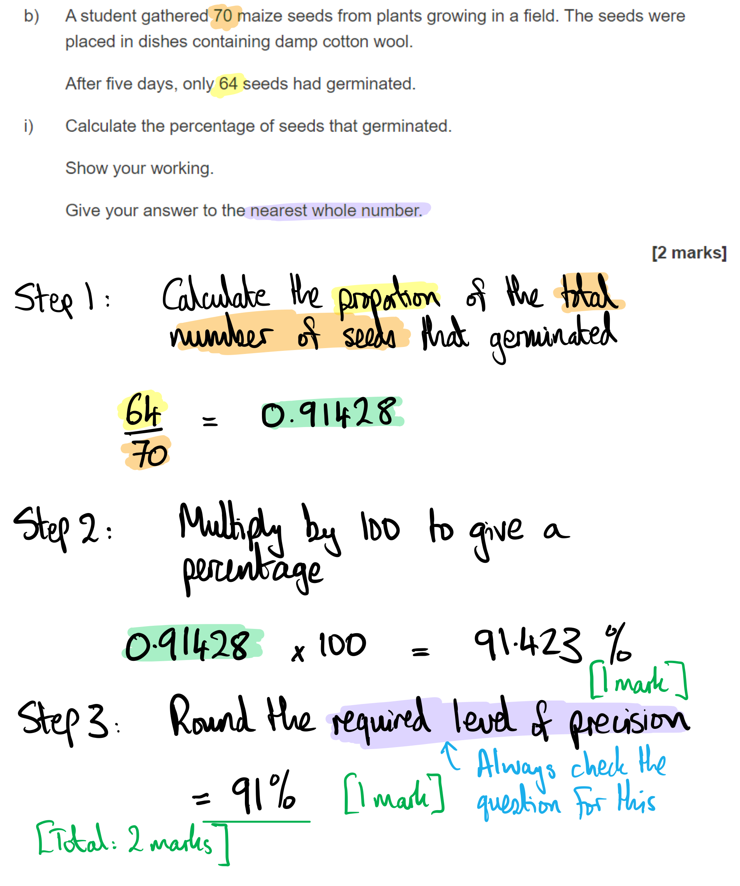

> *It's vital to show your working because even if you get the final answer wrong, there may be a mark available for the working out. In this case, you're only doing one calculation; the other mark is available for following the instruction in the question to state your answer to the nearest whole number. *

(ii) Reasons why some of the seeds did not germinate are:

Any **one **from the following:

- Something wrong with seed e.g. infertile / diseased / dead / immature / abnormal; **[1 mark]**
- Lack of resources; e.g. no oxygen / need more time / not enough water / competition / too close together / insufficient nutrients; **[1 mark]**

*Allow any reasonable lack of resources that could cause the seed(s) to fail to germinate.  Ignore 'lack of light' because seeds do not need light to begin germination. *

**[Total: 3 marks]**

### Q25
The effect that PCOS would have on the ovaries of a woman would include...

Any **three** of the following:

- Low FSH levels **SO** an egg will not mature; **[1 mark]**
- Low FSH **SO** oestrogen will not be released; **[1 mark]**
- No oestrogen **SO** LH will not be released; **[1 mark]**
- Low LH / no LH increase **SO** no ovulation / no egg will be released (from ovary); **[1 mark]**

*Where capitalised SO is present the statements on both sides of SO are required for a mark to be awarded.*

**[Total: 3 marks]**

> *Note that this is an explain question, so each effect on the ovaries needs to be linked to its hormonal cause for a mark to be awarded.*
Reasons why women with PCOS struggle with infertility include...

- If no egg matures / is released during ovulation, then no fertilisation can occur; **[1 mark]**
- Low oestrogen/progesterone levels mean that the uterus lining will not develop / thicken / be maintained to support implantation / pregnancy; **[1 mark]**

**[Total: 2 marks]**

> *This is another question that requires you to apply your knowledge of the hormones involved in the menstrual cycle to an unknown scenario. From part (a) it was clear that all four hormones involved in the menstrual cycle (FSH, LH, oestrogen and progesterone) will be at low levels in a PCOS sufferer which results in no ovulation (and therefore no fertilisation) or no development of the uterus lining that is necessary to support a possible pregnancy.*
The thickness of the uterus wall lining is different between woman **X** and **Y** because...

- Woman X could be pregnant **WHILE** woman Y is not; **[1 mark]**
- Progesterone levels increase for woman X **WHILE*** *they decrease for woman Y; **[1 mark]**
- Progesterone causes the uterus lining to thicken / maintains the uterus lining (in X); **[1 mark]**
- The uterus wall lining breaks down / menstruation occurs (in Y); **[1 mark]**

*Where capitalised WHILE is present the statements on both sides of WHILE are required for a mark to be awarded.*

**[Total: 4 marks]**
The levels of LH and progesterone will differ between woman **X **and **Y** during the next calendar month as follows:

- In X the level of progesterone will continue to rise / will not decrease **WHILE** for Y the level of progesterone will remain low (before day 14) before increasing again (after day 14); **[1 mark]**
- In X the level of LH will remain low **WHILE **in Y LH will peak at around day 14; **[1 mark]**

*Where capitalised WHILE is present the statements on both sides of WHILE are required for a mark to be awarded.*

**[Total: 2 marks]**

> *Note that when a question asks you to give differences, you must use comparative statements in order to gain marks; here this is illustrated clearly in the mark scheme with use of the word WHILE to indicate a contrast.*

> *This is an outline question, so detailed explanation is not needed.*

### Q26
The correct positions of five lines are:

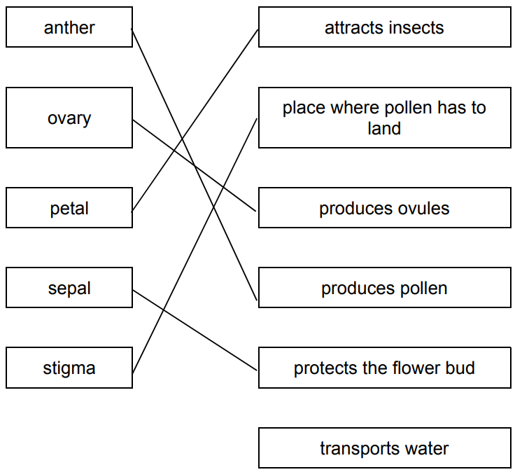

**[1 mark] ***for each correct line.*

**[Total: 5 marks]**

> *A common error in this question is to link 'anther' to 'place where pollen has to land'.  *
A pollen grain from a wind-pollinated flower is different to a pollen grain from an insect-pollinated flower in the following ways:

Any** two **from the following:

- (A wind-pollinated pollen grain is) lighter / has less mass;** [1 mark]**
- Smaller; **[1 mark]**
- Smooth(er) / not rough / not spiky;** [1 mark]**
- Not sticky;** [1 mark]**
- (Has) wings / extensions / air bladders/sacs; **[1 mark]**

**[Total: 2 marks]**

> *These differences are for a reason; for the wind to carry a pollen grain requires the grain to be small and very light, otherwise, the grain will not get airborne. Roughness or stickiness helps a pollen grain stick to its animal pollinator, but doesn't help wind-pollinated plants. Wings and other extensions allow a pollen grain to float further from its parent flower, via the air. *

> *Remember, your answer should always be about **comparing** the two types of pollen (small**er**, light**er** etc), not simply describing features of wind-pollinated and insect-pollinated pollen. *
The correct use of words from the list is as follows:

Plants produce seeds as a result of **sexual** reproduction. Seeds germinate if they have the correct conditions. These conditions include a suitable temperature and also **oxygen** and **water**. 1

The germinating seed produces a young root which grows downwards in response to **gravity**** OR ****light** . The young root absorbs **water**** OR ****oxygen**** OR ****mineral ions** and **water**** OR ****oxygen**** OR ****mineral ions** 2 from the soil as well as keeping the young plant in a stable position.

*1** oxygen and water can be in either order*

*2** water/oxygen/mineral ions can be in any order*

**[1 mark]** *for each correctly-placed word.*

**[Total: 6 marks]**

### Q27
(i) cells that convert glucose to glycogen contain many mitochondria because:

Any **two **from the following:

- The conversion / process, needs energy; **[1 mark]**
- Aerobic respiration occurs (in mitochondria); **[1 mark]**
- (Aerobic) respiration releases energy; **[1 mark]**

(a) (ii) The type of biological molecule that catalyses reactions such as the conversion of glycogen to glucose is an:

- Enzyme; **[1 mark]**

**[Total: 3 marks]**

> *For part (i) ensure you do not write mitochondria **make** energy; energy is never made (or destroyed) only released or transferred. *

> *This question covers core knowledge taken from an extended only paper 4 question.*
A fetus obtains glucose in the following way:

Any **three **from the following:

- From the mother; **[1 mark]**
- The glucose (in mother / fetus) is carried in the blood; **[1 mark]**
- (The glucose) diffuses / moves from high concentration to low concentration; **[1 mark]**
- Across the <u>placenta</u>; **[1 mark]**
- (Through) the umbilical cord; **[1 mark]**

**[Total: 3 marks]**

> *It is a common exam question to be assessed on your knowledge of the transport of substances between the mother and fetus so make sure you learn a few examples, such as this one in reference to glucose.  Other substances include oxygen and carbon dioxide.  *
(i) The term *hormone* is defined as:

- A chemical substance produced by a (endocrine) gland; **[1 mark]**
- It is carried by the blood; **[1 mark]**
- It alters/changes/affects the activity of specific target organs; **[1 mark]**

(ii) The percentage increase in the glycogen concentration in the fetus between day 10 and birth is:

- Correct answer of 182 (%); **[2 marks]**

*Full marks awarded for the correct answer in the absence of calculations. ***[1 mark]** *awarded for the correct working in the presence of an incorrect answer.*

(iii) The changes in glycogen concentration are explained by:

Any **four** of the following:

**Descriptions**:

- (There is) no glycogen (measured) until day 10 / at first the (measurable) glycogen concentration is 200–220 µmol per g; **[1 mark]**
- (There is a) small / no change / decrease in glycogen until day 20–26; **[1 mark]**
- Glycogen increases from day 20 - 26, until birth / day 62–64 **OR** (There was a) 420 µmol per g increase from day 20 until birth; **[1 mark]**
- 610–630 µmol per g of glycogen is the peak at birth; **[1 mark]**
- (There is a) steep decrease in glycogen after birth / after day 62–64 / to 330–350 µmol per g / to day 69–71; **[1 mark]**
- Glycogen starts to increase (slowly), after day 70–73 / 7–10 days after birth; **[1 mark]**

*Units must be stated at least once in the answer.*

**AND**

Any **two** of the following:

**Explanations**:

- Insulin is linked to an increase in glycogen; **[1 mark]**
- Glucagon is linked to a decrease in glycogen; **[1 mark]**
- Changes in glycogen are linked to the control of (blood) glucose concentration; **[1 mark]**
- A description of homeostasis / negative feedback (this must be in the context of Fig. 1 / blood glucose); **[1 mark]**

**[Total: 6 marks]**

> *For part (i), make sure you learn this definition; it gives you three marks: where hormones are made, how they travel and what they do. *

> *A common error here is to forget that the question asks for the answer as a whole number, so be sure to round your answer to the nearest whole number.  The model answer for part (ii) is: *

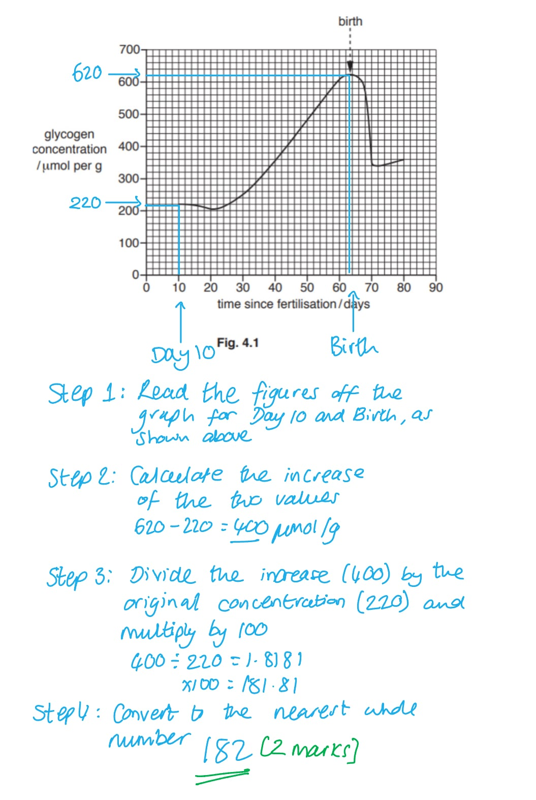

> *For part (iii), it is important here to note that you only get a certain number of marks for describing the data in the graph, you must also include an explanation, as stated in the question, to gain full marks. So make sure you spread your time between the two when answering questions like this. It is also useful to use the wording the question gives you on the graph labels so you can be clear in your response and descriptions of data. *
Disadvantages of breastfeeding would include:

Any **three **from the following:

- Not all mothers can produce enough milk; **[1 mark]**
- Some drugs can pass through into milk; **[1 mark]**
- There may be a transfer of named pathogens through breast milk (in correct context); **[1 mark]**
- It can cause painful nipples; **[1 mark]**
- It can be time consuming; **[1 mark]**
- Only the mother can produce milk / fathers can’t express milk; **[1 mark]**
- The infant/baby may have difficulty suckling leading to not enough (milk) intake / not enough weight gain/growth of the baby; **[1 mark]**
- It can be tiring (for the mother); **[1 mark]**

**[Total: 3 marks]**

> *Although there can be disadvantages to breastfeeding, note that there are many advantages too.*

### Q28
(i) The correctly-completed Table 1 is:

| **process** | **letter from Fig. 1** |   |
|---|---|---|
| meiosis | **R** | ; **[1 mark]** |
| fertilisation | **S** | ;** [1 mark]** |
| implantation | **V** | ;** [1 mark]** |

(ii) The part of the female reproductive system labelled **S** in Fig. 1 is:

- Oviduct; **[1 mark]**

**[Total: 4 marks]**

> *This question covers core knowledge taken from an extended only paper 4 question.*

> *For information, the other labelled parts in Fig. 1 are:*

- *R - ovary*
- *S - oviduct*
- *T - uterus*
- *V - uterine lining*
- *W - uterine wall*
- *X - cervix*
- *Y - vagina*
(i)  The formula that would be used to calculate the magnification of the diagram is:

Any** one** of the following from:

- image size ÷ actual size **OR** $\frac{\mathrm{image} \mathrm{size}}{\mathrm{actual} \mathrm{size}}$ ; **[1 mark]**

(ii) The length of the sperm cell, measured in micrometres, is:

- 55;** [1 mark]**

Accept 55 μm

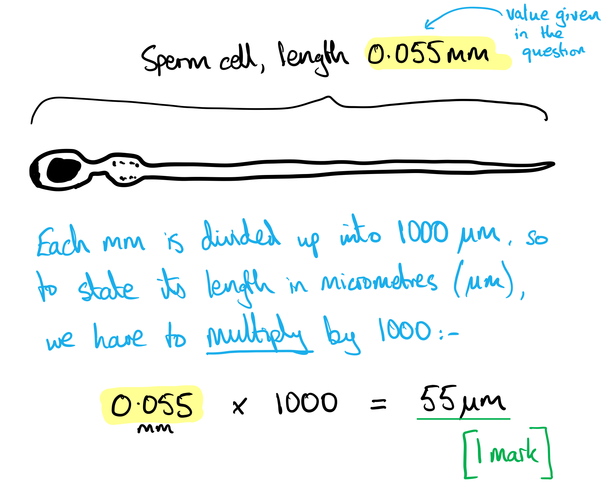

> *There are 1000 micrometres (µm) in 1 mm, so to convert from mm to µm, we have to multiply by 1000. *

**[Total: 2 marks]**
The nuclei of sperm cells differ from those of other cells in the male because:

Any **two** of the following from:

- (Sperm nuclei are) haploid / have n / one set of chromosomes / half the diploid number / 23 chromosomes; **[1 mark]**
- (Produced by) meiosis; **[1 mark]**
- So the number of chromosomes remains the same / does not double at fertilisation **OR **the diploid number is restored at fertilisation **OR** the zygote is diploid; **[1 mark]**

**[Total: 2 marks]**

> *The third mark scheme point gives a reason why gametes are haploid and other cells have twice their amount of DNA; this is an important answer because the command word in the question is 'explain'.*
The roles of the flagellum, the mitochondria and the acrosome in sperm cells are:

Up to **two** marks per structure:

**Flagellum**

- (Flagellum) propels the sperm / allows the sperm to swim; **[1 mark]**
- To the oviduct / site of fertilisation / egg (cell) / ovum; **[1 mark]**

**Mitochondria**

- <u>Aerobic respiration</u>; **[1 mark]**
- Provides / releases / supplies, energy / ATP; **[1 mark]**

**Acrosome**

- (Contains / has / releases) enzyme(s); **[1 mark]**
- (Enzymes) digest / break down / dissolve the jelly coat / protein layer; **[1 mark]**
- So sperm nucleus can enter the egg cell / so sperm and egg membranes can fuse together; **[1 mark]**

*Ignore 'produces energy'.*

**[Total: 6 marks]**

> *This question covers core knowledge taken from an extended only paper 4 question.*
The sex of a child is determined by its father because:

Any** two **from the following:

- Sex is determined by X and Y chromosomes / males are XY and females are XX; **[1 mark]**
- Egg cells all have X chromosome / 2 x X chromosomes / females can only provide X chromosome; **[1 mark]**
- Sperm cells have X or Y chromosome / only the males can provide X or Y chromosome / only males can provide the Y chromosome; **[1 mark]**

**[Total: 2 marks]**

> *This question covers core knowledge taken from an extended only paper 4 question.*

> *Errors to avoid here:*

- *Stating that X and Y are alleles; they are whole chromosomes*
- *Claiming that Y is 'dominant' to X / X is recessive to Y; this is not the case*

### Q29
(i) Two letters of insects representing offspring produced by asexual reproduction are:

**Both** letters required for the mark:

- **N **and **S ***(letters can be in either order)*; **[1 mark]**

(ii)  Information from the diagram to support the statement 'Insect **R **was produced by sexual reproduction' is:

- **R** has different characteristics to the parent / has dark eyes / knobs on the end of antennae / knobs on abdomen (whereas the parent does not); **[1 mark]**

(iii) The term that is defined as the observable features of an organism is:

- Phenotype; **[1 mark]**

**[Total: 3 marks]**

### Q30
An X showing where an egg cell is normally fertilised is:

- X – placed clearly on the oviduct; **[1 mark]**

*Allow: X with label line clearly indicating oviduct*

**[Total: 1 mark]**

> *The oviduct is also known as the fallopian tube, however, you should stick to using the terminology used in your specification. *

> *Your X can be placed at any point along either oviduct to get the mark. *

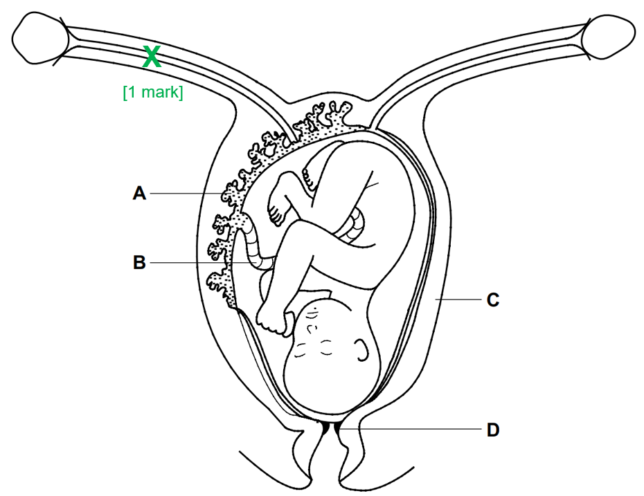
The functions of the structures labelled A and B are:

- **A **– (is the placenta) transfer of nutrients from mother to fetus / transfer of oxygen from mother to fetus / removal of CO2 from fetus to mother / removal of waste from fetus to mother; **[1 mark]**
- **B** – (is the umbilical cord) carries fetal blood to and from the placenta; **[1 mark]**

**[Total: 2 marks]**

> *To get the first mark the direction of transport must be clear, i.e. either from the mother to the fetus or from fetus to the mother.*
The roles of structures C and D during labour and birth are:

- **C** **– **(is the uterus wall) contracts to push baby (out); **[1 mark]**
- **D** – (is the cervix) dilates to allow exit of baby / (allow a description of dilation here);** [1 mark]**

**[Total: 2 marks]**

> *In normal circumstances that cervix is a ring of muscle that is very tightly closed to hold the baby in. During labour, the circle of muscle (cervix) widens and opens up to allow the baby to fit through and leave the body. This process is called dilation. *

### Q31
The completed Table 1 is:

| **function** | **letter from Fig. 1** | **name the organ** |
|---|---|---|
| meiosis to produce pollen grains | **Final answer:** **C** | **anther** |
| pollination | **Final answer:** **D** | **stigma** |
| development of seeds | **Final answer:** **E** | **ovary** |
| protection of flower in the bud | **Final answer:** **A** | **sepal** |

*Award* **[1 mark]** *per correct row*

**[Total: 4 marks]**

> *This question covers core knowledge taken from an extended only paper 4 question.*
(i) The diameter of the pollen grain could be calculated using the following formula:

- Image size ÷ magnification **OR** image size ÷ 220; **[1 mark]**

Accept "image size / magnification" or  "image size divided by magnification"

(ii) This value in µm would be...

- 0.082 x 1000
- 82 (µm); **[1 mark]**

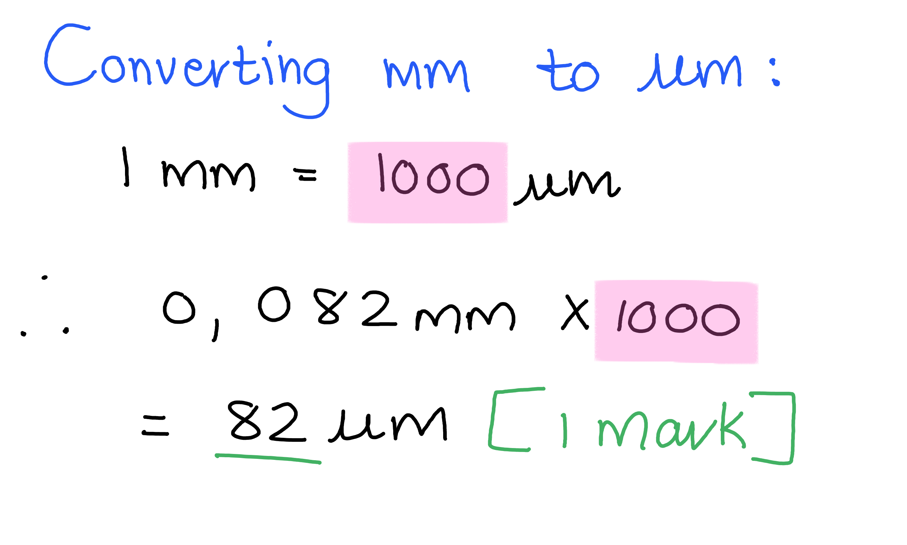

(iii) The pollen is adapted for pollination in the following ways:

Any **two **from the following:

- It is covered in spikes / sticky; **[1 mark]**
- This means the (pollen) sticks to insect / animal (bodies / legs / any part of the animal); **[1 mark]**
- This pollen is large(r) size (in comparison with pollen which uses wind pollination); **[1 mark] **

**[Total: 4 marks]**
(i) The part that contains the female gamete is...

- The ovule; **[1 mark]**

(ii) A haploid nucleus is...

- A (nucleus) containing one set of (unpaired) chromosomes; **[1 mark]**

(iii) It is important that gametes are haploid....

Any **one **from the following:

- So that chromosome number does not double (at fertilisation); **[1 mark]**
- So that chromosome number remains constant from generation to generation; **[1 mark]**

**[Total: 3 marks]**
