# Exam Questions — Reproduction in Plants & Humans
**16. Reproduction** · Cambridge (CIE) IGCSE biology (0610 & 0970)
> Source: [https://www.savemyexams.com/igcse/biology/cie/23/topic-questions/](https://www.savemyexams.com/igcse/biology/cie/23/topic-questions/) · 66 questions across 2 sets

## Multiple Choice Questions (35 questions)

### Q1 — hard — 1 marks

**Q1** [1 mark]

Which of the following statements about antibiotics is correct?

### Q2 — medium — 1 marks

**Q2** [1 mark]

The graph shows the levels of four hormones in the blood during a 28-day menstrual cycle.

What is hormone X?

### Q3 — medium — 1 marks

**Q3** [1 mark]

The diagram shows a flower.

Which row correctly identifies the functions of X, Y and Z?

|   | Function of X | Function of Y | Function of Z |
|---|---|---|---|
| A | produces pollen grains | receives pollen grains | contains ovules |
| B | produces pollen grains | receives pollen grains | produces pollen |
| C | receives pollen grains | produces pollen grains | contains pollen |
| D | produces pollen grains | contains ovules | receives pollen |

### Q4 — medium — 1 marks

**Q4** [1 mark]

How will the composition of a pregnant woman’s blood change as it passes through the placenta?

|   | concentration of dissolved oxygen | concentration of urea |
|---|---|---|
| **A** | decreases | decreases |
| **B** | decreases | increases |
| **C** | increases | decreases |
| **D** | increases | increases |

*Source: June 2021 0970/21 Q31*

### Q5 — medium — 1 marks

**Q5** [1 mark]

A zygote has ten chromosomes in its nucleus.

Which row shows the number of chromosomes in the cells of this species?

|   | body cells | sperm cells | embryo cells |
|---|---|---|---|
| **A** | 5 | 5 | 10 |
| **B** | 5 | 10 | 20 |
| **C** | 10 | 5 | 10 |
| **D** | 10 | 10 | 20 |

*Source: June 2021 0970/21 Q30*

### Q6 — hard — 1 marks

**Q6** [1 mark]

The diagram shows some of the events of the menstrual cycle.

In which shaded zone of the cycle would progesterone levels be the highest?

*Source: june 2022 paper 2  Q29*

### Q7 — easy — 1 marks

**Q7** [1 mark]

Which sequence of structures does a pollen tube grow through in a flower?

*Source: june 2022 paper 2 Q28*

### Q8 — easy — 1 marks

**Q8** [1 mark]

The diagram shows a cross-section of an insect-pollinated flower.

Which label is the stigma?

*Source: june 2022 paper 1 Q31*

### Q9 — easy — 1 marks

**Q9** [1 mark]

What is an example of sexual reproduction?

*Source: june 2022 paper 1 Q30*

### Q10 — medium — 1 marks

**Q10** [1 mark]

The graph shows a woman’s body temperature during the menstrual cycle.

On which days is the woman most likely to become pregnant?

*Source: June 2021 0970/11 Q32*

### Q11 — easy — 1 marks

**Q11** [1 mark]

Which structure in the male reproductive system makes the fluid for sperm to swim in?

*Source: June 2021 0970/11 Q31*

### Q12 — medium — 1 marks

**Q12** [1 mark]

A gardener wants to produce many genetically identical plants from a single plant.

The diagram shows different methods of growing new plants.

Which methods will produce plants that are genetically identical to the parent plant?

*Source: June 2021 0970/11 Q30*

### Q13 — easy — 1 marks

**Q13** [1 mark]

Which organ secretes the most progesterone during pregnancy?

*Source: Specimen 2023 0970/02 Q29*

### Q14 — easy — 1 marks

**Q14** [1 mark]

Which row describes sexual reproduction?

|   | gamete nucleus | zygote nucleus | genetically different offspring produced |
|---|---|---|---|
| **A** | diploid | diploid | no |
| **B** | diploid | haploid | no |
| **C** | haploid | diploid | yes |
| **D** | haploid | haploid | yes |

*Source: Specimen 2023 0970/02 Q28*

### Q15 — easy — 1 marks

**Q15** [1 mark]

The human immunodeficiency virus (HIV) can be transmitted in body fluid.

Some examples of body fluids are listed.

1. blood
2. saliva
3. semen
4. tear fluid

Which body fluids can transmit HIV?

*Source: Specimen 2023 0970/01 Q30*

### Q16 — medium — 1 marks

**Q16** [1 mark]

The diagram shows a timeline of a woman’s menstrual cycle, which lasts for 28 days.

On which days of the menstrual cycle is a woman most likely to ovulate?

*Source: Specimen 2023 0970/01 Q29*

### Q17 — medium — 1 marks

**Q17** [1 mark]

The diagram shows the female reproductive system.

Where does implantation normally occur?

*Source: Specimen 2023 0970/01 Q28*

### Q18 — medium — 1 marks

**Q18** [1 mark]

The diagram shows part of a flower.

Where does fertilisation occur?

*Source: Specimen 2023 0970/01 Q27*

### Q19 — easy — 1 marks

**Q19** [1 mark]

What is formed when the nucleus of a sperm fuses with the nucleus of an egg?

*Source: Specimen 2023 0970/01 Q26*

### Q20 — easy — 1 marks

**Q20** [1 mark]

Which environmental conditions must always be present for seed germination?

*Source: Specimen 2023 0970/01 Q21*

### Q21 — medium — 1 marks

**Q21** [1 mark]

HIV is an STI. The following statements are about changes that could occur in the body.

1. Reduced antibody production
2. Reduction in red blood cells
3. Reduction in white blood cells
4. Reduced volume of blood plasma

Which of these statements would be correct for HIV?

### Q22 — hard — 1 marks

**Q22** [1 mark]

Germinating seeds were placed in different temperature and light conditions as shown in the table below.

| **sample** | **temperature / °C** | **light** |
|---|---|---|
| 1 | 20 | absent |
| 2 | 20 | present |
| 3 | 4 | absent |
| 4 | 4 | present |

A seedling was removed from each experiment after 7 days.

Which seedling was from sample 2?

### Q23 — medium — 1 marks

**Q23** [1 mark]

During birth the following processes happen:

1. Breaking of the amniotic sac
2. Contraction of the muscles in the uterine wall
3. Cutting of the umbilical cord

In which order do these processes usually occur?

### Q24 — hard — 1 marks

**Q24** [1 mark]

An experiment was set up with four test tubes as shown in the diagram below and placed in the dark.

In which conditions would the seeds germinate first?

### Q25 — easy — 1 marks

**Q25** [1 mark]

Students were discussing how to remember the difference between two groups of cells, ‘many, minute and motile’ or ‘few, fat and fixed’.

What group of cells were they referring to?

### Q26 — easy — 1 marks

**Q26** [1 mark]

The diagram shows a human sperm cell. The sperm cell has many mitochondria in the mid section.

How do the mitochondria help the sperm carry out its function?

### Q27 — medium — 1 marks

**Q27** [1 mark]

#### Extended only

The table below shows some advantages and disadvantages of sexual and asexual reproduction.

Which row is correct?

|   | advantages of sexual reproduction | advantage of asexual reproduction |
|---|---|---|
| **A** | less population growth | only one parent needed |
| **B** | more energy efficient | gametes can be transferred by the environment |
| **C** | no transfer of gametes | does not compete with parent for nutrients |
| **D** | more genetic variation | faster |

### Q28 — hard — 1 marks

**Q28** [1 mark]

The diagram below shows a flower.

Which of these processes have taken place?

|   | **pollination** | **fertilisation** |
|---|---|---|
| **A** | no | no |
| **B** | no | yes |
| **C** | yes | yes |
| **D** | yes | no |

### Q29 — hard — 1 marks

**Q29** [1 mark]

#### Extended only

The graphs below show the levels of two hormones involved in the menstrual cycle and the thickness of the uterus lining.

Which of these statements is supported by evidence from the graphs?

### Q30 — medium — 1 marks

**Q30** [1 mark]

The diagrams show 3 different species of pollen grains as they appear under a microscope. The diagrams are all to the same scale.

Which pollen grains are involved in insect pollination?

### Q31 — hard — 1 marks

**Q31** [1 mark]

The diagram shows the menstrual cycle. This is a 28 day cycle.

Which time range in the cycle is the woman most likely to get pregnant?

### Q32 — medium — 1 marks

**Q32** [1 mark]

The diagram shows the female reproductive system.

After ejaculation, which pathway will the male gamete take to fuse with the egg?

### Q33 — easy — 1 marks

**Q33** [1 mark]

#### Extended only

There are a number of hormones that control fertility in women.

Which one of these maintains the lining during pregnancy?

### Q34 — easy — 1 marks

**Q34** [1 mark]

The statements below are about different hormones in the human body.

1. Produced by the pancreas.
2. Causes the voice to deepen at puberty.
3. Causes an egg to mature in the menstrual cycle.
4. Promotes the development of stronger muscles.

Which of these statements are correct for testosterone?

### Q35 — easy — 1 marks

**Q35** [1 mark]

#### Extended only

Which of the following is **not** an advantage of asexual reproduction?

## Theory Questions (31 questions)

### Q1 — hard — 2 marks

**Q1** [2 marks]

Some viral diseases, such as HIV, cannot currently be prevented by a vaccination.

HIV is a sexually transmitted infection (STI).

(i) State what is meant by the term sexually transmitted infection.

[1]

(ii) State one method of preventing the transmission of HIV.

[1]

### Q2 — medium — 13 marks

**Q2** [4 marks]

Fig. 5.1 shows the female reproductive system.

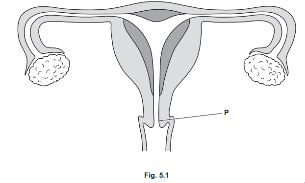

Label Fig. 5.1 using the letters listed to show the position of the organs that are identified by their functions.

The first one (P) has been completed for you.

**P** site of secretion of mucus

**Q** site of fertilisation

**R** site of implantation

**S** site of oestrogen secretion

**T** site where sperm are deposited during sexual intercourse

*Source: June 2021 0610/41 Q5A*

**Q2** [5 marks]

Fig. 5.2 shows a section through an egg cell at the time of ovulation.

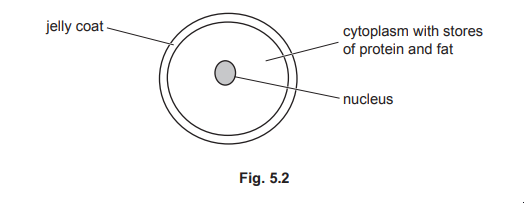

(i)

Explain why the egg cell contains stores of protein and fat.

[3]

(ii)

Describe the function of the jelly coat.

[2]

*Source: June 2021 0610/41 Q5B*

**Q2** [4 marks]

Fertilisation results in the formation of a zygote.

Describe how an embryo is formed from a zygote.

*Source: June 2021 0610/41 Q5C*

### Q3 — medium — 1 marks

**Q3** [1 mark]

Fig. 2.1 is a front view diagram of the male reproductive system in humans.

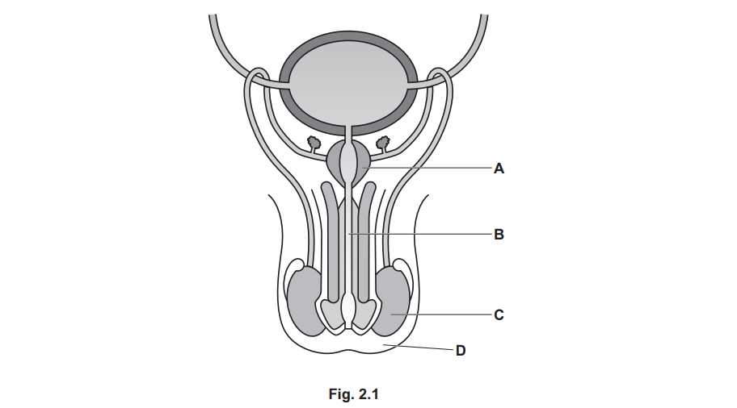

The human reproductive system is involved in sexual reproduction.

Compare **asexual** reproduction with **sexual **reproduction.

[3]

*Source: June 2021 0970/31 Q2C*

### Q4 — easy — 7 marks

**Q4** [4 marks]

Fig. 2.1 is a front view diagram of the male reproductive system in humans.

The boxes on the left show the letters identifying the parts in Fig. 2.1.

The boxes on the right show the functions of some of the parts of the male reproductive system.

Draw lines to link each letter to its function. Draw **four **lines.

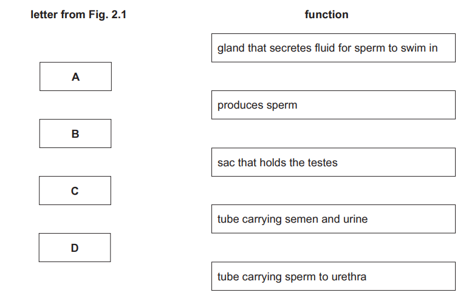

[4]

*Source: June 2021 0970/21 Q2A*

**Q4** [3 marks]

Sperm are the male gametes in humans.

(i) State the name of the female gamete in humans.

[1]

(ii) State the name of the cell that is formed at fertilisation.

[1]

(iii) State the usual site of fertilisation in humans.

[1]

*Source: June 2021 0970/31 Q2B*

### Q5 — easy — 15 marks

**Q5** [6 marks]

Fig. 6.1 is a flow diagram showing the events that occur to form a human fetus.

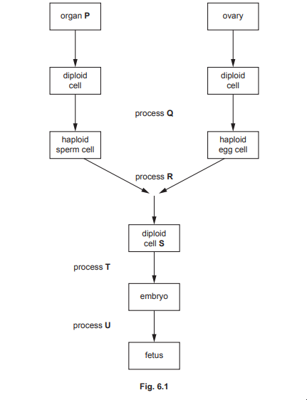

Complete Table 6.1 by using the information in the flow diagram to identify the cell, the organ and the processes shown in Fig. 6.1.

Table 6.1

| cell, organ or process | name of the cell, organ or process |
|---|---|
| organ P |   |
| cell S |   |
| process Q produces haploid sperm and eggs |   |
| process R produces diploid cell S |   |
| process T occurs so that cell S can grow into an embryo |   |
| process U occurs so that the embryo can gain oxygen and nutrients from the mother’s blood |   |

*Source: June 2022 0610/41  Q6A*

**Q5** [2 marks]

(i)

State why it is important that sperm and egg cells are haploid and not diploid.

[1]

(ii)

State the function of the jelly coat that surrounds egg cells.

[1]

*Source: June 2022 0610/41  Q6B*

**Q5** [7 marks]

Complete the sentences with the appropriate words.

The placenta provides a large surface area for the ............................................... of oxygen and carbon dioxide between maternal and fetal blood. Dissolved nutrients also pass across the placenta. Examples of dissolved nutrients are: ............................................... acids, ............................................... and ............................................... .

Antibodies pass from the maternal blood giving natural ............................................... immunity to the baby for some infections that the mother has had or has been vaccinated against. Each different type of vaccine contains one or more ............................................... taken from the ............................................... that causes the disease.

*Source: June 2022 0610/41  Q6C*

### Q6 — easy — 10 marks

**Q6** [5 marks]

Fig. 6.1 is a photograph of a section through a flower.

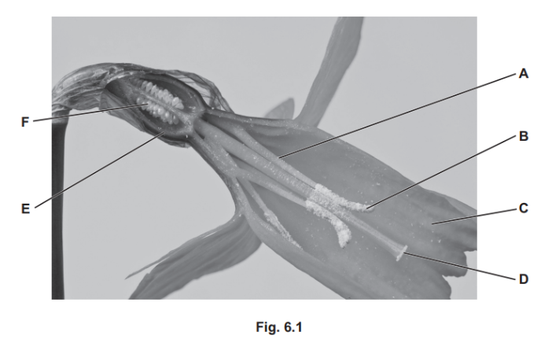

(i) State the names of the parts labelled **A**, **C** and **E** in Fig. 6.1.

[3]

(ii) State the function of the part labelled **B** in Fig. 6.1.

[1]

(iii) State the letter of the part in Fig. 6.1 where pollination occurs.

[1]

*Source: june 2022 paper 3 Q6A*

**Q6** [1 mark]

State **one** piece of evidence from Fig. 6.1 that shows this is an insect-pollinated flower.

*Source: june 2022 paper 3 Q6B*

**Q6** [3 marks]

Describe the adaptations of the flower structure and pollen in a wind-pollinated flower.

*Source: june 2022 paper 3 Q6C*

**Q6** [1 mark]

Living organisms are classified into kingdoms. The organism shown in Fig. 6.1 belongs to the plant kingdom.

State the name of one other kingdom.

*Source: june 2022 paper 3 Q6D*

### Q7 — easy — 12 marks

**Q7** [6 marks]

Fig. 4.1 is a diagram of the female reproductive system in humans.

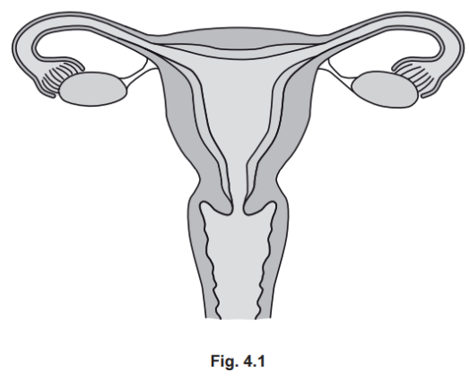

(i) On Fig. 4.1:

- Circle a part that releases egg cells.
- Draw a label line and the letter **W** to show where fertilisation occurs.
- Draw a label line and the letter **X** to show where the fetus develops.

[3]

(ii) State the name of the process that produces egg cells.

[1]

(iii) State the names of **two** parts of the female reproductive system that sperm must pass through to reach the egg cell.

[2]

*Source: june 2022 paper 3 Q4A*

**Q7** [3 marks]

Fig. 4.2 is a graph showing the changes in the thickness of the uterus lining during a menstrual cycle.

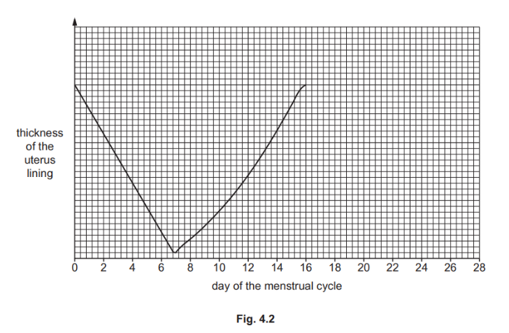

(i) Use the information in Fig. 4.2 to state the number of days during which the uterus lining is shed.

[1]

(ii) Draw a line to complete the graph in Fig. 4.2 to show the thickness of the uterus lining between day 16 and 28.

[1]

(iii) State the day of the menstrual cycle when eggs are released.

[1]

*Source: june 2022 paper 3 Q4B*

**Q7** [3 marks]

The menstrual cycle is one of the changes that happens to girls during puberty.

Describe the changes that occur in boys during puberty.

*Source: June 2022 paper 3 Q4C*

### Q8 — easy — 4 marks

**Q8** [4 marks]

HIV infection is an example of an STI.

(i) State the name of the type of pathogen that causes an HIV infection.

[1]

(ii) Describe how HIV can be transmitted.

. [3]

*Source: june 2022 paper 3  Q2B*

### Q9 — hard — 3 marks

**Q9** [3 marks]

Sugarcane is a crop plant that is usually grown from stem cuttings rather than from seeds.

Describe the advantages of using cuttings rather than seeds to reproduce crop plants.

*Source: Specimen 2023 0970/04 Q4D*

### Q10 — easy — 9 marks

**Q10** [3 marks]

Fig. 5.1 shows a diagram of part of the male reproductive system.

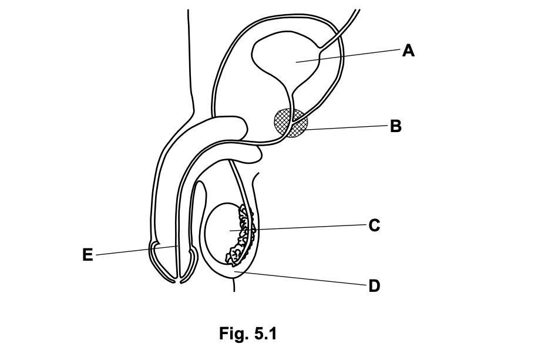

State the letter on Fig. 5.1 that identifies: 

where sperm are made ..................... 

the part that carries urine and sperm out of the body ..................... 

where the fluid that is added to the sperm is made .....................

*Source: specimen 2023 0970/03 Q5A*

**Q10** [3 marks]

Sperm must pass through different structures in the female reproductive system to reach an egg cell.

State the names of **three** of these structures.

*Source: Specimen 2023 0970/03 Q5B*

**Q10** [3 marks]

State three ways that sperm are adapted for their function.

*Source: Specimen 2023 0970/03 Q5C*

### Q11 — medium — 11 marks

**Q11** [2 marks]

Complete the sentences by stating the part of the human body that produces male gametes and the part that produces female gametes.

Male gametes are produced by the ........................................................................

Female gametes are produced by the ...................................................................

*Source: 2019 0970/31 Q6A*

**Q11** [9 marks]

Fig. 1 represents the early stages in the development of a female embryo.

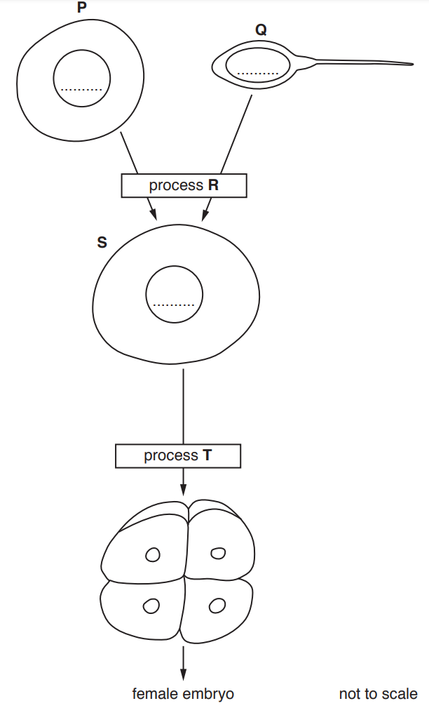

**Fig. 1**

(i)

State the names of the cells labelled **P**, **Q** and **S** in Fig. 1.

[3]

(ii)

Complete Fig. 1 by writing the correct sex chromosomes in structures **P**, **Q **and **S**.

[3]

(iii)

State the names of processes **R** and **T **in Fig. 1.

[2]

(iv)

State the name of the organ in the body in which the female embryo develops.

[1]

*Source: 2019 0970/31 Q6B*

### Q12 — medium — 9 marks

**Q12** [3 marks]

Define the term *sexual reproduction*.

*Source: 2018 0610/31 Q2A*

**Q12** [5 marks]

Fig. 1 shows some organs in the body of a man.

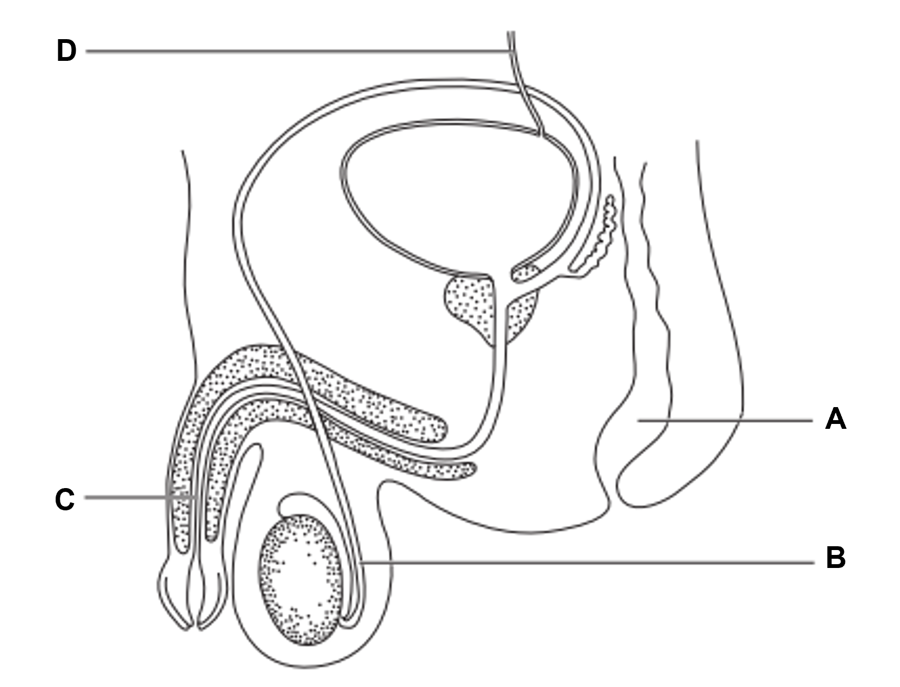

**Fig. 1**

(i)

Complete Table 1 by writing in the names of the parts labelled **A** to **D** in Fig. 1.

**Table 1**

| **letter on Fig. 1** | **name of part** | **name of the substance or substances transported** |
|---|---|---|
| **A** |   | faeces |
| **B** |   | sperm |
| **C** |   | sperm and urine |
| **D** |   | urine |

[4]

(ii)

On Fig. 1 draw a label line to the prostate gland and label it **P**.

[1]

*Source: 2018 0610/31 Q2B*

**Q12** [1 mark]

State the function of the scrotum.

*Source: 2018 0610/31 Q2C*

### Q13 — easy — 12 marks

**Q13** [3 marks]

Fig. 1 shows a diagram of part of the male reproductive system.

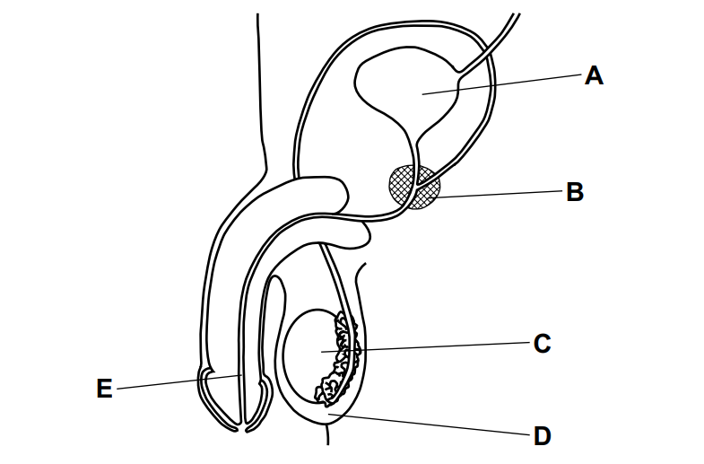

**Fig. 1**

State the letter on Fig. 1 that identifies:

(i)

Where sperm are made

[1]

(ii)

The part that carries urine and sperm out of the body

[1]

(iii)

Where the fluid that is added to the sperm is made

[1]

*Source: 2023 0970/03 Q5A*

**Q13** [3 marks]

Sperm must pass through different structures in the female reproductive system to reach an egg cell.

State the names of **three** of these structures.

*Source: 2023 3/1/0970 Q5B*

**Q13** [3 marks]

State **three** ways that sperm are adapted for their function.

*Source: 2023 3/1/0970 Q5C*

**Q13** [3 marks]

Sperm contain chromosomes. Chromosomes contain genes.

(i)

State **all** the possible sex chromosomes that normal sperm can contain.

[1]

(ii)

Complete the definition of the term gene.

Use words from the list.

Each word can only be used once or not at all.

| **carbohydrate            DNA           fat       **  ** nuclei           protein** |
|---|

A gene is a length of .............................................. that codes for a ...............................................

[2]

*Source: 2023 3/1/0970 Q5D*

### Q14 — medium — 10 marks

**Q14** [8 marks]

Fig. 1 shows a section through a flower.

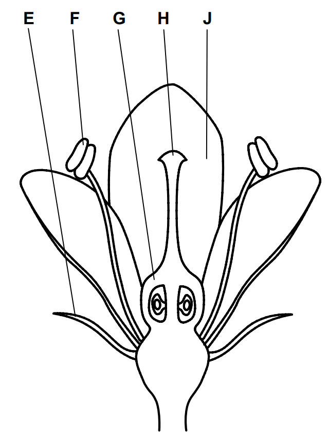

**Fig. 1**

(i)

Write **one** letter from Fig. 1 to identify **each** of the following.

You may use each letter once, more than once, or not at all.

| Petal |   |
|---|---|
| Anther |   |
| Stigma |   |
| A male part of the flower |   |
| A part of the carpel |   |
| Sepal |   |

[6]

(ii)

Describe the evidence that this flower is pollinated by insects.

[2]

*Source: 2020 0610/03 Q7A*

**Q14** [2 marks]

Fig. 2 shows pollen grains from the flowers of several different species, labelled with the letters **K**–**Q**.

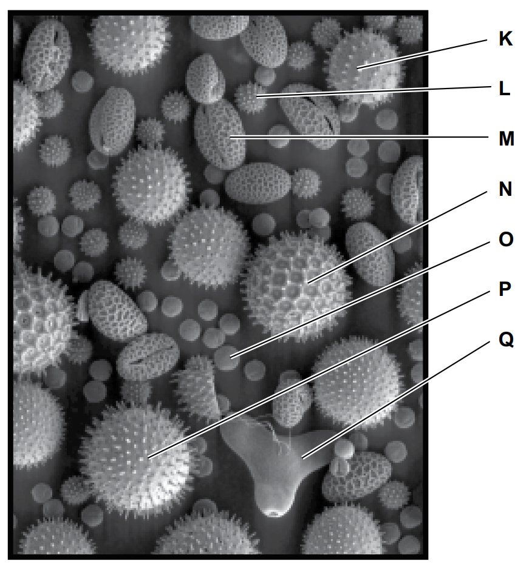

**Fig. 2**

State the letters of the pollen grains that come from insect-pollinated flowers.

*Source: 2020 0610/03 Q7B*

### Q15 — easy — 9 marks

**Q15** [3 marks]

Fig. 1 shows a diagram of the human female reproductive system.

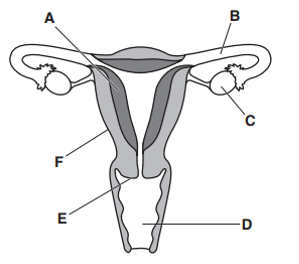

**Fig. 1**

Using letters **A**–**F**, identify the parts of the human female reproductive system in Fig. 1.

(i)

Where eggs are made.

[1]

(ii)

Where fertilisation occurs.

[1]

(iii)

Where implantation of the zygote occurs.

[1]

*Source: 2018 (Series 1) 0610/31 Q1A*

**Q15** [2 marks]

Oestrogen is a hormone responsible for the development of secondary sexual characteristics during puberty.

(i)

State the name of the part of the female reproductive system that secretes oestrogen.

[1]

(ii)

Describe how the hormone oestrogen is transferred to its target organs.

[1]

*Source: 2018 (Series 1) 0610/31 Q1B*

**Q15** [4 marks]

Table 1 shows some secondary sexual characteristics.

Place ticks (✓) in Table 1 to show which characteristics develop during puberty in boys and girls.

One row has been done for you.

**Table 1**

| **secondary sexual characteristic** | **boy** | **girl** |
|---|---|---|
| breasts grow |   | ✓ |
| growth of sex organs |   |   |
| growth of pubic hair |   |   |
| start of menstruation |   |   |
| voice deepens |   |   |

*Source: 2018 (Series 1) 0610/31 Q1C*

### Q16 — easy — 6 marks

**Q16** [4 marks]

Fig. 1 shows the human female reproductive system.

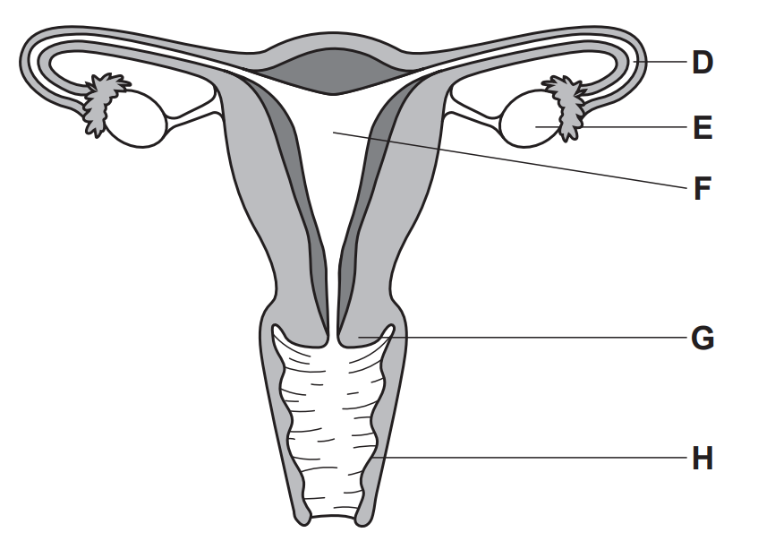

**Fig. 1**

Use the letters on Fig. 1 to identify:

- The cervix
- The oviduct
- The uterus
- The vagina

*Source: 2018 (Series 3) 0610/33 Q8A*

**Q16** [1 mark]

**Extract:**

Fig. 1 shows the human female reproductive system.

The letters for each part are:
- The cervix = G
- The oviduct = D
- The uterus = F
- The vagina = H

[Fig. 1 diagram of the female reproductive system with labelled parts D, E, F, G, H]

On Fig. 1, write an **X **to show where female gametes are produced.

*Source: 2018 (Series 3) 0610/33 Q8B*

**Q16** [1 mark]

State the name of the structure where fertilisation normally takes place.

*Source: 2018 (Series 3) 0610/33 Q8C*

### Q17 — easy — 14 marks

**Q17** [4 marks]

#### Extended only

Fig. 1 is a diagram of the human female reproductive system.

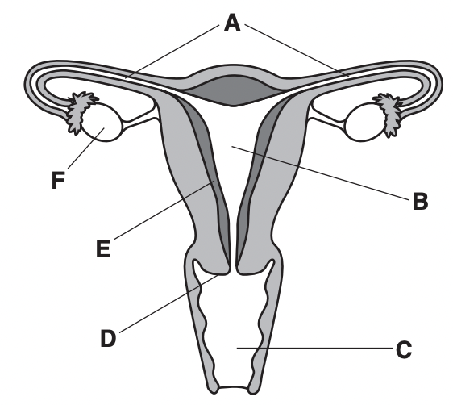

**Fig. 1**

**Table 1**

| **function** | **letter** | **name** |
|---|---|---|
| releases oestrogen |   |   |
| site of fertilisation |   |   |
| site of implantation |   |   |
| dilates during the process of birth |   |   |

Complete Table 1 to show the letter and the name of each of the structures that perform these functions.

*Source: 2018 Feb/Mar 0610/42 Q4A*

**Q17** [2 marks]

#### Extended only

Fertilisation is the fusion of the nuclei of a male gamete and a female gamete resulting in a zygote.

State the number of chromosomes present in a human:

(i)

Female gamete

[1]

(ii)

Zygote

[1]

*Source: 2018 0610/42 Q4B*

**Q17** [3 marks]

#### Extended only

Chlamydia is a sexually transmitted infection (STI).

Fig. 2 shows the number of reported cases of chlamydia in females in each age group in one country.

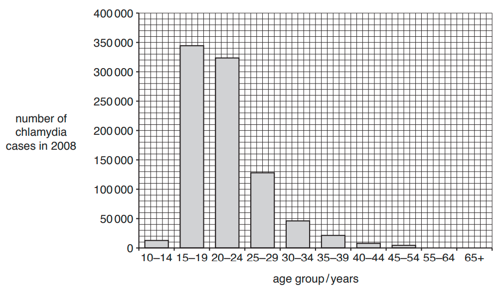

**Fig. 2**

Describe the results shown by the data in Fig. 2.

*Source: 2018 0610/42 Q4C*

**Q17** [5 marks]

Chlamydia is caused by a bacterium.

(i)

Suggest a treatment for chlamydia.

[1]

(ii)

State the name of **one other** STI.

[1]

(iii)

Complete the sentences about the spread of STIs.

STIs are transmitted through the transfer of ............................................... during sexual contact. One way individuals can avoid the spread of STIs is to use a type of ............................................... contraception. One example of this type of contraception is ............................................... .

[3]

*Source: 2018 0610/42 Q4D*

### Q18 — medium — 3 marks

**Q18** [3 marks]

#### Extended Only

Sugarcane is a crop plant that is usually grown from stem cuttings rather than from seeds.

Describe the advantages of using cuttings rather than seeds to reproduce crop plants.

*Source: 2023 970/04 Q4D*

### Q19 — medium — 12 marks

**Q19** [4 marks]

Fig. 1 shows sections of two flowers, **K** and **L**, from the same species.

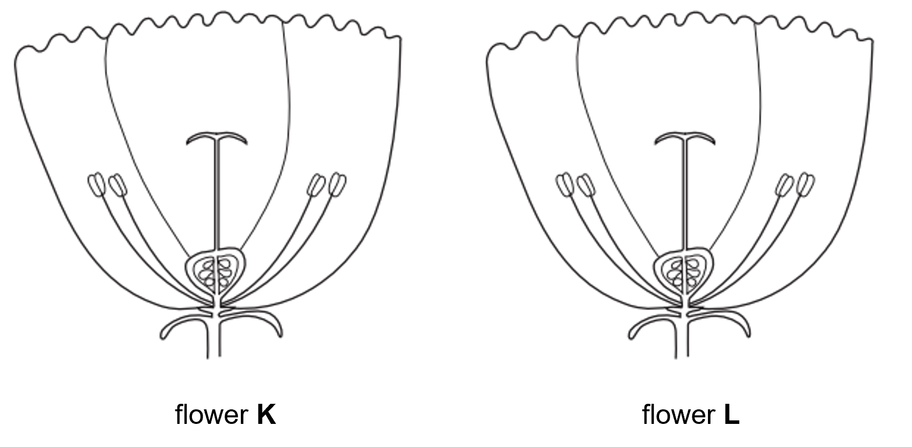

**Fig. 1**

(i)

On flower **L** in Fig. 1, identify and label an ovule and a petal.

[2]

(ii)

State the names of the parts in Fig. 1 that:

- produce ovules
- protect the bud of the flower

[2]

*Source: 2018 0610/31 Q7A*

**Q19** [2 marks]

**Extract:**

Fig. 1 shows sections of two flowers, K and L, from the same species.

On Fig. 1, draw an arrow to represent the transfer of pollen from flower **K** to flower** L** during pollination.

*Source: 2018 0610/31 Q7B*

**Q19** [2 marks]

A student said, “*Flowers ****K**** and ****L**** are pollinated by insects*.”

Describe **two** structures in flowers **K** and **L** that support this statement.

Use features that are visible in Fig. 1.

*Source: 2018 0610/31 Q7C*

**Q19** [4 marks]

Describe the pathway water takes in a plant, as it moves from the soil to a leaf.

*Source: 2018 0610/31 Q7D*

### Q20 — medium — 10 marks

**Q20** [2 marks]

Define the term pollination.

*Source: 2018 0610/32 Q8A*

**Q20** [2 marks]

Fig 1 shows a flower that reproduces using wind-pollination.

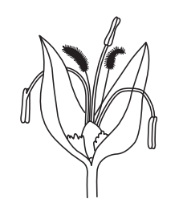

**Fig 1**

Describe **two** ways in which the flower in Fig. 1 is adapted for wind-pollination.

*Source: 2018 0610/32 Q8B*

**Q20** [3 marks]

**Extract:**

Pollen from an insect-pollinated flower is different to pollen from a wind-pollinated flower in the following ways:

Any three from the following comparisons:

- Heavy / Light
- Sticky / Not sticky
- Large / Small
- Spiky surface / surface has more air resistance / Smooth surface / surface has less air resistance
- Produced in small numbers / Produced in large numbers

Fig. 2 shows two photomicrographs of pollen.

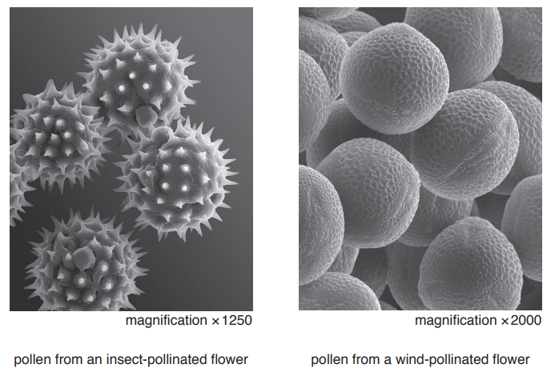

**Fig 2**

Describe, using your knowledge and the information in Fig. 2, how pollen from an insect-pollinated flower is different to pollen from a wind-pollinated flower.

*Source: 2018 0610/32 Q8C*

**Q20** [3 marks]

Sexual reproduction in plants results in seeds being formed.

State **three** conditions needed for the germination of seeds.

*Source: 2018 0610/32 Q8D*

### Q21 — hard — 6 marks

**Q21** [2 marks]

#### Extended Only

Explain the difference between self-pollination and cross-pollination.

*Source: 2020 0610/04 Q4D*

**Q21** [4 marks]

#### Extended Only

Some plant species are self-pollinated.

Discuss the long-term effects of self-pollination on the evolution of these plant species.

*Source: 2020 0610/04 Q4E*

### Q22 — easy — 12 marks

**Q22** [4 marks]

Table 1 shows four structures associated with the human male reproductive system.

Complete Table 1 by identifying the level of organisation of each structure.

Choose your answers from the list.

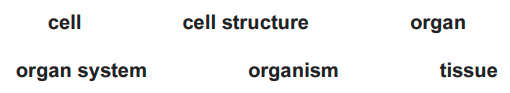

**Table 1**

| **structure** | **level of organisation** |
|---|---|
| epithelium |   |
| nucleus |   |
| sperm |   |
| testis |   |

*Source: 2019 0970/41 Q4A*

**Q22** [5 marks]

Fig. 1 shows the male reproductive system.

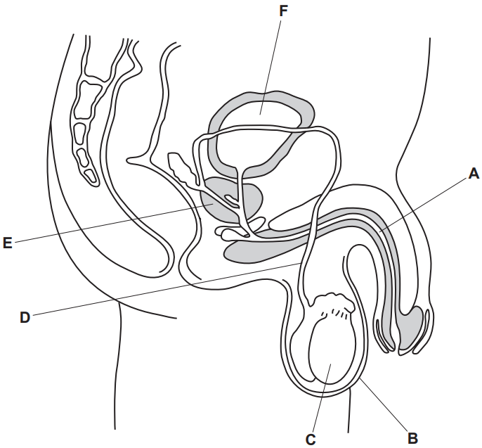

**Fig. 1**

Table 2 shows information about the male reproductive system shown in Fig. 1.

Complete Table 2.

**Table 2**

| **name of structure** | **function** | **letter in Fig. 1** |
|---|---|---|
| testis |   |   |
|   | transports sperm but not urine |   |
|   | tube for urine and seminal fluid through the penis |   |
| prostate gland |   |   |
|   | contains the testes |   |

*Source: 2019 0970/41 Q4B*

**Q22** [1 mark]

**Extract:**

| testis | production of sperm OR secretes/produces/releases testosterone | C | ; [1 mark] |

#### Extended Only

Draw an **X** on Fig. 1 on the structure where meiosis occurs.

*Source: 2019 0970/41 Q4C*

**Q22** [2 marks]

#### Extended Only

Sperm and eggs each have a nucleus which is haploid.

(i)

Define the term *haploid nucleus*.

[1]

(ii)

State the number of chromosomes in a human haploid nucleus.

[1]

*Source: 2019 0970/41 Q4D*

### Q23 — medium — 10 marks

**Q23** [3 marks]

(i)

State **one** type of blood cell that is involved in the defence against disease.

[1]

(ii)

State **two** ways blood cells defend the body against disease.

[2]

*Source: 2018 0610/33 Q7A*

**Q23** [7 marks]

HIV is a sexually transmitted infection (STI).

(i)

Define the term **sexually transmitted infection**.

[2]

(ii)

State why antibiotics cannot be used to treat HIV infections.

[2]

(iii)

Explain how the spread of STIs can be controlled.

[3]

*Source: 2018 0610/33 Q7B*

### Q24 — hard — 7 marks

**Q24** [4 marks]

Some students investigated the conditions needed for the germination of maize seeds. They used maize seeds from a packet of seeds they had purchased in a shop.

Three dishes were used, each containing cotton wool and the same number of maize seeds, as shown in Fig. 1.

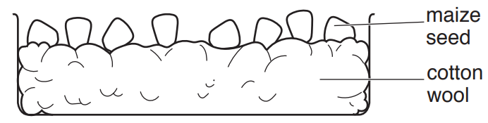

**Fig. 1**

Table 1 shows the conditions provided for each dish.

**Table 1**

| **conditions** | **dish** |   |   |
|---|---|---|---|
| **A** | **B** | **C** |   |
| treatment of cotton wool | damp | dry | damp |
| temperature / °C | 20 | 20 | 3 |
| light or dark | light | light | dark |

The seeds were left for five days and then observed.

The results are shown in Table 2

**Table 2**

| **dish** | **results** |
|---|---|
| **A** | all seeds germinated |
| **B** | no seeds germinated |
| **C** | no seeds germinated |

(i)

Explain why the seeds in dishes **B **and **C **did not germinate.

[2]

(ii)

In a second investigation, maize seeds were placed in a dish containing damp cotton wool.

This dish was left in the dark for five days at 20°C.

Predict and explain the results.

[2]

*Source: 2018 0610/32 Q2A*

**Q24** [3 marks]

A student gathered 70 maize seeds from plants growing in a field. The seeds were placed in dishes containing damp cotton wool.

After five days, only 64 seeds had germinated.

(i)

Calculate the percentage of seeds that germinated.

Show your working.

Give your answer to the nearest whole number.

[2]

(ii)

Suggest a reason why some of the seeds did not germinate.

[1]

*Source: 2018 0610/32 Q2B*

### Q25 — hard — 11 marks

**Q25** [3 marks]

#### Extended only

Polycystic ovary syndrome (PCOS) is a condition that commonly occurs in women of reproductive age. It is characterised by hormonal imbalances that affect the menstrual cycle of women with this condition.

Fig. 1 compares the levels of FSH and LH in a normal menstrual cycle with the levels seen in the cycle of a woman with PCOS.

**Fig. 1**

Use the information in Fig. 1 to explain the effect that PCOS would have on the ovaries of a woman.

**Q25** [2 marks]

**Extract:**

Polycystic ovary syndrome (PCOS) is a condition that commonly occurs in women of reproductive age. It is characterised by hormonal imbalances that affect the menstrual cycle of women with this condition.

The effect that PCOS would have on the ovaries of a woman would include...
- Low FSH levels SO an egg will not mature;
- Low FSH SO oestrogen will not be released;
- No oestrogen SO LH will not be released;
- Low LH / no LH increase SO no ovulation / no egg will be released (from ovary);

#### Extended only

Women with PCOS will often struggle with infertility.

Suggest a possible reason for this.

**Q25** [4 marks]

#### Extended only

Fig. 2** **shows changes in the thickening of the uterus wall lining in two women **X **and **Y**.

**Fig. 2**

Suggest an explanation for the difference in the thickness of the uterus wall lining between woman **X** and **Y** in Fig. 2.

**Q25** [2 marks]

**Extract:**

The thickness of the uterus wall lining is different between woman X and woman Y because...
- Woman X could be pregnant WHILE woman Y is not; [1 mark]
- Progesterone levels increase for woman X WHILE they decrease for woman Y; [1 mark]
- Progesterone causes the uterus lining to thicken / maintains the uterus lining (in X); [1 mark]
- The uterus wall lining breaks down / menstruation occurs (in Y); [1 mark]

#### Extended only

Outline how the levels of LH and progesterone will differ between woman **X **and **Y** during the next calendar month (assume a normal menstrual cycle for woman **Y**).

### Q26 — easy — 13 marks

**Q26** [5 marks]

The boxes on the left contain the names of flower parts.

The boxes on the right contain descriptions of the functions of the flower parts.

Draw **one **straight line from each box on the left to **one **box on the right to link the flower part to its function.

Draw **five **lines.

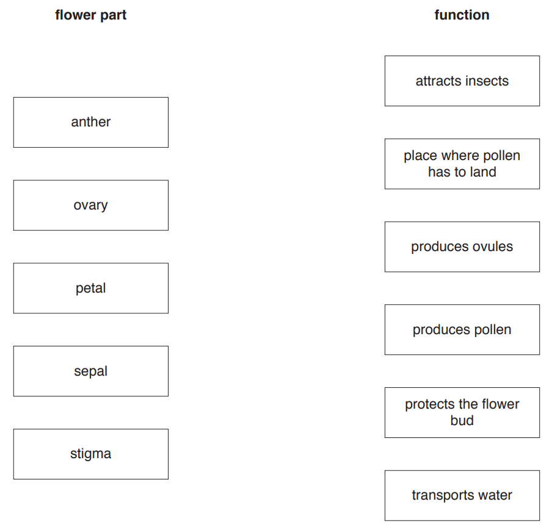

*Source: 2019 0970/31 Q1A*

**Q26** [2 marks]

Pollen grains from wind-pollinated flowers and insect-pollinated flowers are different.

State **two** ways in which a pollen grain from a wind-pollinated flower is different to a pollen grain from an insect-pollinated flower.

*Source: 2019 0970/31 Q1B*

**Q26** [6 marks]

Complete the sentences about seeds.

Use words from the list.

Each word may be used once, more than once, or not at all.

| **asexual ** | **carbon dioxide** | **gravity ** | **hormones** |
|---|---|---|---|
| **light ** | **mineral ions** | **oxygen ** | **sexual** |
| **vitamins ** | **water** |   |   |

Plants produce seeds as a result of .............................................. reproduction. Seeds germinate if they have the correct conditions. These conditions include a suitable temperature and also .............................................. and .............................................. .

The germinating seed produces a young root which grows downwards in response to .............................................. . The young root absorbs .............................................. and .............................................. from the soil as well as keeping the young plant in a stable position.

*Source: 2019 0970/31 Q1C*

### Q27 — medium — 20 marks

**Q27** [3 marks]

Glycogen is a storage carbohydrate in animals. Glycogen is made from glucose.

(i)

Cells that convert glucose to glycogen contain many mitochondria.

Suggest why these cells contain many mitochondria.

[2]

(ii)

State the type of biological molecule that catalyses reactions such as the conversion of glycogen to glucose.

[1]

*Source: 2018 0610/43 Q4A*

**Q27** [3 marks]

#### Extended only

A fetus needs glucose to make glycogen.

Describe how a fetus obtains glucose.

*Source: 2018 0610/43 Q4B*

**Q27** [11 marks]

#### Extended only

Fig. 1 shows the concentration of glycogen in the fetus of a domestic cat during pregnancy and immediately after birth.

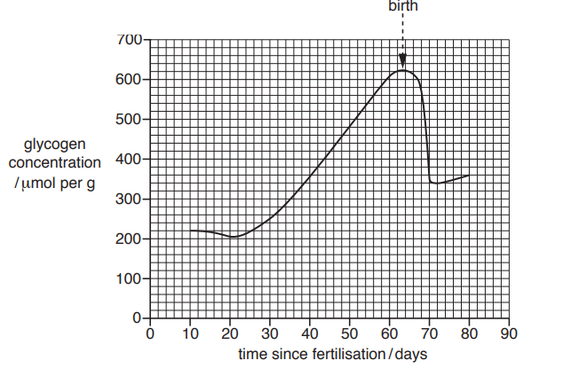

**Fig. 1**

Hormones stimulate changes in the concentration of glycogen in the fetus.

(i)

Define the term *hormone*.

[3]

(ii)

Calculate the percentage increase in the glycogen concentration in the fetus between day 10 and birth in Fig. 1.

Give your answer to the nearest whole number.

Show your working.

[2]

(iii)

Describe the changes in glycogen concentration shown in Fig. 1 **and** explain how hormones in the fetus cause these changes.

Use data from Fig. 1 to support your answer.

[6]

*Source: 2018 0610/43 Q4C*

**Q27** [3 marks]

#### Extended only

After birth, cats produce milk to feed their offspring.

Human babies can be breast-fed or bottle-fed with formula milk.

Outline **three** disadvantages of breast-feeding.

*Source: 2018 0610/43 QD*

### Q28 — medium — 16 marks

**Q28** [4 marks]

Fig. 1 is a diagram of the human female reproductive system.

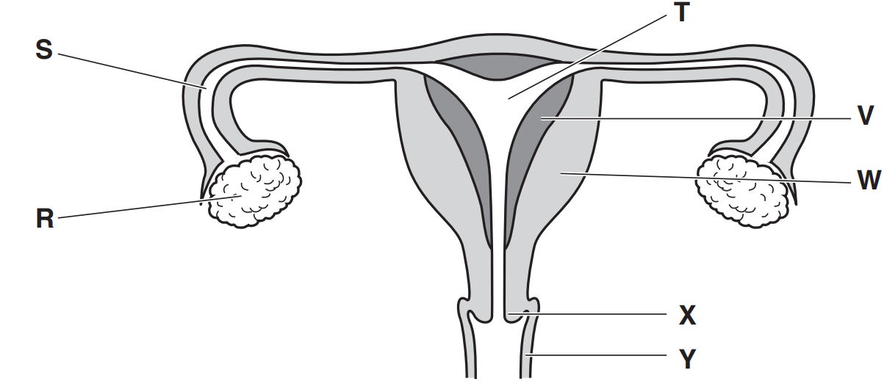

**Fig. 1**

(i)

Complete Table 1 by stating the letter from Fig. 1 that identifies the structure where each process occurs.

**Table 1**

| **process** | **letter from Fig. 1** |
|---|---|
| meiosis |   |
| fertilisation |   |
| implantation |   |

[3]

(ii)

State the name of the part of the female reproductive system labelled **S** in Fig. 1.

[1]

*Source: 2018 0610/41 Q6A*

**Q28** [2 marks]

#### Extended Only

Fig. 2 is a diagram of a human sperm cell.

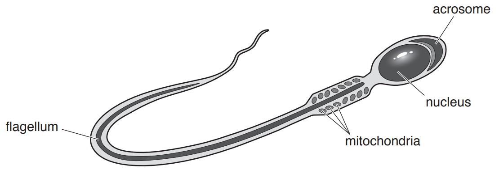

**Fig. 2**

(i)

Write the formula that would be used to calculate the magnification of the diagram.

[1]

(ii)

The actual length of the sperm cell in Fig. 2 is 0.055mm.

Convert this value to micrometres (μm).

Space for working.

___________ µm  [1]

*Source: 2018 0610/41 Q6B*

**Q28** [2 marks]

#### Extended only

Explain why the nuclei of sperm cells differ from those of other cells in the male.

*Source: 2018 0610/41 Q6C*

**Q28** [6 marks]

Explain the roles of the flagellum, the mitochondria and the acrosome in sperm cells.

*Source: 2018 0610/41 Q6D*

**Q28** [2 marks]

Explain why the sex of a child is determined by its father.

*Source: 2018 0610/41 Q6E*

### Q29 — medium — 3 marks

**Q29** [3 marks]

Some insects can reproduce by sexual reproduction **and** asexual reproduction. In both types of reproduction chromosomes are passed from the parent or parents, to the offspring.

Fig. 1 shows a drawing of a parent insect and seven of her offspring: **M, N, P, R, S, T** and **U.**

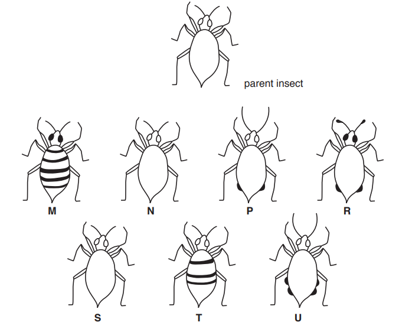

**Fig 1**

(i)

Two of the offspring were produced by asexual reproduction.

Suggest the letters representing these **two** offspring.

[1]

(ii)

Insect **R** was produced by sexual reproduction.

Use the information from the diagram to support this statement.

[1]

(iii)

State the term that is defined as the observable features of an organism.

[1]

*Source: 2018 0610/32 Q9A*

### Q30 — easy — 5 marks

**Q30** [1 mark]

Fig. 1 shows a fetus developing inside the uterus.

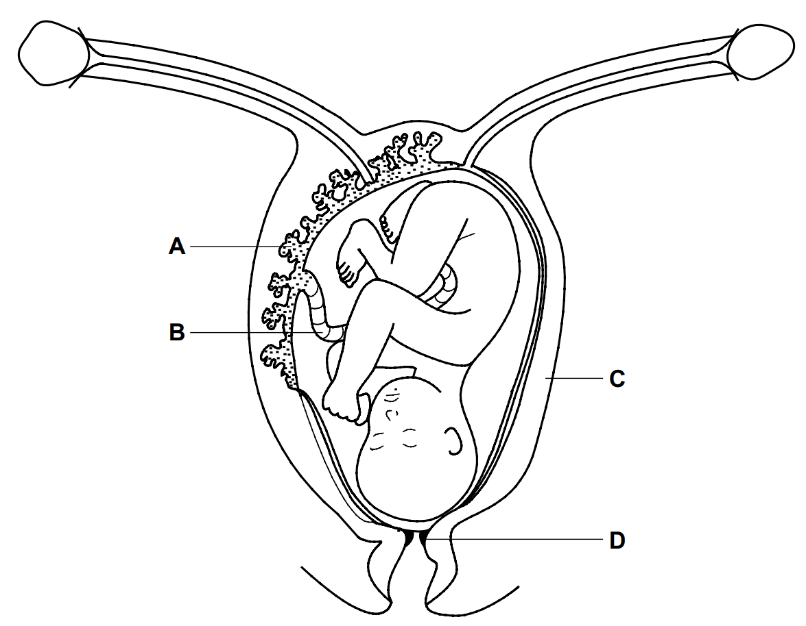

**Fig. 1**

The fetus developed from a fertilised egg cell

Draw an **X** on Fig. 1 to show where an egg cell is normally fertilised.

*Source: 2020 0610/03 Q3A*

**Q30** [2 marks]

**Extract:**

Fig. 1 shows a fetus developing inside the uterus. (Diagram shows structures labelled A and B, where A is the placenta and B is the umbilical cord.)

State the functions of the structures labelled **A** and **B**

*Source: 2020 0610/03 Q3B*

**Q30** [2 marks]

Describe the roles of the structures labelled **C** and **D** during labour and birth.

*Source: 2020 0610/03 Q3C*

### Q31 — medium — 11 marks

**Q31** [4 marks]

Fig. 1 is a half-flower drawing of pride of Barbados, *Caesalpinia pulcherrima.*

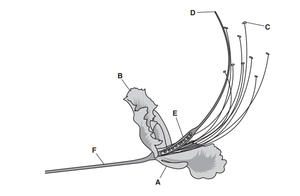

**Fig. 1**

Complete Table 1 by stating the letter from Fig. 1 that indicates the organ where each function occurs and the name of the organ.

**Table 1**

| **function** | **letter from Fig. 1** | **name of the organ** |
|---|---|---|
| meiosis to produce pollen grains |   |   |
| pollination |   |   |
| development of seeds |   |   |
| protection of flower in the bud |   |   |

*Source: 2018 0610/43 Q6A*

**Q31** [4 marks]

#### Extended Only

Fig. 2 is a scanning electron micrograph of some pollen grains from wind-pollinated flowers and insect-pollinated flowers.

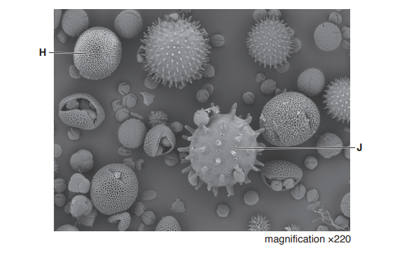

**Fig. 2**

(i)

Write the formula that would be used to calculate the actual diameter of pollen grain** H**.

[1]

(ii)

The actual diameter of pollen grain **H** is 0.082mm.

Convert this value to micrometres (μm).

[1]

(iii)

Explain how the pollen grain labelled **J** is adapted for insect pollination.

[2]

*Source: 2018 0610/43 Q6B*

**Q31** [3 marks]

#### Extended Only

Pollen grains grow tubes, which contain haploid male gamete nuclei.

(i)

One of these male gamete nuclei fuses with the female gamete. State the part of the flower that contains the female gamete

[1]

(ii)

Define the term *haploid nucleus.*

[1]

(iii)

Explain why it is important for gametes to be haploid.

[1]

*Source: 2018 0610/43 Q6C*

