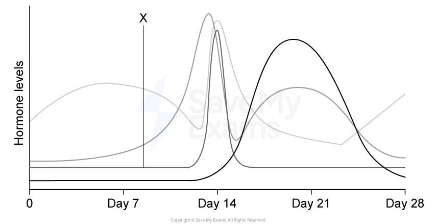
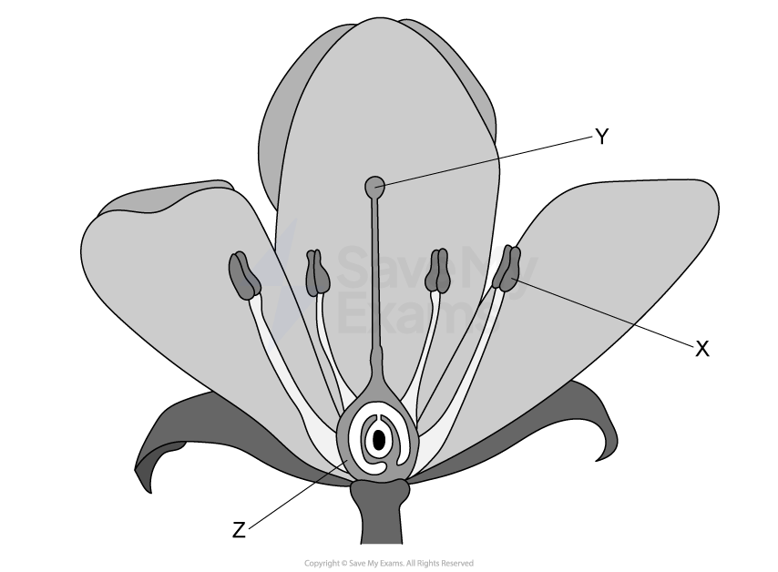
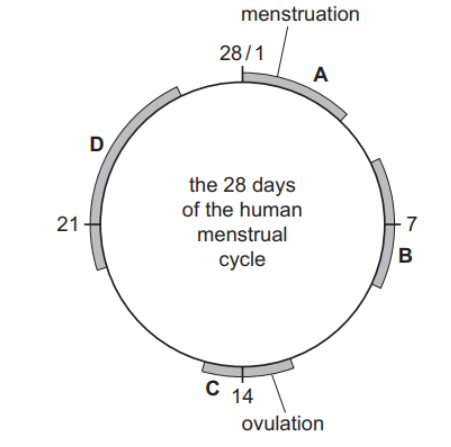
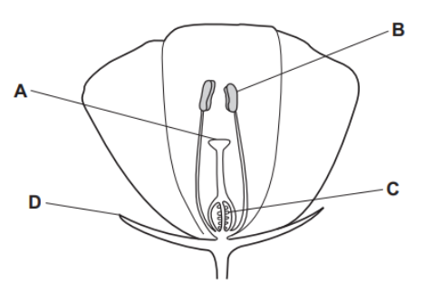
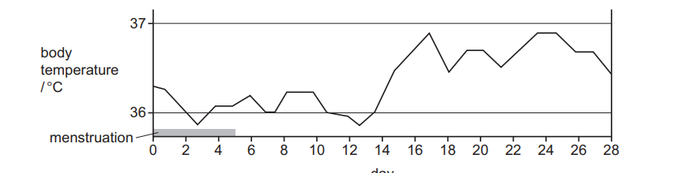
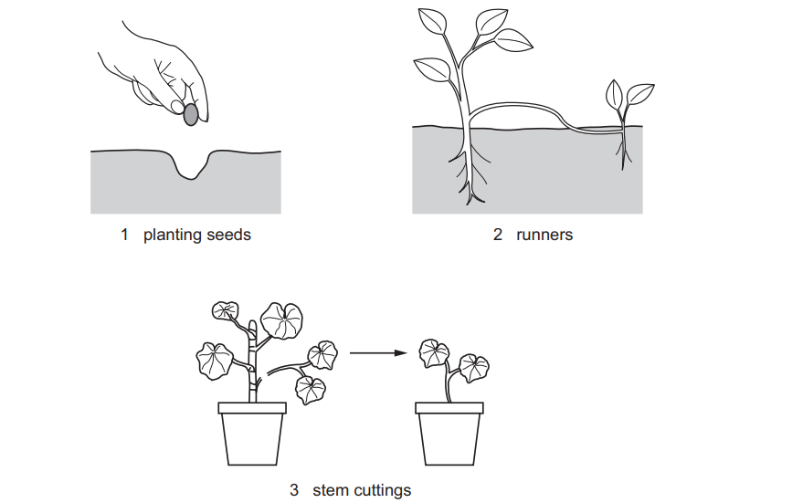
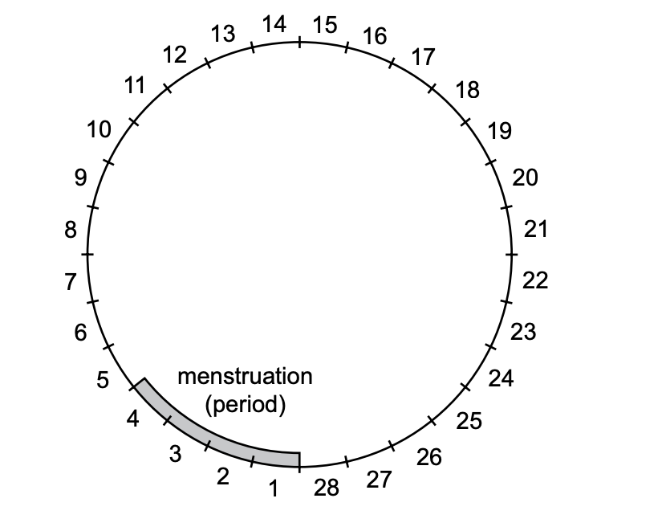
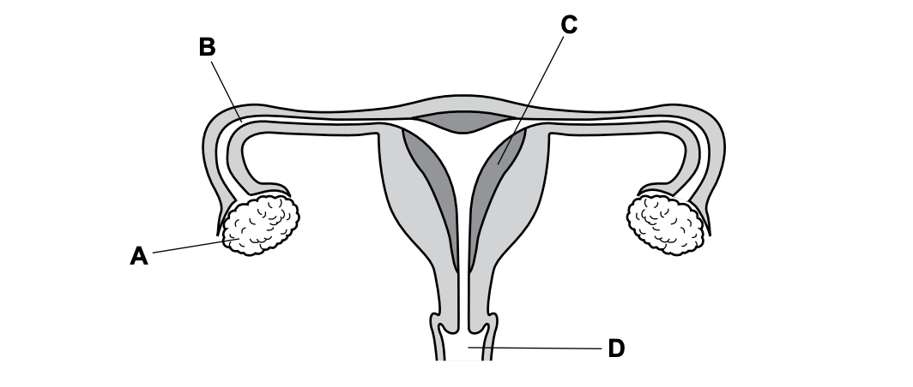
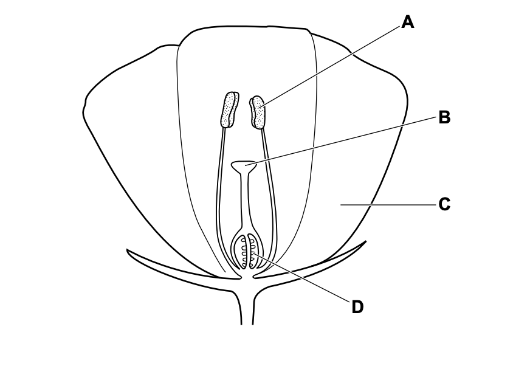
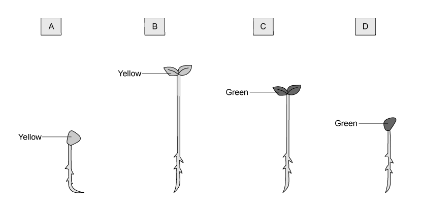

# Exam Questions — Reproduction in Plants & Humans
**16. Reproduction** · Cambridge (CIE) IGCSE biology (0610 & 0970)
> Source: [https://www.savemyexams.com/igcse/biology/cie/23/topic-questions/](https://www.savemyexams.com/igcse/biology/cie/23/topic-questions/) · 35 questions across 1 sets

## Multiple Choice Questions (35 questions)

### Q1 — hard — 1 marks

**Q1** [1 mark]

Which of the following statements about antibiotics is correct?

### Q2 — medium — 1 marks

**Q2** [1 mark]

The graph shows the levels of four hormones in the blood during a 28-day menstrual cycle.

What is hormone X?

### Q3 — medium — 1 marks

**Q3** [1 mark]

The diagram shows a flower.

Which row correctly identifies the functions of X, Y and Z?

|   | Function of X | Function of Y | Function of Z |
|---|---|---|---|
| A | produces pollen grains | receives pollen grains | contains ovules |
| B | produces pollen grains | receives pollen grains | produces pollen |
| C | receives pollen grains | produces pollen grains | contains pollen |
| D | produces pollen grains | contains ovules | receives pollen |

### Q4 — medium — 1 marks

**Q4** [1 mark]

How will the composition of a pregnant woman’s blood change as it passes through the placenta?

|   | concentration of dissolved oxygen | concentration of urea |
|---|---|---|
| **A** | decreases | decreases |
| **B** | decreases | increases |
| **C** | increases | decreases |
| **D** | increases | increases |

*Source: June 2021 0970/21 Q31*

### Q5 — medium — 1 marks

**Q5** [1 mark]

A zygote has ten chromosomes in its nucleus.

Which row shows the number of chromosomes in the cells of this species?

|   | body cells | sperm cells | embryo cells |
|---|---|---|---|
| **A** | 5 | 5 | 10 |
| **B** | 5 | 10 | 20 |
| **C** | 10 | 5 | 10 |
| **D** | 10 | 10 | 20 |

*Source: June 2021 0970/21 Q30*

### Q6 — hard — 1 marks

**Q6** [1 mark]

The diagram shows some of the events of the menstrual cycle.

In which shaded zone of the cycle would progesterone levels be the highest?

*Source: june 2022 paper 2  Q29*

### Q7 — easy — 1 marks

**Q7** [1 mark]

Which sequence of structures does a pollen tube grow through in a flower?

*Source: june 2022 paper 2 Q28*

### Q8 — easy — 1 marks

**Q8** [1 mark]

The diagram shows a cross-section of an insect-pollinated flower.

Which label is the stigma?

*Source: june 2022 paper 1 Q31*

### Q9 — easy — 1 marks

**Q9** [1 mark]

What is an example of sexual reproduction?

*Source: june 2022 paper 1 Q30*

### Q10 — medium — 1 marks

**Q10** [1 mark]

The graph shows a woman’s body temperature during the menstrual cycle.

On which days is the woman most likely to become pregnant?

*Source: June 2021 0970/11 Q32*

### Q11 — easy — 1 marks

**Q11** [1 mark]

Which structure in the male reproductive system makes the fluid for sperm to swim in?

*Source: June 2021 0970/11 Q31*

### Q12 — medium — 1 marks

**Q12** [1 mark]

A gardener wants to produce many genetically identical plants from a single plant.

The diagram shows different methods of growing new plants.

Which methods will produce plants that are genetically identical to the parent plant?

*Source: June 2021 0970/11 Q30*

### Q13 — easy — 1 marks

**Q13** [1 mark]

Which organ secretes the most progesterone during pregnancy?

*Source: Specimen 2023 0970/02 Q29*

### Q14 — easy — 1 marks

**Q14** [1 mark]

Which row describes sexual reproduction?

|   | gamete nucleus | zygote nucleus | genetically different offspring produced |
|---|---|---|---|
| **A** | diploid | diploid | no |
| **B** | diploid | haploid | no |
| **C** | haploid | diploid | yes |
| **D** | haploid | haploid | yes |

*Source: Specimen 2023 0970/02 Q28*

### Q15 — easy — 1 marks

**Q15** [1 mark]

The human immunodeficiency virus (HIV) can be transmitted in body fluid.

Some examples of body fluids are listed.

1. blood
2. saliva
3. semen
4. tear fluid

Which body fluids can transmit HIV?

*Source: Specimen 2023 0970/01 Q30*

### Q16 — medium — 1 marks

**Q16** [1 mark]

The diagram shows a timeline of a woman’s menstrual cycle, which lasts for 28 days.

On which days of the menstrual cycle is a woman most likely to ovulate?

*Source: Specimen 2023 0970/01 Q29*

### Q17 — medium — 1 marks

**Q17** [1 mark]

The diagram shows the female reproductive system.

Where does implantation normally occur?

*Source: Specimen 2023 0970/01 Q28*

### Q18 — medium — 1 marks

**Q18** [1 mark]

The diagram shows part of a flower.

Where does fertilisation occur?

*Source: Specimen 2023 0970/01 Q27*

### Q19 — easy — 1 marks

**Q19** [1 mark]

What is formed when the nucleus of a sperm fuses with the nucleus of an egg?

*Source: Specimen 2023 0970/01 Q26*

### Q20 — easy — 1 marks

**Q20** [1 mark]

Which environmental conditions must always be present for seed germination?

*Source: Specimen 2023 0970/01 Q21*

### Q21 — medium — 1 marks

**Q21** [1 mark]

HIV is an STI. The following statements are about changes that could occur in the body.

1. Reduced antibody production
2. Reduction in red blood cells
3. Reduction in white blood cells
4. Reduced volume of blood plasma

Which of these statements would be correct for HIV?

### Q22 — hard — 1 marks

**Q22** [1 mark]

Germinating seeds were placed in different temperature and light conditions as shown in the table below.

| **sample** | **temperature / °C** | **light** |
|---|---|---|
| 1 | 20 | absent |
| 2 | 20 | present |
| 3 | 4 | absent |
| 4 | 4 | present |

A seedling was removed from each experiment after 7 days.

Which seedling was from sample 2?

### Q23 — medium — 1 marks

**Q23** [1 mark]

During birth the following processes happen:

1. Breaking of the amniotic sac
2. Contraction of the muscles in the uterine wall
3. Cutting of the umbilical cord

In which order do these processes usually occur?

### Q24 — hard — 1 marks

**Q24** [1 mark]

An experiment was set up with four test tubes as shown in the diagram below and placed in the dark.

In which conditions would the seeds germinate first?

### Q25 — easy — 1 marks

**Q25** [1 mark]

Students were discussing how to remember the difference between two groups of cells, ‘many, minute and motile’ or ‘few, fat and fixed’.

What group of cells were they referring to?

### Q26 — easy — 1 marks

**Q26** [1 mark]

The diagram shows a human sperm cell. The sperm cell has many mitochondria in the mid section.

How do the mitochondria help the sperm carry out its function?

### Q27 — medium — 1 marks

**Q27** [1 mark]

#### Extended only

The table below shows some advantages and disadvantages of sexual and asexual reproduction.

Which row is correct?

|   | advantages of sexual reproduction | advantage of asexual reproduction |
|---|---|---|
| **A** | less population growth | only one parent needed |
| **B** | more energy efficient | gametes can be transferred by the environment |
| **C** | no transfer of gametes | does not compete with parent for nutrients |
| **D** | more genetic variation | faster |

### Q28 — hard — 1 marks

**Q28** [1 mark]

The diagram below shows a flower.

Which of these processes have taken place?

|   | **pollination** | **fertilisation** |
|---|---|---|
| **A** | no | no |
| **B** | no | yes |
| **C** | yes | yes |
| **D** | yes | no |

### Q29 — hard — 1 marks

**Q29** [1 mark]

#### Extended only

The graphs below show the levels of two hormones involved in the menstrual cycle and the thickness of the uterus lining.

Which of these statements is supported by evidence from the graphs?

### Q30 — medium — 1 marks

**Q30** [1 mark]

The diagrams show 3 different species of pollen grains as they appear under a microscope. The diagrams are all to the same scale.

Which pollen grains are involved in insect pollination?

### Q31 — hard — 1 marks

**Q31** [1 mark]

The diagram shows the menstrual cycle. This is a 28 day cycle.

Which time range in the cycle is the woman most likely to get pregnant?

### Q32 — medium — 1 marks

**Q32** [1 mark]

The diagram shows the female reproductive system.

After ejaculation, which pathway will the male gamete take to fuse with the egg?

### Q33 — easy — 1 marks

**Q33** [1 mark]

#### Extended only

There are a number of hormones that control fertility in women.

Which one of these maintains the lining during pregnancy?

### Q34 — easy — 1 marks

**Q34** [1 mark]

The statements below are about different hormones in the human body.

1. Produced by the pancreas.
2. Causes the voice to deepen at puberty.
3. Causes an egg to mature in the menstrual cycle.
4. Promotes the development of stronger muscles.

Which of these statements are correct for testosterone?

### Q35 — easy — 1 marks

**Q35** [1 mark]

#### Extended only

Which of the following is **not** an advantage of asexual reproduction?
