# Mark Schemes — Inheritance, Genes & Cell Division
**17. Inheritance** · Cambridge (CIE) IGCSE biology (0610 & 0970)

## Multiple Choice Questions (36 questions)

### Q1
**Final answer:** **The correct answer is D.**

To determine the probability that any offspring will have long ears:

- Determine the genotypes of both parents:

  - the heterozygous male has genotype **Ee**
  - the female has short ears, which is the recessive phenotype, so she must be homozygous **ee**
- Set up a Punnett square:

|   | **E** | **e** |
|---|---|---|
| **e** | Ee | ee |
| **e** | Ee | ee |

- Count the offspring with long ears:

  - 2 out of 4 offspring have genotype Ee and will therefore have long ears
- Express as a probability:

$\frac{2}{4}$ = $\frac{1}{2}$ = 50 %

### Q2
**Final answer:** **The correct answer is ****D.**

- **Meiosis** is the type of cell division that produces **gametes (sperm and egg cells)**
- During meiosis, the chromosome number is **halved from diploid to haploid**, and the resulting cells are **genetically different from each other**
- This genetic variation is important for **sexual reproduction**

> **[exam-tip]**
> If the question mentions **growth**, **repair** or **asexual reproduction**, the process is **mitosis**. Mitosis produces **genetically identical cells** and keeps the chromosome number the same.
> 
> If the question mentions **gametes** or **sexual reproduction**, the process is **meiosis**. Meiosis produces haploid gametes that are** genetically different**, with half the number of chromosomes as the parent cell.

### Q3
**Final answer:** **The correct answer is ****D.**

- **Messenger RNA (mRNA)** carries genetic instructions from the **nucleus to the cytoplasm**
- A gene remains in the nucleus, but a **copy of the gene is made as mRNA**
- The mRNA moves out of the nucleus to a **ribosome **in the cytoplasm, where it is used to assemble amino acids into a **protein**

**A **is incorrect because DNA remains in the nucleus and does not leave to carry instructions to the cytoplasm.

**B** is incorrect because neurotransmitters are chemical signalling molecules used to transmit impulses between neurones, not to carry genetic information.

**C **is incorrect because ribosomes assemble proteins, but they do not carry genetic instructions from the nucleus.

### Q4
**Final answer:** **The correct answer is ****C.**

- Determine parent genotypes:

Carrier female: **XᴺXᶜ**

Normal male: **XᴺY**

- Complete Punnett square:

|   | **Xᴺ** | **Y** |
|---|---|---|
| **Xᴺ** | XᴺXᴺ (daughter, normal) | XᴺY (son, normal) |
| **Xᶜ** | XᴺXᶜ (daughter, carrier) | XᶜY (son, colour blind) |

- For sons only, look at the Y column (because sons get Y from the father):

**XᴺY** (normal)

**XᶜY** (colour blind)

- So 1 out of 2 sons (**1/2**) are colour blind

**A** is incorrect because one possible son genotype (XᶜY) results in colour blindness.

**B** is incorrect because 1/4 refers to the proportion of all children, not specifically to sons.

**D** is incorrect because only sons that inherit Xᶜ from the mother are colour blind.

> **[exam-tip]**
> If a question asks only about “sons” or “daughters”, only consider the relevant row or column of the Punnett square. A helpful strategy is to identify and highlight the sons or daughters in the Punnett square before doing any calculations. This makes it much easier to avoid errors.

### Q5
**Final answer:** **The correct answer is**** B****.**

- The gene for colour blindness is located on the X chromosome, and it is more common in males due to their having only one X chromosome

**A** is incorrect because the gene for colour blindness is located on the X chromosome, not the Y chromosome, although it is more common in males.

**C** is incorrect because colour blindness is more common in males than in females because females have two X chromosomes, which provides a backup copy of the gene.

**D** is incorrect because the gene for colour blindness is located on the X chromosome, not the Y chromosome, and it is more common in males than in females.

### Q6
**Final answer:** **The correct answer is ****D****.**

- Meiosis allows the formation of new combinations of chromosomes through processes like crossing over and independent assortment.

**A** is incorrect because daughter cells produced by meiosis are genetically diverse, not identical.

**B** is incorrect because meiosis reduces the chromosome number from diploid to haploid, not the other way around. The diploid number is restored at fertilisation when the nuclei of two gametes fuse.

**C** is incorrect because meiosis produces gametes (sex cells), not body cells. Body cells are produced in mitosis.

### Q7
**Final answer:** **The correct answer is ****D****.**

- During transcription, genes are copied onto the mRNA in the nucleus of a cell. These mRNA molecules then leave the nucleus carrying a copy of the gene to the ribosomes in the cytoplasm, where proteins are made.

**A** is incorrect because alleles are different forms of a gene and do not carry copies of genes to the cytoplasm.

**B** is incorrect because, due to the size of the molecule, DNA remains in the nucleus and does not directly travel to the cytoplasm to make proteins.

**C** is incorrect because ribosomes are found in the cytoplasm and are the sites of protein synthesis, they do not carry copies of genes.

### Q8
**Final answer:** **The correct answer is ****B****.**

- This is because sperm cells are haploid, meaning that they contain half the number of chromosomes as a normal cell
- If the pangolin normally has 40 chromosomes then a sperm will have half of this, which is 20 chromosomes

**A** is incorrect because if the gametes each contained 10 chromosomes, when these combine during fertilisation this would result in a cell with 20 chromosomes, not 40.

**C** is incorrect because if the gametes each contained 40 chromosomes, when these combine during fertilisation this would result in a cell with 80 chromosomes, not 40.

**D** is incorrect because if the gametes each contained 50 chromosomes, when these combine during fertilisation this would result in a cell with 100 chromosomes, not 40.

### Q9
**Final answer:** **The correct answer is ****C****.**

- This is because mRNA carries the genetic code from the DNA in the nucleus and carries to the ribosome where the mRNA code is used to join together the amino acids in the correct order to make the protein

**A** and **B** are incorrect because the DNA is not found in the cytoplasm.

**D** is incorrect because amino acids are also needed to make proteins.

### Q10
**Final answer:** **The correct answer is ****A****.**

- This is because the cells in the mother contain two X chromosomes so during meiosis all of the egg cells inherit an X chromosome and therefore must pass that on to the offspring
- The cells in the father contain one X chromosome and one Y chromosome and so during meiosis when the sperm cells are made half of the sperm cells inherit the X chromosome and half the Y so there is a 50% chance the sperm cell that fertilises the egg will cause the offspring to be either male or female

**B** is incorrect because no cells in the mother contain a Y chromosome.

**C** is incorrect because no cells in the mother contain a Y chromosome and some sperm cells in the father will have an Y chromosome.

**D** is incorrect because no cells in the mother contain a Y chromosome and some sperm cells in the father will have an X chromosome.

### Q11
**Final answer:** **The correct answer is ****D****.**

- This is because inheritance is the transmission of genetic information from one generation to the next through the process of reproduction

**A** is incorrect because natural selection involves an element of ‘survival of the fittest’, where some individuals are more likely to survive and reproduce due to having an advantageous trait in comparison to others. This scenario is not described in the question.

**B** is incorrect because fertilisation is the fusion of a male and female gamete during sexual reproduction.

**C** is incorrect because mitosis is when a parent cell divides to produce two identical daughter cells for the purpose of growth, development, or the replacement of old or damaged cells.

### Q12
**Final answer:** **The correct answer is B.**

- Inheritance is the process by which genetic information is passed from parents to offspring from generation to generation.

**A** is incorrect because fertilisation is the process where sperm and egg combine to form a new organism, but it does not refer specifically to the transfer of genetic information across generations.

**C** is incorrect because meiosis is the cell division process that creates sex cells (sperm and eggs) with half the genetic material. While it plays a role in passing genetic information, it is not the term for the overall transfer from generation to generation.

**D** is incorrect because reproduction is the process of producing offspring, but it doesn’t specifically refer to the transmission of genetic information.

### Q13
**Final answer:** **The correct answer is B**

- This is because the F1 chickens are all heterozygous
- The black and white alleles are **codominant** resulting in the black and white phenotype when heterozygous
- Crossing two heterozygous parents will produce the following outcome:

- This results in a 1:2:1 ratio of offspring phenotypes

### Q14
**Final answer:** **The correct answer is D**

- This is because the parents both have AB and O blood groups and the children will have a 50% chance of having the A blood group and a 50% chance of B blood group

**A** is incorrect because there children could have A or AB blood group, which is the same as the parents

**B **is incorrect because the children would all have type A blood, which is the same as each other and one parent

**C **is incorrect because there children could have B or AB blood group, which is the same as the parents

### Q15
**Final answer:** **The correct answer is B**

- This is because after mitosis the number of chromosomes stays the same so the daughter cells should have the same number of chromosomes as the parent cell

**A** is incorrect because during meiosis the number of chromosomes halves but this is not the case for mitosis

**C **is incorrect because there is no scenario in which a small number of extra chromosomes would be produced by mitosis

**D **is incorrect because the chromosome number does not double during mitosis because the cell with replicated DNA is split into two, results in two cells with the correct number of chromosomes

### Q16
**Final answer:** **The correct answer is B**

- This is because messenger RNA makes a copy of the gene and carries it from the nucleus through the cytoplasm to the ribosome
- The DNA cannot leave the nucleus and so the mRNA allows the genetic code to travel to other areas of the cell

**A** is incorrect because the ribosome assembles amino acids into protein molecules

**C **is incorrect because the nucleus controls cell function

**D **is incorrect because messenger RNA is not involved in the duplication for chromosomes before mitosis. This process requires new DNA, not RNA

### Q17
**Final answer:** **The correct answer is A because:**

Heterozygous is when they have two different alleles, H and h

**B** is incorrect because 5 and 6 are both homozygous recessive (hh), not heterozygous.

**C** is incorrect because 2 is homozygous recessive (hh), not heterozygous.

**D** is incorrect because 2, 5 and 6 are all homozygous recessive (hh), not heterozygous.

### Q18
**Final answer:** **The correct answer is B because:**

A male embryo is XY and so the X comes from the egg and the Y from the sperm

**A** is incorrect because the question specifies that the embryo is male and so must be XY, not XX.

**C** and **D** are incorrect because egg cells cannot contain Y chromosomes.

### Q19
**Final answer:** **The correct answer is ****A**** (gene →  DNA strand →  chromosomes →  nucleus) because:**

A gene is the smallest structure of those listed; a gene is a section of a single DNA strand.  DNA coils itself around to form chromosomes; chromosomes are found in the nucleus which is the largest structure.

### Q20
**Final answer:** **The correct answer is ****D**** (group A) because:**

- Blood group inheritance is an example of <u>codominance</u>
- There are three possible alleles that can be inherited; but an individual can only have a maximum of two alleles in their genotype
- Alleles IA and IB  are dominant over IO, so because one parent is homozygous for blood group A, all of the offspring will inherit the **I****A** allele, meaning all the offspring will be in group A (as the partner has a heterozygous genotype with the recessive IO allele

| **Final answer:** ** ** | **Final answer:** **I****A**** ** | **Final answer:** **I****O** |
|---|---|---|
| **Final answer:** **I****A**** ** | **Final answer:** **I****A****I****A** | **Final answer:** **I****A****I****O** |
| **Final answer:** **I****A**** ** | **Final answer:** **I****A****I****A** | **Final answer:** **I****A****I****O** |

### Q21
**Final answer:** **The correct answer is ****D**** (I****B****I****O****) because:**

- Blood group inheritance is an example of **codominance**
- There are three possible alleles for the blood group (but remember a person can inherit a maximum of two alleles per gene)
- Alleles IA and IB  are dominant groups over IO
- Jignasha has two children with a man who has the A blood group phenotype
- Jignasha’s son is blood group B, meaning that Jignasha must have at least one IB allele, as the son's father would not have this allele (the father must be IAIO)
- Jignasha’s daughter’s genotype is not shown, but she has one daughter who is blood type O and one who is blood type A. The child who is blood group O must be IOIO so the allele for IO must have come from Jignasha making her IBIO

It is very important to read and make use of all the information in the question, for example to realise that Jignasha is a female.

### Q22
**Final answer:** **The correct answer is ****B ****(a nucleus containing a single set of chromosomes) because:**

Meiosis is the type of cell division that creates genetically different cells with a haploid number of chromosomes, so that during sexual reproduction a new organism with a diploid number of chromosomes can be made.

**A** is incorrect because this is the definition of diploid. This refers to the somatic (body) cells in an organism (everything but the gametes).

**C** is incorrect because this is a condition known as Turner’s syndrome, where an individual only has one X chromosome.

**D** is incorrect because this is a condition known as Klinefelter syndrome, caused by the inheritance of an extra X chromosome in an XY (male) individual.

### Q23
**Final answer:** **The correct answer is ****A ****because:**

- The production of **gametes** involves meiosis
- Meiosis results in the production of cells with a **haploid number** of chromosomes and with genetic variation (the daughter cells contain a unique combination of alleles compared to the parent cell)
- **Mitosis** produces genetically identical cells with a **diploid number** of chromosomes. This is used for **somatic** (body cell) division in growth and repair; so once the **gametes **have fused to form a **zygote **mitotic cell divisions allow the zygote to form an embryo and then a foetus

The other answers are incorrect as they have not identified the correct stage for mitosis and meiosis.

### Q24
**Final answer:** **The correct answer is ****D**** (Tt x tt) because:**

- Both parents would need to be **carriers** of the **recessive** allele for any of the offspring to be dwarf plants, so this rules out option **C**
- If one parent is homozygous dominant, then all of the offspring will inherit at least one dominant allele in their genotype and therefore have the dominant phenotype
- All offspring would have the dwarf phenotype in the cross in option **A** as the parents can only pass on recessive alleles

This leaves options **B** and **D:**

- In option B each there is only a 0.25 chance that any offspring will have the recessive phenotype

This leaves us with option** D**:

- The ratio produced by crossing the individuals in this option would be 2:2 and so simplified to 1:1.

This is shown in the **Punnett square** below:

| **Final answer:** ** ** | **Final answer:** **T** | **Final answer:** **t** |
|---|---|---|
| **Final answer:** **t** | **Final answer:** **Tt** | **Final answer:** **tt** |
| **Final answer:** **t** | **Final answer:** **Tt** | **Final answer:** **tt** |

### Q25
**Final answer:** **The correct answer is ****C**** (males XY, females XX) because:**

The male sex chromosomes are inherited as an X and a Y chromosomes - the X from the mother and the Y from the father, giving a male the chromosomes XY. A female inherits an X from the mother and another X from the father, giving the chromosomes XX as a female.

### Q26
**Final answer:** **The correct answer is ****B**** (50% TT, 50% Tt) because:**

- The parents have the genotypes TT (homozygous) and Tt (heterozygous)
- The gametes produced by the homozygous dominant individual will all contain the allele ‘T’
- The possible gametes for the heterozygous parent will contain either ‘T’ or ‘t’

|   | **Final answer:** **T** | **Final answer:** **T** |
|---|---|---|
| **Final answer:** **T** | **Final answer:** **TT** | **Final answer:** **TT** |
| **Final answer:** **t** | **Final answer:** **Tt** | **Final answer:** **Tt** |

### Q27
**Final answer:** **The correct answer is ****D**** (100%) because:**

- If both parents have the condition then they will both have the same **genotype**: **homozygous recessive**
- Both parents only have (two) copies of the recessive allele; therefore the gametes formed by **meiosis** in each parent will always contain a recessive allele, therefore the only possible genotype for any offspring from these parents will be homozygous recessive

> *Note - in genetics it is key to know your definitions!*

- **Gene** - section of the chromosome that codes for a particular characteristic
- **Allele** - alternative version of a gene
- **Genotype **-  the genetic make-up of an organism in terms of the alleles present
- **Phenotype **- the observable features (physical characteristics) of an organism
- **Homozygous **- having two identical alleles for the same gene
- **Heterozygous **- has two different alleles for a particular gene

### Q28
**Final answer:** **The correct answer is ****A ****because:**

- Males carry the sex chromosomes **XY** and females carry **XX**
- In order for the sex of the offspring to be a female she will need to inherit an X chromosome from **each** parent
- In order for the sex of the offspring to be a male he will need to inherit an X chromosome from his mother and a Y chromosome from his father
- The mother can only give the offspring an X chromosome so the gamete Q must have the X chromosome
- To be a male son **R** must have the genotype XY

### Q29
**Final answer:** **The correct answer is ****B**** (mitosis producing genetically identical cells) because:**

The question states that two daughter cells are produced, which means the division must be mitotic, and in having the same chromosome number they will be genetically identical (as the daughter cells are genetic copies of the parent cell).

**A** is incorrect because this answer describes the process of **meiosis. **Meiosis produces gametes for sexual reproduction; gametes are genetically different from the parent cell with only a **haploid** (half the amount) number of chromosomes of a normal body cell.

**C** is incorrect because **meiosis **does not produce genetically identical cells

**D** is incorrect because **mitosis** doesn’t produce genetically different cells.

### Q30
**Final answer:** **The correct answer is ****C ****because:**

- Mitosis has one division and produces two genetically identical clones which are diploid and contain the full set of chromosomes
- Meiosis has two divisions and produces four genetically unique cells which are haploid and contain only half the amount of chromosomes

### Q31
**Final answer:** **The correct answer is ****C**** (50%) because:**

- For the daughter to have the condition she would need to inherit two recessive alleles, aa
- To be a girl she will inherit an **X** chromosome from each parent
- There is a 50% chance that she will inherit the recessive allele from her mother
- This is shown in the Punnett square:

| **Final answer:** ** ** | **Final answer:** **X****a** | **Final answer:** **Y** |
|---|---|---|
| **Final answer:** **X****a** | **Final answer:** **X****a****X****a** | **Final answer:** **X****a****Y** |
| **Final answer:** **X****A** | **Final answer:** **X****A****X****a** | **Final answer:** **X****A****Y** |

There is only a 25% chance that the offspring of these parents will be a girl and have the recessive condition, but this is not what the question was asking you, so be sure to read the wording carefully.

### Q32
**Final answer:** **The correct answer is ****D ****because:**

- The cell shown is a sperm cell, a type of **gamete**. Sperm cells are produced by **meiosis**
- **Meiosis** is the type of cell division that creates genetically different cells with a **haploid **number of chromosomes, so that during sexual reproduction two gametes form a cell which becomes a new individual, with a **diploid **number of chromosomes in the nucleus of that cell

**A** is incorrect because this is a white blood cell (and therefore a body cell) it would have a **diploid** number of **chromosomes.**

**B** is incorrect because this looks like a plant cell with chloroplasts and a cell wall, therefore it would not be a gamete.

**C** is incorrect because this is a nerve cell/neurone (and therefore a body cell) which would have a **diploid** number of **chromosomes.**

### Q33
**Final answer:** **The correct answer is ****B ****because:**

|   | t | t |
|---|---|---|
| T | Tt | Tt |
| t | tt | tt |

This is because heterozygous means that there is one dominant and one recessive allele present, Tt. Homozygous means there are two sets of the same allele present, in this case, tt. To complete a genetic diagram you take one of each allele from the corresponding row and column and write them out into the table spaces.

**A** is incorrect because this cross shows a cross between two homozygous parent plants, homozygous recessive tt and homozygous dominant TT.

**C** is incorrect because this shows a cross between two heterozygous parent plants, Tt and Tt.

**D** is incorrect because this shows the same cross as option A between two homozygous parent plants. TT and tt. In this cross, the parent alleles are written the other wat around in the table.

### Q34
**Final answer:** **The correct answer is ****A**** (ribosomes) because:**

The ribosomes are responsible for protein synthesis in all cells. They attach to the** mRNA** released from the **nucleus**. The **ribosome** is then involved in the assembly of the protein from amino acids based on the **sequence of bases** in the **mRNA**.

**B** is incorrect because **chloroplasts** are the site of **photosynthesis.**

**C** is incorrect because **mitochondria **are the site of **aerobic respiration.**

**D** is incorrect because **cell walls **provide support for the cell.

### Q35
**Final answer:** **The correct answer is ****C**** (50%) because:**

- The parent without Huntington’s (non-Huntington’s) must be homozygous recessive (hh)
- The parent with Huntington’s must be heterozygous (Hh) as they have one child without the disease and the sufferer must have passed on a recessive allele

The Punnett square for this will be:

| **Final answer:** ** ** | **Final answer:** **H** | **Final answer:** **h** |
|---|---|---|
| **Final answer:** **h** | **Final answer:** **Hh** | **Final answer:** **hh** |
| **Final answer:** **h** | **Final answer:** **Hh** | **Final answer:** **hh** |

This shows a 50% chance of any child from this cross being a sufferer of the disease.

### Q36
**Final answer:** **The correct answer is ****C**** (The allele for red eyes is dominant) because:**

- Dominant characteristics will show even if a recessive allele is present in the genotype (for example in an heterozygous individual)
- Organisms that are orange-eyed must be recessive as when crossed offspring always have orange-eyes
- In order for there to be a mixture of red and orange-eyed individuals the red-eyed flies must have been heterozygous

If R  = red eyes and r = orange eyes then the Punnett square for two orange-eyed individuals would be:

| **Final answer:** ** ** | **Final answer:** **r** | **Final answer:** **r** |
|---|---|---|
| **Final answer:** **r** | **Final answer:** **rr** | **Final answer:** **rr** |
| **Final answer:** **r ** | **Final answer:** **rr** | **Final answer:** **rr** |

The cross for red-eyed flies would be:

| **Final answer:** ** ** | **Final answer:** **R** | **Final answer:** **r** |
|---|---|---|
| **Final answer:** **R** | **Final answer:** **RR** | **Final answer:** **Rr** |
| **Final answer:** **r ** | **Final answer:** **Rr** | **Final answer:** **rr** |

**A** is incorrect because if the allele for orange eyes was dominant, then the results of the two red-eyed fly cross would be all red eyes and in this case the red eyes trait would be recessive (rr)

**B** is incorrect because the 1:1 ratio would depend on the genotype of the red-eyed fly in the cross and can’t be concluded from the information given.

**D** is incorrect because we do not need to do a cross to find the 3:1 ratio just to find out which of the alleles are dominant.

## Theory Questions (19 questions)

### Q1
> **[mark-scheme]**
> (i) Allele:
> 
> - An alternative form/version of a gene **[1 mark]**
> 
> (ii) Heterozygous:
> 
> - Having two different alleles of a gene **[1 mark]**
To predict the genotypes and phenotypes of the offspring:

- Identify parent genotypes

heterozygous, polled cow = Pp **AND** horned bull = pp **[1 mark]**

- Complete Punnett square

|   | **p** | **p** |
|---|---|---|
| **P** | Pp | Pp |
| **p** | pp | pp |

**[1 mark]**

- Indicate phenotypes of offspring

Pp = polled **AND** pp = horned **[1 mark]**

- State phenotype ratio

1 polled : 1 horned **[1 mark]**

> **[mark-scheme]**
> Award marking point 3 for a correctly labelled Punnett square.
> 
> Allow 2 polled : 2 horned / 50% polled and 50% horned for marking point 4.

> **[exam-tip]**
> The question tells us that the polled cow is heterozygous, so we know that her genotype must be Pp.
> 
> Because horns are recessive, the horned bull must be pp since a recessive trait can only be expressed when both alleles are recessive.
> 
> Make sure to state the phenotypes in full words — the letter combinations alone only represent the genotypes and that final mark will not be awarded without them.
> **[mark-scheme]**
> - Breed together a cow with a high milk yield and a suitable bull / a bull that produces female offspring with high milk yield **[1 mark]**
> - Breed together the offspring with the highest milk yield **[1 mark]**
> - Repeatover many generations **[1 mark]**

### Q2
Any three from:

- Active transport;**[1 mark]**
- Movement occurs against a concentration gradient / from low concentration to high concentration; **[1 mark]**
- The CFTR protein changes shape to move (chloride) ions;**[1 mark]**
- Energy is needed; **[1 mark]**

Note that you are not expected to know anything about cystic fibrosis, but instead you should be able to apply your knowledge of active transport to this context.
Any three from:

- Chloride ions (in duct) decrease water potential; **[1 mark]**
- Water moves by <u>osmosis</u>; **[1 mark]**
- Water moves down a water potential gradient / from high water potential to low water potential; **[1 mark]**
- Water moves through a partially permeable membrane; **[1 mark]**
(i)

- Parents of 5 and 7 / individuals 2 and 3 do not have cystic fibrosis;** [1 mark]**
- Individuals 2 and 3 must be heterozygous / carriers (of the cystic fibrosis allele); **[1 mark]**

(ii)

- One parent has the genotype aa;**[1 mark]**
- One parent has the genotype Aa; **[1 mark]**
- Parental gametes are a **AND** a** AND** A** AND** a; **[1 mark]**
- Offspring genotypes are Aa **AND** aa** AND** Aa **AND** aa; **[1 mark]**
- Clear indication that Aa = no cystic fibrosis and aa = cystic fibrosis **AND** the probability of being a sufferer is 50%/half/0.5; **[1 mark]**

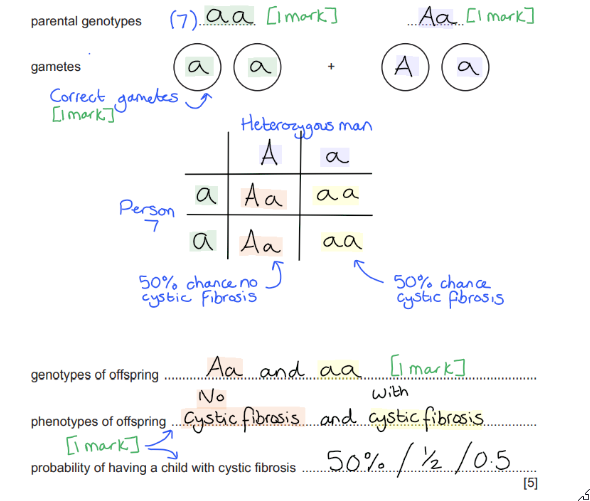

### Q3
- A length/section of DNA; **[1 mark]**
- That codes for a protein; **[1 mark]**

**[Total: 2 marks]**
(i)

- 1/one; **[1 mark]**

The information provided in the question tells us that the smooth coat allele (r) is recessive, so only individuals with the genotype rr will have smooth coats. In the key we can see that unfilled shapes represent individuals with the genotype rr, and individual F is the only guinea pig in Fig. 3.2 represented by an unfilled shape.

(ii)

- D;  **[1 mark]**

The key provided in Fig. 3.2 allows us to see that individual D is the only guinea pig with the genotype RR.

(iii)

- 3/three;  **[1 mark]**

The key shows that squares represent male guinea pigs, so individuals A, D and F are males.

**[Total: 3 marks]**
- Male gametes = R and R **AND** female gametes = R and r; **[1 mark]**
- Offspring genotypes = RR **AND** RR **AND** Rr **AND** Rr; **[1 mark]**
- Probability of having a smooth coat = 0/zero; **[1 mark]**

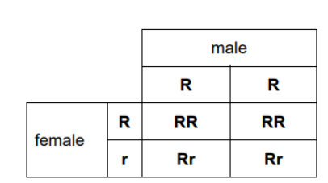

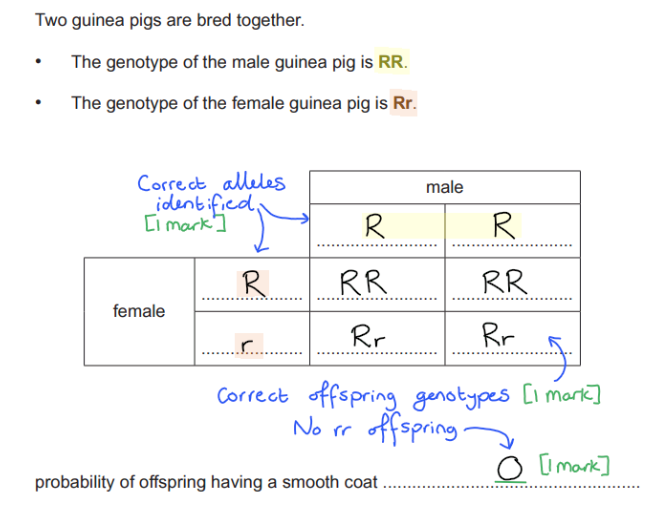

**[Total: 3 marks]**
- Pure; **[1 mark]**

**[Total: 1 mark]**

### Q4
(i)

- **(P) X****H****X****h**; **[1 mark]**
- **(Q) X****h****Y**;** [1 mark]**
- **(R) X****H****Y**; **[1 mark]**

P must be heterozygous because they pass on their Xh chromosome for haemophilia to their son Q.

(ii) 0.25; **[1 mark]**

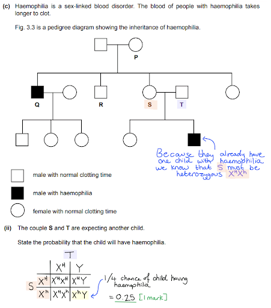

(iii)

- The gene is located on a sex chromosome; **[1 mark] **
- The characteristic is more common in / one sex (than the other); **[1 mark]**

**[Total: 6 marks]**

### Q5
(i)

- X or Y; **[1 mark]**

(ii)

- A gene is a length of **DNA**…; **[1 mark]**
- …that codes for a **protein**; **[1 mark]**

**[Total: 3 marks]**

### Q6
- (Male and female gametes) **A** and **a**; **[1 mark]**
- (Offspring) **AA**, **Aa**,** Aa** and** aa**;** [1 mark]**
- (Phenotypic ratio) 3 (white) : 1 (black); **[1 mark]**

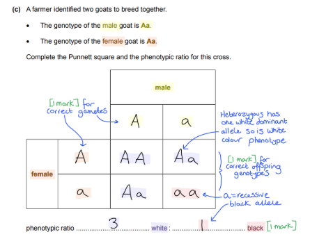

**[Total: 3 marks]**

### Q7
(i) The type of cell division that produces gametes is:

- Meiosis; **[1 mark]**

(ii) The name of the cell formed when the nuclei of two gametes join together is:

- Zygote; **[1 mark]**

**[Total: 2 marks]**
(i) The term *homozygous* means:

- Having two identical alleles of a (particular) gene; **[1 mark]**

(ii) The dominant allele for fur colour is:

- **B**/black; **[1 mark]**
- All of the offspring have black fur / brown fur not seen in offspring; **[1 mark]**

**[Total: 3 marks]**

> *If you're struggling to remember the difference between homozygous and heterozygous, remember that "homo" means 'the same' and "hetero" means 'different'.*

> *When the two rabbits are crossed all of the offspring will have the genotype Bb (they will be heterozygous), and the fact that all of these rabbits have black fur tells us that the allele for black fur (B) must be dominant over the allele for brown fur (b).*

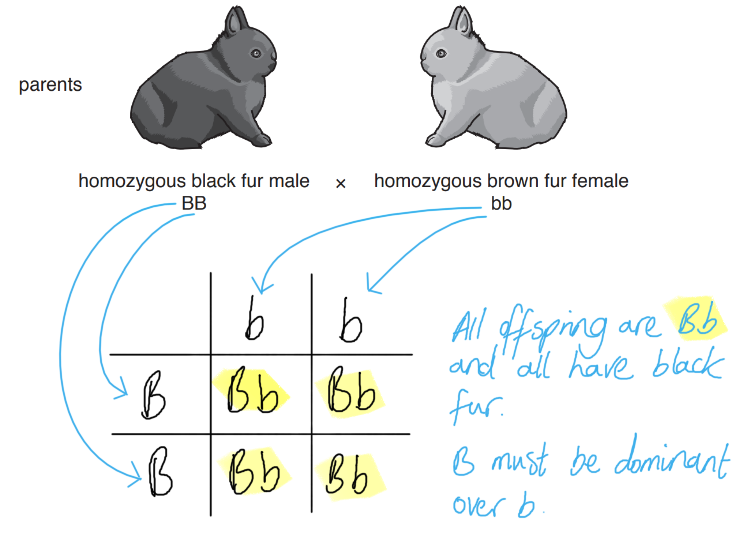
The phenotype of an organism is different to its genotype because:

- Phenotype is the observable features/appearance **WHILE** genotype is alleles present / whether the individuals are heterozygous or homozygous; **[1 mark]**

**[Total: 1 mark]**

> *Whenever a question asks you to give a **difference **your answer should always give both sides of the story; here, for example, you need to correctly define **both** phenotype and genotype to get the mark.*
The completed genetic diagram is as follows:

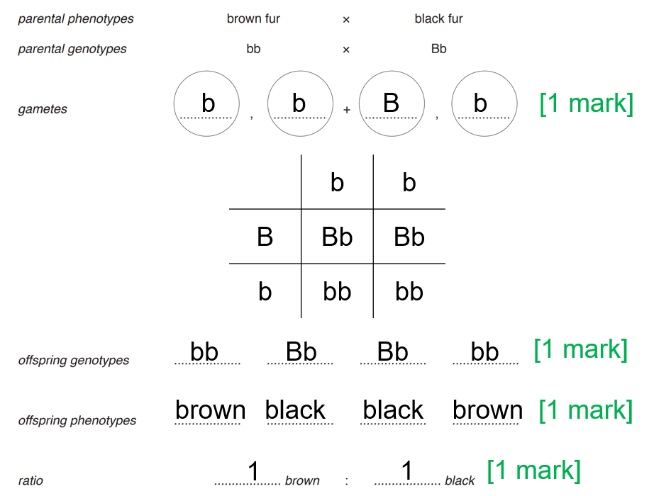

*Phenotypes must match with the corresponding genotype for mark point 3 to be awarded.*

**[Total: 4 marks]**

> *You need to make sure that the offspring genotypes and the phenotypes on the line below match up, i.e. whenever you write bb then it must say brown directly below, and Bb must say black directly below. Otherwise, you won't get the mark for offspring phenotypes. *

> *The offspring are half brown and half black; this is expressed in ratio form as 1:1.*
The stages in the process of selective breeding are:

Any **three **from the following:

- Choose (parents with) desired feature/trait; **[1 mark]**
- Breed/cross/mate (individuals with the trait together); **[1 mark]**
- Choose offspring with the feature; **[1 mark]**
- Breed offspring with feature (together); **[1 mark]**
- For several/many generations; **[1 mark]**

*Stages must be stated in the correct order for marks to be awarded.*

**[Total: 3 marks]**

> *You should make sure your stages are in the correct order; even if you write something that is on the mark scheme, if it doesn't make sense in the context in which it is written then you can't get the mark. *

> *If you just say "repeat" for the last marking point, you can't get the mark. You should say repeat for **several **generations**.*

### Q8
The diploid number of chromosomes of the female muntjac deer is:

- 6 *(accept 3 pairs)*; **[1 mark]**

**[Total: 1 mark]**

From the diagram, you can see there are six individual chromosomes (these are the sausage/worm shaped structures) or three pairs. Be sure to write your response in context to the question, i.e. **not** about humans in this case. You have to apply your knowledge of chromosomes to what is being asked of you in the question. You also should make sure your terminology is correct and refer to chromosome **pairs**, rather than just chromosomes.

This question covers core knowledge but is taken from an extended paper 4 question.
The sex chromosomes of the male muntjac deer shown in Fig. 2 differ from those of the female shown in Fig. 1 by:

Any **two **from the following:

- Different lengths of (sex) chromosomes; **[1 mark]**
- Different banding (patterns) of (sex) chromosome; **[1 mark]**
- Different numbers of (sex) chromosomes; **[1 mark]**
- The female has XX (chromosomes) and male has, XYY (chromosomes) *(accept alternative wording of the same idea)*; **[1 mark]**
- The female chromosomes are the same as each other / male chromosomes differ from each other ; **[1 mark]**

**[Total: 2 marks]**

> *This is like a game of 'spot the difference' in comparing the two diagrams; you need to state what you see as differences. *

> *This question covers core knowledge taken from an extended only paper 4 question.*
Meiosis can result in variation because:

Any **four **from the following:

- (Meiosis) produces gametes ; **[1 mark]**
- (**Gametes**) are haploid / contain one (complete) set of **chromosomes**; **[1 mark]**
- **Gametes** are genetically different (from each other); **[1 mark]**
- (There is then) fusion of **gametes**; **[1 mark]**
- (Which happens) at random; **[1 mark]**
- The zygotes / offspring are genetically different (from the parent); **[1 mark]**
- Sexual reproduction causes variation; **[1 mark]**

**[Total: 4 marks]**

> *A common mistake here is to describe the fusion of chromosomes rather than the fusion of gametes. Be clear in your response as to what meiosis is and isn't; another common mistake is to include fertilisation in the stages of meiosis. *
A new allele can be formed by:

Any **three **from the following:

- An allele is a version of a gene *(accept alternative descriptions of the same idea)*; **[1 mark]**
- Mutations (can cause new alleles to form); **[1 mark]**
- (Mutations lead to a) change in the base / DNA sequence; **[1 mark]**
- (Ionising) radiation / (named) chemicals can cause mutations; **[1 mark]**

**[Total: 3 marks]**

> *Don't get confused here with different combinations of alleles as opposed to generating new alleles. Natural selection and sexual reproduction (meiosis) will lead to new allele **combinations** but only mutations will create new alleles. *

> *This question covers core knowledge taken from an extended only paper 4 question.*

### Q9
(i) Cell **T** is a

- Zygote; **[1 mark]**

(ii) The name of the process that takes place at **S **to form cell **T **in Fig. 1 is:

Any **one **from the following:

- Fertilisation; **[1 mark]**
- <u>Nuclear</u> fusion; **[1 mark]**

(iii) In the human body, process **S** takes place in the:

- Oviduct; **[1 mark]**

A common misconception is that fertilisation takes place in the uterus or vagina; the sperm travels as far as the oviduct. This long journey is one reason why so many sperm are released when only one is needed to fertilise the egg.

**[Total: 3 marks]**
(i) The completed table is as follows:

| Individual | Genotype |
|---|---|
| **1** | > *Tt* |
| **3** | > *Tt* |
| **4** | > *Tt* |

**[1 mark]** for each correct row.

> *Individual **1 **is heterozygous as stated in the question, so it **Tt**.*

> *Individuals **3 **and **4 **must both be heterozygous in order to both be tongue-rollers **AND **to have one child, a daughter, who cannot roll her tongue. She must have inherited the recessive allele from both parents, so the conclusion is that both parents must be heterozygous, **Tt**.*

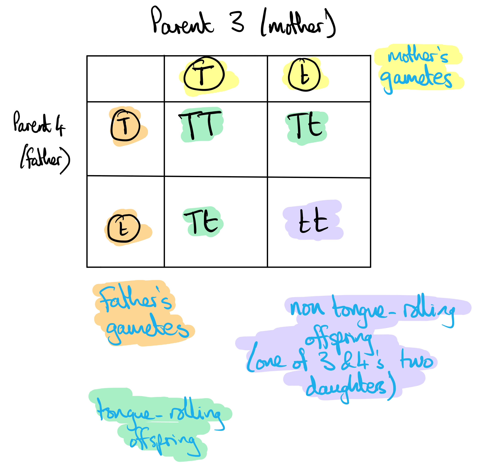

(b) (ii) The possible offspring phenotypes and the prediction of the ratio of phenotypes for the couple's children are as follows:

- Possible offspring genotypes: **Tt **and **tt**; **[1 mark] **
- Ratio of phenotypes: 1:1 / 50:50 etc; **[1 mark]**

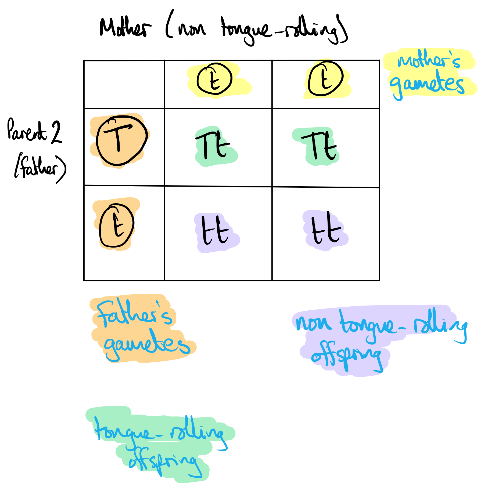

**[Total: 5 marks]**

> *Be sure you know what the question is asking you for. The question requires **genotypes** in your answer. Genotypes are 2-letter abbreviations showing the alleles that an individual possesses for a particular gene. So a genotype of **Tt** means that the owner is heterozygous ie. possesses two different alleles, one dominant and the other recessive. This question has nothing to do with sex chromosomes X and Y. The fact that the photograph in Fig. 2 shows two boys (and no girls) is irrelevant to the answer. *

### Q10
(i) The genotypes of the people identified as **P**, **Q** and **R** in Fig. 1 are...

- **P** = XHXh; **[1 mark]**
- **Q** = XhY; **[1 mark]**
- **R** = XHY; **[1 mark]**

(ii) The probability that the child of **S** and **T** will have haemophilia is...

- 0.25 / 25% / 1/4; **[1 mark]**

(iii) The term sex-linked characteristic refers to...

- A gene located on a sex chromosome; **[1 mark]**
- (The gene being on the sex chromosome means that the) characteristic is more common in one sex than the other; **[1 mark]**

**[Total: 6 marks]**

> *Provided that you have been given the correct information it should be possible to work out an individual's genotype in a pedigree diagram; here we have been told that haemophilia is sex-linked and that it is a recessive condition (indicated by the use of lower-case 'h' to represent haemophilia). You should consider whether an individual is male (XY) or female (XX), whether they are healthy or haemophiliac, and the health of any offspring:*

> *Individual **S** must be heterozygous for haemophilia for the same reason as individual **P**; they are healthy females, meaning that they have two copies of the X chromosome, one of which must be X**H**. They also have a haemophiliac son so their other X chromosome must be X**h**. Individual **T** is a healthy male so must be X**H**Y. In a cross between X**H**X**h** and X**H**Y there is a probability of 0.25 that the child will have haemophilia:*

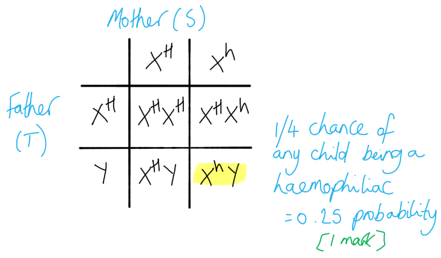

### Q11
(i) The genotype of a heterozygous female carrier is:

- XBXb; **[1 mark]**

(ii) The genotype of a colour-blind male is:

- XbY; **[1 mark]**

(iii) The correct symbol for person **13 **is:

- Solid shaded square; **[1 mark]**

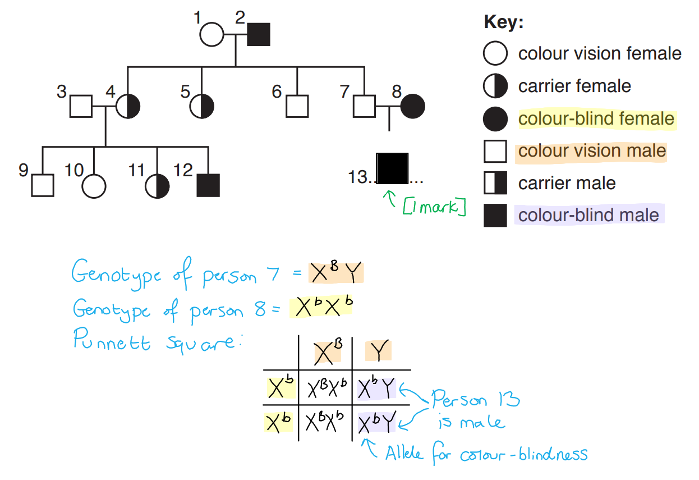

(iv) Females 4 and 5 are carriers even though their mother is not a carrier because:

Any **two **from the following:

- (They would inherit) one X chromosome from each parent / an X chromosome from their father; **[1 mark]**
- (Their) mother does not have any colour-blind alleles / father passes on one colour-blind allele (to them); **[1 mark]**
- (All female offspring would be) heterozygous / XBXb; **[1 mark]**

**[Total: 5 marks]**

> *Remember that it is not possible for there to be a carrier male for sex-linked characteristics because males only have one X chromosome and will therefore always express the allele on their X chromosome, whether it is dominant or recessive.*

### Q12
(i) The genotypes are as follows...

- P = XHXh; **[1 mark]**
- Q = Xh Y; **[1 mark]**
- R = XHY; **[1 mark]**

(ii) The probability that S and T will have a child with haemophilia is...

- 0.25 / 25 % / 1 in 4 / ¼; **[1 mark]**

(iii) Sex-linked can be defined as...

- (A sex-linked) gene is located on a sex chromosome / X or Y chromosome / X / Y ; **[1 mark]**
- (A sex-linked) characteristic is more common in males / in one sex (than the other); **[1 mark]**

**[Total: 6 marks]**

> *Provided that you have been given the correct information it should be possible to work out an individual's genotype in a pedigree diagram; here we have been told that haemophilia is sex-linked and that it is a recessive condition (indicated by the use of lower-case 'h' to represent haemophilia). You should consider whether an individual is male (XY) or female (XX), whether they are healthy or haemophiliac, and the health of any offspring:*

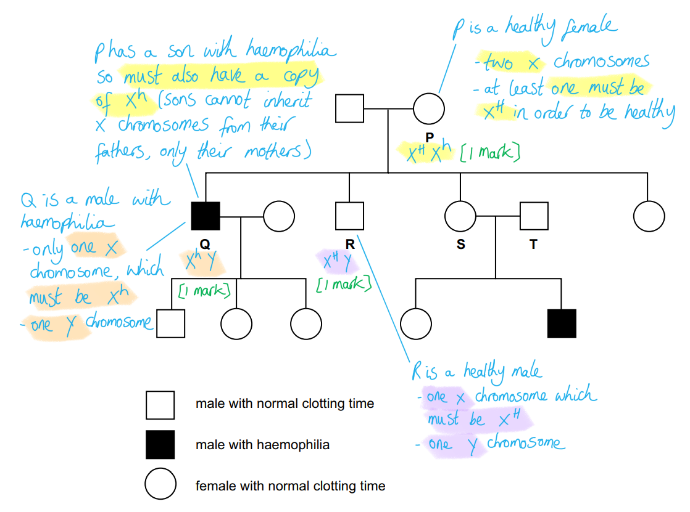

> *Individual S must be heterozygous for haemophilia for the same reason as individual P; they are healthy females, meaning that they have two copies of the X chromosome, one of which must be XH. They also have a haemophiliac son so their other X chromosome must be Xh. Individual T is a healthy male so must be XHY. In a cross between XHXh and XHY there is a probability of 0.25 that the child will have haemophilia:*

> *A sex-linked characteristic is more common in the sex which has only one allele for that gene. In humans and many other species this is males; males have only one X chromosome so will only have one allele got any gene located on the x chromosome.*

### Q13
(i) The evidence visible in the figure (that identifies the cells of *A. cepa* as plant cells) includes:

Any **one **from the following:

- Cell wall; **[1 mark]**
- Cells are a regular shape **OR** cells have (relatively) straight sides; **[1 mark]**
- Vacuole(s) (are present); **[1 mark]**

***Ignore**** references to chloroplasts.*

(ii) The role of mitosis in a shoot tip is:

Any **one **from the following:

- Growth; **[1 mark]**
- Producing cells; **[1 mark]**
- Increase length of shoot / elongation of shoot; **[1 mark]**

**[Total: 2 marks]**

> *There are no chloroplasts **visible** in the micrograph, so the answer ‘chloroplasts’ in part (a) (i) would be **ignored** and would gain no marks.*
Mitochondria have an important role in dividing cells because:

Any **three **from the following:

- Dividing cells / cell division/mitosis needs energy; **[1 mark]**
- (Mitochondria) carry out <u>aerobic respiration</u>; **[1 mark]**
- (Respiration) releases energy; **[1 mark]**
- (For) a named function in dividing cells, e.g. movement of chromosomes **OR** making new cell wall **OR** making new (named) molecules (e.g. protein/DNA) **OR **making (named) organelle(s); **[1 mark]**

***Reject**** references to energy being produced or made.*

**[Total: 3 marks]**

> *One very common misconception amongst students is that mitochondria ‘**produce**’ energy - this goes against the laws of physics and so is **incorrect**! You would **not gain a mark** for this incorrect statement. Mitochondria **RELEASE** energy.*
It is important that only some of the genes in cell **A** are expressed because:

Any **three **from the following:

- Plants have different structures/parts / specialised cells; **[1 mark]**
- Different parts / specialised cells have different functions/roles/features; **[1 mark]**
- Specific/different proteins are required in different parts / specialised cells; **[1 mark]**
- Genes code for proteins; **[1 mark]**
- Therefore/so some genes are required / are not required; **[1 mark]**

***Accept ****for a mark the idea that it is a waste of the plant's/cell's resource(s) if all genes are expressed***.**

**[Total: 3 marks]**

### Q14
The term allele can be defined as...

- A version of a <u>gene</u>; **[1 mark]**

**[Total: 1 mark]**

> *This question covers core knowledge but is taken from a paper 4 (extended content) paper.*
A mutation could result in an abnormal enzyme as follows...

Any **three **of the following:

- (A mutation causes a) change in base (sequence of DNA); **[1 mark]**
- The DNA/gene/base sequence codes for a protein/enzyme; **[1 mark]**
- (Incorrect DNA sequence is transcribed to) mRNA; **[1 mark]**
- (This results in a) different (sequence of) amino acids in protein/polypeptide/enzyme (during translation); **[1 mark]**
- (The mutated/changed) enzyme / active site has a different shape/structure; **[1 mark]**
- (The enzyme / active site is) not complementary to the substrate **OR** enzyme-substrate complexes cannot form **OR** the substrate will not fit into / bind (with the enzyme); **[1 mark]**

**[Total: 3 marks]**

> *Remember that enzymes are specific to their substrate so a change in the active site, however small, could result in a non-functional enzyme.*

> *A common mistake is to confuse DNA structure with the structure of the protein. A mutation changes the base sequence in the DNA which in turn can alter the amino acid sequence of the protein.*
It is possible to achieve this ratio because...

- The allele for dwarfism is recessive/t; **[1 mark]**
- Both parents are heterozygous (so do not express the allele and are themselves tall); **[1 mark]**

**[Total: 2 marks]**

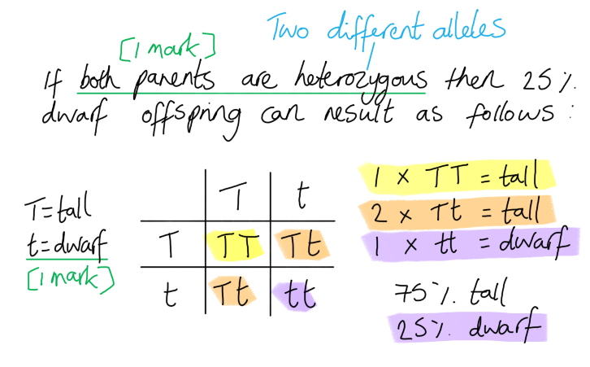

> *This question covers core knowledge taken from a paper 4 (extended content) paper.*
(i) The type of reproduction shown can be explained as follows...

- (These are cuttings which is an example of) <u>asexual reproduction</u>; **[1 mark]**
- (The plantlets/cells/offspring grow by) <u>mitosis</u>; **[1 mark]**
- (This means that) all cells / new plants are <u>genetically identical</u>; **[1 mark]**

(ii) The disadvantages of this type of reproduction include...

Any **three **of the following:

- There will be increased/more competition for resources as all individuals are close together; **[1 mark]**
- There is an increased risk of inheriting harmful alleles/features/traits **OR** any harmful alleles will (always) be passed on to offspring; **[1 mark]**
- (As there is) no/little (genetic) variation; **[1 mark]**
- No new adaptive features (will arise/be introduced into the population); **[1 mark]**
- (This means) no evolution/(natural) selection/artificial selection (can occur); **[1 mark]**
- (No selection means that) there is no/little ability to respond to (named) environmental change; **[1 mark]**
- (No variation means that) all individuals are susceptible to the same diseases/pests; **[1 mark]**
- There will be a higher risk of <u>extinction</u> (in the event of environmental change or disease); **[1 mark]**

**[Total: 6 marks]**

> *When cuttings are taken the offspring are genetically identical to each other and to the parent plant; they are clones. This can be advantageous for gardeners seeking to replicate desirable plant features but means that any resulting plant population will be susceptible to dying out if the environment changes. This is because they will be unable to evolve by natural selection due to their lack of genetic variation.*

### Q15
(i) The number of goats with white fur is:

- Five / 5; **[1 mark]**

(ii) The phenotype of goat **5** will be:

- <u>Black</u> (fur / coat); **[1 mark]**

(iii) Two terms that can be used to describe the genotype of goat **6** would be:

- Homozygous; **[1 mark]**
- Dominant; **[1 mark]**

**[Total: 4 marks]**

> *For part (a) (i), the white allele (**A**) is written as a capital letter, which indicates that it is dominant over the black allele (**a**). This means that any goat containing at least one white (**A**) allele in its genotype will have white fur.*

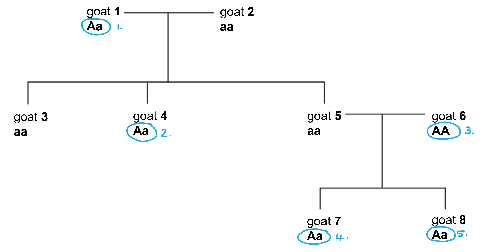

> *For part (a) (ii), the genotype of goat 5 is **aa**, meaning that it has two black alleles for coat colour and will therefore have black fur.*

> *For part (a) (iii), the genotype of goat 6 is **AA**. This means that the goat is homozygous for coat colour, since both alleles are the same (**A**). The alleles are written in capital letters, which means that they are both dominant.*
The type of variation shown by fur colour in these goats is:

- <u>Discontinuous</u> (variation); **[1 mark]**

**[Total: 1 mark]**

> *Discontinuous variation is that which fits into a discrete set of categories. Sometimes the data which tells us about this variation is referred to as being discrete or categorical as well as being discontinuous. Conversely, continuous variation gives data which can have any numerical value on a scale e.g. height.*
The genetic cross can be done as follows:

**Marks are allocated to the following:**

- Male and female gametes: **A** and **a**; **[1 mark]**
- Genotypes of the offspring: **AA**, **Aa**, **Aa**, **aa**; **[1 mark]**
- Phenotypic ratio: 3 (white) : 1 (black); **[1 mark]**

*Error carried forward would apply from the step before.*

**[Total: 3 marks]**

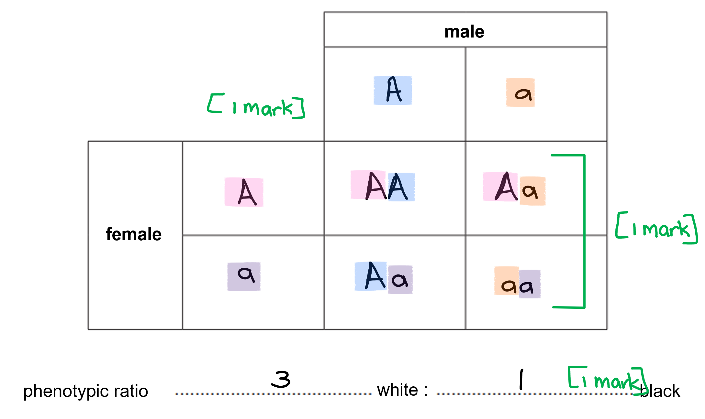
The process a farmer could use to breed a herd of white goats includes:

Any **three **from the following:

- (They could) use selective breeding; **[1 mark]**
- (The farmer should) breed / cross / mate two white goats; **[1 mark]**
- (They should) select the offspring with white coats and breed them again **OR** do not breed the offspring with black coats / remove the black goats from the breeding stock; **[1 mark]**
- (Breeding the white goats) should be done over many/several generations; **[1 mark]**
- To ensure/create a population of (white) goats that are homozygous dominant; **[1 mark]**

**[Total: 3 marks]**

> *For the fourth marking point, you must be specific about the process being repeated over **many generations**. If you just state that the process is repeated you can't get the mark. *

> *By continuously selecting the individuals with the white coat colour to breed ensures that a population of homozygous white goats will be produced over the course of many generations.*

### Q16
The term *allele* means:

- The (two) versions of a gene / the two or more alternative forms of a gene; **[1 mark]**

**[Total: 1 mark]**

> *It is really important you learn the definitions of the key words in inheritance. In this example, all pea plants will have the gene for coloured flowers, but there will be two forms of this gene: one for red flowers and one for white flowers. This is defined as the allele of the gene. *
The dominant allele is:

- (Allele for) red (flowers) / **R**; **[1 mark]**

**[Total: 1 mark]**

> *You can tell that the red allele is the dominant one because all the plant's offspring were red, meaning that this allele was expressed over the white version, which would be recessive in this case. *
(i) A Punnet square for the diagram is:

- All alleles (parent genotypes) correct; **[1 mark]**
- All offspring genotypes correct; **[1 mark]**

(ii) The phenotypic ratio is:

- 3 <u>red</u> : 1 <u>white</u> (colours must be stated); **[1 mark]**

**[Total: 3 marks]**

> *Rr could be shown as rR and still be correct. *

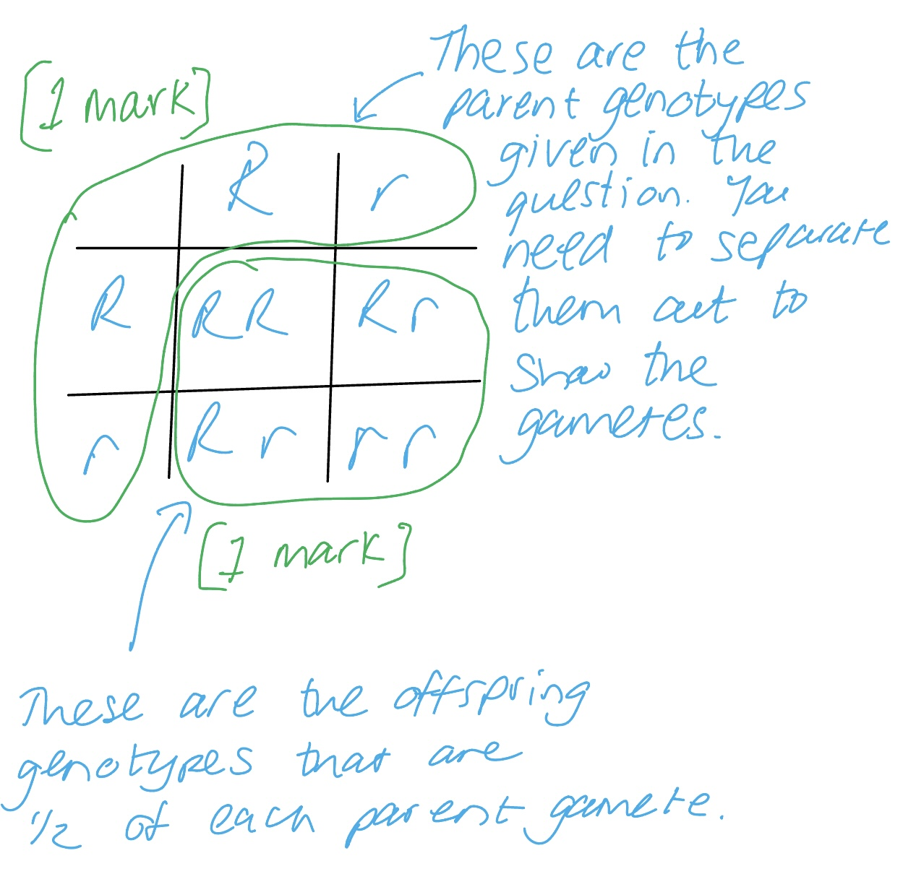

### Q17
There is usually a 1:1 ratio of male babies born to female babies because:

Any **three** from the following:

- Males carry an X & a Y chromosome, females carry 2 X chromosomes; **[1 mark]**
- Males produce half of sperm/gametes carrying X, half carrying Y; **[1 mark]**
- Females produce all eggs/gametes carrying X; **[1 mark]**
- Fertilisation will produce XY or XX with even chances / 50:50 / 50% each; **[1 mark]**

*Allow a suitable Punnett square or genetic diagram to illustrate the answer*

**[Total: 3 marks]**
Processes P and Q in Fig. 1 are:

- P = transcription; **[1 mark]**
- Q = translation; **[1 mark]**

**[Total: 2 marks]**
The items are as follows:

(i) The molecule that leaves the nucleus carrying the genetic code is

- mRNA / messenger RNA; **[1 mark]**

(ii) The cell structure where protein synthesis takes place is:

- Ribosome / ribosomes; **[1 mark]**

(iii) The feature of a DNA molecule that determines the amino acid sequence is:

- Base sequence / triplet code / codon; **[1 mark]**

**[Total: 3 marks]**
The correct words to use to fill the gaps are as follows:

Mitosis is a process of cell **division **in which two **identical **daughter cells are produced. Because these cells all have two copies of each **chromosome**, they are known as **diploid **cells.

Mitosis allows for **repair **of damaged tissues as well as to provide more cells during periods of **growth**.

**[1 mark]** for each correct word in the correct place.

**[Total: 6 marks]**

### Q18
The correctly-completed genotypes in Table 1 are:

| number of individual in Fig. 2 | genotype of individual |
|---|---|
| 1 | bb |
| 2 | Bb |
| 4 | Bb |
| 14 | bb |

**[1 mark]** *for each correct genotype.*

**[Total: 4 marks]**

> *Unless you are crystal clear on the difference between phenotypes and genotypes, this question will be very challenging. The question asks for **genotypes**, so that means pairs of letters like BB, Bb and bb. Phenotypes are the cats' appearances, so not required in your answers!*

- *Individuals 1 and 14 must be bb because they are normal-toed cats, so do not possess the dominant allele B*
- *Individual 2 must be Bb; they have extra toes, so must have **a copy of the dominant allele**, but must **also have a copy of recessive b** in order to produce normal-toed offspring (e.g. individual 7)*
- *Individual 4 must be Bb; they have extra toes so must have dominant allele B, but parent 1 has normal toes, so 4 can only have inherited a single copy of B*

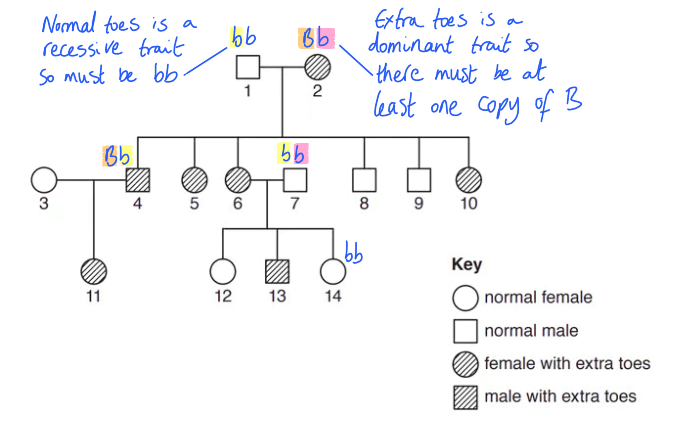

### Q19
The completed diagram is as follows:

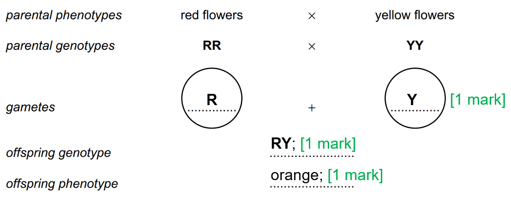

**[Total: 3 marks]**

> *Both **R** and** Y** are required for the parent genotypes mark. *
The completed table is as follows:

|   | genotypes of Offspring |   |
|---|---|---|
| **cross 2** | offspring of **cross 1** × offspring of **cross 1** | **RR, YY, RY**; **[1 mark]** |
| **cross 3** | offspring of **cross 1** × red-flowered plant | **RR, RY**; **[1 mark]** |
| **cross 4** | offspring of** cross 1** × yellow-flowered plant | **YY, RY**; **[1 mark]** |

**[Total: 3 marks]**

> *If you got the answer to part (a) incorrect you can still get marks for error carried forward. *

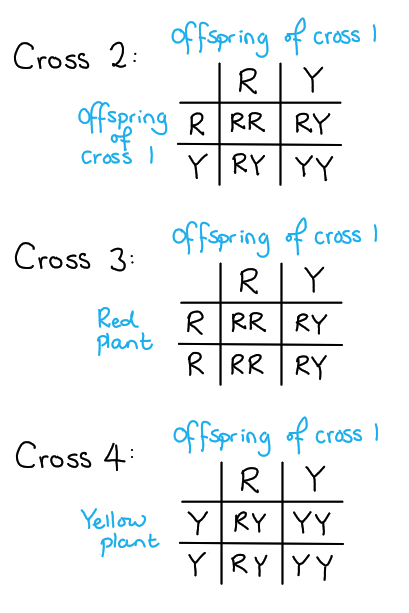
The results of the crosses show that the alleles for flower colour are not dominant or recessive because:

Any **three **from the following:

- Phenotype of **RY** (offspring of **cross 1**) is different from either parent or the homozygous genotypes; **[1 mark]**
- The phenotype was intermediate / mixture of two colours; **[1 mark]**
- Offspring of **cross 2** gives three phenotypes not two; **[1 mark]**
- Offspring of **crosses 3** and **4** both give two phenotypes; **[1 mark]**
- If dominance **cross 3** or **4** would give one phenotype only / incomplete dominance / both alleles are expressed; **[1 mark]**

**[Total: 3 marks]**
