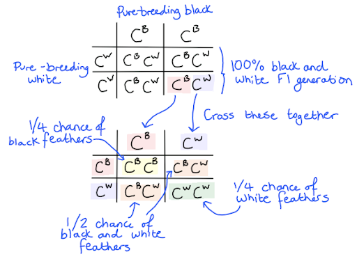
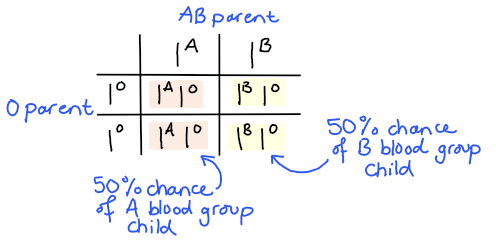

# Mark Schemes — Inheritance, Genes & Cell Division
**17. Inheritance** · Cambridge (CIE) IGCSE biology (0610 & 0970)

## Multiple Choice Questions (36 questions)

### Q1
**Final answer:** **The correct answer is D.**

To determine the probability that any offspring will have long ears:

- Determine the genotypes of both parents:

  - the heterozygous male has genotype **Ee**
  - the female has short ears, which is the recessive phenotype, so she must be homozygous **ee**
- Set up a Punnett square:

|   | **E** | **e** |
|---|---|---|
| **e** | Ee | ee |
| **e** | Ee | ee |

- Count the offspring with long ears:

  - 2 out of 4 offspring have genotype Ee and will therefore have long ears
- Express as a probability:

$\frac{2}{4}$ = $\frac{1}{2}$ = 50 %

### Q2
**Final answer:** **The correct answer is ****D.**

- **Meiosis** is the type of cell division that produces **gametes (sperm and egg cells)**
- During meiosis, the chromosome number is **halved from diploid to haploid**, and the resulting cells are **genetically different from each other**
- This genetic variation is important for **sexual reproduction**

> **[exam-tip]**
> If the question mentions **growth**, **repair** or **asexual reproduction**, the process is **mitosis**. Mitosis produces **genetically identical cells** and keeps the chromosome number the same.
> 
> If the question mentions **gametes** or **sexual reproduction**, the process is **meiosis**. Meiosis produces haploid gametes that are** genetically different**, with half the number of chromosomes as the parent cell.

### Q3
**Final answer:** **The correct answer is ****D.**

- **Messenger RNA (mRNA)** carries genetic instructions from the **nucleus to the cytoplasm**
- A gene remains in the nucleus, but a **copy of the gene is made as mRNA**
- The mRNA moves out of the nucleus to a **ribosome **in the cytoplasm, where it is used to assemble amino acids into a **protein**

**A **is incorrect because DNA remains in the nucleus and does not leave to carry instructions to the cytoplasm.

**B** is incorrect because neurotransmitters are chemical signalling molecules used to transmit impulses between neurones, not to carry genetic information.

**C **is incorrect because ribosomes assemble proteins, but they do not carry genetic instructions from the nucleus.

### Q4
**Final answer:** **The correct answer is ****C.**

- Determine parent genotypes:

Carrier female: **XᴺXᶜ**

Normal male: **XᴺY**

- Complete Punnett square:

|   | **Xᴺ** | **Y** |
|---|---|---|
| **Xᴺ** | XᴺXᴺ (daughter, normal) | XᴺY (son, normal) |
| **Xᶜ** | XᴺXᶜ (daughter, carrier) | XᶜY (son, colour blind) |

- For sons only, look at the Y column (because sons get Y from the father):

**XᴺY** (normal)

**XᶜY** (colour blind)

- So 1 out of 2 sons (**1/2**) are colour blind

**A** is incorrect because one possible son genotype (XᶜY) results in colour blindness.

**B** is incorrect because 1/4 refers to the proportion of all children, not specifically to sons.

**D** is incorrect because only sons that inherit Xᶜ from the mother are colour blind.

> **[exam-tip]**
> If a question asks only about “sons” or “daughters”, only consider the relevant row or column of the Punnett square. A helpful strategy is to identify and highlight the sons or daughters in the Punnett square before doing any calculations. This makes it much easier to avoid errors.

### Q5
**Final answer:** **The correct answer is**** B****.**

- The gene for colour blindness is located on the X chromosome, and it is more common in males due to their having only one X chromosome

**A** is incorrect because the gene for colour blindness is located on the X chromosome, not the Y chromosome, although it is more common in males.

**C** is incorrect because colour blindness is more common in males than in females because females have two X chromosomes, which provides a backup copy of the gene.

**D** is incorrect because the gene for colour blindness is located on the X chromosome, not the Y chromosome, and it is more common in males than in females.

### Q6
**Final answer:** **The correct answer is ****D****.**

- Meiosis allows the formation of new combinations of chromosomes through processes like crossing over and independent assortment.

**A** is incorrect because daughter cells produced by meiosis are genetically diverse, not identical.

**B** is incorrect because meiosis reduces the chromosome number from diploid to haploid, not the other way around. The diploid number is restored at fertilisation when the nuclei of two gametes fuse.

**C** is incorrect because meiosis produces gametes (sex cells), not body cells. Body cells are produced in mitosis.

### Q7
**Final answer:** **The correct answer is ****D****.**

- During transcription, genes are copied onto the mRNA in the nucleus of a cell. These mRNA molecules then leave the nucleus carrying a copy of the gene to the ribosomes in the cytoplasm, where proteins are made.

**A** is incorrect because alleles are different forms of a gene and do not carry copies of genes to the cytoplasm.

**B** is incorrect because, due to the size of the molecule, DNA remains in the nucleus and does not directly travel to the cytoplasm to make proteins.

**C** is incorrect because ribosomes are found in the cytoplasm and are the sites of protein synthesis, they do not carry copies of genes.

### Q8
**Final answer:** **The correct answer is ****B****.**

- This is because sperm cells are haploid, meaning that they contain half the number of chromosomes as a normal cell
- If the pangolin normally has 40 chromosomes then a sperm will have half of this, which is 20 chromosomes

**A** is incorrect because if the gametes each contained 10 chromosomes, when these combine during fertilisation this would result in a cell with 20 chromosomes, not 40.

**C** is incorrect because if the gametes each contained 40 chromosomes, when these combine during fertilisation this would result in a cell with 80 chromosomes, not 40.

**D** is incorrect because if the gametes each contained 50 chromosomes, when these combine during fertilisation this would result in a cell with 100 chromosomes, not 40.

### Q9
**Final answer:** **The correct answer is ****C****.**

- This is because mRNA carries the genetic code from the DNA in the nucleus and carries to the ribosome where the mRNA code is used to join together the amino acids in the correct order to make the protein

**A** and **B** are incorrect because the DNA is not found in the cytoplasm.

**D** is incorrect because amino acids are also needed to make proteins.

### Q10
**Final answer:** **The correct answer is ****A****.**

- This is because the cells in the mother contain two X chromosomes so during meiosis all of the egg cells inherit an X chromosome and therefore must pass that on to the offspring
- The cells in the father contain one X chromosome and one Y chromosome and so during meiosis when the sperm cells are made half of the sperm cells inherit the X chromosome and half the Y so there is a 50% chance the sperm cell that fertilises the egg will cause the offspring to be either male or female

**B** is incorrect because no cells in the mother contain a Y chromosome.

**C** is incorrect because no cells in the mother contain a Y chromosome and some sperm cells in the father will have an Y chromosome.

**D** is incorrect because no cells in the mother contain a Y chromosome and some sperm cells in the father will have an X chromosome.

### Q11
**Final answer:** **The correct answer is ****D****.**

- This is because inheritance is the transmission of genetic information from one generation to the next through the process of reproduction

**A** is incorrect because natural selection involves an element of ‘survival of the fittest’, where some individuals are more likely to survive and reproduce due to having an advantageous trait in comparison to others. This scenario is not described in the question.

**B** is incorrect because fertilisation is the fusion of a male and female gamete during sexual reproduction.

**C** is incorrect because mitosis is when a parent cell divides to produce two identical daughter cells for the purpose of growth, development, or the replacement of old or damaged cells.

### Q12
**Final answer:** **The correct answer is B.**

- Inheritance is the process by which genetic information is passed from parents to offspring from generation to generation.

**A** is incorrect because fertilisation is the process where sperm and egg combine to form a new organism, but it does not refer specifically to the transfer of genetic information across generations.

**C** is incorrect because meiosis is the cell division process that creates sex cells (sperm and eggs) with half the genetic material. While it plays a role in passing genetic information, it is not the term for the overall transfer from generation to generation.

**D** is incorrect because reproduction is the process of producing offspring, but it doesn’t specifically refer to the transmission of genetic information.

### Q13
**Final answer:** **The correct answer is B**

- This is because the F1 chickens are all heterozygous
- The black and white alleles are **codominant** resulting in the black and white phenotype when heterozygous
- Crossing two heterozygous parents will produce the following outcome:

- This results in a 1:2:1 ratio of offspring phenotypes

### Q14
**Final answer:** **The correct answer is D**

- This is because the parents both have AB and O blood groups and the children will have a 50% chance of having the A blood group and a 50% chance of B blood group

**A** is incorrect because there children could have A or AB blood group, which is the same as the parents

**B **is incorrect because the children would all have type A blood, which is the same as each other and one parent

**C **is incorrect because there children could have B or AB blood group, which is the same as the parents

### Q15
**Final answer:** **The correct answer is B**

- This is because after mitosis the number of chromosomes stays the same so the daughter cells should have the same number of chromosomes as the parent cell

**A** is incorrect because during meiosis the number of chromosomes halves but this is not the case for mitosis

**C **is incorrect because there is no scenario in which a small number of extra chromosomes would be produced by mitosis

**D **is incorrect because the chromosome number does not double during mitosis because the cell with replicated DNA is split into two, results in two cells with the correct number of chromosomes

### Q16
**Final answer:** **The correct answer is B**

- This is because messenger RNA makes a copy of the gene and carries it from the nucleus through the cytoplasm to the ribosome
- The DNA cannot leave the nucleus and so the mRNA allows the genetic code to travel to other areas of the cell

**A** is incorrect because the ribosome assembles amino acids into protein molecules

**C **is incorrect because the nucleus controls cell function

**D **is incorrect because messenger RNA is not involved in the duplication for chromosomes before mitosis. This process requires new DNA, not RNA

### Q17
**Final answer:** **The correct answer is A because:**

Heterozygous is when they have two different alleles, H and h

**B** is incorrect because 5 and 6 are both homozygous recessive (hh), not heterozygous.

**C** is incorrect because 2 is homozygous recessive (hh), not heterozygous.

**D** is incorrect because 2, 5 and 6 are all homozygous recessive (hh), not heterozygous.

### Q18
**Final answer:** **The correct answer is B because:**

A male embryo is XY and so the X comes from the egg and the Y from the sperm

**A** is incorrect because the question specifies that the embryo is male and so must be XY, not XX.

**C** and **D** are incorrect because egg cells cannot contain Y chromosomes.

### Q19
**Final answer:** **The correct answer is ****A**** (gene →  DNA strand →  chromosomes →  nucleus) because:**

A gene is the smallest structure of those listed; a gene is a section of a single DNA strand.  DNA coils itself around to form chromosomes; chromosomes are found in the nucleus which is the largest structure.

### Q20
**Final answer:** **The correct answer is ****D**** (group A) because:**

- Blood group inheritance is an example of <u>codominance</u>
- There are three possible alleles that can be inherited; but an individual can only have a maximum of two alleles in their genotype
- Alleles IA and IB  are dominant over IO, so because one parent is homozygous for blood group A, all of the offspring will inherit the **I****A** allele, meaning all the offspring will be in group A (as the partner has a heterozygous genotype with the recessive IO allele

| **Final answer:** ** ** | **Final answer:** **I****A**** ** | **Final answer:** **I****O** |
|---|---|---|
| **Final answer:** **I****A**** ** | **Final answer:** **I****A****I****A** | **Final answer:** **I****A****I****O** |
| **Final answer:** **I****A**** ** | **Final answer:** **I****A****I****A** | **Final answer:** **I****A****I****O** |

### Q21
**Final answer:** **The correct answer is ****D**** (I****B****I****O****) because:**

- Blood group inheritance is an example of **codominance**
- There are three possible alleles for the blood group (but remember a person can inherit a maximum of two alleles per gene)
- Alleles IA and IB  are dominant groups over IO
- Jignasha has two children with a man who has the A blood group phenotype
- Jignasha’s son is blood group B, meaning that Jignasha must have at least one IB allele, as the son's father would not have this allele (the father must be IAIO)
- Jignasha’s daughter’s genotype is not shown, but she has one daughter who is blood type O and one who is blood type A. The child who is blood group O must be IOIO so the allele for IO must have come from Jignasha making her IBIO

It is very important to read and make use of all the information in the question, for example to realise that Jignasha is a female.

### Q22
**Final answer:** **The correct answer is ****B ****(a nucleus containing a single set of chromosomes) because:**

Meiosis is the type of cell division that creates genetically different cells with a haploid number of chromosomes, so that during sexual reproduction a new organism with a diploid number of chromosomes can be made.

**A** is incorrect because this is the definition of diploid. This refers to the somatic (body) cells in an organism (everything but the gametes).

**C** is incorrect because this is a condition known as Turner’s syndrome, where an individual only has one X chromosome.

**D** is incorrect because this is a condition known as Klinefelter syndrome, caused by the inheritance of an extra X chromosome in an XY (male) individual.

### Q23
**Final answer:** **The correct answer is ****A ****because:**

- The production of **gametes** involves meiosis
- Meiosis results in the production of cells with a **haploid number** of chromosomes and with genetic variation (the daughter cells contain a unique combination of alleles compared to the parent cell)
- **Mitosis** produces genetically identical cells with a **diploid number** of chromosomes. This is used for **somatic** (body cell) division in growth and repair; so once the **gametes **have fused to form a **zygote **mitotic cell divisions allow the zygote to form an embryo and then a foetus

The other answers are incorrect as they have not identified the correct stage for mitosis and meiosis.

### Q24
**Final answer:** **The correct answer is ****D**** (Tt x tt) because:**

- Both parents would need to be **carriers** of the **recessive** allele for any of the offspring to be dwarf plants, so this rules out option **C**
- If one parent is homozygous dominant, then all of the offspring will inherit at least one dominant allele in their genotype and therefore have the dominant phenotype
- All offspring would have the dwarf phenotype in the cross in option **A** as the parents can only pass on recessive alleles

This leaves options **B** and **D:**

- In option B each there is only a 0.25 chance that any offspring will have the recessive phenotype

This leaves us with option** D**:

- The ratio produced by crossing the individuals in this option would be 2:2 and so simplified to 1:1.

This is shown in the **Punnett square** below:

| **Final answer:** ** ** | **Final answer:** **T** | **Final answer:** **t** |
|---|---|---|
| **Final answer:** **t** | **Final answer:** **Tt** | **Final answer:** **tt** |
| **Final answer:** **t** | **Final answer:** **Tt** | **Final answer:** **tt** |

### Q25
**Final answer:** **The correct answer is ****C**** (males XY, females XX) because:**

The male sex chromosomes are inherited as an X and a Y chromosomes - the X from the mother and the Y from the father, giving a male the chromosomes XY. A female inherits an X from the mother and another X from the father, giving the chromosomes XX as a female.

### Q26
**Final answer:** **The correct answer is ****B**** (50% TT, 50% Tt) because:**

- The parents have the genotypes TT (homozygous) and Tt (heterozygous)
- The gametes produced by the homozygous dominant individual will all contain the allele ‘T’
- The possible gametes for the heterozygous parent will contain either ‘T’ or ‘t’

|   | **Final answer:** **T** | **Final answer:** **T** |
|---|---|---|
| **Final answer:** **T** | **Final answer:** **TT** | **Final answer:** **TT** |
| **Final answer:** **t** | **Final answer:** **Tt** | **Final answer:** **Tt** |

### Q27
**Final answer:** **The correct answer is ****D**** (100%) because:**

- If both parents have the condition then they will both have the same **genotype**: **homozygous recessive**
- Both parents only have (two) copies of the recessive allele; therefore the gametes formed by **meiosis** in each parent will always contain a recessive allele, therefore the only possible genotype for any offspring from these parents will be homozygous recessive

> *Note - in genetics it is key to know your definitions!*

- **Gene** - section of the chromosome that codes for a particular characteristic
- **Allele** - alternative version of a gene
- **Genotype **-  the genetic make-up of an organism in terms of the alleles present
- **Phenotype **- the observable features (physical characteristics) of an organism
- **Homozygous **- having two identical alleles for the same gene
- **Heterozygous **- has two different alleles for a particular gene

### Q28
**Final answer:** **The correct answer is ****A ****because:**

- Males carry the sex chromosomes **XY** and females carry **XX**
- In order for the sex of the offspring to be a female she will need to inherit an X chromosome from **each** parent
- In order for the sex of the offspring to be a male he will need to inherit an X chromosome from his mother and a Y chromosome from his father
- The mother can only give the offspring an X chromosome so the gamete Q must have the X chromosome
- To be a male son **R** must have the genotype XY

### Q29
**Final answer:** **The correct answer is ****B**** (mitosis producing genetically identical cells) because:**

The question states that two daughter cells are produced, which means the division must be mitotic, and in having the same chromosome number they will be genetically identical (as the daughter cells are genetic copies of the parent cell).

**A** is incorrect because this answer describes the process of **meiosis. **Meiosis produces gametes for sexual reproduction; gametes are genetically different from the parent cell with only a **haploid** (half the amount) number of chromosomes of a normal body cell.

**C** is incorrect because **meiosis **does not produce genetically identical cells

**D** is incorrect because **mitosis** doesn’t produce genetically different cells.

### Q30
**Final answer:** **The correct answer is ****C ****because:**

- Mitosis has one division and produces two genetically identical clones which are diploid and contain the full set of chromosomes
- Meiosis has two divisions and produces four genetically unique cells which are haploid and contain only half the amount of chromosomes

### Q31
**Final answer:** **The correct answer is ****C**** (50%) because:**

- For the daughter to have the condition she would need to inherit two recessive alleles, aa
- To be a girl she will inherit an **X** chromosome from each parent
- There is a 50% chance that she will inherit the recessive allele from her mother
- This is shown in the Punnett square:

| **Final answer:** ** ** | **Final answer:** **X****a** | **Final answer:** **Y** |
|---|---|---|
| **Final answer:** **X****a** | **Final answer:** **X****a****X****a** | **Final answer:** **X****a****Y** |
| **Final answer:** **X****A** | **Final answer:** **X****A****X****a** | **Final answer:** **X****A****Y** |

There is only a 25% chance that the offspring of these parents will be a girl and have the recessive condition, but this is not what the question was asking you, so be sure to read the wording carefully.

### Q32
**Final answer:** **The correct answer is ****D ****because:**

- The cell shown is a sperm cell, a type of **gamete**. Sperm cells are produced by **meiosis**
- **Meiosis** is the type of cell division that creates genetically different cells with a **haploid **number of chromosomes, so that during sexual reproduction two gametes form a cell which becomes a new individual, with a **diploid **number of chromosomes in the nucleus of that cell

**A** is incorrect because this is a white blood cell (and therefore a body cell) it would have a **diploid** number of **chromosomes.**

**B** is incorrect because this looks like a plant cell with chloroplasts and a cell wall, therefore it would not be a gamete.

**C** is incorrect because this is a nerve cell/neurone (and therefore a body cell) which would have a **diploid** number of **chromosomes.**

### Q33
**Final answer:** **The correct answer is ****B ****because:**

|   | t | t |
|---|---|---|
| T | Tt | Tt |
| t | tt | tt |

This is because heterozygous means that there is one dominant and one recessive allele present, Tt. Homozygous means there are two sets of the same allele present, in this case, tt. To complete a genetic diagram you take one of each allele from the corresponding row and column and write them out into the table spaces.

**A** is incorrect because this cross shows a cross between two homozygous parent plants, homozygous recessive tt and homozygous dominant TT.

**C** is incorrect because this shows a cross between two heterozygous parent plants, Tt and Tt.

**D** is incorrect because this shows the same cross as option A between two homozygous parent plants. TT and tt. In this cross, the parent alleles are written the other wat around in the table.

### Q34
**Final answer:** **The correct answer is ****A**** (ribosomes) because:**

The ribosomes are responsible for protein synthesis in all cells. They attach to the** mRNA** released from the **nucleus**. The **ribosome** is then involved in the assembly of the protein from amino acids based on the **sequence of bases** in the **mRNA**.

**B** is incorrect because **chloroplasts** are the site of **photosynthesis.**

**C** is incorrect because **mitochondria **are the site of **aerobic respiration.**

**D** is incorrect because **cell walls **provide support for the cell.

### Q35
**Final answer:** **The correct answer is ****C**** (50%) because:**

- The parent without Huntington’s (non-Huntington’s) must be homozygous recessive (hh)
- The parent with Huntington’s must be heterozygous (Hh) as they have one child without the disease and the sufferer must have passed on a recessive allele

The Punnett square for this will be:

| **Final answer:** ** ** | **Final answer:** **H** | **Final answer:** **h** |
|---|---|---|
| **Final answer:** **h** | **Final answer:** **Hh** | **Final answer:** **hh** |
| **Final answer:** **h** | **Final answer:** **Hh** | **Final answer:** **hh** |

This shows a 50% chance of any child from this cross being a sufferer of the disease.

### Q36
**Final answer:** **The correct answer is ****C**** (The allele for red eyes is dominant) because:**

- Dominant characteristics will show even if a recessive allele is present in the genotype (for example in an heterozygous individual)
- Organisms that are orange-eyed must be recessive as when crossed offspring always have orange-eyes
- In order for there to be a mixture of red and orange-eyed individuals the red-eyed flies must have been heterozygous

If R  = red eyes and r = orange eyes then the Punnett square for two orange-eyed individuals would be:

| **Final answer:** ** ** | **Final answer:** **r** | **Final answer:** **r** |
|---|---|---|
| **Final answer:** **r** | **Final answer:** **rr** | **Final answer:** **rr** |
| **Final answer:** **r ** | **Final answer:** **rr** | **Final answer:** **rr** |

The cross for red-eyed flies would be:

| **Final answer:** ** ** | **Final answer:** **R** | **Final answer:** **r** |
|---|---|---|
| **Final answer:** **R** | **Final answer:** **RR** | **Final answer:** **Rr** |
| **Final answer:** **r ** | **Final answer:** **Rr** | **Final answer:** **rr** |

**A** is incorrect because if the allele for orange eyes was dominant, then the results of the two red-eyed fly cross would be all red eyes and in this case the red eyes trait would be recessive (rr)

**B** is incorrect because the 1:1 ratio would depend on the genotype of the red-eyed fly in the cross and can’t be concluded from the information given.

**D** is incorrect because we do not need to do a cross to find the 3:1 ratio just to find out which of the alleles are dominant.
