# Exam Questions — Inheritance, Genes & Cell Division
**17. Inheritance** · Cambridge (CIE) IGCSE biology (0610 & 0970)
> Source: [https://www.savemyexams.com/igcse/biology/cie/23/topic-questions/](https://www.savemyexams.com/igcse/biology/cie/23/topic-questions/) · 55 questions across 2 sets

## Multiple Choice Questions (36 questions)

### Q1 — hard — 1 marks

**Q1** [1 mark]

Ear length in rabbits is determined by a single gene with two alleles.

- The long ears allele is dominant and is represented by **E**
- The short ears allele is recessive and is represented by **e**

A male rabbit that is heterozygous for ear length mates with a female rabbit with short ears.

What is the probability that any offspring will have long ears?

### Q2 — medium — 1 marks

**Q2** [1 mark]

When gametes are produced, cells undergo division by

### Q3 — easy — 1 marks

**Q3** [1 mark]

What carries genetic instructions from the nucleus to the cytoplasm?

### Q4 — hard — 1 marks

**Q4** [1 mark]

Red–green colour blindness is caused by a recessive allele on the X chromosome.

A carrier female (XᴺXᶜ) and a normal male (XᴺY) have children.

What proportion of their sons will be colour blind?

### Q5 — medium — 1 marks

**Q5** [1 mark]

Colour blindness is a characteristic that is sex-linked.

Which statement about colour blindness is correct?

*Source: June 2021 0970/21 Q33*

### Q6 — easy — 1 marks

**Q6** [1 mark]

Which statement about meiosis is correct?

*Source: June 2021 0970/21 Q33*

### Q7 — medium — 1 marks

**Q7** [1 mark]

What carries a copy of the gene to the cytoplasm to make a protein?

*Source: June 2021 0970/21 Q32*

### Q8 — easy — 1 marks

**Q8** [1 mark]

Pangolins are mammals. One species of pangolin has 40 chromosomes per body cell.

How many chromosomes will a sperm cell from this species of pangolin have?

*Source: june 2022 paper 2 Q31*

### Q9 — medium — 1 marks

**Q9** [1 mark]

What is needed in the cytoplasm to make proteins at a ribosome?

*Source: June 2022 paper 2 Q30*

### Q10 — medium — 1 marks

**Q10** [1 mark]

A student used a diagram to explain the inheritance of sex in humans.

Which statements should she use to complete boxes 1 and 2?

|   | box 1 | box 2 |
|---|---|---|
| **A** | all have an X chromosome | half have an X chromosome and half have a Y chromosome |
| **B** | all have a Y chromosome | half have an X chromosome and half have a Y chromosome |
| **C** | half have an X chromosome and half have a Y chromosome | all have an X chromosome |
| **D** | half have an X chromosome and half have a Y chromosome | all have a Y chromosome |

*Source: June 2022 Paper 1 Q34*

### Q11 — easy — 1 marks

**Q11** [1 mark]

Beak shape in birds is controlled by genes passed from the parent birds to their offspring.

What is this an example of?

*Source: June 2022 Paper 1  Q33*

### Q12 — easy — 1 marks

**Q12** [1 mark]

What is the transmission of genetic information from generation to generation called?

*Source: June 2021 0970/11 Q33*

### Q13 — hard — 1 marks

**Q13** [1 mark]

Pure-breeding black-feathered chickens are mated with pure-breeding white-feathered chickens. All of the offspring (F1 generation) have black feathers **and **white feathers.

When two of the F1 generation chickens are crossed, what will be the ratios of offspring phenotypes?

*Source: Specimen 2023 0970/02 Q33*

### Q14 — hard — 1 marks

**Q14** [1 mark]

A man marries a woman who has a different blood group from him. They have two children. The children have different blood groups from each other and different blood groups from their parents.

What are the genotypes of the parents’ blood groups?

*Source: Specimen 2023 0970/02 Q32*

### Q15 — medium — 1 marks

**Q15** [1 mark]

The diagram shows the cell of an organism. The nucleus contains 12 chromosomes.

After this cell divides by mitosis, how many chromosomes would be present in one of the daughter cells?

*Source: Specimen 2023 0970/02 Q31*

### Q16 — easy — 1 marks

**Q16** [1 mark]

What is the role of messenger RNA (mRNA)?

*Source: Specimen 2023 0970/02 Q30*

### Q17 — easy — 1 marks

**Q17** [1 mark]

The genetic diagram shows a monohybrid cross.

H is the dominant allele and h is the recessive allele.

Which of the parents and offspring are heterozygous?

*Source: Specimen 2023 0970/01 Q32*

### Q18 — medium — 1 marks

**Q18** [1 mark]

The information shows what happens during some of the stages of sexual reproduction in a human.

egg + sperm → fertilised egg → male embryo

Which sex chromosomes are present in the egg, sperm and fertilised egg shown?

|   | egg | sperm | fertilised egg |
|---|---|---|---|
| **A** | X | X | XX |
| **B** | X | Y | XY |
| **C** | Y | X | XY |
| **D** | Y | Y | YY |

*Source: Specimen 2023 0970/01 Q31*

### Q19 — easy — 1 marks

**Q19** [1 mark]

Which shows the correct size order of structures, starting with the smallest?

### Q20 — hard — 1 marks

**Q20** [1 mark]

#### Extended only

ABO blood groups are an inherited characteristic.

What would the blood group of the offspring be when two parents have the genotypes IAIA and IAIO?

### Q21 — hard — 1 marks

**Q21** [1 mark]

#### Extended only

The diagram shows the inheritance of ABO blood groups in the family.

What could be Jignasha’s genotype?

### Q22 — easy — 1 marks

**Q22** [1 mark]

#### Extended

What does the term haploid mean?

### Q23 — medium — 1 marks

**Q23** [1 mark]

#### Extended only

The diagram below shows the process of sexual reproduction.

Which of the processes are shown by stages **Q **and **R**?

|   | **Q** | **R** |
|---|---|---|
| **A** | meiosis | mitosis |
| **B** | mitosis | mitosis |
| **C** | meiosis | meiosis |
| **D** | mitosis | meiosis |

### Q24 — hard — 1 marks

**Q24** [1 mark]

A farmer is growing pea plants; the allele for tall plants is T and is dominant to the allele for dwarf plants, t.

She wants to know what cross she would need to carry out to produce a ratio of 1:1 tall to dwarf plants?

### Q25 — easy — 1 marks

**Q25** [1 mark]

Males and females have a unique set of chromosomes.

What is the correct combination of male and female chromosomes?

### Q26 — medium — 1 marks

**Q26** [1 mark]

Two individuals are crossed. One is homozygous dominant (TT), the other heterozygous.

What will the genotypes of the offspring be?

### Q27 — medium — 1 marks

**Q27** [1 mark]

Albinism is a condition where the pigment melanin does not get produced in the skin, hair and eyes. This is an inherited condition that is caused by a recessive allele.

If both parents have albinism what are the chances of the offspring being an albino child?

### Q28 — hard — 1 marks

**Q28** [1 mark]

The diagram shows how the sex of the offspring can be determined.

What are the sex chromosomes in gamete **Q** and the son **R**?

|   | **Q** | **R** |
|---|---|---|
| **A** | X | XY |
| **B** | X | XX |
| **C** | Y | XY |
| **D** | Y | XX |

### Q29 — easy — 1 marks

**Q29** [1 mark]

#### Extended only

When a somatic (body) cell undergoes cell division, two daughter cells are produced with the same chromosome number as the parent cell.

Which type of division has taken place?

### Q30 — hard — 1 marks

**Q30** [1 mark]

#### Extended

Which row in the table shows a comparison between meiosis and mitosis?

|   | mitosis | meiosis |
|---|---|---|
| **A** | produces 4 daughter cells | produces 2 daughter cells |
| **B** | produces genetically identical cells | produces cloned cells |
| **C** | daughter cells are diploid | daughter cells are haploid |
| **D** | two cell division occur | four cell divisions occur |

### Q31 — hard — 1 marks

**Q31** [1 mark]

#### Extended only

The diagram shows the sex chromosomes of a woman and a man. This also shows the alleles for a recessive sex-linked condition.

What is the percentage chance that their daughter will show the sex-linked condition?

### Q32 — medium — 1 marks

**Q32** [1 mark]

#### Extended only

New cells are formed by the division of existing cells.

The diagram below shows four different cells.

Which one is formed by meiosis?

### Q33 — easy — 1 marks

**Q33** [1 mark]

A tall pea plant is crossed with a short pea plant. The tall gene is dominant over the short gene. The tall plant is heterozygous. The short plant is homozygous recessive

Which is the correct genetic diagram for this cross?

### Q34 — medium — 1 marks

**Q34** [1 mark]

#### Extended only

Which of the following structures in plant cells carry out protein synthesis under the control of the nucleus?

### Q35 — hard — 1 marks

**Q35** [1 mark]

The inheritance of Huntington's disease is determined by a single gene. This gene has a dominant allele and a recessive allele. The allele for Huntington’s is dominant to the allele for non-sufferers of the condition.

The diagram shows the inheritance of Huntington’s in a family.

What is the probability that the next child from the same parents will have Huntington’s?

### Q36 — hard — 1 marks

**Q36** [1 mark]

Fruit flies can have orange or red eyes.

If two orange flies are crossed, all of the offspring will have orange eyes.

If two red eyed fruit flies are crossed, the offspring have either orange or red eyes.

What can be concluded from these observations?

## Theory Questions (19 questions)

### Q1 — hard — 9 marks

**Q1** [2 marks]

A farmer is responsible for managing a large herd of cattle. Within the herd, some cattle naturally grow horns whilst others do not. Cattle that do not grow horns are described as polled. The allele for being polled (P) is dominant over the allele for having horns (p).

Define the following terms.

(i) Allele

[1]

(ii) Heterozygous

[1]

**Q1** [4 marks]

**Extract:**

A farmer is responsible for managing a large herd of cattle. Within the herd, some cattle naturally grow horns whilst others do not. Cattle that do not grow horns are described as polled. The allele for being polled (P) is dominant over the allele for having horns (p).

The farmer crossed a heterozygous, polled cow with a horned bull.

Draw a genetic diagram to predict the genotypes and phenotypes of the offspring.

**Q1** [3 marks]

The farmer wished to develop a new herd of cattle capable of producing a higher milk yield than the current herd.

Describe the process of selective breeding that the farmer would carry out to achieve this.

### Q2 — medium — 13 marks

**Q2** [3 marks]

Chloride ions also move along the pancreatic duct.

CFTR proteins in the cells lining the pancreatic duct move chloride ions out of the cells into the duct.

Fig. 3.2 is a diagram of a cell from the lining of the pancreatic duct showing the location and activity of CFTR proteins.

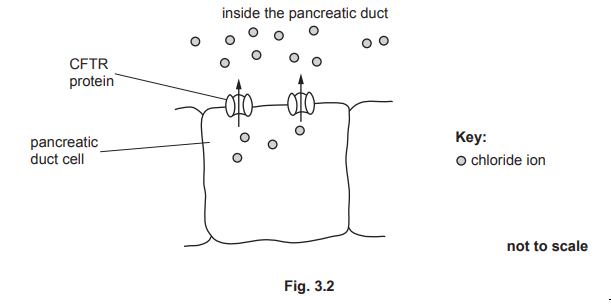

Explain how CFTR proteins move chloride ions across the membrane of the cell shown in Fig. 3.2.

*Source: June 2022 0610/41 Q3C*

**Q2** [3 marks]

**Extract:**

Chloride ions also move along the pancreatic duct.

CFTR proteins in the cells lining the pancreatic duct move chloride ions out of the cells into the duct.

The movement of chloride ions into the pancreatic duct causes water to move from the cells into the duct to help the flow of liquid in the duct.

Explain how water moves from the cell shown in Fig. 3.2 into the pancreatic duct.

*Source: June 2022 0610/41  Q3D*

**Q2** [7 marks]

If CFTR proteins do not move chloride ions, the liquid in the pancreatic duct becomes very sticky and the duct can become blocked.

Blocked pancreatic ducts are one effect of cystic fibrosis, which is an inherited disease. Cystic fibrosis is caused by a mutation of the gene that codes for the CFTR protein.

Fig. 3.3 shows the pedigree diagram of a family that has two people who have cystic fibrosis.

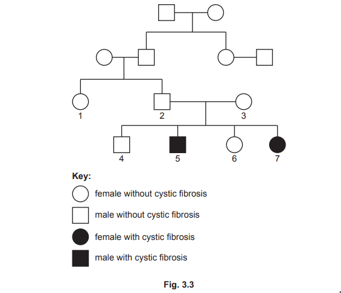

(i)

The allele that causes cystic fibrosis is a recessive allele.

Describe **and **explain the evidence shown in Fig. 3.3 that cystic fibrosis is caused by a recessive allele.

[2]

(ii)

Person 7 is expecting a child with a man who is heterozygous for cystic fibrosis.

Complete the genetic diagram to predict the probability of person 7 and the heterozygous man having a child with cystic fibrosis.

Use the symbol A for the dominant allele and a for the recessive allele.

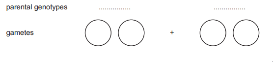

genotypes of offspring .....................................................................

phenotypes of offspring .....................................................................

probability of having a child with cystic fibrosis ...................................

[5]

*Source: June 2022 0610/41  Q3E*

### Q3 — medium — 9 marks

**Q3** [2 marks]

The inheritance of coat texture in guinea pigs is controlled by a single gene.

Define the term gene.

*Source: June 2022 paper 3 Q3A*

**Q3** [3 marks]

Fig. 3.1 shows a photograph of a guinea pig with a rough coat and a guinea pig with a smooth coat.

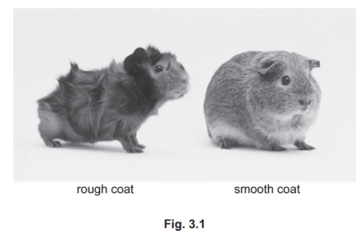

The allele for a rough coat is dominant and represented by the letter R.

The allele for a smooth coat is recessive and represented by the letter r.

Fig. 3.2 is a pedigree diagram showing the inheritance of coat texture in some guinea pigs.

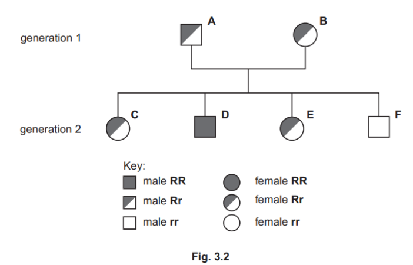

(i) State the total number of guinea pigs with smooth coats in Fig. 3.2.

[1]

(ii) State the letter of a guinea pig that has a homozygous dominant genotype in Fig. 3.2.

[1]

(iii) State the total number of male guinea pigs in Fig. 3.2.

[1]

*Source: June 2022 paper 3 Q3B*

**Q3** [3 marks]

**Extract:**

The allele for a rough coat is dominant and represented by the letter R. The allele for a smooth coat is recessive and represented by the letter r.

Two guinea pigs are bred together

- The genotype of the male guinea pig is **RR**
- The genotype of the female guinea pig is **Rr**.

Complete Fig. 3.3 to show the:

- possible genotypes of the offspring from this cross
- the probability of offspring having a smooth coat

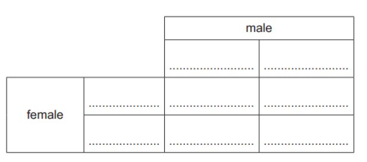

probability of offspring having a smooth coat .....................................................

**Fig. 3.3**

*Source: june 2022 paper 3 Q3C*

**Q3** [1 mark]

Complete the sentence about breeding.

Two identical homozygous individuals that breed together will be

..................................................... -breeding.

*Source: june 2022 paper 3 Q3D*

### Q4 — medium — 6 marks

**Q4** [6 marks]

Haemophilia is a sex-linked blood disorder. The blood of people with haemophilia takes longer to clot.

Fig. 3.3 is a pedigree diagram showing the inheritance of haemophilia.

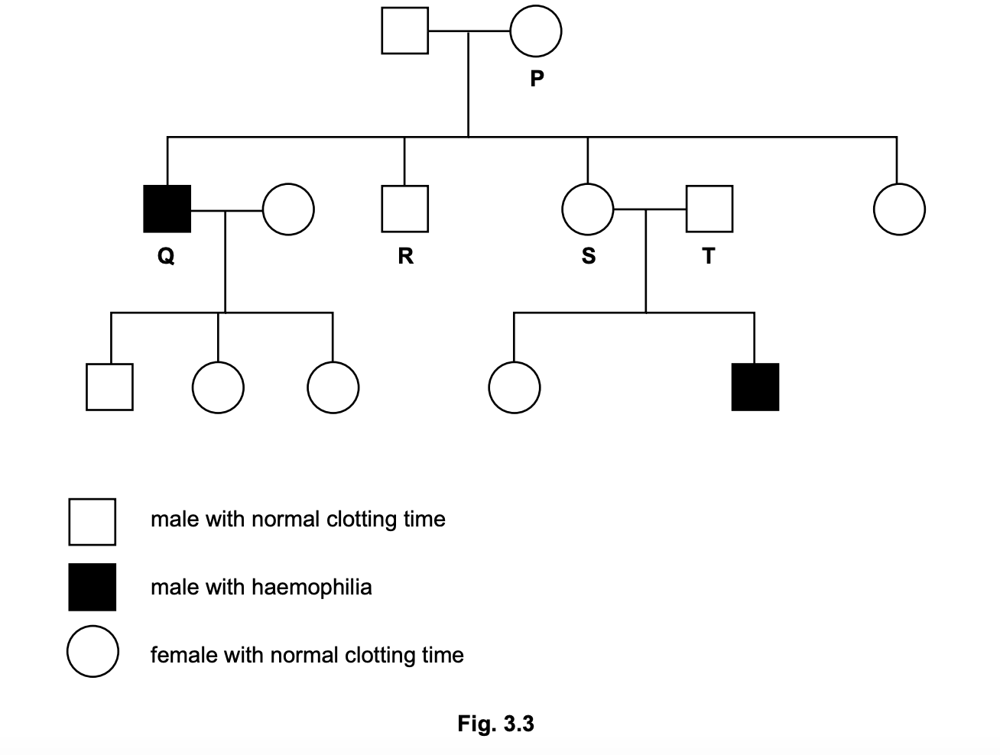

- The allele for normal clotting time is represented by XH.
- The allele for haemophilia is represented by Xh .

(i)

State the genotypes of the people identified as P, Q and R in Fig. 3.3.

**P **..............................................................................................................................

**Q** ..............................................................................................................................

**R **...............................................................................................................................

[3]

(ii)

The couple S and T are expecting another child.

State the probability that the child will have haemophilia.

[1]

(iii)

Describe what is meant by the term sex-linked characteristic.

[2]

*Source: Specimen 2023 0970/04 Q3C*

### Q5 — easy — 3 marks

**Q5** [3 marks]

Sperm contain chromosomes. Chromosomes contain genes.

(i) 
State all the possible sex chromosomes that normal sperm can contain

. [1]

(ii) 
Complete the definition of the term gene. Use words from the list. Each word can only be used once or not at all

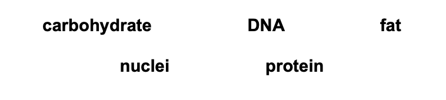

A gene is a length of ........................................ that codes for a .......................................

[2]

*Source: Specimen 2023 0970/03 Q5D*

### Q6 — easy — 3 marks

**Q6** [3 marks]

A farmer identified two goats to breed together.

• The genotype of the male goat is Aa.

• The genotype of the female goat is Aa.

Complete the Punnett square and the phenotypic ratio for this cross

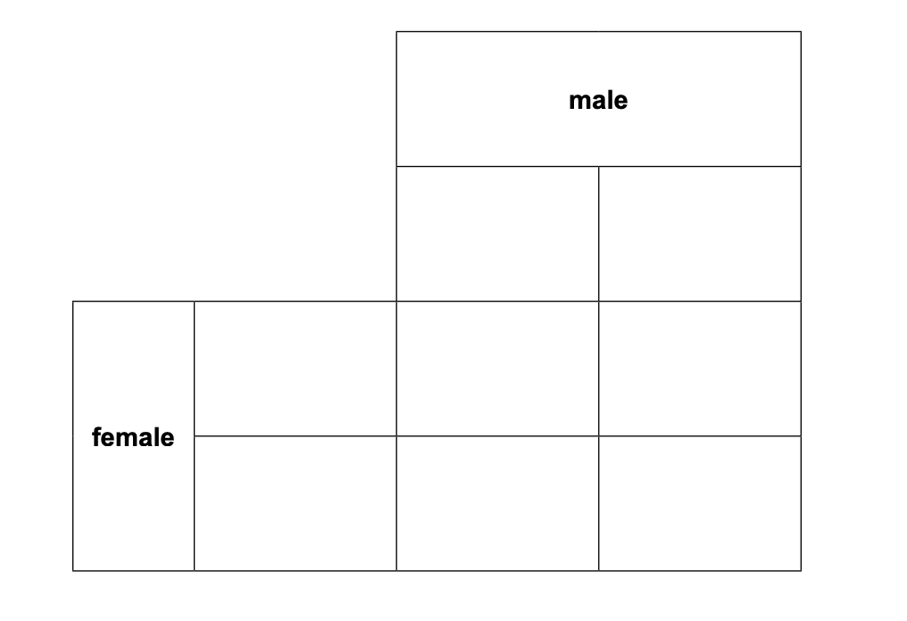

phenotypic ratio ....................................... white : ....................................... black

*Source: Specimen 2023 0970/03 Q3C*

### Q7 — medium — 13 marks

**Q7** [2 marks]

Organisms pass on their genetic information in their gametes.

(i)

State the name of the type of cell division that produces gametes.

[1]

(ii)

State the name of the cell formed when the nuclei of two gametes join together.

[1]

*Source: 2018 (Series 3) 0610/33 Q6A*

**Q7** [3 marks]

A rabbit that was homozygous for black fur was crossed with a rabbit that was homozygous for brown fur.

All of their offspring had black fur.

This is shown in Fig. 1.

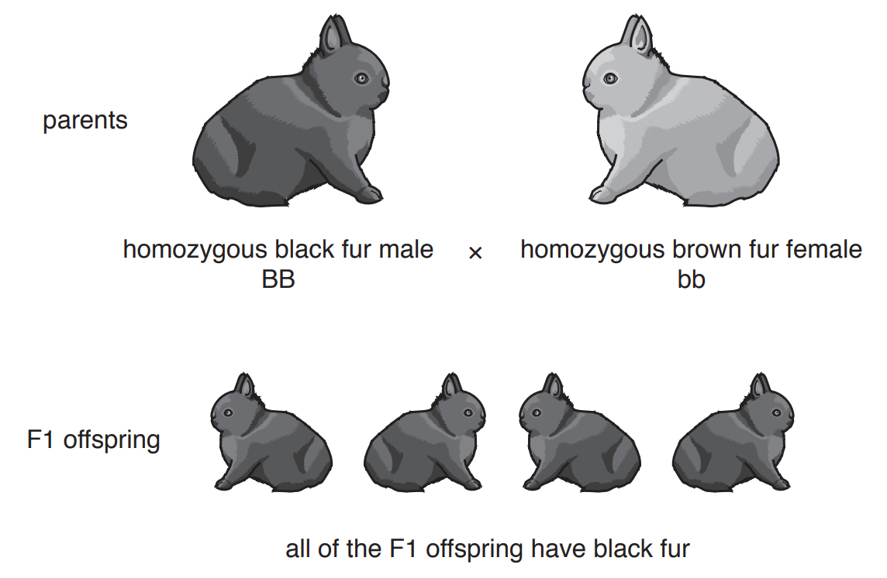

**Fig. 1**

(i)

Define the term* homozygous*.

[1]

(ii)

State the dominant allele for the rabbits' fur colour **and** give a reason for your answer.

[2]

*Source: 2018 (Series 3) 0610/33 Q6B*

**Q7** [1 mark]

The F1 offspring all have the same phenotype as the male parent but their genotype is not the same as the male parent.

State how the phenotype of an organism is different to its genotype.

*Source: 2018 (Series 3) 0610/33 Q6C*

**Q7** [4 marks]

**Extract:**

A rabbit that was homozygous for black fur was crossed with a rabbit that was homozygous for brown fur. All of their offspring had black fur. When the two rabbits are crossed all of the offspring will have the genotype Bb (they will be heterozygous), and the fact that all of these rabbits have black fur tells us that the allele for black fur (B) must be dominant over the allele for brown fur (b). The dominant allele for fur colour is: B/black; All of the offspring have black fur / brown fur not seen in offspring.

A rabbit with brown fur is mated with one of the F1 rabbits with black fur.

Complete the genetic diagram to show the possible fur colours that could occur from this mating.

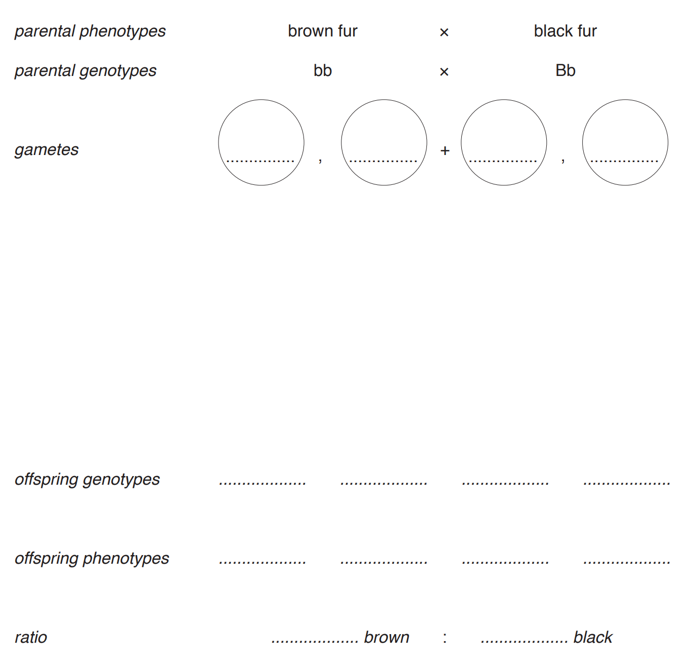

*Source: 2018 (Series 3) 0610/33 Q6D*

**Q7** [3 marks]

New breeds of rabbits can be produced by selective breeding.

Describe the stages in the process of selective breeding.

*Source: 2018 (Series 3) 0610/33 Q6E*

### Q8 — medium — 10 marks

**Q8** [1 mark]

The Indian muntjac deer, *Muntiacus muntjak*, is recorded as the mammal with the lowest number of chromosomes.

Fig. 1 is an image of the chromosomes in the nucleus of a diploid cell of a female muntjac deer.

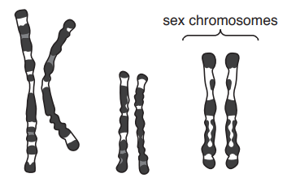

**Fig 1**

State the diploid number of chromosomes for the female muntjac deer.

*Source: 2018 0610/43 Q2A*

**Q8** [2 marks]

**Extract:**

Fig. 1 is an image of the chromosomes in the nucleus of a diploid cell of a female muntjac deer.

Fig. 2 is an image of the chromosomes in the nucleus of a diploid cell of a male muntjac deer.

Fig. 2 is an image of the chromosomes in the nucleus of a diploid cell of a male muntjac deer.

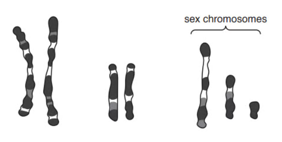

**Fig 2**

Describe how the sex chromosomes of the male muntjac deer shown in Fig. 2 differ from those of the female shown in Fig. 1.

*Source: 2018 0610/43 Q2B*

**Q8** [4 marks]

#### Extended only

Explain how meiosis can result in variation in a species.

Use the words **chromosome** and **gametes** in your answer.

*Source: 2018 0610/43 Q2C*

**Q8** [3 marks]

Another cause of variation is the formation of new alleles.

Describe how new alleles can be formed.

*Source: 2018 0610/43 Q2D*

### Q9 — hard — 8 marks

**Q9** [3 marks]

#### Extended only

Fig. 1 shows the sequence of events that occur in sexual reproduction.

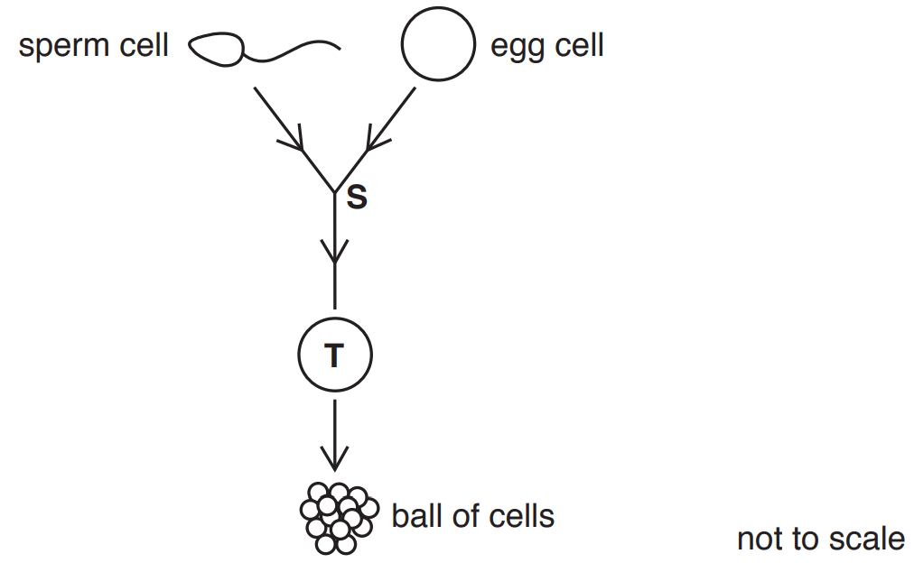

**Fig 1**

(i)

State the name of cell **T** in Fig. 1.

[1]

(ii)

State the name of the process that takes place at **S **to form cell **T **in Fig. 1.

[1]

(iii)

State where in the human body process **S **takes place.

[1]

*Source: 2018 0610/32 Q6A*

**Q9** [5 marks]

Some humans have the ability to roll their tongues and some cannot roll their tongues.

This characteristic is controlled by genes.

Fig. 2 shows two boys: boy **A **cannot roll his tongue and boy **B **can roll his tongue.

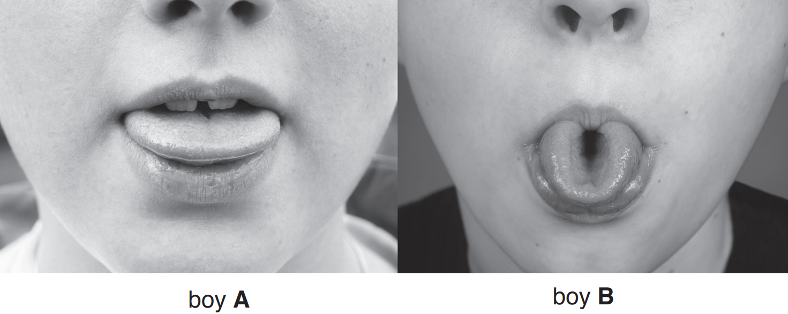

**Fig. 2**

The allele for tongue rolling (**T**) is dominant to the allele for non-tongue rolling (**t**).

Fig. 3 shows a family tree for this characteristic. Individual **1 **and his partner are both heterozygous for tongue rolling.

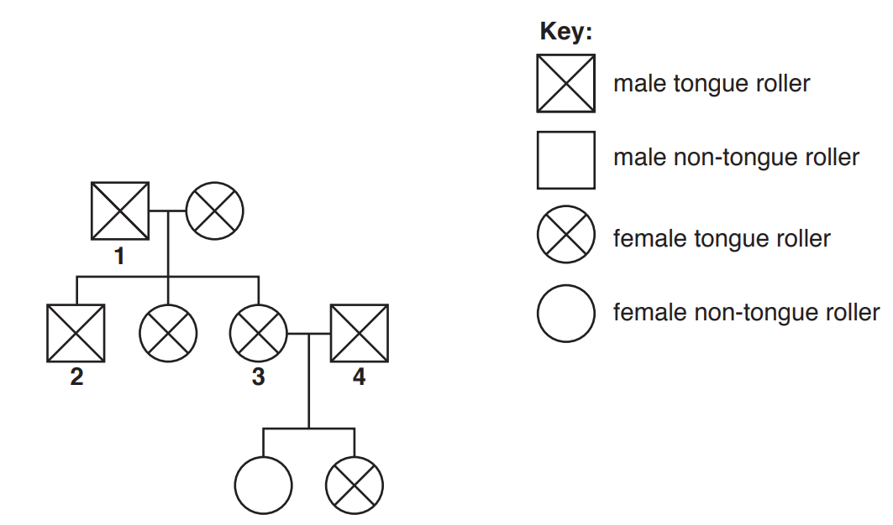

**Fig. 3**

(i)

Complete Table 1 by inserting the genotypes of the numbered individuals in Fig. 3.

**Table 1**

| Individual | Genotype |
|---|---|
| **1** |   |
| **3** |   |
| **4** |   |

[3]

(ii)

Individual 2 in Fig. 3 is heterozygous for tongue rolling. He marries a woman who cannot roll her tongue.

State all of the possible genotypes of their children and predict the ratio of phenotypes for their children.

Possible offspring genotypes: .............................................

Ratio of phenotypes: ..............................................................

[2]

*Source: 2018 0610/32 Q6B*

### Q10 — medium — 6 marks

**Q10** [6 marks]

#### Extended only

Haemophilia is a sex-linked blood disorder. The blood of people with haemophilia takes longer to clot.

Fig. 1 is a pedigree diagram showing the inheritance of haemophilia.

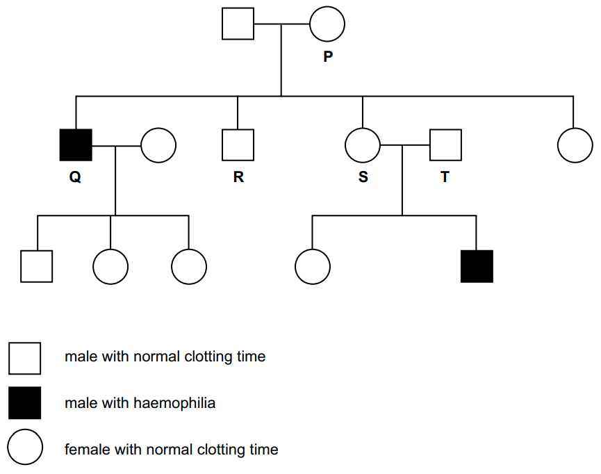

**Fig. 1**

- The allele for normal clotting time is represented by **X****H**.
- The allele for haemophilia is represented by **X****h**.

(i)

State the genotypes of the people identified as **P**, **Q** and **R** in Fig. 1.

[3]

(ii)

The couple **S** and **T** are expecting another child.

State the probability that the child will have haemophilia.

[1]

(iii)

Describe what is meant by the term** sex-linked characteristic**.

[2]

*Source: 2023 970/04 Q3C*

### Q11 — hard — 5 marks

**Q11** [5 marks]

#### Extended only

Some people inherit colour blindness and cannot identify certain colours, even in bright light.

The gene responsible for colour vision is located on the X chromosome.

There are two alleles for this gene on the X chromosome:

- XB – normal colour vision
- Xb – colour blindness.

(i)

People that are heterozygous for colour blindness are called carriers.

State the genotype of a heterozygous female carrier.

[1]

(ii)

There is no gene for colour vision on the male sex chromosome.

State the genotype of a colour-blind male.

[1]

Fig. 1 shows a pedigree diagram for colour blindness.

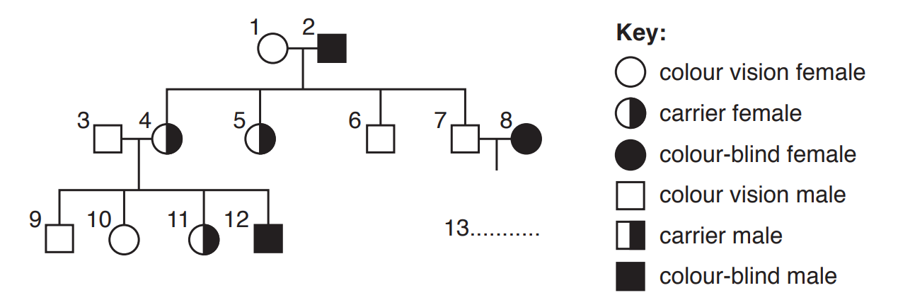

**Fig. 1**

(iii)

Person **13** in Fig. 1 is male. His parents are person **7** and person **8**.

Use the key to complete Fig. 1 by drawing the correct symbol for person **13**.

[1]

(iv)

Colour blindness is a sex-linked characteristic.

Explain why females **4** and **5** are carriers even though their mother is not a carrier.

[2]

*Source: 2018 (Series 1) 0610/41 Q4D*

### Q12 — hard — 6 marks

**Q12** [6 marks]

#### Extended only

Haemophilia is a sex-linked blood disorder in which blood takes a long time to clot.

Fig. 1 is a pedigree diagram showing the inheritance of haemophilia.

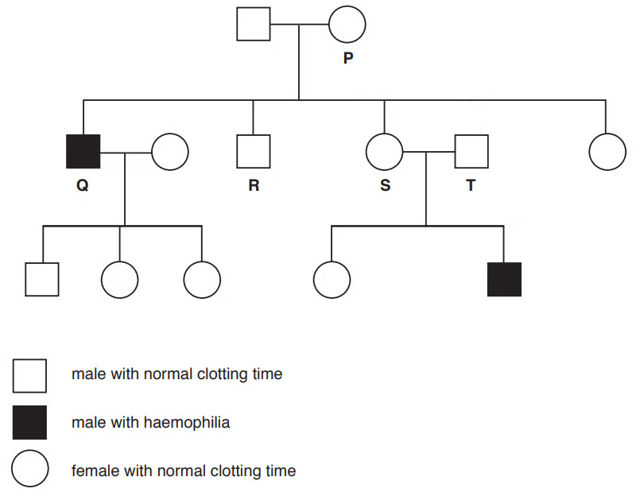

**Fig. 1**

The normal allele is represented by **X****H** and the mutant allele is represented by **X****h**.

(i)

State the genotypes of the people identified as **P**,** Q** and **R** in Fig. 1.

[3]

(ii)

The couple **S **and **T** are expecting another child.

What is the probability that the child will have haemophilia?

Space for working is provided for this question.

[1]

(iii)

Define the term *sex-linked* characteristic.

[2]

*Source: 2018 0610/42 Q5C*

### Q13 — medium — 8 marks

**Q13** [2 marks]

#### Extended only

Fig. 1 shows some cells from the shoot tip of an onion, *Allium cepa*.

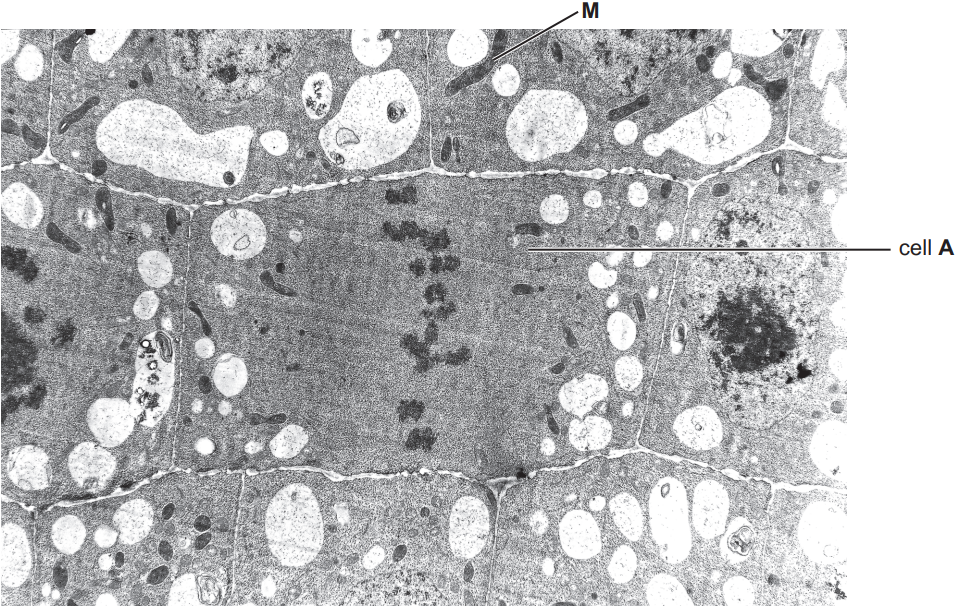

**Fig. 1**

(i)

State the evidence visible in Fig. 1 that identifies the cells of *A. cepa* as plant cells.

[1]

(ii)

Cell **A** is dividing by mitosis.

State the role of mitosis in a shoot tip.

[1]

*Source: 2019 0970/41 Q6A*

**Q13** [3 marks]

#### Extended only

In Fig. 1, the area labelled **M** is a mitochondrion.

Explain why mitochondria have an important role in dividing cells.

*Source: 2019 0970/41 Q6B*

**Q13** [3 marks]

#### Extended only

Some cells in shoot tips become leaf cells and others become cells in the stem or in flowers.

Explain why it is important that only some of the genes in cell **A** are expressed in these cells.

*Source: 2019 0970/41 Q6D*

### Q14 — medium — 12 marks

**Q14** [1 mark]

Fig. 1 shows a dwarf sunflower and a tall sunflower, *Helianthus annuus*.

The height of the dwarf sunflower is 0.45 m and the height of the tall sunflower is 4.5 m.

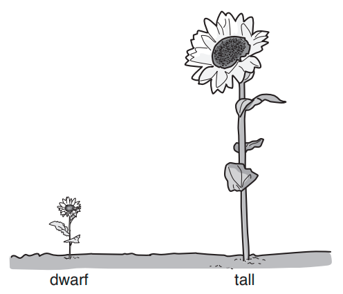

**Fig. 1**

Dwarf plants like the one in Fig. 1 have mutant alleles.

Define the term *allele*.

*Source: 2018 0610/42 Q2A*

**Q14** [3 marks]

**Extract:**

Shoot growth in plants is controlled by auxins. An enzyme in shoot tips converts molecules of an amino acid into auxins as shown in Fig. 2.

amino acid --(enzyme)--> auxin

#### Extended only

Shoot growth in plants is controlled by auxins. An enzyme in shoot tips converts molecules of an amino acid into auxins as shown in Fig. 2.

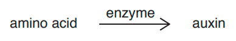

**Fig. 2**

Explain how a mutation in DNA results in an abnormal enzyme which does **not** catalyse the reaction shown in Fig. 2.

*Source: 2018 0610/42 Q2B*

**Q14** [2 marks]

**Extract:**

It is possible to achieve this ratio because...

- The allele for dwarfism is recessive/t; [1 mark]
- Both parents are heterozygous (so do not express the allele and are themselves tall); [1 mark]

T = tall
t = dwarf

If both parents are heterozygous then 25% dwarf offspring can result as follows:

Punnett square:

      T   t
   ---------
T | TT | Tt |
t | Tt | tt |

1 x TT = tall
2 x Tt = tall
1 x tt = dwarf

75% tall, 25% dwarf.

Two tall sunflower plants were crossed. 25 % of the offspring produced were dwarf.

Explain how it is possible for two tall parent plants to have this percentage of dwarf offspring.

*Source: 2018 0610/42 Q2C*

**Q14** [6 marks]

#### Extended only

Fig. 3 shows how several strawberry plants can be formed from one parent plant.

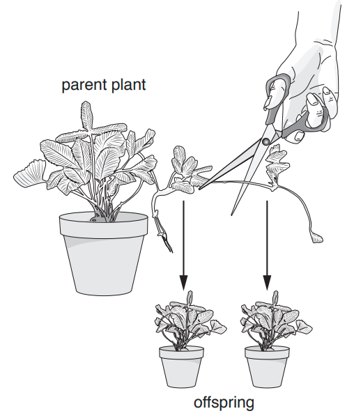

**Fig. 3**

(i)

Explain the type of reproduction that produces plants by the method shown in Fig. 3.

[3]

(ii)

Explain the **disadvantages** of the type of reproduction shown in Fig. 3.

[3]

*Source: 2018 0610/42 Q2D*

### Q15 — easy — 11 marks

**Q15** [4 marks]

Fig. 1 shows a goat with white fur.

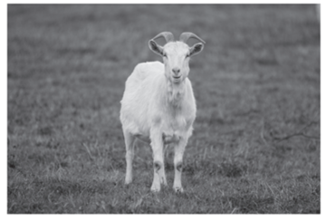

**Fig. 1**

Fur colour is inherited in goats.

- The allele for white fur is represented by **A**.
- The allele for black fur is represented by **a**.
- Each goat is identified by the numbers **1** to **8** in Fig. 2.

Fig. 2 shows a diagram of the inheritance of fur colour in a herd of goats.

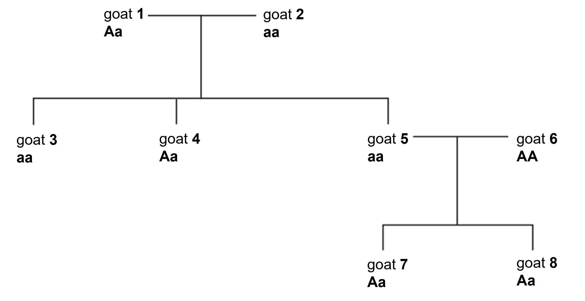

**Fig. 2**

Use Fig. 2 to answer these questions.

(i)

State how many goats have white fur.

[1]

(ii)

State the phenotype of goat **5**.

[1]

(iii)

Draw circles around **two** terms that can be used to describe the **genotype** of goat **6**.

**black                          dominant                          heterozygous**

**homozygous                            recessive                                white**

[2]

*Source: 2018 (Series 1) 0610/31 Q7A*

**Q15** [1 mark]

**Extract:**

Fur colour is inherited in goats.
- The allele for white fur is represented by A.
- The allele for black fur is represented by a.
Each goat is identified by the numbers 1 to 8 in Fig. 2.
Use Fig. 2 to answer these questions.
(i) State how many goats have white fur.
(ii) State the phenotype of goat 5.
(iii) Draw circles around two terms that can be used to describe the genotype of goat 6.

State the name of the type of variation shown by fur colour in these goats.

*Source: 2018 (Series 1) 0610/31 Q7B*

**Q15** [3 marks]

**Extract:**

- The genotype of the male goat is Aa.
- The genotype of the female goat is Aa.
- The allele for white fur is represented by A.
- The allele for black fur is represented by a.
- The white allele (A) is dominant over the black allele (a). This means that any goat containing at least one white (A) allele in its genotype will have white fur.

A farmer identified two goats to breed together.

- The genotype of the male goat is **Aa**.
- The genotype of the female goat is **Aa**.

Complete the genetic diagram and the phenotypic ratio for this cross.

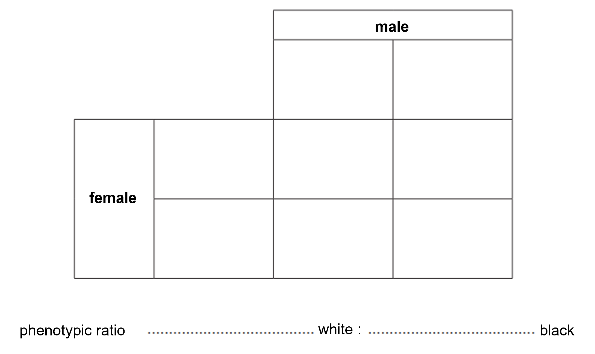

*Source: 2018 (Series 1) 0610/31 Q7C*

**Q15** [3 marks]

**Extract:**

Fur colour is inherited in goats.
- The allele for white fur is represented by A.
- The allele for black fur is represented by a.

The genotype of the male goat is Aa.
The genotype of the female goat is Aa.
Genotypes of the offspring: AA, Aa, Aa, aa.
Phenotypic ratio: 3 (white) : 1 (black).

Describe the process a farmer could use to breed a herd of white goats.

*Source: 2018 (Series 1) 0610/31 Q7D*

### Q16 — easy — 5 marks

**Q16** [1 mark]

Fig. 1 shows a white sweet pea flower and a red sweet pea flower.

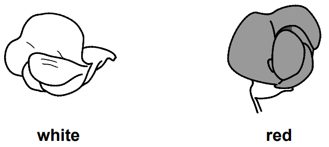

**Fig. 1**

These colours in sweet pea are controlled by a single gene with two alleles.

Define the term *allele*.

*Source: 2020 0610/03 Q11A*

**Q16** [1 mark]

A homozygous sweet pea with white flowers was crossed with a homozygous sweet pea with red flowers. All of the offspring had red flowers.

State which allele of this gene is dominant.

*Source: 2020 0610/03 Q11B*

**Q16** [3 marks]

**Extract:**

Two heterozygous sweet pea plants with red flowers were crossed. These colours in sweet pea are controlled by a single gene with two alleles. The dominant allele is: (Allele for) red (flowers) / R.

Two heterozygous sweet pea plants with red flowers were crossed as shown below.

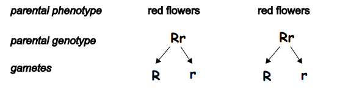

(i)

Draw a Punnet square to show the genotypes that are produced in this cross.

[2]

(ii)

State the phenotypic ratio produced in this cross.

[1]

*Source: 2020 0610/03 Q11C*

### Q17 — easy — 14 marks

**Q17** [3 marks]

Explain why there is usually a 1:1 ratio of male babies born to female babies.

**Q17** [2 marks]

#### Extended only

Fig. 1 shows the overall process of gene expression.

**Fig. 1**

State the names of processes **P **and **Q** in Fig. 1.

**Q17** [3 marks]

#### Extended only

Name the following items related to gene expression:

(i)

The molecule that leaves the nucleus carrying the genetic code.

[1]

(ii)

The cell structure where protein synthesis takes place.

[1]

(iii)

The feature of a DNA molecule that determines the amino acid sequence.

[1]

**Q17** [6 marks]

#### Extended only

The following is a passage relating to mitosis with some missing words.

Mitosis is a process of cell __________ in which two __________ daughter cells are produced. Because these cells all have two copies of each __________, they are known as __________ cells.

Mitosis allows for __________ of damaged tissues as well as to provide more cells during periods of __________.

Complete the above sentences, using the words from the box below. You can use each word once, more than once or not at all.

| gene | repair | identical | growth |
|---|---|---|---|
| chromosome | division | nucleus | diploid |

### Q18 — hard — 4 marks

**Q18** [4 marks]

Fig. 1 shows a cat with an inherited condition that means the cat has extra toes.

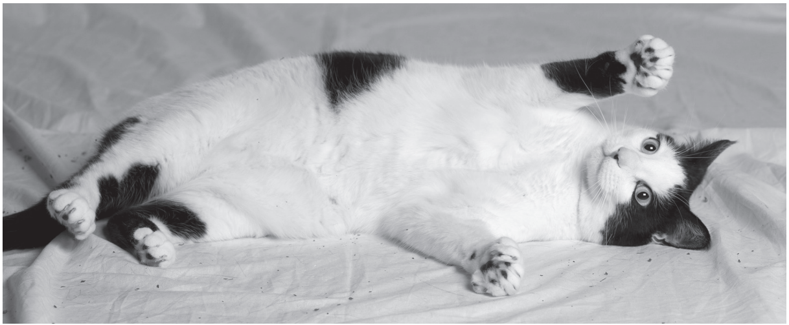

**Fig. 1**

The allele that causes this condition is dominant to the allele for the normal condition.

Fig. 2 shows the inheritance of this condition in a family of cats.

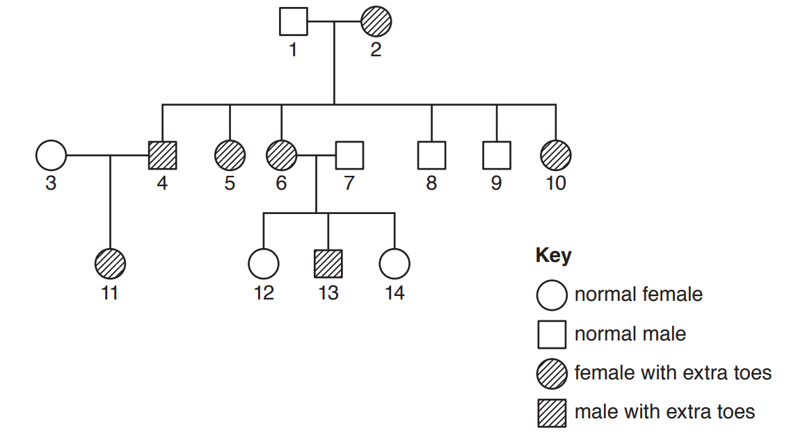

**Fig. 2**

Complete Table 1 by stating the genotypes of the numbered individuals.

Use **B** for the dominant allele and **b** for the recessive allele.

**Table 1**

| number of individual in Fig. 2 | genotype of individual |
|---|---|
| 1 |   |
| 2 |   |
| 4 |   |
| 14 |   |

*Source: 2019 0970/31 Q8*

### Q19 — hard — 9 marks

**Q19** [3 marks]

#### Extended only

The four o’clock plant, *Mirabilis jalapa*, can have flowers of three different colours as shown in Fig. 1.

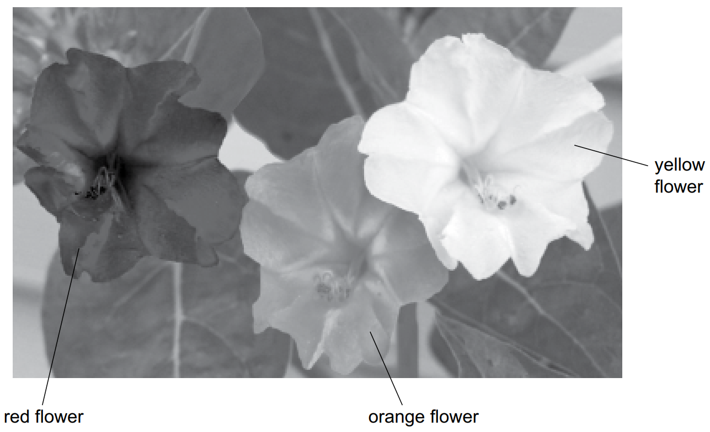

**Fig .1**

A student crossed some red-flowered plants with some yellow-flowered plants (**cross 1**).

She collected the seeds and grew them. All of the plants that grew from these seeds had orange flowers.

Complete the genetic diagram to explain the result of **cross 1**.

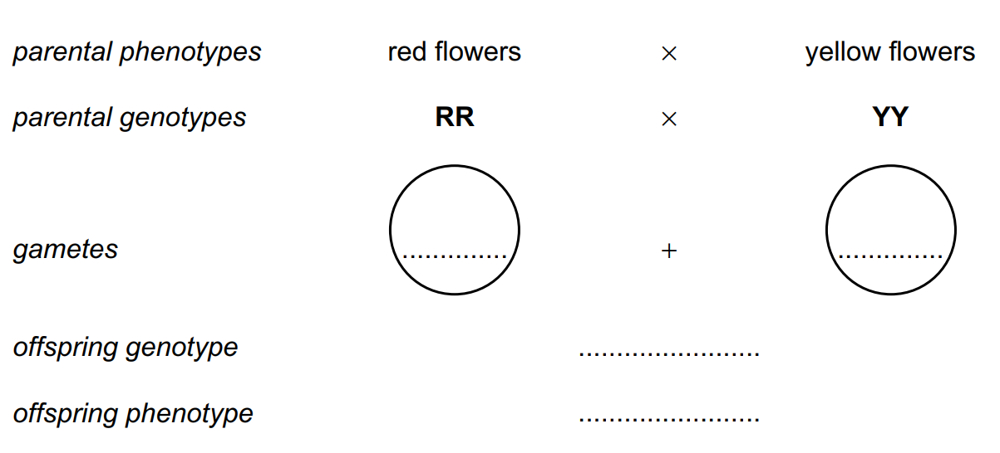

*Source: 2020 0610/04 Q4A*

**Q19** [3 marks]

**Extract:**

A student crossed some red-flowered plants with some yellow-flowered plants (cross 1). She collected the seeds and grew them. All of the plants that grew from these seeds had orange flowers. The genetic diagram uses the alleles R and Y. The completed diagram is as follows: Both R and Y are required for the parent genotypes mark.

The student then carried out three further crosses as shown in Table 1.

**Table 1**

|   | genotypes of offspring |   |
|---|---|---|
| **cross 2** | offspring of **cross 1** × offspring of **cross 1** |   |
| **cross 3** | offspring of **cross 1** × red-flowered plant |   |
| **cross 4** | offspring of** cross 1** × yellow-flowered plant |   |

Complete the table by writing in the genotypes of the offspring of **crosses 2, 3 and 4**, using the same symbols as in the genetic diagram in (a).

*Source: 2020 0610/04 Q4B*

**Q19** [3 marks]

**Extract:**

A student crossed some red-flowered plants with some yellow-flowered plants (cross 1). She collected the seeds and grew them. All of the plants that grew from these seeds had orange flowers.

The completed table is as follows:
|   | genotypes of Offspring |
| cross 2 | offspring of cross 1 × offspring of cross 1 | RR, YY, RY |
| cross 3 | offspring of cross 1 × red-flowered plant | RR, RY |
| cross 4 | offspring of cross 1 × yellow-flowered plant | YY, RY |

#### Extended only

Flower colour in *M. jalapa* is **not **an example of the inheritance of dominant and recessive alleles.

Explain how the results of the crosses show that these alleles for flower colour are not dominant or recessive.

*Source: 2020 0610/04 Q4C*

