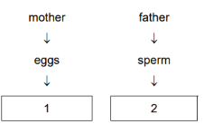
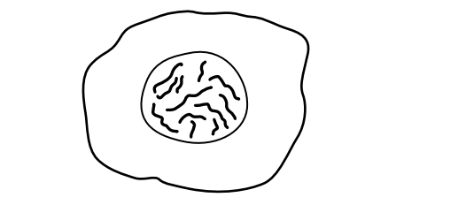
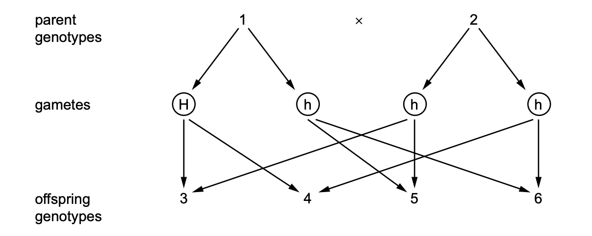
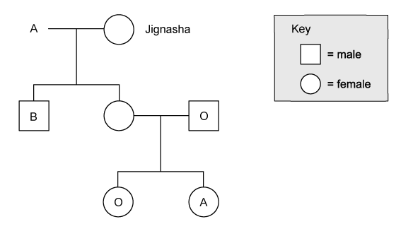
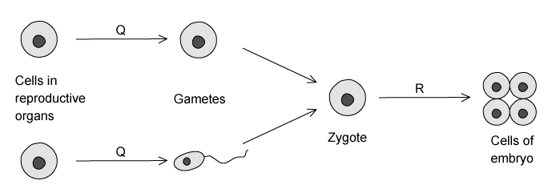
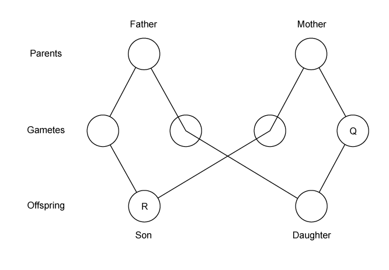
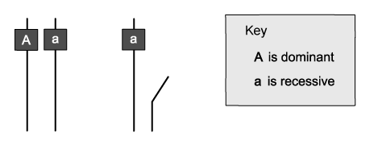
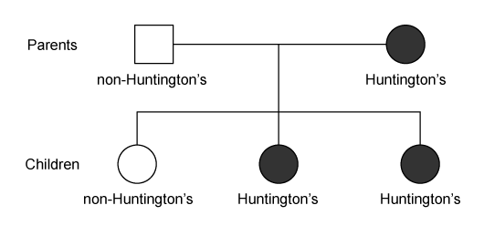

# Exam Questions — Inheritance, Genes & Cell Division
**17. Inheritance** · Cambridge (CIE) IGCSE biology (0610 & 0970)
> Source: [https://www.savemyexams.com/igcse/biology/cie/23/topic-questions/](https://www.savemyexams.com/igcse/biology/cie/23/topic-questions/) · 36 questions across 1 sets

## Multiple Choice Questions (36 questions)

### Q1 — hard — 1 marks

**Q1** [1 mark]

Ear length in rabbits is determined by a single gene with two alleles.

- The long ears allele is dominant and is represented by **E**
- The short ears allele is recessive and is represented by **e**

A male rabbit that is heterozygous for ear length mates with a female rabbit with short ears.

What is the probability that any offspring will have long ears?

### Q2 — medium — 1 marks

**Q2** [1 mark]

When gametes are produced, cells undergo division by

### Q3 — easy — 1 marks

**Q3** [1 mark]

What carries genetic instructions from the nucleus to the cytoplasm?

### Q4 — hard — 1 marks

**Q4** [1 mark]

Red–green colour blindness is caused by a recessive allele on the X chromosome.

A carrier female (XᴺXᶜ) and a normal male (XᴺY) have children.

What proportion of their sons will be colour blind?

### Q5 — medium — 1 marks

**Q5** [1 mark]

Colour blindness is a characteristic that is sex-linked.

Which statement about colour blindness is correct?

*Source: June 2021 0970/21 Q33*

### Q6 — easy — 1 marks

**Q6** [1 mark]

Which statement about meiosis is correct?

*Source: June 2021 0970/21 Q33*

### Q7 — medium — 1 marks

**Q7** [1 mark]

What carries a copy of the gene to the cytoplasm to make a protein?

*Source: June 2021 0970/21 Q32*

### Q8 — easy — 1 marks

**Q8** [1 mark]

Pangolins are mammals. One species of pangolin has 40 chromosomes per body cell.

How many chromosomes will a sperm cell from this species of pangolin have?

*Source: june 2022 paper 2 Q31*

### Q9 — medium — 1 marks

**Q9** [1 mark]

What is needed in the cytoplasm to make proteins at a ribosome?

*Source: June 2022 paper 2 Q30*

### Q10 — medium — 1 marks

**Q10** [1 mark]

A student used a diagram to explain the inheritance of sex in humans.

Which statements should she use to complete boxes 1 and 2?

|   | box 1 | box 2 |
|---|---|---|
| **A** | all have an X chromosome | half have an X chromosome and half have a Y chromosome |
| **B** | all have a Y chromosome | half have an X chromosome and half have a Y chromosome |
| **C** | half have an X chromosome and half have a Y chromosome | all have an X chromosome |
| **D** | half have an X chromosome and half have a Y chromosome | all have a Y chromosome |

*Source: June 2022 Paper 1 Q34*

### Q11 — easy — 1 marks

**Q11** [1 mark]

Beak shape in birds is controlled by genes passed from the parent birds to their offspring.

What is this an example of?

*Source: June 2022 Paper 1  Q33*

### Q12 — easy — 1 marks

**Q12** [1 mark]

What is the transmission of genetic information from generation to generation called?

*Source: June 2021 0970/11 Q33*

### Q13 — hard — 1 marks

**Q13** [1 mark]

Pure-breeding black-feathered chickens are mated with pure-breeding white-feathered chickens. All of the offspring (F1 generation) have black feathers **and **white feathers.

When two of the F1 generation chickens are crossed, what will be the ratios of offspring phenotypes?

*Source: Specimen 2023 0970/02 Q33*

### Q14 — hard — 1 marks

**Q14** [1 mark]

A man marries a woman who has a different blood group from him. They have two children. The children have different blood groups from each other and different blood groups from their parents.

What are the genotypes of the parents’ blood groups?

*Source: Specimen 2023 0970/02 Q32*

### Q15 — medium — 1 marks

**Q15** [1 mark]

The diagram shows the cell of an organism. The nucleus contains 12 chromosomes.

After this cell divides by mitosis, how many chromosomes would be present in one of the daughter cells?

*Source: Specimen 2023 0970/02 Q31*

### Q16 — easy — 1 marks

**Q16** [1 mark]

What is the role of messenger RNA (mRNA)?

*Source: Specimen 2023 0970/02 Q30*

### Q17 — easy — 1 marks

**Q17** [1 mark]

The genetic diagram shows a monohybrid cross.

H is the dominant allele and h is the recessive allele.

Which of the parents and offspring are heterozygous?

*Source: Specimen 2023 0970/01 Q32*

### Q18 — medium — 1 marks

**Q18** [1 mark]

The information shows what happens during some of the stages of sexual reproduction in a human.

egg + sperm → fertilised egg → male embryo

Which sex chromosomes are present in the egg, sperm and fertilised egg shown?

|   | egg | sperm | fertilised egg |
|---|---|---|---|
| **A** | X | X | XX |
| **B** | X | Y | XY |
| **C** | Y | X | XY |
| **D** | Y | Y | YY |

*Source: Specimen 2023 0970/01 Q31*

### Q19 — easy — 1 marks

**Q19** [1 mark]

Which shows the correct size order of structures, starting with the smallest?

### Q20 — hard — 1 marks

**Q20** [1 mark]

#### Extended only

ABO blood groups are an inherited characteristic.

What would the blood group of the offspring be when two parents have the genotypes IAIA and IAIO?

### Q21 — hard — 1 marks

**Q21** [1 mark]

#### Extended only

The diagram shows the inheritance of ABO blood groups in the family.

What could be Jignasha’s genotype?

### Q22 — easy — 1 marks

**Q22** [1 mark]

#### Extended

What does the term haploid mean?

### Q23 — medium — 1 marks

**Q23** [1 mark]

#### Extended only

The diagram below shows the process of sexual reproduction.

Which of the processes are shown by stages **Q **and **R**?

|   | **Q** | **R** |
|---|---|---|
| **A** | meiosis | mitosis |
| **B** | mitosis | mitosis |
| **C** | meiosis | meiosis |
| **D** | mitosis | meiosis |

### Q24 — hard — 1 marks

**Q24** [1 mark]

A farmer is growing pea plants; the allele for tall plants is T and is dominant to the allele for dwarf plants, t.

She wants to know what cross she would need to carry out to produce a ratio of 1:1 tall to dwarf plants?

### Q25 — easy — 1 marks

**Q25** [1 mark]

Males and females have a unique set of chromosomes.

What is the correct combination of male and female chromosomes?

### Q26 — medium — 1 marks

**Q26** [1 mark]

Two individuals are crossed. One is homozygous dominant (TT), the other heterozygous.

What will the genotypes of the offspring be?

### Q27 — medium — 1 marks

**Q27** [1 mark]

Albinism is a condition where the pigment melanin does not get produced in the skin, hair and eyes. This is an inherited condition that is caused by a recessive allele.

If both parents have albinism what are the chances of the offspring being an albino child?

### Q28 — hard — 1 marks

**Q28** [1 mark]

The diagram shows how the sex of the offspring can be determined.

What are the sex chromosomes in gamete **Q** and the son **R**?

|   | **Q** | **R** |
|---|---|---|
| **A** | X | XY |
| **B** | X | XX |
| **C** | Y | XY |
| **D** | Y | XX |

### Q29 — easy — 1 marks

**Q29** [1 mark]

#### Extended only

When a somatic (body) cell undergoes cell division, two daughter cells are produced with the same chromosome number as the parent cell.

Which type of division has taken place?

### Q30 — hard — 1 marks

**Q30** [1 mark]

#### Extended

Which row in the table shows a comparison between meiosis and mitosis?

|   | mitosis | meiosis |
|---|---|---|
| **A** | produces 4 daughter cells | produces 2 daughter cells |
| **B** | produces genetically identical cells | produces cloned cells |
| **C** | daughter cells are diploid | daughter cells are haploid |
| **D** | two cell division occur | four cell divisions occur |

### Q31 — hard — 1 marks

**Q31** [1 mark]

#### Extended only

The diagram shows the sex chromosomes of a woman and a man. This also shows the alleles for a recessive sex-linked condition.

What is the percentage chance that their daughter will show the sex-linked condition?

### Q32 — medium — 1 marks

**Q32** [1 mark]

#### Extended only

New cells are formed by the division of existing cells.

The diagram below shows four different cells.

Which one is formed by meiosis?

### Q33 — easy — 1 marks

**Q33** [1 mark]

A tall pea plant is crossed with a short pea plant. The tall gene is dominant over the short gene. The tall plant is heterozygous. The short plant is homozygous recessive

Which is the correct genetic diagram for this cross?

### Q34 — medium — 1 marks

**Q34** [1 mark]

#### Extended only

Which of the following structures in plant cells carry out protein synthesis under the control of the nucleus?

### Q35 — hard — 1 marks

**Q35** [1 mark]

The inheritance of Huntington's disease is determined by a single gene. This gene has a dominant allele and a recessive allele. The allele for Huntington’s is dominant to the allele for non-sufferers of the condition.

The diagram shows the inheritance of Huntington’s in a family.

What is the probability that the next child from the same parents will have Huntington’s?

### Q36 — hard — 1 marks

**Q36** [1 mark]

Fruit flies can have orange or red eyes.

If two orange flies are crossed, all of the offspring will have orange eyes.

If two red eyed fruit flies are crossed, the offspring have either orange or red eyes.

What can be concluded from these observations?
