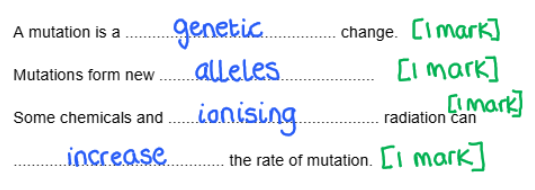
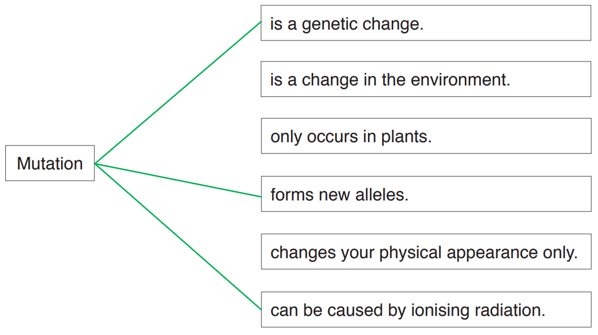
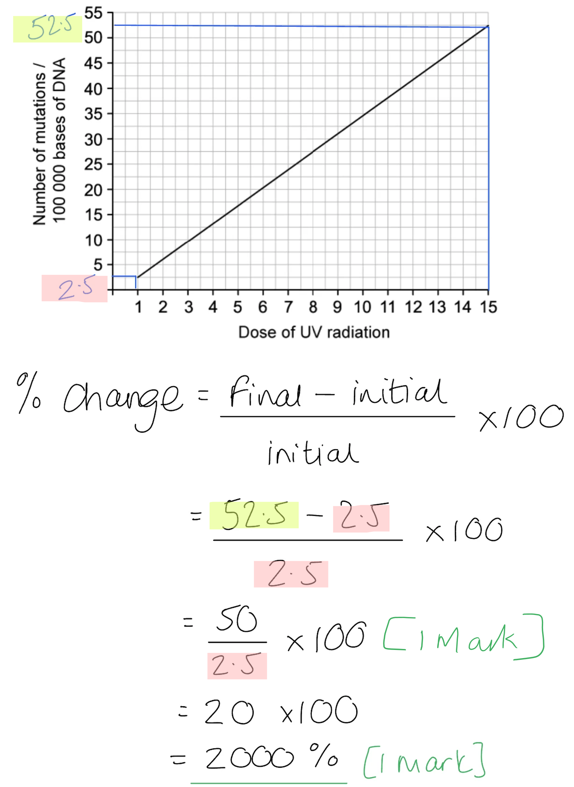
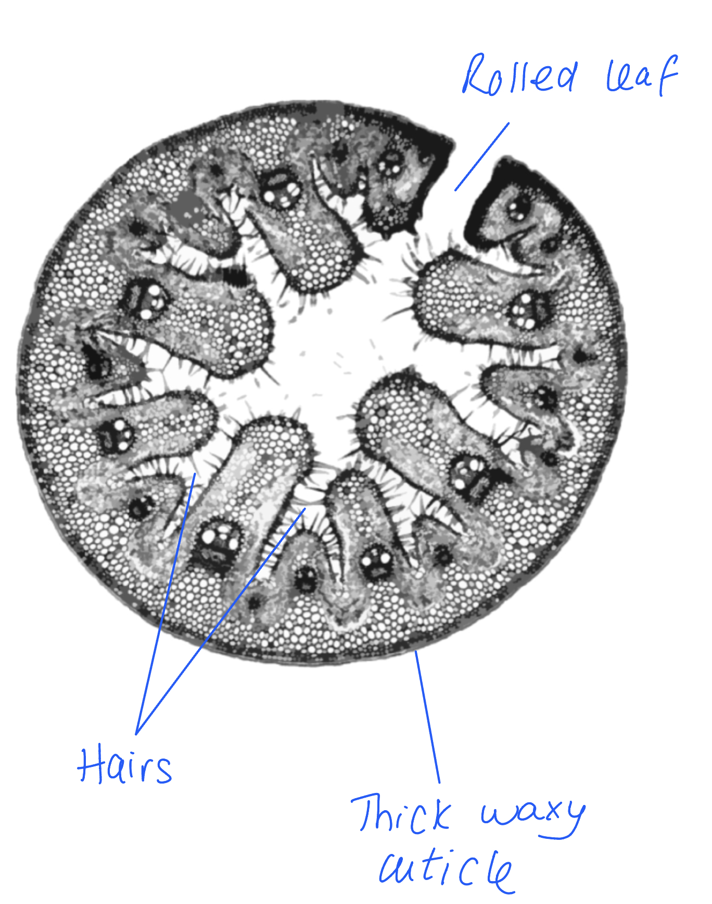

# Mark Schemes — Variation & Natural Selection
**18. Variation & Selection** · Cambridge (CIE) IGCSE biology (0610 & 0970)

## Multiple Choice Questions (25 questions)

### Q1
**Final answer:** **The correct answer is ****B.**

**Statement 1 is correct **because **thick leaves** and a** waxy cuticle** are adaptive features that** reduce water loss**. These features help desert plants survive in dry environments by reducing evaporation from the leaf surface.

**Statement 2 is correct **because these features are** inherited characteristics**. Adaptive features are** controlled by genes** and can be** passed from parent plants to their offspring.**

**Statement 3 is incorrect **because adaptations** do not develop because organisms need them**. Instead, they arise through **natural selection** over many generations. Plants that already had traits such as thicker leaves or a waxy cuticle **survived better in dry conditions** and **passed these alleles to their offspring.**

### Q2
**Final answer:** **The correct answer is ****B****.**

- Artificial selection is the process of selecting and breeding together plants with desired characteristics, such as disease resistance and high yield

**A** is incorrect because natural selection does not require human intervention, whereas this process involves human-directed breeding.

**C** is incorrect because genetic engineering involves directly altering an organism's DNA and so is more complicated than cross-breeding individuals.

**D** is incorrect because asexual reproduction involves the production of genetically identical offspring with only one parent, whereas cross-breeding in natural selection requires two parents and the offspring are not genetically identical.

### Q3
**Final answer:** **The correct answer is ****D****.**

- Discontinuous variation refers to traits that fall into distinct categories with no intermediate forms, such as blood type

**A, B **and** C** are incorrect because they all describe features of continuous variation, where genotypes and there are many intermediate phenotype possibilities giving a range of possibilities along a spectrum e.g. height, weight or eye colour.

### Q4
**Final answer:** **The correct answer is ****B****.**

- This is because hydrophytes are plants that are adapted to live in extremely wet conditions
- Hydrophyte leaves contain large air spaces in the leaves for flotation, to keep the leaves close to the surface of the water where there is more light for photosynthesis

**A** is incorrect because hairs being present on the upper and lower surfaces of leaves is an adaptation of xerophytes, not hydrophytes.

**C** is incorrect because hydrophytes tend to have stomata on the upper surface only because the leaves float on water so this means they can exchange gases much more easily with the air.

**D** is incorrect because thick cuticles are an adaptation of xerophytes, not hydrophytes.

### Q5
**Final answer:** **The correct answer is ****B****.**

- This is because heterozygous individuals are more resistant to malaria so in areas where malaria is common this genotype is selected for, increasing the frequency of the sickle cell allele in these populations

**A** is incorrect because although this statement is true, it does not explain why being heterozygous is beneficial over being homozygous dominant.

**C** is incorrect because the disorder is caused by a recessive allele. You can tell this is the case otherwise being heterozygous would not be beneficial. 

**D** is incorrect because differences between sexes is not mentioned in the question.

### Q6
**Final answer:** **The correct answer is ****D****.**

- This is because the desirable features are selected by the breeders to be passed onto the next generation to increase the frequency of these traits in the population over time

**A** is incorrect because selective breeding does involve human activity to select the individuals for breeding.

**B** is incorrect because natural selection involves a struggle for survival, not selective breeding. 

**C** is incorrect because selective breeding involves sexual reproduction with two parents, not asexual reproduction.

### Q7
**Final answer:** **The correct answer is ****D****.**

- Discontinuous variation refers to traits that fall into distinct categories with no intermediate forms, such as blood type.

**A, B **and** C** are incorrect because they all describe features of continuous variation, where genotypes and there are many intermediate phenotype possibilities giving a range of possibilities along a spectrum e.g. height, weight or eye colour.

### Q8
**Final answer:** **The correct answer is D**

- This is because the bacterial population have evolved resistance to antibiotics through the process of natural selection

**A** is incorrect because artificial selection is also known as selective breeding and humans are not selecting bacterial cells to breed antibiotic resistance

**B **is incorrect because although bacteria do carry out asexual reproduction, on its own it does not increase antibiotic resistance - only as part of natural selection

**C **is incorrect because more effective new antibiotics are a method to counteract antibiotic resistance but it does not cause it

### Q9
**Final answer:** **The correct answer is B because:**

Barhee has soft dates with a high yield and medium size, and Thoory has straw coloured dates with a medium size

**A **is incorrect because neither person has dates with straw colour.

**C** is incorrect because neither person has dates with straw colour and high yield.

**D** is incorrect because neither person has dates with a high yield.

### Q10
**The correct answer is B because**:

Body length in humans is an example of continuous variation

**A** is incorrect because ABO blood group is an example of discontinuous variation.

**C** is incorrect because seed colour in peas is an example of discontinuous variation.

**D** is incorrect because seed shape in peas is an example of discontinuous variation.

### Q11
**Final answer:** **The correct answer is ****A**** (it reduces the loss of water) because:**

- Xerophytes live in very dry environments such as sand dunes and deserts
- Fewer stomata and leaves that are spikes are **adaptations** of xerophytes to reduce water loss via transpiration (evaporation and diffusion of water vapour from the spongy cells in the leaf)

**B** is incorrect because decreasing carbon dioxide uptake would reduce the rate of **photosynthesis,** making the plant less likely to survive.

**C** is incorrect because a reduction in stomata will not increase the uptake of carbon dioxide.

**D** is incorrect because an increase in the loss of water in this environment will mean that the plant is less likely to survive.

### Q12
**Final answer:** **The correct answer is ****B**** (An inherited feature that increases an organism's ability to survive and reproduce) because:**

Adaptive** features **are features that increase the chance of an organism surviving and reproducing in its environment.

**A** is incorrect because there may be changes in an environment that will give certain **phenotypes** an advantage, however, this is not an adaptive feature.

**C** is incorrect because a change in phenotype is not caused by the environment, but mutations in **genes **which can be inherited**.**

**D** is incorrect because this answer describes behavioural adaptations such as mating rituals.

### Q13
**Final answer:** **The correct answer is ****B ****(the population will adapt more slowly to environmental changes) because:**

- The whole population has descended from just two parents, this will mean the population has very **little genetic diversity** (a small gene pool)
- Reduced **variation **in a population means that they are less likely to survive any changes in the environment
- Natural changes will occur due to **random mutations**, but these must occur in gametes that form new individuals to possibly introduce variation into the population; such changes will be slow

The other answers are incorrect because all of these statements refer to a population that has a large gene pool and a large genetic diversity.

### Q14
**Final answer:** **The correct answer is ****C**** (the bacteria will have undergone a process of natural selection) because:**

- The evolution of bacterial resistance by **natural selection** occurs because within a population of bacteria there may be some individuals that naturally have **resistance **to the antibiotic
- When the antibiotic is applied, there is a selection pressure. The environment of the bacteria has changed and only those with resistance to the antibiotic are usually able to survive exposure to it
- With non-resistant bacteria dying, there is less competition for resources
- **Bacteria** that survive after a treatment with antibiotics (a change to the environment of the bacteria), will be able to pass the resistant gene to their offspring when they reproduce
- This is an example of natural selection; individuals best suited to the environment are more likely to survive and reproduce

**A** is incorrect because **this bacteria will probably not be resistant to all different types of antibiotic as they all work slightly differently.**

**B** is incorrect because **selective** **breeding** is breeding individuals with desired characteristics together. These characteristics are chosen by humans. This is **artificial selection**.

**D** is incorrect because the next generation will now have more individuals that have resistance to the antibiotic, so the antibiotic will be less effective.

### Q15
**Final answer:** **The correct answer is ****A**** (they offer little resistance to water flow) because:**

- The leaves underwater are much **smaller **than the floating leaves on the surface of the water. This small size will mean that they offer **little resistance** to the flow of the water
- If they were larger this would increase resistance and put more **strain **on the roots and stem

**B** is incorrect because a thick cuticle is useful to reduce water loss. This is an **adaptation** of xerophytes but hydrophytes don’t need to worry about water loss! Xerophytes are land plants that are adapted to live in very dry habitats.

**C** is incorrect because **xylem vessels** transport water and although they can provide physical support (when full of water), the question is about the leaves that are underwater not the stem.

**D** is incorrect because the leaves underwater are still exposed to light through the water and can therefore **photosynthesise**.

Make sure that you really look at the diagram. Diagrams are included in questions for a reason, not just to look nice!

### Q16
**Final answer:** **The correct answer is ****A ****because:**

- Blood group is a characteristic that is completely under **genetic control** and therefore the environment does not affect this characteristic
- Blood group alleles show **codominance **- alleles IA and IB are **both **expressed if present in the genotype (they cannot mask each other), but both are dominant over the i (O) allele. There are therefore 4 possible phenotypes for blood type (A, B, AB and O)
- Blood groups, therefore, show **discontinuous variation** - there are distinct blood group categories and a person will fit into one of them; there are no intermediates. This is unlike height for example, this is a characteristic that shows a continuous variation where individuals can be any height within a range

**B** is incorrect because blood groups are an example of **discontinuous** variation, not **continuous **variation.

**C** and **D **are incorrect because blood groups are not affected by the environment.

### Q17
**Final answer:** **The correct answer is ****C**** (artificial selection) because:**

- Selecting plants for their desirable characteristics is **selective breeding**
- This is an example of **artificial selection** carried out by humans

**A** is incorrect because **evolution** is the change in adaptive features of a population over time as the result of **natural selection.**

**B** is incorrect because **adaptations** are an inherited feature that helps an organism to survive and reproduce in its environment.

**D** is incorrect because **natural selection** is the process by which organisms best suited to their environment (better adapted) are more likely to survive and reproduce.

### Q18
**Final answer:** **The correct answer is ****A**** (Discontinuous and genetic only) because:**

- Blood groups are controlled by a **genetic variation**
- This is an example of **discontinuous variation**, there are distinct groups
- These differences are due to differences in the **genetic code**

**B **and **C** are incorrect because the blood group characteristic is not an example of **continuous variation,** there are only four possible blood groups with no intermediates in between.

**D** is incorrect because **discontinuous variation** is only under the influence of genetic factors, the environment doesn’t influence the phenotype.

### Q19
**Final answer:** **The correct answer is ****D****:**

- The graph shows that the plants fall into two height groups; a shorter group and a taller group; the plants being in **two distinct groups** indicates **discontinuous variation**
- Height is measured on a continuous scale, and within each group there is a** range of heights**; this indicates** continuous variation**

Make sure that you really look at the graph. It is included in the question for a reason! It is really easy to miss that there are two groups in this graph.

### Q20
**Final answer:** **The correct answer is ****C**** (leaves rolled up and covered with hairs) because:**

- **Hydrophytes** are plants that live in **wet** or **aquatic** environments
- Leaves rolled up and covered with hairs is an **adaptation** of xerophytes (plants that live in very dry environments such as sand dunes)

The other answers are incorrect because all the other features listed are features of hydrophytes:

- They have a reduced root and xylem system as they are living in an aquatic environment so have a plentiful supply of water
- They have large air spaces in the tissues for gas exchange
- They have stomata on their upper surface as they are often floating in water, so stomata on the upper surface of the leaf are easier for gas exchange

### Q21
**Final answer:** **The correct answer is ****D**** (a change in a gene) because:**

- The definition of a mutation is the change in the base sequence of DNA (which is a more detailed way of saying a change in a gene)
- This is how we get different versions of the same genes known as **alleles**
- **Mutations ** are the basis of **genetic variation**

**A** is incorrect because **genetic engineering** is a process that involves inserting a **gene** into an organism (from another)

**B** is incorrect because **continuous variation** is a type of variation that has a range of **phenotypes** often due to both genetic and environmental factors.

**C** is incorrect because a** dominant allele** is a version of a gene that will always be expressed in the **phenotype** of an organism.

### Q22
**Final answer:** **The correct answer is ****B**** (selection by humans) because:**

- Within populations there will always be **variation**
- Natural selection is the ‘favouring’ of a characteristic giving an individual a survival advantage over others: individuals with these characteristics are better adapted to the **environment** (remember the environment determines what is ‘favoured’ or ‘selected’) and therefore these individuals are more likely to **survive** and **reproduce**
- Variation increases the capability of a **population **to survive and cope with environmental change
- **Artificial selection** is carried out by humans selecting specific traits and deciding which individuals in a population (of livestock animals or plant crops) are able to breed. This is not a feature of natural selection

All the other answers are incorrect because they are features of natural selection:

- Production of a large number of offspring will mean that there will be a larger range of phenotypes from the inheritance of random mutations in sexually reproducing organisms
- Competition for resources means that only the best suited to the environment are likely to survive
- Variation in the population means that there are a wide variety of genotypes and therefore phenotypes; making the population as a whole better able to adapt to changes in the environment

### Q23
**Final answer:** **The correct answer is ****C**** (tongue rolling) because:**

A characteristic that shows discontinuous variation is usually determined by **genetic** differences only (the environment does not influence the characteristic). Tongue-rolling has a limited number of phenotypes with no variation in between (intermediates) - you can either roll your tongue or you can’t.

**A**, **B** and **D** are all incorrect because they are all examples of continuous variation. Continuous variation results in a wider range of phenotypes, often seen as a bell shaped curve on a graph. They have a wide range of variations in between (intermediates).

### Q24
**Final answer:** **The correct answer is ****B**** (less carbon dioxide can enter the plant) because:**

Carbon dioxide can only enter the plant through the stomata. Carbon dioxide is needed for the plant to photosynthesize. However, xerophytic plants live in dry conditions so if the stomata are open water will be lost which can be fatal for the plant. Xerophytes will open more stomata at night in the presence of mist or dew when carbon dioxide can still enter the plant but photosynthesis will wait until the morning.

**A** is incorrect because less water lost is an advantage for the plant.

**C** is incorrect because stomata don't **only **open at night, they just open less during the day compared to other types of plants.

**D** is incorrect because this is not a disadvantage for the plant as oxygen is a waste product.

### Q25
**Final answer:** **The correct answer is ****C**** (weight) because:**

A person's weight is determined by both **genetic factors** and the amount of food they have access to and choose to eat, and how active they are (environmental factors).

All the other answers are incorrect as these refer to characteristics that are determined by** genetic factors **only.

## Theory Questions (12 questions)

### Q1
(i)

- 17;  **[1 mark]**
- 4 + 13 = 17

(ii)

- 1;  **[1 mark]**
- 5 - 4 = 1

(iii)

- There are two / limited / discrete / distinct, categories / groups;  **[1 mark]**
- There are no, intermediates / range / intervals; **[1 mark]**

(iv)

- The ability to roll your tongue; **[1 mark]**

*Accept any other valid suggestion e.g. blood type / earlobe attachment / eye colour; * **[1 mark]**

(v)

- Height; **[1 mark]**

*Accept any other valid suggestion e.g. weight / IQ / blood pressure / foot size; * **[1 mark]**

**[Total: 6 marks]**

**[Total: 4 marks]**

### Q2
Any three from:

- Breed / cross / mate two white goats; **[1 mark]**
- Select offspring with white coats and breed again / do not breed the offspring with black coats; **[1 mark]**
- (Repeat this process) over many generations;  **[1 mark]**
- (To increase the chance that all the sheep will be) homozygous dominant;  **[1 mark]**

It is important to memorise the steps in this process because the mark schemes for these kinds of questions always follow a very similar format with different examples of species.

**[Total: 3 marks]**

### Q3
> **[mark-scheme]**
> The changes in mean beak depth shown in Table 1 can be described as follows:
> 
> Any **two** of the following:
> 
> - Mean beak depth increased (on both islands); **[1 mark]**
> - Island B had a greater increase in mean beak depth than Island A; **[1 mark]**
> - Island A had an increase in beak depth from 9.4 to 10.7 mm / of 1.3 mm; **[1 mark]**
> - Island B had an increase in beak depth from 9.5 to 11.1 mm / of 1.6 mm; **[1 mark]**
> 
> **[Total: 2 marks]**
> **[mark-scheme]**
> The mean beak depth of finches increased on both islands after the drought because:
> 
> Any **three** of the following:
> 
> - Finches with deeper beaks were able to find more food / eat the larger seeds; **[1 mark]**
> - Finches with deeper beaks had a greater chance of surviving than those with smaller beaks;
> - Finches with deeper beaks were more likely to reproduce; **[1 mark]**
> - The alleles for deeper beaks were passed on to offspring. **[1 mark]**
> 
> **[Total: 3 marks]**
> **[mark-scheme]**
> (i) A prolonged increase in rainfall would affect the beak depth of the finch populations as follows:
> 
> - Average beak depth would decrease; **[1 mark]**
> 
> (ii) This can be explained as follows:
> 
> - Seeds would soak up more water and become softer; **[1 mark]**
> - Finches with smaller beaks would be better able to eat the (softer) seeds / finches with deeper beaks would find the softer seeds more difficult to eat; **[1 mark]**
> - Finches with smaller beaks more likely to survive and reproduce; **[1 mark]**
> 
> **[Total: 4 marks]**
> **[mark-scheme]**
> The student's statement can be evaluated as follows:
> 
> *Incorrect:*
> 
> - Mutations are <u>random</u> and not caused by environmental change; **[1 mark]**
> 
> *Correct:*
> 
> - Natural selection acts on variation that occurs due to mutation / mutation can give rise to new alleles on which natural selection can act; **[1 mark]**
> 
> **[Total: 2 marks]**

### Q4
The environment xerophytes are adapted to are:

- A dry/arid environment *(accept a named dry environment such as salt marsh, desert, polar regions);* **[1 mark]**

**[Total: 1 mark]**

> *A xerophyte is a type of plant that has adaptations to survive in an environment with little **liquid** water. A common mistake is to think that this environment has to be hot or tropical. *
(i) The type of variation shown in the graph is:

- Discontinuous; **[1 mark]**

(ii) The type of leaf spike is an example of the variation because:

Any **two **from the following:

- There are a limited number of phenotypes / only three categories; **[1 mark]**
- There are no intermediates / discrete / separate categories; **[1 mark]**
- (Leaf variation is) caused by genes only; **[1 mark]**
- The data is displayed as a bar chart (which has gaps); **[1 mark]**

**[Total: 3 marks]**

> *This question covers core knowledge taken from an extended only paper 4 question.*
Two named features of leaves that show the type of variation shown in Fig. 2. are:

Any **two **from the following:

- The thickness / length / width / mass / concentration of pigment / volume / surface area of any leaf feature; **[1 mark]**
- The density of stomata; **[1 mark]**
- The number of veins / chloroplasts / spikes; **[1 mark]**

**[Total: 2 marks]**

> *Continuous variation is when there are very many small degrees of difference for a particular characteristic between individuals and they are arranged in order and can usually be measured on a scale. So this might be leaf length for example. *

> *This question covers core knowledge taken from an extended only paper 4 question.*
One reason for the difference in variation of leaf feature **B** after one year is:

Any **one **from the following:

- (The ecologist) measured different leaves; **[1 mark]**
- (There was a) change in (a named) environmental (feature) *(You must have a named environmental feature for this mark)*; **[1 mark]**
- (The plant/xerophyte) adapted to the environment; **[1 mark]**
- The leaves / plant have grown / gotten older; **[1 mark]**

**[Total: 1 mark]**

> *This question covers core knowledge taken from an extended only paper 4 question.*

### Q5
The coat colours of horses in the table are as follows...

| **genotype** | **black coat** | **red coat** |
|---|---|---|
| **EE** | **✔** |   |
| **Ee** | **✔** |   |
| **ee** |   | **✔** |
| ** ** | ; **[1 mark]** | ; **[1 mark]** |

**[1 mark]*** is awarded per correct column of ticks.*

**[Total: 2 marks]**
The term used to describe the difference between individuals of the same species is...

- Variation; **[1 mark]**

**[Total: 1 mark]**

> *Breeds are groups of organisms within a species that share certain characteristics. These differences between breeds are still within a single species, and we refer to differences with a species as **variation**.*
The process of selective breeding involves the following...

Any **three **of the following:

- Humans choose/select individuals with (named) desirable features; **[1 mark]**
- (Selected individuals) mate/breed/are crossed together; **[1 mark]**
- The offspring with (the same) desired feature is/are selected; **[1 mark]**
- Repeat (the above) over many generations; **[1 mark]**

**[Total: 3 marks]**

> *Selective breeding is a process that takes many generations. Individuals with desired characteristics are selected and bred together, and then any **offspring** showing the same desired characteristics are bred together. This process needs to be **repeated many times** before the characteristics appear consistently.*
Natural selection differs from selective breeding as follows...

- Characteristics/features are not selected by humans; **[1 mark]**
- (Characteristics/features provide) adaptation to environment / increased chance of survival in environment; **[1 mark]**

**[Total: 2 marks]**

> *The principles behind natural and artificial selection are the same; they both involve selection of a favourable characteristic and then an increased likelihood of that characteristics being passed on to the next generation. The difference is the source of the selection; in artificial selection, the favourable characteristics is selected by **humans** (e.g. because it is useful or looks nice), while in natural selection the favourable characteristic is 'selected' by the **environment** in which an individual lives due to the characteristic being **adaptive**, e.g. the ability to run fast would be 'selected' by the presence of a predator (because slow individuals would be killed), or thick fur would be selected by a cold climate (because individuals with thin fur would die from cold).*

### Q6
The term *species* refers to:

- A (group of) organisms that can reproduce...;** [1 mark]**
- ...to produce fertile offspring; **[1 mark]**

**[Total: 2 marks]**

> *This question part covers core content but is taken from an extended paper 4 question.*
Apart from the presence of hair, other features that distinguish mammals from all other vertebrates include:

Any **two **from the following:

- Pinna(e) / external ears;** [1 mark]**
- Mammary glands / milk glands / production of milk / lactating / suckling / breast feeding / nipples;** [1 mark]**
- Diaphragm; ** [1 mark]**
- (Three) bones in the middle ear;** [1 mark]**
- (Four) different types of teeth / two sets of teeth; ** [1 mark]**
- Sweat glands; ** [1 mark]**
- Enucleated red blood cells / red blood cells with no nucleus; ** [1 mark]**
- Uterus / placenta / navel;** [1 mark]**

**[Total: 2 marks]**

> *This question part covers core content but is taken from an extended paper 4 question.*
The steps that breeders would take to breed sheep that have wool with very thin hairs include:

Any **five **from the following:

- Select parent(s)/sheep with fine/thin hairs (in wool) **OR** use Merino sheep from South Africa **and** NZ sheep;** [1 mark]**
- Cross/breed them together / use artificial insemination/IVF;**[1 mark]**
- Measure/assess the hairs in the wool of all the offspring; **[1 mark]**
- Select offspring with fine/thin hairs (in their wool);**[1 mark]**
- Cross/breed/mate offspring (with thin hairs) together; **[1 mark]**
- Continue/repeat selection and/or breeding;**[1 mark]**
- (Repeat) over many generations;**[1 mark]**

*A maximum of four marks can be awarded here if no reference is made to the quality of wool as this is the selected desirable characteristics.*

**[Total: 5 marks]**

> *This question part covers core content but is taken from an extended paper 4 question.*
Natural selection differs from selective breeding in the following ways:

Any **three **from the following:

Note that all of the below statements relate to natural selection.

- Features (evolved through natural selection) are adaptive / adaptations (for environment); **[1 mark]**
- (Features are selected for) by the environment /  an organism's surroundings; **[1 mark]**
- (There is) competition between individuals for (named) resource(s); **[1 mark]**
- Reference to named selective agent(s), e.g. food availability, presence of predators, cold temperatures etc.; **[1 mark]**
- Slow(er) (than artificial selection); **[1 mark]**
- Increases the ability (of the individuals) to survive **AND** reproduce (in their environment); **[1 mark]**
- Maintains (genetic) variation / selective breeding reduces genetic variation; **[1 mark]**
- Random mating (as opposed to planned mating in selecting breeding);**[1 mark]**

**[Total: 3 marks]**

> *In natural selection features of the environment (e.g. the presence of predators or a lack of food) 'select' the characteristics that will be passed on to the next generation; individuals with characteristics that increase their survival chances within their environment are more likely to **survive** and **reproduce** and so **pass on these advantageous characteristics**.*

> *In artificial selection it is **humans that select** the most desirable characteristics and plan a breeding programme to ensure that these characteristics are passed on. The features selected by humans are desirable but may not increase the survival chances of the individual organisms in the wild, and by breeding related individuals together the genetic variation of a population is reduced.*

### Q7
Fig. 1 shows that blood group is an example of discontinuous variation because:

Any **one **from the following:

- Limited number of phenotypes / categories / groups; **[1 mark]**
- No intermediates; **[1 mark]**

**[Total: 1 mark]**

> *There is a common misconception that discontinuous variation describes a type of characteristic that cannot change throughout an individual's lifetime. Remember that discontinuous variation is always plotted as a bar chart because the data is always split into categories. *
The examples of discontinuous variation are:

| Attached or unattached earlobes | ✓; **[1 mark]** |
|---|---|
| Foot length |   |
| Height |   |
| Tongue rolling | ✓;**[1 mark]** |
| Weight |   |

**[Total: 2 marks]**
The correct sentences about mutation are:

**[1 mark] ***for each correct line*

**[Total: 3 marks]**

> *If the question says to draw three lines you need to make sure to draw the exact correct number. Any more or less may mean marks are not awarded. Always draw lines with a ruler to avoid confusion. *

### Q8
A comparison of natural selection with artificial selection is...

- Natural selection occurs naturally due to selection pressures within the environment **whereas **artificial selection is carried out by humans (selecting organisms with the most suitable characteristics); **[1 mark]**
- Natural selection results in populations with features/characteristics better adapted to the environment **whereas **artificial selection results in populations (more) useful to humans; **[1 mark]**
- Natural selection takes many generations / a long time to occur **whereas **artificial selection takes fewer generations / less time to occur; **[1 mark]**

**[Total: 3 marks]**
Selective breeding of the Wild Mustard Plant has led to the development of the Kale plant by...

- Individual plants with large/many leaves are selected by humans; **[1 mark]**
- (These individual plants) are bred together/crossed; **[1 mark]**
- Offspring with large/many leaves are selected **and **bred together/crossed; **[1 mark]**
- Over many/lots of generations; **[1 mark]**

***Accept ****description of plant breeding for marking point 2*

**[Total: 4 marks]**

> *You do not need to give details on how to breed and cross plants here. But you should be specific to the context of the question, which in this case is about Kale. You can see from Fig. 1 that kale has larger leaves compared to the mustard plant so this is the feature that is desired and has been selected for. *
The data shows...

- As the generations increase the frequency of variant **X** increases; **[1 mark]**
- Because variant **X** is resistant to streptomycin; **[1 mark]**
- As the generations increase the frequency of variant **Y** decreases; **[1 mark]**
- Because variant **Y** is not resistant to streptomycin **OR** variant **Y** is killed/affected by streptomycin; **[1 mark]**

**[Total: 4 marks]**
The process that has led to the results shown by variant **X** is...

Any **four **of the following from:

- Variation occurs with the population of variant **X**; **[1 mark]**
- Some bacteria show resistance to streptomycin **OR **variant **X** has a gene for resistance to streptomycin; **[1 mark]**
- Variant **X** is better adapted to the environment (with streptomycin) **and **survive and reproduce; **[1 mark]**
- Other variants will not survive and therefore will not reproduce; **[1 mark]**
- Better adapted bacteria / variant **X** will pass on their alleles to the next generation; **[1 mark]**

**[Total: 4 marks]**

> *Variant **X** is able to reproduce and pass on their alleles to the next generation which will result in an increase in the number of variant **X** within the population. At the same time, variant **Y** will be killed by the presence of streptomycin since they do not contain the allele that would make them resistant to streptomycin. Over many generations, this will result in variant **X** making up a greater proportion of the total population compared to variant **Y** and this is reflected in the data from Table 1.*

### Q9
(i) A mutation is...

- A random change in the base sequence of DNA; **[1 mark]**

(ii) Fig. 1 shows...

- As the dose of UV radiation increased the percentage of mutations increased; **[1 mark]**
- Because radiation can damage bonds in DNA **OR **can alter the base sequence of DNA; **[1 mark]**

(iii) The percentage change is...

- (50 ÷ 2.5) x 100; **[1 mark]**
- 2000 (%); **[1 mark]**

**[Total: 5 marks]**

An explanation as to whether all mutations are harmful or not is...

- No, **BECAUSE** some (mutations are) neutral which cause no harm to the individual; **[1 mark]**
- Some (mutations) form new alleles which may be beneficial/advantageous / increase the chance of survival; **[1 mark]**

***Accept ****named example for either marking point such as extra digit for marking point 1 or resistance to disease for marking point 2*

**[Total: 2 marks]**

> *You do not need to know specific examples of mutations and their effects in order to answer this question. *
The classification of ant is:

- Kingdom: Animal; **[1 mark]**
- Phylum: Arthropod; **[1 mark]**
- Class: Insect; **[1 mark]**

**[Total: 3 marks]**

> *You can tell that the ant is an arthropod due to its jointed legs. It has three body parts and six legs meaning it is an insect. *
This tells you this about adaptive features of ants...

- The adaptive features of ants are well suited to their habitats; **[1 mark]**
- **Because **little or no natural selection has taken place; **[1 mark]**
- **Therefore **individuals with variation have not been selected for **OR **these individuals have not reproduced; **[1 mark]**
- (And have) not passed on their alleles to the next generation; **[1 mark]**

**[Total: 4 marks]**

> *There has been little change in the physical structures of ants, as shown by fossil records, which tells us that ants are well adapted animals. There has been little need for adaptations through natural selection to take place. *

> *You do need to fully explain your answer here, given the command word in the question stem and indicated by the number of marks available. *

### Q10
(i) Characteristics in which these students show continuous variation are:

Any **three **from the following:

- Height; **[1 mark]**
- Weight; **[1 mark]**
- Skin colour; **[1 mark]**
- Hair colour / length; **[1 mark]**
- Any other valid point such as arm length or leg length;**[1 mark]**

(ii) An example of discontinuous variation is:

Any **one **from the following:

- Tongue rolling; **[1 mark]**
- Gender; **[1 mark]**
- Any other valid example such as eye colour or blood group; **[1 mark]**

**[Total: 4 marks]**

### Q11
Two adaptive features visible in Fig. 1 are...

Any **two** from the following:

- Rolled leaf; **[1 mark]**
- Hairs; **[1 mark]**
- Thick (waxy) cuticle; **[1 mark]**

**[Total: 2 marks]**

> *Although sunken stomata are a key feature of xerophytic plants, they are not clearly visible in the image shown in Fig. 1.*

The feature is an adaptation for the plant because...

- **Rolled leaf:**
- Moist air is trapped and prevents air movement across stomata; **[1 mark]**
- This reduces the evaporation rate; **[1 mark]**

**OR**

- **Hairs**:
- Traps moist air and prevents air movement across stomata; **[1 mark]**
- This reduces transpiration; **[1 mark]**

**OR**

- **Thick waxy cuticle:**
- Reduces water loss; **[1 mark]**
- By acting as a barrier to evaporation **OR **the shiny surface reflects heat and so lowers the temperature; **[1 mark]**

**[Total: 2 marks]**
The leaf shown in Fig. 2 is from...

- A hydrophyte; **[1 mark]**
- Large air spaces (in the leaf); **[1 mark]**

**[Total: 2 marks]**

> *You should be able to recognise this adaptation clearly from Fig. 2 as it is a common and distinctive adaptation of hydrophyte plants which live in water or very wet conditions. The air spaces help the leaf float close to the surface of the water, thereby maximising the absorption of light for photosynthesis. *
(i) The type of data is shown by the depth of roots within the sediment is.

- Continuous data; **[1 mark]**
- **Because **there are many small degrees of difference for depth of roots between individuals and depth is measured on a scale; **[1 mark]**

(ii) The type of graph best suited for the data shown in Table 1 is...

- Bar graph; **[1 mark]**
- **Because **submergence is discontinuous variation; **[1 mark]**

(iii) A conclusion for the data is....

- Plants with floating leaves have deeper roots; **[1 mark]**
- Plants with submerged leaves have more shallow roots **OR **as leaves become more submerged their roots are more shallow; **[1 mark]**

**[Total: 6 marks]**

### Q12
The breed of sheep that would be most suitable for both meat and wool would be:

- Merino; **[1 mark]**

The reason for this is:

- It has a good yield for wool / meat / very good wool quality; **[1 mark]**

**[Total: 2 marks]**

> *The Merino breed of sheep provides the best of both worlds for the farmer. They produce a good yield of wool that is of very good quality, while also providing a good meat yield. All the other breeds of sheep listed in the table are either average or poor for at least one of these qualities.*
The process a farmer would use to produce a new breed of sheep with very good milk yield and wool quality is:

Any **four **from the following:

- They would use Awassi and Merino sheep; **[1 mark]**
- Breed/cross/mate the sheep together; **[1 mark]**
- Pick/select the offspring with the desired characteristics/phenotype; **[1 mark]**
- The chosen offspring would be allowed to breed with each other; **[1 mark]**
- The chosen offspring could be bred/crossed with Awassi/Merino sheep; **[1 mark]**
- This process would be repeated for many/several generations; **[1 mark]**

**[Total: 4 marks]**

> *Make sure that you know the steps involved with selective breeding very well. You will need to apply the general outline of the process to the specific example given in the question, in this case, the different breeds of sheep. It would make sense to breed the Awassi (very good milk yield) and the Merino (very good wool quality) together in order to produce offspring that would have both of these desired characteristics. By selecting and breeding the offspring that display these characteristics over many generations, will lead to a population of sheep that will all have these qualities.*
