# Exam Questions — Variation & Natural Selection
**18. Variation & Selection** · Cambridge (CIE) IGCSE biology (0610 & 0970)
> Source: [https://www.savemyexams.com/igcse/biology/cie/23/topic-questions/](https://www.savemyexams.com/igcse/biology/cie/23/topic-questions/) · 37 questions across 2 sets

## Multiple Choice Questions (25 questions)

### Q1 — hard — 1 marks

**Q1** [1 mark]

A desert plant has thick leaves and a waxy cuticle.

Scientists make three statements.

1. These features reduce water loss.
2. These features are inherited characteristics.
3. These features developed because the plant needed them.

Which statements are correct?

### Q2 — easy — 1 marks

**Q2** [1 mark]

New strains of the crop plant wheat can be produced by cross-breeding disease resistant plants with those that give high yields of grain.

What is this an example of?

*Source: June 2021 0970/21 Q36*

### Q3 — medium — 1 marks

**Q3** [1 mark]

The graph shows the percentage of different blood groups in a human population.

Which type of variation is shown by human blood groups?

*Source: June 2021 0970/21 Q35*

### Q4 — easy — 1 marks

**Q4** [1 mark]

Which adaptation is shown in the leaves of hydrophytes?

*Source: june 2022 paper 2 Q32*

### Q5 — hard — 1 marks

**Q5** [1 mark]

Sickle cell anaemia is a genetic disorder which results in severe illness in homozygous individuals. In some human populations, being heterozygous can be beneficial.

What could be the reason for this?

*Source: june 2022 paper 2 Q33*

### Q6 — easy — 1 marks

**Q6** [1 mark]

Which statement about selective breeding is correct?

*Source: June 2022 Paper 1 Q35*

### Q7 — medium — 1 marks

**Q7** [1 mark]

The graph shows the distribution of blood groups in one area.

This is an example of discontinuous variation.

Which statement about discontinuous variation is correct?

*Source: June 2021 0970/11 Q35*

### Q8 — easy — 1 marks

**Q8** [1 mark]

Over the last 30 years some antibiotics have become less effective in treating bacterial infections.

What is the reason for this?

*Source: Specimen 2023 0970/02 Q34*

### Q9 — hard — 1 marks

**Q9** [1 mark]

Dates are a type of fruit.

The table shows some features of the dates a farmer grows.

| variety | colour | texture | yield | size |
|---|---|---|---|---|
| Barhee | amber | soft | high | small to medium |
| Dayri | dark reddish brown | semi dry | variable | medium to large |
| Hayany | purplish black | soft | medium | large |
| Maktoom | amber | soft | medium | medium to large |
| Thoory | straw coloured | dry | medium | medium to large |

The farmer would like to produce a new variety of date using selective breeding.

He wants a medium-sized date that is straw coloured and soft, with a high yield.

Which two varieties could the farmer breed together to get the variety he wants?

*Source: Specimen 2023 0970/01 Q34*

### Q10 — hard — 1 marks

**Q10** [1 mark]

The graph shows the distribution of a characteristic in a population.

Which characteristic is shown by the curve?

*Source: Specimen 2023 0970/01 Q33*

### Q11 — medium — 1 marks

**Q11** [1 mark]

#### Extended

A cactus is a type of xerophyte. Cacti have fewer stomata than other plants.

How is this an adaptation to survive in desert conditions?

### Q12 — medium — 1 marks

**Q12** [1 mark]

Which of the following statements is a correct definition of ‘adaptive features’?

### Q13 — medium — 1 marks

**Q13** [1 mark]

An island’s entire population of a species of butterfly are descended from just two parents. These were introduced from the mainland.

Which of the following statements about this species of butterfly, compared with that of the mainland, is correct?

### Q14 — medium — 1 marks

**Q14** [1 mark]

#### Extended

A patient with a bacterial infection is treated with antibiotics, but some of the bacteria survive.

Which statement is correct about the bacteria that have survived?

### Q15 — medium — 1 marks

**Q15** [1 mark]

#### Extended

The diagram shows a hydrophyte in a stream.

Which statement is **true **about the leaves underwater?

### Q16 — hard — 1 marks

**Q16** [1 mark]

Which row best describes human blood groups?

|   | affected by environment | has no intermediates | shows continuous variation | shows discontinuous variation |
|---|---|---|---|---|
| **A** | X | ✓ | X | ✓ |
| **B** | X | ✓ | ✓ | X |
| **C** | ✓ | X | ✓ | X |
| **D** | ✓ | X | X | ✓ |

### Q17 — hard — 1 marks

**Q17** [1 mark]

When growing millet, farmers choose seeds from high-yielding plants.

Which of the following is this an example of?

### Q18 — hard — 1 marks

**Q18** [1 mark]

A woman who has blood group A and a man who has blood group B have four children, each with a different blood group A, B, AB and O.

What variation does this show?

### Q19 — hard — 1 marks

**Q19** [1 mark]

The graph below shows the height of bean plants grown from 1000 bean seeds.

What variation do the plants show?

### Q20 — easy — 1 marks

**Q20** [1 mark]

#### Extended

Which of these is **not **a feature of a hydrophyte?

### Q21 — easy — 1 marks

**Q21** [1 mark]

What is a mutation?

### Q22 — easy — 1 marks

**Q22** [1 mark]

Which of the following is **not **a feature of natural selection?

### Q23 — easy — 1 marks

**Q23** [1 mark]

Which of the following characteristics show discontinuous variation?

### Q24 — hard — 1 marks

**Q24** [1 mark]

#### Extended

Xerophytes have an inverted stomatal opening rhythm. This means that during the day when the sun is at its peak, most stomata of xerophytes are closed.

Which statement explains a disadvantage of this for the plant?

### Q25 — easy — 1 marks

**Q25** [1 mark]

Which of these phenotypes is affected by **both **environmental and genetic factors?

## Theory Questions (12 questions)

### Q1 — easy — 10 marks

**Q1** [6 marks]

Dimples are an indentation of the cheek visible when smiling.

Fig. 6.1 is a photograph showing a person with dimples.

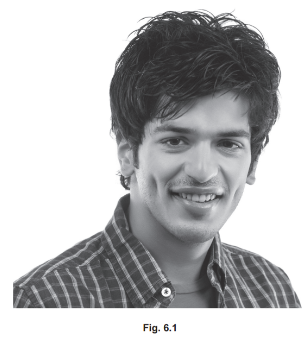

The number of male and female students in a class that had dimples was recorded.

The results are shown in Table 6.1.

**Table 6.1**

| **characteristic** | **sex** | **number of students** |
|---|---|---|
| with dimples | male | 4 |
| female | 5 |   |
| without dimples | male | 13 |
| female | 12 |   |

(i) Calculate the total number of male students in the class.

[1]

(ii) Calculate the difference in number between male and female students with dimples.

[1]

(iii) Describe the evidence from Table 6.1 that shows that dimples are a type of discontinuous variation.

[2]

(iv) State one other example of discontinuous variation in humans.

[1]

(v) State one example of continuous variation in humans.

[1]

*Source: june 2021 paper 3 Q6A*

**Q1** [4 marks]

Variation can be caused by a mutation.

Complete the sentences about mutation using words from the list.

Each word can be used once, more than once or not at all.

**alleles 	decrease	 genetic	 impulses **

**Increase	 ionising 	maintain 	physical 	stimuli **

A mutation is a ............................................... change.

Mutations form new ................................................

Some chemicals and ............................................... radiation can

............................................... the rate of mutation.

*Source: june 2021 paper 3 Q6B*

### Q2 — easy — 3 marks

**Q2** [3 marks]

A farmer has a group of goats. Some have white fur and some have black fur.

Describe how the farmer can use selective breeding to produce a group of goats that only have **white** fur.

*Source: Specimen 2023 0970/03 Q3D*

### Q3 — hard — 11 marks

**Q3** [2 marks]

A population of finches lived on two neighbouring islands in the Pacific Ocean. The main food source source available to the finches on the islands was the seeds of local plants.

Over a period of 10 years, scientists recorded the average beak depth of the finch populations on each island. Their findings are summarised in Table 1.

**Table 1: Mean beak depth of finches before and after drought**

| Island | Year 1 | Year 10 |
|---|---|---|
| Island A | 9.4 mm | 10.7 mm |
| Island B | 9.5 mm | 11.1 mm |

Describe the changes in mean beak depth shown in Table 1.

**Q3** [3 marks]

**Extract:**

A population of finches lived on two neighbouring islands in the Pacific Ocean. The main food source source available to the finches on the islands was the seeds of local plants. Over a period of 10 years, scientists recorded the average beak depth of the finch populations on each island. Their findings are summarised in Table 1. Table 1: Mean beak depth of finches before and after drought | Island | Year 1 | Year 10 | | --- | --- | --- | | Island A | 9.4 mm | 10.7 mm | | Island B | 9.5 mm | 11.1 mm |

In year 5, a drought caused a shortage of small, soft seeds on both islands, while hard, large seeds remained more abundant.

Explain why the mean beak depth of finches increased on both islands after the drought.

**Q3** [4 marks]

**Extract:**

In year 5, a drought caused a shortage of small, soft seeds on both islands, while hard, large seeds remained more abundant. The mean beak depth of finches increased on both islands after the drought because: Finches with deeper beaks were able to find more food / eat the larger seeds; Finches with deeper beaks had a greater chance of surviving than those with smaller beaks; Finches with deeper beaks were more likely to reproduce; The alleles for deeper beaks were passed on to offspring.

(i) Predict how a prolonged increase in rainfall would affect the beak depth of the finch populations.

[1]

(ii) Explain your prediction from part (i).

[3]

**Q3** [2 marks]

**Extract:**

A student concluded that finches adapted to changes in seed availability because of mutations that gave rise to new alleles in response to environmental change

**Extended Only**

A student stated that finches were able to adapt to changes in seed availability because of mutations that occurred in response to environmental change.

Evaluate the student's statement.

### Q4 — easy — 7 marks

**Q4** [1 mark]

#### Extended only

An ecologist studied variation in a species of xerophyte.

Xerophytes are adapted to a particular type of environment.

State this type of environment.

*Source: 2018 0610/43 Q5A*

**Q4** [3 marks]

The ecologist studied the features of the leaves in the species of xerophyte.

Fig. 1 shows the variation in the type of leaf spike.

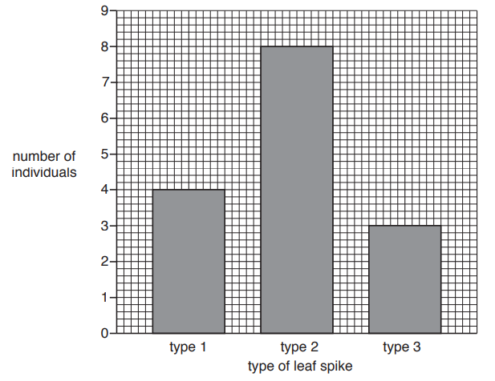

**Fig. 1**

(i)

State the type of variation shown in Fig. 1.

[1]

(ii)

Explain why the type of leaf spike is an example of the variation shown in Fig. 1.

[2]

*Source: 2018 0610/43 Q5B*

**Q4** [2 marks]

The ecologist also measured other features of the leaves.

Fig. 2 shows the variation in leaf feature **B**.

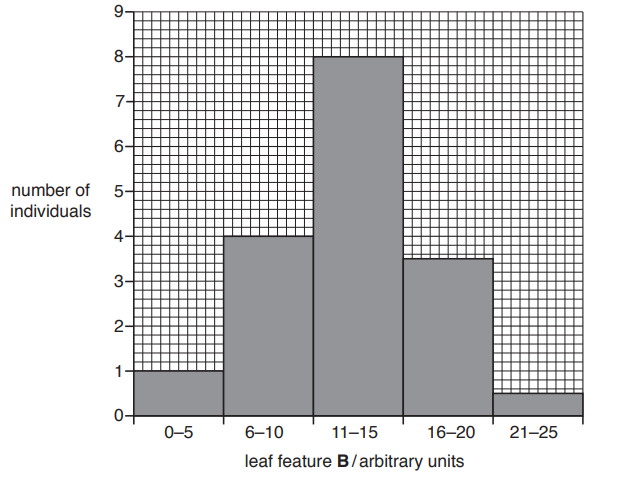

**Fig. 2**

State **two** named features of leaves that show the type of variation shown in Fig. 2.

*Source: 2018 0610/43 Q5C*

**Q4** [1 mark]

**Extract:**

The ecologist also measured other features of the leaves. Fig. 2 shows the variation in leaf feature B. State two named features of leaves that show the type of variation shown in Fig. 2.

After one year, the ecologist recorded the variation in leaf feature **B** again.

The results are shown in Fig. 3.

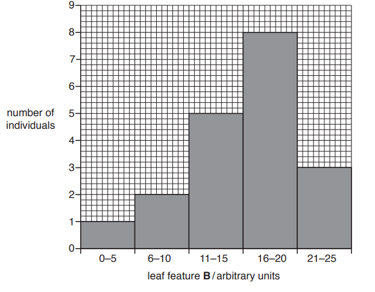

**Fig. 3**

Suggest **one** reason for the difference in variation of leaf feature **B** after one year.

*Source: 2018 0610/03 Q5D*

### Q5 — medium — 8 marks

**Q5** [2 marks]

Coat colour in horses is controlled by genes.

The allele for black coat (**E**) is dominant.

The allele for red coat (**e**) is recessive.

Place ticks in the table to show the coat colours of horses with each of the following genotypes.

| **genotype** | **black coat** | **red coat** |
|---|---|---|
| **EE** |   |   |
| **Ee** |   |   |
| **ee** |   |   |

*Source: 2018 0610/33 Q5A*

**Q5** [1 mark]

Modern horse breeds look very different to each other, but still belong to the same species.

Fig. 1 shows three different horse breeds.

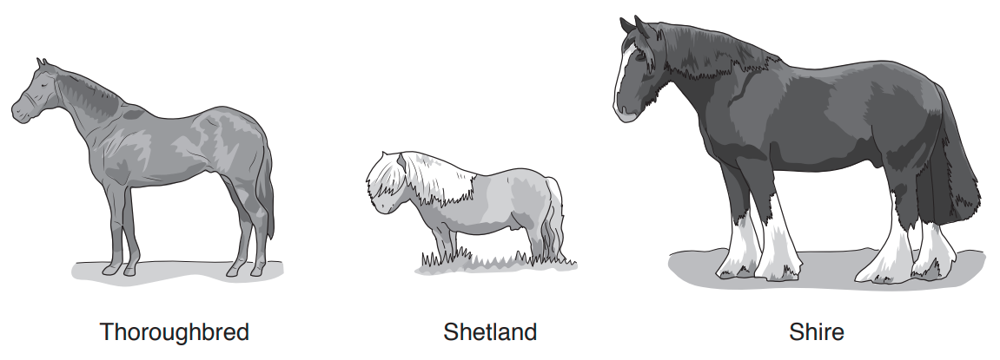

**Fig. 1**

State the term used to describe the difference between individuals of the same species.

*Source: 2018 0610/33 Q5B*

**Q5** [3 marks]

Shire horses have been produced by selective breeding. They are strong and can pull heavy loads.

Describe the process of selective breeding.

*Source: 2018 0610/33 Q5C*

**Q5** [2 marks]

Describe how natural selection differs from selective breeding.

*Source: 2018 0610/33 Q5D*

### Q6 — medium — 12 marks

**Q6** [2 marks]

All commercial breeds of sheep belong to the species *Ovis aries*.

Define the term *species*.

*Source: 2019 0970/41 Q1A*

**Q6** [2 marks]

The Merino is a breed of sheep that is farmed mainly for its wool. The wool is very thick and is made of lots of very thin hairs.

Fig. 1 shows a female Merino sheep with her newborn lamb.

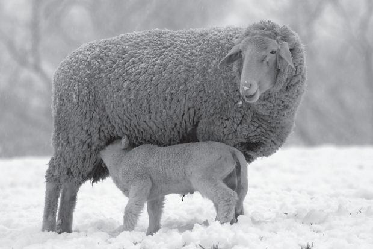

**Fig. 1**

The presence of hair is a feature that is only found in mammals.

State **two other** features that distinguish mammals from all other vertebrates.

*Source: 2019 0970/41 Q1B*

**Q6** [5 marks]

Merino sheep in South Africa have high quality wool with very thin hairs.

Breeders in New Zealand have used selective breeding programmes to improve the wool of their sheep to match the quality of South African wool.

Describe the steps that breeders would take to breed sheep that have wool with very thin hairs.

*Source: 2019 0970/41 Q1C*

**Q6** [3 marks]

#### Extended Only)

Explain how natural selection differs from selective breeding.

*Source: 2019 0970/41 Q1D*

### Q7 — medium — 6 marks

**Q7** [1 mark]

Blood group is an example of discontinuous variation.

The blood groups of patients in a hospital were recorded.

Fig. 1 shows the results.

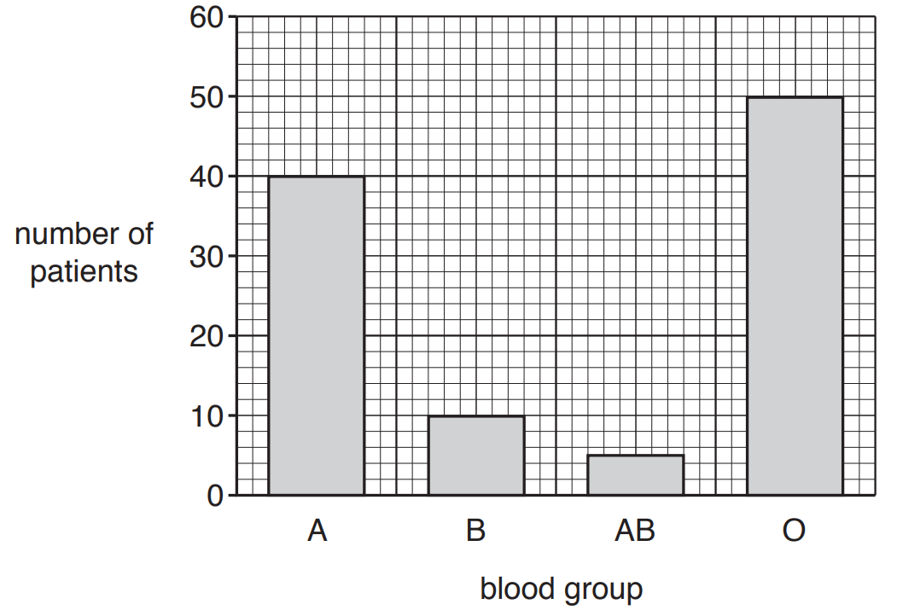

**Fig. 1**

Explain how Fig. 1 shows that blood group is an example of discontinuous variation.

*Source: 2018 (Series 2) 0610/32 Q8A*

**Q7** [2 marks]

Table 1 shows different examples of variation.

Tick all the boxes that show examples of discontinuous variation.

**Table 1**

| Attached or unattached earlobes |   |
|---|---|
| Foot length |   |
| Height |   |
| Tongue rolling |   |
| Weight |   |

*Source: 2018 (Series 2) 0610/32 Q8B*

**Q7** [3 marks]

Variation can be caused by mutation.

The word mutation can be connected to the words in the boxes on the right to make a complete sentence.

Draw **three** lines to join the word ‘mutation’ to the words in the boxes to make three correct sentences.

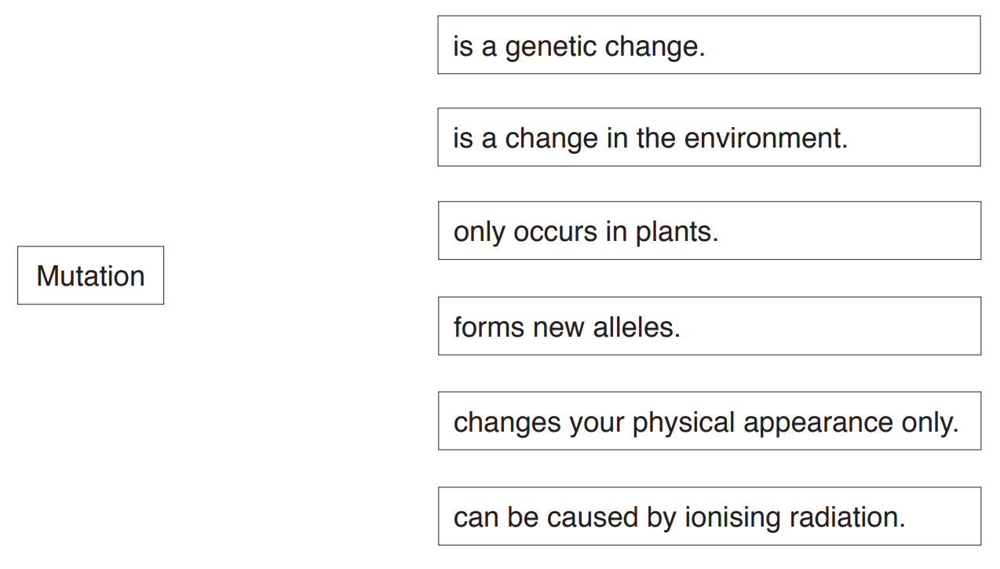

*Source: 2018 (Series 2) 0610/32 Q8C*

### Q8 — hard — 15 marks

**Q8** [3 marks]

#### Extended only

Compare natural selection with artificial selection.

**Q8** [4 marks]

Selective breeding is an example of artificial selection.

The Wild Mustard plant has undergone extensive selective breeding for hundreds of years.

Fig. 1 shows the outcome of this selective breeding and the traits that have been selected for.

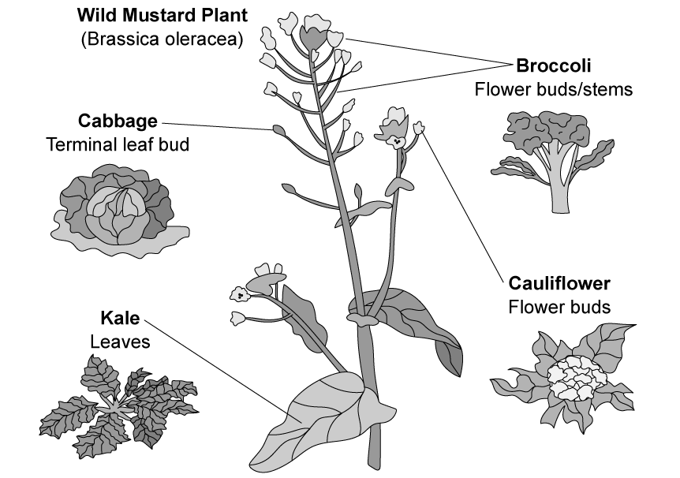

**Fig. 1 **

Outline how selective breeding of the Wild Mustard plant has led to the development of the Kale plant.

**Q8** [4 marks]

#### Extended only

Streptomycin is an antibiotic.

Table 1 shows results scientists collected from a study examining the effect of streptomycin on a bacterial population over fifteen generations.

The bacterial population consisted of organisms of two variants (**X** and **Y**).

**Table 1**

| **generation** | **frequency of variant X in the population** | **frequency of variant Y in the population** |
|---|---|---|
| 1 | 52 | 51 |
| 2 | 55 | 49 |
| 3 | 64 | 44 |
| 4 | 66 | 41 |
| 5 | 73 | 38 |
| 6 | 76 | 32 |
| 7 | 81 | 26 |
| 8 | 85 | 21 |
| 9 | 89 | 16 |
| 10 | 94 | 12 |
| 11 | 98 | 8 |
| 12 | 99 | 5 |
| 13 | 99 | 2 |
| 14 | 99 | 1 |
| 15 | 99 | 1 |

Describe and explain the data shown in Table 1.

**Q8** [4 marks]

**Extract:**

Streptomycin is an antibiotic. Table 1 shows results scientists collected from a study examining the effect of streptomycin on a bacterial population over fifteen generations. The bacterial population consisted of organisms of two variants (X and Y). Table 1: | generation | frequency of variant X in the population | frequency of variant Y in the population | 1 | 52 | 51 | 2 | 55 | 49 | 3 | 64 | 44 | 4 | 66 | 41 | 5 | 73 | 38 | 6 | 76 | 32 | 7 | 81 | 26 | 8 | 85 | 21 | 9 | 89 | 16 | 10 | 94 | 12 | 11 | 98 | 8 | 12 | 99 | 5 | 13 | 99 | 2 | 14 | 99 | 1 | 15 | 99 | 1 |

Explain the process that has led to the results shown by variant **X** in Table 1.

### Q9 — hard — 14 marks

**Q9** [5 marks]

#### Extended only

Scientists investigated mutations in ants by exposing them to UV rays. Their results are shown in Fig. 1.

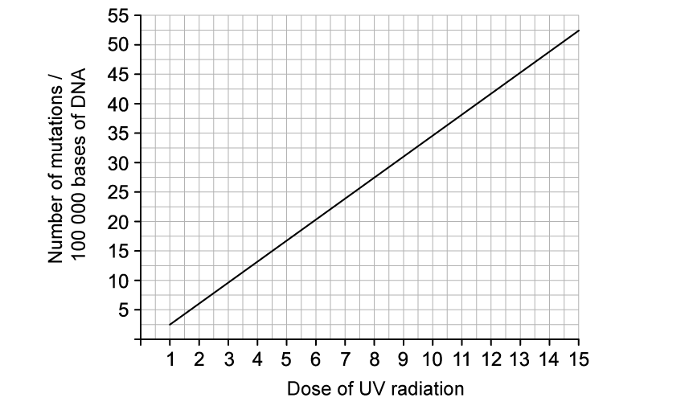

**Fig. 1**

(i)

Explain why is meant by a mutation.

[1]

(ii)

Describe and explain the results in Fig. 1.

[2]

(iii)

Calculate the percentage change in mutations from the first dose of UV radiation to the last.

[2]

**Q9** [2 marks]

#### Extended only

Explain whether all mutations are harmful or not.

**Q9** [3 marks]

Fig. 2 shows an ant.

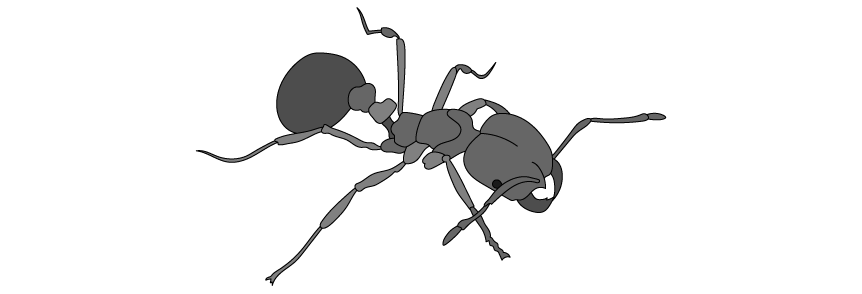

**Fig. 2**

Use the information in Fig. 2 to determine the kingdom, phylum and class of ants.

**Q9** [4 marks]

There are more than 12 000 known species of ants.  Fig. 3 shows a fossilised ant that was embedded in amber about 20 million years ago.

The physical form of ants has barely changed throughout their history.

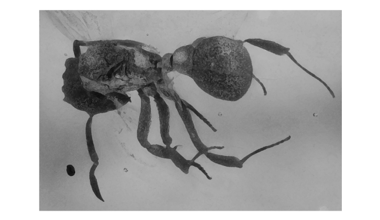

**Fig. 3**

Image courtesy of Wikimedia Commons: https://commons.wikimedia.org/wiki/File:Extinct_fungus-growing_ant_(23411374650).jpg

Insects Unlocked, CC0, via Wikimedia Commons

Suggest an explanation for what this tells you about the adaptive features of ants.

### Q10 — easy — 4 marks

**Q10** [4 marks]

Fig. 1 shows a group of male students. They are all the same age.

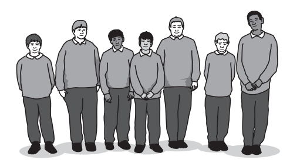

**Fig. 1**

(i)

The students in Fig. 1 show continuous variation in some of their characteristics.

State **three** characteristics in which these students show continuous variation.

[3]

(ii)

State **one** example of discontinuous variation.

[1]

*Source: 2018 0610/32 Q9B*

### Q11 — hard — 12 marks

**Q11** [2 marks]

#### Extended only

Fig. 1 shows a micrograph of a leaf from a desert plant.

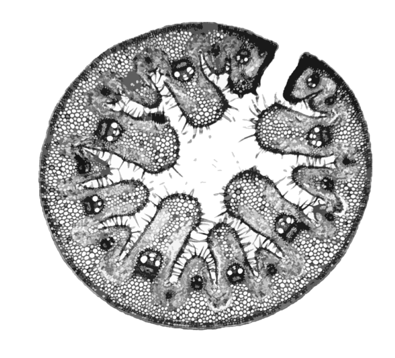

**Fig. 1**

Identify and label **two **adaptive features visible in Fig. 1.

**Q11** [2 marks]

**Extract:**

Two adaptive features visible in Fig. 1 are...

Any two from the following:

- Rolled leaf; [1 mark]
- Hairs; [1 mark]
- Thick (waxy) cuticle; [1 mark]

#### Extended only

For **one** of the features identified in part (a), explain how this is an adaption for the plant.

**Q11** [2 marks]

#### Extended only

Fig. 2 shows a micrograph of a leaf from a different type of plant.

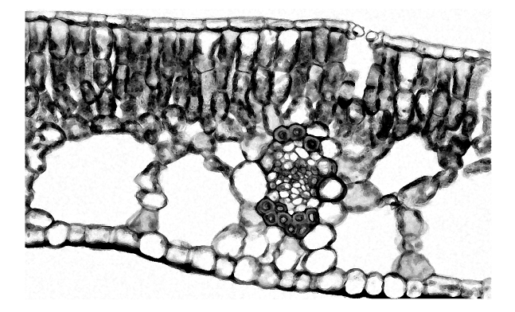

**Fig. 2**

Suggest and explain what type of plant this leaf may be from.

**Q11** [6 marks]

A student investigated the submergence of leaves from plants in a pond and the depth of the roots within sediment.

Table 1 shows their results.

**Table 1**

| **submergence of leaf within  pond** | **depth of roots within sediment / cm** |
|---|---|
| floating | 58 |
| partially submerged | 35 |
| fully submerged | 23 |

(i)

Explain which type of data is shown by the depth of roots within the sediment.

[2]

(ii)

Explain which type of graph would best display this data.

[2]

(iii)

Suggest a conclusion for the data.

[2]

### Q12 — easy — 6 marks

**Q12** [2 marks]

Selective breeding of animals is very important to farmers.

Many different breeds of sheep have been produced by selective breeding.

Fig. 1 shows a flock of Merino sheep. This breed of sheep was produced by selective breeding.

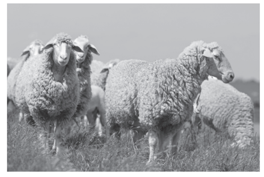

**Fig. 1**

Sheep are important animals in many parts of the world as they produce meat, wool and milk.

Table 1 describes some characteristics of five different breeds of sheep.

**Table 1**

| breed of sheep | wool yield | wool quality | meat yield | milk yield |
|---|---|---|---|---|
| Arapawa | average | good | poor | average |
| Awassi | average | poor | average | very good |
| Blackbelly | poor | poor | very good | average |
| Merino | good | very good | good | poor |
| Tsurcana | average | good | average | average |

A farmer wants to sell both meat and wool.

Suggest which breed of sheep in Table 1 is the most suitable for this farmer.

Give a reason for your choice.

*Source: 2018 0610/31 Q10A*

**Q12** [4 marks]

**Extract:**

Table 1 describes some characteristics of five different breeds of sheep.

| breed of sheep | wool yield | wool quality | meat yield | milk yield |
| Arapawa | average | good | poor | average |
| Awassi | average | poor | average | very good |
| Blackbelly | poor | poor | very good | average |
| Merino | good | very good | good | poor |
| Tsurcana | average | good | average | average |

Another farmer wants to produce a new breed of sheep with both a very good milk yield and a very good quality of wool.

The farmer is able to buy any of the breeds of sheep shown in Table 1.

Describe the process this farmer would use to produce the new breed of sheep on her farm.

*Source: 2018 0610/31 Q10B*

