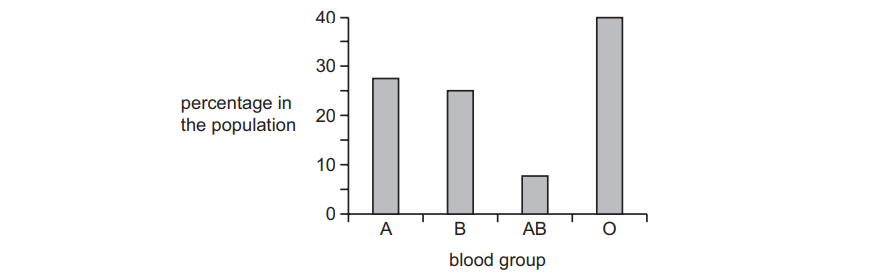
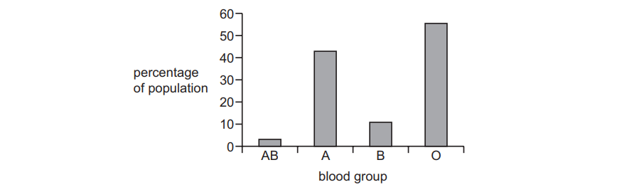
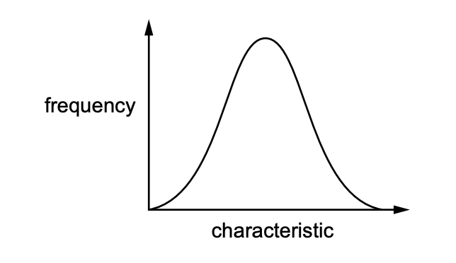
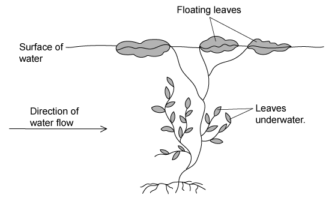

# Exam Questions — Variation & Natural Selection
**18. Variation & Selection** · Cambridge (CIE) IGCSE biology (0610 & 0970)
> Source: [https://www.savemyexams.com/igcse/biology/cie/23/topic-questions/](https://www.savemyexams.com/igcse/biology/cie/23/topic-questions/) · 25 questions across 1 sets

## Multiple Choice Questions (25 questions)

### Q1 — hard — 1 marks

**Q1** [1 mark]

A desert plant has thick leaves and a waxy cuticle.

Scientists make three statements.

1. These features reduce water loss.
2. These features are inherited characteristics.
3. These features developed because the plant needed them.

Which statements are correct?

### Q2 — easy — 1 marks

**Q2** [1 mark]

New strains of the crop plant wheat can be produced by cross-breeding disease resistant plants with those that give high yields of grain.

What is this an example of?

*Source: June 2021 0970/21 Q36*

### Q3 — medium — 1 marks

**Q3** [1 mark]

The graph shows the percentage of different blood groups in a human population.

Which type of variation is shown by human blood groups?

*Source: June 2021 0970/21 Q35*

### Q4 — easy — 1 marks

**Q4** [1 mark]

Which adaptation is shown in the leaves of hydrophytes?

*Source: june 2022 paper 2 Q32*

### Q5 — hard — 1 marks

**Q5** [1 mark]

Sickle cell anaemia is a genetic disorder which results in severe illness in homozygous individuals. In some human populations, being heterozygous can be beneficial.

What could be the reason for this?

*Source: june 2022 paper 2 Q33*

### Q6 — easy — 1 marks

**Q6** [1 mark]

Which statement about selective breeding is correct?

*Source: June 2022 Paper 1 Q35*

### Q7 — medium — 1 marks

**Q7** [1 mark]

The graph shows the distribution of blood groups in one area.

This is an example of discontinuous variation.

Which statement about discontinuous variation is correct?

*Source: June 2021 0970/11 Q35*

### Q8 — easy — 1 marks

**Q8** [1 mark]

Over the last 30 years some antibiotics have become less effective in treating bacterial infections.

What is the reason for this?

*Source: Specimen 2023 0970/02 Q34*

### Q9 — hard — 1 marks

**Q9** [1 mark]

Dates are a type of fruit.

The table shows some features of the dates a farmer grows.

| variety | colour | texture | yield | size |
|---|---|---|---|---|
| Barhee | amber | soft | high | small to medium |
| Dayri | dark reddish brown | semi dry | variable | medium to large |
| Hayany | purplish black | soft | medium | large |
| Maktoom | amber | soft | medium | medium to large |
| Thoory | straw coloured | dry | medium | medium to large |

The farmer would like to produce a new variety of date using selective breeding.

He wants a medium-sized date that is straw coloured and soft, with a high yield.

Which two varieties could the farmer breed together to get the variety he wants?

*Source: Specimen 2023 0970/01 Q34*

### Q10 — hard — 1 marks

**Q10** [1 mark]

The graph shows the distribution of a characteristic in a population.

Which characteristic is shown by the curve?

*Source: Specimen 2023 0970/01 Q33*

### Q11 — medium — 1 marks

**Q11** [1 mark]

#### Extended

A cactus is a type of xerophyte. Cacti have fewer stomata than other plants.

How is this an adaptation to survive in desert conditions?

### Q12 — medium — 1 marks

**Q12** [1 mark]

Which of the following statements is a correct definition of ‘adaptive features’?

### Q13 — medium — 1 marks

**Q13** [1 mark]

An island’s entire population of a species of butterfly are descended from just two parents. These were introduced from the mainland.

Which of the following statements about this species of butterfly, compared with that of the mainland, is correct?

### Q14 — medium — 1 marks

**Q14** [1 mark]

#### Extended

A patient with a bacterial infection is treated with antibiotics, but some of the bacteria survive.

Which statement is correct about the bacteria that have survived?

### Q15 — medium — 1 marks

**Q15** [1 mark]

#### Extended

The diagram shows a hydrophyte in a stream.

Which statement is **true **about the leaves underwater?

### Q16 — hard — 1 marks

**Q16** [1 mark]

Which row best describes human blood groups?

|   | affected by environment | has no intermediates | shows continuous variation | shows discontinuous variation |
|---|---|---|---|---|
| **A** | X | ✓ | X | ✓ |
| **B** | X | ✓ | ✓ | X |
| **C** | ✓ | X | ✓ | X |
| **D** | ✓ | X | X | ✓ |

### Q17 — hard — 1 marks

**Q17** [1 mark]

When growing millet, farmers choose seeds from high-yielding plants.

Which of the following is this an example of?

### Q18 — hard — 1 marks

**Q18** [1 mark]

A woman who has blood group A and a man who has blood group B have four children, each with a different blood group A, B, AB and O.

What variation does this show?

### Q19 — hard — 1 marks

**Q19** [1 mark]

The graph below shows the height of bean plants grown from 1000 bean seeds.

What variation do the plants show?

### Q20 — easy — 1 marks

**Q20** [1 mark]

#### Extended

Which of these is **not **a feature of a hydrophyte?

### Q21 — easy — 1 marks

**Q21** [1 mark]

What is a mutation?

### Q22 — easy — 1 marks

**Q22** [1 mark]

Which of the following is **not **a feature of natural selection?

### Q23 — easy — 1 marks

**Q23** [1 mark]

Which of the following characteristics show discontinuous variation?

### Q24 — hard — 1 marks

**Q24** [1 mark]

#### Extended

Xerophytes have an inverted stomatal opening rhythm. This means that during the day when the sun is at its peak, most stomata of xerophytes are closed.

Which statement explains a disadvantage of this for the plant?

### Q25 — easy — 1 marks

**Q25** [1 mark]

Which of these phenotypes is affected by **both **environmental and genetic factors?
