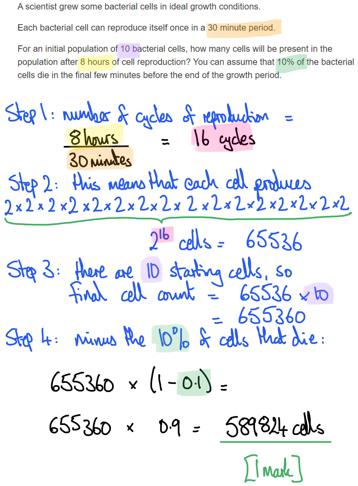

# Mark Schemes — Energy & Feeding Relationships
**19. Organisms & Their Environment** · Cambridge (CIE) IGCSE biology (0610 & 0970)

## Multiple Choice Questions (28 questions)

### Q1
**Final answer:** **The correct answer is ****A.**

- A **producer** is an organism that **makes its own organic nutrients**, usually by **photosynthesis **using energy from sunlight
- Grass is a plant, so it acts as a producer at the first trophic level of a food chain, converting **light energy into chemical energy** stored in organic molecules

**B **is incorrect because a rabbit is a primary consumer, obtaining energy by feeding on plants.

**C **is incorrect because a hawk is a carnivore and a higher-level consumer, obtaining energy by eating other animals.

**D** is incorrect because fungi are decomposers, obtaining energy by breaking down dead organic material.

### Q2
**Final answer:** **The correct answer is ****A****.**

- A secondary consumer is a consumer that eats a primary consumer and a tertiary consumer is one that consumes a secondary consumer
- The fox eats rabbits and mice, which are both primary consumers, this makes the fox a secondary consumer
- However, the fox also eats blackbirds which are secondary consumers, this makes the fox also a tertiary consumer

**B** is incorrect because the owl eats the mouse and the grasshopper making it a secondary consumer only.

**C** is incorrect as the blackbird is a secondary consumer only.

**D** is incorrect as the rabbit is a primary consumer only.

### Q3
**Final answer:** **The correct answer is ****C****.**

- The sun transfers light energy to the plant, this is absorbed by the chlorophyll and converted to chemical energy in the form of glucose stored as starch in the tissues of the plant. This chemical energy is then passed on through the trophic levels of the food chain to the rabbit and then to the fox when it eats the rabbit.

**A** is incorrect because light energy from the sun is transferred to the grass which then converts it to chemical energy through photosynthesis.

**B** is incorrect because, although the sun gives out heat energy, it is the light energy that is used in photosynthesis in the production of glucose.

**D** is incorrect because although the rabbit will release heat energy, it is the chemical energy stored in the biomass of the rabbit that is transferred to the fox.

### Q4
**Final answer:** **The correct answer is ****A****.**

- This is because if the chaffinches die then the number of caterpillars would increase because they are not being predated anymore
- The increased number of caterpillars would eat more of the trees, resulting in more damage to these trees

**B** is incorrect because the food supply for the grey squirrels would decrease as the trees are consumed by more caterpillars.

**C** is incorrect because the number of wood pigeons would decrease due to having less food available as the trees are being consumed by the large population of caterpillars.

**D** is incorrect because the population of caterpillars would increase as they are no longer being eaten by the chaffinches.

### Q5
**Final answer:** **The correct answer is ****B****.**

- This is because a population is defined as a group of organisms of one species, living in the same area at the same time
- All the red deer are the same species living in the same place (the forest) at the same time

**A** is incorrect because all the animals in the forest are different species and so are not classified as the same population.

**C** is incorrect because all the organisms in the forest are different species and so are not classified as the same population.

**D** is incorrect because all the plants in the forest are different species and so are not classified as the same population.

### Q6
**Final answer:** **The correct answer is ****C****.**

- This is because photosynthesis takes in energy from the sun and converts it into chemical energy stored in the bonds of glucose molecules
- This allows the energy to be in a form that can be released and used by living organisms in the process of respiration

**A** is incorrect because the energy in the chemicals that are taken in during ingestion come from other organisms and so this is not the principle source of energy in biological systems.

**B** is incorrect because decomposition breaks down biological molecules, releasing energy from their organic matter and so this is not the principle source of energy in biological systems.

**D** is incorrect because respiration releases energy from glucose however the glucose must initially be made during the process of photosynthesis before it can be used for respiration.

### Q7
**Final answer:** **The correct answer is ****B****.**

- All the crocodiles in a river represent a specific group of the same species living in a particular area, which defines a population.

**A** is incorrect because all the arthropods in a pond includes multiple species, not a single population.

**C** is incorrect because all the plants in a wood also include different species and do not represent a single population.

**D** is incorrect because all the zebras that lived from 1990–2010 refers to a historical time frame and not a current population in a specific area.

### Q8
**Final answer:** **The correct answer is ****A****.**

- A secondary consumer occupies the second level of the food chain and eats primary consumers. In this case, the desert foxes, desert snakes and hawks all eat the kangaroo rats (primary consumer) and the large lizards eat the small lizards (primary consumer).

**B** is incorrect because it doesn’t include the large lizards or desert snakes.

**C** is incorrect because it names only the primary consumers

**D** is incorrect because it doesn’t include the desert foxes or the hawks.

### Q9
**Final answer:** **The correct answer is B**

- This is because denitrifying bacteria release nitrogen from the nitrates in the soil to the atmosphere (W)
- The conversion of ammonium ions to nitrate ions is nitrification (X)
- Decomposing bacteria convert dead plants and animals into ammonium ions (Y)
- Nitrogen-fixing bacteria convert atmospheric nitrogen into nitrates in the soil or into root nodules of leguminous plants (Z)

**A** is incorrect because X and Y processes are incorrect

**C **is incorrect because all of the processes named in the table are incorrect

**D **is incorrect because W and Z processes are incorrect

### Q10
**Final answer:** **The correct answer is D because:**

At 200 days the curve switches to curving towards being level as the insect population is starting to be limited by resources such as food

**A**,** B** and **C** are all incorrect because the curve is still curving upwards as the insect population is growing rapidly as it is not being limited by anything.

### Q11
**Final answer:** **The correct answer is A because:**

- This is because during decay the decomposers break down carbon from dead and waste materials for respiration and release carbon dioxide into the air
- Plants take in carbon dioxide from the air to carry out photosynthesis

**B** is incorrect because respiration releases carbon dioxide into the air, it does not remove it.

**C** is incorrect because photosynthesis removes carbon dioxide from the air and combustion releases carbon dioxide into the air.

**D** is incorrect because decay releases carbon dioxide into the air.

### Q12
**Final answer:** **The correct answer is D because:**

The rabbit and the snail are both primary consumers because they both eat producers

**A** is incorrect because the frog is not a herbivore, it does not eat plants.

**B** is incorrect because the hawk is a tertiary consumer.

**C** is incorrect because the frog is a secondary consumer.

### Q13
**Final answer:** **The correct answer is ****D ****(there is a large amount of energy loss at each level so insufficient energy can be passed up to the sixth trophic level) because:**

Most tropic levels are less than 10% efficient; in other words, less than 10% of the energy in an organism is available to the organisms that eat it. If this inefficiency is extended along a food chain, very little energy reaches the top predator, which would make a further trophic level impossible to sustain.

**A** is incorrect because firstly, efficiency is never as high as 20%; even then the cumulative effects would be 20% of 20% of 20% (0.8%), not added up as shown in this statement.

**B **is incorrect because pyramids of numbers don't have to be pyramid-shaped. There does not have to be just one top predator; a habitat would be expected to sustain at least one mating **pair **to ensure that the species survives.

**C** is only partly correct because energy is the best consideration, not biomass; this statement is partially correct but the question asks for the <u>best</u> explanation.

### Q14
**Final answer:** **The correct answer is ****A**** because:**

As the carnivores have less food available the numbers will reduce over time. The reduction in numbers will be rapid as shown in graph A.

**B** is incorrect because this graph shows a gentle decline in the number of carnivores over time. The decline has also started before point X on the graph.

**C** and **D** are incorrect because both graphs show the numbers of carnivores increasing after point X.

### Q15
**Final answer:** **The correct answer is ****B**** (crabs) because:**

Crabs feed on mussels, lugworms and limpets. This gives them the largest range of food sources (3 in all) in this food web. This would mean that they have the greatest chance of survival if one of their food sources decreased in number.

**A** is incorrect because whelks only have one source of food, mussels.

**C** is incorrect because limpets only have one source of food, sea lettuce.

**D** is incorrect because mussels only have one source of food, small invertebrates.

### Q16
**Final answer:** **The correct answer is ****D**** because:**

- Pyramids of numbers show the **number of organisms** in the chain. In this case, there would likely only have been one tree in this food chain. Producers are always at the bottom of the pyramid. The number of** **primary consumers that are insects that could be supported by one tree is likely to be very large, so the second level of the pyramid would be much bigger than the first level, and the biggest of the pyramid
- As you go up the pyramid after the primary consumer the number of organisms that can be supported decreases (due to loss of biomass) so in this case the number of birds of prey will be less than the number of small birds

### Q17
**Final answer:** **The correct answer is ****C**** (respiration) because:**

Decomposers release energy from their food (dead matter) by **respiration**. Essentially the source of food for a decomposer is a dead plant / animal and their consumption of dead matter leads to the recycling of nutrients back into the environment. They respire as they do this, releasing carbon dioxide.

**A** is incorrect because photosynthesis removes carbon dioxide from the atmosphere. This is shown by the arrow from carbon dioxide in the atmosphere to green plants.

**B** is incorrect because feeding is to take in food, this process is shown by the arrows from green plants to decomposers and green plants to animals.

**D** is incorrect because combustion releases carbon dioxide into the atmosphere. This is shown by the arrow from fossil fuels to carbon dioxide in the atmosphere.

### Q18
**Final answer:** **The correct answer is ****B**** (589 824 cells) because:**

This is calculated as set out below.

### Q19
**Final answer:** **The correct answer is ****C**** (5%) because:**

The calculation can be completed as below:

### Q20
**Final answer:** **The correct answer is ****B**** (200 years) because:**

Between 1630 and 1830 the population increased from 500 million to 1000 million. This is the longest time period represented on the graph for the population to double. After 1830 there was rapid growth of the human population, the time for the population to double was significantly less.

### Q21
**Final answer:** **The correct answer is ****C**** because:**

Pyramids of biomass are always pyramid shaped, regardless of the habitat that they represent (unlike pyramids of number).

Pyramids **A**, **B** and **D** are not pyramid shaped so, therefore, do not show a pyramid of biomass.

### Q22
**Final answer:** **The correct answer is ****C**** because:**

The process of denitrification removes nitrates from the soil, releasing it back into the atmosphere as nitrogen gas. This process occurs naturally by denitrifying bacteria in the soil, and it reduces soil fertility.

**A** is incorrect because this arrow shows decomposition of animals into ammonium compounds.

**B** is incorrect because this arrow refers to nitrification which is carried out by nitrifying bacteria.

**D** is incorrect because this arrow depicts nitrogen fixation by bacteria in root nodules and lightning.

### Q23
**Final answer:** **The correct answer is ****B**** because:**

The definition of a population is 'the same species living in the same habitat at the same time'.

**A** is incorrect because this answer refers to ‘all the animals’, it is highly unlikely all of the animals in a forest belong to the same species, so this is not a definition of a population.

**C** is incorrect because this refers to more than one species so is not the definition of population.

**D** is incorrect because while this refers to a number of organisms of the same species this is not at the same time as over 150 years, some of the people will have died and other will have been born.

### Q24
**Final answer:** **The correct answer is ****C**** because:**

The first diagram shows a pyramid of biomass, although the trees are few in number, they are large organisms with a very high biomass. Remember that biomass is the biological mass of the organisms after water has been removed. The aphids have a small biomass; therefore a very large number are needed to support the next trophic level so in a pyramid of numbers this will be a much larger box than the producers. Remember that the producers are always at the bottom of a pyramid. <u>Pyramids of biomass are always pyramid shaped but pyramids of numbers may not be</u>.

**A **& **D **are incorrect because there will only be a few trees supporting many of the next level in the chain. In a pyramid of numbers, when the producers are very large organisms, they will be represented by a smaller box.

**B** is incorrect because if there were only a very small number of aphids there would not be enough to support the next level in the chain.

### Q25
**Final answer:** **The correct answer is ****C**** because:**

The exponential (log) phase in a population growth curve is when there is rapid growth of a population.

**A **is incorrect because the stationary phase on the graph would show neither an increase nor a decrease in numbers in the population.

**B **is incorrect because the lag phase is when the population is growing slowly and adjusting to new conditions.

**D **is incorrect because the death phase on a graph would show the decline of the population with the line decreasing. This is not yet seen in the human population.

### Q26
**Final answer:** **The correct answer is ****B**** because:**

- Energy from the sun is trapped by **chlorophyll**, the pigment found in chloroplasts. Light energy is then used to drive the synthesis of carbohydrates such as glucose (a **sugar**); in this sense an energy transfer occurs from light to chemical potential energy within the bonds of carbohydrate molecules
- The sugars produced in photosynthesis are then **stored **as more complex molecules such as starch in the plant

### Q27
**Final answer:** **The correct answer is ****A ****(nitrogen fixation) because:**

The process of nitrogen fixation is carried out by bacteria in the root nodules of leguminous plants (peas, beans and clover for example). Nitrogen fixation can also occur during a lightning storm. In nitrogen fixation, nitrogen gas in the atmosphere is converted to ammonia.

**B** is incorrect because decomposition in the nitrogen cycle involves the breakdown of organisms into ammonium compounds.

**C** is incorrect because nitrification is carried out by nitrifying bacteria. This converts ammonium into nitrites and then to nitrates that can be used by plants.

**D** is incorrect because denitrification is the process that reduces fertility in the soil by removing nitrates and converting them to nitrogen gas.

### Q28
**Final answer:** **The correct answer is ****A**** (all the populations of all species in a forest) because:**

The definition of a community is all of the populations of all of the different species in a habitat.

**B** is incorrect because this answer refers to one species, all the goldfish in a pond.

**C** is incorrect because this refers to only two species. There will be more than two species in that habitat.

**D** is incorrect because this answer only refers to the producers in the forest and doesn’t consider all the populations within that habitat.
