# Mark Schemes — Energy & Feeding Relationships
**19. Organisms & Their Environment** · Cambridge (CIE) IGCSE biology (0610 & 0970)

## Alternative To Practical Questions (2 questions)

### Q1
> **[mark-scheme]**
> (i) The rabbit population at year 0 is:
> 
> - 400 **[1 mark]**
> 
> (ii) The fox population at year 10 is:
> 
> - 40 **[1 mark]**

> **[exam-tip]**
> When reading values from a graph, make sure you read the correct axis. Here, the rabbit population is typically shown on one axis and the fox population on another. Take care to identify which line represents which organism before reading off the value.
> **[mark-scheme]**
> 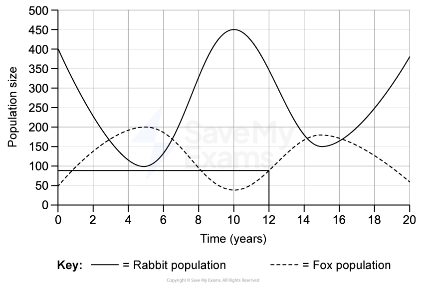
> 
> - Construction lines clearly visible on graph at year 12, drawn from the x-axis to the fox line and across to the y-axis **[1 mark]**
> - **90 ****[1 mark]**
> 
> Accept any answer between 80 and 100 for the fox population estimate.

> **[exam-tip]**
> Make sure you draw clear construction lines on your graph to show the examiner exactly how you obtained your estimate. Draw a vertical line from year 12 on the x-axis up to the fox population line, then a horizontal line across to the y-axis. Without these lines, you may lose a mark even if your final answer is correct. Read the y-axis scale carefully and give your answer as a single value rather than a range.

**[2 marks]**
> **[mark-scheme]**
> - The rabbit population fluctuates/rises and falls in a cyclical pattern **[1 mark]**
> - Appropriate data quote with units (e.g. reaching a peak of 450 at year 10) **[1 mark]**

> **[exam-tip]**
> When asked to describe a trend, always mention the overall pattern first (e.g. cyclical, increasing, decreasing) and then back it up with specific data from the graph, including units. Many students lose the second mark by describing the trend in general terms without quoting any figures. Make sure you reference at least one data point with its correct value and the corresponding year.
> **[mark-scheme]**
> - As the rabbit population increases, the fox population increases (or vice versa) **[1 mark]**
> 
> **OR**
> 
> - The fox population changes lag behind / follow the rabbit population changes **[1 mark]**

> **[exam-tip]**
> When describing a relationship between two populations on a graph, make sure you refer to both populations and explain how one changes in relation to the other. A common mistake is to describe only one population's trend without linking it to the other. If you notice a time delay between the peaks of the two populations, mentioning this lag is a strong way to demonstrate your understanding of predator–prey relationships.

**[1 mark]**
$\text{percentage decrease} = \frac{180-60}{180} \times 100$

$= \frac{120}{180} \times 100$

$= 66 . 666 . . .$

= **66.7 %**

> **[mark-scheme]**
> - Correct substitution into the formula: $( 180 - 60 ) / 180 \times 100$ **OR **$120 / 180 \times 100$ **[1 mark]**
> - Correct unrounded value: $66 . 666 . . .$ **[1 mark]**
> - Correct rounding to one decimal place: `66.7\,(\%)` **[1 mark]**

> **[exam-tip]**
> When calculating a percentage decrease, always divide the change by the **original** value (the value at the start of the period), not the final value. A common mistake is to divide by the smaller number instead. Also, make sure you round only at the very end of the calculation — rounding intermediate values can lead to an inaccurate final answer. Always show each step of your working clearly, as marks are awarded for the substitution and the unrounded answer even if the final rounding is incorrect.
> **[mark-scheme]**
> (i) The anomalous result is:
> 
> - 42 (in Sector 3) **[1 mark]**
> 
> (ii) The student calculated the mean as follows:
> 
> - The student excluded/ignored the anomalous result **AND **averaged the other three sectors **[1 mark]**

> **[exam-tip]**
> The anomalous result is the value that is significantly different from the other values in the data set.
> **[mark-scheme]**
> - Rabbits are mobile so they may be counted twice / rabbits may be hiding and missed **[1 mark]**

> **[exam-tip]**
> When asked about sources of error in population estimates, always think about what makes the method unreliable. With mobile animals, the two key issues are double-counting (because they move around) and undercounting (because they may be hidden or have moved out of the survey area). Make sure your answer clearly links the error to the fact that the animals are mobile — simply saying "they are hard to count" is too vague.
> **[mark-scheme]**
> - Only one woodland area was studied, so it may not be representative / sample area may be too small **[1 mark]**

> **[exam-tip]**
> When asked about limitations of data, think about factors such as sample size, the number of sites studied, the range of conditions tested and whether the results can be generalised. A common pitfall is describing a problem with the conclusion rather than with the data itself. Make sure your answer focuses on how the data were collected or the scope of the investigation, not on what the data show.
> **[mark-scheme]**
> Any **two **from:
> 
> - Count the populations more frequently than once a year (e.g. every month)
> - Sample a larger area of the woodland / increase the number of sectors counted
> - Use a more accurate surveying method / use camera traps / use capture-recapture
> - Repeat the counts on multiple days (in the same year) and calculate a mean
> - Ensure counts are carried out at the same time of day
> - Survey other similar woodland areas to see if the population pattern is representative
> 
> **[2 marks]**

> **[exam-tip]**
> Make sure each of your three suggestions is distinct — do not repeat the same idea in different words. For example, "repeat the counts" and "count more often" could be seen as overlapping, so be specific about what you mean. Think about the key sources of error or uncertainty in ecological sampling: sample size, frequency, timing, technique and representativeness. Each suggestion should clearly target one of these areas. Avoid vague answers such as "do it better" — always state *how* the method would be improved.

### Q2
(i) The completed table is as follows...

| Spider web | Number of insects caught in each web |
|---|---|
| **A** | 6 |
| **B** | 3 |
| **C** | 4 |
| **D** | 6 |
| **E** | 8 |
| **F** | 9 |
| Total | 36 |

- Correct values for all spider webs;** [1 mark]**
- Correct total; **[1 mark]**

(ii) The average number of insects per web in the small section of garden is...

- (36 ÷ 6) = 6;** [1 mark]**

(iii) The total number of insects caught in webs in the whole garden is...

- (6 x 102) = 612; **[1 mark]**

(iv) One reason why the estimated total number of insects caught in webs in the whole garden may not be accurate is because...

Any **one **from the following:

- Variation in insect populations in different parts of the garden / unrepresentative sample / some webs difficult to see;** [1 mark]**
- Some insects are eaten by spiders / or fall off the web; **[1 mark]**
- Some insects are too small to be visible / difficult to count; **[1 mark]**
- Some caught organisms may not be insects; **[1 mark]**

**[Total: 5 marks]**
(i) A drawing of the spider is as follows:

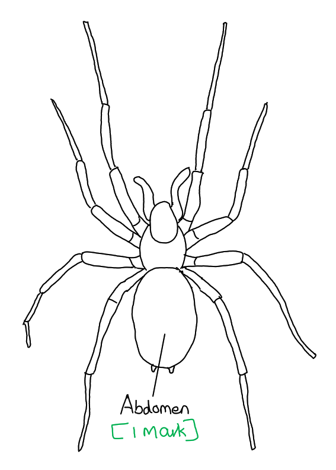

*Outer line: *

- Single, clear, continuous lines with no shading;** [1 mark]**

*Size: *

- Occupies at least half the space provided;** [1 mark]**

*Details: *

- Two body parts and 2 chelicerae (on the cephalothorax) or 2 spinnerets (on abdomen); **[1 mark]**
- 8 jointed legs, attached to the body in the correct position and in the correct orientation;** [1 mark]**

*Label:*

- <u>Line</u> labelled abdomen ending on the abdomen;** [1 mark]**

(ii) The magnification of the spider drawing can be calculated as follows...

- Length of **XY **on Fig. 2.2 given as 3.9 cm – 4.1 cm / 39 mm - 41 mm;** [1 mark]**
- Line **XY **in the correct position on the drawing; **[1 mark]**
- Magnification = 9.5 ÷ 4.0 = (x) 2.375 / 2.38 / 2.4; **[1 mark]**

**[Total: 8 marks]**

> *Clearly, the correct answer for this question depends on how large you have drawn your own image of the original spider. For the purposes of illustrating this, we have added a virtual ruler to show how you might calculate your own answer. This explains why every candidate's answers may differ from each other. *

> *A ruler has been placed on the example drawing from part b) i) as indicated below: this shows the distance **XY **to be 95 mm / 9.5 cm.*

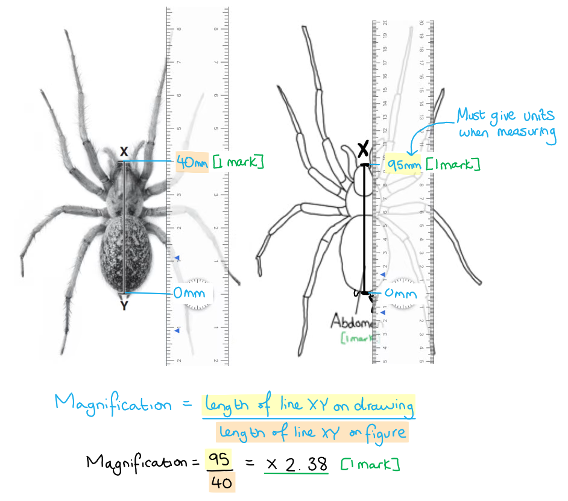

> * *
(i) A bar chart of the data is as follows...

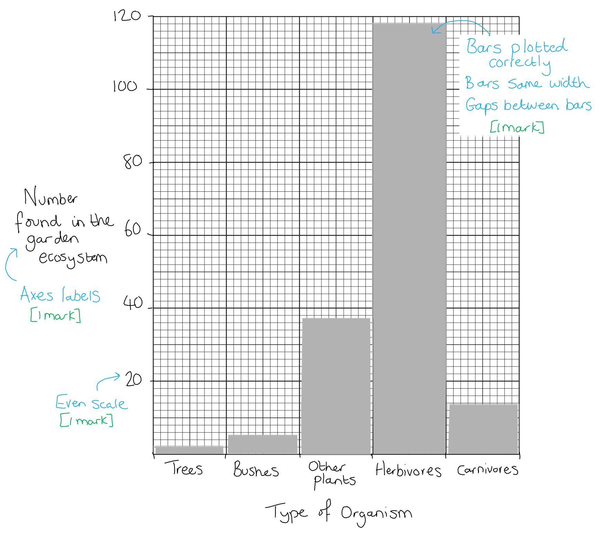

*Axes: *

- Labelled with units; **[1 mark]**

*Scale and size: *

- Even scale **AND **bars to occupy at least half the grid in both directions; **[1 mark]**

*Plotting:*

- All five bars plotted accurately **AND **± half a small square **AND **bars same width (at least 1 small squares wide) **AND **gaps between bars; **[1 mark]**

(ii) The ratio of animals to plants is...

- 3:1; **[2 marks]**

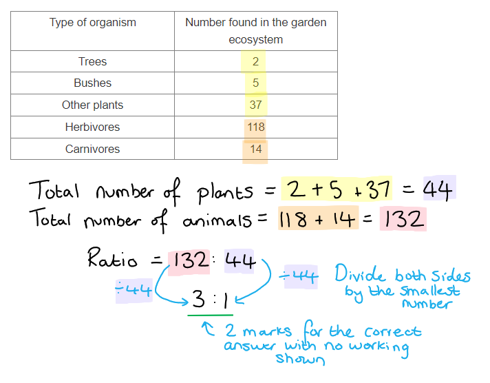

**[Total: 5 marks]**

> *Always make sure your axes labels are word for word the same as the table headings. *

## Multiple Choice Questions (28 questions)

### Q1
**Final answer:** **The correct answer is ****A.**

- A **producer** is an organism that **makes its own organic nutrients**, usually by **photosynthesis **using energy from sunlight
- Grass is a plant, so it acts as a producer at the first trophic level of a food chain, converting **light energy into chemical energy** stored in organic molecules

**B **is incorrect because a rabbit is a primary consumer, obtaining energy by feeding on plants.

**C **is incorrect because a hawk is a carnivore and a higher-level consumer, obtaining energy by eating other animals.

**D** is incorrect because fungi are decomposers, obtaining energy by breaking down dead organic material.

### Q2
**Final answer:** **The correct answer is ****A****.**

- A secondary consumer is a consumer that eats a primary consumer and a tertiary consumer is one that consumes a secondary consumer
- The fox eats rabbits and mice, which are both primary consumers, this makes the fox a secondary consumer
- However, the fox also eats blackbirds which are secondary consumers, this makes the fox also a tertiary consumer

**B** is incorrect because the owl eats the mouse and the grasshopper making it a secondary consumer only.

**C** is incorrect as the blackbird is a secondary consumer only.

**D** is incorrect as the rabbit is a primary consumer only.

### Q3
**Final answer:** **The correct answer is ****C****.**

- The sun transfers light energy to the plant, this is absorbed by the chlorophyll and converted to chemical energy in the form of glucose stored as starch in the tissues of the plant. This chemical energy is then passed on through the trophic levels of the food chain to the rabbit and then to the fox when it eats the rabbit.

**A** is incorrect because light energy from the sun is transferred to the grass which then converts it to chemical energy through photosynthesis.

**B** is incorrect because, although the sun gives out heat energy, it is the light energy that is used in photosynthesis in the production of glucose.

**D** is incorrect because although the rabbit will release heat energy, it is the chemical energy stored in the biomass of the rabbit that is transferred to the fox.

### Q4
**Final answer:** **The correct answer is ****A****.**

- This is because if the chaffinches die then the number of caterpillars would increase because they are not being predated anymore
- The increased number of caterpillars would eat more of the trees, resulting in more damage to these trees

**B** is incorrect because the food supply for the grey squirrels would decrease as the trees are consumed by more caterpillars.

**C** is incorrect because the number of wood pigeons would decrease due to having less food available as the trees are being consumed by the large population of caterpillars.

**D** is incorrect because the population of caterpillars would increase as they are no longer being eaten by the chaffinches.

### Q5
**Final answer:** **The correct answer is ****B****.**

- This is because a population is defined as a group of organisms of one species, living in the same area at the same time
- All the red deer are the same species living in the same place (the forest) at the same time

**A** is incorrect because all the animals in the forest are different species and so are not classified as the same population.

**C** is incorrect because all the organisms in the forest are different species and so are not classified as the same population.

**D** is incorrect because all the plants in the forest are different species and so are not classified as the same population.

### Q6
**Final answer:** **The correct answer is ****C****.**

- This is because photosynthesis takes in energy from the sun and converts it into chemical energy stored in the bonds of glucose molecules
- This allows the energy to be in a form that can be released and used by living organisms in the process of respiration

**A** is incorrect because the energy in the chemicals that are taken in during ingestion come from other organisms and so this is not the principle source of energy in biological systems.

**B** is incorrect because decomposition breaks down biological molecules, releasing energy from their organic matter and so this is not the principle source of energy in biological systems.

**D** is incorrect because respiration releases energy from glucose however the glucose must initially be made during the process of photosynthesis before it can be used for respiration.

### Q7
**Final answer:** **The correct answer is ****B****.**

- All the crocodiles in a river represent a specific group of the same species living in a particular area, which defines a population.

**A** is incorrect because all the arthropods in a pond includes multiple species, not a single population.

**C** is incorrect because all the plants in a wood also include different species and do not represent a single population.

**D** is incorrect because all the zebras that lived from 1990–2010 refers to a historical time frame and not a current population in a specific area.

### Q8
**Final answer:** **The correct answer is ****A****.**

- A secondary consumer occupies the second level of the food chain and eats primary consumers. In this case, the desert foxes, desert snakes and hawks all eat the kangaroo rats (primary consumer) and the large lizards eat the small lizards (primary consumer).

**B** is incorrect because it doesn’t include the large lizards or desert snakes.

**C** is incorrect because it names only the primary consumers

**D** is incorrect because it doesn’t include the desert foxes or the hawks.

### Q9
**Final answer:** **The correct answer is B**

- This is because denitrifying bacteria release nitrogen from the nitrates in the soil to the atmosphere (W)
- The conversion of ammonium ions to nitrate ions is nitrification (X)
- Decomposing bacteria convert dead plants and animals into ammonium ions (Y)
- Nitrogen-fixing bacteria convert atmospheric nitrogen into nitrates in the soil or into root nodules of leguminous plants (Z)

**A** is incorrect because X and Y processes are incorrect

**C **is incorrect because all of the processes named in the table are incorrect

**D **is incorrect because W and Z processes are incorrect

### Q10
**Final answer:** **The correct answer is D because:**

At 200 days the curve switches to curving towards being level as the insect population is starting to be limited by resources such as food

**A**,** B** and **C** are all incorrect because the curve is still curving upwards as the insect population is growing rapidly as it is not being limited by anything.

### Q11
**Final answer:** **The correct answer is A because:**

- This is because during decay the decomposers break down carbon from dead and waste materials for respiration and release carbon dioxide into the air
- Plants take in carbon dioxide from the air to carry out photosynthesis

**B** is incorrect because respiration releases carbon dioxide into the air, it does not remove it.

**C** is incorrect because photosynthesis removes carbon dioxide from the air and combustion releases carbon dioxide into the air.

**D** is incorrect because decay releases carbon dioxide into the air.

### Q12
**Final answer:** **The correct answer is D because:**

The rabbit and the snail are both primary consumers because they both eat producers

**A** is incorrect because the frog is not a herbivore, it does not eat plants.

**B** is incorrect because the hawk is a tertiary consumer.

**C** is incorrect because the frog is a secondary consumer.

### Q13
**Final answer:** **The correct answer is ****D ****(there is a large amount of energy loss at each level so insufficient energy can be passed up to the sixth trophic level) because:**

Most tropic levels are less than 10% efficient; in other words, less than 10% of the energy in an organism is available to the organisms that eat it. If this inefficiency is extended along a food chain, very little energy reaches the top predator, which would make a further trophic level impossible to sustain.

**A** is incorrect because firstly, efficiency is never as high as 20%; even then the cumulative effects would be 20% of 20% of 20% (0.8%), not added up as shown in this statement.

**B **is incorrect because pyramids of numbers don't have to be pyramid-shaped. There does not have to be just one top predator; a habitat would be expected to sustain at least one mating **pair **to ensure that the species survives.

**C** is only partly correct because energy is the best consideration, not biomass; this statement is partially correct but the question asks for the <u>best</u> explanation.

### Q14
**Final answer:** **The correct answer is ****A**** because:**

As the carnivores have less food available the numbers will reduce over time. The reduction in numbers will be rapid as shown in graph A.

**B** is incorrect because this graph shows a gentle decline in the number of carnivores over time. The decline has also started before point X on the graph.

**C** and **D** are incorrect because both graphs show the numbers of carnivores increasing after point X.

### Q15
**Final answer:** **The correct answer is ****B**** (crabs) because:**

Crabs feed on mussels, lugworms and limpets. This gives them the largest range of food sources (3 in all) in this food web. This would mean that they have the greatest chance of survival if one of their food sources decreased in number.

**A** is incorrect because whelks only have one source of food, mussels.

**C** is incorrect because limpets only have one source of food, sea lettuce.

**D** is incorrect because mussels only have one source of food, small invertebrates.

### Q16
**Final answer:** **The correct answer is ****D**** because:**

- Pyramids of numbers show the **number of organisms** in the chain. In this case, there would likely only have been one tree in this food chain. Producers are always at the bottom of the pyramid. The number of** **primary consumers that are insects that could be supported by one tree is likely to be very large, so the second level of the pyramid would be much bigger than the first level, and the biggest of the pyramid
- As you go up the pyramid after the primary consumer the number of organisms that can be supported decreases (due to loss of biomass) so in this case the number of birds of prey will be less than the number of small birds

### Q17
**Final answer:** **The correct answer is ****C**** (respiration) because:**

Decomposers release energy from their food (dead matter) by **respiration**. Essentially the source of food for a decomposer is a dead plant / animal and their consumption of dead matter leads to the recycling of nutrients back into the environment. They respire as they do this, releasing carbon dioxide.

**A** is incorrect because photosynthesis removes carbon dioxide from the atmosphere. This is shown by the arrow from carbon dioxide in the atmosphere to green plants.

**B** is incorrect because feeding is to take in food, this process is shown by the arrows from green plants to decomposers and green plants to animals.

**D** is incorrect because combustion releases carbon dioxide into the atmosphere. This is shown by the arrow from fossil fuels to carbon dioxide in the atmosphere.

### Q18
**Final answer:** **The correct answer is ****B**** (589 824 cells) because:**

This is calculated as set out below.

### Q19
**Final answer:** **The correct answer is ****C**** (5%) because:**

The calculation can be completed as below:

### Q20
**Final answer:** **The correct answer is ****B**** (200 years) because:**

Between 1630 and 1830 the population increased from 500 million to 1000 million. This is the longest time period represented on the graph for the population to double. After 1830 there was rapid growth of the human population, the time for the population to double was significantly less.

### Q21
**Final answer:** **The correct answer is ****C**** because:**

Pyramids of biomass are always pyramid shaped, regardless of the habitat that they represent (unlike pyramids of number).

Pyramids **A**, **B** and **D** are not pyramid shaped so, therefore, do not show a pyramid of biomass.

### Q22
**Final answer:** **The correct answer is ****C**** because:**

The process of denitrification removes nitrates from the soil, releasing it back into the atmosphere as nitrogen gas. This process occurs naturally by denitrifying bacteria in the soil, and it reduces soil fertility.

**A** is incorrect because this arrow shows decomposition of animals into ammonium compounds.

**B** is incorrect because this arrow refers to nitrification which is carried out by nitrifying bacteria.

**D** is incorrect because this arrow depicts nitrogen fixation by bacteria in root nodules and lightning.

### Q23
**Final answer:** **The correct answer is ****B**** because:**

The definition of a population is 'the same species living in the same habitat at the same time'.

**A** is incorrect because this answer refers to ‘all the animals’, it is highly unlikely all of the animals in a forest belong to the same species, so this is not a definition of a population.

**C** is incorrect because this refers to more than one species so is not the definition of population.

**D** is incorrect because while this refers to a number of organisms of the same species this is not at the same time as over 150 years, some of the people will have died and other will have been born.

### Q24
**Final answer:** **The correct answer is ****C**** because:**

The first diagram shows a pyramid of biomass, although the trees are few in number, they are large organisms with a very high biomass. Remember that biomass is the biological mass of the organisms after water has been removed. The aphids have a small biomass; therefore a very large number are needed to support the next trophic level so in a pyramid of numbers this will be a much larger box than the producers. Remember that the producers are always at the bottom of a pyramid. <u>Pyramids of biomass are always pyramid shaped but pyramids of numbers may not be</u>.

**A **& **D **are incorrect because there will only be a few trees supporting many of the next level in the chain. In a pyramid of numbers, when the producers are very large organisms, they will be represented by a smaller box.

**B** is incorrect because if there were only a very small number of aphids there would not be enough to support the next level in the chain.

### Q25
**Final answer:** **The correct answer is ****C**** because:**

The exponential (log) phase in a population growth curve is when there is rapid growth of a population.

**A **is incorrect because the stationary phase on the graph would show neither an increase nor a decrease in numbers in the population.

**B **is incorrect because the lag phase is when the population is growing slowly and adjusting to new conditions.

**D **is incorrect because the death phase on a graph would show the decline of the population with the line decreasing. This is not yet seen in the human population.

### Q26
**Final answer:** **The correct answer is ****B**** because:**

- Energy from the sun is trapped by **chlorophyll**, the pigment found in chloroplasts. Light energy is then used to drive the synthesis of carbohydrates such as glucose (a **sugar**); in this sense an energy transfer occurs from light to chemical potential energy within the bonds of carbohydrate molecules
- The sugars produced in photosynthesis are then **stored **as more complex molecules such as starch in the plant

### Q27
**Final answer:** **The correct answer is ****A ****(nitrogen fixation) because:**

The process of nitrogen fixation is carried out by bacteria in the root nodules of leguminous plants (peas, beans and clover for example). Nitrogen fixation can also occur during a lightning storm. In nitrogen fixation, nitrogen gas in the atmosphere is converted to ammonia.

**B** is incorrect because decomposition in the nitrogen cycle involves the breakdown of organisms into ammonium compounds.

**C** is incorrect because nitrification is carried out by nitrifying bacteria. This converts ammonium into nitrites and then to nitrates that can be used by plants.

**D** is incorrect because denitrification is the process that reduces fertility in the soil by removing nitrates and converting them to nitrogen gas.

### Q28
**Final answer:** **The correct answer is ****A**** (all the populations of all species in a forest) because:**

The definition of a community is all of the populations of all of the different species in a habitat.

**B** is incorrect because this answer refers to one species, all the goldfish in a pond.

**C** is incorrect because this refers to only two species. There will be more than two species in that habitat.

**D** is incorrect because this answer only refers to the producers in the forest and doesn’t consider all the populations within that habitat.

## Theory Questions (20 questions)

### Q1
- 1 = nitrogen fixation; **[1 mark]**
- 2 = deamination; **[1 mark]**
- 3 = nitrification;**[1 mark]**

**[Total: 3 marks]**

### Q2
(i)

- Arrow drawn from carbon compounds in plants to carbon dioxide in the atmosphere; **[1 mark]**

Plants use carbon compounds, such as glucose, in respiration, breaking them down to release energy. During this process carbon dioxide gas is released into the atmosphere as a waste product.

(ii)

- J = combustion;** [1 mark]**
- L = feeding; **[1 mark]**
- M = decomposition; **[1 mark]**

Remember that during decomposition microorganisms use the carbon compounds stored in dead and waste matter to fuel their respiration. This respiration results in the release of carbon dioxide into the atmosphere.

**[Total; 4 marks]**
- Glucose; **[1 mark]**
- Oxygen;** [1 mark]**

**[Total: 2 marks]**
- There would be an increase (in carbon dioxide concentration); **[1 mark]**
- Due to a reduction in photosynthesis; **[1 mark]**

Trees normally remove carbon dioxide from the atmosphere during photosynthesis.  Deforestation reduces the number of trees, meaning that the rate of photosynthesis will decrease and less carbon dioxide will be removed from the atmosphere.

**[Total: 2 marks]**

### Q3
|   | name of organism from Fig. 6.1 |
|---|---|
| producer | algae / (phyto)plankton; **[1 mark]** |
| secondary consumer | (stone) crab / mysid shrimp / blenny; **[1 mark]** |
| an animal that feeds at two trophic levels | blenny / (spotted) sandpiper; **[1 mark]** |

**[Total: 3 marks]**
(i)

- Nitrification; **[1 mark]**
- (Nitrifying) bacterium / bacteria;**[1 mark]**

Nitrifying bacteria live in the soil and convert the ammonium ions from the process of decomposition into nitrite ions and then nitrate ions, which are then in a form that can be taken into the roots of plants.

(ii) Any **three** from:

- Root hairs; **[1 mark]**
- (By) active transport; **[1 mark]**
- Across (cell) membranes; **[1 mark]**
- Against a concentration gradient / low to high concentration; **[1 mark]**
- By proteins (molecules / pumps / carriers); **[1 mark]**
- Use of energy / ATP; **[1 mark]**
- (Also by) diffusion; **[1 mark]**

(iii)

- Ribosome; **[1 mark]**

(iv)

- Nitrogen fixation;**[1 mark]**

**[Total: 7 marks]**
Any** three** from:

- Energy is lost between the trophic levels; **[1 mark]**
- Not enough energy at the top of the pyramid / at higher trophic levels to support a large number of organisms; **[1 mark]**
- Named example of how energy is lost e.g. as heat / movement / undigested waste (faeces) / urine; **[1 mark]**
- Not all organisms / parts of organisms (in one trophic level) are eaten / digested; **[1 mark]**

**[Total: 3 marks]**

### Q4
(i)

| organism | producer | herbivore | secondary consumer |
|---|---|---|---|
| corn plant | **✓** |   |   |
| vole |   | **✓** |   |
| grasshopper |   | **✓** |   |
| hawk |   |   | **✓** |

**[1 mark] **for each correct column of producer, herbivore and secondary consumer

(ii)

- 4; **[1 mark]**

There are four trophic levels in the corn → vole → snake → hawk food chain.

(iii)

- Hawk; **[1 mark]**

The hawk is a tertiary consumer in the corn → vole → snake → hawk food chain and a secondary consumer in the other two food chains.

(iv)

- Decomposer; **[1 mark]**

(v)

- (The) sun; **[1 mark]**

The sun provides energy to the producers via the process of photosynthesis and then that energy is stored in glucose and passed up to all the other trophic levels.

**[Total: 7 marks]**

### Q5
Aerial roots and floating seeds will allow mangrove trees to survive in water in the following ways:

Aerial roots:

Any **one** from the following:

- Provides anchorage/stability (in flowing water); **[1 mark]**
- Allows for oxygen absorption / gas exchange / aerobic respiration; **[1 mark]**

Floating seeds:

Any **one** from the following:

- Allows for (seed) dispersal (being carried on water) **OR** reduces competition (with parent plant for resources); **[1 mark]**
- Provides access to oxygen (for germination/respiration); **[1 mark]**

**[Total: 2 marks]**

> *It is important to be able to apply your knowledge on hydrophyte adaptations to this unfamiliar scenario. Living in water has its own set of challenges for a plant and having characteristics such as aerial roots and floating seeds enables plants like the mangrove to survive in these conditions.*
(i) The biomass of one fiddler crab can be calculated as follows:

- (8 000 ÷ 7 500 000) x 1000; **[1 mark]**
- 1.1 (g); **[1 mark]**

(ii) The mark allocation for the pyramid of numbers would be as follows:

- The bottom bar is the narrowest; **[1 mark]**
- The middle bar is the widest; **[1 mark]**
- Correct numbering of the trophic levels; **[1 mark]**

(iii) The shape of a pyramid of biomass would be different from the shape of a pyramid of numbers because:

Any **four** from the following:

- A pyramid of biomass is pyramid-shaped / widest at the base and gets narrower towards the top; **[1 mark]**
- Mangrove trees have larg<u>er</u> biomass (than crabs); **[1 mark]**
- (Therefore) one tree provides food for many crabs; **[1 mark]**
- (One) crab has a smaller biomass than (one) seagull; **[1 mark]**
- Each seagull needs to eat many crabs (in order to survive); **[1 mark]**
- (The total) crab biomass is greater than (the total) seagull biomass; **[1 mark]**
- Comparative data to support any of the arguments with units e.g. the total crab biomass is 8 000 kg while the total seagull biomass is 1 200 kg; **[1 mark]**

***Accept ****reverse argument, e.g. 'crabs have a smaller biomass than mangrove trees' instead of 'mangrove trees have a larger biomass than crabs'.*

**[Total: 9 marks]**

> *The calculation for (b) (i):*

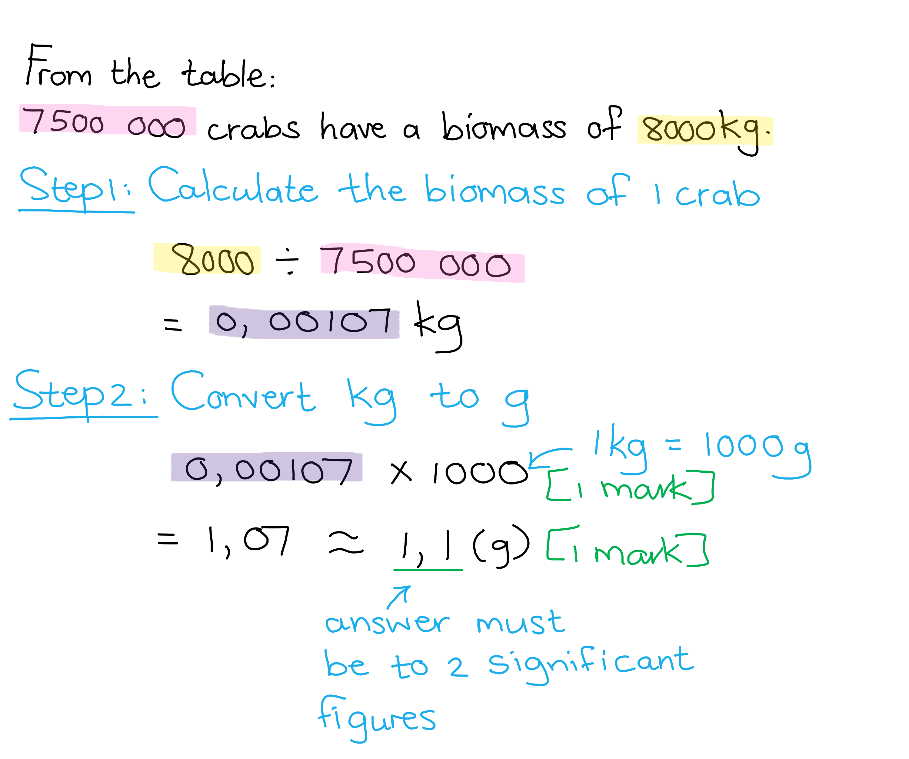

> *The pyramid of numbers for (b) (ii) would look as follows:*

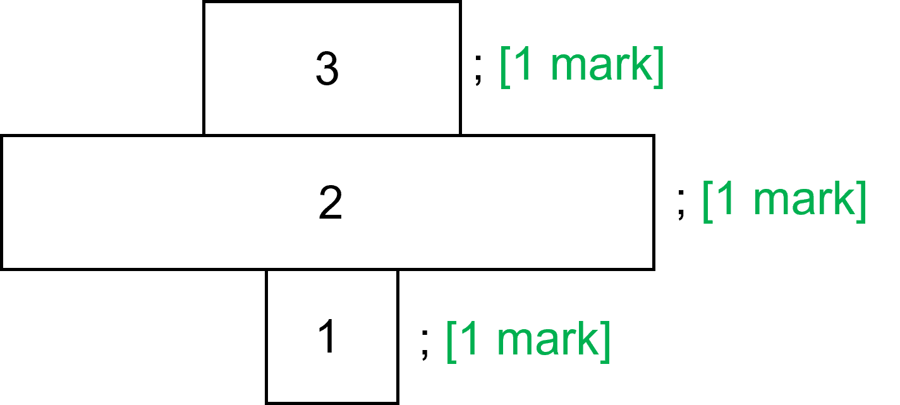

> *This question covers core knowledge but is taken from an extended paper 4 question.*

### Q6
The processes shown by arrows **A**, **B** and **C** are:

- **A** = combustion;** [1 mark]**
- **B** = feeding;** [1 mark]**
- **C** = fossilisation;** [1 mark]**

**[Total: 3 marks]**

> *If the question gives you words in a list, make sure to stick to only using those words! *
(i) and (ii) Arrows should be drawn on the diagram as follows:

- Arrow from 'carbon dioxide in the atmosphere' to 'carbon compounds in plants' **AND** labelled D; **[1 mark]**
- Arrow from 'carbon compounds in plants' / 'carbon compounds in animals' to 'carbon dioxide in the atmosphere' **AND** labelled E; **[1 mark]**

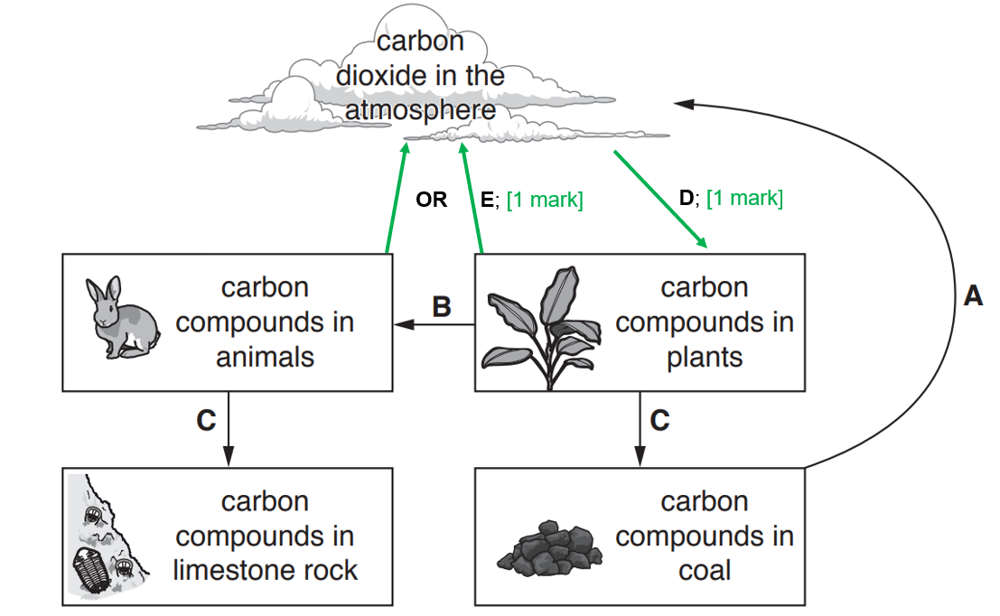

**[Total: 2 marks]**

> *Although there are two possible correct answers for ii) you only need to draw one of them to gain the mark.*
(i) Two possible causes of the increased carbon dioxide concentration in the atmosphere are:

Any **two **from the following:

- Fossil fuels being burned / a named example of a fossil fuel; **[1 mark]**
- Deforestation; **[1 mark]**
- Industry / factories / power stations / urbanisation; **[1 mark]**
- Transport / named example e.g. cars/planes; **[1 mark]**
- Cattle/farm animals being raised for food; **[1 mark]**

(ii) Two adverse effects of the increase in carbon dioxide concentration in the atmosphere.

Any **two **from the following:

- Global warming / increased temperatures / climate change / enhanced greenhouse effect; **[1 mark]**
- Flooding; **[1 mark]**
- Increase in sea level / ice caps or glaciers melting; **[1 mark]**
- Desertification; **[1 mark]**

(iii) An example of another greenhouse gas is:

Any **one **from the following:

- Methane; **[1 mark]**
- Water vapour; **[1 mark]**
- Nitrous oxides; **[1 mark]**
- Ozone; **[1 mark]**
- CFCs; **[1 mark]**

**[Total: 5 marks]**

### Q7
(i) The process labelled **U** is:

- Nutrition / ingestion / feeding; **[1 mark]**

(ii) A group of organisms responsible for W are:

- Decomposers / bacteria / fungi; **[1 mark]**

(iii) Two letters that identify respiration are:

Any **two** of the following from:

- **T**; **[1 mark]**
- **V**; **[1 mark]**
- **W**; **[1 mark]**

(iv) The letter which identifies photosynthesis is:

- **S**; **[1 mark]**

**[Total: 5 marks]**

> *It is important you can recognise and interpret the carbon cycle shown in a range of different diagrams.*
The word equation for respiration is:

- Glucose + oxygen (reactants in either order); **[1 mark]**
- Carbon dioxide + water (products in either order); **[1 mark]**

**[Total: 2 marks]**

> *Here you get one mark for the correct reactants and one mark for the correct products. The word equation should be represented as **glucose + oxygen → carbon dioxide + water**.  It is a common mistake for students to put an equals sign (=) where the arrow should be. It does not matter if the reactants and products are written in an alternative order as long as each are on the correct sides of the arrow. *

> *If you put CO**2 **or any other symbol you cannot get the mark. This is because the question specifically asks for the **word** equation. *
Reasons why the mean percentage of carbon dioxide in the atmosphere has increased during the last 100 years are:

Any **three **from the following:

- (There is now) more combustion / use of fossil fuels (for heat / power) *(allow: references to homes, factories, electricity production)*; **[1 mark]**
- (There is now) more use of (fossil fuels for) vehicles* (allow: any named type of vehicles such as cars); ***[1 mark]**
- (There is now a) larger/increased human population respiring (and therefore releasing carbon dioxide into the atmosphere);** [1 mark]**
- Deforestation (*accept a description eg. cutting down trees*);** [1 mark]**
- Leading to less photosynthesis; **[1 mark]**
- (And) the burning/combustion/decay of cut down materials; **[1 mark]**

**[Total: 3 marks]**

> *The idea here is that the combustion of fossil fuels releases carbon dioxide into the environment. The methods of combustion have increased, such as cars and the use of fossil fuels to generate electricity. In addition to this deforestation has increased.  This means there are less trees which would be absorbing carbon dioxide as part of photosynthesis. Trees that are cut down during deforestation are typically burnt too.*

### Q8
(i) The name of the producer in this food chain is...

- (Green) alga/algae; **[1 mark]**

(ii) The term producer refers to...

- Organism that makes its own (organic) nutrients; **[1 mark]**
- (Usually) with the use of (sun)light energy / through photosynthesis; **[1 mark]**

(iii) The name of the secondary consumer in this food chain is...

- Crab; **[1 mark]**

(iv) The name of the herbivore in this food chain is...

- Sea snail; **[1 mark]**

(v) The arrows in a food chain represent...

- Transfer/flow of energy; **[1 mark]**

**[Total: 6 marks]**

> *It is not enough here to describe producers as plants, or in terms of their position at the base of a food chain; you need to know that producers are organisms that make their own nutrients, and that they (usually!) do this using energy from light in photosynthesis (there are some unusual organisms that can use other energy sources).*

> *The arrow in a food chain represents the transfer of energy; it is not enough to just say that it shows one organism eating another.*
The over-harvesting of crabs could affect the other organisms in the food chain shown in Fig. 1 as follows...

Any **three** of the following:

- More sea snails **AND** less green algae **AND** fewer starfish; **[1 mark]**
- (More sea snails due to) fewer crabs / reduction in predation (from crabs); **[1 mark]**
- (Less algae due to) more snails / increase in predation (from snails); **[1 mark]**
- (Fewer starfish due to) fewer crabs / reduced food availability (starfish feed on crabs); **[1 mark]**

**[Total: 3 marks]**

### Q9
(i) The missing value in table 1 is...

- 0.2; **[1 mark]**

(ii) The pyramid of biomass should have the following features...

- A pyramid shape that is widest at the base **AND** four bars / trophic levels; **[1 mark]**
- Bars are drawn at the correct width (with a half-square allowance for error); **[1 mark]**
- Each bar is labelled with its trophic level; **[1 mark]**

***Accept**** error carried forward from part i) for marking point 2, i.e. accept a top bar that is drawn to the width stated in part i) even if that width has been calculated incorrectly.*

**[Total: 4 marks]**

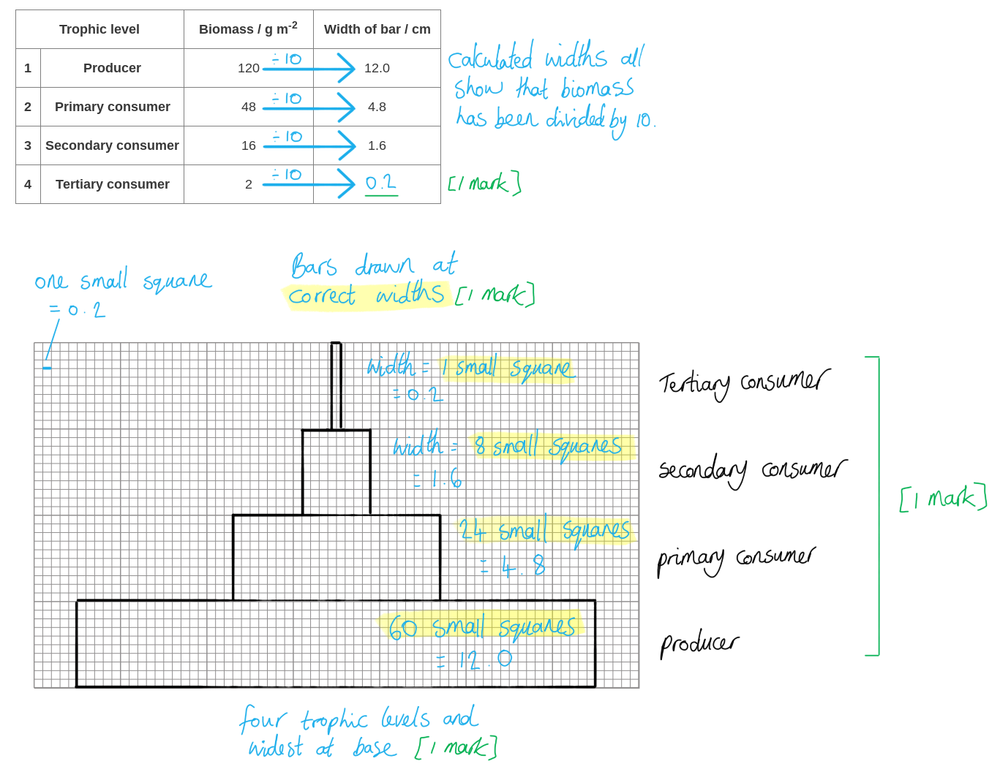

> *This question covers core knowledge but is taken from an extended paper 4 question.*
The name of this type of organism that gains energy from waste organic material from all trophic levels is...

- Decomposer; **[1 mark]**

**[Total: 1 mark]**

> *This question covers core knowledge but is taken from an extended paper 4 question.*
(i) Organisms in the first trophic level of the woodland food chain produce biomass using energy from the Sun as follows...

Any **three** of the following:

- (By) photosynthesis; **[1 mark]**
- (In the presence of) chlorophyll; **[1 mark]**
- (Sun)light energy is transferred/converted to chemical energy; **[1 mark]**
- Glucose is formed (from carbon dioxide and water); **[1 mark]**
- Cellulose/starch/sucrose/protein/DNA (produced from the products of photosynthesis) can be used for the building of biomass/tissues; **[1 mark]**

(ii) The fourth trophic level has the least biomass in this food chain because...

Any **three** of the following:

- Energy is lost (to the environment) / decreases with each trophic level; **[1 mark]**
- Not all of the organism is / named parts of the organism (e.g. fur, claws, bones) are not eaten/digested/absorbed; **[1 mark]**
- Energy is lost as heat / in respiration / in metabolic processes / due to movement; **[1 mark]**
- Energy is lost in excretion / urine **OR** in faeces; **[1 mark]**
- Less energy is available to be passed on to / support the next trophic level;  **[1 mark]**

**[Total: 6 marks]**

> *Remember that photosynthesis is the conversion of light energy to chemical energy in the presence of chlorophyll. This process produces glucose which can then be converted into other molecules, e.g. starch and cellulose, which can then be used to build new plant biomass.*

> *The biomass at each trophic level decreases as you go up the food chain. This is because energy is lost at each trophic level, meaning that less energy is available to support each successive trophic level. This energy is lost due to incomplete consumption of prey, as heat in respiration, due to movement of organisms, and in excretion or egestion of waste products.*
Possible benefits of conserving this specific area of woodland include...

Any **three** of the following:

- Preventing (local) extinction / protecting endangered species; **[1 mark]**
- Maintaining genetic diversity / biodiversity; **[1 mark]**
- Maintaining habitat / the ecosystem / breeding conditions (for certain species); **[1 mark]**
- Allowing nutrient recycling to occur; **[1 mark]**
- Resource provision / production of food/drugs/fuel/building materials (for humans); **[1 mark]**
- Maintaining food chains/webs / trophic levels of the food chain; **[1 mark]**
- Preventing soil loss/erosion; **[1 mark]**

***Accept*** *references to leisure/tourism/education.*

**[Total: 3 marks]**

> *Ensure that any answers can be applied to the **specific** area of woodland in the question. References to the large-scale consequences of deforestation (e.g. climate change) will not be credited.*

### Q10
(i) The mark allocation for the food chain would be as follows:

- The food chain starts with the fig tree **and** ends with the hawk; **[1 mark]**
- The caterpillar is placed before the blackbird in the food chain; **[1 mark]**
- Three correct arrows; **[1 mark]**

**Fig tree → Caterpillar → Blackbird → Hawk**

(ii) The principal source of energy for this food chain is:

- (The) Sun; **[1 mark]**

(iii) The type of organism that gains its energy from dead organic material is:

- Decomposer(s); **[1 mark]**

*Do not award marks for specific examples of decomposers.*

**[Total: 5 marks]**

A food chain will always start with a producer, in this case, the fig tree. Producers are able to convert energy from the Sun into a form that is useable for the organisms in the rest of the food chain. Once an organism dies, its body will be broken down by decomposers, such as bacteria and fungi.

Remember that a) iii) asks for the type of organism that feeds on dead organic material, so you would not gain a mark for giving examples of decomposers.
(i) Species can become endangered in the following ways:

Any **four **from the following:

- (Due to) habitat destruction / deforestation (which will displace organisms and lead to a decrease in numbers); **[1 mark]**
- (Population size can decrease due to) hunting / poaching of animals **OR** due to the collection/removal of plants / animals (from their habitat); **[1 mark]**
- The introduction of new species / predators into an ecosystem (can lead to increased competition for resources / predation); **[1 mark]**
- (The population size of a species can decrease) due to a lack of food (in their habitat); **[1 mark]**
- Water / air / plastic pollution can make a habitat unsuitable for organisms to survive/live (leading to a decrease in population size); **[1 mark]**
- Climate change / global warming (will lead to changes in ecosystems / habitats to which some species may not be able to adapt to); **[1 mark]**
- (The largescale outbreak of) disease within a species (can decrease numbers to the point where they become endangered); **[1 mark]**
- (In certain species it may be) hard/difficult to find a mate **OR** they have a low reproductive success rate / population growth rate (which makes them more susceptible to becoming endangered); **[1 mark]**
- An increase in the number of / population size of predators in a habitat (will increase predation and therefore decrease the population size of prey species); **[1 mark]**

(ii) Endangered species can be conserved in the following ways:

Any **one** from the following:

- (By) monitoring / protecting species (within their natural environment/habitat); **[1 mark]**
- The removal of predators / decrease the number of predators (of the endangered species within a habitat); **[1 mark]**
- Removing the vectors of (certain) diseases (that affects endangered species); **[1 mark]**
- (By) protecting / preserving / creating/making new habitats (for endangered species); **[1 mark]**
- Through educating / education of the public (in order to support conservation efforts); **[1 mark]**
- (Increasing numbers of endangered animal species through) captive breeding programmes; **[1 mark]**
- (Increasing numbers of endangered plant species through) seed banks; **[1 mark]**
- DNA banks (can preserve the genetic material of endangered species for the future); **[1 mark]**
- Zoos / wild life parks / conservation areas (provides a protected habitat for endangered species to survive); **[1 mark]**
- Embryos (of endangered species) can be preserved (for future use); **[1 mark]**
- Legislation to protect endangered species e.g. banning hunting; **[1 mark]**

**[Total: 5 marks]**

> *It is important to be able to explain the reasons why species become endangered, as well as the ways in which they can be conserved. These types of questions can be worth many marks in an exam.*

### Q11
(i) Two visible features that identify arctic wolves as mammals are:

Any **two **from the following:

- (External) ears / pinna(e); **[1 mark]**
- Fur / hair; **[1 mark]**
- Whiskers; **[1 mark]**

(ii) An adaptive feature is...

Any **three **from the following:

- An inherited / genetic feature; **[1 mark]**
- (It is a feature which is the) result of natural selection; **[1 mark]**
- (Adaptive features) increase fitness (of the individual/species/population); **[1 mark]**
- Because, they increase chances of survival / individuals are more likely to survive; **[1 mark]**
- Therefore this increases chances of reproducing / individuals are more likely to reproduce (and pass on their alleles/genes/adaptive features to the next generation); **[1 mark]**

**[Total: 5 marks]**

The question specifically asks for **visible** features, so ensure you are referring to features that can be seen in the picture.

The best answers for part ii) would include an explanation of how adaptive features may increase chances of survival.

In the extended content, you are taught the link between the genetics, natural selection and fitness of an organism within its environment. These are all important in your explanation of an adaptive feature.
Three conditions that may limit plant growth could include:

Any **three **from the following:

- Temperature; **[1 mark]**
- Light (intensity); **[1 mark]**
- Water (supply) / idea that water is not available (as frozen); **[1 mark]**
- (Named) soil feature; **[1 mark]**
- (Named) mineral ion eg. excess nitrates, limited nitrates; **[1 mark]**
- Carbon dioxide; **[1 mark]**
- Grazing / predation; **[1 mark]**
- (Competition for) space; **[1 mark]**
- Disease; **[1 mark]**
- (Named) pollutant eg. sewage; **[1 mark]**

**[Total: 3 marks]**

> *There are many options here for conditions that you could identify. Anything which is likely to prevent plants growing at their usual rate can be considered, however, you must ensure that you are specific where you can be, e.g. avoiding responses such as 'weather'.*
The number of arctic wolves are so small because:

Any **six **from the following:

- There is little energy available from herbivores / primary consumers / lower trophic level(s); **[1 mark]**
- Because there are few producers / low population of producers; **[1 mark]**
- Also, energy is lost between / within trophic levels / along the food chain; **[1 mark]**
- There is only about 10 % energy transfer / 90% energy loss (between trophic levels); **[1 mark]**
- (Energy is lost) in named process (e.g. respiration, excretion, movement, not all organisms are consumed/digested); **[1 mark]**
- (Small amounts of energy in lower trophic levels means) low numbers of prey / (primary) consumers / food (for wolves); **[1 mark]**
- Wolves are also not very successful at catching prey; **[1 mark]**
- (Reason why they aren't successful at catching prey) e.g. prey are widely dispersed / larger animals; **[1 mark]**
- Wolves also have a lower reproductive rate / higher mortality of wolves; **[1 mark]**
- (Wolves may be) hunted / killed by people; **[1 mark]**
- (Reason why wolves are hunted) e.g. for fur / because they compete with humans for food; **[1 mark]**
- Habitat destruction (of the wolves habitat by humans); **[1 mark]**
- (Reason why habitats are destroyed by humans) e.g. road building / oil exploration / melting of snow: **[1 mark]**
- Disruption of the food web (described); **[1 mark]**
- Disease (killing off wolves); **[1 mark]**
- Inbreeding / reduced genetic diversity (meaning more wolf deaths); **[1 mark]**
- <u>Climate change</u> / <u>global warming</u>; **[1 mark]**

**[Total: 6 marks]**

### Q12
A herbivore is:

- An animal that gets its energy; **[1 mark]**
- From eating plants; **[1 mark]**

**[Total: 2 marks]**

*Think about the way this question is constructed; just to say that a herbivore eats plants would be worthy of ***[1 mark]***; this should make you think about what additional detail you should provide to earn the second mark. This is the point about energy; many candidates will miss out on this second mark by not paying close attention to the number of marks available, which should give a hint about how many separate points to write. *
Factors that could cause an increase in a rabbit population are:

**Two** from:

- Increased food supply / plants; **[1 mark]**
- More births / fewer deaths; **[1 mark]**
- Less predation / fewer predators / less hunting; **[1 mark]**
- Less disease; **[1 mark]**

**[Total: 2 marks]**
The increase in the human population has affected marine ecosystems in the following ways:

**Three **from:

- Damage / destroy, (marine) habitats; **[1 mark]**
- (Leads to the) extinction of species; **[1 mark]**
- Reference to pollution (of sea) e.g. oil spills / plastic pollution; **[1 mark]**
- Global warming / reference to an increase in sea temperature; **[1 mark]**
- Rise in sea levels / melting of ice-caps; **[1 mark]**
- Overfishing / disruption of (marine) food chains; **[1 mark]**

**[Total: 3 marks]**

> *Make sure to restrict your answer to the effect on **marine** ecosystems, as specified in the question; any reference to land ecosystems (eg. deforestation) will be ignored and won't earn credit.*

### Q13
(i) The table should be completed as follows:

| **organism** | **producer** | **herbivore** | **secondary consumer** |
|---|---|---|---|
| corn plant | **✓** |   |   |
| vole |   | **✓** |   |
| grasshopper |   | **✓** |   |
| hawk |   |   | **✓** |

*Allow* **[1 mark] ***for each correct column*

(ii) The number of trophic levels is:

- Four/4; **[1 mark]**

(iii) One organism that feeds at more than one trophic level includes:

- The hawk; **[1 mark]**

(iv) The term used to describe the organism is:

- A decomposer; **[1 mark]**

(v) The principle source of energy is:

- The sun; **[1 mark]**

**[Total: 7 marks]**

### Q14
In this context, *fitness *means:

- (The probability that an organism will) survive <u>**AND**</u> reproduce; **[1 mark]**

**[Total: 1 mark]**

> *Just mentioning 'survival' won't be enough to gain the mark on this question. This is because the organisms of a species may well be able to survive, but unless they can **reproduce**, then the species is effectively extinct; it will only take until the end of those individuals' natural lives and there won't be any more individuals to keep the species going. *

> *This question covers core knowledge taken from an extended only paper 4 question.*
Two features of *J. jaculus* that adapt it to each of the following challenges of living in desert ecosystems are:

(i) very high daytime temperatures:

Any** two **of the following from:

- (During the day they) remain in a burrow / stay in the shade / stay; **[1 mark]**
- Inactive / sleep; **[1 mark]**
- Light colour / pale / yellow / white (fur / hair); **[1 mark]**
- Thin / long, tail / legs; **[1 mark]**
- Thin / short / little, fur; **[1 mark]**
- No fur on legs; **[1 mark]**
- Fur on feet; **[1 mark]**
- Large, ears / pinna(e); **[1 mark]**
- Little / no, fat; **[1 mark]**
- Large surface area: volume ratio; **[1 mark]**
- Produces, little / concentrated, urine; **[1 mark]**

*'Small size' is insufficient, without reference to sa:vol ratio Ignore behavioural adaptations*

(ii) very little or no light at night:

Any** two **of the following from:

- Big eyes / large pupils / good eyesight; **[1 mark]**
- (Presence of) whiskers; **[1 mark]**
- Lots of rod cells (in the retina / fovea); **[1 mark]**
- Large ears / good sense of hearing / sensitive ears; **[1 mark]**
- Good sense of smell; **[1 mark]**

**[Total: 4 marks]**

> *This question covers core knowledge taken from an extended only paper 4 question.*
(i) The completed pyramid of biomass is as follows:

- Block added to the top of the pyramid that is 4 small squares wide;** [1 mark]**
- Labelled carnivores; **[1 mark]**

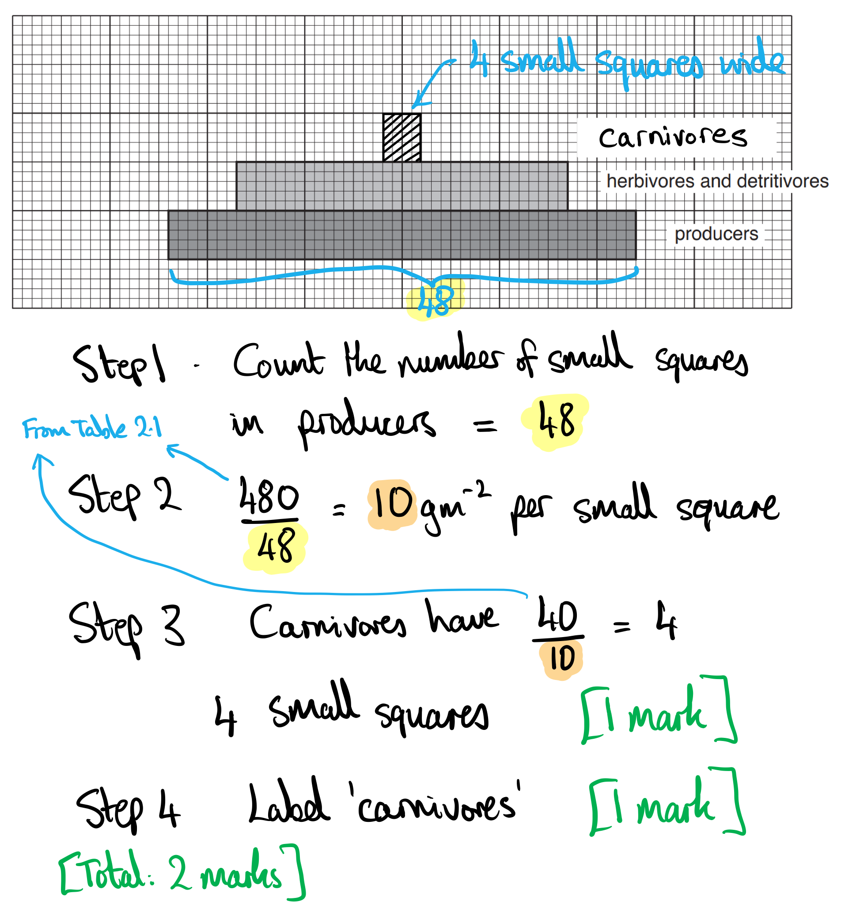

(ii) The scientist discovered that the detritivores:

Any** one** of the following from:

- Eat (mainly), plants / producers; **[1 mark]**
- Feed, at second trophic level / as primary consumers; **[1 mark]**
- Are eaten by, third trophic level / secondary consumers; **[1 mark]**

(iii) There are rarely more than four or five trophic levels in ecosystems because:

Any** two** of the following from:

- Little energy is transferred from one trophic level to the next / much energy is lost at each trophic level; **[1 mark]**
- Not all of the organisms are, eaten / digested / absorbed; **[1 mark]**
- (You can give a) named example of energy loss; **[1 mark]**
- Idea that there is not enough energy (passing through the food chain) to support higher trophic levels; **[1 mark]**

(iv) The advantages of presenting information about food webs as a pyramid of biomass and not as a pyramid of numbers are:

**Any three** of the following from:

- In a pyramid of numbers one large individual is shown in the same way as one very tiny individual; **[1 mark]**
- Biomass indicates how much food there is, available / left; **[1 mark]**
- Biomass is an indicator of the energy available / numbers are not; **[1 mark]**
- Pyramid of biomass is a pyramid shaped whereas a pyramid of numbers is not always; **[1 mark]**

> *You can use simple sketches of the various pyramids to illustrate your answer in this case. *

> *This question covers core knowledge taken from an extended only paper 4 question.*

**[Total: 8 marks]**

### Q15
The table should be completed as follows...

**One** mark for each correctly completed row:

|   | **name of organism from Fig. 1** |
|---|---|
| producer | algae / (phyto)plankton / clover / grass; **[1 mark]** |
| secondary consumer | marsh rice rat / (stone) crab / mycid shrimp / blenny / (bald) eagle; **[1 mark]** |
| an animal that feeds at two trophic levels | (bald) eagle / blenny / (spotted) sandpiper; **[1 mark]** |

**[Total: 3 marks]**

> *Be careful when labelling the level of the consumers; a primary consumer is the first level of consumers after the producers, so primary consumers feed on producers.*

> *It may not always be necessary to use the full animal name in your answer to be awarded the mark, for example, there is only one type of eagle in this food web so you could get away with writing 'eagle' instead of 'bald eagle'. These answers are often shown in brackets in the exam board mark scheme. However, it is good practise to write the full name to avoid any mistakes.*

> *This question covers core knowledge but is taken from a paper 4 (extended content) paper.*
The name of process A is...

- <u>Nitri</u>fication ; **[1 mark]**

***Accept**** oxidation instead of nitrification.*

The type of organism involved in the process is...

- (Nitrifying) bacteria; **[1 mark]**

***Accept**** bacterium for bacteria.*

**[Total: 2 marks]*** *

> *Note that oxidation is also a permitted answer for the process name; the nitrification reaction is an oxidation reaction as oxygen is added to the ammonium ions during the process whilst hydrogen ions are lost.*
Nitrate ions enter the roots of plants in the following way...

Any **three **of the following:

- (Nitrate ions enter via) the root hairs / root hair cells; **[1 mark]**
- (Ions enter the root hair cells by) the process of active transport/uptake; **[1 mark]**
- (Active transport) occurs across cell membranes; **[1 mark]**
- (Mineral ions move) against a concentration gradient / from low to high concentration; **[1 mark]**
- (Active transport) uses proteins (molecules/pumps/carriers); **[1 mark]**
- (Active transport also) requires energy / ATP; **[1 mark]**
- (Some nitrates move) by diffusion ; **[1 mark]**

**[Total: 3 marks]**

> *Whilst some nitrates move by diffusion, plants mainly rely on active transport for the transfer of mineral ions into their roots. This is because most of the time there are low concentrations of mineral ions (including nitrates) in the soil and higher concentrations inside the plant cells.*
Process **D** occurs in the following location...

Any **one **of the following:

- Ribosomes; **[1 mark]**
- (Rough) endoplasmic reticulum; **[1 mark]**

**[Total: 1 mark]**

> *D** represents protein synthesis as the amino acids are used to build proteins. This process occurs in the ribosomes inside plant cells. Ribosomes are either free in the cytoplasm or associated with the rough endoplasmic reticulum.*
The process that occurs at **B** is...

- Nitrogen fixation; **[1 mark]**

**[Total: 1 mark]**

> *At **B** nitrogen from the atmosphere/air is being converted into nitrate ions. This process is carried out by bacteria called nitrogen fixing bacteria.*
There are a large number of organisms at the base of the pyramid compared to the top because...

Any **three **of the following:

- There is very little energy transferred from one trophic level to the next; **[1 mark]**
- There is little / not enough energy (remaining) at the top of the pyramid / at higher trophic levels to support large numbers of organisms; **[1 mark]**
- Energy is lost through heat / in respiration / movement; **[1 mark]**
- Energy is lost through excretion / urine / (in egestion through) faeces; **[1 mark]**
- (Small amounts of energy are transferred because) not all organisms / parts of organisms (in one trophic level), are, eaten/digested (e.g. fur/claws/bones); **[1 mark]**

**[Total: 3 marks]**

### Q16
Table 1 should be completed as follows:

|   | **name of organism from Fig. 1** |
|---|---|
| producer | algae / (phyto)plankton; **[1 mark]** |
| secondary consumer | (stone) crab / mysid shrimp / blenny; **[1 mark]** |
| an animal that feeds at two trophic levels | blenny / (spotted) sandpiper; **[1 mark]** |

**[Total: 3 marks]**

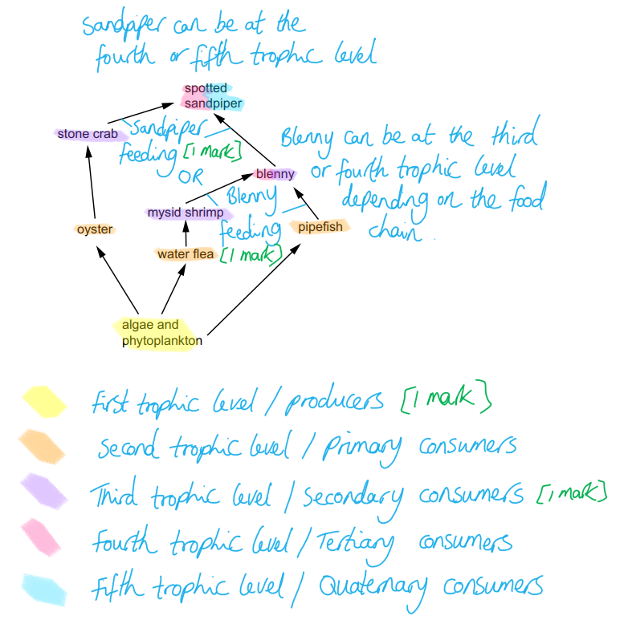

> *This question covers core knowledge but is taken from an extended paper 4 question.*
(i) The name of process A in Fig. 2 is...

- Nitrification; **[1 mark]**

***Accept*** *oxidation.*

The type of organism that converts ammonium ions to nitrate ions is...

- (Nitrifying) bacteria; **[1 mark]**

***Accept*** *bacterium.*

(ii) The nitrate ions used in process **C** enter the roots of plants as follows...

Any **three** of the following:

- (Through the) root hairs; **[1 mark]**
- (By) active transport/uptake; **[1 mark]**
- Across (cell) membranes; **[1 mark]**
- Against a concentration gradient / from low to high concentration; **[1 mark]**
- Through/by protein(s) (molecules/pumps/carriers); **[1 mark]**
- Energy is needed / ATP is used; **[1 mark]**
- (Also by) diffusion; **[1 mark]**

(iii) The structure in plant cells where process **D** occurs is...

- Ribosome; **[1 mark]**

(iv) The process that occurs at **B** is...

- Nitrogen fixation; **[1 mark]**

**[Total: 7 marks]**

> *While the overall focus of this question is the events of the nitrogen cycle, there are some sub-parts that require knowledge of other parts of the specification:*

> *You should be aware that plants take up minerals from the soil via root hair cells, and that they do this by active transport against their concentration gradient. Other marks here can be gained by showing more detailed knowledge of the process of active transport itself, e.g. that it occurs via carrier proteins and requires ATP.*

> *Amino acids are converted into proteins during the process of protein synthesis, which occurs at ribosomes inside cells.*
There were very large numbers of organisms at the base of the pyramid and very few at the top because...

Any **three** of the following:

- Energy is lost (from the food chain) between each trophic level; **[1 mark]**
- There is not enough energy (remaining) at the top of the pyramid / at higher trophic levels to support large numbers of organisms; **[1 mark]**
- Named example of how energy is lost, e.g. excretion/loss of urine / movement / heat / egestion/loss of faeces; **[1 mark]**
- Not all organisms / parts of an organism are eaten/digested (e.g. fur, teeth, claws, plant cell walls); **[1 mark]**

**[Total: 3 marks]**

> *Not all of the energy contained within the biomass of organisms is passed on to the biomass of the next trophic level in a food chain. When an organism consumes another organism it may not eat or digest every part, so the energy in those parts not eaten are not available to the next trophic level. In addition to this, any energy that **is** gained may not be used to build new cells and tissues and may instead be lost to the environment in waste or as heat.*

### Q17
(i) The principle source of energy required for trophic level **D** is:

- Sun / light; **[1 mark]**

(ii) The letter that represents the primary consumers is:

- **C**; **[1 mark]**

(iii) The carbon is transferred from producers to primary consumers by:

- Ingestion / feeding; **[1 mark]**

(iv) Trophic level **A** is smaller than trophic level **B** because:

Any **three **from the following:

- Energy is lost (from the food chain as it is transferred from one trophic level to the next) / energy decreases up the trophic levels / energy transfer is inefficient; **[1 mark]**
- Only 10% of the energy from each trophic level is transferred to the next **OR** about 90% of the energy from each trophic level is not transferred to the next; **[1 mark]**
- Energy is lost as heat / in respiration / in (named) metabolic processes / movement; **[1 mark]**
- Not all organisms (in one trophic level) are eaten / not all parts of the organisms are eaten; **[1 mark]**
- Not all nutrients in the organisms are eaten / digested / absorbed; **[1 mark]**
- Some energy is lost in excretion / urine / faeces / egestion; **[1 mark]**
- Some energy is transferred to decomposers; **[1 mark]**

**[Total: 6 marks]**

> *It is important to remember as many examples as possible of how energy is lost between trophic levels. This is quite a common question that gets repeated many times in exams. *

> *This question covers core knowledge but is taken from an extended paper 4 question.*
(i) The term decomposer means:

- Organisms that get energy from dead / waste (organic) material; **[1 mark]**

(ii) Process **X** is:

- Respiration; **[1 mark]**

**[Total: 2 marks]**

> *Remember that all living organisms carry out respiration to return carbon dioxide back to the atmosphere. This includes plants, animals and decomposers. *

> *This question covers core knowledge taken from an extended only paper 4 question.*
Human activities affect the carbon cycle by:

Any **five **from the following:

- Combustion / burning (will release carbon dioxide into the atmosphere); **[1 mark]**
- (More / less) fossil fuel is used; **[1 mark]**
- Concentration of (atmospheric) carbon dioxide is increasing; **[1 mark]**
- Deforestation (reduces the amount of carbon dioxide removed from the atmosphere); **[1 mark]**
- Trees not replanted / fewer trees; **[1 mark]**
- This reduces the amount of photosynthesis; **[1 mark]**
- Carbon dioxide released (into the atmosphere) as the trees are burnt / decay...; **[1 mark]**
- ... causing global warming / <u>enhanced</u> greenhouse effect; **[1 mark]**
- As the tundra thaws, methane (and carbon dioxide) is released (into the atmosphere); **[1 mark]**
- Rate of fossilisation is slower than rate of combustion / fossil fuels are non-renewable; **[1 mark]**
- Mention of positive human activities / carbon capture technology; **[1 mark]**
- (Human activities result in a) loss of equilibrium / balance (between the amount of carbon released and the amount being removed from the atmosphere); **[1 mark]**

**[Total: 5 marks]**

> *When referring to pollution you need to make sure your answer is relevant to the carbon cycle being asked about in this question, for example, ozone doesn't contain carbon and so shouldn't be included in an answer to this question. *

> *This question covers core knowledge taken from an extended only paper 4 question.*

### Q18
The completed food web is as follows:

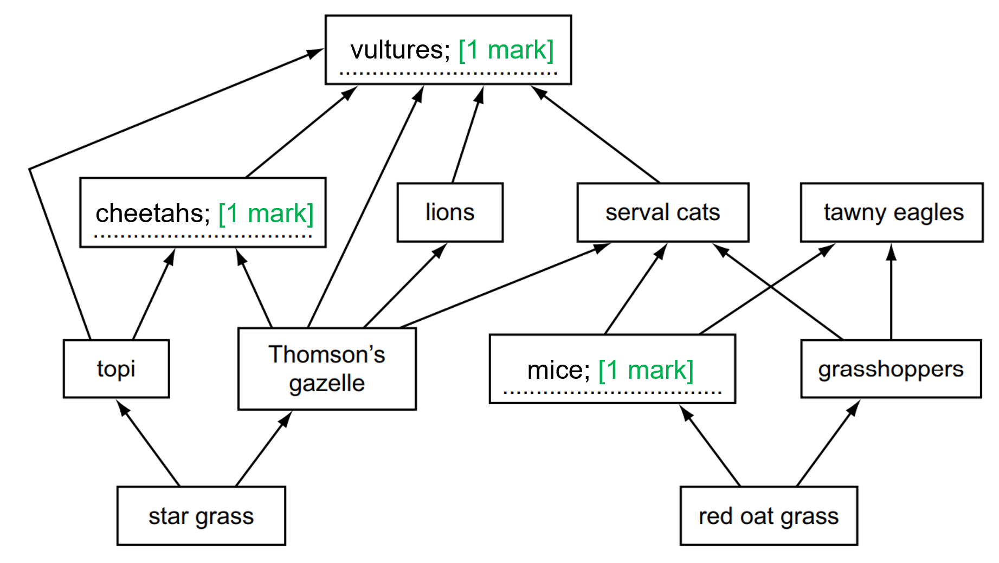

**[Total: 3 marks]**

> *All of the information you needed to fill in the spaces was in the bullet point list at the top. *

> *This question covers core knowledge taken from an extended only paper 4 question.*
The trophic level of the star grass and topi are:

(i)

- Star grass: producer; **[1 mark]**

(ii)

- Topi: <u>primary consumer</u>; **[1 mark]**

**[Total: 2 marks]**

> *The word primary is required for the mark here. Just consumer on its own would not be enough.*

> *This question covers core knowledge taken from an extended only paper 4 question.*
(i) The principle source of energy for the food web is:

- The sun; **[1 mark]**

(ii) When the energy leaves the food web it is...

- (Lost) to the atmosphere / (lost as) infra-red (radiation) / heat; **[1 mark]**

**[Total: 2 marks]**

> *Remember that energy can never be created or destroyed and so it must be transferred into and out of the bodies of living organisms.*
There are no more than four trophic levels in the food web because:

Any **three **from the following:

- Idea that a small percentage of energy from the Sun is ‘fixed’ by photosynthesis / most energy from Sun not available / reference to wrong colour / wavelength; **[1 mark]**
- Energy is lost between and within trophic levels; **[1 mark]**
- 10% energy transfer / 90% lost (per trophic level); **[1 mark]**
- Some material is inedible or indigestible; **[1 mark]**
- Only a small total percentage reaching the fourth trophic level; **[1 mark]**
- Not enough energy in the fourth trophic level to support another level; **[1 mark]**

**[Total: 3 marks]**

> *The mark scheme here allows for any other valid points. Other examples could include energy being lost as heat through respiration, or through urine.*
The disadvantages of intensive farming, such as salmon farming, include:

Any **three **from the following:

- Feed is expensive; **[1 mark]**
- More energy efficient to feed humans on crops or producers or animals that are used to make the (fish) food; **[1 mark]**
- Waste feed causes eutrophication of water supplies; **[1 mark]**
- Diseases or parasites spread easily (in captivity); **[1 mark]**
- Diseases spread to other organisms in the wild; **[1 mark]**
- Chemicals used to control the disease are also pollutants (e.g. antibiotics); **[1 mark]**
- Animal welfare concerns; **[1 mark]**

**[Total: 3 marks]**

> *Make sure to link your answer back to the example given in the question, in this case, salmon farming. *

### Q19
The food chain for the Arctic ecosystem is:

- (Arctic) plant(s) → lemming(s) → (snowy) owl(s); **[1 mark]**

**[Total: 1 mark]**

> *Food chains always need to start with a producer; these are generally plants but can also be photosynthetic organisms such as some species of bacteria. *
(i) The rate of increase of the lemmings becomes greater because:

- There are increasing numbers of lemmings reproducing; **[1 mark]**

(ii) The lemming population falls during year 2 because:

Any **two** from the following:

- The snowy owl population increasing; **[1 mark]**
- Therefore more predation / more lemmings are eaten; **[1 mark]**
- The lemming population is too large for food supply / *(accept a different description of this idea here)*; **[1 mark]**

(iii) A description and explanation of why the lemming population affects the snowy owl population is:

Any **three** from the following:

*Description:*

- As the lemming population falls / rises so does the snowy owl population; **[1 mark]**
- But with a time delay; **[1 mark]**

*Explanation:*

- Because of less / more food for the snowy owls; **[1 mark]**
- *(Accept any other valid point such as explanation of time delay);* **[1 mark]**

(iv) If all the snowy owls were removed from the Arctic ecosystem an explanation for the effect this would have on the lemming population is:

Any **three** from the following:

- The lemming population would increase / reach a peak; **[1 mark]**
- This is because of less predation (from the owls); **[1 mark]**
- (After the peak) the population would level off / fall; **[1 mark]**
- Because of equilibrium being reached with plants / food / other factors coming into play; **[1 mark]**
- There would be too many lemmings for food supply to support; **[1 mark]**

**[Total: 9 marks]**

> *For part (iii) an explanation of the time delay between the lemming population and snowy owl population is that each species affects the other; so as the population of the lemmings falls the owl's food source will run out and so their population will then fall.  Once the owl population falls then there are less owls hunting the lemming and so the lemming population will then increase.  Each of these changes in population takes time due to breeding cycles. *
(i) The principle source of all energy in this ecosystem is:

- The Sun; **[1 mark]**

(ii) The process that first traps this energy is:

- Photosynthesis; **[1 mark]**

**[Total: 2 marks]**

### Q20
The correctly-joined lines are as follows:

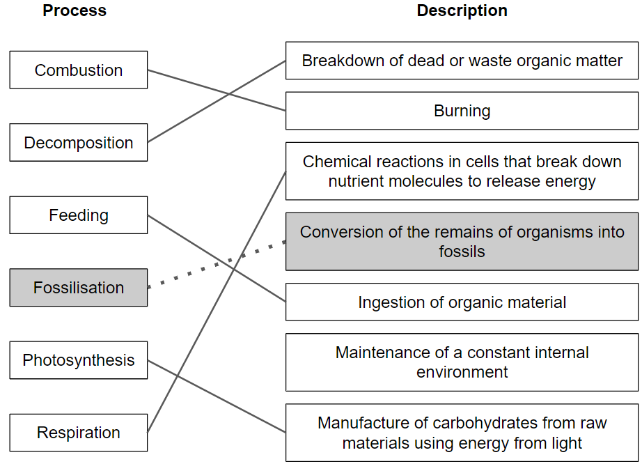

**[1 mark]** for each correct line.

**[Total: 5 marks]**
