# Exam Questions — Energy & Feeding Relationships
**19. Organisms & Their Environment** · Cambridge (CIE) IGCSE biology (0610 & 0970)
> Source: [https://www.savemyexams.com/igcse/biology/cie/23/topic-questions/](https://www.savemyexams.com/igcse/biology/cie/23/topic-questions/) · 50 questions across 3 sets

## Alternative To Practical Questions (2 questions)

### Q1 — medium — 16 marks

**Q1** [2 marks]

A researcher investigated the populations of rabbits and foxes in a woodland area over 20 years.

**Fig. 2** shows the estimated populations over this time period.

**Fig. 2**

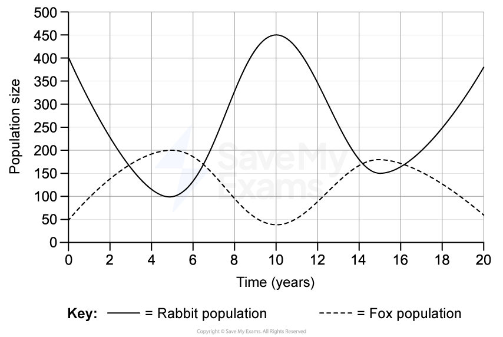

(i) Using **Fig. 2**, state the rabbit population at year 0.

[1]

(ii) Using **Fig. 2**, state the fox population at year 10.

[1]

**Q1** [2 marks]

**Extract:**

A student investigated the populations of rabbits and foxes in a woodland area over 20 years.

**Fig. 2.1** shows the estimated populations over this time period.

Using **Fig. 2**, determine the fox population at year 12. Show on your graph how you obtained your answer

**Q1** [2 marks]

**Extract:**

A student investigated the populations of rabbits and foxes in a woodland area over 20 years.

**Fig. 2.1** shows the estimated populations over this time period. 

Describe the trend in the rabbit population over the 20 years shown in **Fig. 2**.

**Q1** [1 mark]

**Extract:**

A student investigated the populations of rabbits and foxes in a woodland area over 20 years.

**Fig. 2.1** shows the estimated populations over this time period.

Describe the relationship between the rabbit and fox populations shown in **Fig. 2**.

**Q1** [3 marks]

**Extract:**

A student investigated the populations of rabbits and foxes in a woodland area over 20 years.

**Fig. 2.1** shows the estimated populations over this time period.

Calculate the percentage decrease in the fox population between year 15 and year 20.

Give your answer to **one decimal place**. Show your working

**Q1** [2 marks]

In year 10, the student estimated the rabbit population by counting the number of rabbits seen in four different sectors of the woodland. The results are shown in **Table 2**.

**Table 2**

|   | Sector 1 | Sector 2 | Sector 3 | Sector 4 | Mean |
|---|---|---|---|---|---|
| Number of rabbits | 112 | 115 | 42 | 118 | 115 |

(i) Identify the anomalous result in **Table 2**.

[1]

(ii) Explain how the student calculated the mean shown in **Table 2**.

[1]

**Q1** [1 mark]

Suggest **one **source of error when trying to estimate a population of mobile animals, such as rabbits, by counting them by eye.

**Q1** [1 mark]

**Extract:**

A student investigated the populations of rabbits and foxes in a woodland area over 20 years.

**Fig. 2.1** shows the estimated populations over this time period.

Suggest **one **limitation of the data shown in **Fig. 2**.

**Q1** [2 marks]

**Extract:**

A student investigated the populations of rabbits and foxes in a woodland area over 20 years.

In year 10, the student estimated the rabbit population by counting the number of rabbits seen in four different sectors of the woodland. The results are shown in Table 2.1.

Table 2.1

Sector 1: 112
Sector 2: 115
Sector 3: 42
Sector 4: 118
Mean: 115

Suggest **two **ways the student could improve their method for estimating the animal populations to increase confidence in the results.

### Q2 — medium — 18 marks

**Q2** [5 marks]

A student wanted to investigate a garden ecosystem.

She counted the number of insects caught in spider webs in one small section of the garden.

She found six spider webs in the small section of the garden sampled.

Diagrams of the spider webs are shown in Fig. 1 Each black dot represents one insect caught in a spider web.

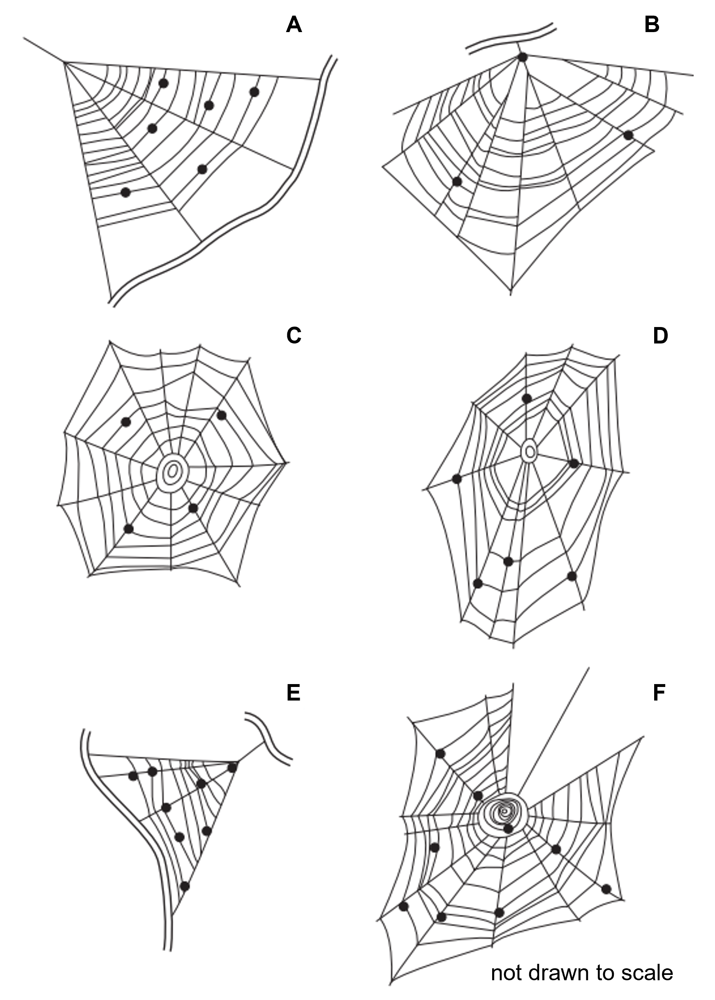

**Fig. 1**

(i)

Use Fig. 1 to complete Table 1

**Table 1**

| Spider web | Number of insects caught in each web |
|---|---|
| **A** |   |
| **B** |   |
| **C** |   |
| **D** |   |
| **E** |   |
| **F** |   |
| Total |   |

[2]

(ii)

Calculate the average number of insects per web in the small section of the garden, using the information in Fig.1 and Table 1.

[1]

(iii)

The student counted the total number of spider webs in the whole garden and found that there were a total of 102 spider webs.

Use this information and your answer to part **(a)(ii) **to estimate the total number of insects caught in webs in the whole garden.

[1]

(iv)

Suggest **one** reason why the estimated total number of insects caught in webs in the whole garden may not be accurate.

[1]

*Source: 2018 (Series 1) 0610/61 Q2A*

**Q2** [8 marks]

Fig. 2 is a photograph of a spider.

A spider’s body has two main parts. The legs are all attached to the cephalothorax which is the upper part of the body and starts at label **X** on Fig. 2. The lower part of the body is called the abdomen and is nearest to label **Y** on Fig. 2.

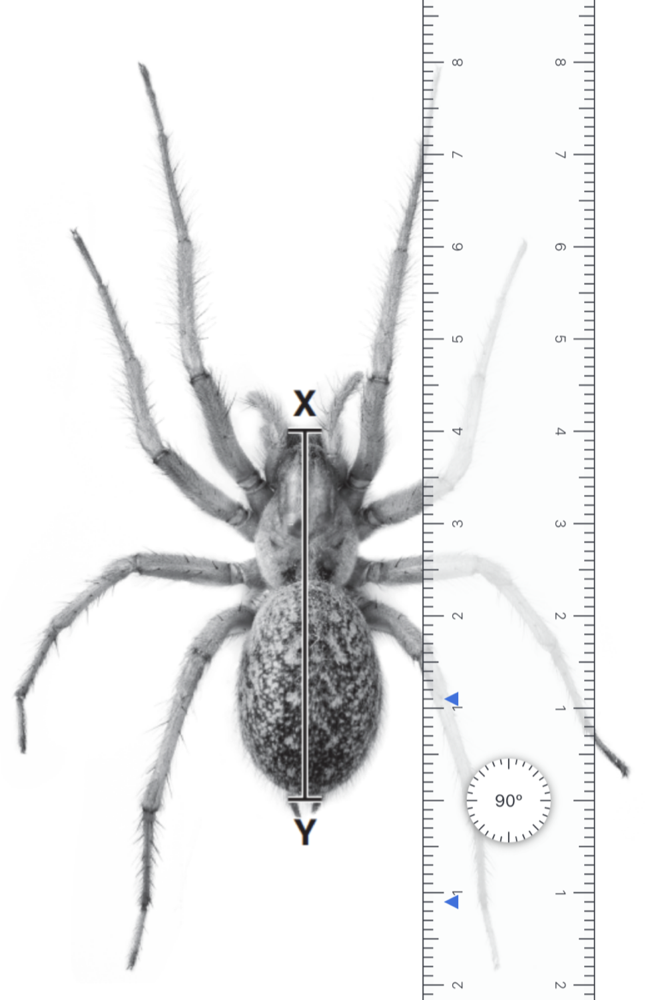

**Fig. 2**

(i)

Make a large drawing of the spider in Fig. 2 to show its outline, including its legs.

Label the abdomen.

[5]

(ii)

Measure the length of the spider between points **X** and **Y** in Fig. 2 Include the units. A ruler, graduated in cm, has been added to Fig. 2 for this purpose.

Draw a line in the same position on your drawing and measure the length of your drawing.

Calculate the magnification of your drawing using your measurements and the following equation:

$\mathrm{magnification}=\frac{\mathrm{length} \mathrm{of} \mathrm{line} \mathrm{XY} \mathrm{on} \mathrm{your} \mathrm{drawing}}{\mathrm{length} \mathrm{of} \mathrm{line} \mathrm{XY} \mathrm{on} \mathrm{Fig}.2}$

[3]

*Source: 2018 (Series 1) 0610/61 Q2B*

**Q2** [5 marks]

**Extract:**

A student wanted to investigate a garden ecosystem.

She counted the number of insects caught in spider webs in one small section of the garden.

She found six spider webs in the small section of the garden sampled.

Diagrams of the spider webs are shown in Fig. 1 Each black dot represents one insect caught in a spider web.

Table 2 contains some other data collected by the student from the garden ecosystem.

**Table 2**

| Type of organism | Number found in the garden ecosystem |
|---|---|
| Trees | 2 |
| Bushes | 5 |
| Other plants | 37 |
| Herbivores | 118 |
| Carnivores | 14 |

(i)

Plot a bar chart of the data in Table 2.

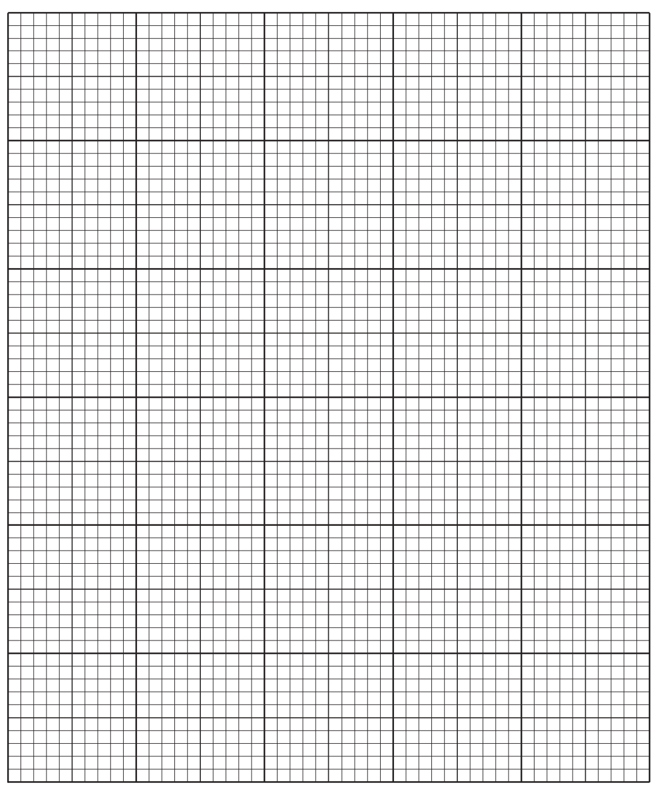

[3]

(ii)

Herbivores and carnivores are animals.

Use the data in Table 2 to calculate the ratio of animals to plants.

Show your working and give your answer in its simplest form.

[2]

*Source: 2018 (Series 1) 0610/61 Q2C*

## Multiple Choice Questions (28 questions)

### Q1 — easy — 1 marks

**Q1** [1 mark]

Which organism is a producer?

### Q2 — easy — 1 marks

**Q2** [1 mark]

The diagram shows the feeding relationships in a food web.

Which organism may feed as both a secondary and a tertiary consumer?

*Source: June 2021 0970/21 Q38*

### Q3 — medium — 1 marks

**Q3** [1 mark]

The diagram shows the flow of energy.

Which form of energy is transferred at points 1 and 3 in the diagram?

|   | 1 | 3 |
|---|---|---|
| **A** | chemical | chemical |
| **B** | heat | light |
| **C** | light | chemical |
| **D** | light | heat |

*Source: June 2021 0970/21 Q37*

### Q4 — easy — 1 marks

**Q4** [1 mark]

The food web shows the feeding relationships in a woodland.

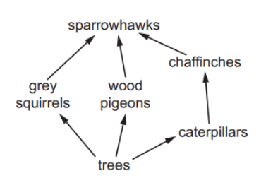

If all the chaffinches in the food web die, which effect would this have?

*Source: June 2022 Paper 1 Q40*

### Q5 — medium — 1 marks

**Q5** [1 mark]

A herd of red deer live in a forest that contains snakes and a large variety of birds.

Which group of organisms is an example of a population?

*Source: June 2022 Paper 1 Q38*

### Q6 — easy — 1 marks

**Q6** [1 mark]

Which process uses the principal source of energy input to biological systems?

*Source: June 2022 Paper 1 Q36*

### Q7 — easy — 1 marks

**Q7** [1 mark]

What is an example of a population?

*Source: June 2021 0970/11 Q38*

### Q8 — easy — 1 marks

**Q8** [1 mark]

The diagram shows a food web in a desert.

Which organisms are **all** secondary consumers?

*Source: June 2021 0970/11 Q36*

### Q9 — medium — 1 marks

**Q9** [1 mark]

The diagram shows part of the nitrogen cycle

Which row identifies the bacteria involved in processes W, X, Y and Z?

|   | W | X | Y | Z |
|---|---|---|---|---|
| **A** | denitrifying | decomposer | nitrifying | nitrogen-fixing |
| **B** | denitrifying | nitrifying | decomposer | nitrogen-fixing |
| **C** | nitrifying | decomposer | nitrogen-fixing | denitrifying |
| **D** | nitrogen-fixing | nitrifying | decomposer | denitrifying |

*Source: Specimen 2023 0970/02 Q35*

### Q10 — hard — 1 marks

**Q10** [1 mark]

The graph shows a population growth curve for a species of insect which has been introduced to an island.

How long after the introduction does the insect population start to be limited by resources such as food?

*Source: Specimen 2023 0970/01 Q37*

### Q11 — medium — 1 marks

**Q11** [1 mark]

The table shows processes in the carbon cycle that release carbon dioxide into the air, or remove carbon dioxide from the air.

Which row is correct?

|   | releases carbon dioxide into the air | removes carbon dioxide from the air |
|---|---|---|
| **A** | decay | photosynthesis |
| **B** | combustion | respiration |
| **C** | photosynthesis | combustion |
| **D** | respiration | decay |

*Source: Specimen 2023 0970/01 Q36*

### Q12 — easy — 1 marks

**Q12** [1 mark]

The diagram shows a woodland food web.

Which statement is correct?

*Source: Specimen 2023 0970/01 Q35*

### Q13 — hard — 1 marks

**Q13** [1 mark]

#### Extended only

Which statement gives the best explanation for why most food chains have no more than five trophic levels?

### Q14 — hard — 1 marks

**Q14** [1 mark]

The graphs below show how the number of carnivores change over a period of time in a habitat.

At point X the herbivores in the habitat are removed.

Which graph correctly shows the effect of this on the number of carnivores?

### Q15 — medium — 1 marks

**Q15** [1 mark]

The image shows a food web.

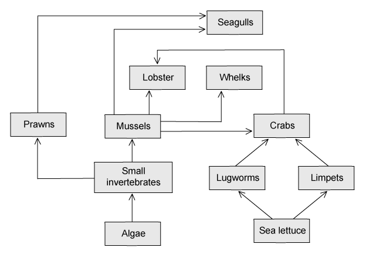

Which organism, from the food web, feeds on the greatest variety of organisms?

### Q16 — easy — 1 marks

**Q16** [1 mark]

A food chain is shown below.

tree ➔ small insects ➔ small birds ➔ birds of prey

One of the pyramids of number below represents this food chain.

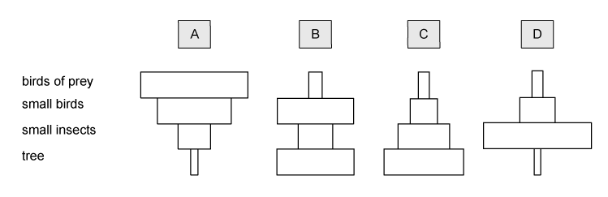

Which one would be correct?

### Q17 — easy — 1 marks

**Q17** [1 mark]

The diagram below illustrates part of the carbon cycle.

Which process is shown by the arrow labelled Y?

### Q18 — hard — 1 marks

**Q18** [1 mark]

A scientist grew some bacterial cells in ideal growth conditions.

Each bacterial cell can reproduce itself once in a 30 minute period.

For an initial population of 10 bacterial cells, how many cells will be present in the population after 8 hours of cell reproduction? You can assume that 10% of the bacterial cells die in the final few minutes before the end of the growth period.

### Q19 — hard — 1 marks

**Q19** [1 mark]

Look at the information about a food chain.

| Organism | Number | Total biomass of trophic level / kg |
|---|---|---|
| Oak tree | 1 | 400,000 |
| Aphids | 9,000 | 900 |
| Predatory midges | 120 | 45 |

What is the percentage biomass of the aphids transferred to the midges?

### Q20 — medium — 1 marks

**Q20** [1 mark]

The graph below shows the growth of the human population globally since 1630.

Which of the following options represents the longest time period taken for the population of humans to double?

### Q21 — easy — 1 marks

**Q21** [1 mark]

Which of the following diagrams show a pyramid of biomass for a forest?

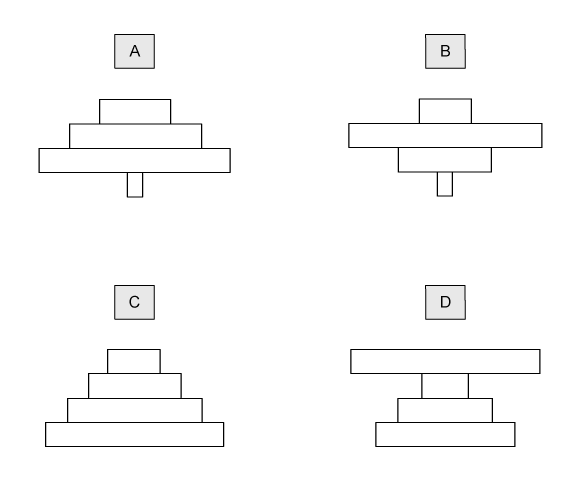

### Q22 — medium — 1 marks

**Q22** [1 mark]

#### Extended only

The diagram below shows part of the nitrogen cycle.

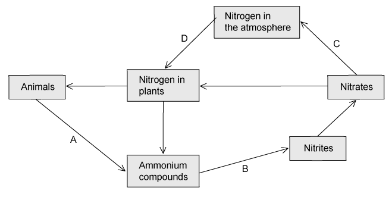

Which letter would represent denitrification?

### Q23 — easy — 1 marks

**Q23** [1 mark]

Which of the following is a correct example of a population?

### Q24 — medium — 1 marks

**Q24** [1 mark]

The image below shows a pyramid of biomass for a food chain in a rainforest ecosystem.

What would be an appropriate **pyramid of numbers** for this food chain?

### Q25 — hard — 1 marks

**Q25** [1 mark]

#### Extended only

The graph shows how the world population of humans has increased from 1650 until the year 2000.

Which stage in this sigmoidal population curve is shown by point X?

### Q26 — medium — 1 marks

**Q26** [1 mark]

Which letter shows the path of the energy from the sun?

### Q27 — easy — 1 marks

**Q27** [1 mark]

#### Extended only

Which of the processes below is carried out by bacteria in the roots of leguminous plants?

### Q28 — easy — 1 marks

**Q28** [1 mark]

Which of the following is an example of a community?

## Theory Questions (20 questions)

### Q1 — easy — 3 marks

**Q1** [3 marks]

Some bacteria are involved in the nitrogen cycle.

Fig. 1.3 shows part of the nitrogen cycle.

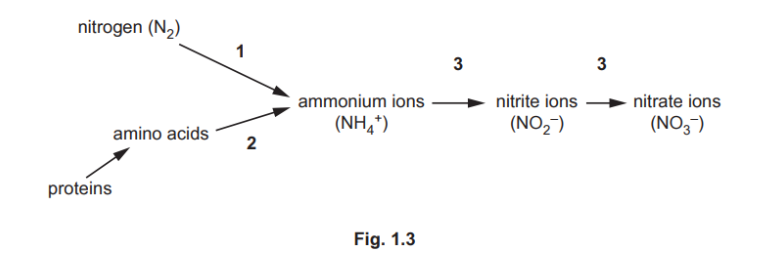

State the processes that are represented by 1, 2 and 3 on Fig. 1.3.

*Source: june 2021 paper 4 Q1D*

### Q2 — easy — 8 marks

**Q2** [4 marks]

Fig. 8.1 is a diagram showing part of the carbon cycle.

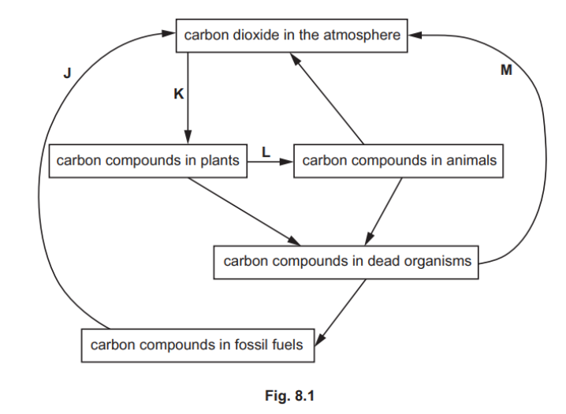

(i) Draw **one** arrow on Fig. 8.1 to represent respiration in plants.

[1]

(ii) Identify the processes labelled J, L and M in Fig. 8.1.

[3]

*Source: june 2022 paper 3 Q8A*

**Q2** [2 marks]

Photosynthesis is the process occurring at **K** in Fig. 8.1.

State the** two** products of photosynthesis.

*Source: june 2022 paper 3 Q8B*

**Q2** [2 marks]

Explain the effect of deforestation on the concentration of carbon dioxide in the atmosphere.

*Source: june 2022 paper 3 Q8C*

### Q3 — medium — 13 marks

**Q3** [3 marks]

Wetlands are important ecosystems. Researchers studied the feeding relationships between the organisms in an area of coastal wetland.

Fig. 6.1 shows part of the food web that they studied.

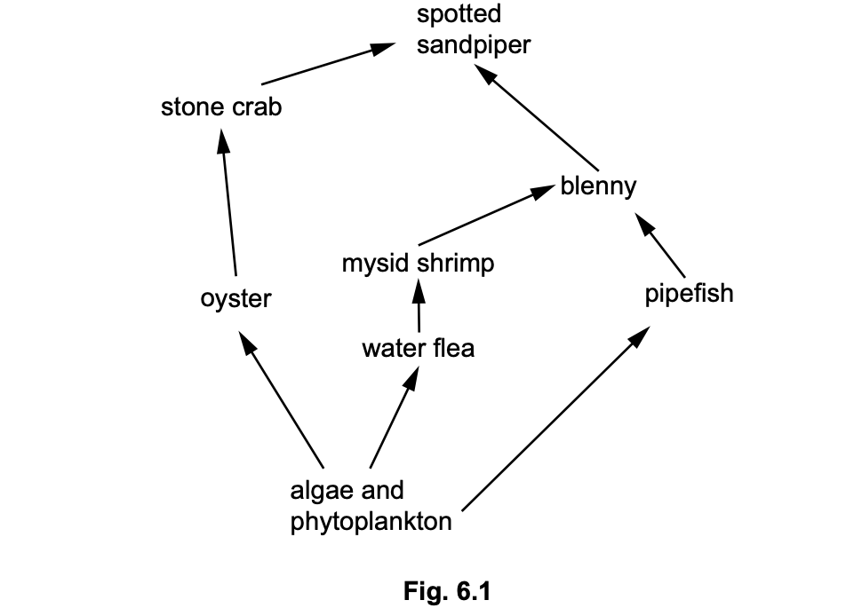

Complete Table 6.1 by giving the name of **one** organism from the food web in Fig. 6.1 for each row.

**Table 6.1**

|   | name of organism from Fig. 6.1 |
|---|---|
| producer |   |
| secondary consumer |   |
| an animal that feeds at two trophic levels |   |

*Source: Specimen 2023 0970/04 Q6A*

**Q3** [7 marks]

The functioning of ecosystems relies on the cycling of nutrients.

Fig. 6.2 shows part of the nitrogen cycle.

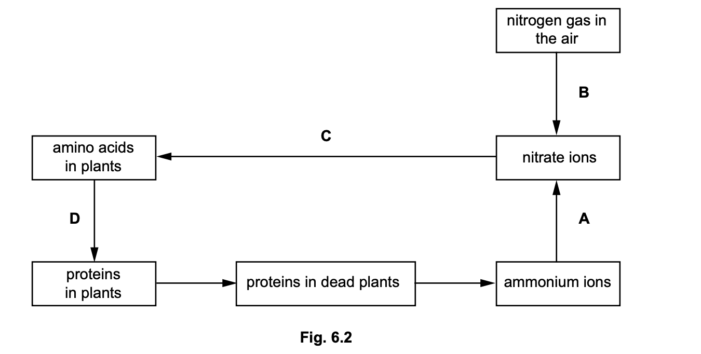

(i)

State the name of process **A** in Fig. 6.2 and give the type of organism that converts ammonium ions to nitrate ions.

**A **............................................................................................................

type of organism ..................................................................................

[2]

(ii)

Describe how the nitrate ions used in process **C** enter the roots of plants

[3]

(iii)

State the name of the structure in plant cells where process **D** occurs.

[1]

(iv)

State the process that occurs at **B**

*Source: Specimen 2023 0970/04 Q6B*

**Q3** [3 marks]

A pyramid of numbers for the wetland ecosystem showed that there were very large numbers of organisms at the base of the pyramid and very few at the top.

Explain why.

*Source: Specimen 2023 0974/04 Q6C*

### Q4 — easy — 7 marks

**Q4** [7 marks]

Fig. 7.1 shows a simple food web.

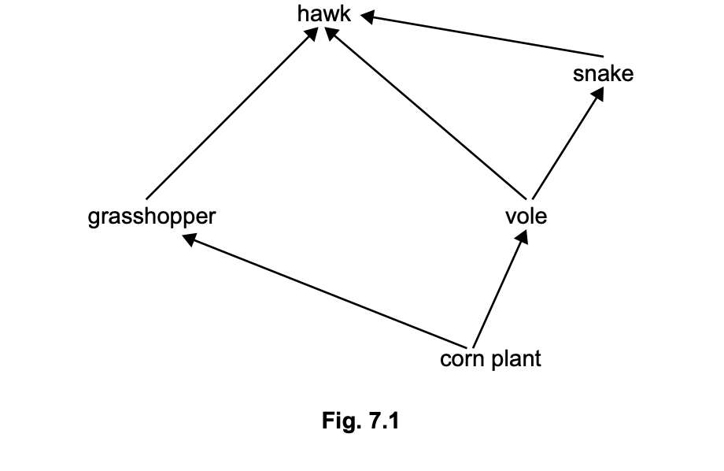

(i)

Table 7.1 shows some of the terms that can be used to describe the organisms in the food web in Fig. 7.1.

Place ticks (`equation`✓) in the boxes to show the terms that can be used to describe each organism.

**Table 7.1**

| organism | producer | herbivore | secondary consumer |
|---|---|---|---|
| corn plant |   |   |   |
| vole |   |   |   |
| grasshopper |   |   |   |
| hawk |   |   |   |

[3]

(ii)

State the number of trophic levels in the food web in Fig. 7.1.

[1]

(iii) Identify **one** organism that feeds at more than one trophic level.

[1]

(iv) State the term used to describe an organism that gets its energy from dead or waste organic material.

[1]

(v) State the principal source of energy for food webs

[1]

*Source: Specimen 2023 0970/03 Q7C*

### Q5 — hard — 11 marks

**Q5** [2 marks]

#### Extended only

Mangrove trees are hydrophytes because they grow in water.

Fig. 1 shows a young mangrove tree.

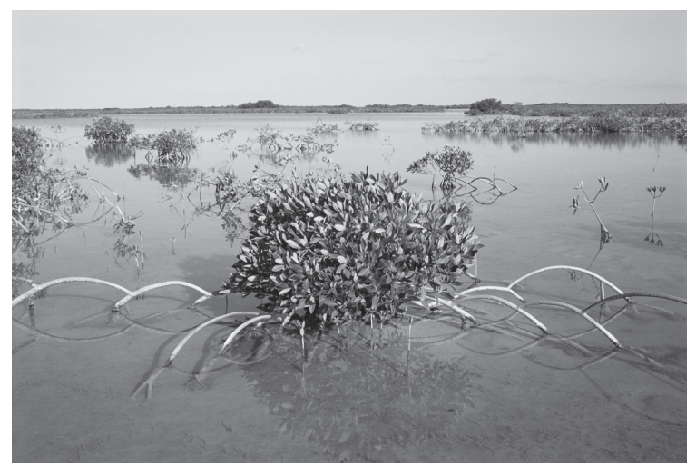

**Fig. 1**

Mangrove trees have many aerial roots and floating seeds.

Suggest how these adaptive features allow mangrove trees to survive in water.

*Source: 2018 0610/42 Q2A*

**Q5** [9 marks]

**Extract:**

Fig. 2 shows a food chain in a mangrove forest.

mangrove tree → fiddler crab → seagull

Table 1 gives the number of organisms and their biomass in a mangrove forest.

| organism       | number of organisms | biomass of organisms / kg |
|---------------|--------------------|--------------------------|
| mangrove tree | 1 000              | 450 000                  |
| fiddler crab  | 7 500 000          | 8 000                    |
| seagulls      | 150 000            | 1 200                    |

Fig. 2 shows a food chain in a mangrove forest.

mangrove tree → fiddler crab → seagull

**Fig. 2**

Table 1 gives the number of organisms and their biomass in a mangrove forest.

**Table 1**

| **organism** | **number of organisms** | **biomass of organisms / kg** |
|---|---|---|
| mangrove tree | 1 000 | 450 000 |
| fiddler crab | 7 500 000 | 8 000 |
| seagulls | 150 000 | 1 200 |

(i)

Estimate the biomass of one fiddler crab in grams.

Write your answer to two significant figures.

Show your working.

[2]

(ii)

Sketch a **pyramid of numbers**, using the information in Table 1, for the food chain shown in Fig. 2.

Write the number of each trophic level on the appropriate part of your pyramid.

[3]

(iii)

Explain why the shape of a pyramid of biomass, for the information given in Table 1, would be different from the shape of your pyramid of numbers.

[4]

*Source: 2018 0610/42 Q2B*

### Q6 — medium — 10 marks

**Q6** [3 marks]

Fig. 1 shows part of the carbon cycle.

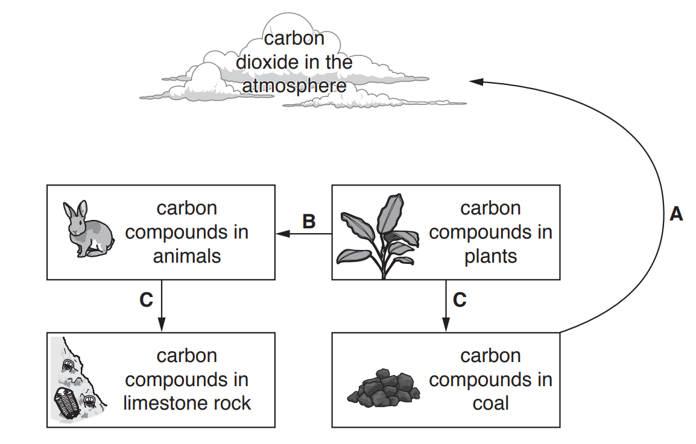

**Fig. 1**

Identify the processes shown by arrows **A**, **B** and **C** on Fig. 1.

Choose words from the list.

| **combustion      decomposition      excretion      feeding      fossilisation** |
|---|

*Source: 2018 (Series 3) 0610/33 Q5A*

**Q6** [2 marks]

**Extract:**

Fig. 1 shows part of the carbon cycle.

carbon dioxide in the atmosphere
carbon compounds in plants
carbon compounds in animals
carbon compounds in limestone rock
carbon compounds in coal

(i)

On Fig. 1 draw **one** arrow to represent photosynthesis.

Label this arrow with a letter **D**.

[1]

(ii)

On Fig. 1 draw **one** arrow to represent respiration.

Label this arrow with a letter **E**.

[1]

*Source: 2018 (Series 3) 0610/33 Q5B*

**Q6** [5 marks]

The concentration of carbon dioxide in the atmosphere is increasing.

(i)

Describe **two** possible causes of the increased carbon dioxide concentration in the atmosphere.

[2]

(ii)

State **two** adverse effects of the increase in carbon dioxide concentration in the atmosphere.

[2]

(iii)

Carbon dioxide is a greenhouse gas.

State the name of **one other** greenhouse gas.

[1]

*Source: 2018 (Series 3) 0610/33 Q5C*

### Q7 — medium — 10 marks

**Q7** [5 marks]

Fig. 1 represents the carbon cycle.

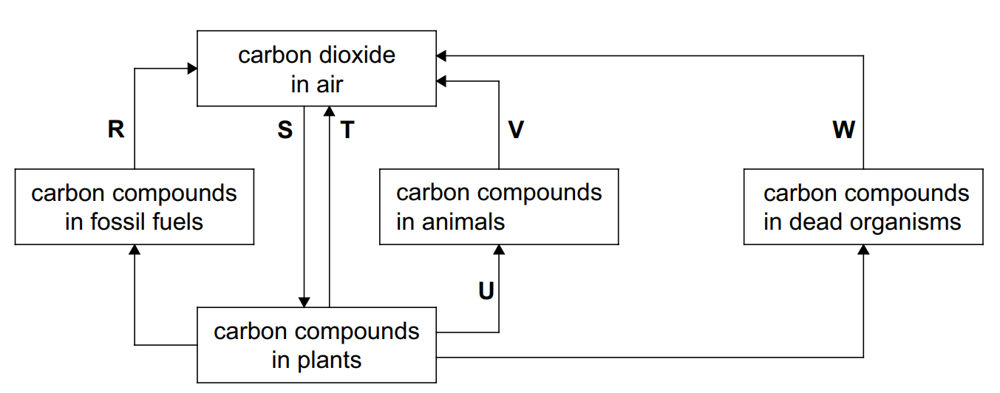

**Fig. 1**

Use Fig. 1 to answer the following questions.

(i)

Name the process labelled **U**.

[1]

(ii)

Name a group of organisms that are responsible for the process labelled **W**.

[1]

(iii)

List** two **letters that identify respiration.

[2]

(iv)

State which letter identifies photosynthesis.

[1]

*Source: 2020 0610/03 Q9A*

**Q7** [2 marks]

State the word equation for aerobic respiration.

*Source: 2020 0610/03 Q9B*

**Q7** [3 marks]

Suggest reasons why the mean percentage of carbon dioxide in the atmosphere has increased during the last 100 years.

*Source: 2020 0610/03 Q9C*

### Q8 — medium — 9 marks

**Q8** [6 marks]

Fig. 1 shows a food chain that is found in the sea.

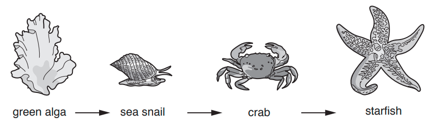

**Fig. 1**

(i)

State the name of the producer in this food chain.

[1]

(ii)

Define the term *producer*.

[2]

(iii)

State the name of the secondary consumer in this food chain.

[1]

(iv)

State the name of the herbivore in this food chain.

[1]

(v)

State what the arrows in a food chain represent.

[1]

*Source: 2018 0610/33 Q3A*

**Q8** [3 marks]

**Extract:**

Fig. 1 shows a food chain that is found in the sea.

(i) The name of the producer in this food chain is...
- (Green) alga/algae; [1 mark]

(iii) The name of the secondary consumer in this food chain is...
- Crab; [1 mark]

(iv) The name of the herbivore in this food chain is...
- Sea snail; [1 mark]

[The food chain diagram (not shown here) includes green algae, sea snail, crab, and starfish.]

In some countries humans eat crabs.

Explain how the over-harvesting of crabs could affect the other organisms in the food chain shown in Fig. 1.

*Source: 2018 0610/33 Q3B*

### Q9 — hard — 14 marks

**Q9** [4 marks]

Ecologists studied an area of woodland and estimated the biomass of each trophic level for one of the food chains in the woodland.

Some students wanted to use the data to draw a pyramid of biomass for the food chain.

Table 1 shows the students’ table.

The students added a column to calculate the width of the bars they would need to draw.

**Table 1**

| **trophic level** | **biomass / g m****-2** | **width of bar / cm** |   |
|---|---|---|---|
| **1** | **producer** | 120 | 12.0 |
| **2** | **primary consumer** | 48 | 4.8 |
| **3** | **secondary consumer** | 16 | 1.6 |
| **4** | **tertiary consumer** | 2 |   |

(i)

Complete Table 1 by calculating the missing value and writing it in the table.

[1]

(ii)

Using the information in Table 1, draw a pyramid of biomass.

Label each bar with the trophic level.

[3]

*Source: 2018 Feb/Mar 0610/42 Q3A*

**Q9** [1 mark]

A type of organism gains energy from waste organic material from all trophic levels.

State the name of this type of organism.

*Source: 2018 Feb/Mar 0610/42 Q3B*

**Q9** [6 marks]

#### Extended only

(i)

Outline how organisms in the first trophic level of the woodland food chain produce biomass using energy from the Sun.

[3]

(ii)

Explain why the fourth trophic level has the least biomass in this food chain.

[3]

*Source: 2018 Feb/Mar 0610/42 Q3C*

**Q9** [3 marks]

**Extract:**

Ecologists studied an area of woodland and estimated the biomass of each trophic level for one of the food chains in the woodland.

Table 1 shows the students' table.

| trophic level | biomass / g m^-2 | width of bar / cm |
| 1 | producer | 120 | 12.0 |
| 2 | primary consumer | 48 | 4.8 |
| 3 | secondary consumer | 16 | 1.6 |
| 4 | tertiary consumer | 2 |   |

This question covers core knowledge but is taken from an extended paper 4 question.

#### Extended only

The woodland is a conservation area.

Outline the possible benefits of conserving this specific area of woodland.

*Source: 2018 Feb/Mar 0610/42 Q3D*

### Q10 — medium — 10 marks

**Q10** [5 marks]

(i)

The sentences in the box describe the feeding relationships between four organisms.

| Hawks obtain their energy from blackbirds.  A fig tree carries out photosynthesis.  Blackbirds are secondary consumers.  Caterpillars are herbivores. |
|---|

Use the information in the sentences to write a food chain containing these four organisms.

Do **not** draw pictures of the organisms.

[3]

(ii)

State the principal source of energy for this food chain.

[1]

(iii)

State the type of organism that gains its energy from dead organic material.

[1]

*Source: 2018 0610/31 Q5A*

**Q10** [5 marks]

(i)

A species becomes endangered when it is at risk of extinction.

Explain **two** ways in which a species could become endangered.

[4]

(ii)

State **one** way in which endangered species can be conserved.

[1]

*Source: 2018 0610/31 Q5B*

### Q11 — easy — 14 marks

**Q11** [5 marks]

#### Extended only

Fig. 1 shows an Arctic wolf, *Canis lupus*. These wolves are one of the few mammals adapted to the extreme cold of the tundra in the Canadian Arctic and in Alaska.

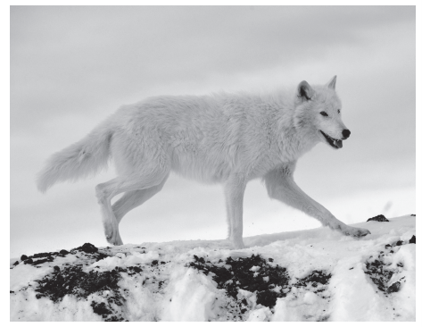

**Fig. 1**

(i)

State **two** features, **visible** in Fig. 1, that identify Arctic wolves as mammals.

[2]

(ii)

Arctic wolves show many adaptive features to a cold environment.

Explain what is meant by the term adaptive feature.

[3]

*Source: 2018 0610/43 Q2A*

**Q11** [3 marks]

#### Extended only

The food available to animals in the Arctic tundra is limited. There is a short growing season for plants and the environmental conditions do not favour high rates of photosynthesis and growth compared with temperate and tropical ecosystems.

State **three** conditions that limit plant growth rates.

*Source: 2018 0610/43 Q2B*

**Q11** [6 marks]

**Extract:**

The food available to animals in the Arctic tundra is limited. There is a short growing season for plants and the environmental conditions do not favour high rates of photosynthesis and growth compared with temperate and tropical ecosystems.

#### Extended only

Arctic wolves are the top carnivores in the food web in the tundra.

Explain why the number of Arctic wolves is so small in this ecosystem.

*Source: 2018 0610/43 Q2C*

### Q12 — easy — 7 marks

**Q12** [2 marks]

Rabbits are herbivores.

Define the term *herbivore*.

*Source: 2019 0970/31 Q5A*

**Q12** [2 marks]

The size of a rabbit population can increase and decrease from year to year, as shown in Fig. 1.

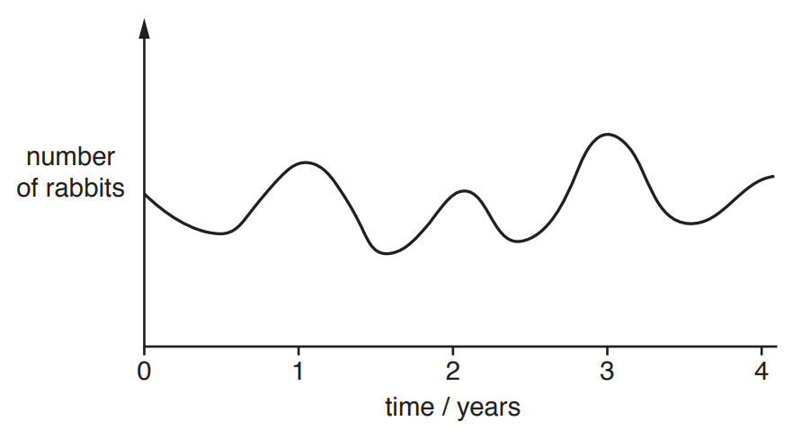

**Fig. 1**

State** two** factors that could cause an increase in a rabbit population.

*Source: 2019 0970/31 Q5B*

**Q12** [3 marks]

Since 1800 the population of humans in the world has increased dramatically.

State **three** ways in which this increase in the human population has affected marine ecosystems.

*Source: 2019 0970/31 Q5C*

### Q13 — medium — 7 marks

**Q13** [7 marks]

Fig. 1 shows a simple food web.

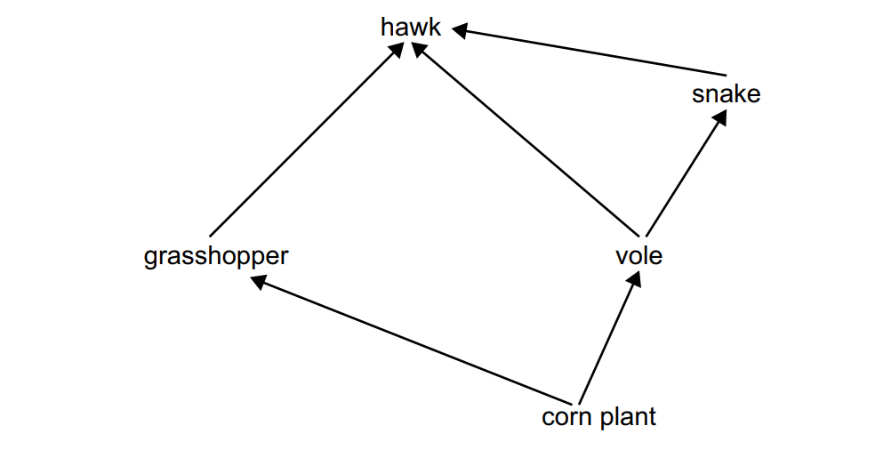

**Fig. 1**

(i)

Table 1 shows some of the terms that can be used to describe the organisms in the food web in Fig. 1.

Place ticks (✓) in the boxes to show the terms that can be used to describe each organism.

**Table 1**

| **organism** | **producer** | **herbivore** | **secondary consumer** |
|---|---|---|---|
| corn plant |   |   |   |
| vole |   |   |   |
| grasshopper |   |   |   |
| hawk |   |   |   |

[3]

(ii)

State the number of trophic levels in the food web in Fig. 1.

[1]

(iii)

Identify **one** organism that feeds at more than one trophic level.

[1]

(iv)

State the term used to describe an organism that gets its energy from dead or waste organic material.

[1]

(v)

State the principal source of energy for food webs.

[1]

*Source: 2023 3/1/0970 Q7C*

### Q14 — medium — 13 marks

**Q14** [1 mark]

Adaptive features are defined as the inherited features of an organism that increase its fitness.

State what is meant by *fitness *in this context.

*Source: 2018 0610/41 Q2A*

**Q14** [4 marks]

Rodents are the most common mammals in many hot deserts.

Fig. 1 shows the lesser Egyptian jerboa, *Jaculus jaculus*, which lives in North Africa and the Middle East in areas that have high daytime temperatures and very little rainfall.

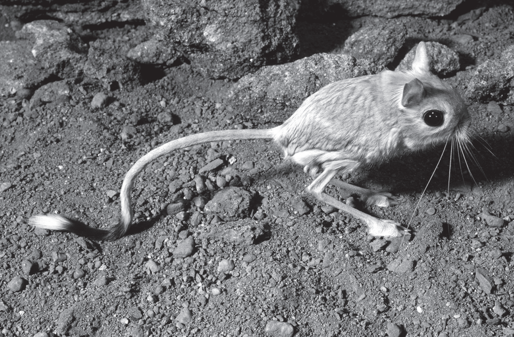

**Fig. 1**

Like many desert-living mammals, jerboas are active at night.

Suggest **two** features of *J. jaculus* that adapt it to each of the following challenges of living in desert ecosystems:

(i)

very high daytime temperatures

1...............................

2...............................

[2]

(ii)

very little or no light at night

1...............................

2...............................

[2]

*Source: 2018 0610/41 Q2B*

**Q14** [8 marks]

A scientist studied communities in different parts of a desert and estimated the biomass of the organisms in each area.

He divided the organisms into four groups according to their roles in the food web as shown in Table 1.

Detritivores are animals that eat dead organisms or parts of organisms.

**Table 1**

| **groups of organisms in the food web** | **biomass / g per m****2** |
|---|---|
| producers | 480 |
| herbivores | 220 |
| detritivores | 120 |
| carnivores | 40 |

Some of these results are shown as a pyramid of biomass in Fig. 2.

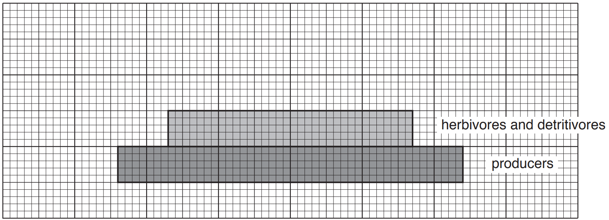

**Fig. 2**

(i)

Use the information in Table 1 to complete the pyramid of biomass in Fig. 2.

[2]

(ii)

The scientist observed the detritivores and decided to include them with herbivores in this pyramid of biomass.

Suggest what the scientist discovered about the detritivores that made him make this decision.

[1]

(iii)

Explain why there are rarely more than four or five trophic levels in ecosystems.

[2]

(iv)

Explain the advantages of presenting information about food webs as a pyramid of biomass and not as a pyramid of numbers.

[3]

*Source: 2018 0610/41 Q2C*

### Q15 — hard — 13 marks

**Q15** [3 marks]

Wetlands are important ecosystems. Researchers studied the feeding relationships between the organisms in an area of wetland on the coast of Texas.

Fig. 1 shows part of the food web that they studied.

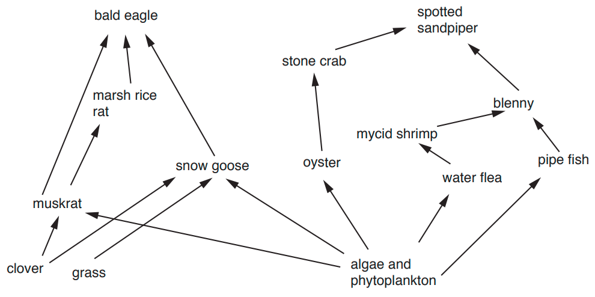

**Fig. 1**

Complete Table 1 by giving the name of one organism from the food web in Fig. 1 for each row.

**Table 1**

|   | **name of organism from Fig. 1** |
|---|---|
| producer |   |
| secondary consumer |   |
| an animal that feeds at two trophic levels |   |

*Source: 2018 0610/42 Q1A*

**Q15** [2 marks]

#### Extended only

The functioning of ecosystems relies on the cycling of nutrients.

Fig. 2 shows part of the nitrogen cycle.

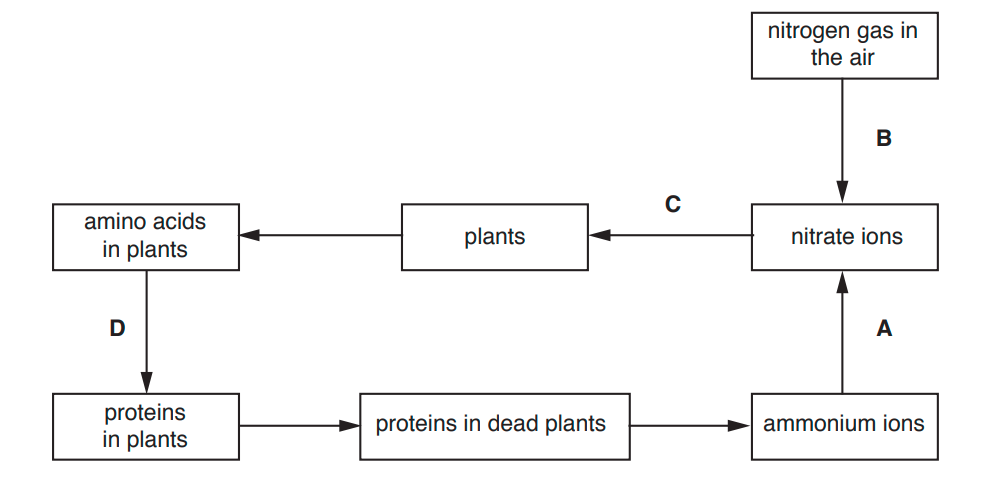

**Fig. 2**

State the name of process **A** in Fig. 2 and give the type of organism that converts ammonium ions to nitrate ions.

*Source: 2018 0610/42 Q1B*

**Q15** [3 marks]

#### Extended only

Describe how nitrate ions enter the roots of plants shown by arrow **C **on Fig. 2.

*Source: 2018 0610/42 Q1C*

**Q15** [1 mark]

#### Extended only

State the name of the structure in plant cells where process **D** occurs.

*Source: 2018 0610/42 Q1D*

**Q15** [1 mark]

#### Extended only

State the process that occurs at **B.**

*Source: 2018 0610/42 Q1E*

**Q15** [3 marks]

#### Extended only

A pyramid of numbers for the wetland ecosystem showed that there were very large numbers of organisms at the base of the pyramid and very few at the top.

Explain why.

*Source: 2018 0610/42 Q1F*

### Q16 — medium — 13 marks

**Q16** [3 marks]

Wetlands are important ecosystems. Researchers studied the feeding relationships between the organisms in an area of coastal wetland.

Fig. 1 shows part of the food web that they studied.

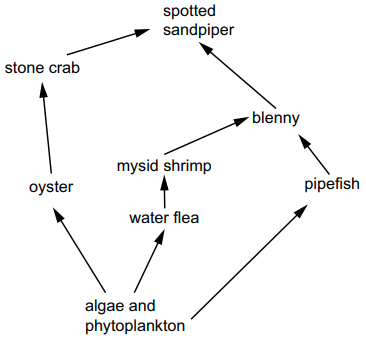

**Fig. 1**

Complete Table 1 by giving the name of **one** organism from the food web in Fig. 1 for each row.

**Table 1**

|   | **name of organism from Fig. 1** |
|---|---|
| producer |   |
| secondary consumer |   |
| an animal that feeds at two trophic levels |   |

*Source: 2023 970/04 Q6A*

**Q16** [7 marks]

**Extract:**

Wetlands are important ecosystems. Researchers studied the feeding relationships between the organisms in an area of coastal wetland.

Fig. 1 shows part of the food web that they studied.

#### Extended only

The functioning of ecosystems relies on the cycling of nutrients.

Fig. 2 shows part of the nitrogen cycle.

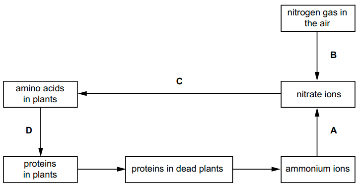

**Fig. 2**

(i)

State the name of process **A** in Fig. 2 **and** give the type of organism that converts ammonium ions to nitrate ions.

[2]

(ii)

Describe how the nitrate ions used in process **C** enter the roots of plants.

[3]

(iii)

State the name of the structure in plant cells where process **D** occurs.

[1]

(iv)

State the process that occurs at **B**.

[1]

*Source: 2023 970/04 Q6B*

**Q16** [3 marks]

#### Extended only

A pyramid of numbers for the wetland ecosystem showed that there were very large numbers of organisms at the base of the pyramid and very few at the top.

Explain why.

*Source: 2023 970/04 Q6C*

### Q17 — medium — 13 marks

**Q17** [6 marks]

Fig. 1 shows a pyramid of biomass and part of the carbon cycle.

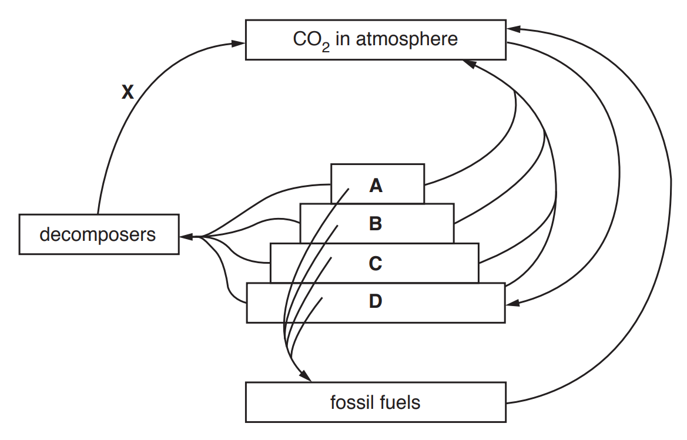

**Fig. 1**

(i)

State the principal source of energy required for trophic level **D** of the pyramid of biomass in Fig. 1.

[1]

(ii)

State the letter that represents the primary consumers in Fig. 1.

[1]

(iii)

State how carbon is transferred from producers to primary consumers.

[1]

(iv)

Explain why trophic level **A** is smaller than trophic level **B** in the pyramid of biomass in Fig. 1.

[3]

*Source: 2018 (Series 1) 0610/41 Q1A*

**Q17** [2 marks]

Some fungi and bacteria are decomposers

(i)

Define the term *decomposer*.

[1]

(ii)

Arrow** X** on Fig. 1 indicates the transfer of carbon from decomposers to the atmosphere. State the name of process** X**.

[1]

*Source: 2018 (Series 1) 0610/41 Q1B*

**Q17** [5 marks]

Describe how human activities are affecting the carbon cycle.

*Source: 2018 (Series 1) 0610/41 Q1C*

### Q18 — medium — 13 marks

**Q18** [3 marks]

The dominant grass species in an African grassland ecosystem are star grass and red oat grass.

- Star grass is eaten by antelope species, such as topi and Thomson’s gazelle.
- Smaller animals such as mice and grasshoppers feed on red oat grass.
- Topi and Thomson’s gazelle are eaten by predators such as cheetahs, lions and serval cats.
- Grasshoppers and mice are eaten by serval cats and tawny eagles.
- Vultures feed on dead mammals.

Fig. 1 shows part of the food web for this ecosystem.

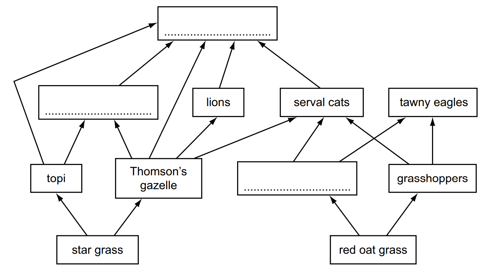

**Fig. 1**

Complete the food web by writing the names of the correct organisms in the boxes in Fig. 1.

*Source: 2020 0610/04 Q1A*

**Q18** [2 marks]

**Extract:**

The dominant grass species in an African grassland ecosystem are star grass and red oat grass.

- Star grass is eaten by antelope species, such as topi and Thomson's gazelle.
- Smaller animals such as mice and grasshoppers feed on red oat grass.
- Topi and Thomson's gazelle are eaten by predators such as cheetahs, lions and serval cats.
- Grasshoppers and mice are eaten by serval cats and tawny eagles.
- Vultures feed on dead mammals.

Name the trophic level of the following species.

(i)

Star grass

[1]

(ii)

Topi

[1]

*Source: 2020 0610/04 Q1B*

**Q18** [2 marks]

#### Extended only

(i)

State the principal source of energy for the food web shown in Fig. 1.

[1]

(ii)

State what happens to energy when it leaves a food web.

[1]

*Source: 2020 0610/04 Q1C*

**Q18** [3 marks]

**Extract:**

The dominant grass species in an African grassland ecosystem are star grass and red oat grass.

- Star grass is eaten by antelope species, such as topi and Thomson's gazelle.
- Smaller animals such as mice and grasshoppers feed on red oat grass.
- Topi and Thomson's gazelle are eaten by predators such as cheetahs, lions and serval cats.
- Grasshoppers and mice are eaten by serval cats and tawny eagles.
- Vultures feed on dead mammals.

Fig. 1 shows part of the food web for this ecosystem.

#### Extended only

Explain why there are no more than four trophic levels in the food web shown in Fig. 1.

*Source: 2020 0610/04 Q1D*

**Q18** [3 marks]

#### Extended only

Fish such as salmon can be reared intensively in fish farms. They are fed on high protein food made from animals. When eating this food, the fish are feeding as secondary consumers.

Describe the **disadvantages** of intensive farming, such as salmon farming, for producing human food.

*Source: 2020 0610/04 Q1E*

### Q19 — hard — 12 marks

**Q19** [1 mark]

In the Arctic, snowy owls are predators of lemmings. The lemmings eat Arctic plants.

Draw the food chain for this Arctic ecosystem.

*Source: 2020 0610/03 Q5A*

**Q19** [9 marks]

Fig. 1 shows changes in the populations of snowy owls and lemmings over a three year period.

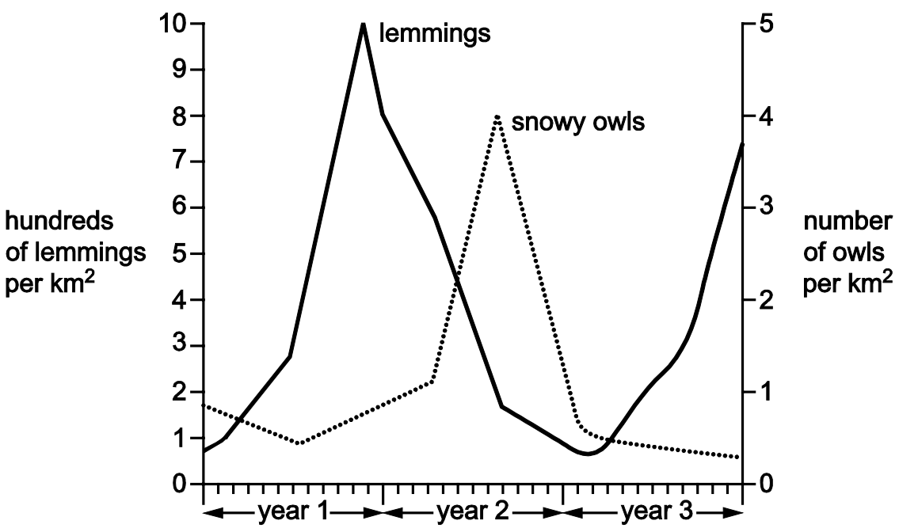

**Fig. 1**

During the first 10 months of year 1, the lemming population increases slowly at first and then more rapidly.

(i)

Suggest why the rate of increase becomes greater.

[1]

(ii)

Suggest why the lemming population falls during year 2.

[2]

(iii)

Use Fig. 1 to describe and explain how changes in the lemming population affect the snowy owl population.

[3]

(iv)

If all the snowy owls were removed from the Arctic ecosystem, suggest and explain what effect this would have on the lemming population in the following years.

[3]

*Source: 2020 0610/03 Q5B*

**Q19** [2 marks]

Lemmings and snowy owls get their energy from the food they eat.

(i)

State the principal source of all the energy in this ecosystem.

[1]

(ii)

Name the process that first traps this energy.

[1]

*Source: 2020 0610/03 Q5C*

### Q20 — easy — 5 marks

**Q20** [5 marks]

The boxes on the left contain the names of processes from the carbon cycle.

The boxes on the right contain some descriptions of processes.

Draw one straight line from each process to link the process to its description.

An example has been done for you.

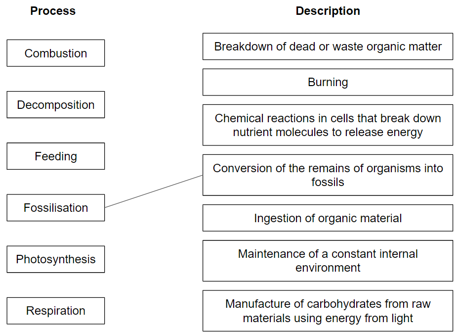

*Source: 2018 0610/32 Q1*

