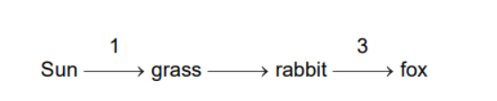
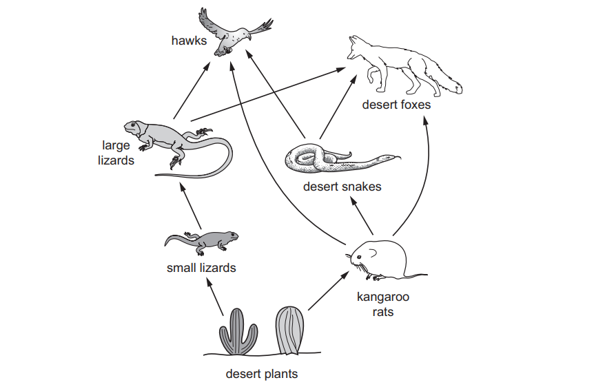
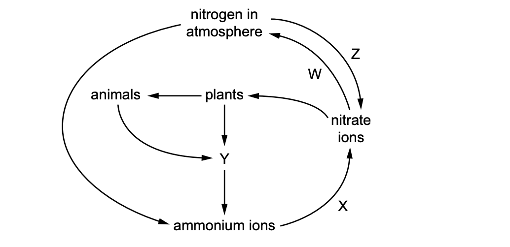
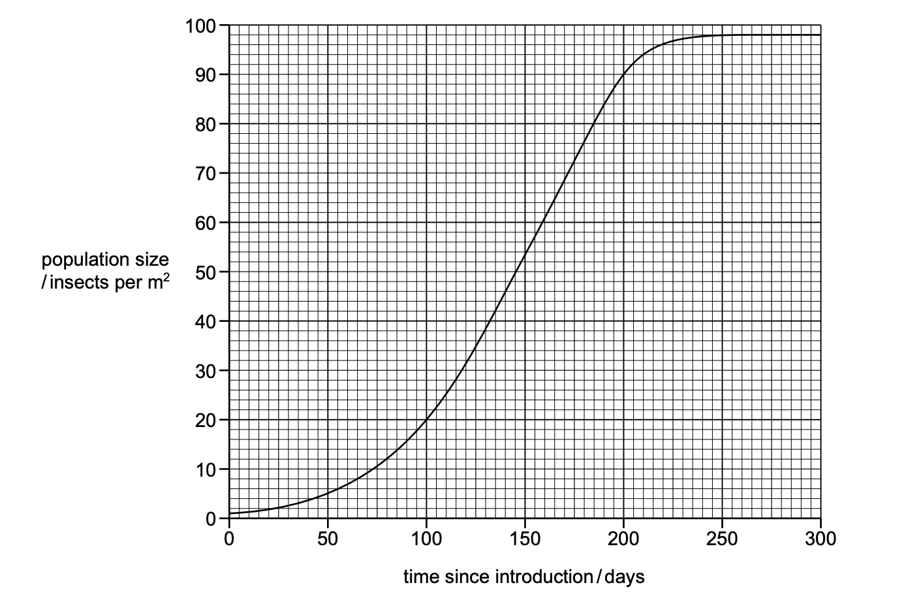
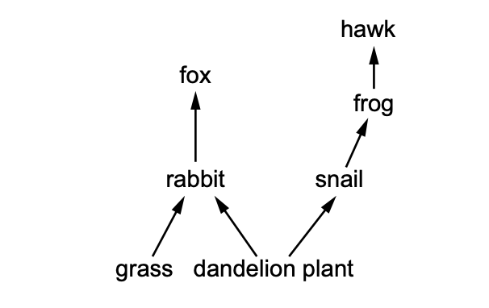
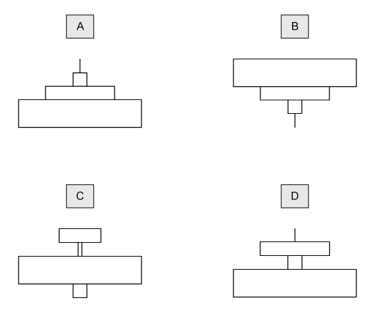
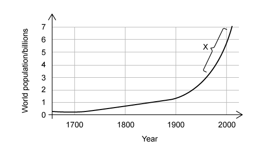

# Exam Questions — Energy & Feeding Relationships
**19. Organisms & Their Environment** · Cambridge (CIE) IGCSE biology (0610 & 0970)
> Source: [https://www.savemyexams.com/igcse/biology/cie/23/topic-questions/](https://www.savemyexams.com/igcse/biology/cie/23/topic-questions/) · 28 questions across 1 sets

## Multiple Choice Questions (28 questions)

### Q1 — easy — 1 marks

**Q1** [1 mark]

Which organism is a producer?

### Q2 — easy — 1 marks

**Q2** [1 mark]

The diagram shows the feeding relationships in a food web.

Which organism may feed as both a secondary and a tertiary consumer?

*Source: June 2021 0970/21 Q38*

### Q3 — medium — 1 marks

**Q3** [1 mark]

The diagram shows the flow of energy.

Which form of energy is transferred at points 1 and 3 in the diagram?

|   | 1 | 3 |
|---|---|---|
| **A** | chemical | chemical |
| **B** | heat | light |
| **C** | light | chemical |
| **D** | light | heat |

*Source: June 2021 0970/21 Q37*

### Q4 — easy — 1 marks

**Q4** [1 mark]

The food web shows the feeding relationships in a woodland.

If all the chaffinches in the food web die, which effect would this have?

*Source: June 2022 Paper 1 Q40*

### Q5 — medium — 1 marks

**Q5** [1 mark]

A herd of red deer live in a forest that contains snakes and a large variety of birds.

Which group of organisms is an example of a population?

*Source: June 2022 Paper 1 Q38*

### Q6 — easy — 1 marks

**Q6** [1 mark]

Which process uses the principal source of energy input to biological systems?

*Source: June 2022 Paper 1 Q36*

### Q7 — easy — 1 marks

**Q7** [1 mark]

What is an example of a population?

*Source: June 2021 0970/11 Q38*

### Q8 — easy — 1 marks

**Q8** [1 mark]

The diagram shows a food web in a desert.

Which organisms are **all** secondary consumers?

*Source: June 2021 0970/11 Q36*

### Q9 — medium — 1 marks

**Q9** [1 mark]

The diagram shows part of the nitrogen cycle

Which row identifies the bacteria involved in processes W, X, Y and Z?

|   | W | X | Y | Z |
|---|---|---|---|---|
| **A** | denitrifying | decomposer | nitrifying | nitrogen-fixing |
| **B** | denitrifying | nitrifying | decomposer | nitrogen-fixing |
| **C** | nitrifying | decomposer | nitrogen-fixing | denitrifying |
| **D** | nitrogen-fixing | nitrifying | decomposer | denitrifying |

*Source: Specimen 2023 0970/02 Q35*

### Q10 — hard — 1 marks

**Q10** [1 mark]

The graph shows a population growth curve for a species of insect which has been introduced to an island.

How long after the introduction does the insect population start to be limited by resources such as food?

*Source: Specimen 2023 0970/01 Q37*

### Q11 — medium — 1 marks

**Q11** [1 mark]

The table shows processes in the carbon cycle that release carbon dioxide into the air, or remove carbon dioxide from the air.

Which row is correct?

|   | releases carbon dioxide into the air | removes carbon dioxide from the air |
|---|---|---|
| **A** | decay | photosynthesis |
| **B** | combustion | respiration |
| **C** | photosynthesis | combustion |
| **D** | respiration | decay |

*Source: Specimen 2023 0970/01 Q36*

### Q12 — easy — 1 marks

**Q12** [1 mark]

The diagram shows a woodland food web.

Which statement is correct?

*Source: Specimen 2023 0970/01 Q35*

### Q13 — hard — 1 marks

**Q13** [1 mark]

#### Extended only

Which statement gives the best explanation for why most food chains have no more than five trophic levels?

### Q14 — hard — 1 marks

**Q14** [1 mark]

The graphs below show how the number of carnivores change over a period of time in a habitat.

At point X the herbivores in the habitat are removed.

Which graph correctly shows the effect of this on the number of carnivores?

### Q15 — medium — 1 marks

**Q15** [1 mark]

The image shows a food web.

Which organism, from the food web, feeds on the greatest variety of organisms?

### Q16 — easy — 1 marks

**Q16** [1 mark]

A food chain is shown below.

tree ➔ small insects ➔ small birds ➔ birds of prey

One of the pyramids of number below represents this food chain.

Which one would be correct?

### Q17 — easy — 1 marks

**Q17** [1 mark]

The diagram below illustrates part of the carbon cycle.

Which process is shown by the arrow labelled Y?

### Q18 — hard — 1 marks

**Q18** [1 mark]

A scientist grew some bacterial cells in ideal growth conditions.

Each bacterial cell can reproduce itself once in a 30 minute period.

For an initial population of 10 bacterial cells, how many cells will be present in the population after 8 hours of cell reproduction? You can assume that 10% of the bacterial cells die in the final few minutes before the end of the growth period.

### Q19 — hard — 1 marks

**Q19** [1 mark]

Look at the information about a food chain.

| Organism | Number | Total biomass of trophic level / kg |
|---|---|---|
| Oak tree | 1 | 400,000 |
| Aphids | 9,000 | 900 |
| Predatory midges | 120 | 45 |

What is the percentage biomass of the aphids transferred to the midges?

### Q20 — medium — 1 marks

**Q20** [1 mark]

The graph below shows the growth of the human population globally since 1630.

Which of the following options represents the longest time period taken for the population of humans to double?

### Q21 — easy — 1 marks

**Q21** [1 mark]

Which of the following diagrams show a pyramid of biomass for a forest?

### Q22 — medium — 1 marks

**Q22** [1 mark]

#### Extended only

The diagram below shows part of the nitrogen cycle.

Which letter would represent denitrification?

### Q23 — easy — 1 marks

**Q23** [1 mark]

Which of the following is a correct example of a population?

### Q24 — medium — 1 marks

**Q24** [1 mark]

The image below shows a pyramid of biomass for a food chain in a rainforest ecosystem.

What would be an appropriate **pyramid of numbers** for this food chain?

### Q25 — hard — 1 marks

**Q25** [1 mark]

#### Extended only

The graph shows how the world population of humans has increased from 1650 until the year 2000.

Which stage in this sigmoidal population curve is shown by point X?

### Q26 — medium — 1 marks

**Q26** [1 mark]

Which letter shows the path of the energy from the sun?

### Q27 — easy — 1 marks

**Q27** [1 mark]

#### Extended only

Which of the processes below is carried out by bacteria in the roots of leguminous plants?

### Q28 — easy — 1 marks

**Q28** [1 mark]

Which of the following is an example of a community?
