# Mark Schemes — Cell Structure & Size of Specimens
**2. Organisation of the Organism** · Cambridge (CIE) IGCSE biology (0610 & 0970)

## Alternative To Practical Questions (5 questions)

### Q1
(i) Your drawing of the bronchus should look similar to that shown below:

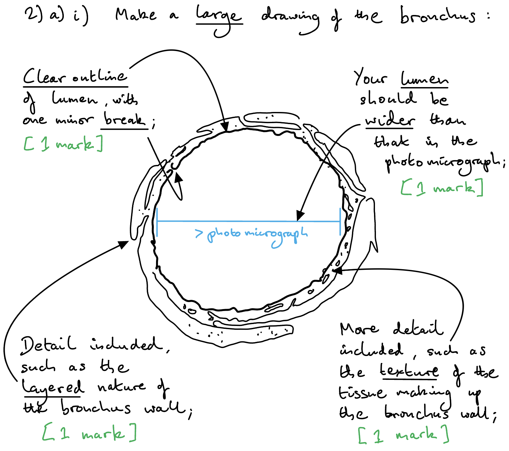

(ii) The magnification of the bronchus in Fig.1, to the nearest whole number, would be:

- (x) 36 / 37; **[2 marks]**

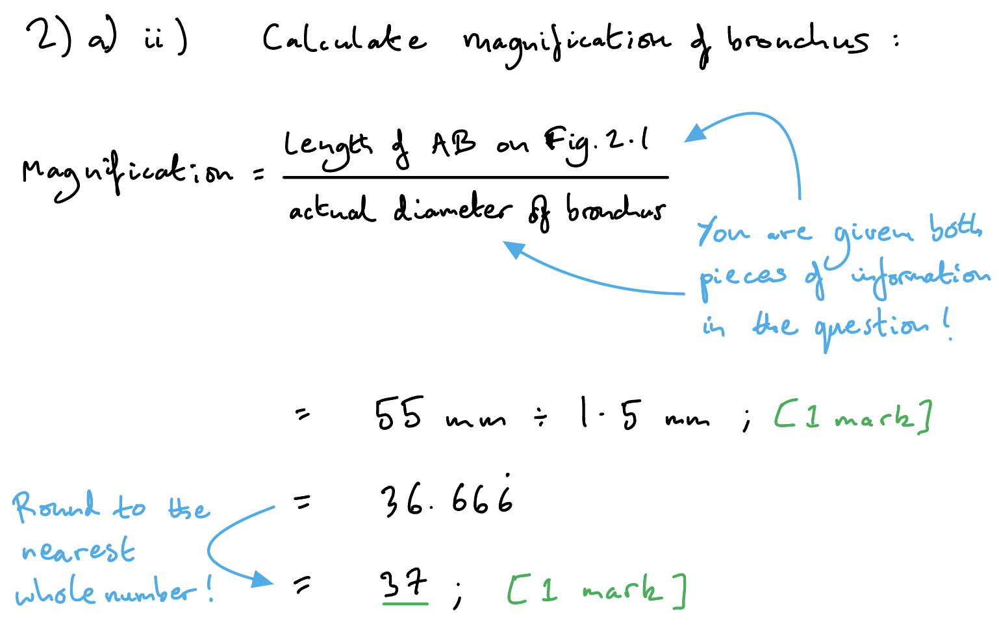

**[Total: 6 marks]**

> *Whilst you can receive **two marks** for a correct answer **without** showing any working, you would receive **one mark** for showing working along the lines of: 55 ÷ 1.5.*

### Q2
The length of **XY** and the magnification of the photograph would be...

*Length of petal ****XY****: *

- 30 mm ± 1;** [1 mark]**

*The magnification of the photograph:*

- (x) 6; **[1 mark]**

**[Total: 2 marks]**

> *Note that the ruler was added to Fig.1 to enable measuring on a screen. In the exam, the ruler would not have been there and you would have been expected to use your own one.*

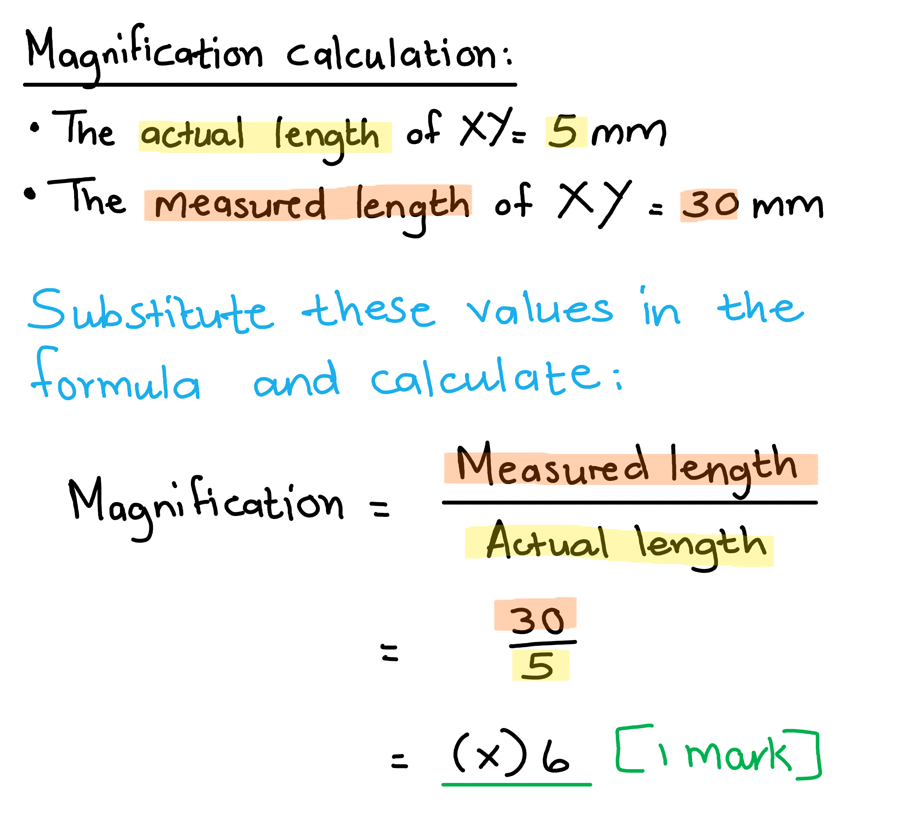
(i) The number of petals on flowers **9** and **10** would be...

*Flower 9: *

- 19/20

**AND**

*Flower 10: *

- 19/20; **[1 mark]**

*Both answers are needed for ***[1 mark]***.*

(ii) The average number of petal for species **B** is...

- 6; **[1 mark]**

(iii) A method that would ensure accurate counting of the number of petals is...

- Mark each petal as counted **OR** detach petals as they are counted **OR** repeat the count (twice); **[1 mark]**

**[Total: 3 marks]**

> *The calculation for b) ii):*

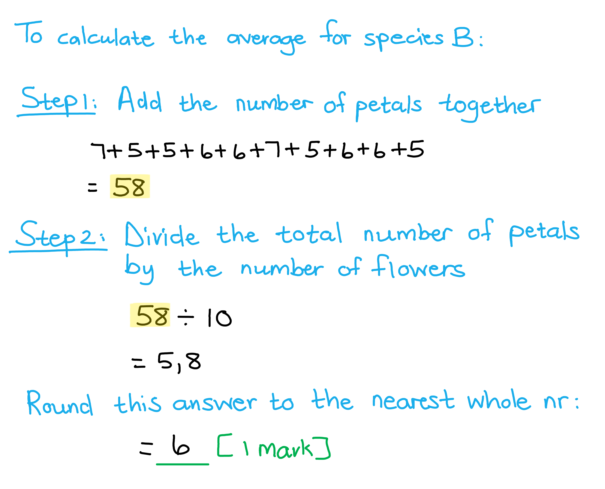
The mark allocation for the graph would be as follows...

*Axes: *

- Both axes labelled (**x**: Species plus **A** and **B** , **y**: (Average) number of petals);** [1 mark]**

*Scale: *

- Even scale and plot area occupying at least half the grid in both directions; **[1 mark]**

*Plot: *

- Bar heights plotted correctly, bars same width and not touching;** [1 mark]**

*Error carried forward would apply to plotting the bar for species ****B****, based on the value calculated in (b)(ii). *

**[Total: 3 marks]**

> *Your graph would look like this:*

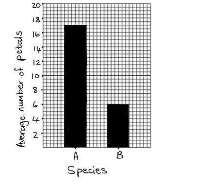
Reasons to repeat an investigation include...

Any **two** from the following:

- To identify anomalous results / values that are outliers;** [1 mark]**
- To increase the reliability (of the results);** [1 mark]**
- Any other valid point e.g.  petals may have fallen off / been eaten;** [1 mark]**

**[Total: 2 marks]**
(i) The test for reducing sugar can be described as follows...

- (Add) Benedict’s (solution / reagent to the nectar solution); **[1 mark]**
- Heat (the solution to) 80 °C;** [1 mark]**
- A positive result is (a) green / yellow / orange / (brick) red (precipitate forming); **[1 mark]**

(ii) A safety precaution that should be taken is...

Any **one** from the following:

- Use a water-bath (to heat the solution); **[1 mark]**
- Wear safety goggles/eye protection; **[1 mark]**
- Wear gloves (to protect the hands); **[1 mark]**
- Use test-tube holders (to avoid burns); **[1 mark]**
- Point test-tubes away from people (when heating solution); **[1 mark]**

**[Total: 4 marks]**

> *Familiarise yourself with the steps of performing the different food tests and what a positive result would look like for each. The names of the reagents that are used are also important to remember, as well as laboratory safety precautions that should be followed when performing these tests.*

### Q3
(i) The mark allocation for the diagram would be as follows...

- Single clear line **AND** no shading; **[1 mark]**
- Equal to/larger than the original in size;** [1 mark]**
- At least eight distinct segments;** [1 mark]**
- Two projections at the front **AND** two at the back;** [1 mark]**

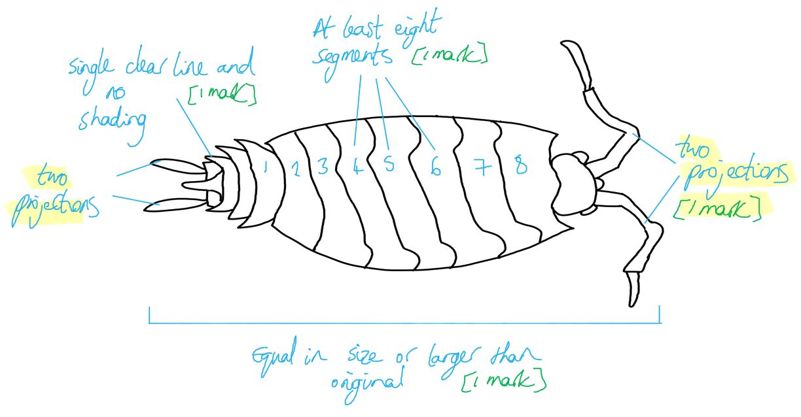

(ii) The actual width of the woodlouse can be calculated as follows...

- 48 ÷ 9; **[1 mark]**
- 5.33;** [1 mark]**

*Answer must be correctly rounded to ****three significant figures**** to obtain mark.*

*Full marks can be awarded for the correct answer in the absence of other calculations.*

**[Total: 6 marks]**

> *Take note that this question and mark scheme was adapted to suit an on-screen format. In the exam you will be expected to measure the length of PQ, for which you would gain a mark, so remember to pack a ruler!*

> *Calculation for c) ii):*

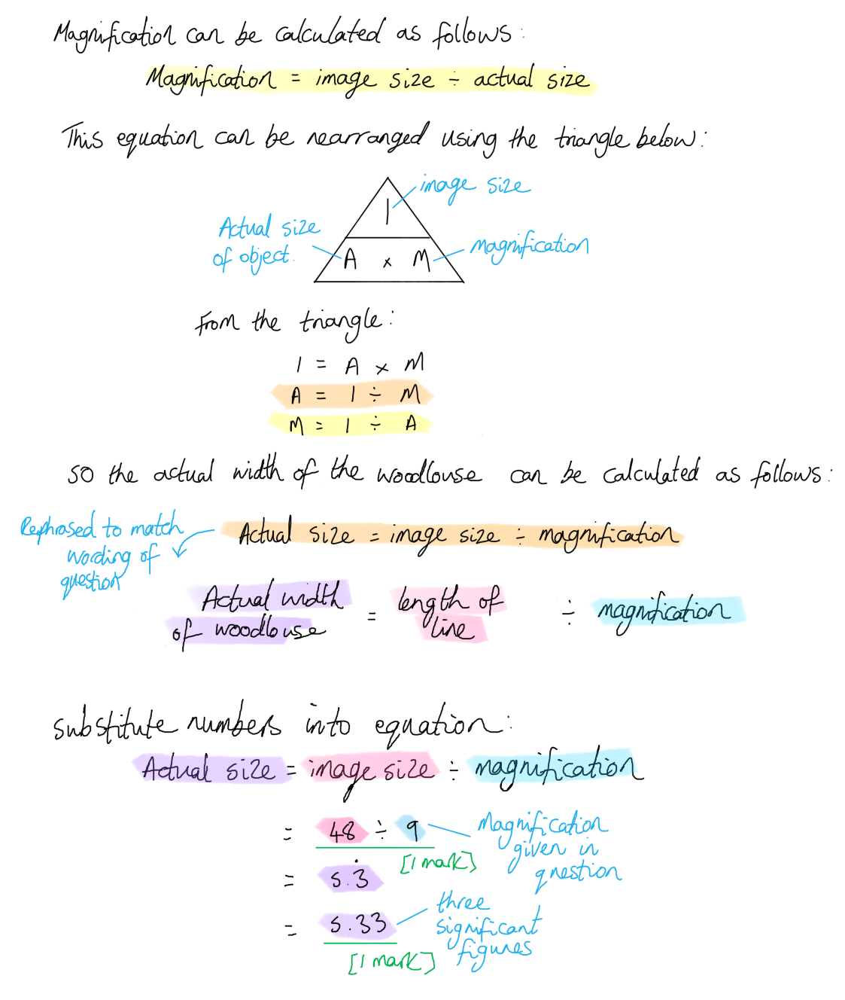

### Q4
(i) The large outline drawing of the algae should have the following features...

- **O**utline - single clear line no shading; **[1 mark]**
- **S**ize - use at least half available space; **[1 mark]**
- **D**etail - eight algae visible; **[1 mark]**
- **D**etail - circle drawn in the centre; **[1 mark]**

> *Using the **OSDD **abbreviation will help you to remember the key features required in a 'draw' question of this kind. As you can see from the model answer below, the examiners are not expecting 'Leonardo da Vinci quality' artwork (this is a science exam after all!).*

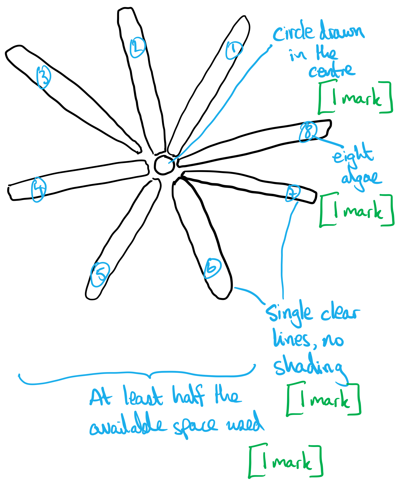

(ii) The length of line **AB **in Fig 1 is...

- 85mm / 8.5 cm; **[1 mark]**

*Allow 84-86 mm inclusive / 8.4 - 8.6 cm inclusive.*

The actual diameter of the algae shown in Fig.1 is...

- $425=\frac{85}{\mathrm{actual} \mathrm{diameter}}$; **[1 mark]**
- actual diameter = 0.2 mm / 0.02 cm / 200 µm; **[1 mark]**

*Allow ecf (error carried forward)*

*If you have an incorrect value for AB but used it correctly in the calculation, this earns a maximum of*** [2 marks]**

**[Total: 7 marks]**

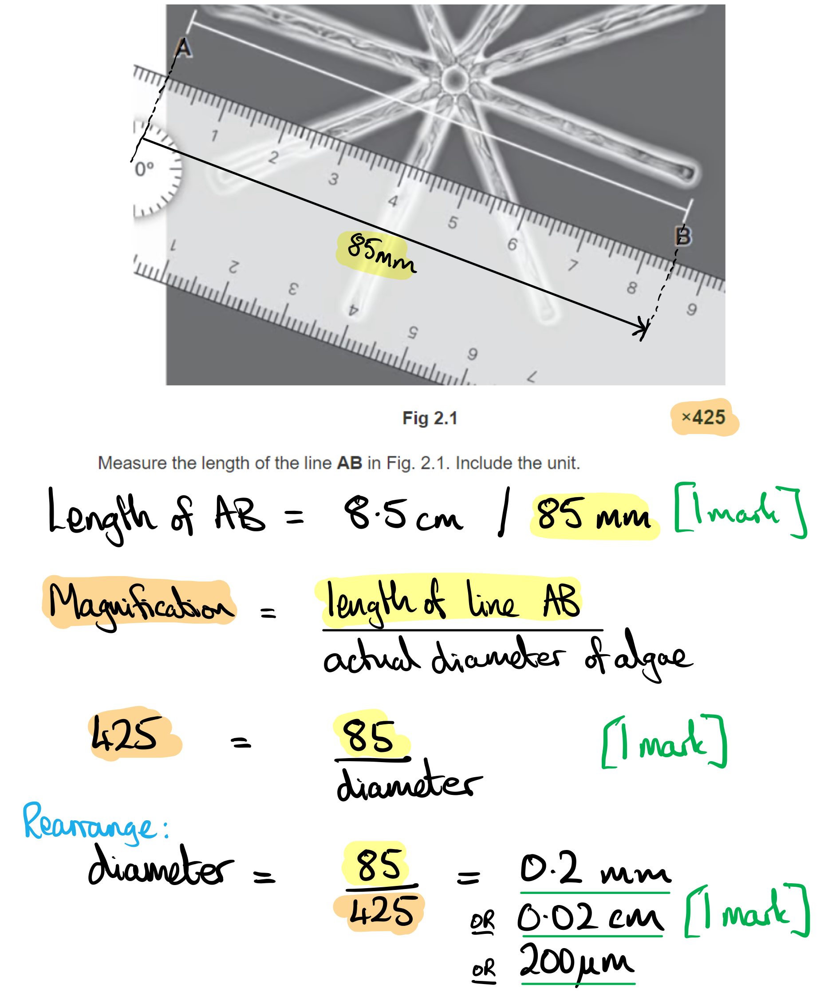
(i) An experiment using use hydrogencarbonate indicator to investigate the effect of light intensity on photosynthesis in fresh water algae would be set up as follows...

*Independent variable*

- Use different light (intensities); **[1 mark]**

*Dependent variable*

- Record colour of hydrogencarbonate indicator after a time / record the time taken to reach a set colour; **[1 mark]**

*Use of controlled variables*

Up to **three **from:

- Same amount / number / mass / species / type of algae; **[1 mark]**
- Same volume / concentration of hydrogencarbonate indicator;** [1 mark]**
- Same temperature; **[1 mark]**
- Same point of ending the investigation e.g. specified time / or specified end colour (measure the time taken to reach that colour); **[1 mark]**
- Same initial colour of indicator at the start; **[1 mark]**

*Methodology*

Up to **three **from:

- Detail of a quantitative method used to achieve different light intensities eg. moving light source / use of bulbs with  different light intensities / determining light intensity with a light meter; **[1 mark]**
- Method of achieving constant temperature eg. heat shield/screen / low energy bulb / LED bulb; **[1 mark]**
- Use of a control tube with no algae; **[1 mark]**
- Time to equilibrate (to different light intensities); **[1 mark]**
- Two or more repeats / replicates; **[1 mark]**

(ii) The name of a pH indicator other than hydrogencarbonate which could be used to detect a change in pH is...

Any **one **from the following:

- Litmus; **[1 mark]**
- Universal indicator;** [1 mark]**

*Any valid pH indicator can be named here.*

**[Total: 7 marks]**

### Q5
(i) The mark allocation for the drawing of the beetroot would be as follows...

- Single clear lines **AND** no shading; **[1 mark]**
- Equal to or larger than the original in size; **[1 mark]**
- At least eight rings present; **[1 mark]**
- Thickening in outer layer drawn **OR** light rings drawn as broken structures; **[1 mark]**

> *Remember that even though it may be tempting to want to shade in the dark rings, you will lose a mark if you do!*

> *Your drawing may look something like this...*

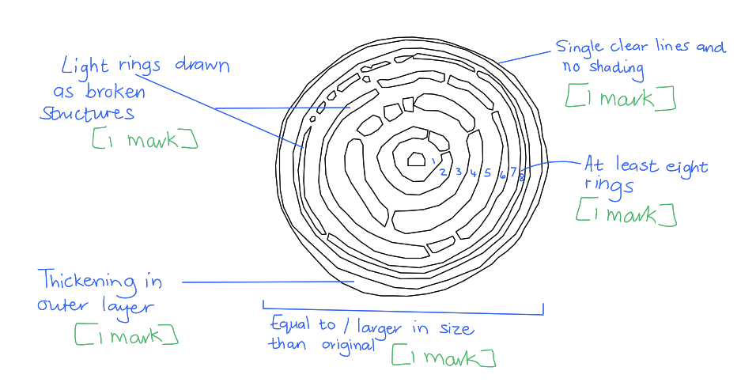

(ii) The actual width of the beetroot can be calculated as follows...

- 10 ÷ 2; **[1 mark]**
- 5 (cm); **[1 mark]**

*Full marks awarded for the correct answer only in the absence of other calculations*

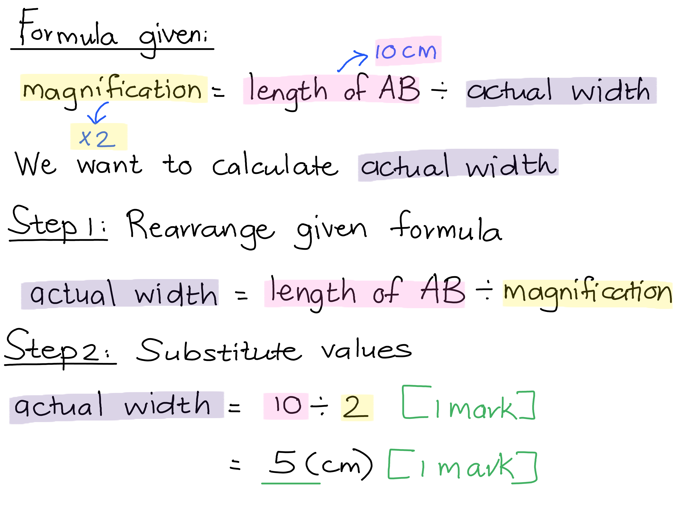

**[Total: 6 marks]**

> *Take note that the measurement for line AB was provided in order to eliminate the challenges of measuring on a screen. In the exam however, you will have to make your own measurements so do not forget to bring along your ruler!*
(i) The independent and dependent variable can be identified as follows...

- **Independent** = temperature; **[1 mark]**
- **Dependent** = (percentage) transmission of light; **[1 mark]**

> *Remember that the independent variable is the one that is changed by the students, in this case, the temperature of the water baths while the dependent variable is the one that is measured, in this case, the transmission of light.*

(ii) Safety precautions that should be followed include...

Any **two** of the following:

- Carry scalpels/knives/cutting tools in a tray **OR** cut away from yourself when cutting beetroot cores; **[1 mark]**
- Wear a lab coat to protect clothes from beetroot stains; **[1 mark]**
- Wear eye protection to protect against hot water / beetroot juice splashing; **[1 mark]**
- Use test tube tongs when handling test tubes placed in hot water; **[1 mark]**

**[Total: 4 marks]**
(i) The mean percentage light transmitted at 60°C can be calculated as follows...

- (91.4 ÷ 3) = 30.5; **[1 mark]**

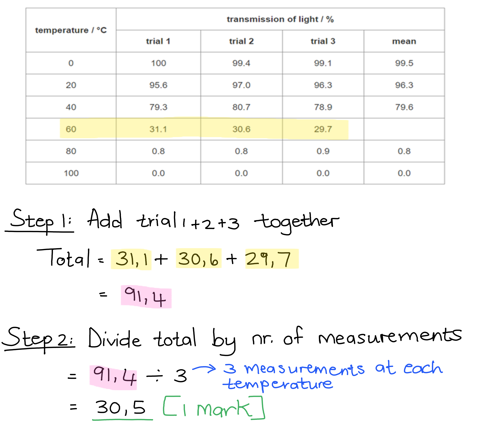

(ii) The mark allocation for the line graph would be as follows...

- Both axes labelled **and** units included (**x** = temperature / °C, **y** = transmission of light / %); **[1 mark]**
- Even scale and plot area occupying at least half the grid; **[1 mark]**
- All points plotted correctly; **[1 mark]**
- Smooth line connecting plotted points only; **[1 mark]**

**[Total: 5 marks]**

> *When plotting a line graph, you should only draw a line between the plotted data points. Do not draw a line starting from 0, unless that is where the first data point is located. Drawing parts of the graph for which you don't have data is called extrapolation and this may cost you marks, unless you are specifically asked to do so.*

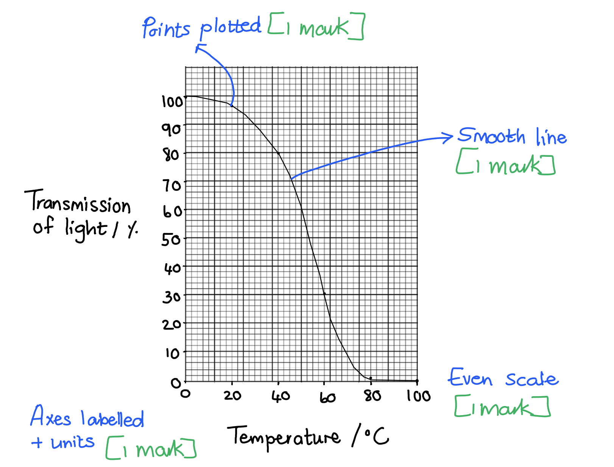
It is important to repeat the experiment because...

Any **two** of the following:

- To increase the reliability of the results; **[1 mark]**
- It provides an opportunity to identify anomalies in the data; **[1 mark]**
- It enables the students to calculate a mean (at each temperature); **[1 mark]**

**[Total: 2 marks]**

## Multiple Choice Questions (28 questions)

### Q1
**Final answer:** **The correct answer is ****D.**

- The cell is magnified 4000 times

To calculate magnification:

- Convert the units so that they match

  - There are 1000 μm in 1 mm

24 x 100 = 24 000 μm

- Use the formula:

**magnification = image size ÷ actual size**

= 24 000 ÷ 6

=** 4000**

> **[exam-tip]**
> Always check that your units match before you begin calculating. If the image size is given in millimetres and the actual size is given in micrometres, convert the image size to micrometres first (multiply by 1000) before doing anything else.
> 
> Carrying out unit conversions at the start of your working reduces the risk of forgetting to convert at all, which is one of the most common sources of error in magnification questions.

### Q2
**Final answer:** **The correct answer is ****B.**

- A palisade mesophyll cell is packed with many chloroplasts and is found near the upper surface of the leaf, where light intensity is highest
- This means it can absorb more light energy for photosynthesis

**A **is incorrect because palisade mesophyll cells do not close stomata; that is the role of guard cells.

**C** is incorrect because the palisade mesophyll layer does not have a notably large surface area. Increasing surface area for gas exchange is mainly the role of the spongy mesophyll, which has large air spaces that allow gases to diffuse through the leaf.

**D** is incorrect because although the cell does respire, the key adaptation described here is for photosynthesis, not increased respiration.

### Q3
**Final answer:** **The correct answer is C.**

- Convert the image size from cm to mm

  - 1 cm = 10 mm

1.73 x 10 = 17.3

- Convert from mm to µm

  - 1 mm = 1000 µm

17.3 x 1000 = 17 300

- Note the magnification equation:

$\mathrm{magnification}=\frac{\mathrm{image} \mathrm{size}}{\mathrm{actual} \mathrm{size}}$

- Rearrange the equation to give actual size:

$\mathrm{actual} \mathrm{size}=\frac{\mathrm{image} \mathrm{size}}{\mathrm{magnification}}$

- Substitute the values:

Actual size = 17 300 ÷ 200

= 86.5

- Round to the nearest whole number

=** 87** µm

**A** is incorrect as it results from converting mm to micrometres by multiplying by 100 instead of 1000, giving 8.65 μm which rounds to 9 μm.

**B** is incorrect as it results from dividing the image size by the magnification without converting to micrometres. A further clue that this answer is incorrect is that it has not been rounded to the nearest whole number, as the question requires.

**D** is incorrect as 86.5 μm rounded to the nearest whole number is 87, not 86.

### Q4
**Final answer:** **The correct answer is D.**

- Z = a plasmid; a ring of DNA in the cytoplasm which is separate from the main circular chromosome (labelled Y)

**A** is incorrect as bacterial cells do not contain membrane-bound organelles like mitochondria.

**B** is incorrect as chloroplasts are another example of membrane-bound organelles.

**C** is incorrect as, although bacterial cells do have a cell wall, Z is not pointing towards the cell wall.

### Q5
**Final answer:** **The correct answer is ****B.**

- To find the actual size of the nucleus, we use the formula:

Actual size = 	observed size / magnification

- Observed size of the nucleus = 2 mm (the size seen in the photograph)
- Magnification = 500

**A** is incorrect because it represents an error in division by 10,000.

**C **is incorrect because 0.04mm** **would result from dividing 2 mm by 50 instead of 500.

**D **is incorrect because it implies multiplying rather than dividing by the magnification.

### Q6
**Final answer:** **The correct answer is ****C****.**

- An organ system is a group of organs and tissues that work together to perform a specific function. In this case, blood vessels are part of the circulatory system, which also includes the heart and works to circulate blood.

**A** is incorrect because a cell is the smallest unit of an organism from which tissues, organs and organ systems are made.

**B** is incorrect because an organ is a single, distinct structure that performs a specific function, like the heart or lungs.

**D** is incorrect because tissues are made up of a group of cells of a similar structure working together to carry out the same function.

### Q7
**Final answer:** **The correct answer is ****C****.**

- An animal cell contains a cell membrane, cytoplasm and nucleus.

**A** and **B **are incorrect because animal cells do not contain chloroplasts as they do not photosynthesize.

**D** is incorrect because animal cells do not contain a large permanent vacuole.

### Q8
**Final answer:** **The correct answer is B.**

- This is because the calculation needed to work out the length of the actual worm is: **length of worm = length of diagram ÷ magnification**

- For option B this is 70 ÷ 1 = 70 mm, which is larger than the other options

**A** is incorrect because the length of the worm is 60 ÷ 3 = 20 mm, which is smaller than 70 mm.

**C** is incorrect because the length of the worm is 100 ÷ 2 = 50 mm, which is smaller than 70 mm.

**D** is incorrect because the length of the worm is 120 ÷ 5 = 24 mm, which is smaller than 70 mm.

### Q9
**Final answer:** **The correct answer is C.**

- This is because C shows the spongy mesophyll tissue. A tissue is made up of several of the same type of cells working together to carry out a shared function

**A** is incorrect because it is indicating the entire expanse of the leaf, which is an organ.

**B** is incorrect because it shows the waxy cuticle, which is not made of cells and therefore is not a tissue.

**D** is incorrect because it shows the stomata, which is a space between cells and therefore is not a tissue.

### Q10
**Final answer:** **The correct answer is A.**

- This is because W is the nucleus and is found in all eukaryotic cells and X is the cell membrane, which is also found in animal cells.

**B** is incorrect because Y is the chloroplast, which is not found in animal cells because these cells do not carry out photosynthesis.

**C** is incorrect because Y is the chloroplast, which is not found in animal cells because these cells do not carry out photosynthesis, also Z is the cell wall, which is another structure not found in animal cells.

**D** is incorrect because Z is the cell wall, which is not found in animal cells.

### Q11
**Final answer:** **The correct answer is C because:**

70 ÷ 7000 = 0.01 mm

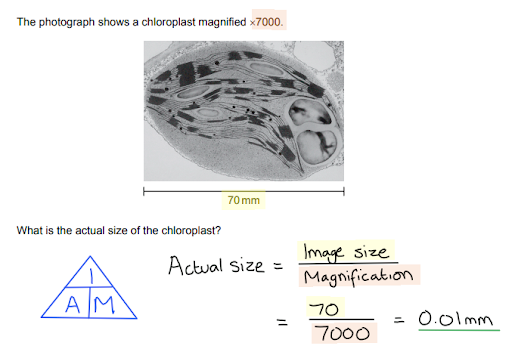

### Q12
**Final answer:** **The correct answer is B because:**

The diagram shows a root hair cell which is specialised to absorb mineral ions (and water) from the soil

**A **is incorrect because this is a cell from a plant root, and carbon dioxide enters the plant through the stomata in the leaves, not through the roots.

**C** is incorrect because phloem transports sucrose from the leaves.

**D** is incorrect because xylem transports water in stems.

### Q13
**Final answer:** **The correct answer is A because; **

The cell membrane is the part of the cell that controls the movement of substances in and out

**B** is incorrect because the cell wall provides support to the cell, defining its shape. Cell walls are fully permeable and do not control the movement of substances.

**C** is incorrect because the cytoplasm is the gel-like substance that fills the cell and is the site of many chemical reactions in the cell.

**D** is incorrect because vacuole is the storage structure for cell sap, which contains sugars and salts.

### Q14
**Final answer:** **The correct answer is ****C ****because:**

Spongy mesophyll cells contain chloroplasts for photosynthesis and have a relatively large surface area for gas exchange with the air spaces in the leaf. They also lose water by transpiration; water evaporates from the surfaces of the spongy cells, diffusing into the air spaces and out of the stomata.

The other answers are incorrect because they do not correctly describe a spongy mesophyll cell.

The diagram below shows the structure of the leaf and the position of the spongy mesophyll cells within the leaf.

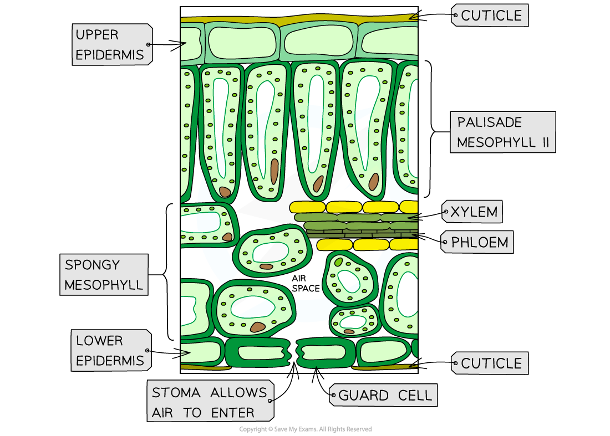

### Q15
**Final answer:** **The correct answer is ****D**** (mitochondria and ribosomes) because:**

- Salivary amylase is an **enzyme**; enzymes are made from **protein**. **Ribosomes** are the site of** protein synthesis** in all cells
- Production of proteins requires significant amounts of **energy** and therefore cells which manufacture digestive enzymes. that need to be made and then transported out of the cell would contain a lot of **mitochondria**, as this is where respiration takes place

**A **and **B** are incorrect because although mitochondria and ribosomes would be required in large numbers, each cell only ever possesses one nucleus.

**C** is incorrect because vacuoles are present in plant cells; salivary glands are animal cells.

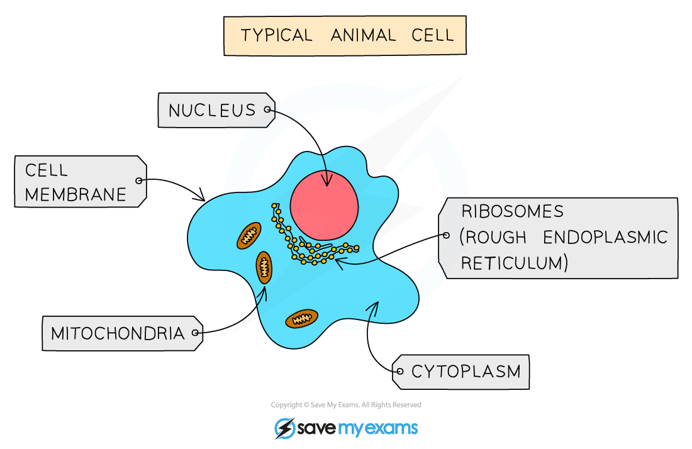

### Q16
**Final answer:** **The correct answer is ****B ****because:**

Bacterial cells have a cell membrane and a cell wall. They contain a relatively large circular chromosome that is **not **bound inside a nucleus.

The other answers are incorrect because they do not show the correct structures present in bacterial cells.

The diagram below shows a typical bacterial cell.

### Q17
**Final answer:** **The correct answer is ****A ****because:**

- The cell membrane is partially permeable and controls the movement of substances into the cell by osmosis, diffusion and active transport
- The cell wall is fully permeable and therefore does not control the movement of any substances, all move through it
- The cell wall (in plants) is made of cellulose, a polysaccharide that forms fibres which criss-cross over each other to form a very strong support for the cell
- Mitochondria are where most energy is released in the cell (via respiration)

The other rows are incorrect as they do not correctly describe the functions of the components of the root hair cell.

### Q18
**Final answer:** **The correct answer is ****C**** (1 & 3 only) because:**

- The **nucleus** is usually the **largest** subcellular structure and should easily be visible in a plant cell observed with a light microscope
- **Ribosomes** are extremely small and cannot be seen with a light microscope - you need an electron microscope with higher magnification and resolution to see them
- Plant cells contain **permanent** **vacuoles** (which store solutions of salt and sugar)
- Not every plant cell will have a **chloroplast** - they are largely found in the palisade and spongy mesophyll cells, as well as guard cells (all in the leaf)

The other answers are incorrect because they do not correctly show the structures that would be visible with a light microscope.

Remember not every cell in a plant will photosynthesise - think of the cells of the roots underground, they don’t receive any light so couldn’t photosynthesise even if they did contain chloroplasts (which they don’t!).

### Q19
**Final answer:** **The correct answer is ****C**** (stomach → red blood cell → nucleus → chromosome →  gene) because:**

- Genes are the smallest structures shown; genes are ‘coding’ sections of DNA
- A chromosome is formed from a relatively long piece of double-stranded DNA; chromosomes are found inside the nucleus of cells and therefore must logically be smaller than a single cell
- Red blood cells do not contain nuclei, but they are bigger than them
- The stomach is an organ and so logically is the biggest structure listed

The other answers are incorrect because they do not show the correct size order of the structures.

### Q20
**Final answer:** **The correct answer is ****A ****because:**

- The phloem is a transport tissue in plants formed from a number of cell types; including conducting cells (responsible for moving sugars around the plant) and structural and support cells
- The small intestine is an organ because it is made from a number of different tissues; including muscular tissue, epithelial tissue and nervous tissue
- The digestive system is made from a number of organs involved in the breakdown of large insoluble molecules into small soluble molecules

**B** is incorrect because blood is a tissue, RBCs are one of the cells in the blood; the xylem is a tissue not an organ, and the stomach is an organ.

**C** is incorrect because the small intestine is an organ and the spermatozoa are cells.

**D** is incorrect because root hair cells are not tissue, the heart is an organ part of the circulatory system.

### Q21
**Final answer:** **The correct answer is ****C**** (organ) because:**

All three structures in the question are organs. An organ is a group of two or more tissues working together to carry out a particular function.

**A** is incorrect because each of the leaves, stems and roots are made up of thousands of different cells all working together.

**B** is incorrect because the **leaf** is made from **palisade** & **spongy** mesophyll tissue, **epidermal** tissue and **vascular** tissue functioning together to allow a plant to photosynthesise. The **roots** and **stem** are made from **vascular** (transport) **tissue** which work together to transport substances around the plant.

**D** is incorrect because together plants have two organ systems. The** shoot organ system **in a plant is made from leaves, stems, buds, fruits and flowers. The **root organ system** of most plants are all the parts that are underground.

### Q22
**Final answer:** **The correct answer is ****C**** (The liver is an organ, containing several tissues, which forms part of the digestive system) because:**

The **liver** is an organ composed of several different tissue types. It plays a vital role in digestion by producing bile which neutralises acidic gastric juice from the stomach.

- An **organ** is a structure made up of a group of tissues working together to perform a specific function
- A **tissue** is a group of cells with similar structures working together to perform a shared function
- An **organ** **system** is a group of organs with related functions working together to perform body functions

The other answers are incorrect because they do not correctly define what the liver is.

### Q23
**Final answer:** **The correct answer is ****D**

- Xylem lack end walls and cell contents, so this matches the description given in the question stem
- Xylem are hollow, lignified tubes that allow uninterrupted flow of water

**A** is incorrect because this description matches root hair cells, which have a large surface area to absorb water from the plant's surroundings.

**B **and **C** are incorrect because root hair cells do not match the structure description given in the question stem; the descriptions provided also do not match the structure or function of root hair cells

### Q24
**Final answer:** **The correct answer is ****A**** (cell) because:**

The image shows a ciliated epithelial cell. These cells can be found lining the trachea and parts of the lungs. Cells are the basic functional units of all living organisms on Earth.

**B** is incorrect because organelle is a term used to describe subcellular structures within cells, such as mitochondria and chloroplasts.

**C** is incorrect because an organ is formed from two or more tissues working together. Tissues are made from groups of similar cells.

**D** is incorrect because an organ system is made from organs working together to perform a particular function.

### Q25
**Final answer:** **The correct answer is ****A ****because:**

Mitochondria are usually slightly smaller than chloroplasts and are found within the cytoplasm. Mitochondria have a highly folded internal membrane, whereas chloroplasts look like they contain stacks of pancakes (sometimes!).

**B** is incorrect because mitochondria are not found within the cell wall; in fact, no organelles are found within the cell wall.

**C** is incorrect because mitochondria are not found within the vacuole.

**D** is incorrect because this cell is an animal cell. You can tell this because of the absence of a cell wall and vacuole.

### Q26
**Final answer:** **The correct answer is ****D**** (17.2 µm) because:**

This is because to calculate the actual size of an image you need to use the magnification equation:

**Actual size = Image size**$\div$** magnification**

Actual size = 43 $\div$ 2500

Actual size = 0.0172 mm

Convert to µm = 0.0172 x 1000

**Actual size = 17.2 µm**

The other answers are incorrect as these do not give the correct width of the cell.

### Q27
**Final answer:** **The correct answer is ****B**** (× 184) because:**

- You need to use the magnification equation to calculate your answer
- Whenever you carry out a magnification calculation, you need to make sure that your image measurement and actual measurement have the same unit (either µm or mm)

The other answers are incorrect as these are not the correct magnifications.

### Q28
**Final answer:** **The correct answer is ****C**

- **P** is a chloroplast
- **Q** is the cytoplasm
- **R** is the vacuole

While P could be a mitochondrion, as the image does not show enough detail to distinguish between chloroplasts and mitochondria, there is no option for this where the other letters are identified correctly

While Q could point to a ribosome, which is a very small organelle that might not be visible in this diagram, there is no option for this where the other letters are identified correctly

## Theory Questions (18 questions)

### Q1
> **[mark-scheme]**
> - **P** = cell membrane **[1 mark]**
> - **Q** = nucleus **[1 mark]**
> **[mark-scheme]**
> Any **one** from:
> 
> - Many ribosomes **SO** allowing for increased protein synthesis / more proteins can be made **[1 mark]**
> - Many mitochondria **SO** allowing for increased (aerobic) respiration / releasing energy for protein synthesis **[1 mark]**
> 
> Reject references to energy being produced or made.

> **[exam-tip]**
> The keyword here is **explain**, so make sure you give a reason why. Just writing "many ribosomes" or "many mitochondria" will get you zero on an explain question. You need to say *why* this is beneficial.

### Q2
(i)

- Prokaryote / plant;  **[1 mark]**

Cell structure A is a cell wall and so this feature is shared with prokaryotic cells (bacteria) or plants although remember that these are made from different biological molecules in the different types of organisms.

(ii)

| cell function | cell structure | letter from Fig. 1.1 |
|---|---|---|
| storage of genes | Nucleus | G; **[1 mark]** |
| aerobic respiration | Mitochondria | E;  **[1 mark]** |
| amino acids are assembled to make protein | Ribosomes | H / F; **[1 mark]** |

For the “amino acids are assembled to make protein” you could have also got **[1 mark**] for identifying (rough) endoplasmic reticulum / (R)ER as the cell structure and F as the letter.

**[Total: 4 marks]**
(i)

- 0.002 (mm); **[1 mark]**

Remember that 1mm = 1000μm so to convert μm to mm you must divide by 1000.

2 ÷ 1000 = 0.002 mm

(ii)

Length of drawing / image / Fig. 1.2 (in mm); **[1 mark]**

**[Total: 2 marks]**

### Q3
(i)

- (A) Cytoplasm; **[1 mark]**
- (B) Cell membrane; **[1 mark]**
- (C) Nucleus; **[1 mark]**

(ii)

Any two from:

- Chloroplast; **[1 mark]**
- Cell wall; **[1 mark]**
- (Permanent) vacuole; **[1 mark]**

(iii)

- Cell wall; **[1 mark]**

Bacteria and plant cells both have cell walls but they are made out of different chemicals. Plant cell walls are made from cellulose. Bacterial cell wall are made from peptidoglycan.

**[Total: 6 marks]**
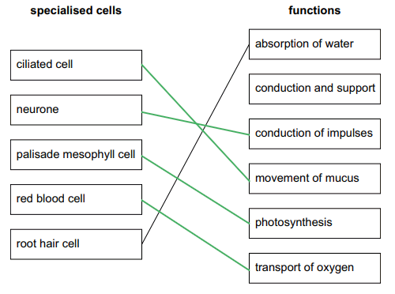

- **[1 mark]** for each correct line

**[Total: 4 marks]**

### Q4
The table should be completed as follows:

| **Measurement** | **Unit** | **Conversion** | **Unit** |
|---|---|---|---|
| 15.3 | cm | **Final answer:** **153 000** | µm |
| 3 x 10-6 | mm | **Final answer:** **0.003** | µm |
| 0.25 | m | **Final answer:** **250 000** | µm |

**[Total: 3 marks]**

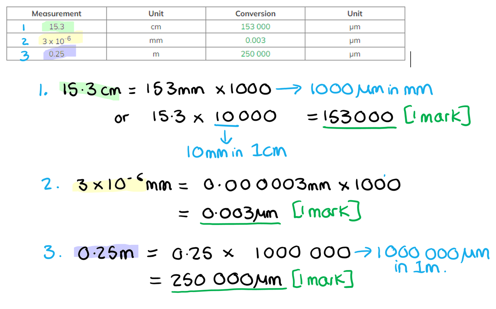
The number of grams immediately after binary fission can be calculated as follows:

- 200 x  (1 x 10-15); **[1 mark]**
- 2 x 10-13; **[1 mark]**

**[Total: 2 marks]**

> *Any number between 2.0 x 10**-13 **and 2.2 x 10**-13 **is permitted for the mark. *

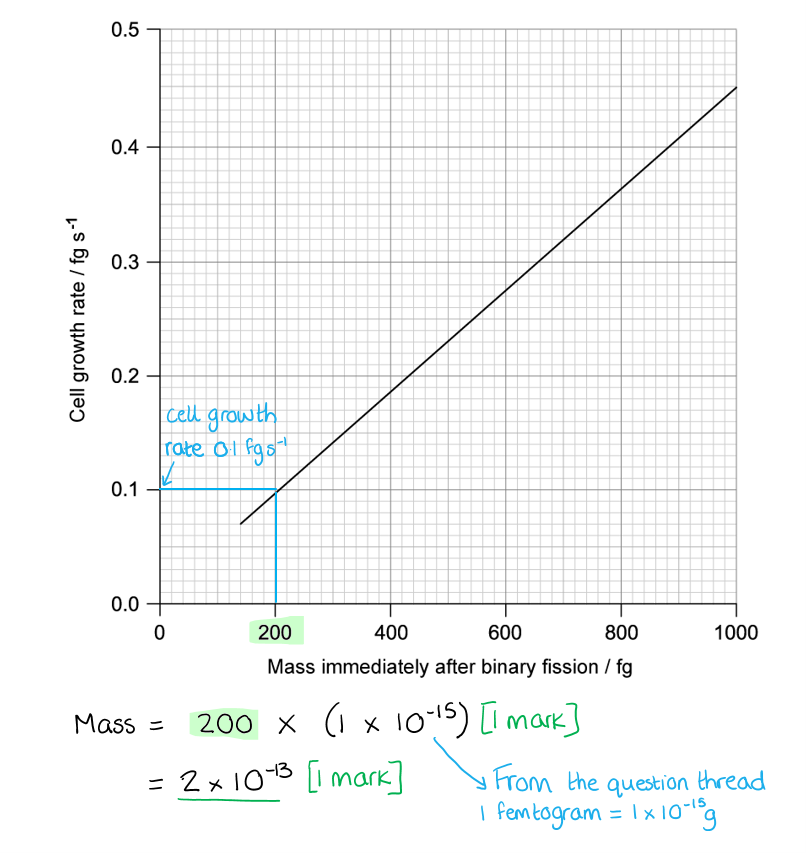
The magnification can be calculated as follows:

- 1.5 cm = 15 000 μm; **[1 mark]**
- 15 000 ÷ 5; **[1 mark]**
- 3000 ×; **[1 mark]**

**[Total:3 marks]**

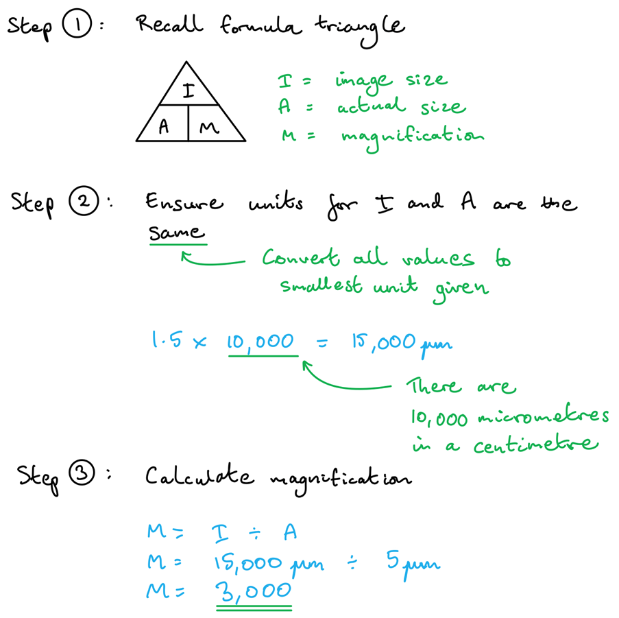

### Q5
The correctly completed table is as follows:

| Structure | Name of structure | Level of organisation |
|---|---|---|
| **A** | **Final answer:** **Trachea** | **Final answer:** **Organ** |
| **B** | **Final answer:** **Alveolus / alveolar ****epithelium**** ** | **Final answer:** **Organ or Cell** |
| **C** | **Final answer:** **Capillary ****endothelium** | **Final answer:** **Tissue** |
| **D** | **Final answer:** **Breathing / respiratory system** | **Final answer:** **System** |

**[1 mark]** for each correct row

**[Total: 4 marks]**

> *You should pay very close attention to the diagram here because you run the risk of giving ambiguous answers. For example, the label line from B finishes inside a single cell, so that cannot be labelled as a tissue as C can, because C shows several cells of the same type linked together. Also, if you decide that B is pointing to the alveolus, rather than to a single alveolar epithelium cell, then it could be argued that an alveolus is an organ. *
Two separate organs of the musculoskeletal system, muscles and bones, work together to perform the function of movement as follows:

**Two **from the following:

- Muscles contract, (other muscles relax); **[1 mark]**
- And are attached to bones; **[1 mark]**
- Muscle movement pulls bones around; **[1 mark]**
- Bones support the rest of the body which moves with them; **[1 mark]**

**[Total: 2 marks]**
The levels of organisation that the muscle cell belongs to are:

- Tissue: Skeletal muscle; **[1 mark]**
- Organ: Muscle / any large named leg muscle eg. hamstring, quadriceps; **[1 mark]**
- Organ System: Musculoskeletal system; **[1 mark]**

*Ignore: leg*

**[Total: 3 marks]**
The mass of the adult male is calculated as follows:

- $\frac{3.7\times10^{13}}{1.25\times10^{12}}\times3.1$;** [1 mark]**
- =91.76kg;
- 92kg; **[1 mark]**

**[Total: 2 marks]**

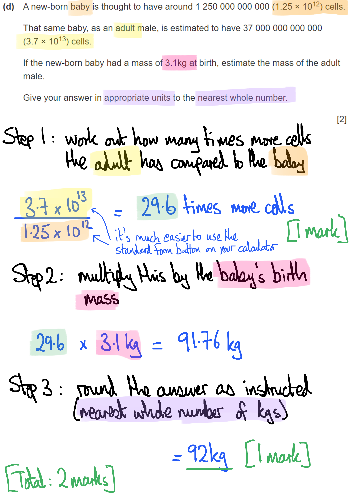

### Q6
The correct order is as follows:

| **Measurement** | **Rank (1-4)** |
|---|---|
| 10 000µm | **Final answer:** **4** |
| 1mm | **Final answer:** **2** |
| 0.15cm | **Final answer:** **3** |
| 100µm | **Final answer:** **1** |

All 4 correct; **[2 marks] **
2 or 3 correct; **[1 mark]** 
0 or 1 correct; **[0 marks]**

**[Total: 2 marks]**

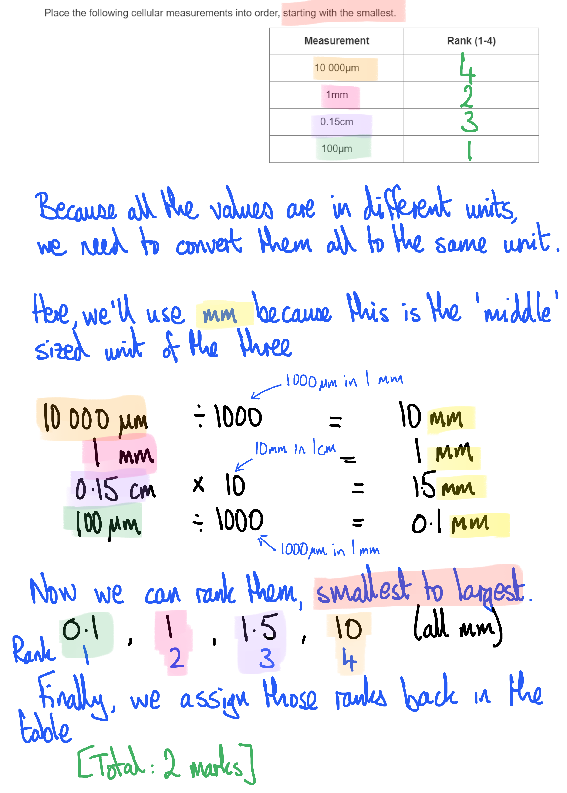
The height of the palisade cell is calculated as follows:

- Unit conversion: 6.2 cm = 62 mm = 62 000 µm; **[1 mark]**
- Height = 62 000 ÷ 7 800 = 7.9 µm / 8 µm; **[1 mark]**

**[Total: 2 marks]**

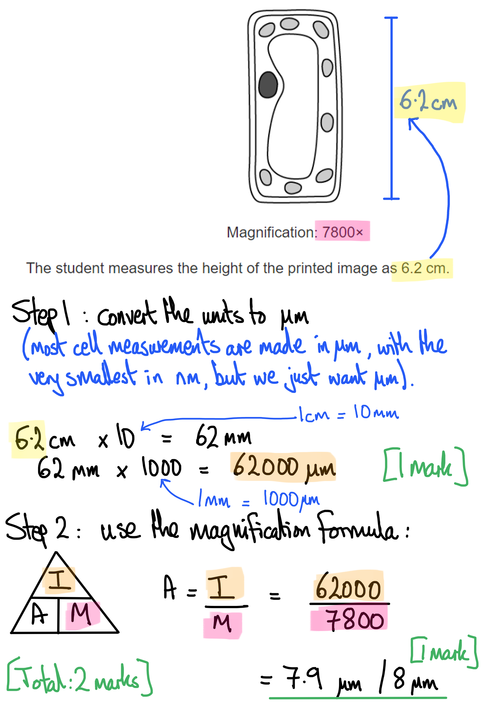
The correctly completed table is as follows:

| statement | plausible? (✓) |
|---|---|
| 1. The artery is 50 cm long | **Final answer:** **✓** |
| 2. The artery is 5 000 mm long |   |
| 3. The artery is 50 000 µm long |   |
| 4. The artery is 5 × 105 µm long | **Final answer:** **✓** |

**[1 mark]** for each correct row

**[Total: 2 marks]**

> *Using data in science is one skill, but making sure the numerical answer is plausible and is checked against common sense is a different skill, though no less important. This question examines that second skill.*

> *Statement **1 **is **plausible**; 50 cm is half a metre and that could easily be the approximate length from shoulder to wrist on a man's body. Use your ruler to measure your arm, it'll be around this length (though will vary according to your height / age / gender).*

> *Statement **2 **is **not plausible**; 5 000mm is 5 metres; this is about the height of an adult giraffe, not the length of a man's arm.*

> *Statement **3 **is **not plausible**; 50 000µm is 50 mm or 5 cm, which is just a bit shorter than the length of the man's thumb, not his arm.*

> *Statement **4 **is **plausible**; 5 × 10**5**µm divided by 1 000 is 500 mm or 50 cm, the same length as the Statement **1**.*
Dead tissue in certain parts of the xylem is an advantage over live tissue because:

**Two** from the following:

- (Xylem can have) a continuous column of water running up the plant; **[1 mark]**
- (The tissue has) no need for cytoplasm or organelles to maintain life, so nothing blocks / interrupts the water stream; **[1 mark]**
- The walls of the xylem can thicken (with lignin) to provide a woody stem to support the plant; **[1 mark]**

**[Total: 2 marks]**

### Q7
The size ratio can be calculated as follows:

- 1mm = 1000 µm; **[1 mark]**
- 0.05 mm = 50 µm; **[1 mark]**
- 1 : 30 : 50; **[1 mark]**

**[Total: 3 marks]**

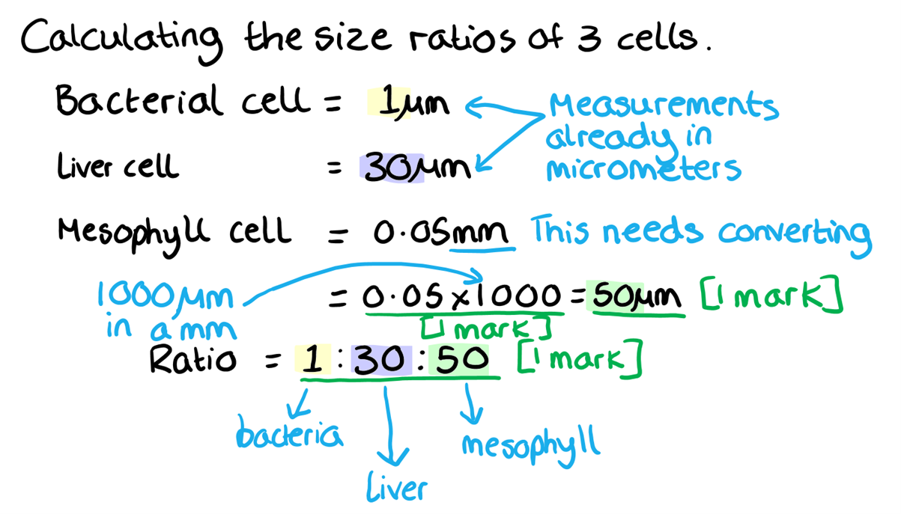
Differentiation plays the following role in producing root hair cells which allow them to carry out their function:

Any **four **of the following:

- Differentiation determines cell shape / which organelles are present; **[1 mark]**
- <u>Large surface area</u> **SO** increasing rate of osmosis / water uptake; **[1 mark]**
- Many <u>mitochondria</u> **SO** providing energy for <u>active transport</u> (of mineral ions); **[1 mark]**
- A <u>large vacuole</u> **SO** enabling storage of water and minerals / maintaining a <u>concentration gradient</u>; **[1 mark]**
- No chloroplasts **SO** saving energy (as they do not photosynthesise); **[1 mark]**

*Where capitalised SO is present the statements on both sides of SO are required for each mark.*

**[Total: 4 marks]**

> *Remember that cells differentiate to become specialised. This means that the differences each cell has are required so that they are adapted to carry out a particular function.*

> *This question asks for an explanation as to how differentiation allows the root hair cell to carry out its function, so you need to ensure that you have identified the feature and then linked it to a specific function (water or mineral ion uptake).*

> *A large surface area and concentration gradient are features which maximise water uptake by osmosis. Water moves into the root cells from the soil by osmosis and is then moved out of the cytoplasm of the root cell and stored within the vacuole. This means that water potential of the root cell cytoplasm is low and so the concentration gradient between the soil and the root cell cytoplasm is maintained.*
Starch found in the roots of grass supports growth in the following way:

- Glucose is stored as starch in plant cells/chloroplasts; **[1 mark]**
- Energy is released from glucose in respiration; **[1 mark]**
- Energy is required for growth / building of new molecules **OR** energy is required for active transport of mineral ions / nitrates into the root; **[1 mark]**

**[Total: 3 marks]**
The percentage change can be calculated in the following way:

- (25 ÷ 30) x 100 = 83.3 % decrease / - 83.3 %; **[1 mark]**

This decrease could be because...

- Less photosynthesis occurs in winter months (so less glucose is stored as starch); **[1 mark]**
- Starch stores are used up / glucose is used for respiration / active transport; **[1 mark]**

**[Total: 3 marks]**

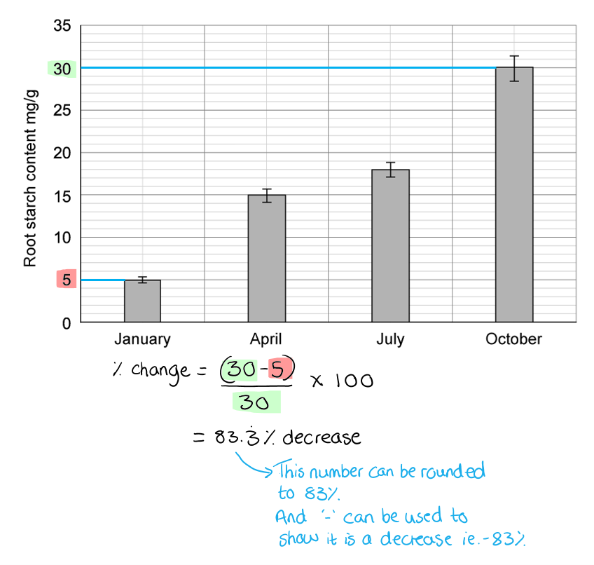

### Q8
Animal and bacterial cells can be compared as follows:

**Structural comparisons:**

Up to **three **from the following:

- They both have cell membranes / cytoplasm / ribosomes; **[1 mark]**
- Sperm cells and some bacteria have a tail / flagellum; **[1 mark]**
- Bacteria can have more than one flagellum (sperm only have one); **[1 mark]**
- Animal cells have mitochondria whereas bacteria cells do not; **[1 mark]**
- Animal cells have a nucleus whereas bacteria cells have DNA loose in the cytoplasm; **[1 mark]**
- Bacteria cells have plasmids whereas animal cells do not; **[1 mark]**

**Size comparisons:**

Up to **three **from the following:

- Bacteria cells are smaller than animal cells; **[1 mark]**
- Bacteria cells are around 1 µm compared to 10-100 µm in animal cells; **[1 mark]**
- Some organelles / mitochondria are bigger than whole bacterial cells **OR** would not fit into a bacteria cell; **[1 mark]**

**[Total: 6 marks]**
The protein produced by these cells for carbohydrate digestion is....

- <u>Amylase</u> (enzyme); **[1 mark]**

**[Total: 1 mark]**
The cell in **Fig. 1** is adapted in the following way:

**Final answer:** **Any ****four ****from:**

- It contains many ribosomes; **[1 mark]**
- Ribosomes are required for protein synthesis / to make enzymes;** [1 mark]**
- The cell contains many mitochondria; **[1 mark]**
- To provide energy from respiration; **[1 mark]**
- Used to build proteins / enzymes; **[1 mark]**

**[Total: 4 marks]**
A zygote develops into a baby through the following process:

Any **two **from:

- The single cell / fertilised egg divides by mitosis; **[1 mark]**
- Different cells are required to form different tissues / all the tissues of the baby; **[1 mark]**
- Cells (in the embryo) differentiate **OR **develop / synthesise different organelles/shapes (for their function); **[1 mark]**

**[Total: 2 marks]**

### Q9
(i) The names of structures** F, G **and **H **are:

- **F **- cytoplasm; **[1 mark]**
- **G **- chloroplast *(ignore chlorophyll)*; **[1 mark]**
- **H** - (sap / central) vacuole; **[1 mark]**

(ii) On the diagram labels are as follows:

- **K** line ending on the nucleus; **[1 mark]**
- **L **line ending exactly on the inner line of the cell wall; **[1 mark]**

(iii) The name of this type of plant cell is:

- A palisade (mesophyll) cell; **[1 mark]**

**[Total: 6 marks]**

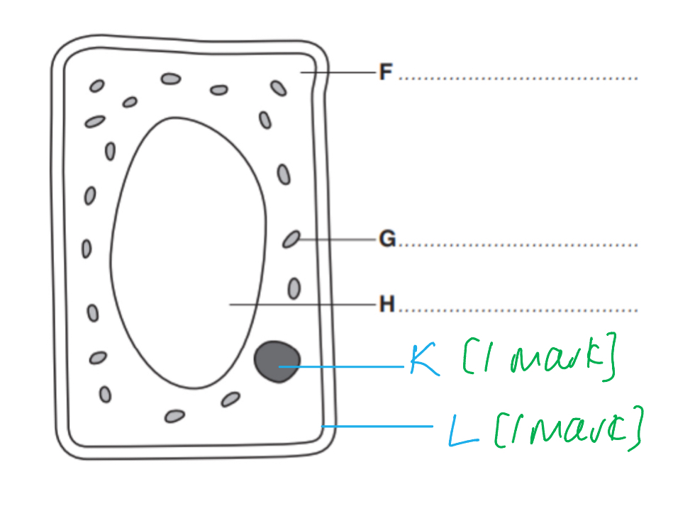
(i)** **The ways in which the cell has changed are:

**Final answer:** **Any ****two ****from the following:**

- The cell / it has shrunk / is smaller **OR** it has become flaccid; **[1 mark]**
- The cell walls are indented; **[1 mark]**
- The vacuole is smaller; **[1 mark]**
- A gap has developed (between wall and membrane) **OR** plasmolysis occurred / a gap developed between the cell wall and the protoplast; **[1 mark]**

*Accept "the cell has one more chloroplast" as an answer. Ignore reference to a change in the shape or size of the cell / cell wall.*

(ii) The ways in which diffusion is different to active transport are:

Any **three **from the following, **one** mark for each correct comparison:

- *(Answers do ****not**** need to be given in a table format)*

| **Diffusion** | **Active Transport** |
|---|---|
| Movement from high to low (solute) concentration / down a concentration gradient | Movement from low to high (solute) concentration / against a concentration gradient |
| This does not require a membrane | This does require a membrane |
| No energy is needed / it is a passive process | This requires energy / it is an active process / it requires ATP |
| It occurs in (living and) non-living substances | It only occurs in living organisms |
| The rate is dependent on the concentration gradient | The rate is dependent on requirements, such as ATP synthesis |

**[1 mark]** *for each correct description between diffusion and active transport.*

**[Total: 5 marks]**

> *A common mistake here would be include details about osmosis as this is mentioned in the question, but read the question carefully as it only asks for a comparison between diffusion and active transport. *
The completed **Table 1 **is as follows:

| Feature | Plants | Animals |
|---|---|---|
| Multicellular | **Final answer:** **✓** | **Final answer:** **✓** |
| Cells contain a nucleus | **Final answer:** **✓** | **Final answer:** **✓** |
| Cells contain chloroplasts | **Final answer:** **✓** |   |
| Cells connected by nervous coordination |   | **Final answer:** **✓** |
| They can move from place to place |   | **Final answer:** **✓** |
| Cells store glycogen |   | **Final answer:** **✓** |

All 6 rows correct;** [4 marks]** 
4 or 5 rows correct; **[3 marks]** 
2 or 3 rows correct; **[1 mark]** 
0 or 1 row correct;** [0 marks]**

**[Total: 4 marks]**
An animal cell organelle that would be expected to occur in large numbers in a metabolically active cell is:

**One **of the following:

- Mitochondrion / mitochondria; **[1 mark]**
- Ribosome / ribosomes; **[1 mark]**

*Ignore chloroplasts*

**[Total: 1 mark]**

> *Mitochondria would be expected in large numbers because, as the site of energy release from respiration, the mitochondria acts as a mini power station, releasing the energy required by the active cell. One such cell would be a muscle cell. *

> *Ribosomes are the site of protein synthesis, a process that also requires a lot of energy. Cells that secrete a lot of protein would have many ribosomes for that purpose. An example would be an insulin-secreting cell in the pancreas. *

> *Chloroplasts would not score a mark because the question specifies an animal cell. *

### Q10
The magnification of the printed drawing of the cell is:

- Magnification = Image (width) ÷ Actual (width)
- 62 000 ÷ 80; **[1 mark]**
- = 775 (×); **[1 mark]**

*Full marks awarded for the correct answer in the absence of calculations Ignore any units stated*

**[Total: 2 marks]**

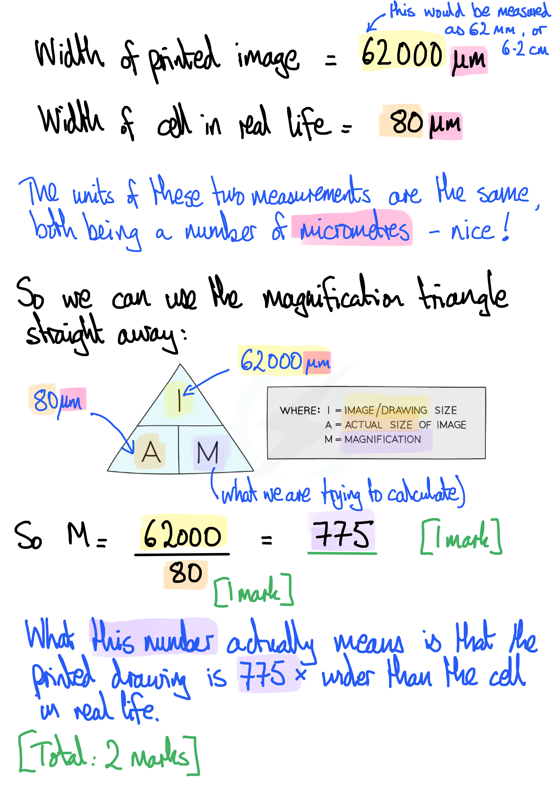

> *A harder version of this question would give you the width of the drawing in more realistic units such as 6.2 cm or 62 mm and you would be required to perform a conversion of those units into micrometres. *
Units often need to be converted before attempting magnification calculations like the one in part (a) because:

Any **two** from the following:

- Units of measurement (of a drawing) are (more realistically) in cm or mm **whereas** units of cell structure are most often µm (or nm); **[1 mark]**
- Units need to be the same when dividing / creating a ratio/quotient like magnification; **[1 mark]**
- Magnification has no units; **[1 mark]**

**[Total: 2 marks]**

> *It would be unusual, as in part (a), to measure a drawing and say it is 62 000 µm across. We tend to select the most appropriate measurement unit depending on the scale. It's like saying that "Edinburgh is 648 000 m from London"; this is factually correct but sounds odd; a more sensible way to say it would be "Edinburgh is 648 km from London" because km is a more sensible unit for measuring that kind of distance. Similarly, "the drawing is 62 mm wide" sounds more plausible than "62 000 µm", even though both say the same thing.*
The formula that links image size, magnification and actual size when examining specimens under a microscope is:

**One **from the following:

- Magnification = image size ÷ actual size; **[1 mark]**
- Actual size = image size ÷ magnification; **[1 mark]**
- Image size = magnification × actual size; **[1 mark]**

**[Total: 1 mark]**

> *The triangle 'I AM' is useful for remembering the relationship between these three parameters.*

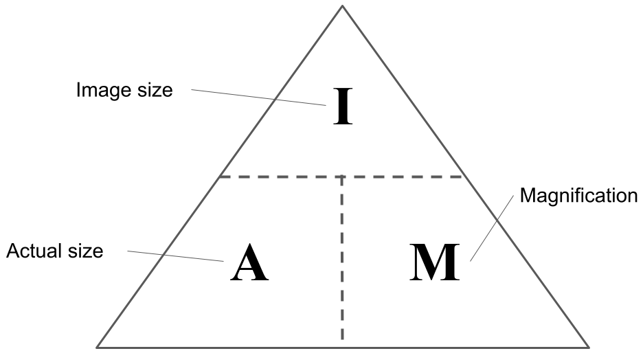
Magnification has no units because:

**One **from the following:

- It's a ratio (of sizes); **[1 mark]**
- It's calculated from the same units in the numerator and denominator / units cancel themselves out; **[1 mark]**

**[Total: 1 mark]**

### Q11
(i) On the diagram, two structures that are visible in cell **P** are:

Any **two **from the following:

- Cell membrane; **[1 mark]**
- Cell wall; **[1 mark]**
- Cytoplasm; **[1 mark]**
- Vacuole; **[1 mark]**
- Nucleus; **[1 mark]**

(ii) The name of the tissue shown is:

- Epidermis; **[1 mark]**

(iii)  It is important to the plant that the tissue shown in Fig. 1 is transparent because:

Any **two **from the following:

- Allows light through; **[1 mark]**
- (So that light) reaches chloroplasts / chlorophyll; **[1 mark]**
- (Which are) in the mesophyll / palisade cells; **[1 mark]**
- (The palisade / mesophyll / chloroplasts / chlorophyll) need light for photosynthesis / to trap energy from light; **[1 mark]**

**[Total 6 marks]**

> *For part (i), it is common to think that you would be able to see chloroplasts (since this is a plant cell) but plant epidermal cells typically lack them. This is because the cells must be transparent to allow light through to the mesophyll cells underneath; the presence of chloroplasts would interfere with this function.*

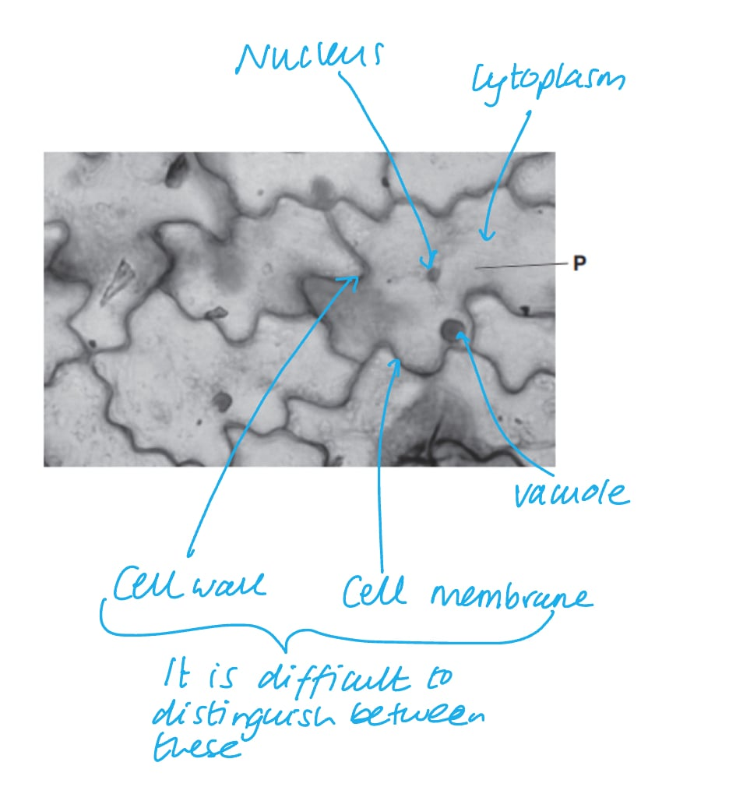
A bacterial cell sketch will include the following:

**Cell components**

Up to **three** of the following parts:

- Cell wall; **[1 mark]**
- Cell membrane; **[1 mark]**
- Cytoplasm; **[1 mark]**
- Ribosomes; **[1 mark]**
- Circular DNA; **[1 mark]**
- Plasmid(s); **[1 mark]**

**Drawing qualities**

- Fine, unbroken lines; **[1 mark]**
- Using most of the available space;** [1 mark]**
- Label lines with a ruler and touch the object or feature labelled; **[1 mark]**

**[Total: 6 marks]**

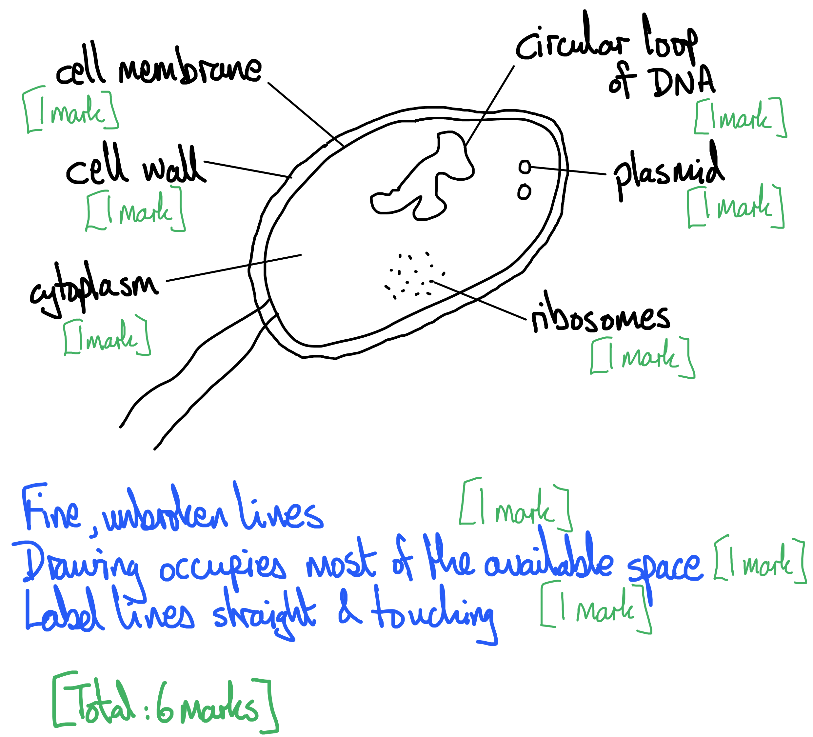

### Q12
The cell types and processes can be linked as follows:

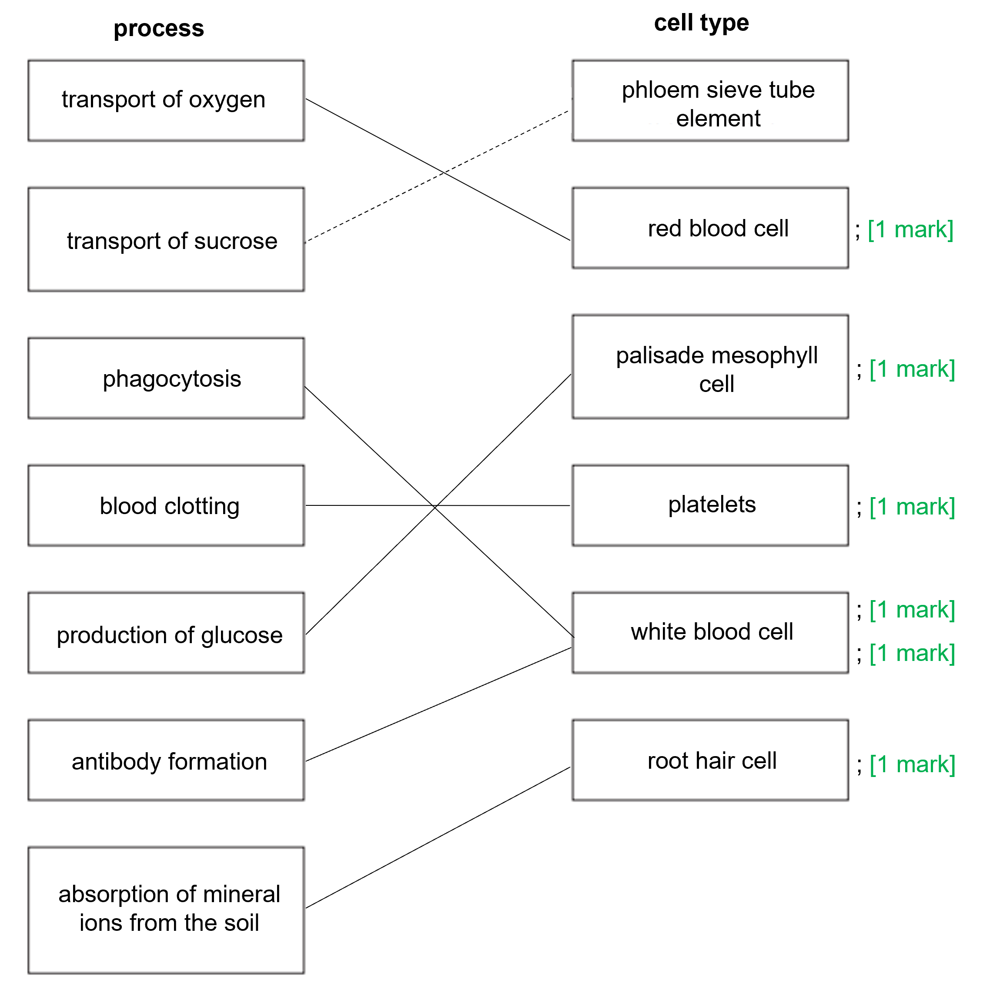

**[1 mark] ***for each correct line.*

*Deduct*** ****[1 mark] ***for each extra line drawn.*

**[Total: 6 marks]**

> *A common error is to only draw five lines, despite the instruction to draw six. Read the question carefully.*

> *Make sure that you are familiar with the role of each type of specialised cell mentioned in the question.*
(i) The structures on Fig. 1 can be identified as follows:

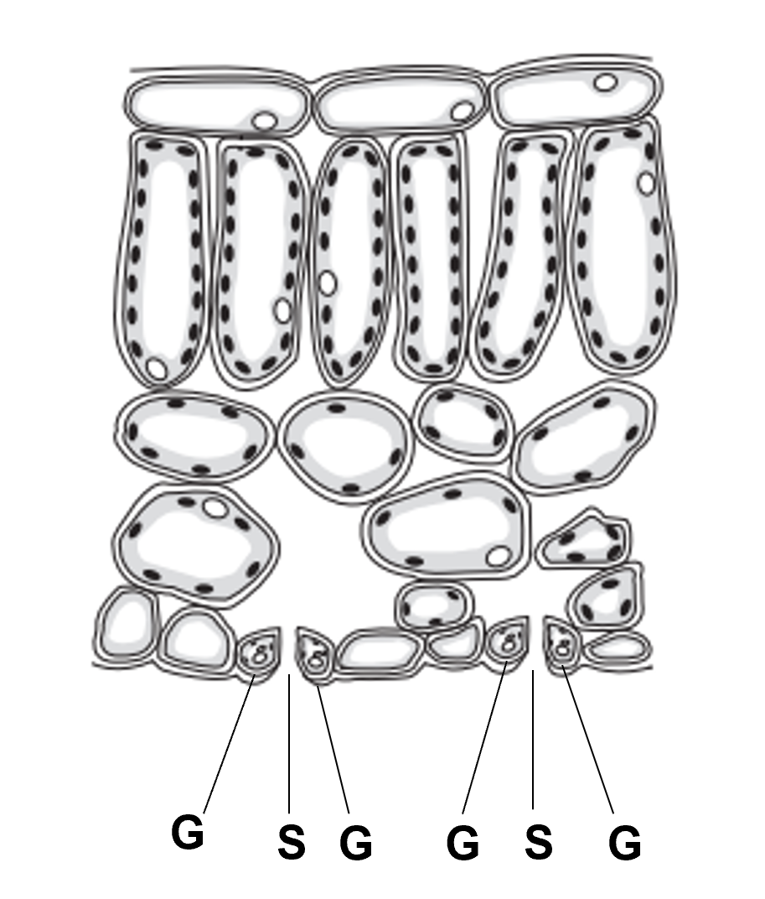

**[1 mark] ***for identifying any one of the structures labelled ****G***.

**[1 mark]** *for identifying any one of the structures labelled ****S***.

(ii) A function of the stomata is:

Any **one** from the following:

- (It is responsible for) gas exchange / diffusion of gases (between the leaf and atmosphere) **OR** carbon dioxide will diffuse into the leaf / oxygen will diffuse out of the leaf (through the stomata during the day); **[1 mark]**
- Transpiration (occurs through the stomata) **OR** water vapour diffuses out of the leaf (through the stomata); **[1 mark]**

**[Total: 3 marks]**

> *The guard cells are the cells surrounding the stomata (openings). Together, these structures are responsible for gaseous exchange of oxygen and carbon dioxide between the air spaces in the leaf and the atmosphere. Make sure you mention which direction the gases are diffusing, into or out of the leaf! This is also the place where transpiration occurs, with water vapour diffusing out of the leaf during the day.*
Bacteria do not have a nucleus because:

Any **one** of the following:

- A bacterial cell is too small / the nucleus is larger than a bacterial cell / no room; **[1 mark]**
- They do not need one as they have a small circular chromosome; **[1 mark]**
- They have no need to separate their DNA from the rest of the cytoplasm;** [1 mark]**

**[Total: 1 mark]**

### Q13
The link of each structure to the process in which it is involved is:

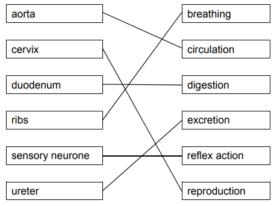

**[1 mark]** *for each correct line.*

**[Total: 6 marks]**

> *It is important you use a ruler to create these lines; wiggly ambiguous lines will not be awarded marks.*
The functions of the specialised cells are:

- Red blood cell - to transport/carry <u>oxygen</u>; **[1 mark]**
- Ciliated cell - to move <u>mucus</u> in / remove mucus from the airways; **[1 mark]**

**[Total: 2 marks]**

> *The question is merely asking for the **functions** of these cells, so you don't have to give a long and elaborate answer in either case. Note the underlined keywords, which must appear in your answer to get the marks. *
(i) The cell in the diagram is a:

- <u>Root hair</u> cell; **[1 mark]**

(ii) One adaptation that allows this cell to carry out its function is:

Any **pair of points **from the following:

- Long root hair; **[1 mark]**
- Increases surface area for absorption; **[1 mark]**

**OR**

- Many mitochondria; **[1 mark]**
- Release energy for active transport; **[1 mark]**

**OR**

- Thin cell wall; **[1 mark]**
- Reduces distance for transport of substances; **[1 mark]**

**OR**

- (Many) carrier proteins (in cell membrane); **[1 mark]**
- For active transport / uptake of mineral ions; **[1 mark]**

*Note that the pairs of points must match those given above in order for marks to be awarded; this ensures that the feature and its explanation match.*

**[Total: 3 marks]**

> **[exam-tip]**
> An adaptation is a physical structure, so name the structure before giving its benefit.
> 
> Avoid vague explanations and say exactly how the feature helps the cell.
The correctly-completed table is as follows:

| Structure | In animal cells? | In plant cells? |
|---|---|---|
| Nucleus | **Final answer:** **✓** | **Final answer:** **✓** |
| Permanent vacuole |   | **Final answer:** **✓** |
| Cell wall |   | **Final answer:** **✓** |

**[1 mark]** for each correct row.

**[Total: 3 marks]**

### Q14
**Two **structures that would be found in an animal cell and a plant cell are:

Any **two** of the following:

- Nucleus; **[1 mark]**
- Cell membrane; **[1 mark]**
- Cytoplasm; **[1 mark]**
- Mitochondria; **[1 mark]**
- Ribosomes; **[1 mark]**

**[Total: 2 marks]**
Structure X is a:

- Root hair / root hair cell; **[1 mark]**

**[Total: 1 mark]**
The actual length of structure X is:

Correct answer gains both marks.

- Actual = image size / magnification size
- 98 to 100 mm ÷ 500; **[1 mark]**
- = 0.196 mm to 0.2 mm = 196 *μ*m to 200 *μ*m;** [1 mark]**

**[Total: 2 marks]**

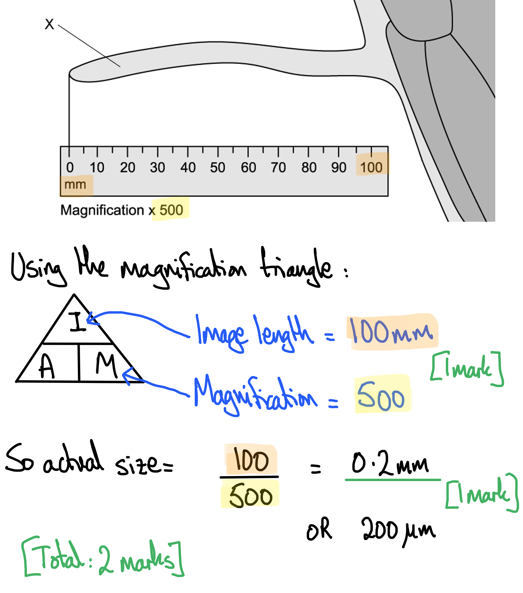
Failure of structure **X** to develop properly in the cells of a plant root could be catastrophic to a plant because...

Any **four** of the following:

- The purpose / function of the root hair is to increase surface area; **[1 mark]**
- For absorption of water (by osmosis); **[1 mark]**
- (And) for absorption of mineral ions / named example (e.g. magnesium ions, nitrate ions);** [1 mark]**
- Less root hairs would reduce absorption; **[1 mark]**
- Water is essential for photosynthesis / maintaining pressure / as a solvent;** [1 mark]**
- (Reduced absorption) could lead to mineral deficiencies, causing stunted growth / named example of mineral deficiency described; **[1 mark]**

**[Total: 4 marks]**

### Q15
The structures in the list in increasing order of organisation are as follows...

- Tissue (first in the sequence); **[1 mark]**

**THEN**

- Organ** AND** organ system (in this order); **[1 mark]**

**THEN**

- Organism (last in the sequence); **[1 mark]**

*Organ must come before organ system for marking point 2 to be awarded.*

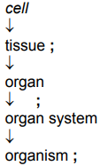

**[Total: 3 marks]**
Parts of a flowering plant and their correct level of organisation are...

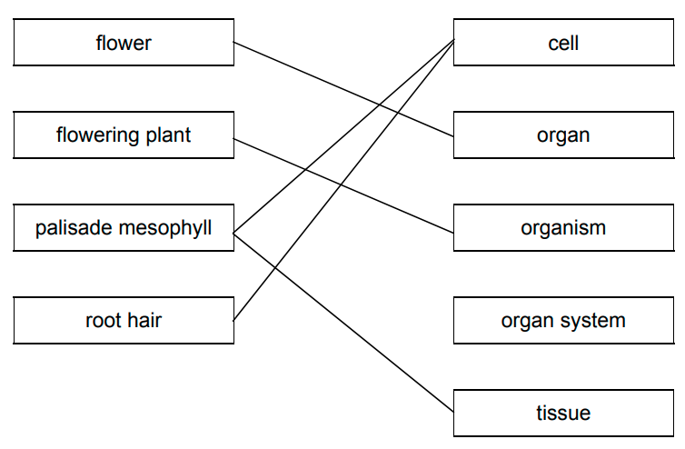

- 4 or 5 correct lines; **[4 marks]**
- 3 correct lines; **[3 marks]**
- 2 correct lines; **[2 marks]**
- 1 correct line; **[1 mark]**

**[Total: 4 marks]**

> *Note that the mark scheme shows two possible correct answers for palisade mesophyll; this is a type of plant cell, which when grouped together form a type of plant tissue of the same name. It is possible to get full marks for giving only one of these correct answers (as instructed in the question).*
The correctly-drawn lines between boxes are as follows:

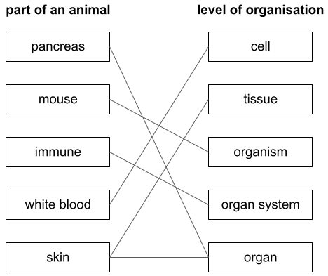

**[1 mark]** for each correct line.

**[Total: 5 marks]**

> *Note that the mark scheme shows two possible correct answers for skin; this is commonly regarded as a type of tissue, but can also be regarded as an organ of the same name. It is possible to get full marks for giving only one of these correct answers (as instructed in the question).*
A red blood cell does not have a nucleus because:

- (A nucleus would) take up space / leave less room for haemoglobin; **[1 mark]**
- (A nucleus would) not allow biconcave shape / not allow the cell to bend/flex; **[1 mark]**

**[Total: 2 marks]**

### Q16
The magnification of the image is calculated as follows:

- 60 000 ÷ 30; **[1 mark]**
- = 2 000 (×); **[1 mark]**

**[Total: 2 marks]**

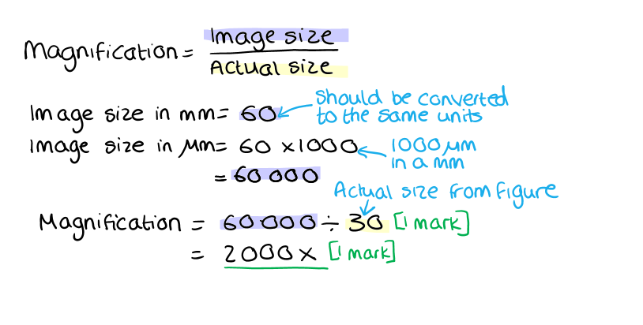
The evidence to support the statement that a light microscope could not be used to observe the cell as shown in **Fig.1 **includes:

- Mitochondria / ribosomes are visible **OR **mitochondria / ribosomes would not be visible using a light microscope; **[1 mark]**

**[Total: 1 mark]**
The magnification of the microscope was

- 200 (×);** [1 mark]**

**[Total: 1 mark]**

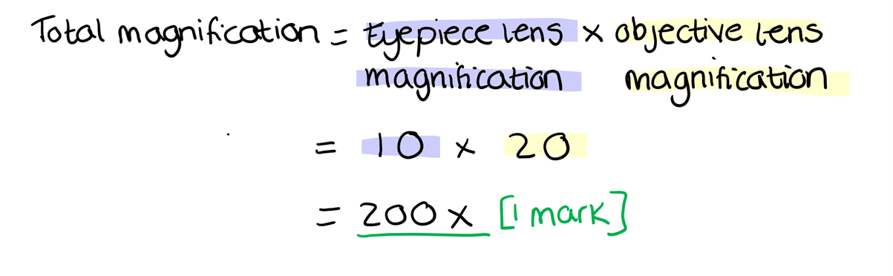

### Q17
The correct function for each specialised cell is as follows:

**[1 mark] ***for each correct line.*

**[Total: 4 marks]**

> *When drawing lines you **must **use a ruler to make your lines straight. If you draw wiggly lines that aren't clear the examiner will give you zero marks. *
The name of the process by which existing cells give rise to new cells is:

- Cell division;** [1 mark]**

*Allow: cell multiplication, mitosis, meiosis* *Ignore: cell differentiation, specialisation, growth*

**[Total: 1 mark]**

> *The term 'cell division' was coined when the first microscopists observed cells apparently splitting in two, or dividing. You may think, from maths, that division is the opposite of multiplication, and that would be correct. In reality, the number of cells **multiplies **in number because 1 cell becomes 2, 2 become 4 etc. as the process continues. This is the reason why cell division is also (paradoxically) known as cell multiplication! The contents of the cell is copied before a new cell appears to split ('divide') from the original. *
The levels of organisation into a logical order from the largest to the smallest in size are as follows:

| **LARGEST** | 1 | **Final answer:** **organism** |
|---|---|---|
|  | 2 | **Final answer:** **system** |
| 3 | **Final answer:** **organ** |   |
| 4 | **Final answer:** **tissue** |   |
| **SMALLEST** | 5 | **Final answer:** **cell** |

All 5 correct: **[2 marks] **
2, 3 or 4 correct; **[1 mark] **
0 or 1 correct; **[0 marks]**

**[Total: 2 marks]**
The correctly-completed **Table 1** is as follows:

| Structure | Tissue | Organ | System |
|---|---|---|---|
| Leaf |   | ✔ |   |
| Vascular bundle |   |   | **✔** |
| Flower |   | **✔** |   |
| Phloem | **✔** |   |   |

**[1 mark]** for each correct row

**[Total: 3 marks]**

### Q18
The function of a muscle cell is to:

- Contract for movement; **[1 mark]**

They are adapted for this function as follows:

- They have many mitochondria to release energy; **[1 mark]**

Accept produce ATP for marking point 2

Reject any reference to energy being created or made

**[Total: 2 marks]**

> **[exam-tip]**
> While muscle cells are not an example of a type of specialised cell that you need to learn about, you should be able to use your knowledge of cell structure and cellular respiration to work out the answer to this question.
The cells should be identified as follows:

First cell: nerve cell Second cell: root <u>hair</u> cell Third cell: sperm cell

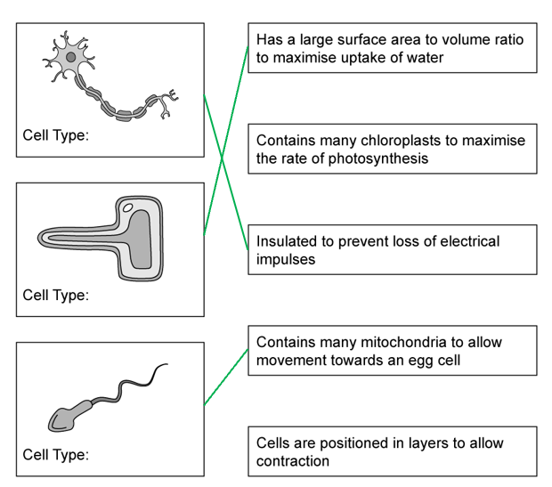

**[1 mark]*** should be awarded for each cell which is correctly labelled and linked to the correct function*

**[Total: 3 marks]**
The xylem is adapted in the following way:

Any **one **from the following:

- Cells are dead / form hollow tubes / have no organelles;** [1 mark]**
- Walls are strengthened (with lignin) / thickened;** [1 mark]**

**[Total: 1 mark]**
The process by which cells become specialised is...

- (Cell) differentiation;** [1 mark]**

**[Total: 1 mark]**

The process is sometimes referred to as 'specialisation' but because the word 'specialised' is in the question stem, you wouldn't get a mark for answering that way.
