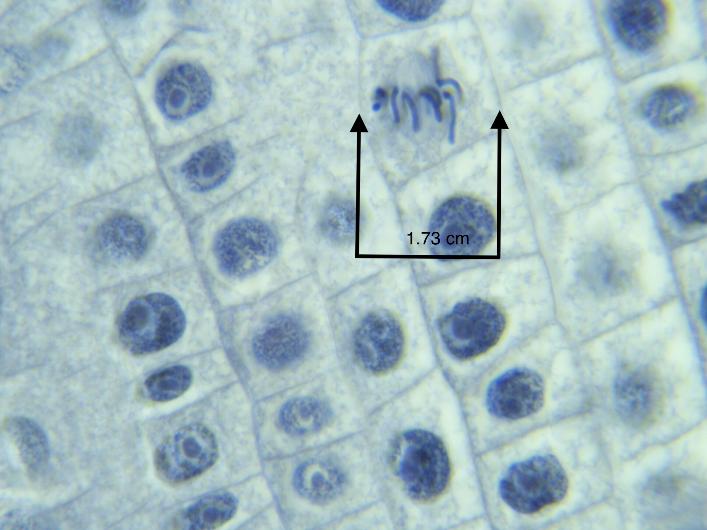
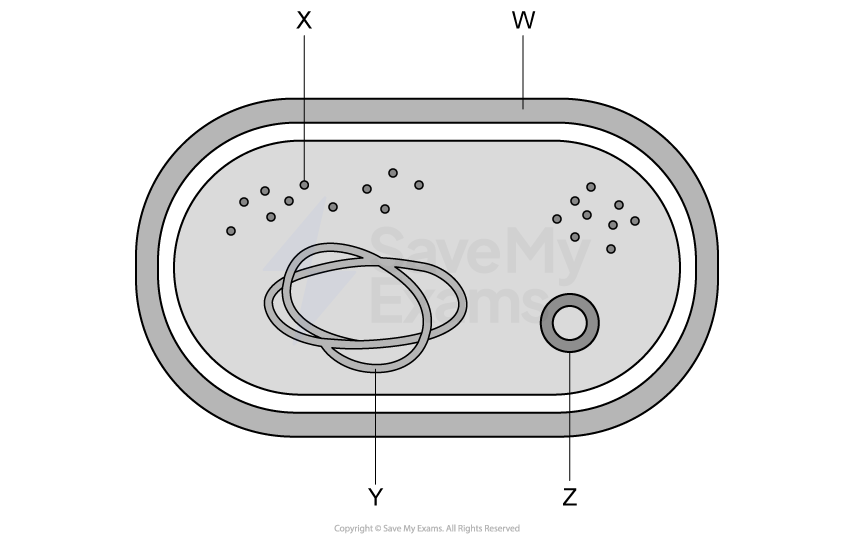
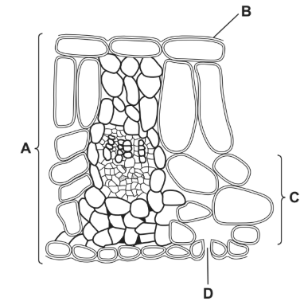
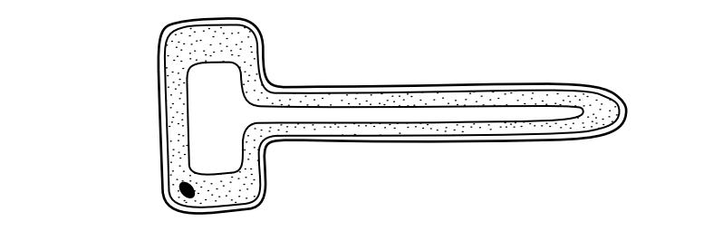
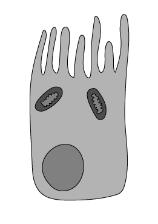
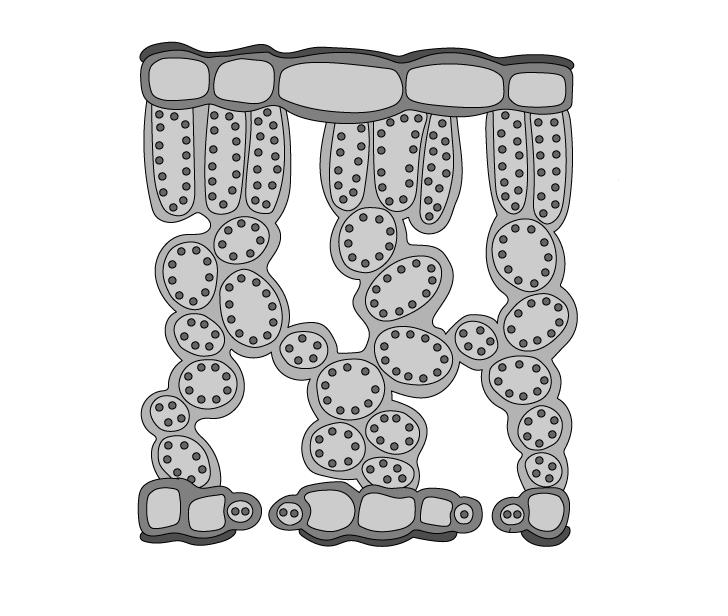

# Exam Questions — Cell Structure & Size of Specimens
**2. Organisation of the Organism** · Cambridge (CIE) IGCSE biology (0610 & 0970)
> Source: [https://www.savemyexams.com/igcse/biology/cie/23/topic-questions/](https://www.savemyexams.com/igcse/biology/cie/23/topic-questions/) · 28 questions across 1 sets

## Multiple Choice Questions (28 questions)

### Q1 — medium — 1 marks

**Q1** [1 mark]

An image of a cell is 24 mm long. The actual cell length is 6 μm.

What is the magnification?

### Q2 — medium — 1 marks

**Q2** [1 mark]

A palisade mesophyll cell is found near the upper surface of a leaf and contains many chloroplasts.

Why is this an effective adaptation?

### Q3 — medium — 1 marks

**Q3** [1 mark]

The micrograph below shows onion root cells undergoing various stages of mitosis. A x200 magnification was used.

Nathalie Russell via [Wikimedia Commons](https://commons.wikimedia.org/w/index.php?title=File:Mitosis_in_Onion_Root_various_stages_(Metaphase).jpg&oldid=801253780)

Which of the following shows the the real length of the cell indicated in the image, rounded to the nearest whole number?

### Q4 — easy — 1 marks

**Q4** [1 mark]

The diagram below shows a bacteria cell

What is the function of structure Z?

### Q5 — medium — 1 marks

**Q5** [1 mark]

A photograph shows a plant cell nucleus measuring 2 mm across.

If the magnification of the cell is x500, what is the actual size of the nucleus?

*Source: June 2021 0970/11 Q6*

### Q6 — easy — 1 marks

**Q6** [1 mark]

The diagram shows some of the blood vessels and other structures in the human body.

The blood vessels shown are all parts of the same

*Source: June 2021 0970//11 Q5*

### Q7 — easy — 1 marks

**Q7** [1 mark]

The diagram shows a single-celled organism called Euglena.

Which labelled structures would also be found in an animal cell?

*Source: June 2021 0970/11 Q4*

### Q8 — hard — 1 marks

**Q8** [1 mark]

A student found four different worms in a sample of soil and drew diagrams of them. The diagrams were drawn with different magnifications.

Which worm was the longest?

|   | length of  diagram / mm | magnification |
|---|---|---|
| A | 60 | x3 |
| B | 70 | x1 |
| C | 100 | x2 |
| D | 120 | x5 |

*Source: June 2022 0970/11 Q6*

### Q9 — medium — 1 marks

**Q9** [1 mark]

The diagram shows a cross-section through a leaf.

Which label shows a tissue?

*Source: June 2022 0970/11 Q5*

### Q10 — easy — 1 marks

**Q10** [1 mark]

The diagram shows a cross-section through two guard cells of a leaf.

Which labelled structures would also be found in an animal cell?

*Source: June 2022 0970/11 Q4*

### Q11 — hard — 1 marks

**Q11** [1 mark]

The photograph shows a chloroplast magnified ×7000

What is the actual size of the chloroplast?

*Source: Specimen 2023 0970/01 Q6*

### Q12 — easy — 1 marks

**Q12** [1 mark]

The diagram shows the structure of a plant cell.

What is a function of this specialised plant cell?

*Source: Specimen 2023 0970/01 Q5*

### Q13 — easy — 1 marks

**Q13** [1 mark]

Which part of a plant cell controls the movement of substances into and out of the cell?

*Source: Specimen 2023 0970/01 Q4*

### Q14 — medium — 1 marks

**Q14** [1 mark]

Which row of the table below correctly describes a spongy mesophyll cell?

| ** ** | contains chloroplasts for photosynthesis | loses water by transpiration | ideal surface area for gas exchange |
|---|---|---|---|
| **A** | **✘** | ✔ | ✔ |
| **B** | ✔ | ✔ | **✘** |
| **C** | ✔ | ✔ | ✔ |
| **D** | ✔ | **✘** | **✘** |

### Q15 — medium — 1 marks

**Q15** [1 mark]

The salivary glands contain cells which are responsible for producing salivary amylase, a digestive enzyme.

Which organelles would be present in large numbers in cells of the salivary glands?

### Q16 — medium — 1 marks

**Q16** [1 mark]

Which row of the table below correctly describes the structures present in a bacterial cell?

| ** ** | cell membrane | cell wall | chromosome | nucleus |
|---|---|---|---|---|
| **A** | **✘** | **✔** | **✘** | **✘** |
| **B** | **✔** | **✔** | **✔** | **✘** |
| **C** | **✔** | **✔** | **✘** | **✘** |
| **D** | **✔** | **✘** | **✘** | **✔** |

### Q17 — medium — 1 marks

**Q17** [1 mark]

Which row of the table below correctly matches functions to some of the components in a root hair cell?

| ** ** | cell wall | cell membrane | mitochondria |
|---|---|---|---|
| **A** | support | active transport | energy release |
| **B** | energy release | active transport | nutrition |
| **C** | support | active transport | nutrition |
| **D** | active transport | support | energy release |

### Q18 — medium — 1 marks

**Q18** [1 mark]

#### Extended only

A list of subcellular structures is given below.

| **1** | nucleus |
|---|---|
| **2** | ribosome |
| **3** | vacuole |
| **4** | chloroplast |

A plant cell and an animal cell are observed under a light microscope.

Which of the above structures would always be visible in a plant cell?

### Q19 — easy — 1 marks

**Q19** [1 mark]

Which of the following orders would be correct showing the size of structures from biggest to smallest?

### Q20 — easy — 1 marks

**Q20** [1 mark]

Which row of the table below correctly matches a structure to its level of organisation within an organism?

| ** ** | tissue | organ | system |
|---|---|---|---|
| **A** | phloem | small intestine | digestive |
| **B** | red blood cell | xylem | stomach |
| **C** | small intestine | sperm | digestive |
| **D** | root hair | leaf | heart |

### Q21 — easy — 1 marks

**Q21** [1 mark]

Which of the following terms would be correct to describe a leaf, a root and stem?

### Q22 — easy — 1 marks

**Q22** [1 mark]

Which description of the liver below is correct?

### Q23 — hard — 1 marks

**Q23** [1 mark]

A student cut a section through a plant, finding a group of long, microscopic structures which lacked end walls or any cell contents.

Which row of the table below correctly identifies the structure described in the statement above?

| ** ** | **identification** | **description** |
|---|---|---|
| **A** | xylem vessels | large surface area to absorb as much water by osmosis as possible |
| **B** | root hair cells | they can support the plant better without cytoplasm, mitochondria provide energy |
| **C** | root hair cells | hollowed, lignified tubes to allow uninterrupted flow of water |
| **D** | xylem vessels | hollowed, lignified tubes to allow uninterrupted flow of water |

### Q24 — easy — 1 marks

**Q24** [1 mark]

The diagram below shows part of an organism (ciliated epithelium).

What term would correctly describe the level of organisation of the structure in the diagram above?

### Q25 — hard — 1 marks

**Q25** [1 mark]

Eukaryotic cells contain mitochondria (a mitochondrion is shown below).

Which diagram below correctly shows the position of mitochondria in a plant cell?

### Q26 — hard — 1 marks

**Q26** [1 mark]

#### Extended only

A student looks at the image below in his textbook.

The image is 43 mm wide and has been magnified 2500 times.

What is the actual width of the cell?

### Q27 — hard — 1 marks

**Q27** [1 mark]

#### Extended only

A student looks at an image of a cross-section of a leaf in her Biology textbook.

The actual thickness of this leaf is 450 µm, but the image in the textbook has a depth of 83 mm.

What would be the correct magnification of the image?

### Q28 — hard — 1 marks

**Q28** [1 mark]

The image below shows a palisade mesophyll cell found in the leaves of plants.

Which row of the table below correctly identifies the structures labelled on the cell in the image above?

| ** ** | **P** | **Q** | **R** |
|---|---|---|---|
| **A** | mitochondrion | nucleus | vacuole |
| **B** | chloroplast | vacuole | nucleus |
| **C** | chloroplast | cytoplasm | vacuole |
| **D** | mitochondrion | ribosome | nucleus |
