# Exam Questions — Cell Structure & Size of Specimens
**2. Organisation of the Organism** · Cambridge (CIE) IGCSE biology (0610 & 0970)
> Source: [https://www.savemyexams.com/igcse/biology/cie/23/topic-questions/](https://www.savemyexams.com/igcse/biology/cie/23/topic-questions/) · 51 questions across 3 sets

## Alternative To Practical Questions (5 questions)

### Q1 — medium — 6 marks

**Q1** [6 marks]

Fig.1 shows a photomicrograph of a bronchus, surrounded by alveoli and other tissues, in the lung.

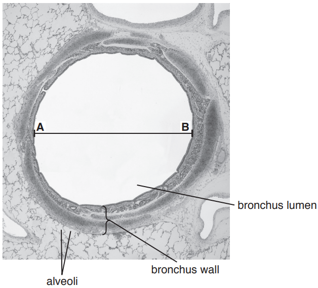

**Fig.1**

(i)

Make a large drawing of the bronchus shown in Fig.1

Do **not** include any of the alveoli or other tissues in your drawing. Do **not** label your drawing.

[4]

(ii)

The diameter of the bronchus in Fig.1 is shown by the line **AB**.

The actual diameter of the bronchus in Fig.1 is 1.5mm.

The magnification of the bronchus in Fig.1 can be calculated using the following equation:

$\mathrm{magnification}=\frac{\mathrm{length} \mathrm{of} \mathrm{AB} \mathrm{on} \mathrm{Fig}.1}{\mathrm{actual} \mathrm{diameter} \mathrm{of} \mathrm{the} \mathrm{bronchus}}$

The length of **AB** on the original photomicrograph, represented in Fig.1 is 55 mm.

Calculate the magnification of the bronchus in Fig.1

Give your answer to the nearest whole number.

[2]

*Source: 2018 0610/62 Q2A*

### Q2 — medium — 14 marks

**Q2** [2 marks]

A student investigated the number of petals on the flowers of two species of daisy, species **A** and species **B**.

Fig.1 shows one daisy flower of species **A**.

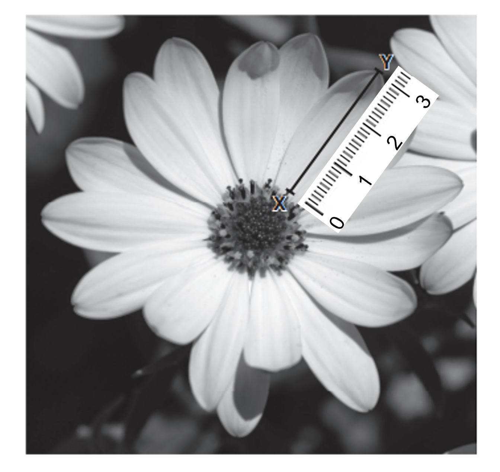

**Fig. 1**

The actual length of petal **XY** of the daisy in Fig.1 was measured by the student as 5 mm.

Measure the length of petal **XY **in the photograph in Fig.1. A cm-ruler has been included for your use. Include the units.

Use the formula to calculate the magnification of the photograph.

$\mathrm{magnification}=\frac{\mathrm{length} \mathrm{of} \mathrm{XY} \mathrm{on} \mathrm{Fig}.1}{\mathrm{actual} \mathrm{length} \mathrm{of} \mathrm{petal} \mathrm{XY}}$

Show your working.

*Source: 2018 0610/62 Q2A*

**Q2** [3 marks]

**Extract:**

The student collected 10 flowers from species A and 10 flowers from species B. They counted the number of petals on each flower.

Table 1
| Flower number | Number of petals |
| Species A | Species B |
| 1 | 16 | 7 |
| 2 | 15 | 5 |
| 3 | 13 | 5 |
| 4 | 20 | 6 |
| 5 | 20 | 6 |
| 6 | 15 | 7 |
| 7 | 17 | 5 |
| 8 | 15 | 6 |
| 9 |   | 6 |
| 10 |   | 5 |
| Average number of petals | 17 |   |

The student collected 10 flowers from species **A** and 10 flowers from species **B**. They counted the number of petals on each flower.

Fig. 2 shows some of the daisy flowers of species **A**.

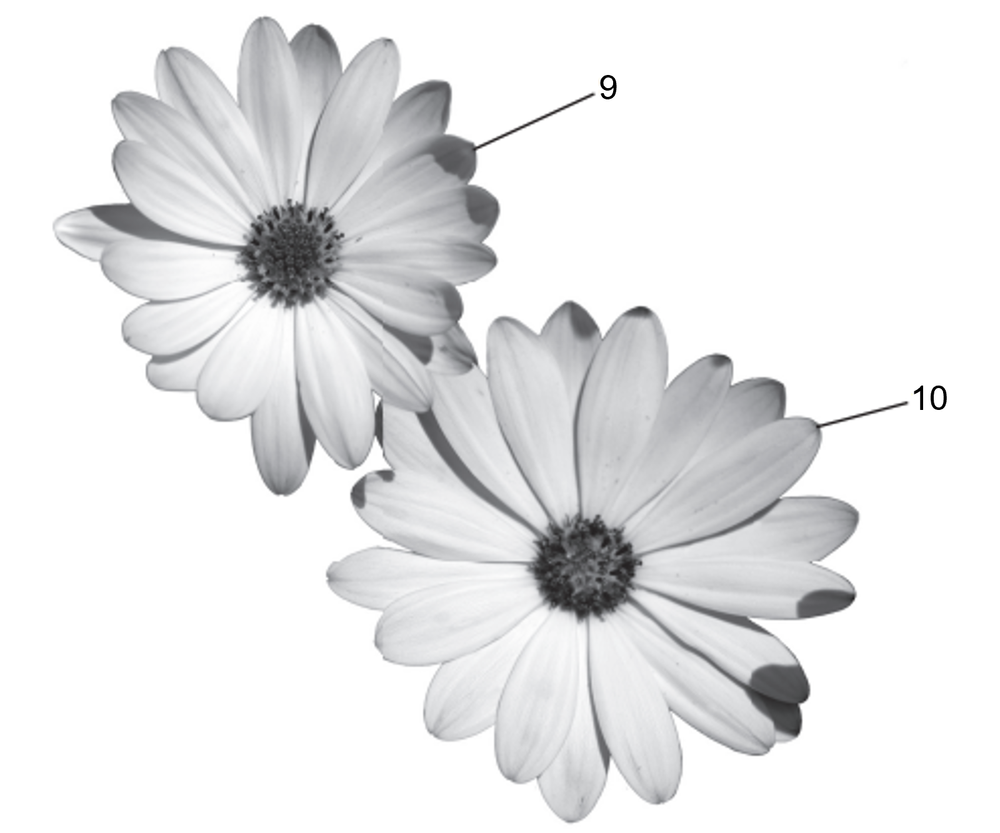

**Fig. 2**

(i)

Count the number of petals on flowers **9** and **10** in Fig. 2 and record the number of petals in Table 1.

**Table 1**

| Flower number | Number of petals |   |
|---|---|---|
| Species **A** | Species **B** |   |
| 1 | 16 | 7 |
| 2 | 15 | 5 |
| 3 | 13 | 5 |
| 4 | 20 | 6 |
| 5 | 20 | 6 |
| 6 | 15 | 7 |
| 7 | 17 | 5 |
| 8 | 15 | 6 |
| 9 |   | 6 |
| 10 |   | 5 |
| Average number of petals | 17 |   |

[1]

(ii)

Calculate the average number of petals for species **B**.

Give your answer to the nearest whole number.

[1]

(iii)

Suggest one method that could be used to ensure that the counting of the number of petals is accurate.

[1]

*Source: 2018 0610/62 Q2B*

**Q2** [3 marks]

**Extract:**

Table 1
| Flower number | Number of petals |
| Species **A** | Species **B** |
| 1 | 16 | 7 |
| 2 | 15 | 5 |
| 3 | 13 | 5 |
| 4 | 20 | 6 |
| 5 | 20 | 6 |
| 6 | 15 | 7 |
| 7 | 17 | 5 |
| 8 | 15 | 6 |
| 9 |   | 6 |
| 10 |   | 5 |
| Average number of petals | 17 |   |

(ii) The average number of petal for species **B** is...
- 6; [1 mark]

Plot a bar chart on the grid of the average number of petals for species **A** and species **B** from Table 1.

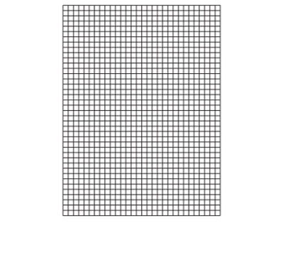

*Source: 2018 0610/62 Q2C*

**Q2** [2 marks]

**Extract:**

A student investigated the number of petals on the flowers of two species of daisy, species A and species B.

State **two** reasons why the student should have repeated the investigation.

*Source: 2018 0610/62 Q2D*

**Q2** [4 marks]

The student noticed that insects fed on the nectar produced by the flowers.

(i)

Describe the test that the student would use to find out if the nectar contains reducing sugars.

[3]

(ii)

State **one** safety precaution that should be taken when carrying out the test for reducing sugars.

[1]

*Source: 2018 0610/62 Q2E*

### Q3 — medium — 6 marks

**Q3** [6 marks]

Fig. 1 shows a photograph of a woodlouse.

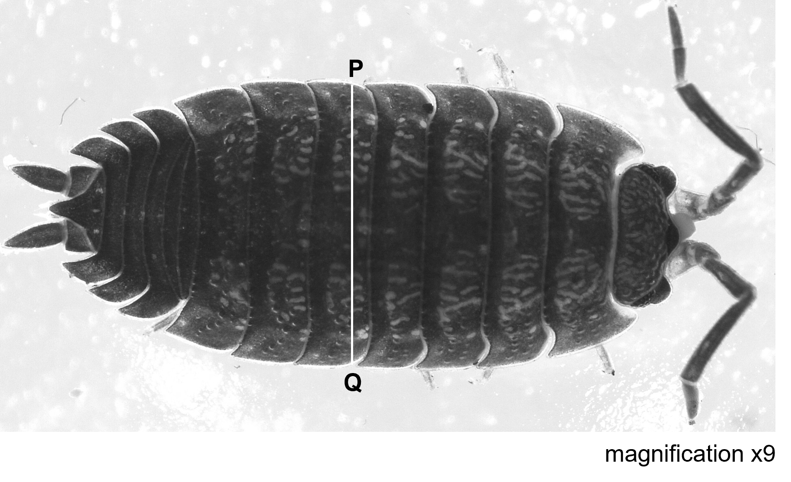

Image courtesy of Donald Hobern. Licensed under Creative Commons Attribution 2.0 Generic license. Reused and distributed under conditions found at: https://creativecommons.org/licenses/by/2.0/deed.en.

**Fig. 1**

(i)

Draw a large diagram of the woodlouse in Fig.1.

[4]

(ii)

The magnification of the woodlouse in Fig.1 is ×9.

The length of line **PQ** is 48 mm.

Calculate the actual width of the woodlouse using the formula and the measurement of line **PQ**.

$\mathrm{magnification}=\frac{\mathrm{length} \mathrm{of} \mathrm{line} \mathrm{PQ}}{\mathrm{actual} \mathrm{width} \mathrm{of} \mathrm{woodlouse}}$

Give your answer to **three** significant figures.

[2]

*Source: 2023 0970/06 Q2C*

### Q4 — medium — 14 marks

**Q4** [7 marks]

Fig.1 shows *Asterionella*, which are microscopic algae that live in fresh water.

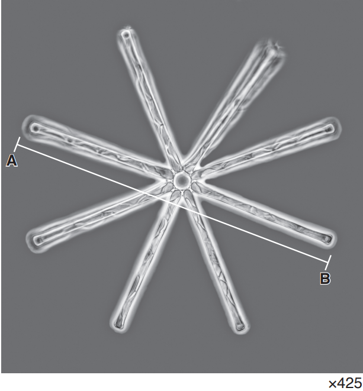

**Fig.1**

(i)

Make a large outline drawing of the algae. Do not label your drawing.

(ii)

A copy of Fig.1 is shown below with a ruler, graduated in cm, added.

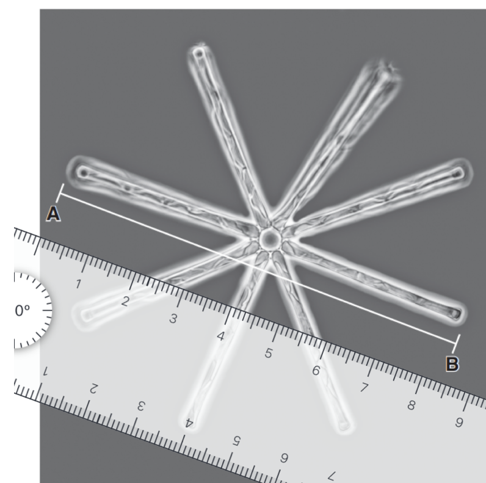

**Fig.1**                                           ×**425**

Measure the length of the line **AB **in Fig.1 Include the unit.

Use the formula to calculate the actual diameter of the algae shown in Fig.1 Include the units.

$\mathrm{magnification}=\frac{\mathrm{length} \mathrm{of} \mathrm{line} \mathrm{AB}}{\mathrm{actual} \mathrm{diameter} \mathrm{of} \mathrm{algae}}$

Show your working.

[3]

*Source: 2018 0610/62 Q2A*

**Q4** [7 marks]

Algae photosynthesise. This process uses carbon dioxide.

Hydrogencarbonate indicator can be used to determine the concentration of carbon dioxide in a solution.

| Colour of hydrogencarbonate indicator | Concentration of carbon dioxide |
|---|---|
| purple | low |
| red | medium |
| yellow | high |

(i)

A student wanted to use hydrogencarbonate indicator to investigate the effect of light intensity on photosynthesis in fresh water algae.

Describe how the student could carry out this experiment.

(ii)

State the name of a pH indicator other than hydrogencarbonate which could be used to detect a change in pH.

[1]

*Source: 2018 0610/62 Q2B*

### Q5 — medium — 17 marks

**Q5** [6 marks]

Fig. 1 shows a cross section through a beetroot.

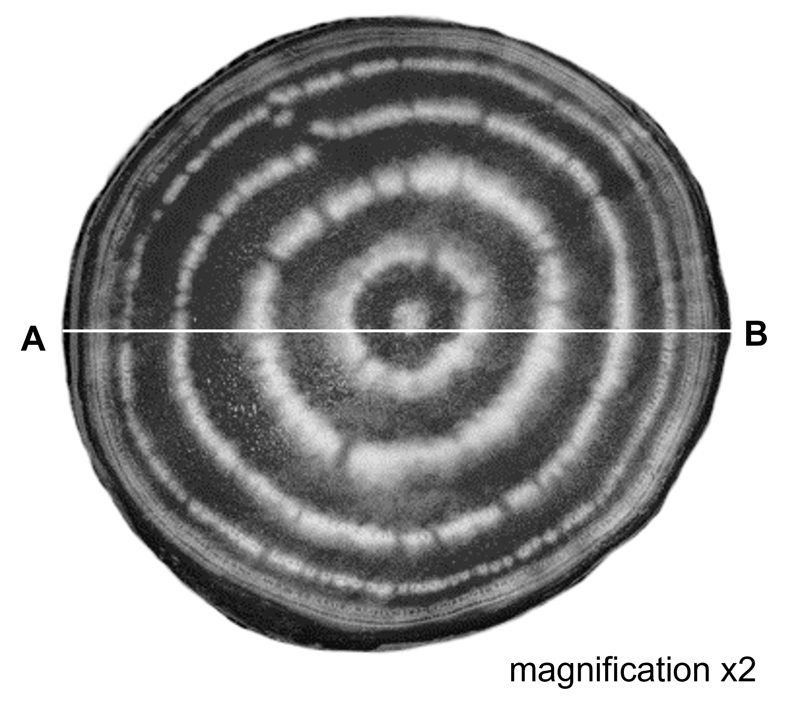

Image courtesy of Joergens.mi. Original image located at: //commons.wikimedia.org/wiki/File:Beetroot_jm27958.jpg. Licenced under CC-BY-SA-3.0 under conditions found at: https://creativecommons.org/licenses/by-sa/3.0/deed.en.

**Fig. 1**

(i)

Draw a large diagram of the beetroot in Fig. 1. Do not label your drawing or include line **AB**.

[4]

(ii)

The magnification of the beetroot in Fig. 1 is x2.

The length of line **AB** is 10 cm.

Calculate the actual width of the beetroot using the formula and the measurement of line **AB**.

$\mathrm{magnification}=\frac{\mathrm{length} \mathrm{of} \mathrm{line} \mathrm{AB}}{\mathrm{actual} \mathrm{width} \mathrm{of} \mathrm{beetroot}}$

Show your working.

[2]

**Q5** [4 marks]

Students conducted an experiment to investigate the effect of temperature on plant cell membranes. They followed the experimental procedure described below.

- Beetroot cores were cut using a cork borer.
- They used a scalpel to cut each core into 2 cm sections.
- Students used six beakers to set up water baths at different temperatures (0°C, 20°C, 40°C, 60°C, 80°C and 100°C).
- The temperature of each water bath was monitored using a thermometer and manually adjusted using cold or hot water.
- 5 cm3 of distilled water was added to each of six test tubes and one test tube was placed in each water bath and left for 5 minutes.
- After 5 minutes, one 2 cm beetroot section was added to each test tube and left for 30 minutes.
- After 30 minutes, the contents of each test tube was placed in a colorimeter and the percentage transmission of light was measured at each temperature.
- The experiment was repeated two more times.

Table 1 shows the results of the investigation.

**Table 1**

| temperature / °C | transmission of light / % |   |   |   |
|---|---|---|---|---|
| trial 1 | trial 2 | trial 3 | mean |   |
| 0 | 100 | 99.4 | 99.1 | 99.5 |
| 20 | 95.6 | 97.0 | 96.3 | 96.3 |
| 40 | 79.3 | 80.7 | 78.9 | 79.6 |
| 60 | 31.1 | 30.6 | 29.7 |   |
| 80 | 0.8 | 0.8 | 0.9 | 0.8 |
| 100 | 0.0 | 0.0 | 0.0 | 0.0 |

(i)

Identify the independent **and **dependent variable for this investigation.

[2]

(ii)

State **two** safety precautions that should be followed during the experimental procedure.

[2]

**Q5** [5 marks]

**Extract:**

Table 1

temperature / °C | transmission of light / %
| trial 1 | trial 2 | trial 3 | mean |
| 0 | 100 | 99.4 | 99.1 | 99.5 |
| 20 | 95.6 | 97.0 | 96.3 | 96.3 |
| 40 | 79.3 | 80.7 | 78.9 | 79.6 |
| 60 | 31.1 | 30.6 | 29.7 |   |
| 80 | 0.8 | 0.8 | 0.9 | 0.8 |
| 100 | 0.0 | 0.0 | 0.0 | 0.0 |

(i)

Use the data in Table 1 to calculate the mean percentage of light transmitted at a temperature of 60°C.

Give your answer to **three** significant figures.

[1]

(ii)

Use the grid below to plot a line graph of temperature against the mean percentage of light transmitted from Table 1.

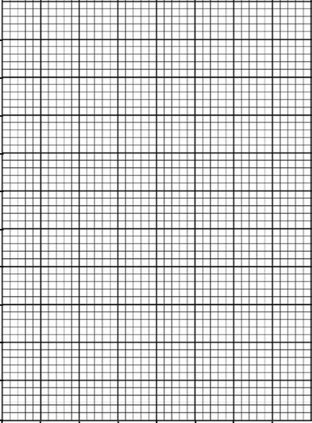

[4]

**Q5** [2 marks]

**Extract:**

The experiment was repeated two more times. Table 1 shows the results of the investigation. | temperature / °C | transmission of light / % | trial 1 | trial 2 | trial 3 | mean | ... (data table showing three trials for each temperature) ...

Explain the importance of repeating the experiment several times.

## Multiple Choice Questions (28 questions)

### Q1 — medium — 1 marks

**Q1** [1 mark]

An image of a cell is 24 mm long. The actual cell length is 6 μm.

What is the magnification?

### Q2 — medium — 1 marks

**Q2** [1 mark]

A palisade mesophyll cell is found near the upper surface of a leaf and contains many chloroplasts.

Why is this an effective adaptation?

### Q3 — medium — 1 marks

**Q3** [1 mark]

The micrograph below shows onion root cells undergoing various stages of mitosis. A x200 magnification was used.

Nathalie Russell via [Wikimedia Commons](https://commons.wikimedia.org/w/index.php?title=File:Mitosis_in_Onion_Root_various_stages_(Metaphase).jpg&oldid=801253780)

Which of the following shows the the real length of the cell indicated in the image, rounded to the nearest whole number?

### Q4 — easy — 1 marks

**Q4** [1 mark]

The diagram below shows a bacteria cell

What is the function of structure Z?

### Q5 — medium — 1 marks

**Q5** [1 mark]

A photograph shows a plant cell nucleus measuring 2 mm across.

If the magnification of the cell is x500, what is the actual size of the nucleus?

*Source: June 2021 0970/11 Q6*

### Q6 — easy — 1 marks

**Q6** [1 mark]

The diagram shows some of the blood vessels and other structures in the human body.

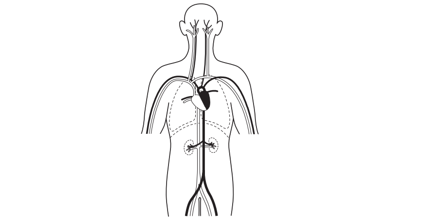

The blood vessels shown are all parts of the same

*Source: June 2021 0970//11 Q5*

### Q7 — easy — 1 marks

**Q7** [1 mark]

The diagram shows a single-celled organism called Euglena.

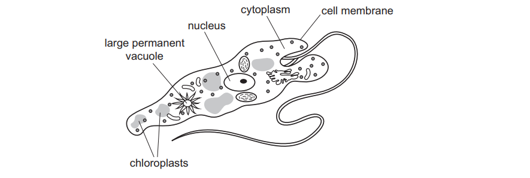

Which labelled structures would also be found in an animal cell?

*Source: June 2021 0970/11 Q4*

### Q8 — hard — 1 marks

**Q8** [1 mark]

A student found four different worms in a sample of soil and drew diagrams of them. The diagrams were drawn with different magnifications.

Which worm was the longest?

|   | length of  diagram / mm | magnification |
|---|---|---|
| A | 60 | x3 |
| B | 70 | x1 |
| C | 100 | x2 |
| D | 120 | x5 |

*Source: June 2022 0970/11 Q6*

### Q9 — medium — 1 marks

**Q9** [1 mark]

The diagram shows a cross-section through a leaf.

Which label shows a tissue?

*Source: June 2022 0970/11 Q5*

### Q10 — easy — 1 marks

**Q10** [1 mark]

The diagram shows a cross-section through two guard cells of a leaf.

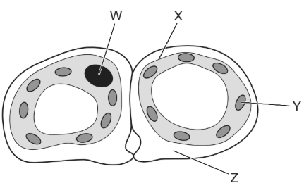

Which labelled structures would also be found in an animal cell?

*Source: June 2022 0970/11 Q4*

### Q11 — hard — 1 marks

**Q11** [1 mark]

The photograph shows a chloroplast magnified ×7000

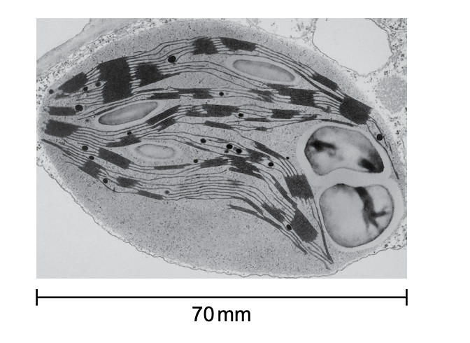

What is the actual size of the chloroplast?

*Source: Specimen 2023 0970/01 Q6*

### Q12 — easy — 1 marks

**Q12** [1 mark]

The diagram shows the structure of a plant cell.

What is a function of this specialised plant cell?

*Source: Specimen 2023 0970/01 Q5*

### Q13 — easy — 1 marks

**Q13** [1 mark]

Which part of a plant cell controls the movement of substances into and out of the cell?

*Source: Specimen 2023 0970/01 Q4*

### Q14 — medium — 1 marks

**Q14** [1 mark]

Which row of the table below correctly describes a spongy mesophyll cell?

| ** ** | contains chloroplasts for photosynthesis | loses water by transpiration | ideal surface area for gas exchange |
|---|---|---|---|
| **A** | **✘** | ✔ | ✔ |
| **B** | ✔ | ✔ | **✘** |
| **C** | ✔ | ✔ | ✔ |
| **D** | ✔ | **✘** | **✘** |

### Q15 — medium — 1 marks

**Q15** [1 mark]

The salivary glands contain cells which are responsible for producing salivary amylase, a digestive enzyme.

Which organelles would be present in large numbers in cells of the salivary glands?

### Q16 — medium — 1 marks

**Q16** [1 mark]

Which row of the table below correctly describes the structures present in a bacterial cell?

| ** ** | cell membrane | cell wall | chromosome | nucleus |
|---|---|---|---|---|
| **A** | **✘** | **✔** | **✘** | **✘** |
| **B** | **✔** | **✔** | **✔** | **✘** |
| **C** | **✔** | **✔** | **✘** | **✘** |
| **D** | **✔** | **✘** | **✘** | **✔** |

### Q17 — medium — 1 marks

**Q17** [1 mark]

Which row of the table below correctly matches functions to some of the components in a root hair cell?

| ** ** | cell wall | cell membrane | mitochondria |
|---|---|---|---|
| **A** | support | active transport | energy release |
| **B** | energy release | active transport | nutrition |
| **C** | support | active transport | nutrition |
| **D** | active transport | support | energy release |

### Q18 — medium — 1 marks

**Q18** [1 mark]

#### Extended only

A list of subcellular structures is given below.

| **1** | nucleus |
|---|---|
| **2** | ribosome |
| **3** | vacuole |
| **4** | chloroplast |

A plant cell and an animal cell are observed under a light microscope.

Which of the above structures would always be visible in a plant cell?

### Q19 — easy — 1 marks

**Q19** [1 mark]

Which of the following orders would be correct showing the size of structures from biggest to smallest?

### Q20 — easy — 1 marks

**Q20** [1 mark]

Which row of the table below correctly matches a structure to its level of organisation within an organism?

| ** ** | tissue | organ | system |
|---|---|---|---|
| **A** | phloem | small intestine | digestive |
| **B** | red blood cell | xylem | stomach |
| **C** | small intestine | sperm | digestive |
| **D** | root hair | leaf | heart |

### Q21 — easy — 1 marks

**Q21** [1 mark]

Which of the following terms would be correct to describe a leaf, a root and stem?

### Q22 — easy — 1 marks

**Q22** [1 mark]

Which description of the liver below is correct?

### Q23 — hard — 1 marks

**Q23** [1 mark]

A student cut a section through a plant, finding a group of long, microscopic structures which lacked end walls or any cell contents.

Which row of the table below correctly identifies the structure described in the statement above?

| ** ** | **identification** | **description** |
|---|---|---|
| **A** | xylem vessels | large surface area to absorb as much water by osmosis as possible |
| **B** | root hair cells | they can support the plant better without cytoplasm, mitochondria provide energy |
| **C** | root hair cells | hollowed, lignified tubes to allow uninterrupted flow of water |
| **D** | xylem vessels | hollowed, lignified tubes to allow uninterrupted flow of water |

### Q24 — easy — 1 marks

**Q24** [1 mark]

The diagram below shows part of an organism (ciliated epithelium).

What term would correctly describe the level of organisation of the structure in the diagram above?

### Q25 — hard — 1 marks

**Q25** [1 mark]

Eukaryotic cells contain mitochondria (a mitochondrion is shown below).

Which diagram below correctly shows the position of mitochondria in a plant cell?

### Q26 — hard — 1 marks

**Q26** [1 mark]

#### Extended only

A student looks at the image below in his textbook.

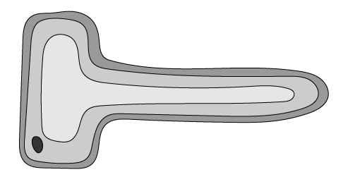

The image is 43 mm wide and has been magnified 2500 times.

What is the actual width of the cell?

### Q27 — hard — 1 marks

**Q27** [1 mark]

#### Extended only

A student looks at an image of a cross-section of a leaf in her Biology textbook.

The actual thickness of this leaf is 450 µm, but the image in the textbook has a depth of 83 mm.

What would be the correct magnification of the image?

### Q28 — hard — 1 marks

**Q28** [1 mark]

The image below shows a palisade mesophyll cell found in the leaves of plants.

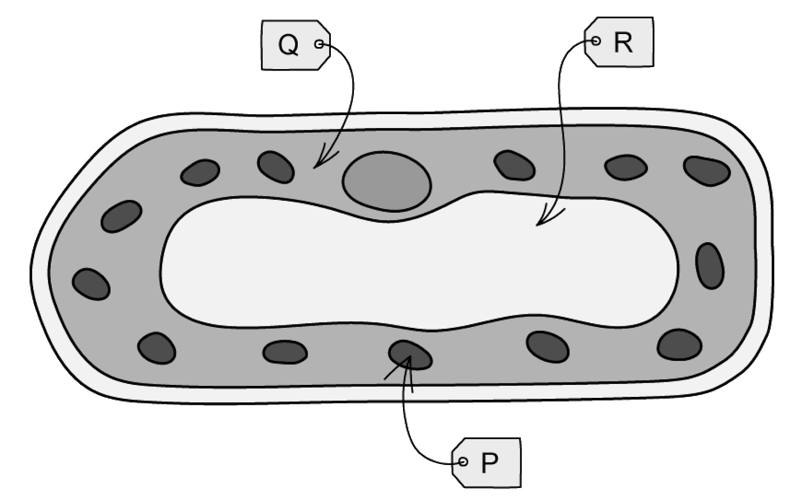

Which row of the table below correctly identifies the structures labelled on the cell in the image above?

| ** ** | **P** | **Q** | **R** |
|---|---|---|---|
| **A** | mitochondrion | nucleus | vacuole |
| **B** | chloroplast | vacuole | nucleus |
| **C** | chloroplast | cytoplasm | vacuole |
| **D** | mitochondrion | ribosome | nucleus |

## Theory Questions (18 questions)

### Q1 — medium — 3 marks

**Q1** [2 marks]

Figure 1.1 is a diagram of a cell from the pancreas that produces and secretes digestive enzymes.

**Fig. 1.1**

State the names of the structures labelled P and Q in Fig. 1.1.

**Q1** [1 mark]

**Extract:**

Figure 1.1 is a diagram of a cell from the pancreas that produces and secretes digestive enzymes.

Using the information in Fig. 1.1, explain how this cell is adapted to produce and secrete enzymes.

### Q2 — easy — 6 marks

**Q2** [4 marks]

Baker’s yeast, *Saccharomyces cerevisiae*, is a single-celled organism that is classified in the kingdom Fungi.

Fig. 1.1 is a drawing of a section through a yeast cell.

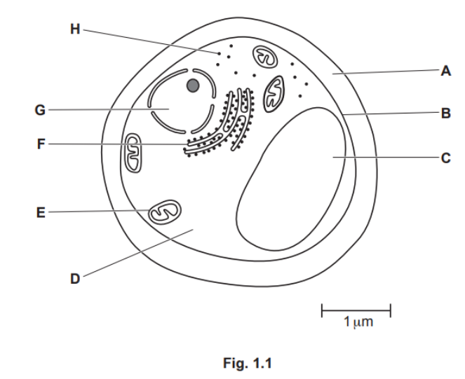

(i) State** one other **kingdom that contains organisms that all have structure **A**.

[1]

(ii) Table 1.1 shows some cell functions.

Complete Table 1.1 by naming the cell structure responsible for each cell function and give the letter that identifies each cell structure in Fig. 1.1.

**Table 1.1**

| cell function | cell structure | letter from Fig. 1.1 |
|---|---|---|
| storage of genes |   |   |
| aerobic respiration |   |   |
| amino acids are assembled to make protein |   |   |

[3]

*Source: june 2021 paper 4 Q1A*

**Q2** [2 marks]

A student made a drawing of one Escherichia coli bacterium. Fig. 1.2 shows the student’s drawing.

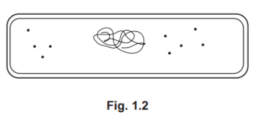

The actual length of the bacterial cell is 2μm.

(i) Convert the actual length of the cell to millimetres.

................................................... mm [1]

(ii) State the other information that the student needs in order to calculate the magnification of the drawing in Fig. 1.2.

[1]

*Source: june 2021 paper 4  Q1B*

### Q3 — easy — 10 marks

**Q3** [6 marks]

Fig. 1.2 is a diagram of an animal cell.

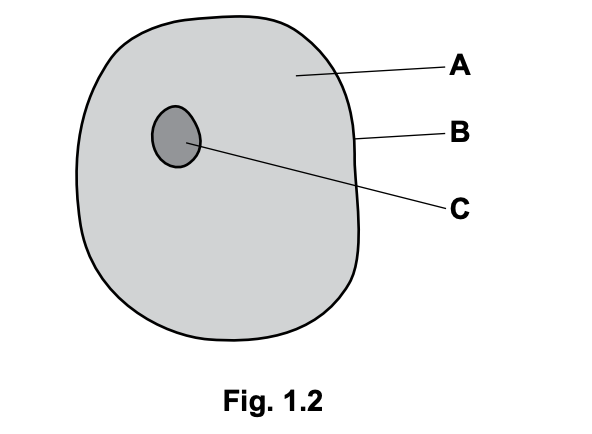

(i)

Identify the parts labelled **A, B** and **C** in Fig. 1.2.

**A **.......................................................................................................................
**B **.......................................................................................................................
**C **.......................................................................................................................

[3]

(ii) State the names of **two** structures in plant cells that are absent in animal cells.

1 ..........................................................................................................................

2 .........................................................................................................................

[2]

(iii)

State the name of **one** structure that is present in bacterial cells and in plant cells but absent in animal cells

[1]

*Source: Specimen 2023 0970/03 Q1C*

**Q3** [4 marks]

Some cells are specialised to perform a particular function.

The boxes on the left show the names of some specialised cells.

The functions of some specialised cells are in the boxes on the right.

Draw **four** lines to link each specialised cell with its function.

One line has been drawn for you. Draw four additional lines

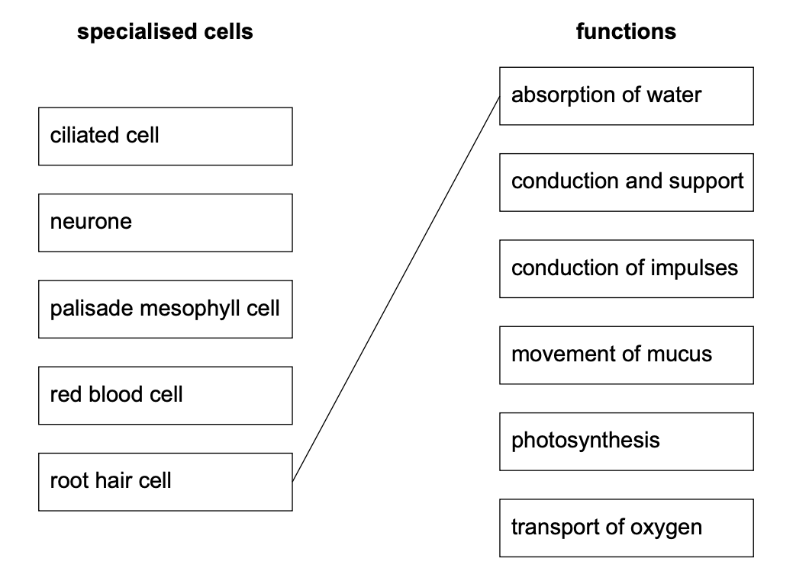

*Source: Specimen 2023 0970/03 Q1D*

### Q4 — hard — 8 marks

**Q4** [3 marks]

#### Extended only

Complete **Table 1** to show the correct size conversions. Record your answers as ordinary numbers

**Table 1**

| **Measurement** | **Unit** | **Conversion** | **Unit** |
|---|---|---|---|
| 15.3 | cm |   | µm |
| 3 x 10-6 | mm |   | µm |
| 0.25 | m |   | µm |

**Q4** [2 marks]

#### Extended only

The mass of bacterial cells was measured in femtograms (fg).

1 femtogram = 1 x 10-15g

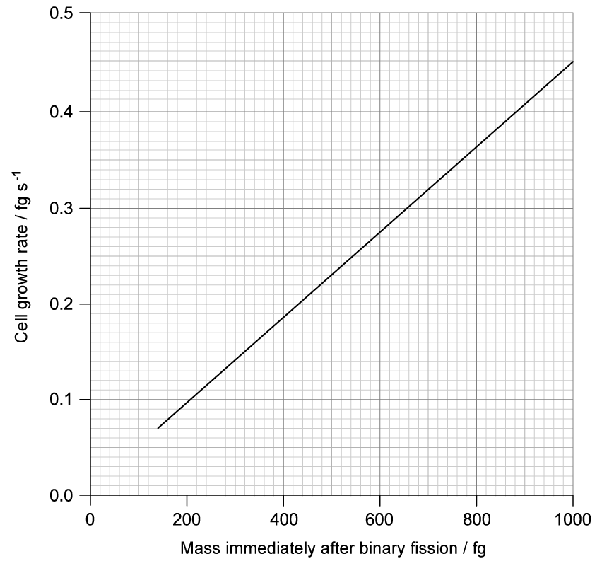

**Fig. 1**

Calculate the mass of bacteria, in grams, immediately after binary fission when the cell growth rate was 0.1 fg s-1.Give your answer in standard form.

**Q4** [3 marks]

#### Extended only

The electron micrograph in **Fig. 2** shows some cellular structure in a leaf. A student uses a ruler to measure the scale bar, which is found to be 1.5 cm.

**Fig. 2**

Calculate the magnification of the image.

### Q5 — hard — 11 marks

**Q5** [4 marks]

**Fig. 1** shows some parts of the human body.

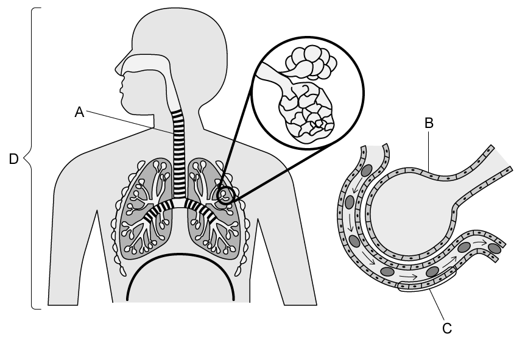

**Fig. 1**

Identify each structure and which level of organisation each one belongs to.

| Structure | Name of structure | Level of organisation |
|---|---|---|
| **A** |   |   |
| **B** |   |   |
| **C** |   |   |
| **D** |   |   |

**Q5** [2 marks]

Explain how two separate organs of the musculoskeletal system, muscles and bones, work together to perform the function of movement.

**Q5** [3 marks]

**Extract:**

The levels of organisation that the muscle cell belongs to are:
- Tissue: Skeletal muscle
- Organ: Muscle / any large named leg muscle eg. hamstring, quadriceps
- Organ System: Musculoskeletal system

From earlier context:
| Structure | Name of structure | Level of organisation |
| **A** | **Trachea** | **Organ** |
| **B** | **Alveolus / alveolar epithelium** | **Organ or Cell** |
| **C** | **Capillary endothelium** | **Tissue** |
| **D** | **Breathing / respiratory system** | **System** |

**Fig. 2** shows a human muscle cell from a person's leg muscle.

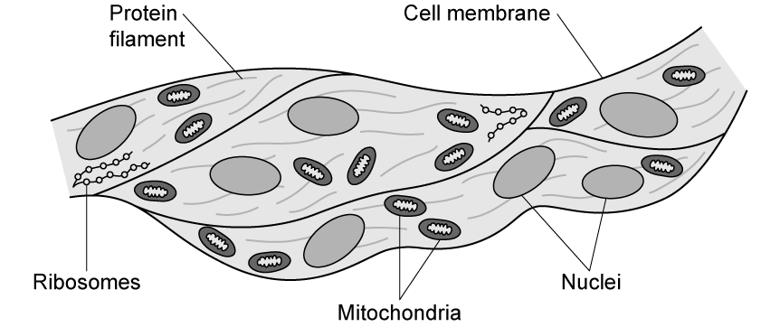

**Fig. 2**

Identify the levels of organisation that this cell belongs to.

**Q5** [2 marks]

A new-born baby is thought to have around 1 250 000 000 000 (1.25 × 1012) cells. That same baby, as an adult male, is estimated to have 37 000 000 000 000 (3.7 × 1013) cells. If the new-born baby had a mass of 3.1kg at birth, estimate the mass of the adult male. Give your answer in appropriate units to the nearest whole number.

### Q6 — hard — 8 marks

**Q6** [2 marks]

#### Extended only

Place the following cellular measurements into order, starting with the smallest.

| **Measurement** | **Rank (1-4)** |
|---|---|
| 10 000µm |   |
| 1mm |   |
| 0.15cm |   |
| 100µm |   |

**Q6** [2 marks]

**Extract:**

The student measures the height of the printed image as 6.2 cm.
Magnification: 7800×

#### Extended only

The palisade mesophyll cell in **Fig. 1** is printed in a student's text book.

Magnification: 7800×

**Fig. 1**

The student measures the height of the printed image as 6.2 cm.

Calculate the height of the palisade cell.

**Q6** [2 marks]

#### Extended only

An artery supplies blood from a man's shoulder to his wrist, before it splits to supply the various parts of his hand.

Identify the statement(s) about the artery in **Table 1** that could be correct?

Place a tick (✓) in the box(es) that show(s) a plausible statement.

**Table 1**

| statement | plausible? (✓) |
|---|---|
| 1. The artery is 50 cm long |   |
| 2. The artery is 5 000 mm long |   |
| 3. The artery is 50 000 µm long |   |
| 4. The artery is 5 × 105 µm long |   |

**Q6** [2 marks]

A form of vascular tissue in plants, the xylem, consists of a large amount of dead tissue yet still performs its function.

Explain how dead tissue in certain parts of the xylem is an advantage over live tissue.

### Q7 — hard — 13 marks

**Q7** [3 marks]

**Fig. 1 **shows three different cells.

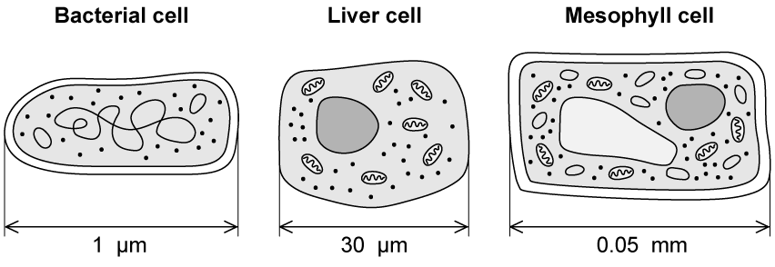

**Fig. 1**

Calculate the size ratio of the bacterial cell compared to the liver cell and mesophyll cell.

**Q7** [4 marks]

Explain the role of differentiation in the development of root hair cells which allows them to carry out their specific function in plants.

**Q7** [3 marks]

Some scientists completed a study to investigate the starch content of roots in a species of grass at four points throughout the year in a country in the northern hemisphere.

Their results can be seen in **Fig. 2**

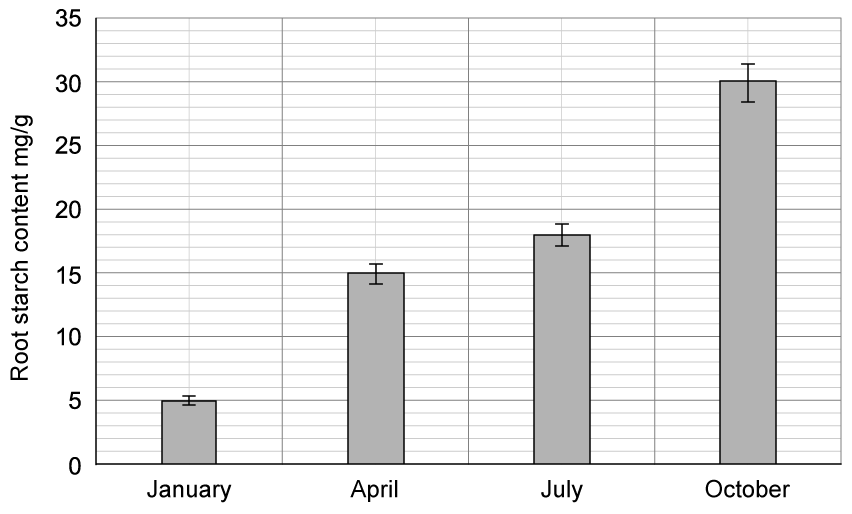

**Fig. 2**

Explain how the starch found in the roots of grass species helps to support growth of the grass.

**Q7** [3 marks]

**Extract:**

Root starch content in October: 30 mg/g
Root starch content in January: 5 mg/g

Calculate the percentage change of stored starch from October to January and suggest a reason for this change.

### Q8 — hard — 13 marks

**Q8** [6 marks]

Compare the similarities and differences in the structure of animal and bacterial cells.

Include reference to the relative sizes of cellular structures in your answer.

**Q8** [1 mark]

**Fig. 1** shows a cell found in the glands responsible for producing saliva in the mouth.

**Fig. 1**

Identify the protein, produced by these cells, that is required for the digestion of carbohydrates.

**Q8** [4 marks]

**Extract:**

Fig. 1 shows a cell found in the glands responsible for producing saliva in the mouth. The protein produced by these cells for carbohydrate digestion is amylase (enzyme).

Suggest how the cell in **Fig. 1** is adapted for its function.

**Q8** [2 marks]

Describe how cell specialisation results in a zygote developing into a baby.

### Q9 — medium — 16 marks

**Q9** [6 marks]

**Fig. 1** shows a diagram of a cell found in leaves.

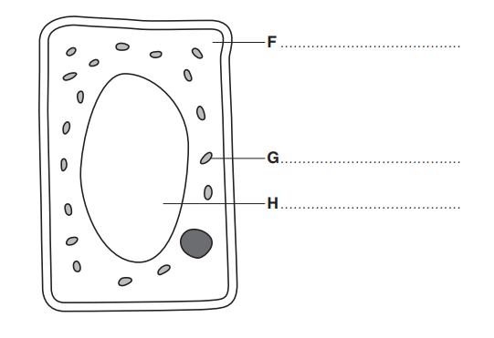

**Fig. 1**

(i)

State the names of structures **F**, **G** and **H**.

[3]

(ii)

On **Fig. 1** draw:

- a line labelled **K** to show where the chromosomes are found
- a line labelled **L** to show the position of the cell membrane.

[2]

(iii)

State the name of this type of plant cell.

[1]

*Source: 2018 0610/32 Q5A*

**Q9** [5 marks]

The cell in **Fig. 1** was placed in a concentrated glucose solution.

**Fig. 2** shows the appearance of the cell after ten minutes in the glucose solution.

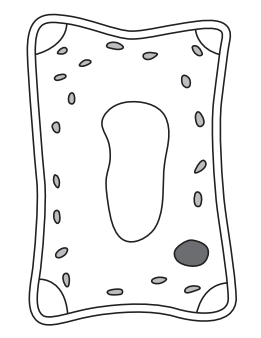

**Fig. 2**

(i)

State **two** ways in which the cell has changed.

[2]

(ii)

Water moves into and out of the cell by osmosis.

Osmosis is a form of diffusion.

Describe the ways in which diffusion is different to active transport.

[3]

*Source: 2018 0610/32 Q5B*

**Q9** [4 marks]

**Table 1** shows some aspects of plant and animals.

Place a tick (**✓**) in the appropriate cells of **Table 1**.

**Table 1**

| Feature | Plants | Animals |
|---|---|---|
| Multicellular |   |   |
| Cells contain a nucleus |   |   |
| Cells contain chloroplasts |   |   |
| Cells connected by nervous coordination |   |   |
| They can move from place to place |   |   |
| Cells store glycogen |   |   |

**Q9** [1 mark]

Name **one** animal cell organelle that would be expected to occur in large numbers in a metabolically active cell.

### Q10 — easy — 6 marks

**Q10** [2 marks]

A diagram of a cell is printed in a textbook and has a width of 62 000 µm on the page, but has a width of 80 µm in real life.

Calculate the magnification of the printed drawing.

**Q10** [2 marks]

**Extract:**

A diagram of a cell is printed in a textbook and has a width of 62 000 µm on the page, but has a width of 80 µm in real life.

The magnification of the printed drawing of the cell is:
- Magnification = Image (width) ÷ Actual (width)
- 62 000 ÷ 80; [1 mark]
- = 775 (×); [1 mark]

A harder version of this question would give you the width of the drawing in more realistic units such as 6.2 cm or 62 mm and you would be required to perform a conversion of those units into micrometres.

#### Extended only

Explain why units often need to be converted before attempting magnification calculations like the one in part (a).

**Q10** [1 mark]

State the formula that links image size, magnification and actual size when examining specimens under a microscope.

**Q10** [1 mark]

**Extract:**

Units need to be the same when dividing / creating a ratio/quotient like magnification; Magnification has no units;

Explain why magnification has no units.

### Q11 — medium — 12 marks

**Q11** [6 marks]

**Fig. 1** is a photomicrograph of part of the upper surface of a broad bean leaf, *Vicia faba.*

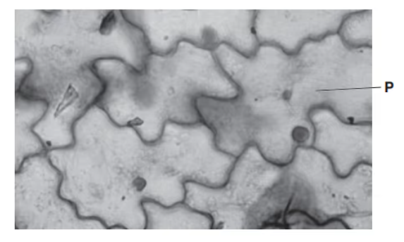

**Fig. 1**

(i)

On **Fig. 1**, identify and label **two** structures that are visible in cell **P**.

[2]

(ii)

State the name of the tissue shown in **Fig. 1**.

[1]

(iii)

The tissue shown in **Fig. 1** is transparent.

Explain why it is important to the plant that the tissue shown in **Fig. 1** is transparent.

*Source: 2018 0610/43 Q3A*

**Q11** [6 marks]

Sketch a bacterial cell, showing its main cellular components.

### Q12 — medium — 10 marks

**Q12** [6 marks]

The boxes on the left describe processes carried out by cells.

The boxes on the right contain the names of the cells that carry out these processes.

Draw **one** straight line from each box on the left to a box on the right to link the process to the cell type.

Draw **six** lines.

An example has been done for you.

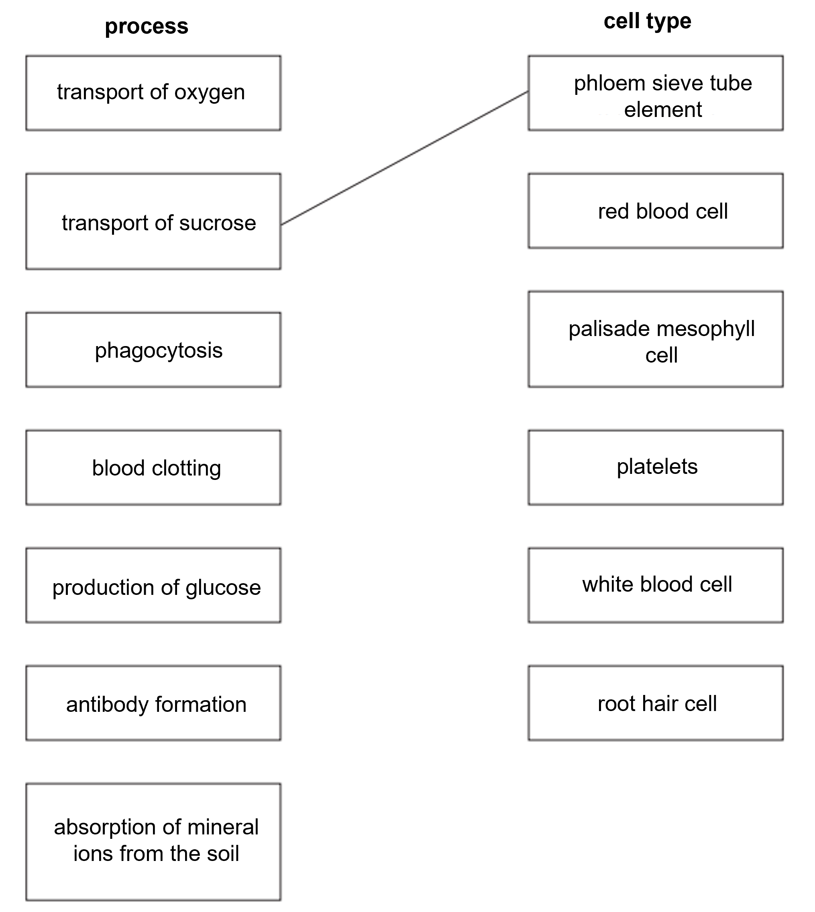

*Source: 2018 0610/31 Q1A*

**Q12** [3 marks]

**Fig. 1** shows a section through part of a leaf.

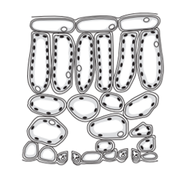

**Fig. 1**

(i)

On **Fig. 1** draw:

- a label line to identify one guard cell and label it **G**
- a label line to identify one of the stomata and label it **S**.

[2]

(ii)

State **one** function of stomata.

[1]

*Source: 2018 0610/31 Q1B*

**Q12** [1 mark]

The nucleus of an animal cell has a diameter of about 6 µm.

Suggest a reason why bacteria do not have a nucleus.

### Q13 — easy — 14 marks

**Q13** [6 marks]

The boxes on the left contain the names of structures in the body.

The boxes on the right contain the names of processes carried out by the body.

Draw one straight line from each structure to the process in which it is involved.

Draw **six** lines.

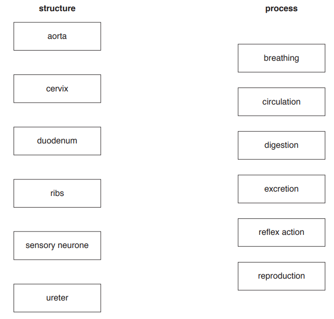

*Source: 2018 0610/32 Q3*

**Q13** [2 marks]

State the functions of these **two **specialised cells.

Red blood cell ............................................................

Ciliated cell ................................................................

**Q13** [3 marks]

Fig. 1 shows a specialised plant cell.

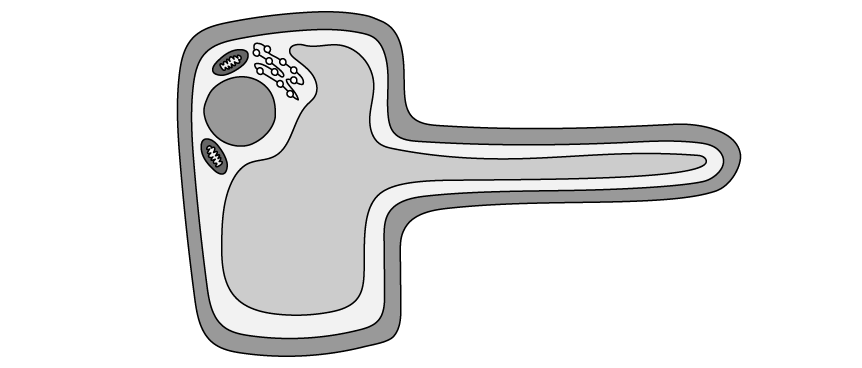

**Fig. 1**

(i)

Identify the plant cell in Fig. 1.

[1]

(ii)

State and explain **one** adaptation that allows this cell to carry out its function.

[2]

**Q13** [3 marks]

Identify with a tick (✓) the structures that are found in both plant and animal cells.

| Structure | In animal cells? | In plant cells? |
|---|---|---|
| Nucleus |   |   |
| Permanent vacuole |   |   |
| Cell wall |   |   |

### Q14 — medium — 9 marks

**Q14** [2 marks]

Animal and plant cells have some structural features in common.

Name **two **structures you would find in both an animal cell and a plant cell.

**Q14** [1 mark]

**Fig.1 **shows a photomicrograph of the surface of a plant root.

**Fig. 1**

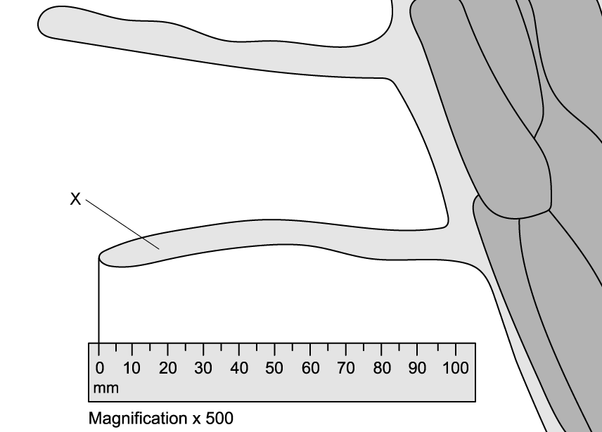

Name structure **X**.

**Q14** [2 marks]

**Extract:**

Actual = image size / magnification size
98 to 100 mm ÷ 500;

Calculate the actual length of structure **X** in **Fig. 1.**

Show your working.

**Q14** [4 marks]

**Extract:**

Structure X is a:

- Root hair / root hair cell;

Failure of structure **X** to develop properly in the cells of a plant root could be catastrophic to a plant.

Suggest an explanation as to why.

### Q15 — easy — 14 marks

**Q15** [3 marks]

Arrange the structures in the list in increasing order of organisation, starting with the smallest structure.

The first one has been done for you.

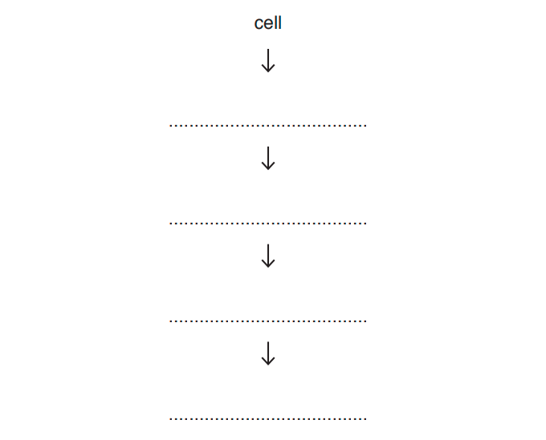

*Source: 2018 0610/33 Q2A*

**Q15** [4 marks]

The boxes on the left show different parts of a flowering plant.

The boxes on the right are terms that describe different levels of organisation.

Draw **one** straight line from each part of a flowering plant to the correct level of organisation.

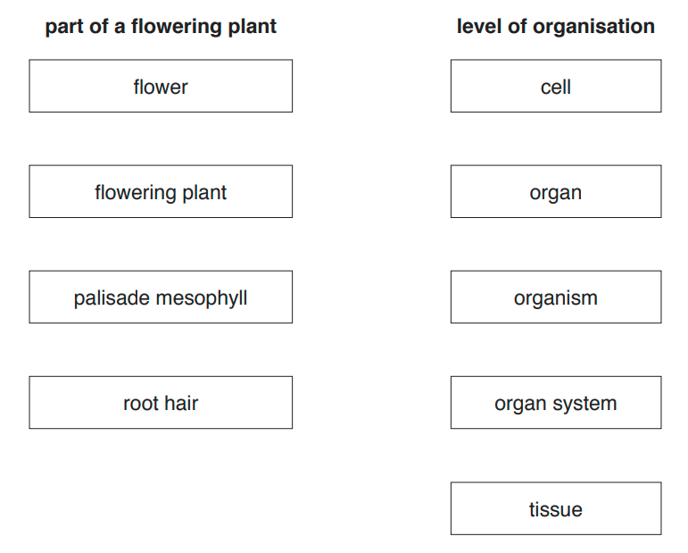

*Source: 2018 0610/33 Q2B*

**Q15** [5 marks]

The boxes on the left show different parts of an animal.

The boxes on the right are terms that describe different levels of organisation.

Draw **one** straight line from each part of the animal to the correct level of organisation.

**Q15** [2 marks]

**Fig. 1** shows a red blood cell.

The cell contains no nucleus.

**Fig.1**

Explain why a red blood cell does not contain a nucleus.

### Q16 — easy — 4 marks

**Q16** [2 marks]

**Fig. 1** shows liver cell which measures 60 mm.

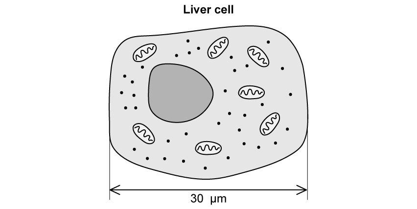

**Fig.1 **

Calculate the magnification of the liver cell using the equation below:

$Magnification=\frac{Imagesize}{Actualsize}$

**Q16** [1 mark]

A light microscope could not be used to observe a cell as seen in **Fig. 1.**

Identify the evidence from **Fig.1 **that supports this statement.

**Q16** [1 mark]

A student set up a light microscope to observe a specimen.

The magnification of the eyepiece lens was ×10 and the magnification of the objective lens was ×20.

Calculate the overall magnification of the light microscope.

### Q17 — easy — 10 marks

**Q17** [4 marks]

Sperm and egg cells are specialised cells that are adapted for reproduction.

The boxes on the left show some specialised cells.

The boxes on the right show the functions of some specialised cells.

Draw **four** lines to link each specialised cell with its function.

One has been done for you.

*Source: 2018 (Series 1) 0610/31 Q1D*

**Q17** [1 mark]

State the name of the process by which existing cells give rise to new cells.

**Q17** [2 marks]

Place these levels of organisation into a logical order from the largest to the smallest in size.

| tissue |
|---|
| organism |
| cell |
| system |
| organ |

**Q17** [3 marks]

**Extract:**

The levels of organisation into a logical order from the largest to the smallest in size are as follows:

| **LARGEST** | 1 | **organism** |
|  | 2 | **system** |
| 3 | **organ** |
| 4 | **tissue** |
| **SMALLEST** | 5 | **cell** |

**Table 1** shows some levels of organisation of a flowering plant.

Place a tick (✔) in the appropriate blank cells in **Table 1**.

The first row has been completed for you.

**Table 1**

| Structure | Tissue | Organ | System |
|---|---|---|---|
| Leaf |   | ✔ |   |
| Vascular bundle |   |   |   |
| Flower |   |   |   |
| Phloem |   |   |   |

### Q18 — medium — 7 marks

**Q18** [2 marks]

**Fig. 1 **shows some muscle cells.

**Fig. 1**

Identify the function of a muscle cell and suggest how they are adapted for this function.

**Q18** [3 marks]

**Fig. 2** shows some information about specialised cells.

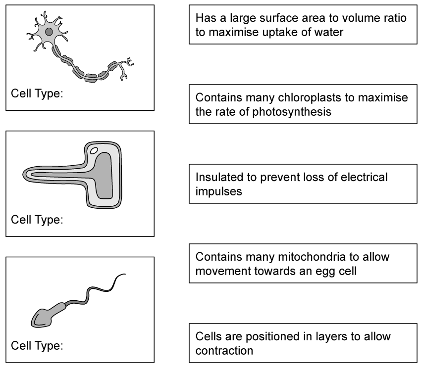

**Fig. 2**

Identify the type of specialised cell shown and match each one to the correct function.

**Q18** [1 mark]

Describe how the xylem is adapted for carrying water and mineral ions around a plant.

**Q18** [1 mark]

Name the process by which a cell changes to become specialised.
