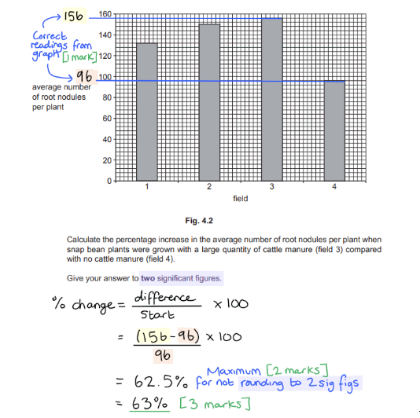
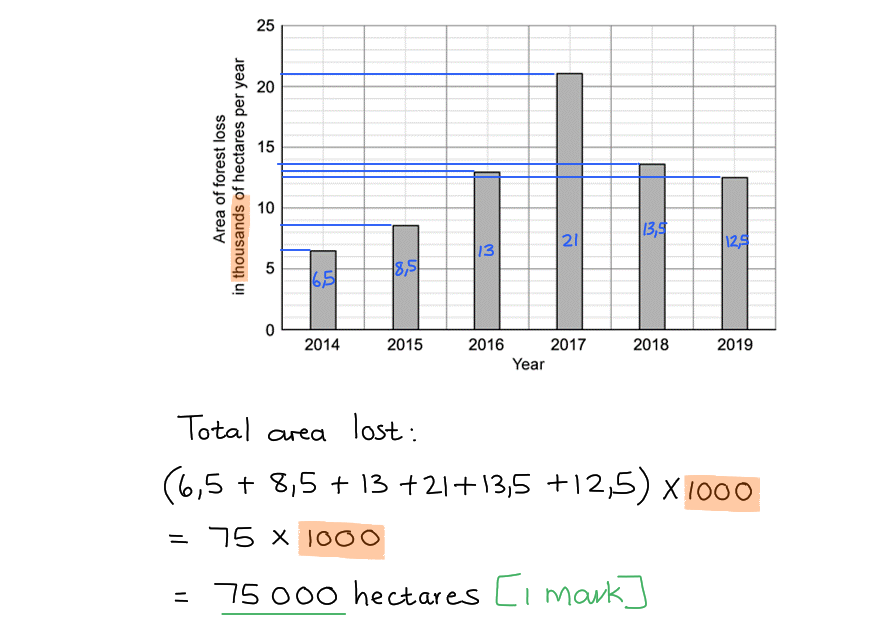
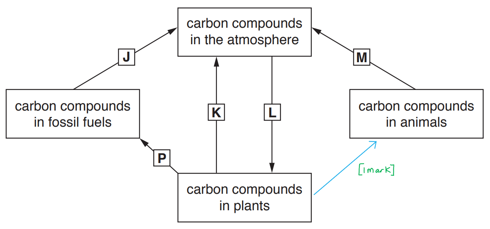
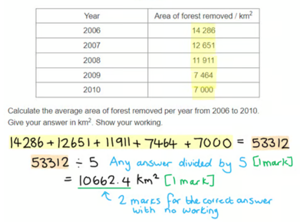
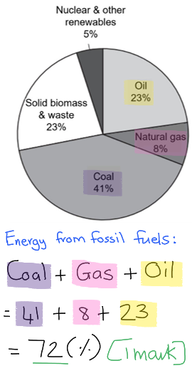
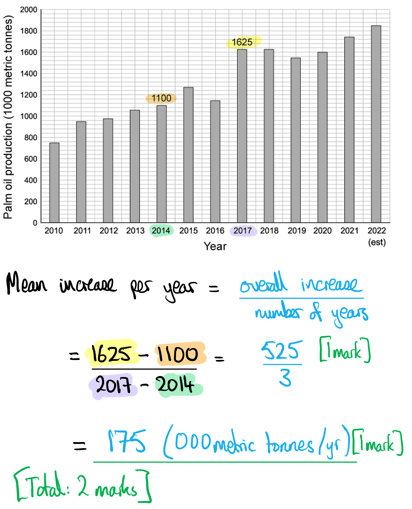
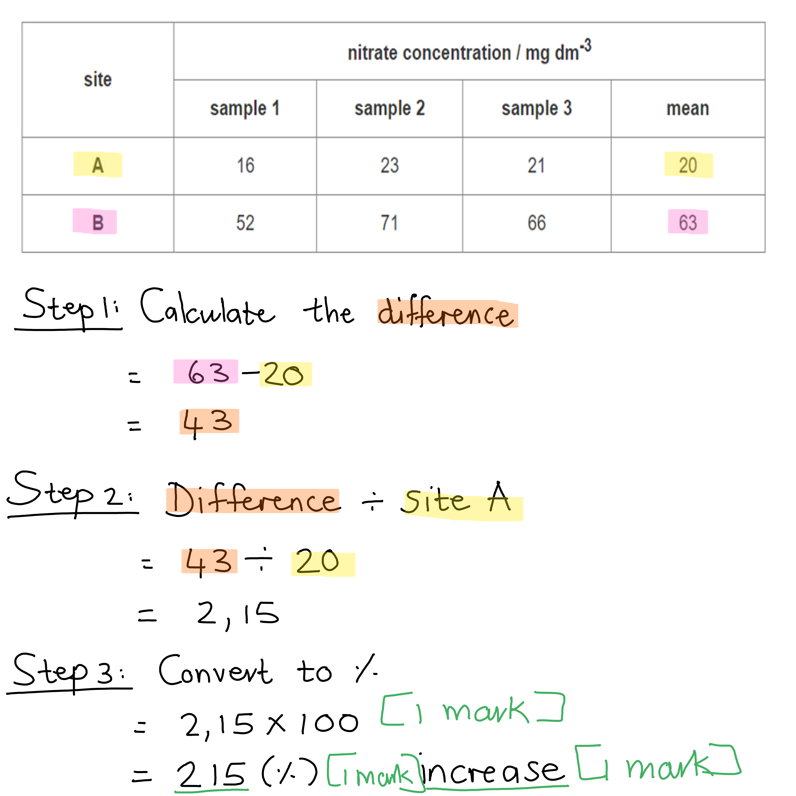

# Mark Schemes — Human Impact: Biodiversity, Pollution & Conservation
**20. Human Influences on Ecosystems** · Cambridge (CIE) IGCSE biology (0610 & 0970)

## Multiple Choice Questions (21 questions)

### Q1
**Final answer:** **The correct answer is ****A.**

- When fertilisers containing **nitrates and other nutrients** enter a lake, they cause an **algal bloom** (rapid growth of algae)
- When many algae die as part of their natural life cycle, **decomposers **break down the dead organic material
- During this process, decomposers carry out **aerobic respiration**, which uses large amounts of **dissolved oxygen** in the water
- This increase in respiration by decomposers causes the **dissolved oxygen concentration to decrease**, which can lead to the **death of aquatic organisms **that require oxygen

**B** is incorrect because increased photosynthesis would produce oxygen, not cause oxygen levels to decrease.

**C** is incorrect because fish feeding does not cause a large decrease in oxygen.

**D **is incorrect because nitrate absorption by plants occurs earlier in the process.

### Q2
**Final answer:** **The correct answer is ****B.**

- Pollution of the air by carbon dioxide and methane contributes to climate change, which is causing ice caps and glaciers to melt and ocean temperatures to rise, both of which lead to rising sea levels.

**A** is incorrect because while carbon dioxide does contribute to climate change, it is not the only factor; methane also plays a significant role.

**C** is incorrect because pollution of the sea by plastics does not directly cause sea level rise; it affects marine ecosystems but does not contribute to rising sea levels.

**D** is incorrect because while pollution by insecticides and nuclear fallout can have harmful effects on the environment, they are not factors that contribute to the rise in sea levels.

### Q3
**Final answer:** **The correct answer is D**

- This is because when producers die the dead organic matter provides nutrition for the decomposers, causing their numbers to increase

**A** is incorrect because a decrease in dissolved oxygen occurs after the decomposers increase in population size

**B **is incorrect because an increase in nitrate concentration causes the population of algae to increase

**C **is incorrect because an increase in the population of algae blocks the light passing through the water leading to the death of producers

### Q4
**Final answer:** **The correct answer is C**

- This is because protecting areas where there are high fish numbers will increase fish stocks that will move out into other areas to be available for fishing

**A** is incorrect because fishing during all seasons will reduce fish stocks due to overfishing

**B **is incorrect because fishing in all areas of the ocean will reduce fish stocks due to overfishing

**D **is incorrect because reducing the mesh size of nets will lead to young fish being caught, which will reduce the ability of the fish populations to recover their number after fishing

### Q5
**Final answer:** **The correct answer is A because:**

Captive breeding programmes help prevent species from becoming endangered

**B** is incorrect because deforestation increases the chance of species becoming endangered.

**C** is incorrect because introduction of other species increases the chance of species becoming endangered.

**D** is incorrect because pollution increases the chance of species becoming endangered.

### Q6
**Final answer:** **The correct answer is D because:**

Monoculture is when all the organisms are the same and so reduced genetic variation is a negative impact

**A** is incorrect because the crops needing harvesting at the same time is a positive for farmers.

**B** is incorrect because monocultures produce the same type of food.

**C** is incorrect because monocultures producing more food is positive.

### Q7
**Final answer:** **The correct answer is ****C**** (1 and 3 only) because:**

Statements 1 and 3 can apply to both marine and terrestrial habitats. Animals on land and in the ocean may mistake plastic pollution for food and try to eat it, while many others may become entangled in discarded plastic packaging. Plastic will release toxins into both marine and terrestrial habitats as it breaks down, much to the detriment of the organisms that live there.

**A** is incorrect because statement 2 will mainly apply to marine environments. While plastic may break down on land, the tiny particles that wash away into rivers will end up doing the most damage in marine habitats.

**B** is incorrect because both statements 2 and 4 will apply to marine habitats. The clue in statement 4 is the mention of mussels, which lives in the ocean.

**D** is incorrect because statement 1 can also apply to both marine and terrestrial habitats.

### Q8
**Final answer:** **The correct answer is ****B**** (as sulfur dioxide levels increase, the number of lichen decreases) because:**

The graph shows that as the levels of sulfur dioxide increase, the number of lichen species decreases.

**A** is incorrect because there **is** a correlation between sulfur dioxide levels and the number of lichens.

**C** is incorrect because some lichens are surviving even at relatively high levels of sulfur dioxide.

**D** is incorrect because sulfur dioxide levels increase and the levels of lichens do not increase.

### Q9
**Final answer:** **The correct answer is ****C**** (carbon dioxide and methane) because:**

The two main gases that cause climate change are **carbon dioxide and methane. **Increasing amounts of carbon dioxide are being released by combustion, with reduced amounts removed by trees for photosynthesis as a result of deforestation. Methane is released by industrial processes as well as farming.

**A** is incorrect because oxygen is not a greenhouse gas.

**B** and **D** are incorrect because sulfur dioxide causes acid rain, this doesn’t contribute to climate change.

### Q10
**Final answer:** **The correct answer is ****C**** (4 → 1 → 2 → 3) because:**

- The first step in eutrophication is the blocking of the light to producers from the algae
- This will cause the producers to die and as a result decomposer numbers will increase, increasing the rate of aerobic respiration occurring in the water
- The reduced level of oxygen as a result of increased aerobic respiration will cause other organisms to die

Nitrates will encourage rapid and dense growth of algae already present in the water, only answers **C** and **D** could possibly be correct as these are the only answers that start with the death of the producers due to the lack of light.

### Q11
**Final answer:** **The correct answer is ****D**** (increased mutation rate) because:**

The increased levels of ionising radiation after a nuclear fall-out will increase the number of mutations in DNA.

**A** is incorrect because nuclear fallout will not cause acid rain. Acid rain is caused by the release of sulfur dioxide into the atmosphere.

**B** is incorrect because nuclear fallout may kill trees long term due to ionising radiation in the area but this is due to the increase in mutations.

**C** is incorrect because nuclear fallout will not increase the number of greenhouse gases directly.

### Q12
**Final answer:** **The correct answer is ****B**** (sludge worm) because:**

The sludge worm is the animal that lives closest to the outlet of the factory emptying pollutants into the stream.

All the other organisms are only present when the levels of pollution have decreased as they have moved away from the factory.

In questions like this, you may not have heard of the organisms being shown, you are not expected to know about them. Here you are applying your knowledge to a novel context about a range of organisms.

### Q13
**Final answer:** **The correct answer is ****A**** (to obtain drugs for medicinal use) because:**

The biodiversity of plants enables us to find new species of plants that can offer us medicinal products or uses.

**B** is incorrect because plants will reduce flooding as they will take up water, but they will not reduce rainfall.

**C** is incorrect because plants release oxygen through photosynthesis.

**D** is incorrect because plants use carbon dioxide in photosynthesis.

### Q14
**Final answer:** **The correct answer is ****A ****because:**

The levels of mineral ions increased sharply after A and the dissolved oxygen levels decreased rapidly.

The levels of mineral ions at** B** are still increasing to the maximum levels at **C**, this will be the impact of the sewage entering the river at **A**, levels start to lower between **C** and **D** as they are diluted and get increasingly lower further downstream. The reverse is happening to the levels of oxygen showing the effects of eutrophication on the river closest to the source of the pollution.

### Q15
**Final answer:** **The correct answer is ****B**** (an increase in biodiversity) because:**

Deforestation destroys habitats, and reduced habitats will likely result in the loss of species and therefore biodiversity.

**A** is incorrect because deforestation is likely to increase flooding as there are fewer plants to take up water from the soil, leaving the soil more saturated when it rains.

**C** is incorrect because trees provide structure to the soil (through their extensive root network) preventing soil erosion.

**D** is incorrect because trees take up carbon dioxide from the atmosphere for photosynthesis; the fewer trees there are the less carbon dioxide removed therefore the level in the atmosphere increases.

### Q16
**Final answer:** **The correct answer is ****C**** (insecticides enter the food chain) because:**

The levels of insecticides will increase up the food chain. This is known as bioaccumulation.

**A** is incorrect because insecticides do not kill plants, they kill insects.

**B** is incorrect because insecticides will not cause acid rain.

**D** is incorrect because insecticides will not add nitrates to the soil.

### Q17
**Final answer:** **The correct answer is ****C ****because:**

A non-selective herbicide will likely kill **all **plants; both aquatic plants in the stream and weeds in the field. Even selective herbicides that only target unwanted plants like weeds can harm all plants when their concentration is high enough.

Herbicides kill plants so any answer that refers to more growth will not be correct.

Be careful – don’t confuse this with eutrophication, herbicides will kill plants not increase growth; that is the role of fertilisers.

### Q18
**Final answer:** **The correct answer is ****B**** (2 and 3 only) because:**

Artificial insemination is a technique whereby the genetic material carried by the gametes combine and is therefore used to maintain or increase the genetic variation within a species, which makes statement 2 false. In vitro fertilisation involves the fusion of gametes outside the body (usually in a petri dish), so statement 3 is not correct.

**A**, **C** and **D** are all incorrect because statements 1 and 4 are **true **regarding conservation techniques.

### Q19
**Final answer:** **The correct answer is ****C**** (the genetic variation of organisms is reduced) because:**

- Monocultures are made up of one organism – ‘**mono’** meaning **one**
- This would be a negative feature because if the organisms within a population are genetically identical, there is no genetic variation within the population which means  every individual could be affected by changing environmental conditions or disease

**A** is incorrect because this is not a negative impact, monocultures do produce a larger yield.

**B** is incorrect because monoculture crops usually produce larger yields and therefore more food.

**D** is incorrect because all crops, regardless if they are monocultures or not, will need to be harvested at the same time. The benefit of monocultures is that they usually grow at the same rate so are ready to be harvested at the same time which is an advantage.

### Q20
**Final answer:** **The correct answer is ****D**** (a resource that can be replenished as quickly as it is used) because:**

A sustainable resource is a resource that can be replaced (almost) as quickly as it is used. This means that it will not run out. An example of this would be planting a tree to replace one that is chopped down.

**A** is incorrect because this statement only refers to resource replacement and not that it can be replaced as quickly as it is used.

**B** is incorrect because this statement only refers to resources, and does not take into account the needs of the future populations.

**C** is incorrect because sustainability is about protecting both the environment and resources for now and the future.

### Q21
**Final answer:** **The correct answer is ****B**** (adding fertilisers to the soil) because:**

Adding fertilisers to the soil increases the risk of the eutrophication of local water sources. It will also result in an increase in the number of weeds that can grow, increasing the need for the use of other chemicals such as herbicides.

**A** is incorrect because cutting down trees will reduce the amount of carbon dioxide removed. The crops grown in its place will use carbon dioxide.

**C** is incorrect because digging the plant matter into the soil provides structure and nutrients for the soil so will not pollute the environment.

**D** is incorrect because growing high yield crops will not pollute the environment.

## Theory Questions (22 questions)

### Q1
> **[mark-scheme]**
> - A = nitrogen fixation **[1 mark]**
> - B = decomposition ** [1 mark]**
> - C = nitrification **[1 mark]**
> 
> Accept ammonification for B

> **[exam-tip]**
> Students often confuse nitrification with nitrogen fixation; remember that:
> 
> - **fixation** is removing nitrogen from the air
> - **nitrification** is converting ammonia into nitrates
> **[mark-scheme]**
> - Between day 5 and day 30 **[1 mark]**
> - Because oxygen concentration is falling **[1 mark]**

> **[exam-tip]**
> The question asked you to "explain" your answer so you need to link the decrease in the dissolved oxygen concentration to the respiration of the decomposers.
> **[mark-scheme]**
> Any **six** from:
> 
> - Nitrate/mineral ions enter the lake / there is increased availability of nitrate/mineral ions **[1 mark]**
> - Increased growth of algae / plants / producers **[1 mark]**
> - Producers at the surface block light **[1 mark]**
> - Plants below cannot photosynthesise / die **[1 mark]**
> - Increased decomposition of (dead) producers **[1 mark]**
> - Increased aerobic respiration of decomposers **[1 mark]**
> - Dissolved oxygen is used by decomposers / respiration **[1 mark]**
> 
> Award two marks for "increased aerobic respiration of decomposers uses up dissolved oxygen".

> **[exam-tip]**
> Eutrophication questions follow a strict sequence and you must tell the story in order. Missing any step in the chain will cost you marks.
> 
> Here you should end with decomposers using oxygen for aerobic respiration, as this directly answers the question on oxygen concentration.

### Q2
> **[mark-scheme]**
> Description of trend (maximum 2)
> 
> - Bird population decreases
> - Population changes from 5000 to (around) 200
> - The population decrease is consistent / steady / occurs at the same rate throughout the period
> 
> Suggested explanation (maximum 2)
> 
> - Loss of habitat
> - Loss of nesting sites / breeding sites
> - Loss of food sources / disruption to food chain
> - Increased vulnerability to predators (due to loss of shelter)
> 
> **[3 marks]**
> 
> Award a maximum of two marks for description and a maximum of two marks for explanation, but no more than three marks in total across both sections.

> **[exam-tip]**
> Always quote both values from the graph when describing the trend — "decreased from 5000 to 200".
> 
> Never just say "they die" — link it to a specific biological reason like loss of food or shelter.
> **[mark-scheme]**
> Any **four** from:
> 
> - Reduced local biodiversity
> - Increases the risk of a single disease / pest destroying the entire crop
> - Depletes soil nutrients (as the same minerals are extracted year after year by the same crop)
> - Increases dependency on chemical pesticides / herbicides / fertilisers
> - Reduced pollinator diversity / numbers  **OR** pesticide use harms pollinators
> 
> **[4 marks]**

> **[exam-tip]**
> Make sure your answers are specifically about the disadvantages of monoculture rather than deforestation in general — points such as soil erosion or loss of tree cover will not be credited here.
> **[mark-scheme]**
> (i) Sewage will affect the bacterial population in the river as follows:
> 
> - Sewage provides nutrients / a food source (for bacteria) **[1 mark]**
> - Causing the bacterial population to increase rapidly **[1 mark]**
> 
> (ii) This leads to:
> 
> Any **two** from:
> 
> - Habitat destruction / damage
> - Pathogenic microorganisms enter river
> - Toxic chemicals enter river
> - Fish / aquatic organisms die **OR** decreased biodiversity
> - Food chains / food webs are disrupted
> 
> **[2 marks]**
> 
> Accept 2-mark descriptions of eutrophication, e.g. increased bacterial respiration reduces dissolved oxygen [1] and death of fish/aquatic organisms [1]

### Q3
Any three from:

- Production of greenhouse gases / methane / carbon dioxide;** [1 mark]**
- Spread of disease / parasites; **[1 mark]**
- References to animal welfare e.g. crowded / stressful living conditions for animals;** [1 mark]**
- References to pollution e.g. water pollution / eutrophication (from runoff of excess nutrients / animal waste); **[1 mark]**
- (Over) use of antibiotics / reference to antibiotic resistance (caused by overuse of antibiotics); **[1 mark]**

*Accept any other valid suggestions, e.g. food safety risks due to spread of disease;*** [1 mark]**

**[Total: 3 marks]**

### Q4
| example of technology | description of how it has improved food production |
|---|---|
| Agricultural machinery; **[1 mark]** | used to farm larger areas of land |
| Fertiliser; **[1 mark]** | used to improve growth in plants by providing nutrients |
| Insecticide; **[1 mark]** | used to improve yield by removing animal pests |
| Herbicide; **[1 mark]** | used to remove competition by weeds |

**[Total: 4 marks]**
| **B** | **E** | A | **C** | **D** |
|---|---|---|---|---|

*Award [1 mark] for 2 correctly ordered letters*

**[Total: 2 marks]**
Any two from:

- Disease (kills off animals in the population); **[1 mark]**
- Reduced reproduction **OR** fewer animals breed **OR **fewer animals are born; **[1 mark]**
- (More animals are killed due to) predation / hunting / poaching; **[1 mark]**
- Climate change / drought / floods / extreme weather / temperature change / natural disasters / war; **[1 mark] **
- Loss of habitat / deforestation;** [1 mark]**
- Pollution; **[1 mark]**

**[Total marks: 2]**

### Q5
Any four from:

- Quantity of plastic waste always higher **inside** GPGP than outside it (or opposite answer e.g. quantity of plastic waste lower outside GPGP); **[1 mark]**
- Quantity of plastic waste inside GPGP remains constant from 1965 to *any year 1975 to 1994*; **[1 mark]**
- Quantity of plastic waste increases in GPGP steeply; **[1 mark]**
- Smaller (overall) increase **outside **the GPGP (or opposite answer); **[1 mark]**
- Quantity of plastic waste outside the GPGP fluctuates;**[1 mark]**
- Comparative data quote with years and unit (e.g. quantity of waste inside the GPGP increases from 0.4 kg per km2 of ocean surface in 1984 to 1.22 kg per km2 of ocean surface in 2015);** [1 mark]**

**[Total: 4 marks]**
(i)

Any one from:

- Leathery / hard / scaly skin; **[1 mark]**
- Hard(er) / rubbery / leathery eggs; **[1 mark]**
- Lay eggs on land (not in water); **[1 mark]**
- Internal fertilisation; **[1 mark]**

(ii)

Any four from:

***Direct effects ***

- (Non-biodegradable plastic) does not break down;**[1 mark]**
- Idea that ability to breathe affected; **[1 mark]**
- Idea that ability to move affected; **[1 mark]**
- Idea that ability to gain nutrition affected; **[1 mark]**
- Damage / injury / infection / death; **[1 mark]**
- Toxic / poisonous; **[1 mark]**

***Indirect effects ***

- Blocks (sun)light, so algae / plants / producers, cannot photosynthesise;**[1 mark]**
- (So) less, food / energy, enters, food chains / food webs; **[1 mark]**
- Loss of (named), habitat / feeding / breeding area;**[1 mark]**
- More likely to be predated; **[1 mark]**
- Idea that (plastic) accumulates up the food chain / bioaccumulation; **[1 mark]**

There is flexibility here to gain extra marks for other valid answers that are not specifically named on the mark scheme.

(iii)

Any two from:

- Use (named) alternatives for plastic e.g. cardboard;**[1 mark]**
- Reduce use of single-use plastic; **[1 mark]**
- Use biodegradable plastics instead of non-biodegradable plastics; **[1 mark]**
- Reduce unnecessary packaging; **[1 mark]**
- Reuse plastic product(s); **[1 mark]**
- Recycle / described; **[1 mark]**
- Education / awareness campaigns;**[1 mark]**
- The idea of fines / punishment for unregulated disposal of plastic waste; **[1 mark]**
- Legislation;**[1 mark]**
- Taxation / charging for using plastic;**[1 mark]**
- Money-back schemes; **[1 mark]**
- Quotas or limits for production; **[1 mark]**
- International treaties; **[1 mark]**

There is flexibility here to gain extra marks for other valid answers that are not specifically named on the mark scheme.

**[Total: 7 marks]**

### Q6
- Widdringtonia;** [1 mark]**
Any three from:

- Lack of roots to absorb water / hold soil together; **[1 mark]**
- No canopy / vegetation cover to protect soil from rainfall; **[1 mark]**
- Increase in runoff; **[1 mark]**
- Soil erosion / soil is washed away; **[1 mark]**
- Loss of minerals/ions/nutrients from the soil; **[1 mark]**
- Flooding; **[1 mark]**
- Landslides / mudslides; **[1 mark]**
- Visual pollution / visually unattractive dead tree stumps / bare ground; **[1 mark]**
- Loss of biodiversity / disruption of food chains / disruption of food webs / (species) extinction; **[1 mark]**
- Food source;**[1 mark]**
- Nesting/breeding, sites; **[1 mark]**
- Shelter / shade / protection from predators; **[1 mark]**
- Leaf litter for decomposers; **[1 mark]**
- Maintaining nutrient cycling;**[1 mark]**
- Source of fruit / timber / medicines / resources for humans; **[1 mark]**
Any two from:

- To preserve genetic diversity/variation;**[1 mark]**
- Plants may be adapted for different environments;**[1 mark]**
- Plants may be resistant to diseases / pests; **[1 mark]**]
- Some of the seeds collected may not be viable / germinate;**[1 mark]**
- Some of the seeds may have an infection / have parasites; **[1 mark]**
- Some of the seeds may have harmful alleles / mutations; **[1 mark]**

### Q7
Any five from:

- Protein is broken down/digested/decomposed to produce amino acids; [1 mark]
- Protein / manure is broken down by decomposers/fungi/bacteria; [1 mark]
- Protein is broken down by proteases/protease enzymes; [1 mark]
- Deamination occurs / nitrogen-containing parts of amino acids are removed; [1 mark]
- (Deamination produces) ammonia/ammonium ions/NH3/NH4+; [1 mark]
- Ammonium (ions) are converted to nitrites/nitrates/NO3-/NO2-; [1 mark]
- The process is known as nitrification / is carried out by nitrifying bacteria; [1 mark]
- Accept other relevant points, e.g. nitrites are converted to nitrates; [1 mark]
(i)

Any one from:

- Farmers do not have to add fertiliser / can use less fertiliser; **[1 mark]**
- An increased yield / more profit per hectare; **[1 mark]**
- Crops grow faster/better; **[1 mark]**

(ii)

- Values read correctly from graph = 156 **AND** 96; **[1 mark]**
- $\frac{(156-96)}{156}\times100$ **OR** 62.5 (%); **[1 mark]**
- 63 (%); **[1 mark]**

*Award full marks for correct answer in the absence of other calculations.*

(iii)

Any four from:

- Manure is broken down/decomposes;**[1 mark]**
- There is an increase in ions / nitrogen ions (in streams/rivers);**[1 mark]**
- Plants/producers/algae grow (in response to ions);**[1 mark]**
- There is increased competition for light / light is blocked due to algae at the surface of the water; **[1 mark]**
- A reduction in / lack of photosynthesis causes death of producers/plants/algae;**[1 mark]**
- There is an increase in bacteria / decomposers; **[1 mark]**
- Respiration (by decomposers) reduces oxygen levels;**[1 mark]**

### Q8
Any **five** from:

- Captive breeding programme; **[1 mark]**
- In zoos / reserves;** [1 mark]**
- Artificial insemination / IVF; **[1 mark]**
- To build up numbers / release back to the wild; **[1 mark]**
- Seed banks; **[1 mark]**
- In botanic gardens / other named e.g. Svalbard; **[1 mark]**
- Store seeds for long periods; **[1 mark]**
- Education / awareness; **[1 mark]**
- Legislation;** [1 mark]**
- To protect / restore habitats; **[1 mark]**
- To reduce / prevent pollution; **[1 mark]**
- To restrict / prevent introduced species; **[1 mark]**
- To restrict / prevent hunting / fishing; **[1 mark]**
- Monitoring populations; **[1 mark]**
- To detect decreases or increases / determine quotas;** [1 mark]**

**[Total: 5 marks]**

> *You can also get a mark for any other correct answer, for example the use of protected areas like national parks, nature reserves or marine parks.*

### Q9
- Methane; **[1 mark]**

You can gain a mark for any other correct answer such as water vapour, nitrous oxide, CFCs or ozone. This does not include carbon dioxide because it is stated in the question.

**[Total: 1 mark]**
Any three from:

- Habitat destruction; **[1 mark]**
- Loss of biodiversity; **[1 mark]**
- Extinction; **[1 mark]**
- Soil erosion; **[1 mark]**
- Flooding; **[1 mark]**

You can also get the mark for any other valid answer, such as landslides / leaching / disruption to food chains or webs or loss of food source / desertification / reduction in rainfall.

**[Total: 3 marks]**

### Q10
Ways that endangered plant and animal species can be conserved include...

Any **five** of the following:

- Captive breeding programmes; **[1 mark]**
- Breeding is carried out in zoos / reserves; **[1 mark]**
- Breeding success can be increased by the use of artificial insemination / IVF; **[1 mark]**
- Breeding helps to build up species numbers / could enable release back into the wild; **[1 mark]**
- Seed banks for plants; **[1 mark]**
- Banks can be set up in botanic gardens; **[1 mark]**
- Banks allow seeds to be stored for long periods of time; **[1 mark]**
- Educating people/the public / raising awareness; **[1 mark]**
- Introducing legislation / laws; **[1 mark]**
- Laws can protect/restore habitats; **[1 mark]**
- Laws can reduce/prevent pollution; **[1 mark]**
- Laws can restrict/prevent problems caused by introduced/alien species; **[1 mark]**
- Laws can restrict/ prevent hunting/fishing; **[1 mark]**
- Monitoring populations;** [1 mark]**
- Monitoring enables detection of decrease/increase in population size **OR** helps to determine (hunting/fishing) quotas; **[1 mark]**

***Accept*** the following:

- *Correctly named alternative location for seed banks.*
- *Protected areas / named example of a protected area, e.g. nature reserve / national park / marine reserve.*

**[Total: 5 marks]**

### Q11
The negative impacts to an ecosystem of intensive livestock production are:

Any **four **from the following:

- Habitat loss / deforestation; **[1 mark]**
- Loss of biodiversity / extinction (of species); **[1 mark]**
- Death of (wild) organisms / disruption of food web; **[1 mark]**
- Enhanced greenhouse effect / global warming; **[1 mark]**
- More carbon dioxide / methane; **[1 mark]**
- Pollution from urine / faeces; **[1 mark]**
- Pollution from farm machinery; **[1 mark]**
- Disease spreads (to wild populations); **[1 mark]**
- Ref. to antibiotic resistance / inappropriate use of antibiotics; **[1 mark]**

*Allow references to reductions in animal welfare. *

**[Total: 4 marks]**

> *The most common error in this question is to describe the effects of intensive **arable **farming, when the question only requires you to focus on intensive **livestock** farming. Careful reading of the question will avert this error. *
Fertilisers, herbicides and insecticides are used in farming because:

- **Fertilisers**: increase productivity / increase yield / addition of (named) nutrients to the soil / nutrients to the plant / increase soil fertility; **[1 mark]**
- **Herbicides: **kill/remove/prevent unwanted plants or weeds / reduces competition (with weeds) / increases yield; **[1 mark]**
- **Insecticides: **kill/remove/prevent insects/pests (feeding on the crop) / increases yield; **[1 mark]**

**[Total: 3 marks]**

> *Be aware that herbicides kills plants, not herbivores!*
Other sources of water pollution are:

Any **two **from the following:

- (Named) factory waste / chemicals; **[1 mark]**
- Pesticides; **[1 mark]**
- Acid rain; **[1 mark]**
- Oil / petrol; **[1 mark]**
- (Named) rubbish / litter /AW; **[1 mark]**
- (Named component of) sewage; **[1 mark]**
- Nuclear waste; **[1 mark]**

**[Total: 2 marks]**

> *Because fertilisers and insecticides are mentioned in the question, make sure you restrict your answer to other forms of  water pollution. *

### Q12
The use of each chemical is:

| chemical | use of chemical |
|---|---|
| antibiotic | **Final answer:** **To kill or stop the growth of bacteria** |
| fertiliser | **Final answer:** **To increase crop yields / to add nutrients to the soil / to make plants grow** |
| herbicide | **Final answer:** **To kill weeds (in the fields of crops) / to reduce competition with weeds / to increase crop yields ** |
| insecticide | **Final answer:** **To kill insects / to increase crop yields / to improve the quality of yields** |
| pectinase | **Final answer:** **Used in fruit juice production** |

**[1 mark]** *for each correct row.*

**[Total: 5 marks]**

> *A common misconception is to think that herbicides must kill "herbs" rather than plants considered as weeds. *

### Q13
The total area of land lost to deforestation in Ecuador from the beginning of 2014 to the end of 2019 is...

- (6.5 + 8.5 + 13 + 21 + 13.5 + 12.5) x 1000 = 75 000 hectares; **[1 mark]**

**[Total: 1 mark]**

The possible reasons for the change in the area of forest lost per year between 2014 and 2017 are:

| The local people stop growing maize |   |
|---|---|
| Less new house-building is needed for the population |   |
| The local people decided to farm sheep and goats | **✔** |
| More trees have been planted |   |
| A company starts growing sugar cane for the production of biofuel | **✔** |

**[1 mark] ***for each correct row*

**[Total: 2 marks]**
Two explanations for the reductions in loss of forest land in Ecuador in the years 2018 and 2019 are:

Any** two** from the following:

- Population did not increase / stabilised / decreased; **[1 mark]**
- Conservation measures (beginning to take effect) / government intervention to reduce habitat destruction; **[1 mark]**
- Lack of suitable forest to cut further; **[1 mark]**
- Less deforestation being declared/reported than reality / misreporting of data / corruption / grey market; **[1 mark]**

**[Total: 2 marks]**
Conservationists looking at the data in Fig. 1 would not be fully satisfied with the 2018 - 2019 trend shown in the data because:

- There is still deforestation taking place (albeit at a slower pace); **[1 mark]**
- Causing further loss of biodiversity / habitats; **[1 mark]**

**[Total: 2 marks]**

### Q14
(i) The letters that represent respiration are:

- **K**; **[1 mark]**
- **M**; **[1 mark]**

(ii) The process that the letter J represents is:

- Combustion; **[1 mark]**

(iii) The arrow that represents the process of feeding is:

**[Total: 4 marks]**
Another type of greenhouse gas is:

Any **one **from the following:

- Methane; **[1 mark]**
- Water vapour; **[1 mark]**
- Nitrous oxides; **[1 mark]**
- CFCs; **[1 mark]**
- Ozone; **[1 mark]**

**[Total: 1 mark]**
(i) Two other undesirable effects of deforestation are:

Any **two **from the following:

- Habitat destruction; **[1 mark]**
- Extinction; **[1 mark]**
- Soil erosion; **[1 mark]**
- Flooding; **[1 mark]**
- Landslides; **[1 mark]**
- Leaching; **[1 mark]**
- Disruption to food chains or webs or loss of food source; **[1 mark]**
- Desertification; **[1 mark]**

(ii) Two uses for the land that has been cleared of trees is:

Any **two **from the following:

- Agriculture;** [1 mark]**
- Mining / extraction, of resources;** [1 mark]**
- Building, houses / factories / industries;** [1 mark]**
- Building, transport links / roads;** [1 mark]**
- Paper production;** [1 mark]**

**[Total: 4 marks]**
(i) The average area of forest removed per year from 2006 to 2010 is:

- 53 312 ÷ 5; **[1 mark]**
- 10 662.4; **[1 mark]**

*Full marks awarded for the correct answer in the absence of other calculations*

(ii) The trend shown in the data is:

- Deforestation is decreasing / less areas of forest are being removed; **[1 mark]**

(iii) Two reasons for the trend are:

- Education / awareness; **[1 mark]**
- Protecting areas / national parks; **[1 mark]**
- Legislation; **[1 mark]**
- Alternative sources of energy used / resources; **[1 mark]**

**[Total: 5 marks]**

### Q15
Four sources of water pollution other than raw sewage are:

Any **four **from the following:

- Insecticides/pesticides; **[1 mark]**
- Herbicides; **[1 mark]**
- Nuclear/radioactive waste; **[1 mark]**
- Chemicals / toxic waste / (named) heavy metals; **[1 mark]**
- Discarded household rubbish/litter/garbage/trash; **[1 mark]**
- Plastics; **[1 mark]**
- Fertiliser (from farmland); **[1 mark]**
- Oil/fuel/fossil fuel; **[1 mark]**

**[Total: 4 marks]**
A pathogen is:

- An organism/agent that causes disease; **[1 mark]**

**[Total: 1 mark]**

### Q16
Biodiversity can be defined as...

- The number of different <u>species</u>; **[1 mark]**
- That live in a particular area; **[1 mark]**

**[Total: 2 marks]**

> *You must be very specific in your answer, it is not the number of organisms in an area but the number of species! An area may contain many different organisms (such as a lawn for example) but if they all belong to the same species, then that area has very low biodiversity.*
The effects of deforestation on biodiversity can be described as follows...

Any **two** of the following:

- Many species will lose their habitat (which will cause them to leave the area); **[1 mark]**
- This will lead to a decrease in biodiversity (in that area); **[1 mark]**
- Species which only occur in that area will become extinct; **[1 mark]**

**[Total: 2 marks]**

> *Your answer here needs to focus on the impacts of deforestation on biodiversity and not the impacts of deforestation generally; be sure to read the questions carefully. *
The ecological importance of maintaining biodiversity in an area is...

- High biodiversity is needed for stable ecosystems **OR** to ensure that ecosystems are more resilient to change; **[1 mark]**

**[Total: 1 mark]**

> *You can think of species as representing the bricks in a wall (which represents an entire ecosystem); when all the bricks are present, the wall is stable. If some of the bricks are removed from the wall (such as what happens when species are lost from an area) you'll soon have a weakened wall that will eventually cave in on itself.*
Examples of the sustainable management of forests include...

Any **four** of the following:

- Guiding and monitoring tourists visiting the forests; **[1 mark]**
- Protection of young trees / saplings (against logging); **[1 mark]**
- Cutting down old trees only; **[1 mark]**
- Replacing cut trees by planting new ones (of the same species); **[1 mark]**
- Monitoring and supervising logging companies (to ensure they follow sustainable practices); **[1 mark]**
- Tracking wood produced from forests (to ensure it was sustainably harvested); **[1 mark]**
- Educating logging companies and consumers on sustainable practices; **[1 mark]**

**[Total: 4 marks]**

> *Sustainable management of forests ensures that the needs of the human population is met without destroying the forest ecosystem. In this way, the forests are maintained for future generations to enjoy.*

### Q17
The total percentage of energy that came from fossil fuels can be calculated as follows:

- 23 + 8 + 41 = 72 (%); **[1 mark]**

**[Total: 1 mark]**

> *The question stem tells you that coal, natural gas and oil are fossil fuels. Therefore  you will need to add the percentages of these energy sources together:*

Fossil fuels are not sustainable resources because:

Any **one **from the following:

- (Fossil fuels) cannot be replaced when they run out / there is a finite/limited supply (of fossil fuels); **[1 mark]**
- They take millions of years to form; **[1 mark]**
- (They are) used up faster than they build up; **[1 mark]**

**[Total: 1 mark]**
(i) Two other processes, other than combustion of fossil fuels, that will release carbon dioxide are:

- (Cellular) respiration; **[1 mark]**
- Decomposition / decay (of organic matter); **[1 mark]**

(ii) A process that removes carbon dioxide from the atmosphere:

Any **one** of the following:

- Photosynthesis; **[1 mark]**
- Fossilisation; **[1 mark]**
- Carbon capture (technology); **[1 mark]**

**[Total: 3 marks]**

> *For this question, you would need to refer to the carbon cycle (Topic 19.1.5) and familiarise yourself with the processes that add and remove carbon dioxide from the atmosphere.*
The environmental effects of increasing carbon dioxide concentration in the atmosphere includes:

Any **two **from the following:

- (It would lead to the) <u>enhanced</u> greenhouse effect; **[1 mark]**
- (Which would result in) global warming / climate change / a(n) rise/increase in temperatures; **[1 mark]**
- A named effect of global warming e.g. rising sea levels / species extinction / loss of biodiversity / soil erosion / flooding / desertification / loss of habitats; **[1 mark]**

**[Total: 2 marks]**

> *To obtain the first mark, you need to be specific in stating that it is the **enhanced** greenhouse effect which is the result of an increase in carbon dioxide levels. The greenhouse effect under normal conditions is necessary to keep temperatures suitable to support life on Earth.*
Modern technology has increased the production of crop plants in the following ways:

Any **three **from the following:

- *Fertiliser*: increase productivity / (crop) yield **OR** adds (named) nutrients to the soil / plant / increases soil fertility; **[1 mark]**
- *Herbicide*: kills/removes/prevents unwanted plants/weeds **OR** reduces competition (with weeds) **OR** increases (crop) yield; **[1 mark]**
- *Insecticide*: kills/removes/prevents insects/pests (from feeding on the crops) **OR** increases (crop) yield; **[1 mark]**
- *Agricultural machinery / techniques*: Irrigation / hydroponics / monoculture / greenhouse / polytunnel leads to less manpower **OR** enables easier harvesting (of crops); **[1 mark]**
- *Selective breeding* / *Artificial insemination*: increases the desirable features (within crop species) e.g. more grains in wheat / disease resistance / drought resistance; **[1 mark]**
- *GMO*: a named example e.g. frost/pest resistant organisms / golden rice / soya beans / flavr savr tomatoes; **[1 mark]**

*The name of the technology as well as a description on how it increases crop production must be included at each marking point.*

**[Total: 3 marks]**

> *The technologies mentioned above has enabled farmers to produce more food than what would have been possible without them. This is important in order to feed the growing human population.*

### Q18
The mean increase in palm oil production per year for the three year period 2014 to 2017 is calculated as:

- Difference = (1 625 - 1 100) = 525 (000 metric tonnes); **[1 mark]**
- Mean increase = 525 ÷ 3 = 175 (000 metric tonnes);** [1 mark]**

*Full marks awarded for the correct answer in the absence of other calculations*

**[Total: 2 marks]**

> *The most common error in the question of this kind is to add up palm oil production for all 3 years and divide by 3, giving a value for mean production rather than mean increase. Avoid another common error, which is to subtract the value for 2014 from that for 2017 but then not to divide by 3. Take care to read the graph accurately, in particularly the axes.*
The replacement of forests with oil palm plantations to produce biofuels will change the composition of the atmosphere as follows:

**Effects of deforestation**

- Deforestation increases/raises the amount of carbon dioxide in the atmosphere; **[1 mark]**

*Award this point only if linked to deforestation*

Plus **two** from:

- Due to less photosynthesis or less carbon dioxide taken in or carbon dioxide not locked up in (forest) trees; **[1 mark]**
- Due to burning of forest / from machinery; **[1 mark]**
- Due to activity of microorganisms / decay; **[1 mark]**

**Effects of growing oil palm for biofuels**

- Carbon dioxide released when palm oil used as fuel; **[1 mark]**
- (Eventually) CO2 intake and output might balance out or burning palm oil carbon neutral; **[1 mark]**

*Accept less carbon dioxide than from burning fossil fuels*

**[Total: 5 marks]**
Even when demand for palm oil is low, the benefit to the palm oil manufacturers in cutting down the native forest is...

- Economic / financial from logging / selling wood/timber/native trees; **[1 mark]**

**[Total: 1 mark]**
Disadvantages of monoculture farming includes...

Any **three** of the following:

- It decreases the biodiversity of an area as many species are replaced by only one species; **[1 mark]**
- There may be an increase in pest populations as crops provide an abundance of food for pests; **[1 mark]**
- More insecticides are used to control pest populations; **[1 mark]**
- Which leads to harmless insects being killed / pesticide pollution / bioaccumulation / pests developing resistance against insecticides; **[1 mark]**

**[Total: 3 marks]**

> *Monocultures may increase the amount of food produced for a growing population, but it leads to multiple ecological problems in the process.*

### Q19
(i) Chimpanzee population has decreased because:

Any **two **from the following:

- Habitat loss / deforestation; **[1 mark]**
- Competition from humans / *(accept description of this here); ***[1 mark]**
- Hunting; **[1 mark]**

*Accept other valid points/ideas such as pollution, disease*; **[1 mark]**

(ii) A captive breeding programme can help conserve chimpanzees in the wild because:

- It increases the numbers (of chimpanzees because there would be more offspring and less infant death); **[1 mark]**
- They can later be reintroduced to the wild*; ***[1 mark]**

(iii) Two other methods of conserving chimpanzee numbers are:

Any **two **from the following:

- Monitoring / protecting habitats (from deforestation for example); **[1 mark]**
- Monitoring / protecting species (from hunting for example); **[1 mark]**
- Education (on the importance of conservation); **[1 mark]**
- Seed banks (to preserve their habitats); **[1 mark]**

**[Total: 6 marks]**

### Q20
The percentage difference in nitrate concentration between site **A** and **B** can be calculated as follows...

- (43 ÷ 20) x 100; **[1 mark]**
- 215 (%); **[1 mark]**
- Increase (from site **A** to site **B**); **[1 mark]**

**[Total: 3 marks]**

An explanation for the presence of algae and dead fish at site **B** would include...

Any **four** of the following:

- Nitrates leaked/leached into the river (between site **A** and **B**) **OR **the water at site **B** had a high mean nitrate concentration; **[1 mark]**
- This would cause <u>eutrophication</u>; **[1 mark]**
- Increased growth of algae / algal bloom blocks sunlight to aquatic plants / no photosynthesis can occur; **[1 mark]**
- (As algae and plants die) they are decomposed by microorganisms; **[1 mark]**
- Microorganisms use oxygen during (aerobic) respiration; **[1 mark]**
- This leads to oxygen depletion / less oxygen available in the water (for aquatic life); **[1 mark]**

**[Total: 4 marks]**

> *The presence of algae indicates that eutrophication occurred in the water. The nitrates from the run-off coming from the fertiliser factory leads to an abundance of nutrients that enables an algal bloom which results in the events that depletes oxygen levels in the river.*
The importance of using chemical fertiliser in modern farming practices includes...

- (They) increase soil nutrients (for crop plants); **[1 mark]**
- They can grow larger / produce more fruit / increase crop yield; **[1 mark]**
- This provides more food (for a growing population) **OR** increase profits made by farmer; **[1 mark]**

**[Total: 3 marks]**
High levels of cadmium will carry the following risks...

- Cadmium / heavy metals do not break down / they persist in the environment; **[1 mark]**
- They build up / accumulate in the bodies of organisms in food chains / bioaccumulation in food chains occur; **[1 mark]**
- Top carnivores / organisms at the top of the food chains are poisoned (due to accumulation of cadmium in their bodies); **[1 mark]**

**[Total: 3 marks]**

### Q21
(i) The name of the type of habitat destruction shown in Fig. 1 is...

- Deforestation; **[1 mark]**

(ii) The undesirable effects of habitat destruction include...

Any **three** of the following:

- Extinction / species becoming endangered / biodiversity loss; **[1 mark]**
- Soil loss/erosion; **[1 mark]**
- Flooding; **[1 mark]**
- Increased (atmospheric) carbon dioxide concentration; **[1 mark]**
- Loss of breeding sites / hunting sites / food / shelter **OR** animals migrate/leave (to find more suitable breeding sites etc.); **[1 mark]**
- Disruption to the food chain; **[1 mark]**

*Accept other correct negative effects of habitat destruction.*

**[Total: 4 marks]**

> *Note that part (ii) here asks for the **effects** of habitat destruction, i.e. the resulting damage; be careful not to mix up **cause** and **effect** by describing the causes of habitat destruction.*
Human activities, other than cutting down large areas of trees, that can cause habitat destruction include...

Any **three **of the following:

- Crop production / growing crops (for which land needs to be cleared); **[1 mark]**
- Keeping livestock / livestock production (which again requires the clearance of land); **[1 mark]**
- Extraction of natural resources / fossil fuels/coal/oil/gas / mining / dredging; **[1 mark]**
- Building / (housing) development / urbanisation; **[1 mark]**
- (Named) pollution; **[1 mark]**

**[Total: 3 marks]**

> *Ensure that any answer here relates specifically to habitat destruction rather than other types of environmental damage.*
Endangered species can be conserved as follows...

Any **three** of the following:

- Monitoring / protecting <u>species</u>; **[1 mark]**
- Protecting <u>habitats</u> / nature reserves / <u>habitat</u> restoration / removal of alien species; **[1 mark]**
- Education (of public) / raising awareness (of the need for conservation); **[1 mark]**
- Legislation / law making / control of trade (of protected species) / ban hunting; **[1 mark]**
- Captive breeding programmes; **[1 mark]**
- Seed banks / zoo/wildlife parks / botanic gardens / tissue banks; **[1 mark]**

***Accept ****references to other valid methods of conservation, e.g. artificial insemination / IVF*

**[Total: 3 marks]**
Table 1 should be completed as follows...

| **pollutant** | **environment** | **effect of pollutant on the environment** |
|---|---|---|
| methane | air | enhanced greenhouse effect / global warming / heating of the atmosphere; **[1 mark]** |
| herbicides | land / water; **[1 mark]** | kills non-targeted plants |
| fertiliser / sewage / nitrates / nitrogen; **[1 mark] ** | water | increased growth of water plants |

**[Total: 3 marks]**

### Q22
Endangered species can be conserved in the following ways...

Any **five **of the following:

- Monitoring/studying population(s)/individual(s); **[1 mark]**
- Protecting/restoring habitats; **[1 mark]**
- Preventing pollution (of habitats); **[1 mark]**
- Removal of alien/new species; **[1 mark]**
- Preventing colonisation by alien species; **[1 mark]**
- Introducing hunting bans / preventing poaching; **[1 mark]**
- Implementing government legislation/law to protect species; **[1 mark]**
- Create exclusion zones / reserves / conservation areas (so that habitats are not disturbed by people); **[1 mark]**
- Introduce specific times when / areas where hunting is not allowed; **[1 mark]**
- International agreements to limit trade (of endangered species / parts of endangered species); **[1 mark]**
- Removal (of endangered organisms) to zoos/botanical gardens/wildlife parks; **[1 mark]**
- Initiate captive breeding / breeding programme (in situ or ex situ); **[1 mark]**
- (Storage of endangered species in) seed banks / frozen zoos / cryopreservation; **[1 mark]**
- (Assist breeding with the use of) artificial insemination / IVF / surrogates; **[1 mark]**
- Reintroduction programmes / returning organisms to their natural habitats; **[1 mark]**
- Education (programs) / developing awareness (about endangered animals); **[1 mark]**

**[Total: 5 marks]**

> *It is common to focus on conservation of animals, however, remember that plant species also need to be protected.*

> *If you refer to 'breeding' as a method of conservation you should qualify this with a further description of the type of breeding, e.g. captive breeding. Selective breeding would not be appropriate here as it reduces genetic diversity and therefore would not help in conservation of an endangered species.*
Natural ecosystems provide the following resources...

Any **three **of the following:

- Food; **[1 mark]**
- Drugs/medicines; **[1 mark]**
- (Named) fuel/biomass for energy; **[1 mark]**
- Timber/wood / building materials / other named building material; **[1 mark]**
- Water; **[1 mark] **
- Oxygen; **[1 mark]**
- (Named) mineral; **[1 mark]**
- Gene(s) / alleles; **[1 mark]**
- Clothing/fur; **[1 mark]**

***Ignore**** rain in place of water.*

***Accept**** any other valid suggestion.*

**[Total: 3 marks]**
