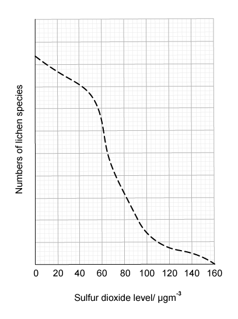
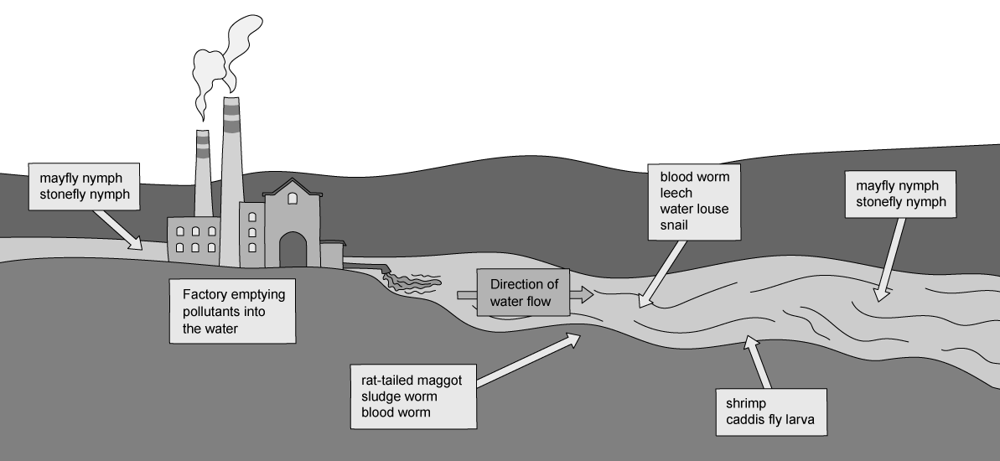
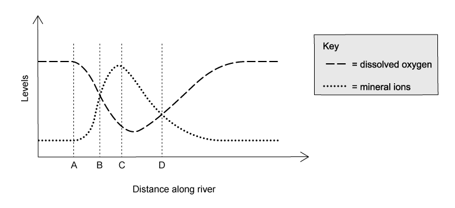

# Exam Questions — Human Impact: Biodiversity, Pollution & Conservation
**20. Human Influences on Ecosystems** · Cambridge (CIE) IGCSE biology (0610 & 0970)
> Source: [https://www.savemyexams.com/igcse/biology/cie/23/topic-questions/](https://www.savemyexams.com/igcse/biology/cie/23/topic-questions/) · 21 questions across 1 sets

## Multiple Choice Questions (21 questions)

### Q1 — medium — 1 marks

**Q1** [1 mark]

The sequence shows the events that occurs in a lake after fertiliser runoff enters the water.

fertiliser runoff → algal bloom → X → dissolved oxygen decreases → fish die

What is process X?

### Q2 — medium — 1 marks

**Q2** [1 mark]

Which factors are believed to have contributed to the rise in sea levels?

*Source: June 2021 0970/11 Q40*

### Q3 — easy — 1 marks

**Q3** [1 mark]

The statements describe some of the events that occur during eutrophication.

What is directly responsible for the increase in decomposers?

*Source: Specimen 2023 0790/02 Q38*

### Q4 — easy — 1 marks

**Q4** [1 mark]

What helps to maintain fish stocks?

*Source: Specimen 2023 0970/02 Q37*

### Q5 — easy — 1 marks

**Q5** [1 mark]

What could help to prevent a species from becoming endangered?

*Source: Specimen 2023 0970/01 Q39*

### Q6 — medium — 1 marks

**Q6** [1 mark]

What is a negative impact of large-scale monocultures?

*Source: Specimen 2023 0970/01 Q38*

### Q7 — medium — 1 marks

**Q7** [1 mark]

The following statements refer to plastic pollution.

1. Animals will often try to eat the plastic or become entangled in it
2. It breaks down into micro particles that wash away into nearby rivers
3. As plastic breaks down, it releases toxins into the surrounding environment
4. It enters the food chain when filter feeders such as mussels ingest micro particles

Which of these statements applies to both marine and terrestrial (land) habitats?

### Q8 — medium — 1 marks

**Q8** [1 mark]

The graph shows the relationship between the number of lichens and the levels of sulfur dioxide pollution.

Which of these statements best describe the graph?

### Q9 — medium — 1 marks

**Q9** [1 mark]

Which of these two gases both contribute to climate change?

### Q10 — hard — 1 marks

**Q10** [1 mark]

#### Extended only

Rapid growth of algae on the surface of the water can occur as a result of nitrates entering a reservoir of water.

This causes the following changes in the reservoir:

1. An increase in aerobic respiration by decomposers.
2. A decrease in the concentration of dissolved oxygen in the water.
3. Fish and other aquatic animals die.
4. Producers die and decomposition increases.

In which order do these changes occur?

### Q11 — hard — 1 marks

**Q11** [1 mark]

Which of these describe the effect of nuclear fall-out pollution?

### Q12 — easy — 1 marks

**Q12** [1 mark]

The image below shows the results of a study on the types of animals found along a stretch of stream near to a factory.

Which animal will live in the most polluted area of the river?

### Q13 — medium — 1 marks

**Q13** [1 mark]

Which of these describe a reason for conserving plant species?

### Q14 — hard — 1 marks

**Q14** [1 mark]

The levels of dissolved oxygen were measured in a river, the results were plotted on a graph, this is shown below.

At which point does raw sewage enter the river?

### Q15 — easy — 1 marks

**Q15** [1 mark]

Which of the following effects is least likely to be as a result of deforestation?

### Q16 — easy — 1 marks

**Q16** [1 mark]

To increase a farmer’s yield, low concentrations of Insecticides can be sprayed onto their crops, but insecticides may also be harmful to wildlife.

Which of these statements correctly explains why?

### Q17 — easy — 1 marks

**Q17** [1 mark]

A large quantity of non-selective herbicide is spread over a field. However, some of the herbicide washes into a nearby stream.

What is the effect of the herbicide on the weeds in the field and on the plants in the stream?

|   | weeds in field | plants in stream |
|---|---|---|
| **A** | more growth | less growth |
| **B** | less growth | more growth |
| **C** | less growth | less growth |
| **D** | more growth | more growth |

### Q18 — hard — 1 marks

**Q18** [1 mark]

#### Extended only

The following statements refer to conservation techniques.

1. Artificial insemination will decrease the need for male and female organisms to be present in the same area
2. The offspring produced during artificial insemination will have less genetic variation than their parents
3. In vitro fertilisation will produce large numbers of offspring without the need for gametes to fuse
4. These techniques will increase the resilience of a species and decrease their risk of extinction

Which of these statements are **false**?

### Q19 — easy — 1 marks

**Q19** [1 mark]

Which of the following would be a negative feature of monoculture crops on an ecosystem?

### Q20 — hard — 1 marks

**Q20** [1 mark]

Which of the following is the correct definition for a sustainable resource?

### Q21 — medium — 1 marks

**Q21** [1 mark]

Which of these agricultural practices may cause the most pollution?
