# Exam Questions — Human Impact: Biodiversity, Pollution & Conservation
**20. Human Influences on Ecosystems** · Cambridge (CIE) IGCSE biology (0610 & 0970)
> Source: [https://www.savemyexams.com/igcse/biology/cie/23/topic-questions/](https://www.savemyexams.com/igcse/biology/cie/23/topic-questions/) · 43 questions across 2 sets

## Multiple Choice Questions (21 questions)

### Q1 — medium — 1 marks

**Q1** [1 mark]

The sequence shows the events that occurs in a lake after fertiliser runoff enters the water.

fertiliser runoff → algal bloom → X → dissolved oxygen decreases → fish die

What is process X?

### Q2 — medium — 1 marks

**Q2** [1 mark]

Which factors are believed to have contributed to the rise in sea levels?

*Source: June 2021 0970/11 Q40*

### Q3 — easy — 1 marks

**Q3** [1 mark]

The statements describe some of the events that occur during eutrophication.

What is directly responsible for the increase in decomposers?

*Source: Specimen 2023 0790/02 Q38*

### Q4 — easy — 1 marks

**Q4** [1 mark]

What helps to maintain fish stocks?

*Source: Specimen 2023 0970/02 Q37*

### Q5 — easy — 1 marks

**Q5** [1 mark]

What could help to prevent a species from becoming endangered?

*Source: Specimen 2023 0970/01 Q39*

### Q6 — medium — 1 marks

**Q6** [1 mark]

What is a negative impact of large-scale monocultures?

*Source: Specimen 2023 0970/01 Q38*

### Q7 — medium — 1 marks

**Q7** [1 mark]

The following statements refer to plastic pollution.

1. Animals will often try to eat the plastic or become entangled in it
2. It breaks down into micro particles that wash away into nearby rivers
3. As plastic breaks down, it releases toxins into the surrounding environment
4. It enters the food chain when filter feeders such as mussels ingest micro particles

Which of these statements applies to both marine and terrestrial (land) habitats?

### Q8 — medium — 1 marks

**Q8** [1 mark]

The graph shows the relationship between the number of lichens and the levels of sulfur dioxide pollution.

Which of these statements best describe the graph?

### Q9 — medium — 1 marks

**Q9** [1 mark]

Which of these two gases both contribute to climate change?

### Q10 — hard — 1 marks

**Q10** [1 mark]

#### Extended only

Rapid growth of algae on the surface of the water can occur as a result of nitrates entering a reservoir of water.

This causes the following changes in the reservoir:

1. An increase in aerobic respiration by decomposers.
2. A decrease in the concentration of dissolved oxygen in the water.
3. Fish and other aquatic animals die.
4. Producers die and decomposition increases.

In which order do these changes occur?

### Q11 — hard — 1 marks

**Q11** [1 mark]

Which of these describe the effect of nuclear fall-out pollution?

### Q12 — easy — 1 marks

**Q12** [1 mark]

The image below shows the results of a study on the types of animals found along a stretch of stream near to a factory.

Which animal will live in the most polluted area of the river?

### Q13 — medium — 1 marks

**Q13** [1 mark]

Which of these describe a reason for conserving plant species?

### Q14 — hard — 1 marks

**Q14** [1 mark]

The levels of dissolved oxygen were measured in a river, the results were plotted on a graph, this is shown below.

At which point does raw sewage enter the river?

### Q15 — easy — 1 marks

**Q15** [1 mark]

Which of the following effects is least likely to be as a result of deforestation?

### Q16 — easy — 1 marks

**Q16** [1 mark]

To increase a farmer’s yield, low concentrations of Insecticides can be sprayed onto their crops, but insecticides may also be harmful to wildlife.

Which of these statements correctly explains why?

### Q17 — easy — 1 marks

**Q17** [1 mark]

A large quantity of non-selective herbicide is spread over a field. However, some of the herbicide washes into a nearby stream.

What is the effect of the herbicide on the weeds in the field and on the plants in the stream?

|   | weeds in field | plants in stream |
|---|---|---|
| **A** | more growth | less growth |
| **B** | less growth | more growth |
| **C** | less growth | less growth |
| **D** | more growth | more growth |

### Q18 — hard — 1 marks

**Q18** [1 mark]

#### Extended only

The following statements refer to conservation techniques.

1. Artificial insemination will decrease the need for male and female organisms to be present in the same area
2. The offspring produced during artificial insemination will have less genetic variation than their parents
3. In vitro fertilisation will produce large numbers of offspring without the need for gametes to fuse
4. These techniques will increase the resilience of a species and decrease their risk of extinction

Which of these statements are **false**?

### Q19 — easy — 1 marks

**Q19** [1 mark]

Which of the following would be a negative feature of monoculture crops on an ecosystem?

### Q20 — hard — 1 marks

**Q20** [1 mark]

Which of the following is the correct definition for a sustainable resource?

### Q21 — medium — 1 marks

**Q21** [1 mark]

Which of these agricultural practices may cause the most pollution?

## Theory Questions (22 questions)

### Q1 — hard — 11 marks

**Q1** [3 marks]

Fig. 2.1 shows a representation of the nitrogen cycle.

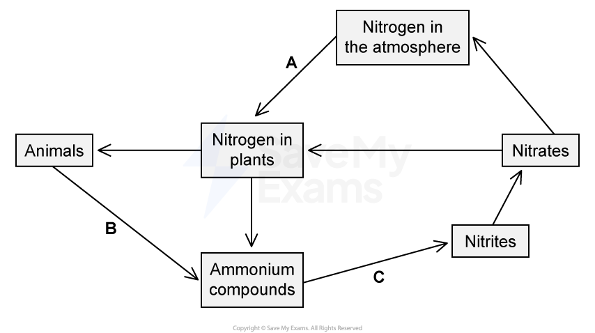

**Fig. 2.1**

State the names of the processes labelled A, B, and C in Fig. 2.1.

**Q1** [2 marks]

A farm is located next to a freshwater lake. Rainwater washes excess chemical fertiliser into the lake. Fig. 2.2 shows the concentration of dissolved oxygen in the lake over a period of 40 days.

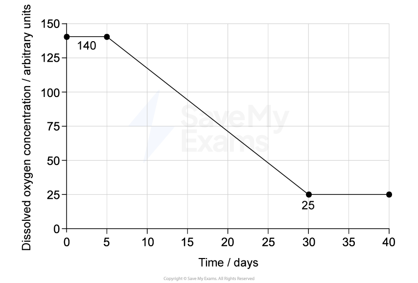

**Fig. 2.2**

Using Fig. 2.2, state the days between which decomposers were respiring.

Give a reason for your answer.

**Q1** [6 marks]

**Extract:**

A farm is located next to a freshwater lake. Rainwater washes excess chemical fertiliser into the lake. Fig. 2.2 shows the concentration of dissolved oxygen in the lake over a period of 40 days.

Explain the process of eutrophication that caused the decrease in oxygen concentration shown in Fig. 2.2.

### Q2 — hard — 11 marks

**Q2** [3 marks]

A large area of tropical rainforest was cleared by an agricultural company in 2010. The rainforest was replaced with a single crop of oil palm trees.

Fig. 5.1 shows a bar chart of the estimated population of a native forest bird species recorded in this area between 2010 and 2020.

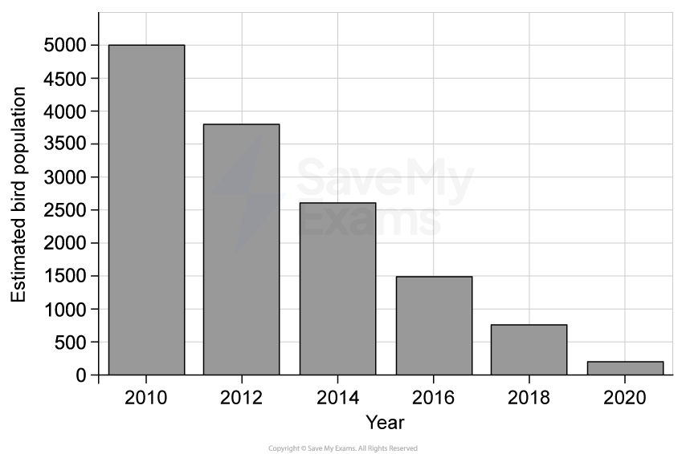

**Fig. 5.1**

Describe the trend in the bird population between 2010 and 2020 and suggest why the deforestation of the rainforest has caused this change.

**Q2** [4 marks]

Following the clearance, the company plants many oil palm trees across the entire area in a practice known as monoculture.

Describe the disadvantages of replacing a rainforest with a monoculture.

**Q2** [4 marks]

A large workers' camp is constructed nearby to house the thousands of employees managing the plantation. Untreated sewage from the camp flows directly into a local river.

(i) Explain how the sewage will affect the bacterial population in the river.

[2]

(ii) Describe the effects of untreated sewage on the river ecosystem.

[2]

### Q3 — medium — 3 marks

**Q3** [3 marks]

Intensive livestock production is used to improve food production.

Describe the negative effects of intensive livestock production.

*Source: June 2021 0970/31 Q7B*

### Q4 — easy — 8 marks

**Q4** [4 marks]

Modern technology has improved food production.

Table 7.1 shows some of the ways that food production has been improved.

Complete Table 7.1 by writing an example for each description.

Table 7.1

| example of technology | description of how it has improved food production |
|---|---|
|   | used to farm larger areas of land |
|   | used to improve growth in plants by providing nutrients |
|   | used to improve yield by removing animal pests |
|   | used to remove competition by weeds |

*Source: June 2021 paper 4 Q7A*

**Q4** [2 marks]

Selective breeding can be used to improve the yield of meat from livestock.

Sentences **A **to **E** in Table 7.2 describe the selective breeding of chickens to improve meat quantity.

The sentences are **not** in the correct order.

**Table 7.2**

| Breed the chickens together. | A |
|---|---|
| Observe the chickens to identify those that will yield the most meat | B |
| Observe the offspring and select the offspring that will yield the most meat. | C |
| Repeat the process over many generations. | D |
| Select one male and one female chicken. | E |

Put the letters from Table 7.2 into the correct order.

One has been done for you.

|   |   | A |   |   |
|---|---|---|---|---|

*Source: june 2021 paper 4 Q7B*

**Q4** [2 marks]

Lack of food can affect the population size of animals in ecosystems.

State two other factors that could decrease population size.

*Source: June 2021 0970/31 Q7D*

### Q5 — hard — 11 marks

**Q5** [4 marks]

Large quantities of plastic waste are polluting the oceans.

A survey published in March 2018 showed the increase in plastic waste in the Pacific Ocean. One area of the Pacific Ocean is known as the Great Pacific Garbage Patch (GPGP).

Data were collected from areas inside and outside the GPGP between 1965 and 2015 to estimate the quantity of plastic waste.

The results are shown in Fig. 2.1.

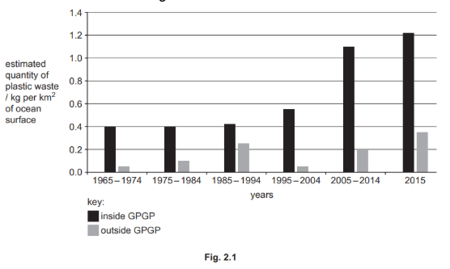

Describe the results of the survey shown in Fig. 2.1.

*Source: june 2021 paper 4 Q2A*

**Q5** [7 marks]

The green turtle, *Chelonia mydas*, is a species of marine animal that is harmed by plastic waste.

Fig. 2.2 shows a green turtle swimming past a plastic bag in the Pacific Ocean.

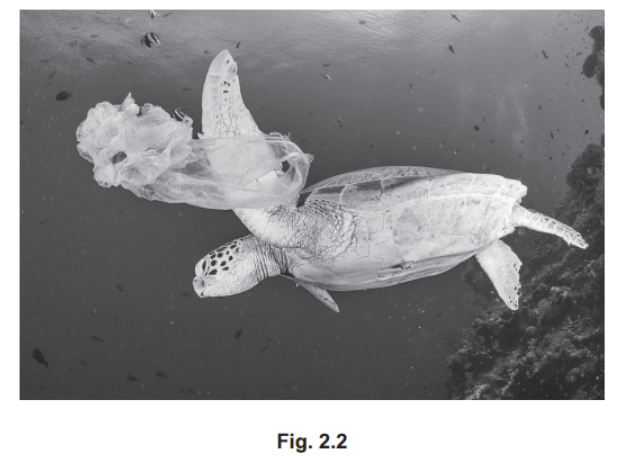

(i) Turtles are classified as reptiles.

State **one** feature shown by all reptiles that is not found in amphibians.

[1]

(ii) Outline the dangers of non-biodegradable plastic waste to marine animals, such as green turtles.

[4]

(iii) Suggest ways to reduce the quantity of plastic waste.

[2]

*Source: june 2021 paper 4 Q2B*

### Q6 — medium — 8 marks

**Q6** [1 mark]

The Mulanje cedar, Widdringtonia whytei, is the national tree of Malawi. This species of tree grows naturally only on Mount Mulanje in Malawi. Many of the trees have been overharvested or destroyed by wildfires, resulting in deforestation, as shown in Fig. 5.1.

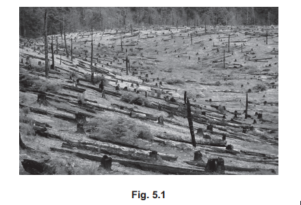

State the genus name of the Mulanje cedar tree.

*Source: June 2022 0610/41 Q5A*

**Q6** [3 marks]

Explain the undesirable effects of deforestation on habitats that are on mountains, such as Mount Mulanje.

*Source: June 2022 0610/41 Q5B*

**Q6** [2 marks]

**Extract:**

The Mulanje cedar, Widdringtonia whytei, is the national tree of Malawi. This species of tree grows naturally only on Mount Mulanje in Malawi. Many of the trees have been overharvested or destroyed by wildfires, resulting in deforestation.

Undesirable effects of deforestation on habitats that are on mountains, such as Mount Mulanje, include: Lack of roots to absorb water / hold soil together; No canopy / vegetation cover to protect soil from rainfall; Increase in runoff; Soil erosion / soil is washed away; Loss of minerals/ions/nutrients from the soil; Flooding; Landslides / mudslides; Visual pollution / visually unattractive dead tree stumps / bare ground; Loss of biodiversity / disruption of food chains / disruption of food webs / (species) extinction.

Scientists in Malawi are working to prevent the extinction of the Mulanje cedar tree in its natural habitat.

Explain the benefits to other organisms on Mount Mulanje of conserving the Mulanje cedar tree in its natural habitat.

*Source: June 2022 0610/41 Q5C*

**Q6** [2 marks]

The seeds of many endangered tree species are kept in seed banks.

Suggest why it is important to collect seeds from many individual trees of each species rather than just one tree.

*Source: June 2022 0610/41 Q5D*

### Q7 — medium — 13 marks

**Q7** [5 marks]

Researchers investigated the effect of adding cattle manure (cattle faeces) to fields where snap bean plants, Phaseolus vulgaris, were grown. Cattle manure contains some protein.

Explain how protein in the cattle manure is converted to the type of ions that plants can absorb.

*Source: June 2022 0610/41 Q4A*

**Q7** [8 marks]

Snap bean plants are legumes which have root nodules that contain nitrogen‑fixing bacteria.

Fig. 4.1 shows some root nodules.

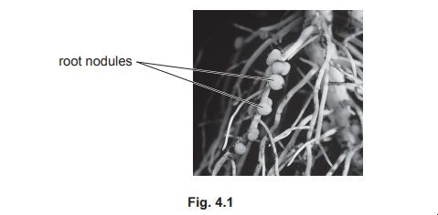

(i)

Suggest the advantage to farmers of having snap bean plants that have a large number of root nodules.

[1]

(ii)

The researchers investigated the effect of adding cattle manure to fields of snap bean plants.

- Field 1 was treated with a small quantity of cattle manure.
- Field 2 was treated with a medium quantity of cattle manure.
- Field 3 was treated with a large quantity of cattle manure.
- Field 4 was not treated with any cattle manure.

The researchers counted the number of root nodules on samples of plants from each field when the snap beans were harvested.

The results of the investigation are shown in Fig. 4.2

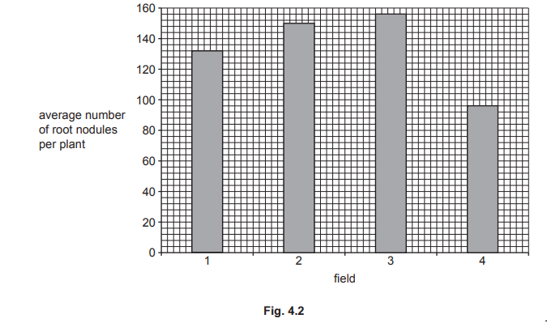

Calculate the percentage increase in the average number of root nodules per plant when snap bean plants were grown with a large quantity of cattle manure (field 3) compared with no cattle manure (field 4).

Give your answer to **two **significant figures.

Space for working.

[3]

(iii)

When large quantities of manure are put on fields it can lead to eutrophication of streams and rivers. This can lead to the death of fish.

Describe how eutrophication of streams and rivers can lead to the death of fish.

[4]

*Source: June 2022 0610/41 Q4B*

### Q8 — easy — 5 marks

**Q8** [5 marks]

There are many threats to species such as the marine iguana.

Describe ways endangered plant and animal species can be conserved

*Source: specimen 2023 0970/04 Q5C*

### Q9 — easy — 4 marks

**Q9** [1 mark]

Carbon dioxide is a greenhouse gas.

State the name of **one other** greenhouse gas.

*Source: Specimen 2023 0970/03 Q7A*

**Q9** [3 marks]

Deforestation can cause an increase in the concentration of carbon dioxide in the atmosphere.

State **three **other undesirable effects of deforestation.

*Source: Specimen 2023 0970/03 Q7B*

### Q10 — medium — 5 marks

**Q10** [5 marks]

#### Extended Only

There are many threats to species such as the marine iguana.

Describe ways endangered plant and animal species can be conserved.

*Source: 2023 970/04 Q5C*

### Q11 — medium — 9 marks

**Q11** [4 marks]

Some animals are farmed intensively.

Describe the negative impacts to an ecosystem of intensive livestock production.

*Source: 2018 0610/32 Q9A*

**Q11** [3 marks]

State why fertilisers, herbicides and insecticides are used in farming.

*Source: 2018 0610/32 Q9B*

**Q11** [2 marks]

Fertilisers, herbicides and insecticides can all pollute water.

List **two** other sources of water pollution.

*Source: 2018 0610/32 Q9C*

### Q12 — easy — 5 marks

**Q12** [5 marks]

Table 1 contains a list of chemicals that are useful to humans.

Complete Table 1 by stating **one** way in which each chemical is useful.

**Table 1**

| chemical | use of the chemical |
|---|---|
| antibiotic |   |
| fertiliser |   |
| herbicide |   |
| insecticide |   |
| pectinase |   |

*Source: 2018 0610/32 Q1*

### Q13 — hard — 7 marks

**Q13** [1 mark]

The graph in Fig. 1 shows the area of forest land lost in Ecuador in the years 2014 - 2019 inclusive.

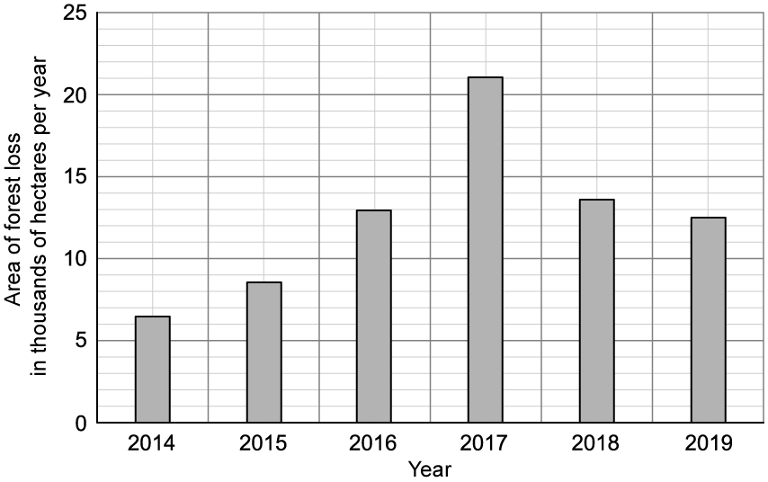

**Fig. 1**

Calculate the total area of land lost to deforestation in Ecuador from the beginning of 2014 to the end of 2019.

**Q13** [2 marks]

Identify in Table 1 below the possible reasons for the change in the area of forest lost per year between 2014 and 2017.

Place a tick (✔) in the boxes below that apply.

**Table 1**

| The local people stop growing maize |   |
|---|---|
| Less new house-building is needed for the population |   |
| The local people decided to farm sheep and goats |   |
| More trees have been planted |   |
| A company starts growing sugar cane for the production of biofuel |   |

**Q13** [2 marks]

Suggest **two** explanations for the reductions in loss of forest land in Ecuador in the years 2018 and 2019.

**Q13** [2 marks]

**Extract:**

The graph in Fig. 1 shows the area of forest land lost in Ecuador in the years 2014 - 2019 inclusive.

Conservationists looking at the data in Fig. 1** **would not be fully satisfied with the 2018 - 2019 trend shown in the data.

Explain why.

### Q14 — medium — 14 marks

**Q14** [4 marks]

Fig. 1 shows part of the carbon cycle. Some of the arrows are missing.

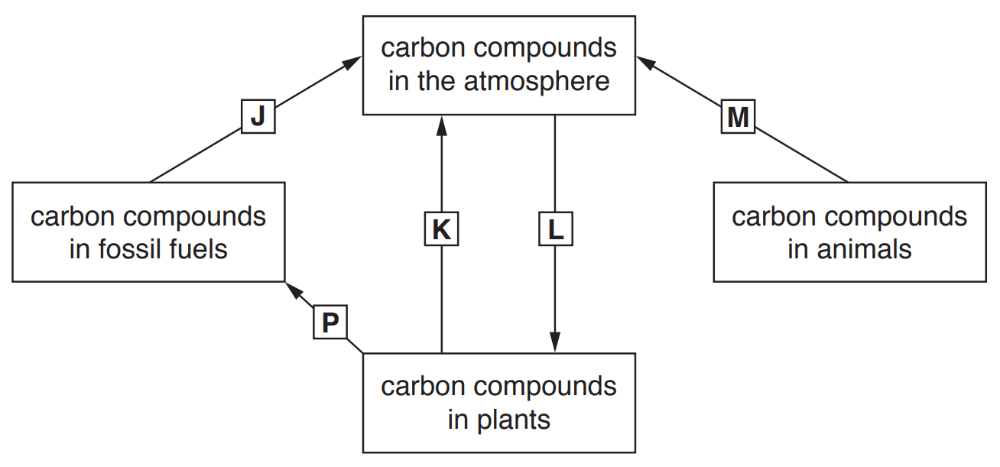

**Fig. 1**

(i)

State **all** the letters in Fig. 1 that represent respiration.

[2]

(ii)

State the name of the process that the letter **J** represents.

[1]

(iii)

Draw an arrow on Fig. 1 to represent the process of feeding.

[1]

*Source: 2018 (Series 2) 0610/32 Q5A*

**Q14** [1 mark]

Carbon dioxide is a greenhouse gas.

State the name of** one other **greenhouse gas.

*Source: 2018 (Series 2) 0610/32 Q5B*

**Q14** [4 marks]

Deforestation can cause an increase in the concentration of carbon dioxide in the atmosphere.

(i)

State **two** other undesirable effects of deforestation.

[2]

(ii)

State **two **uses for land that has been cleared of trees.

[2]

*Source: 2018 (Series 2) 0610/32 Q5C*

**Q14** [5 marks]

The forests in Brazil contain many endangered species.

Table 1 shows the area of forest that was removed in Brazil each year between 2006–2010.

**Table 1**

| **year** | **area of forest removed / km****2** |
|---|---|
| 2006 | 14 286 |
| 2007 | 12 651 |
| 2008 | 11 911 |
| 2009 | 7 464 |
| 2010 | 7 000 |

(i)

Calculate the average area of forest removed per year from 2006 to 2010.

Give your answer in km2. Show your working.

[2]

(ii)

Describe the trend in the data shown in Table 1.

[1]

(iii)

Suggest **two** reasons for the trend you have described in part **(ii)**.

[2]

*Source: 2018 (Series 2) 0610/32 Q5D*

### Q15 — easy — 5 marks

**Q15** [4 marks]

Fig. 1 is part of a newspaper article about pollution.

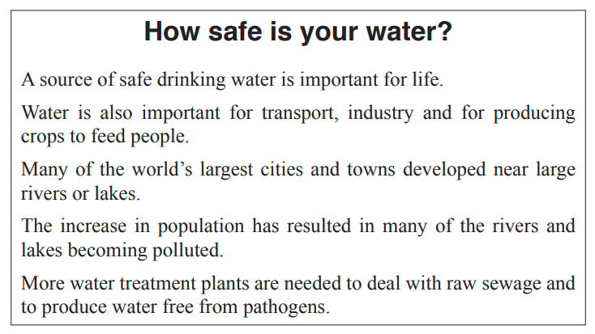

**Fig. 1**

State **four** sources of water pollution other than raw sewage.

*Source: 2018 (Series 3) 0610/33 Q7A*

**Q15** [1 mark]

Fig. 1 states that raw sewage must be treated to produce water free from pathogens.

Define the term *pathogen*.

*Source: 2018 (Series 3) 0610/33 Q7B*

### Q16 — easy — 9 marks

**Q16** [2 marks]

Human activities have had a very negative impact on biodiversity in recent times.

Define the term *biodiversity*.

**Q16** [2 marks]

Deforestation refers to the clearing of trees from a habitat.

Describe the effects of deforestation on biodiversity.

**Q16** [1 mark]

State the ecological importance of maintaining biodiversity in an area.

**Q16** [4 marks]

#### Extended only

One way of decreasing the negative effects of deforestation is to manage forests sustainably.

Give **four** examples of how forests can be managed sustainably.

### Q17 — medium — 10 marks

**Q17** [1 mark]

The energy we use comes from a variety of sources.

Fig. 1 shows the percentage of each source of energy used in one country in 2011.

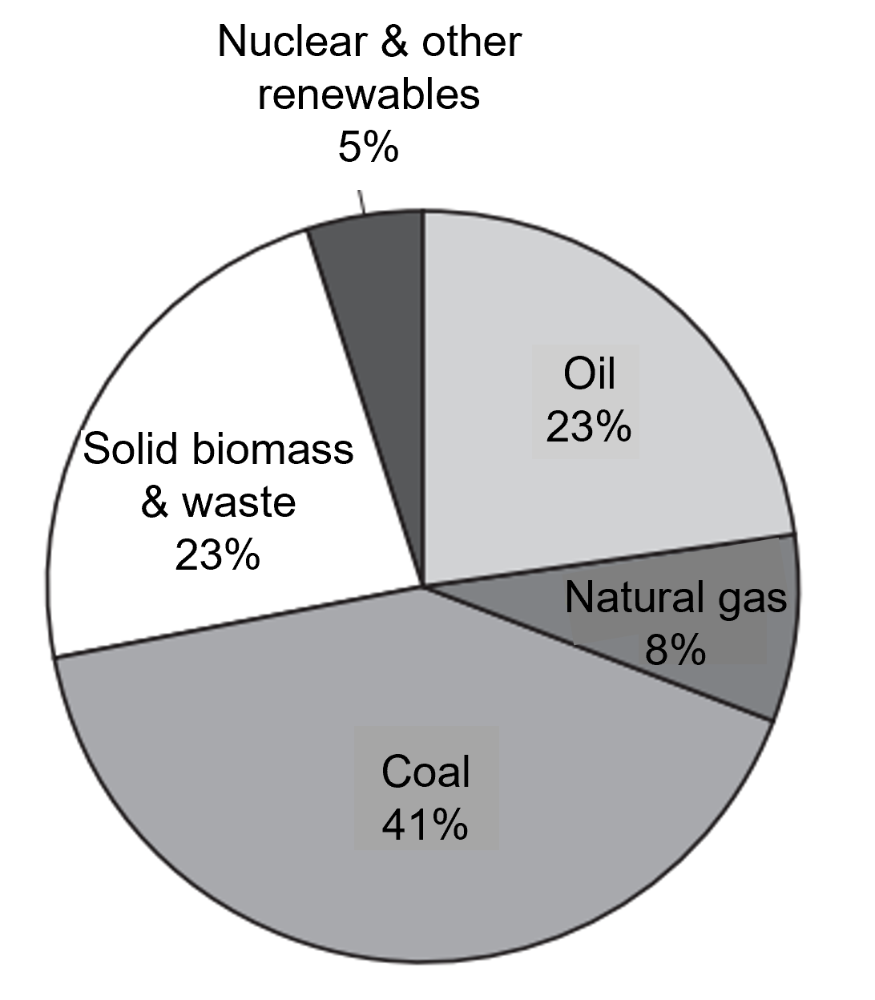

**Fig. 1**

Coal, natural gas and oil are types of fossil fuel.

Calculate the total percentage of energy in Fig. 1 that came from fossil fuels.

*Source: 2018 (Series 1) 0610/31 Q5A*

**Q17** [1 mark]

Explain why fossil fuels are **not** sustainable resources.

*Source: 2018 (Series 1) 0610/31 Q5B*

**Q17** [3 marks]

Combustion of fossil fuels releases carbon dioxide into the atmosphere.

(i)

State the name of **two other** processes that release carbon dioxide into the atmosphere.

[2]

(ii)

State the name of **one** process that removes carbon dioxide from the atmosphere.

[1]

*Source: 2018 (Series 1) 0610/31 Q5C*

**Q17** [2 marks]

Describe the effects on the environment of increasing carbon dioxide concentration in the atmosphere.

*Source: 2018 (Series 1) 0610/31 Q5D*

**Q17** [3 marks]

Improvements in food production have allowed human populations to increase.

Describe how modern technology has increased the production of crop plants.

*Source: 2018 (Series 1) 0610/31 Q5E*

### Q18 — hard — 11 marks

**Q18** [2 marks]

The oil palm is a tree that grows in tropical areas, whose oil has many uses in cooking, food preparation and as a detergent. It is also used in the manufacture of biofuels.

Fig. 1 shows the annual production of palm oil in Colombia (South America) since 2010.

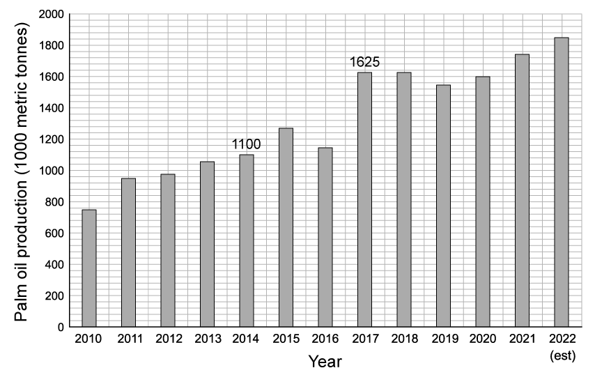

**Fig. 1**

Calculate the mean increase in palm oil production per year for the three year period 2014 to 2017.

Show your working and give your answer in thousands of metric tonnes per year.

**Q18** [5 marks]

Biofuels produced from palm oil can be used as a more renewable alternative to fossil fuels. However, the replacement of forests with oil palm plantations to produce biofuels will change the composition of the atmosphere.

Explain how.

**Q18** [1 mark]

When palm oil plantations are created, native forest is cut down and the biodiversity in the forest reduces dramatically. Even when demand for palm oil is low, there is still a benefit to the palm oil manufacturers in cutting down the native forest.

Suggest what that benefit is.

**Q18** [3 marks]

Growing trees for palm oil is an example of monoculture farming.

Explain **three** disadvantages of monoculture farming.

### Q19 — medium — 6 marks

**Q19** [6 marks]

The chimpanzee lives in forests in central and western Africa. The chimpanzee is classified as an endangered species because its population has decreased greatly.

(i)

Suggest why the chimpanzee population has decreased.

[2]

(ii)

Describe how a captive breeding programme can help to conserve chimpanzees in the wild.

[2]

(iii)

State **two** methods, other than captive breeding, of conserving endangered species.

[2]

*Source: 2020 0610/03 Q2B*

### Q20 — hard — 13 marks

**Q20** [3 marks]

Fig.1 shows a river and the location of a fertiliser factory. The arrows indicate the direction of the flow of the river.

**Fig. 1**

A scientist recorded the nitrate concentrations of the water at site **A** and site **B**.

Table 1 shows the results of this investigation.

**Table 1**

| site | nitrate concentration / mg dm-3 |   |   |   |
|---|---|---|---|---|
| sample 1 | sample 2 | sample 3 | mean |   |
| **A** | 16 | 23 | 21 | 20 |
| **B** | 52 | 71 | 66 | 63 |

Calculate the percentage difference in the mean nitrate concentration between site **A** and **B**.

Show your working and state the nature of the difference.

**Q20** [4 marks]

**Extract:**

Fig.1 shows a river and the location of a fertiliser factory. The arrows indicate the direction of the flow of the river.

A scientist recorded the nitrate concentrations of the water at site **A** and site **B**. 

Table 1 shows the results of this investigation.

| site | nitrate concentration / mg dm^-3^ |
| sample 1 | sample 2 | sample 3 | mean |
| **A** | 16 | 23 | 21 | 20 |
| **B** | 52 | 71 | 66 | 63 |

#### Extended only

Scientists observed algae and dead fish at site **B**.

Suggest an explanation for these observations.

**Q20** [3 marks]

Explain the importance of using chemical fertiliser in modern farming practices.

**Q20** [3 marks]

Further tests revealed that the water at site **B** contained abnormally high levels of cadmium, which is a heavy metal. After analysing the remains of aquatic organisms from the site, the top carnivores were found to have a very high concentration of cadmium stored in their fat cells.

Suggest the risk of high levels of cadmium to the river ecosystem.

### Q21 — medium — 13 marks

**Q21** [4 marks]

Fig. 1 shows a photograph of an area where the trees have been cut down.

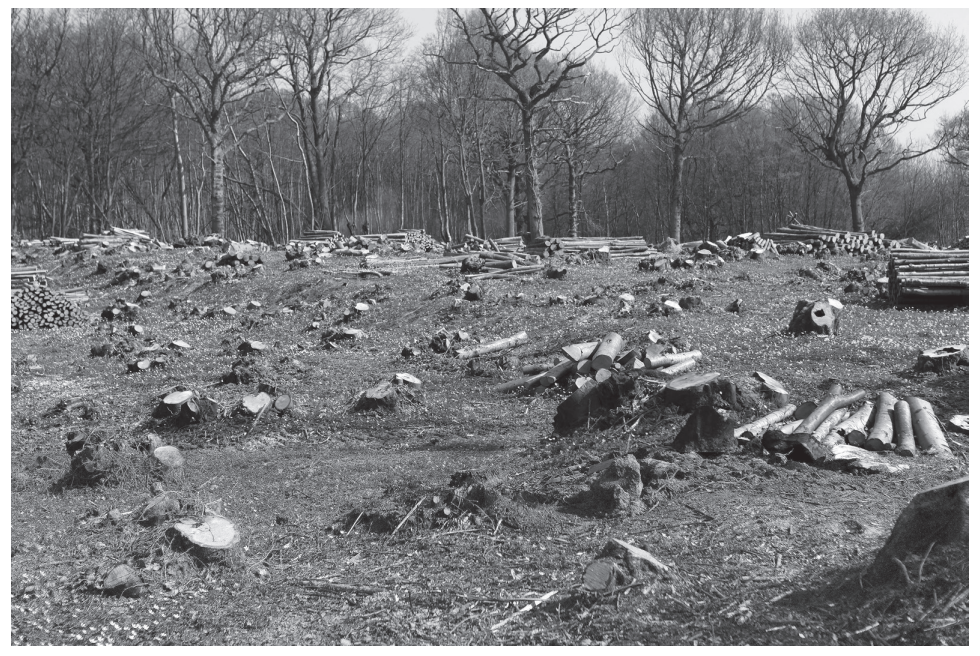

**Fig. 1**

(i)

State the name of the type of habitat destruction shown in Fig. 1.

[1]

(ii)

List **three** undesirable effects of habitat destruction.

[3]

*Source: 2018 0610/33 Q4A*

**Q21** [3 marks]

State **three** human activities, other than cutting down large areas of trees, that can cause habitat destruction.

*Source: 2018 0610/33 Q4B*

**Q21** [3 marks]

Describe how endangered species can be conserved.

*Source: 2018 0610/33 Q4C*

**Q21** [3 marks]

Human activity can cause pollution of the environment.

Table 1 shows some pollutants, the environment they pollute and some of the effects.

Complete Table 1.

**Table 1**

| **pollutant** | **environment** | **effect of pollutant on the environment** |
|---|---|---|
| methane | air |   |
| herbicides |   | kills non-targeted plants |
|   | water | increased growth of water plants |

*Source: 2018 0610/33 Q4D*

### Q22 — medium — 8 marks

**Q22** [5 marks]

#### Extended Only

There are many threats to wildlife in the Galapagos.

Describe ways in which endangered species can be conserved.

*Source: 2018 0610/42 Q6C*

**Q22** [3 marks]

#### Extended Only

One aim of conservation is to maintain resources in natural ecosystems.

State **three **resources that natural ecosystems provide for humans.

*Source: 2018 0610/42 Q6D*

