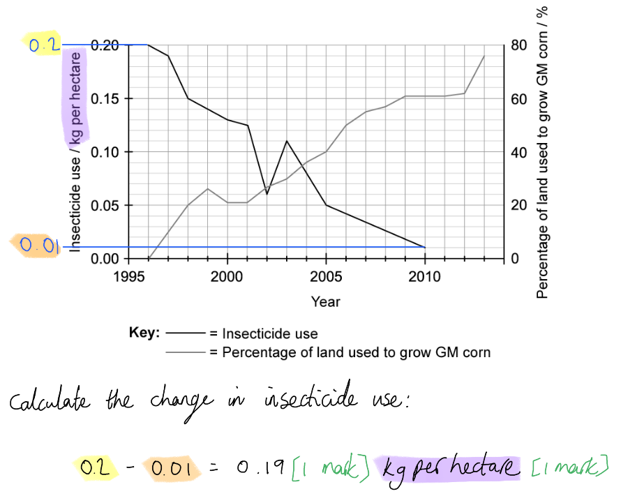
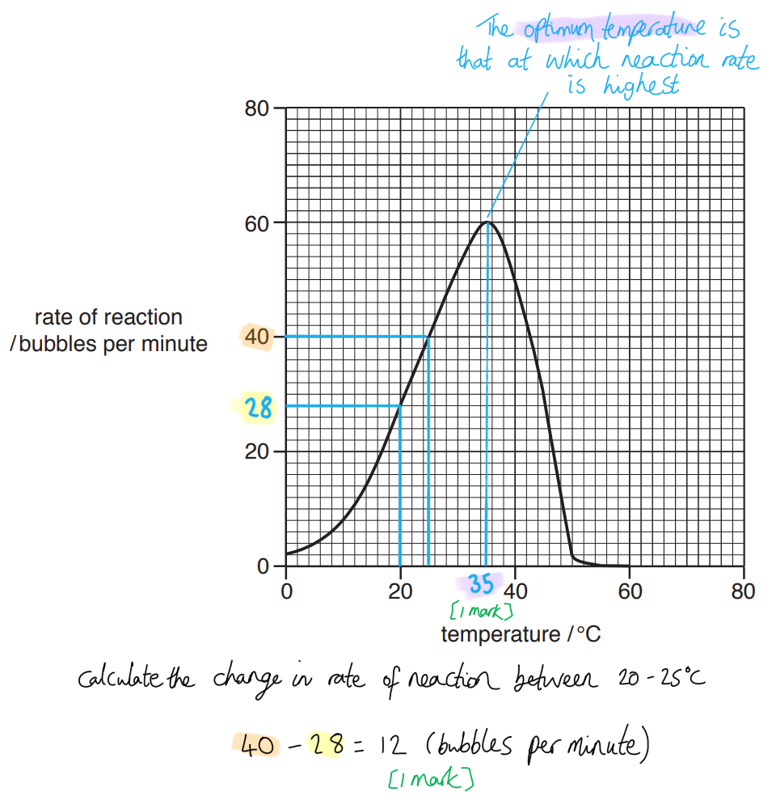
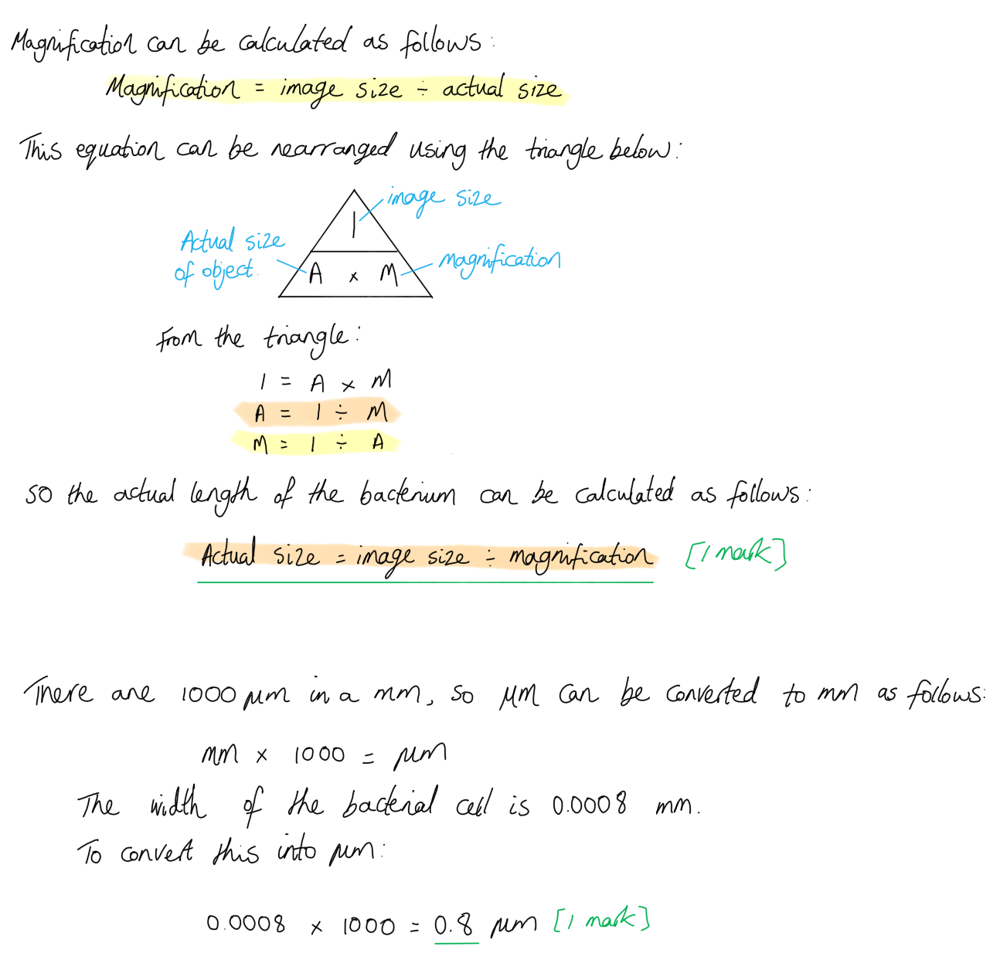

# Mark Schemes — Biotechnology & Genetic Modification
**21. Biotechnology & Genetic Modification** · Cambridge (CIE) IGCSE biology (0610 & 0970)

## Multiple Choice Questions (25 questions)

### Q1
**Final answer:** **The correct answer is ****D.**

- **Plasmids **are **small circular pieces of DNA **found in bacteria that can be easily removed and modified
- In genetic modification, a **human gene **can be inserted into a plasmid using enzymes such as **restriction enzymes **and **DNA ligase**
- The **recombinant plasmid** is then placed back into a bacterium, which **replicates and expresses the human gene to produce the protein**

**A** is incorrect because it represents ribosomes, which are involved in protein synthesis.

**B **is incorrect because it represents the circular bacterial chromosome, which contains the bacterium’s main DNA.

**C** is incorrect because it represents the cell wall, which provides structural support and protection.

### Q2
**Final answer:** **The correct answer is ****C.**

- Bacteria have plasmids, which are small, circular DNA molecules that can be easily manipulated and used as a vector, to introduce new genes into a host organism

**A** is incorrect because while bacteria have a unique genetic code, their similarities to other organisms allow for effective manipulation in genetic engineering.

**B** is incorrect because the presence of cell walls in bacteria does not contribute to their utility in genetic engineering.

**D** is incorrect because bacteria reproduce asexually, which allows for rapid and efficient propagation of genetic modifications, rather than sexual reproduction.

### Q3
**Final answer:** **The correct answer is ****C****.**

- This is because many plants contain chemicals that can be used for medicines for humans
- Many of these plants have not yet been researched for their medicinal properties and so they must be conserved

**A** is incorrect because plants do not absorb oxygen from the air, they absorb carbon dioxide.

**B** is incorrect because plants do not decrease rainfall.

**D** is incorrect because plants do not release carbon dioxide into the air, they take it in.

### Q4
**Final answer:** **The correct answer is ****A****.**

- This is because the genetic code is universal and shared with all living organisms.

### Q5
**Final answer:** **The correct answer is ****A****.**

- This is because bacteria can be genetically engineered to contain the human gene for insulin, which causes the bacteria to produce and release human insulin to be used for medicine for diabetics

**B** is incorrect because the enzymes in biological washing powders do not come from genetically engineered organisms.

**C** is incorrect because pectinase enzymes used in fruit juice production do not come from genetically engineered organisms.

**D** is incorrect because the yeast used to produce ethanol is not genetically engineered. The ethanol comes from fermentation (anaerobic respiration), which is a process the yeast carries out naturally.

### Q6
**Final answer:** **The correct answer is ****A.**

- Pectinase is an enzyme used in the food industry to break down pectin, which helps extract juice from fruit more efficiently.

**B** is incorrect because while enzymes can be used in biofuel production, pectinase specifically is not typically associated with that process.

**C** is incorrect because biological washing powders usually contain proteases and lipases, but not specifically pectinase.

**D** is incorrect because yeast is the primary agent responsible for making bread rise, not pectinase.

### Q7
**Final answer:** **The correct answer is B**

- This is because X are the paddles that rotate during use and help to stir the contents of the fermenter, maintaining an even temperature throughout the solution

**A** is incorrect because oxygen enters the solution through a pipe at the top of the fermenter

**C **is incorrect because the pH is recorded using dedicated probes

**D **is incorrect because the solution is not sterilised due to the importance of maintaining populations of* Penicillium. *The fermenter is sterilised with steam between uses

### Q8
**Final answer:** **The correct answer is D**

- This is because plasmids are able to act as a vector, allowing genetically modified DNA to enter the bacterial cell to be used to produce proteins

**A**, **B** and **C** are incorrect because they are all parts of the bacterial cell that does not play a key role in genetic modification

### Q9
**Final answer:** **The correct answer is A**

- This is because inserting genes into bacteria is an example of genetic modification

**B** is incorrect because insulin is not DNA, it is a protein.

**C** is incorrect because spraying plants with herbicides does not affect their DNA.

**D** is incorrect because using biological washing powders does not change the DNA of an organism.

### Q10
**Final answer:** **The correct answer is ****C**** (to increase the yield of the crop) because:**

**Genetic modification** will enable the plant to have an increased yield. This is particularly important in growing crops more readily in conditions that the plant would normally not thrive in (such as drought).

**A** is incorrect because the purpose of **genetic modification** is to increase the yield of crops.

**B** is incorrect because some genetic modification will **provide, **not prevent, pest resistance.

**D** is incorrect because some genetic modification will **provide, **not prevent, resistance to herbicides.

### Q11
**Final answer:** **The correct answer is ****A**** (they can make complex molecules) because:**

- Bacteria are organisms that reproduce quickly (as much as once every 20 minutes for some species in optimum conditions)
- All cells contain ribosomes and therefore possess the ability to make **complex molecules**. This makes them ideal for biotechnology

  - Biotechnology is the use of microorganisms to make useful products for us
- **Bacteria** have relatively simple cellular systems that allow us to genetically modify them easily. We use them to produce **insulin** and other human hormones

**B** is incorrect because whilst humans host a whole ecosystem of bacteria in our body (prominently in the digestive tract) this has nothing to do with biotechnology.

**C** is incorrect because bacteria reproduce quickly. They show **exponential growth** - some species can double in number every 20 minutes.

**D** is incorrect because bacteria can evolve to become resistant to** antibiotics** and we often use this to select bacteria in genetic engineering. This is not a reason that **bacteria** are used in **biotechnology**.

### Q12
**Final answer:** **The correct answer is ****C**** (5 days) because:**

At 5 days this would give you the highest **yield **of penicillin. Penicillin is produced in a **batch culture** so you would want to harvest with the highest yield possible. This is also the point at which the mass of living organisms has reduced.

### Q13
**Final answer:** **The correct answer is ****D**** (glucose and amino acids) because:**

The two nutrients that would be needed are **glucose** for **respiration** and **amino** **acids** for **growth** and the production of **proteins**.

While the other nutrients may be used for respiration such as lipids, the main two nutrients together are glucose and amino acids.

### Q14
**Final answer:** **The correct answer is ****B**** (to join human DNA with plasmid DNA) because:**

- The** enzyme** that can join complementary **sticky ends** created by the activity of restriction enzymes on plasmid and human DNA is called **ligase**
- ‘Sticky ends’ can complement base-pair with each other, but ligase joins the sugar-phosphate backbones of adjacent DNA molecules together

**A** is incorrect because ligase enzyme is not used when plasmids are taken up by the bacteria.

**C** is incorrect because the human gene is isolated using **restriction enzymes** that cut the DNA at specific base sequences.

**D** is incorrect because **restriction enzymes** are used to cut the plasmid open to create **sticky ends.**

### Q15
**Final answer:** **The correct answer is ****C ****because:**

Anaerobic respiration in yeast breaks down glucose to produce ethanol (alcohol) and carbon dioxide. To make beer, ethanol (alcohol) needs to be produced, and for bread to rise carbon dioxide is required to make the dough rise.

All the other options are incorrect because anaerobic respiration in yeast does not produce lactic acid; this is produced by anaerobic respiration in animals and some bacteria. Simple sugars are used as a reactant in respiration, they are not formed in the process.

### Q16
**Final answer:** **The correct answer is ****D ****because:**

- **Aseptic conditions** will kill undesirable microorganisms and prevent chemical contamination so that only the species of microorganisms that are needed will grow in the fermenter
- The **optimum pH** must be maintained to ensure that the enzymes within the microorganisms function at their optimum rate. Remember that enzymes are proteins and they are very sensitive to changes in pH (and temperature) which will cause them to denature
- **Agitation** with the stirring paddles will ensure that the contents of the fermenter (microorganisms, nutrients, oxygen, pH and temperature) is evenly distributed so that the microorganisms can reproduce at their maximum rate

### Q17
**Final answer:** **The correct answer is ****D**** (pectinase) because:**

**Pectin** is found in fruit juices. It is a **polysaccharide **that is responsible for holding cells together, but it makes fruit juice cloudy. **Pectinase** is the enzyme that breaks down **pectin** so that the juice is clear.

**A** is incorrect because **lipase **breaks down lipids into fatty acids and glycerol.

**B** is incorrect because **amylase** breaks down starch into **maltose**.

**C** is incorrect because **protease** breaks down proteins into **amino acids.**

### Q18
**Final answer:** **The correct answer is ****B**** (altering the DNA in crop plants so that they are resistant to herbicides) because:**

**Genetic engineering** is the process of altering **DNA** to include new **genes** or sequences of **DNA. **This will give the modified organism new characteristics that may increase yield or increase resistance to chemicals.

**A** is incorrect because this process describes **selective breeding**.** **Selective breeding is the use of organisms with a particular characteristic in breeding so that the offspring have the trait that you desire.

**C** is incorrect because this process describes **fermentation**. This is a natural process that has been exploited for centuries to produce bread and beer.

**D** is incorrect because this is a natural process that occurs normally in healthy individuals.

### Q19
**Final answer:** **The correct answer is ****A**** (cloning) because:**

**Cloning **is a process which aims to make an identical copy of the original organism being cloned. Within cloning there is no **genetic modification** of the organism.

**B**, **C** and **D** are incorrect because these are the uses and advantages of genetic modification of organisms.

### Q20
**Final answer:** **The correct answer is ****A ****because:**

- **Restriction enzymes** are needed to cut a desired **gene** from human DNA (if the objective is to produce a human protein)
- The same enzymes are then used to cut open a **plasmid** leaving **sticky ends** that will have the same base sequence at the ends of the human DNA sequence
- **Ligase** can then be used to join the two strands together in the **plasmid**. This creates a **recombinant plasmid**. **Recombinant **means that the organism has had its **genetic sequence** changed

### Q21
**Final answer:** **The correct answer is ****B**** (2 and 3 only) because:**

- Biofuel is considered to be a renewable energy source, since new crops can be planted to replace those that were harvested to produce biofuel. This is a major advantage since we are less likely to run out of biofuel in the future, unlike fossil fuels that are used up faster than it can be replaced (given that it takes millions of years to form)
- Using waste parts of crop plants can also be considered an advantage of biofuel, as these parts have no other commercial use in the food industry and would end up being thrown away. Being able to use these parts to produce something useful like biofuel means less waste will end up in landfills

**A** is incorrect because statement 1 only describes where the ethanol comes from that is used in biofuel, it is not a specific advantage. Statement 4 is considered to be a disadvantage of biofuel by some since using land to grow crops specifically for the production of these fuels will lead to less land available to grow crops used as a food source for people.

**C** is incorrect because statement 2 is not the only advantage listed in the options.

**D** is incorrect because statement 4 is considered a disadvantage of biofuel since this would lead to less land that is available to produce food crops.

### Q22
**Final answer:** **The correct answer is ****C**** (a length of DNA from a human) because:**

To treat diabetes bacteria need to be **genetically modified** to produce human insulin, so that the insulin is not then rejected by the body when injected.

**A** is incorrect because it is a gene, not an enzyme, that needs to be inserted into bacterial cells. While enzymes are used in the process it is the DNA that codes for the insulin protein that must be inserted.

**B** is incorrect because this is the protein, not the **gene **for the protein. The bacterial cell can only produce the protein if it has the instruction (gene) to make it using its ribosomes.

**D** is incorrect because as bacteria do not naturally have a **gene **coding for **insulin**.

### Q23
**Final answer:** **The correct answer is ****C**** (it produces carbon dioxide) because:**

**Yeast** produces carbon dioxide and ethanol (alcohol) during fermentation, and it is bubbles of carbon dioxide gas that makes the bread rise as it gets trapped in the dough.

**A** is incorrect because while yeast fermentation does result in the production of **ethanol**, it is the production of the **carbon dioxide** that makes the bread rise.

**B** is incorrect because **lactic acid** is a product of **anaerobic **respiration in **animals **and some bacteria.

**D** is incorrect because fermentation is **anaerobic**, meaning that it doesn’t require oxygen, and as a type of respiration does not produce oxygen. The process that produces oxygen is **photosynthesis** in plants and algae.

### Q24
**Final answer:** **The correct answer is ****C**** (chocolate milkshake) because:**

This is the stain with the highest percentage stain removal which was achieved with the washing powder with enzyme (94% stain removal).

### Q25
**Final answer:** **The correct answer is ****B**** (1 and 2 only) because:**

- **Restriction enzymes** are used to cut DNA at a certain sequence. This leaves short chains of single stranded DNA known as **sticky ends**
- The plasmid to which the isolated gene is to be inserted is cut with the same **restriction enzyme** so that it has **complementary sticky ends**
- **Sticky ends **are made in step 1 and 2

## Theory Questions (12 questions)

### Q1
> **[mark-scheme]**
> (i) The allele is:
> 
> - Recessive **[1 mark]**
> - Two unaffected parents / 5 and 6 have an affected child **[1 mark]**
> 
> (ii) The  probability of individuals 5 and 6 having a second child who is a carrier is:
> 
> - 50% **OR** 0.5 **OR** 1/2 **[1 mark]**

> **[exam-tip]**
> Where two parents with the same phenotype produce a child with a different one, this indicates that the parents are heterozygous and the condition is recessive.
> **[mark-scheme]**
> - A restriction enzyme is used to cut the AAT gene from the human DNA **[1 mark]**
> - The same restriction enzyme is used to cut the bacterial plasmid **[1 mark]**
> - This leaves sticky ends on the gene and the plasmid **[1 mark]**
> - The cut ends are complementary **[1 mark]**
> - DNA ligase joins the gene and the plasmid / seals the join between the gene and the plasmid **[1 mark]**

> **[exam-tip]**
> You must learn the names of the two key enzymes: restriction enzymes (to cut) and ligase (to join).
> **[mark-scheme]**
> Arguments in support of the conclusion:
> 
> - Strain 1 produces a higher yield / 115 mg vs 60 mg at 40°C **OR** strain 1 produces a higher yield / 45 mg vs 10 mg at 45°C
> - Large scale production is likely to take place at higher temperatures / production will occur faster at higher temperatures
> 
> Arguments against the conclusion (maximum of three points):
> 
> - Strain 2 produces a higher yield / 85 mg vs 40 mg at 25°C **OR** strain 2 produces a higher yield / 120 mg vs 110 mg at 30°C
> - Fermenters are cheaper to run at lower temperatures, so strain 2 may be more suitable
> - At 35°C both strains produce similar yields / 130 mg vs 125 mg
> - Temperature was the only factor investigated **OR** other factors (such as pH) may affect the two strains differently
> - No repeats are shown / results may not be reproducible
> 
> **[4 marks]**
> 
> A maximum of 3 marks may be awarded for arguments against the conclusion; to achieve full marks, candidates must include at least one argument in support of the conclusion.

### Q2
> **[mark-scheme]**
> Two structural features present in bacterial cells but absent in animal cells are:
> 
> Any two of the following:
> 
> - Cell wall; **[1 mark]**
> - Plasmids; **[1 mark]**
> - Circular DNA; **[1 mark]**
> 
> *Accept other correct answers, such as slime capsule, flagellum and 80S ribosomes.*
> 
> **[Total: 2 marks]**
> **[mark-scheme]**
> Bacteria are useful in biotechnology because:
> 
> Any two of the following:
> 
> - Bacteria can produce complex molecules; **[1 mark]**
> - They reproduce rapidly; **[1 mark]**
> - There are few ethical concerns over their use; **[1 mark]**
> - Presence of plasmids makes genetic modification possible; **[1 mark]**
> 
> **[Total: 2 marks]**
> **[mark-scheme]**
> Temperature and pH must be controlled in an industrial fermenter because:
> 
> - Enzyme-controlled reactions (in bacterial cells) occur at their maximum rate / at a high rate at <u>optimum</u> temperature and pH; **[1 mark]**
> - Extreme temperatures or pH can <u>denature</u> enzymes; **[1 mark]**
> 
> **[Total: 2 marks]**
> **[mark-scheme]**
> Two products that can be produced on a large scale using industrial fermenters are:
> 
> Any two of the following:
> 
> - Insulin; **[1 mark]**
> - Penicillin; **[1 mark]**
> - Mycoprotein; **[1 mark]**
> 
> **[Total: 2 marks]**

### Q3
Any three from:

- (Small so do) not need much space; **[1 mark] **
- Rapid reproduction rate; **[1 mark] **
- Can make complex molecule(s);**[1 mark] **
- No ethical concerns over use;**[1 mark] **
- Idea that genetic code is universal; **[1 mark] **
- They have plasmids;**[1 mark] **
- Idea that plasmids are used as vectors / in genetic engineering; **[1 mark] **
- Simple requirements so easy / cheap to grow; **[1 mark] **

There is flexibility here to gain extra marks for other valid answers that are not specifically named on the mark scheme.

**[Total: 3 marks]**
(i)

- Pancreas; **[1 mark]**

(ii)

- (Type 1) diabetes; **[1 mark]**

(iii)

- Reduces blood sugar concentration; **[1 mark]**

**[Total: 3 marks]**
(i)

- y-axis = number / population of (living) bacteria per (1.0) mm3
- **and** x-axis = time / hours / days; **[1 mark]**

Just saying “number of bacteria” is not enough to get the mark.

(ii)

- P – <u>Lag</u>
- Q – Exponential / <u>log</u>
- R – Stationary
- S – Death / decline

Four correct = **[2 marks]**

Two or three correct = **[1 mark]**

One correct =** [0 marks]**

(iii)

Any three from:

- Limiting factor(s) / factors that limit; **[1 mark]**
- Not enough space / overpopulation; **[1 mark]**
- Competition; **[1 mark]**
- Fewer / no (named) nutrient(s) / food; **[1 mark]**
- Not enough oxygen; **[1 mark]**
- Change in pH / increase in acidity;**[1 mark]**
- Increase in temperature; **[1 mark]**
- Build-up of (named) toxic / waste substances; **[1 mark]**

**[Total: 6 marks]**
(i)

- <u>Restriction</u> (enzyme); ** [1 mark]**

Remember that restriction enzymes/endonucleases are known as the DNA scissors.

(ii)

Any two from:

- Use <u>same</u> (restriction) enzyme to cut cassava DNA; ** [1 mark]**
- Sticky ends are formed / joined…;** [1 mark]**
- … at the complementary ends / base pairs;** [1 mark]**
- (Joined by) ligase; ** [1 mark]**

(iii)

Any two from:

- Idea that need to check that offspring inherit ‘new’ gene / trait; ** [1 mark]**
- Ensure new (GM) variety can grow in field conditions;** [1 mark]**
- Make sure the ‘new’ gene does not cause any adverse effects; ** [1 mark]**
- Make sure (GM) plants have the same / a high enough yield; ** [1 mark]**
- Idea of building up a large quantity of seed / plants to sell to farmers;** [1 mark]**

Remember that when a word is underlined in a mark scheme it means that word is essential to get the mark.

**[Total: 5 marks]**

### Q4
(i) The name of an organism that can be used to make ethanol biofuel from sugars is:

- Yeast / *Saccharomyces cerevisiae* / *Saccharomyces* / *S. cerevisiae */ other microorganisms that can respire sugars to give ethanol; **[1 mark]**

(ii) The process that this organism uses to make ethanol biofuel from sugars is:

Any **two **from the following:

- Anaerobic; **[1 mark]**
- Respiration; **[1 mark]**

***Allow ****fermentation;*** [1 mark]**

**[Total: 3 marks]**

> *Some other fungi and yeast are capable of carrying out fermentation to make ethanol from sugars. you are not required to know the names of any of these species. *
It would be better to burn the remains of the sugar cane instead of burning a fossil fuel because:

Any **two **from the following:

- Fossil fuels are non-renewable; **[1 mark]**
- (Sugar cane) is renewable / sustainable;**[1 mark]**
- Combustion (burning) of fossil fuel releases carbon dioxide (into the atmosphere);**[1 mark]**
- Burning plants releases no net carbon dioxide / is carbon neutral; **[1 mark]**

**[Total: 2 marks]**

### Q5
Genetic modification can be defined as...

- Changing the genetic material of an organism; **[1 mark]**
- ... by removing/changing/inserting individual genes; **[1 mark]**
- ... from another organism; **[1 mark]**

**[Total: 3 marks]**
(i) Structure **A** can be identified as...

- (A) plasmid; **[1 mark]**

(ii) The function of structure **A** in genetic modification is...

- It provides a way for genes / sections of DNA to be inserted into cells **OR** it acts as a vector; **[1 mark]**

**[Total: 2 marks]**
The purpose of 'sticky ends' is to...

- They form short sections of unpaired bases; **[1 mark]**
- It provides a way for the gene to be inserted/joined/linked into the plasmid; **[1 mark]**

**[Total: 2 marks]**

> *Sticky ends provide an attachment point to securely join the gene and plasmid together. If the ends were blunt it would be impossible to do that.*
(i) The name and purpose of enzyme **X** is...

- Enzyme **X** = DNA ligase; **[1 mark]**
- It links/joins <u>matching/complementary</u> sticky ends (between the gene and plasmid) to form a single/unbroken DNA molecule; **[1 mark]**

(ii) The name of structure **C** is...

- <u>Recombinant</u> plasmid; **[1 mark]**

**[Total: 3 marks]**

### Q6
The term genetically modified organism can be defined as follows...

- Transfer of genetic material/genes/DNA...; **[1 mark]**
- ...from (an organism of) one <u>species</u> to another species; **[1 mark]**

**OR**

- An organism that has genetic material/genes/DNA...; **[1 mark]**
- ...taken from another species; **[1 mark]**

**[Total: 2 marks]**
(i) The change in insecticide use between 1996 and 2010 is...

- (0.2 - 0.01 =) 0.19; **[1 mark]**
- kg per hectare / kg hectare-1 / kg/hectare; **[1 mark]**

*Accept Ha for hectare.*

> *It is a good idea to get into the habit of always **including units** in your answers to calculation questions. Here it shows that you have been able to read the correct line and the correct axis from the graph that has two lines and two Y axes.*

(ii) The data shows the following about insecticide use and the percentage of corn fields used to grow GM corn between 1996 and 2013...

Any **two** of the following:

- Insecticide use shows an overall decrease **WHILE** the percentage of land used to grow GM corn shows an overall increase; **[1 mark]**
- The percentage of land used to grow crops increases from 0 to 76 % between 1996 and 2013 / any correctly quoted <u>pair</u> of data points and <u>corresponding years</u>; **[1 mark]**
- There is an increase in insecticide use between 2002-2003; **[1 mark]**
- There is a decrease in GM crop percentage between 1999 and 2000; **[1 mark]**

*Ignore numbers quoted for overall insecticide use decrease, as this has already been credited in part (i).*

> *Note that you are **describing** data here; no marks are available for attempts to **explain** your observations.*

> *When describing data you should always aim to:*

- *Describe overall **trends**.*
- *Describe any points in the data that **don't fit with trends**, e.g. a period of increase or levelling of within an overall decreasing trend.*
- *Give **numbers** to back up your statements.*

**[Total: 4 marks]**
Benefits of GM corn include...

- Pesticide use can be reduced / fewer pesticides are needed; **[1 mark]**
- Farmers no longer have to pay for pesticides **OR **biodiversity will increase / non-target species will not be killed / only pest species will be killed; **[1 mark]**

**OR**

- Pests do not eat/kill the crop; **[1 mark]**
- Increased yield / a bigger harvest; **[1 mark]**

*Accept insecticide for pesticide throughout.*

**[Total: 2 marks]**

> *Note that the question asks you to **explain** one benefit, so to gain full marks here you need to state **why** the benefit that you identify is a good thing.*

> *The graph in part (b) does give a large clue here that GM corn is linked to reduced pesticide use, but simply stating this will not gain you full marks. You need to include additional information; why is it good to reduce pesticide use?*

### Q7
The benefits of using bacteria in biotechnology include...

- They are capable of producing complex molecules (that are useful in the commercial market); **[1 mark]**
- They are able to reproduce rapidly / can rapidly increase the amount of chemicals/molecules produced; **[1 mark]**
- There are few ethical concerns/considerations with growing them in a laboratory (as they are not sentient beings / requires less space/resources than larger organisms); **[1 mark]**
- They possess plasmids that can be used to transfer DNA (from one cell to another) / as vectors; **[1 mark]**

**[Total: 4 marks]**
Pectinase is used in the food and beverage industry in the following ways...

- It increases the volume of juice extracted from fruit due to the breakdown of cell walls; **[1 mark]**
- It increases the clarity of the extracted juice by breaking down (the polysaccharide) pectin that cause cloudiness; **[1 mark]**

**[Total: 2 marks]**

> *Make sure you know the examples of everyday products that are made using biotechnology as this makes for a popular question.*
The conditions that should be controlled for the optimum production of citric acid are...

Three **pairs of points** from the following:

- Before culturing the fermenter is steam-cleaned; **[1 mark]**
- This kills / prevents contamination with unwanted microorganisms; **[1 mark]**

**AND/OR**

- Nutrients/glucose is added to the fermenter / the nutrient content of the fermenter is monitored; **[1 mark]**
- The fungus needs glucose to fuel (aerobic) respiration; **[1 mark]**

**AND/OR**

- The temperature (inside the fermenter) is monitored / maintained (by means of a water jacket); **[1 mark]**
- This ensures optimum temperature for functioning of fungal enzymes; **[1 mark]**

**AND/OR**

- The pH is monitored; **[1 mark]**
- This ensures optimum pH / maintains pH between 4 and 6.5; **[1 mark]**

**AND/OR**

- The nutrient broth is oxygenated / oxygen levels are monitored; **[1 mark]**
- This ensures that aerobic respiration can occur (in the fungal cells); **[1 mark]**

**AND/OR**

- The contents of the fermenter are agitated/stirred; **[1 mark]**
- This ensures an even distribution of nutrients/oxygen / an even pH/temperature; **[1 mark]**

**[Total: 6 marks]**

> *Remember that the question is asking you to **describe** and **explain **the conditions that should be controlled. This means that you must **state the condition** and **give the reason** why it is important to control each condition. Simply describing the conditions would not gain you full marks here.*

> *You also need to be as specific as you can regarding the conditions for **A. niger** in the fermenter. The question stem states that it breaks down glucose aerobically at a pH of between 4 and 6.5. This tells you the nutrient broth in the fermenter must contain glucose and oxygen, while the pH level will be adjusted to keep it slightly acidic.*
The ecological risks involved with planting genetically modified crop seeds include...

Any **two** of the following:

- Herbicide resistant gene may be transferred to wild plants / weeds during cross pollination; **[1 mark]**
- Presence of genetically modified crops will decrease biodiversity in an area; **[1 mark]**
- Unknown/possible negative effects on insect/animal life if they consume genetically modified crop plants; **[1 mark]**
- Decomposition of genetically modified crop plants may produce toxic substances (and release it into the environment); **[1 mark]**

**[Total: 2 marks]**

> *This question asks you to focus on the **ecological **risks associated with GM crops, so discussing the expense of buying GM seeds or specific herbicides will not gain you marks here. Remember that herbicides kill plants and are nothing to do with killing herbivores or just herbs!*

### Q8
(i) The term *plasma* refers to:

- (The) liquid/fluid/watery part of the blood; **[1 mark]**

(ii) The products of the action of protease on the protein fibrin would be:

- Amino acid(s); **[1 mark]**

**[Total: 2 marks]**

> *Be careful not to confuse **plasma** with cytoplasm, which is the fluid** **inside cells. You would gain** **no marks** **here if you defined plasma as a fluid but without giving any reference to **blood** - plasma is a key component of blood!*

> *This question part covers core content but has been taken from an extended paper 4 question.*
(i) Structure **A** is a:

- Plasmid; **[1 mark]**

(ii) The enzyme is a:

- <u>Restrict</u>ion (enzyme); **[1 mark]**

(iii) The gene is inserted into structure **A** to form structure **B** via the following process:

Any **three **from the following:

- Cutting/opening **A** / the plasmid with the <u>same</u> (restriction) enzyme(s); **[1 mark]**
- (This) forms sticky ends; **[1 mark]**
- (Sticky) ends of human DNA and plasmid DNA are <u>complementary</u>; **[1 mark]**
- (It is the) bases / base sequences (of sticky ends that are complementary); **[1 mark]**
- (DNA) ligase is used to insert gene / join sticky ends / for splicing; **[1 mark]**
- **B** is a recombinant (plasmid/DNA); **[1 mark]**

(iv) Advantages of producing TPA by genetically-engineered bacteria include:

Any **one **from the following:

- Reliable supply/constant supply (of product); **[1 mark]**
- Can produce large(er) quantities (of product) / can use a fermenter / bacteria reproduce quickly (to make more genetically engineered bacteria); **[1 mark]**
- Not dependent on blood donations; **[1 mark]**
- No health risk is involved (e.g. the transmission of disease from infected blood); **[1 mark]**
- Higher quality of product; **[1 mark]**

(v) The role of mRNA in the genetically-engineered bacterium can be explained as follows:

Any **two **from the following:

- mRNA moves through the cytoplasm; **[1 mark]**
- mRNA molecules move to/through ribosomes; **[1 mark]**
- The sequence of bases in mRNA determines the order of amino acids (in TPA); **[1 mark]**
- For protein synthesis **OR** to make proteins; **[1 mark]**

**[Total: 8 marks]**

> *Remember; as this question is about bacteria, which **do not have nuclei**, mRNA in part (v) can move straight to the ribosomes and does not have to exit the nucleus first as it does in eukaryotic cells. Also, be careful with your wording - mRNA is not a code that **forms** amino acids **itself** - instead, mRNA contains a** **sequence of bases that **codes for** the order in which **amino acids** are assembled to make a protein.*

### Q9
The substance that makes biological washing powders so effective at removing organic stains is...

- Enzymes; **[1 mark]**

**[Total: 1 mark]**
The advantages of using biological washing powders over non-biological washing powders include...

Any **two** of the following:

- They can remove stains fast<u>er</u> than non-biological washing powders; **[1 mark]**
- They are effective at low<u>er</u> temperatures compared to non-biological washing powders **OR** use less energy/money to clean clothes at lower temperatures; **[1 mark]**
- They can be used to clean delicate fabrics that cannot be washed at high temperatures; **[1 mark]**

**[Total: 2 marks]**

> *The enzymes found in biological washing powders are able to break down large insoluble molecules that are found in stains into smaller soluble ones. Since enzymes have an optimum temperature that is far below the normal temperature required to wash clothes with non-biological washing powders, it means that washing water does not need to be heated to such high temperatures. This is more gentle on fabrics and cuts down on the electricity bill at the end of the month.*

> *Be sure to use comparative words here are you are asked to give advantages of biological washing powder **over **non-biological powders. So it is not enough to simply just discuss one **or **the other type of washing powders in your answer. *
The completed sentence would be as follows...

- Yeast will respire **anaerobically**; **[1 mark]**
- ...in the presence of plenty of **sugar/sucrose/glucose**; **[1 mark]**
- This will produce **carbon dioxide**<u>;</u> gas **[1 mark]**
- ...which is trapped in the dough, causing the bread to **rise**; **[1 mark]**

**[Total: 4 marks]**
The substance produced by yeast that can be used as a biofuel would be...

- Ethanol; **[1 mark]**

**[Total: 1 mark]**

### Q10
(i) The type of respiration in yeast that produces ethanol is...

- Anaerobic (respiration); **[1 mark]**

(ii) The name of the substance in apple juice that is converted to ethanol by yeast is...

- Glucose/sugar; **[1 mark]**

**[Total: 2 marks]**
(i) The term enzyme can be defined as...

- A protein; **[1 mark]**
- (A protein) that functions as a (biological) catalyst; **[1 mark]**

(ii) The name of the gas produced by the yeast in Fig. 1 is...

- Carbon dioxide;** [1 mark]**

(iii) The increase in the rate of reaction from 20 °C to 25 °C in Fig. 2 is...

- 12 (bubbles per minute); **[1 mark]**

(iv)

- 35 (°C); **[1 mark]**

**[Total: 5 marks]**

> *Enzymes are proteins, meaning that they are long chains of amino acids joined together in a specific sequence. The role of enzymes is to regulate the rate at which chemical reactions occur inside living cells, hence they are known as biological catalysts.*

> *Carbon dioxide is the gas produced by anaerobic respiration in yeast cells.*

Slices B and C did not turn brown after 30 minutes because...

- For slice B the pH was too low / not optimum for enzyme function / enzyme stopped working at this pH; ** [1 mark]**
- For slice C the temperature was too low/cold / not optimum; **[1 mark]**

**[Total: 2 marks]**
Pectinase is used when making apple juice because...

Any **three** of the following:

- It increases the quantity/volume of juice produced; **[1 mark]**
- It speeds up the (production) process/reaction / allows more juice to be produced <u>in a shorter time</u>; **[1 mark]**
- It breaks down pectin (in plant cell walls); **[1 mark]**
- (This) allows the cell walls of plant cells to be broken down; **[1 mark]**
- It makes clear(er) juice; **[1 mark]**

**[Total: 3 marks]**
Precautions workers should take to ensure that good food hygiene is maintained in the apple juice factory include...

Any **three** of the following:

- Protective clothing / named example of protective clothing / wearing clothing that is not worn anywhere else (other than in the factory); **[1 mark]**
- (Hand)washing with soap / not coughing/sneezing in food preparation areas / workers staying at home when they have an infection/illness; **[1 mark]**
- Keeping food/apples in a clean environment / covering food/apples (e.g. to prevent insects from landing on them); **[1 mark]**
- Cleaning factory/equipment/clothing (between uses);** [1 mark]**
- Disposing of waste food/apples quickly / keeping waste/food separate from food production area; **[1 mark]**

**[Total: 3 marks]**

### Q11
There is a water jacket around the fermenter because:

Any **four **of the following:

- To maintain constant temperature / prevent overheating; **[1 mark]**
- To prevent enzymes denaturing; **[1 mark]**
- Fungus respires; **[1 mark]**
- Fungus releases heat **SO** temperature in the fermenter increases; **[1 mark]**
- High temperatures would kill fungus; **[1 mark]**
- Ensures that product / penicillin is produced; **[1 mark]**

Acids and alkalis are added to the fermenter because:

Any **two **from the following:

- Maintains pH / keeps pH constant; **[1 mark]**
- Enzymes need optimum pH; **[1 mark]**
- To give maximum enzyme activity / keep rate of reaction at its fastest; **[1 mark]**
- To give maximum yield; **[1 mark]**
- Stop enzymes denaturing; **[1 mark]**

**[Total: 6 marks]**
(i) The time interval over which the fungus grew at its maximum rate is:

- <u>40-50</u> hours; **[1 mark]**

*The mass of fungus line (with the Xs) is the steepest at this time, meaning that it increased the most.*

(ii) The type of nuclear division that occurs during the growth of the fungus in the fermenter is:

- Mitosis; **[1 mark]**

(iii) The growth of the fungus slows and stops because:

Any **three **from the following:

- Nutrients are used up; **[1 mark]**
- Limiting (factors) e.g. not enough sterile air or pH becomes too high/low; **[1 mark]**
- Explanation of limiting factor e.g. fungus cannot carry out enough aerobic respiration; **[1 mark]**
- Waste products accumulate; **[1 mark]**
- Wastes are toxic; **[1 mark] **
- Penicillin could inhibit growth; **[1 mark]**
- Population reaches carrying capacity; **[1 mark]**

**[Total: 5 marks]**
(i) The evidence from the figure that penicillin is not needed for growth is:

- Fungus grows when no penicillin produced...;** [1 mark]**
- ... during first 20 hours;** [1 mark]**

> *It is important to quote numbers from the figure here, as this is the **evidence **that is stated in the question. *

(ii) They did not allow the fermenter to continue for longer because:

Any **one **from the following:

- No more growth of fungus / fungus is dead;** [1 mark]**
- No further production of penicillin / no advantage in continuing;** [1 mark]**

**[Total: 3 marks]**
Downstream processing is necessary because:

Any **three **from the following:

- Purifying or separating penicillin...; **[1 mark]**
- ... from waste or toxins; **[1 mark]**
- Ensuring it is the correct concentration; **[1 mark]**
- Making into pills / pressing into shape / putting into capsules; **[1 mark]**
- Colour / taste; **[1 mark]**

**[Total: 3 marks]**

> *After the penicillin leaves the fermenter it needs a lot doing to it before it is ready to be consumed by a patient. *
Antibiotics affect bacteria but not viruses because:

Any **two **from the following:

- Viruses have no metabolism / viruses do not have ribosomes; **[1 mark]**
- Viruses have no target for antibiotics; **[1 mark]**
- Antibiotics stop cell wall growth; **[1 mark]**
- Viruses have no cell wall; **[1 mark]**
- Antibiotics stop enzymes working; **[1 mark]**

**[Total: 2 marks]**

> *This question covers core knowledge taken from an extended only paper 4 question.*

### Q12
The name of the process taking place in Fig. 1 is:

- (Asexual) reproduction; **[1 mark]**

*Reject any mention of sexual reproduction.*

**[Total: 1 mark]**

> *This question covers core knowledge but is taken from an extended paper 4 question.*
(i) The formula that can be used to calculate the actual width of the bacterium is:

- (Actual width = ) image size ÷ magnification; **[1 mark]**

(ii) Converting 0.0008 mm to μm can be done as follows:

- (0.0008 x 1 000) = 0.8 (μm); **[1 mark]**

**[Total: 2 marks]**

(i) The name of the disease that can be treated with insulin injections is:

- (Type 1 or 2) diabetes; **[1 mark]**

(ii) A description of using bacteria in genetic engineering to produce human proteins would include:

Any **five** from the following:

- (The human) <u>gene</u> / DNA that codes for (human) protein...; **[1 mark]**
- ...is identified / isolated; **[1 mark]**
- (The) DNA/gene is cut (out) / removed using <u>restriction</u> enzymes; **[1 mark]**
- (This will) form <u>complementary</u>/<u>sticky</u> ends; **[1 mark]**
- A plasmid (from bacteria) is cut using the same restriction enzyme; **[1 mark]**
- The (human) gene/DNA is inserted into the plasmid / a recombinant plasmid is formed; **[1 mark]**
- (DNA) <u>ligase </u>is used to join the (human) gene with the plasmid; **[1 mark]**
- (The recombinant) plasmids are inserted into bacteria; **[1 mark]**
- These bacteria (with recombinant plasmids) replicate/reproduce/multiply; **[1 mark]**
- (The) transformed bacteria can be identified / purified (and grown in large fermenters);** [1 mark]**

*Procedures must be in the correct sequence to obtain marks.*

**[Total: 6 marks]**
(i) Steam is used to clean fermenters because:

Any **two** from the following:

- (It) kills microorganisms/bacteria/pathogens; **[1 mark]**
- (Steam will) prevent contamination (by other bacteria/microorganisms); **[1 mark]**
- Steam does not contaminate the product/medicines (with other chemicals); **[1 mark]**
- It can reach all the crevices/spaces/corners/parts of the fermenter; **[1 mark]**

(ii) Conditions inside a fermenter that are measured and controlled include the following:

Any **three** from the following:

- pH; **[1 mark]**
- Temperature; **[1 mark]**
- Oxygen (levels/concentration); **[1 mark]**
- Carbon dioxide (levels/concentration); **[1 mark]**
- (Named example of) nutrients, e.g. glucose; **[1 mark]**
- Waste (products); **[1 mark]**
- Turbidity (of liquid in fermenter); **[1 mark]**

***Accept ****references to gas pressure / rate of stirring / amount of product in fermenter.*

(iii) Products other than insulin that are made using fermenters include:

Any **one** from the following:

- Penicillin; **[1 mark]**
- Mycoprotein; **[1 mark]**
- Lactase enzymes; **[1 mark]**
- Ethanol; **[1 mark]**

**[Total: 6 marks]**

> *Fermenters are crucial for the commercial production of the useful products that are created by microorganisms, it is important that conditions are kept at an optimum to ensure that the maximum amount of product is produced.*
The advantages of GM crops includes:

Any **four** from the following:

- (Crops are more) disease resistant; **[1 mark]**
- (Plants produce) large(r) / fast(er) yield; **[1 mark]**
- (Crops are more) drought resistant; **[1 mark]**
- (Plants are more) resistant to high salt levels (in soil); **[1 mark]**
- (Plants are more) resistant to frost; **[1 mark]**
- The nutritional content (of the plants) can be improved/enhanced/enriched; **[1 mark]**
- (Crops are more) resistant to pests/insects; **[1 mark]**
- (Plants are more) resistant to herbicides (used to kill weeds); **[1 mark]**
- (The modified plants) can be used to create/produce vaccines; **[1 mark]**
- It benefits the environment ( in requiring less pesticides / water / fertilisers); **[1 mark]**
- More desirable products are produced / an increased income is generated (for farmers); **[1 mark]**
- A named benefit to humans, e.g. relief from food shortages / preventing vitamin A deficiency; **[1 mark]**

***Accept**** references to modified plant growth, e.g. short stems / adaptations to more extreme environments / rapid improvements to crops / improvements using characteristics not present in the natural population.*

**[Total: 4 marks]**

> *This is a popular exam question so familiarise yourself with the advantages (and disadvantages) of GM organisms.*
