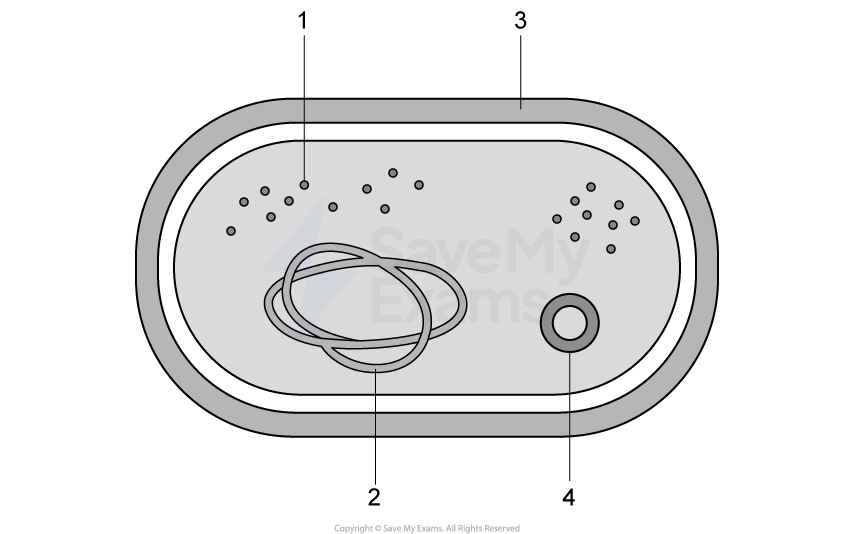
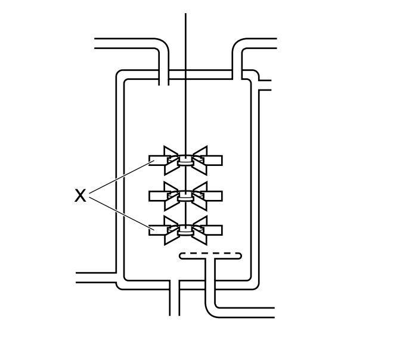
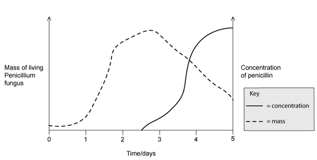
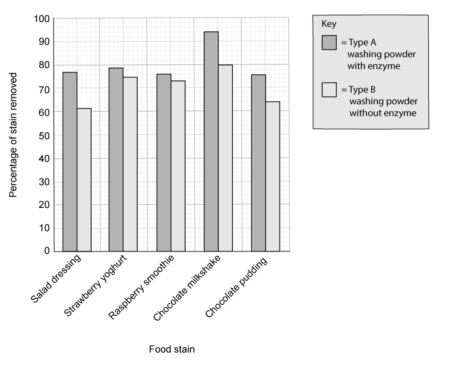
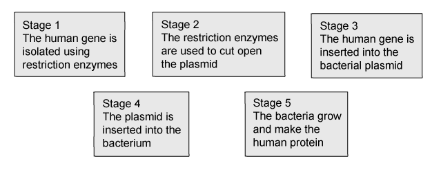

# Exam Questions — Biotechnology & Genetic Modification
**21. Biotechnology & Genetic Modification** · Cambridge (CIE) IGCSE biology (0610 & 0970)
> Source: [https://www.savemyexams.com/igcse/biology/cie/23/topic-questions/](https://www.savemyexams.com/igcse/biology/cie/23/topic-questions/) · 25 questions across 1 sets

## Multiple Choice Questions (25 questions)

### Q1 — medium — 1 marks

**Q1** [1 mark]

The diagram shows the structure of a bacterium.

Which structure is commonly used in genetic modification to produce human proteins such as insulin?

### Q2 — medium — 1 marks

**Q2** [1 mark]

Why are bacteria useful in genetic engineering?

*Source: June 2021 0970/21 Q39*

### Q3 — medium — 1 marks

**Q3** [1 mark]

What is a reason for conserving plant species?

*Source: june 2022 paper 2 Q39*

### Q4 — easy — 1 marks

**Q4** [1 mark]

With which kingdoms do bacteria share the same genetic code?

*Source: june 2022 paper 2 Q37*

### Q5 — easy — 1 marks

**Q5** [1 mark]

Which process makes use of a genetically engineered organism?

*Source: June 2022 Paper 1 Q39*

### Q6 — easy — 1 marks

**Q6** [1 mark]

What is a use of pectinase in the food industry?

*Source: June 2021 0970/11 Q39*

### Q7 — easy — 1 marks

**Q7** [1 mark]

The diagram shows an industrial fermenter that is used to produce penicillin.

What is a function of the part labelled X?

*Source: Specimen 2023 0970/02 Q40*

### Q8 — easy — 1 marks

**Q8** [1 mark]

Which cell structure makes bacteria useful for genetic modification?

*Source: Specimen 2023 0790/02 Q39*

### Q9 — easy — 1 marks

**Q9** [1 mark]

What is an example of genetic modification?

*Source: Specimen 2023 0970/01 Q40*

### Q10 — medium — 1 marks

**Q10** [1 mark]

#### Extended only

Which of the following statements would be an advantage of producing genetically modified crops?

### Q11 — easy — 1 marks

**Q11** [1 mark]

#### Extended only

Why are bacteria used in biotechnology?

### Q12 — medium — 1 marks

**Q12** [1 mark]

Penicillin is produced in a fermenter by growing the fungus *Penicillium*.

The graph below shows how the mass of living *Penicillium *fungus, and the concentration of penicillin, changed over time.

Which day would be the best to harvest the penicillin at?

### Q13 — medium — 1 marks

**Q13** [1 mark]

#### Extended only

Which of the following combinations of nutrients would be needed in a batch fermenter in the production of penicillin?

### Q14 — hard — 1 marks

**Q14** [1 mark]

What is the role of ligase enzymes in genetic engineering?

### Q15 — medium — 1 marks

**Q15** [1 mark]

Which products of fermentation (anaerobic respiration in yeast) are important in the production of beer and bread?

|   | beer | bread |
|---|---|---|
| **A** | ethanol | simple sugars |
| **B** | lactic acid | ethanol |
| **C** | ethanol | carbon dioxide |
| **D** | simple sugars | lactic acid |

### Q16 — hard — 1 marks

**Q16** [1 mark]

Industrial fermenters are used to produce large quantities of microorganisms which can be used for many biotechnological processes.

Which of the following correctly matches the different conditions in the fermenters and the reason why it is important to control these conditions?

|   | aseptic conditions | optimum pH | agitation |
|---|---|---|---|
| **A** | creates an even distribution of substances throughout the fermenter | prevents enzymes from denaturing so that enzyme activity is at a maximum | ensures that only the desired species of microorganisms grow in the fermenter |
| **B** | ensures that only the desired species of microorganisms grow in the fermenter | creates an even distribution of substances throughout the fermenter | prevents enzymes from denaturing so that enzyme activity is at a maximum |
| **C** | prevents enzymes from denaturing so that enzyme activity is at a maximum | ensures that only the desired species of microorganisms grow in the fermenter | creates an even distribution of substances throughout the fermenter |
| **D** | ensures that only the desired species of microorganisms grow in the fermenter | prevents enzymes from denaturing so that enzyme activity is at a maximum | creates an even distribution of substances throughout the fermenter |

### Q17 — easy — 1 marks

**Q17** [1 mark]

What is the name of the enzyme used to produce clear apple juice?

### Q18 — easy — 1 marks

**Q18** [1 mark]

Which of these statements correctly describes genetic engineering?

### Q19 — medium — 1 marks

**Q19** [1 mark]

Which of these is **not **a correct use of genetic modification?

### Q20 — hard — 1 marks

**Q20** [1 mark]

#### Extended only

Genes are isolated from human DNA using ……**1**…… enzymes.

A bacterial plasmid is cut with the same enzyme creating ……**2**…… .

The human DNA is inserted into the bacterial plasmid using the enzyme ……**3**…… creating  a ……**4**…… plasmid.

Which row correctly completes gaps **1**, **2**, **3** and **4**?

|   | 1 | 2 | 3 | 4 |
|---|---|---|---|---|
| **A** | restriction | sticky ends | ligase | recombinant |
| **B** | ligase | daughter plasmids | ligase | restriction |
| **C** | recombinant | new DNA | lipase | daughter |
| **D** | ligase | sticky ends | protease | diploid |

### Q21 — hard — 1 marks

**Q21** [1 mark]

The following statements describe biofuel.

1. Yeast respires to produce ethanol and carbon dioxide
2. It is a renewable energy source since it is made from living organisms instead of fossil fuels
3. Waste parts of crop plants can be used to produce biofuels
4. In some parts of the world, crops are grown specifically for use as biofuels

Which of these statements could be considered an advantage of biofuel?

### Q22 — easy — 1 marks

**Q22** [1 mark]

What needs to be inserted into a bacterial cell to allow it to produce insulin to treat diabetes?

### Q23 — easy — 1 marks

**Q23** [1 mark]

Which of the following is a reason yeast is used to make bread?

*Yeast is used to make bread because...*

### Q24 — medium — 1 marks

**Q24** [1 mark]

Which food shown in the graph below has the highest percentage stain removal with a biological washing powder?

### Q25 — hard — 1 marks

**Q25** [1 mark]

#### Extended only

The stages of genetic engineering are shown in the diagram below.

Which stages involve the production of sticky ends?
