# Exam Questions — Biotechnology & Genetic Modification
**21. Biotechnology & Genetic Modification** · Cambridge (CIE) IGCSE biology (0610 & 0970)
> Source: [https://www.savemyexams.com/igcse/biology/cie/23/topic-questions/](https://www.savemyexams.com/igcse/biology/cie/23/topic-questions/) · 37 questions across 2 sets

## Multiple Choice Questions (25 questions)

### Q1 — medium — 1 marks

**Q1** [1 mark]

The diagram shows the structure of a bacterium.

Which structure is commonly used in genetic modification to produce human proteins such as insulin?

### Q2 — medium — 1 marks

**Q2** [1 mark]

Why are bacteria useful in genetic engineering?

*Source: June 2021 0970/21 Q39*

### Q3 — medium — 1 marks

**Q3** [1 mark]

What is a reason for conserving plant species?

*Source: june 2022 paper 2 Q39*

### Q4 — easy — 1 marks

**Q4** [1 mark]

With which kingdoms do bacteria share the same genetic code?

*Source: june 2022 paper 2 Q37*

### Q5 — easy — 1 marks

**Q5** [1 mark]

Which process makes use of a genetically engineered organism?

*Source: June 2022 Paper 1 Q39*

### Q6 — easy — 1 marks

**Q6** [1 mark]

What is a use of pectinase in the food industry?

*Source: June 2021 0970/11 Q39*

### Q7 — easy — 1 marks

**Q7** [1 mark]

The diagram shows an industrial fermenter that is used to produce penicillin.

What is a function of the part labelled X?

*Source: Specimen 2023 0970/02 Q40*

### Q8 — easy — 1 marks

**Q8** [1 mark]

Which cell structure makes bacteria useful for genetic modification?

*Source: Specimen 2023 0790/02 Q39*

### Q9 — easy — 1 marks

**Q9** [1 mark]

What is an example of genetic modification?

*Source: Specimen 2023 0970/01 Q40*

### Q10 — medium — 1 marks

**Q10** [1 mark]

#### Extended only

Which of the following statements would be an advantage of producing genetically modified crops?

### Q11 — easy — 1 marks

**Q11** [1 mark]

#### Extended only

Why are bacteria used in biotechnology?

### Q12 — medium — 1 marks

**Q12** [1 mark]

Penicillin is produced in a fermenter by growing the fungus *Penicillium*.

The graph below shows how the mass of living *Penicillium *fungus, and the concentration of penicillin, changed over time.

Which day would be the best to harvest the penicillin at?

### Q13 — medium — 1 marks

**Q13** [1 mark]

#### Extended only

Which of the following combinations of nutrients would be needed in a batch fermenter in the production of penicillin?

### Q14 — hard — 1 marks

**Q14** [1 mark]

What is the role of ligase enzymes in genetic engineering?

### Q15 — medium — 1 marks

**Q15** [1 mark]

Which products of fermentation (anaerobic respiration in yeast) are important in the production of beer and bread?

|   | beer | bread |
|---|---|---|
| **A** | ethanol | simple sugars |
| **B** | lactic acid | ethanol |
| **C** | ethanol | carbon dioxide |
| **D** | simple sugars | lactic acid |

### Q16 — hard — 1 marks

**Q16** [1 mark]

Industrial fermenters are used to produce large quantities of microorganisms which can be used for many biotechnological processes.

Which of the following correctly matches the different conditions in the fermenters and the reason why it is important to control these conditions?

|   | aseptic conditions | optimum pH | agitation |
|---|---|---|---|
| **A** | creates an even distribution of substances throughout the fermenter | prevents enzymes from denaturing so that enzyme activity is at a maximum | ensures that only the desired species of microorganisms grow in the fermenter |
| **B** | ensures that only the desired species of microorganisms grow in the fermenter | creates an even distribution of substances throughout the fermenter | prevents enzymes from denaturing so that enzyme activity is at a maximum |
| **C** | prevents enzymes from denaturing so that enzyme activity is at a maximum | ensures that only the desired species of microorganisms grow in the fermenter | creates an even distribution of substances throughout the fermenter |
| **D** | ensures that only the desired species of microorganisms grow in the fermenter | prevents enzymes from denaturing so that enzyme activity is at a maximum | creates an even distribution of substances throughout the fermenter |

### Q17 — easy — 1 marks

**Q17** [1 mark]

What is the name of the enzyme used to produce clear apple juice?

### Q18 — easy — 1 marks

**Q18** [1 mark]

Which of these statements correctly describes genetic engineering?

### Q19 — medium — 1 marks

**Q19** [1 mark]

Which of these is **not **a correct use of genetic modification?

### Q20 — hard — 1 marks

**Q20** [1 mark]

#### Extended only

Genes are isolated from human DNA using ……**1**…… enzymes.

A bacterial plasmid is cut with the same enzyme creating ……**2**…… .

The human DNA is inserted into the bacterial plasmid using the enzyme ……**3**…… creating  a ……**4**…… plasmid.

Which row correctly completes gaps **1**, **2**, **3** and **4**?

|   | 1 | 2 | 3 | 4 |
|---|---|---|---|---|
| **A** | restriction | sticky ends | ligase | recombinant |
| **B** | ligase | daughter plasmids | ligase | restriction |
| **C** | recombinant | new DNA | lipase | daughter |
| **D** | ligase | sticky ends | protease | diploid |

### Q21 — hard — 1 marks

**Q21** [1 mark]

The following statements describe biofuel.

1. Yeast respires to produce ethanol and carbon dioxide
2. It is a renewable energy source since it is made from living organisms instead of fossil fuels
3. Waste parts of crop plants can be used to produce biofuels
4. In some parts of the world, crops are grown specifically for use as biofuels

Which of these statements could be considered an advantage of biofuel?

### Q22 — easy — 1 marks

**Q22** [1 mark]

What needs to be inserted into a bacterial cell to allow it to produce insulin to treat diabetes?

### Q23 — easy — 1 marks

**Q23** [1 mark]

Which of the following is a reason yeast is used to make bread?

*Yeast is used to make bread because...*

### Q24 — medium — 1 marks

**Q24** [1 mark]

Which food shown in the graph below has the highest percentage stain removal with a biological washing powder?

### Q25 — hard — 1 marks

**Q25** [1 mark]

#### Extended only

The stages of genetic engineering are shown in the diagram below.

Which stages involve the production of sticky ends?

## Theory Questions (12 questions)

### Q1 — hard — 12 marks

**Q1** [3 marks]

Alpha-1 antitrypsin (AAT) is a protein that protects the lungs from damage. A deficiency in this protein is a genetic condition determined by a single gene.

Fig. 6.1 shows the inheritance of this condition in a family.

**Fig. 6.1**

Using evidence from Fig. 6.1:

(i) Explain whether the allele for AAT deficiency is dominant or recessive.

[2]

(ii) Determine the probability of individuals 5 and 6 having a second child who is a carrier.

[1]

**Q1** [5 marks]

Scientists are now using genetically modified (GM) bacteria to produce human AAT.

Describe the process used to insert the human AAT gene into a bacterial plasmid. Include the specific roles of any enzymes involved.

**Q1** [4 marks]

Scientists needed to choose between two different strains of genetically modified bacteria (strain 1 and strain 2) to maximise the production of the AAT protein. They grew both strains in a fermenter over a range of temperatures and measured the yield of AAT protein.

The results are shown in Table 6.1.

**Table 6.1**

| Temperature (°C) | AAT yield from strain 1 (mg dm⁻³) | AAT yield from strain 2 (mg dm⁻³) |
|---|---|---|
| 25 | 40 | 85 |
| 30 | 110 | 120 |
| 35 | 125 | 130 |
| 40 | 115 | 60 |
| 45 | 45 | 10 |

A student suggested that strain 1 was more suitable for large-scale industrial production.

Evaluate this conclusion.

### Q2 — easy — 8 marks

**Q2** [2 marks]

**Extended Tier Only**

Identify two structural features present in bacterial cells but absent in animal cells.

**Q2** [2 marks]

**Extended Tier Only**

Describe why bacteria are useful in biotechnology.

**Q2** [2 marks]

**Extended Tier Only**

Explain why temperature and pH must be controlled in an industrial fermenter.

**Q2** [2 marks]

**Extended Tier Only**

Identify two products that can be produced on a large scale using industrial fermenters.

### Q3 — medium — 17 marks

**Q3** [3 marks]

Bacteria are used in many biotechnological processes.

Explain why bacteria are useful in biotechnology.

*Source: june 2021 paper 4 Q3A*

**Q3** [3 marks]

Insulin is one of many human proteins that are made by genetically engineered bacteria.

Some people cannot produce insulin because their immune system has destroyed the cells that make insulin.

(i) State the organ that contains the cells that have been destroyed.

[1]

(ii) State the name of the disease caused by the destruction of these cells.

[1]

(iii) State the function of insulin in the body.

[1]

*Source: june 2021 paper 4 Q3B*

**Q3** [6 marks]

Genetically engineered bacteria that are used to make insulin were grown in a fermenter for five days.

Samples were taken from the fermenter every six hours and the number of bacteria in 1.0mm3 of the nutrient solution were counted.

Changes in the numbers of living bacteria in the samples taken from the fermenter are shown in Fig. 3.1.

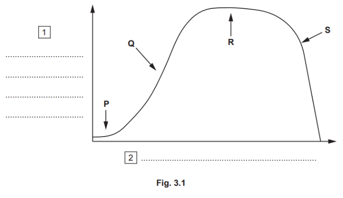

(i) Complete Fig. 3.1 by adding labels for the axes at 1 and 2 .

[1]

(ii) State the names of the stages of population growth of the bacteria labelled P to S.

[2]

(iii) Explain, with reference to Fig. 3.1, why the bacteria did not grow in the fermenter for longer than five days.

[3]

*Source: june 2021 paper 4 Q3C*

**Q3** [5 marks]

Fig. 3.2 shows a field of cassava, *Manihot esculenta*, which is a crop plant grown in parts of Africa and Asia.

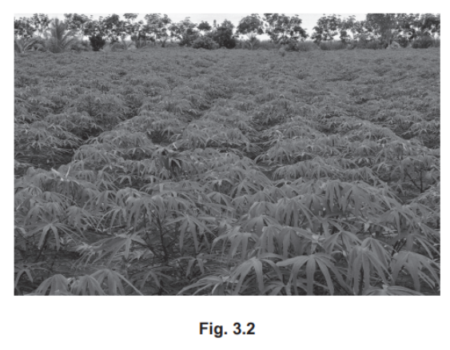

The plants store starch in their roots, which form a large part of the diet for many people. Cassava does not provide many vitamins or mineral ions.

Genetic engineers have modified cassava to increase its iron content. They have done this by incorporating a gene for a membrane protein from the plant *Arabidopsis thaliana*.

(i) State the name of the enzyme that is used to cut out the gene from the DNA of *A. thaliana.*

[1]

(ii) Describe how the gene from* A. thaliana* and the DNA from cassava form recombinant DNA.

[2]

(iii) Scientists who develop genetically engineered varieties of crop plants often breed them for several generations before releasing them for farmers to use. Suggest why the scientists do this.

[2]

*Source: june 2021 paper 4 Q3E*

### Q4 — medium — 5 marks

**Q4** [3 marks]

Fig. 1 shows a field of sugar cane and the remains of the sugar cane after the harvest.

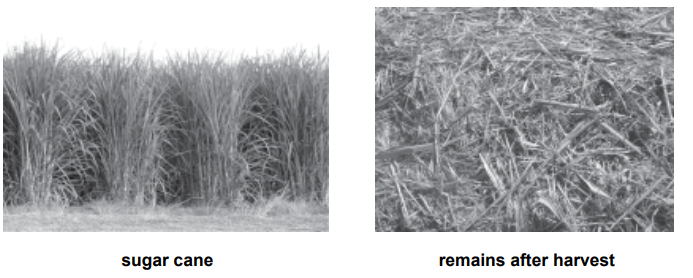

**Fig. 1**

The sugars in sugar cane can be used to make ethanol biofuel.

(i)

State the name of an organism that can be used to make ethanol biofuel from sugars.

[1]

(ii)

State the process that this organism uses to make ethanol biofuel from sugars.

[2]

*Source: 2020 0610/03 Q8A*

**Q4** [2 marks]

**Extract:**

Fig. 1 shows a field of sugar cane and the remains of the sugar cane after the harvest.

The sugars in sugar cane can be used to make ethanol biofuel.

A lot of heat is needed for the final stage of making the biofuel. This heat can be provided by burning fossil fuels.

Explain why it would be better to burn the remains of the sugar cane instead of burning a fossil fuel.

*Source: 2020 0610/03 Q8B*

### Q5 — easy — 10 marks

**Q5** [3 marks]

Genetic modification is a technique that can be used to create many useful substances.

Define the term *genetic modification*.

**Q5** [2 marks]

#### Extended only

Fig. 1 shows part of the process of genetic modification.

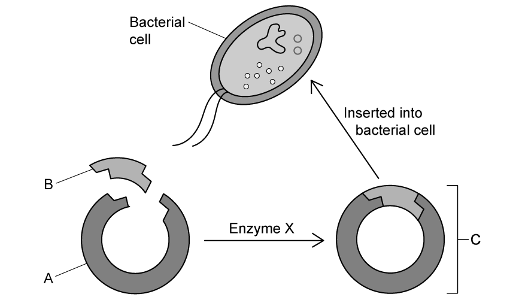

**Fig. 1**

(i)

Identify structure **A**.

[1]

(ii)

Describe the function of structure **A** in the process of genetic modification.

[1]

**Q5** [2 marks]

#### Extended only

Structure **A** and **B** contain 'sticky ends'.

Explain the purpose of these.

**Q5** [3 marks]

**Extract:**

(b) (i) Structure A can be identified as... - (A) plasmid; (ii) The function of structure A in genetic modification is... - It provides a way for genes / sections of DNA to be inserted into cells OR it acts as a vector.

(c) The purpose of 'sticky ends' is to... - They form short sections of unpaired bases; - It provides a way for the gene to be inserted/joined/linked into the plasmid; Sticky ends provide an attachment point to securely join the gene and plasmid together. If the ends were blunt it would be impossible to do that.

#### Extended only

Enzyme **X** plays an important role in the process of genetic modification.

(i)

Identify enzyme **X** and state its purpose in genetic modification.

[2]

(ii)** **  ** **

Enzyme **X** leads to the formation of structure **C**.

Give the name of structure **C**.

[1]

### Q6 — easy — 8 marks

**Q6** [2 marks]

Define the term *genetically modified organism*.

**Q6** [4 marks]

#### Extended only

Fig. 1 shows insecticide use and the percentage of land used to grow genetically modified (GM) corn in US cornfields between 1996 and 2013.

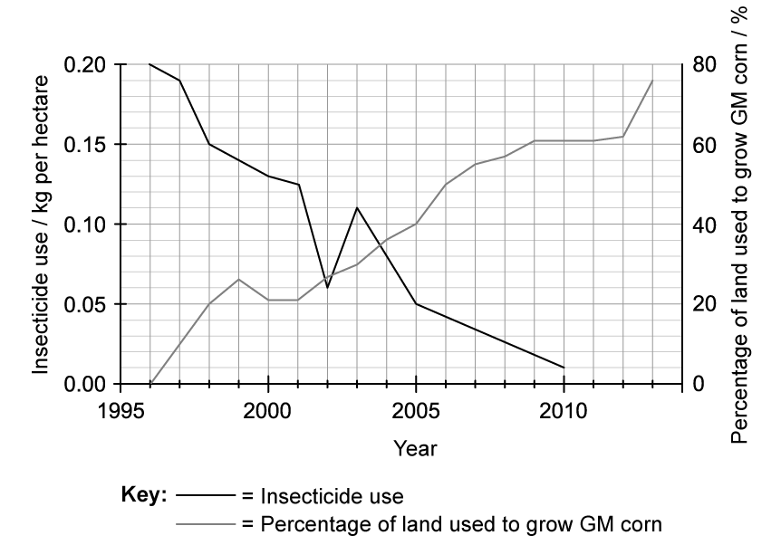

**Fig. 1**

(i)

Calculate the change in insecticide use between 1996 and 2010.

[2]

(ii)

Describe what the data shows about insecticide use and the percentage of corn fields used to grow GM corn between 1996 and 2013.

[2]

**Q6** [2 marks]

#### Extended only

One way in which the corn in part (b) has been genetically modified is to provide the corn with resistance to pests.

Explain one benefit of pest resistant GM corn.

### Q7 — hard — 14 marks

**Q7** [4 marks]

#### Extended only

Bacteria are often used in biotechnology as there are several advantages to their use in this field.

Outline the benefits of using bacteria in biotechnology.

**Q7** [2 marks]

Another example of a microorganism that is useful in biotechnology is the fungus *Aspergillus niger*. They typically grow on fruit and produce pectinase that breaks down plant cell walls. This enables *A. niger* to feed on the contents of the plant cells.

Pectinase is also used in the food and beverage industry.

Explain the use of pectinase in the food and beverage industry.

**Q7** [6 marks]

#### Extended only

Many fruits, such as lemons and limes, contain a substance called citric acid which has a wide variety of applications in the food-, cosmetics- and pharmaceutical industries.

Certain strains of *A. niger* can be used to produce citric acid on an industrial scale by the aerobic breakdown of glucose at pH levels of between 4 and 6.5. The fungus is cultured in large industrial fermenters where conditions are kept at an optimum.

Describe and explain the conditions that should be controlled in the fermenter to ensure optimum production of citric acid.

**Q7** [2 marks]

#### Extended only

In the 1970s, the major US agrochemical business Monsanto developed a family of chemical herbicides that it sold under the trade name Roundup™.

Roundup™ is active against a very wide variety of plants.

Monsanto also developed a range of genetically-modified crop seeds that were resistant to Roundup™ by inserting a gene from a species of soil bacterium.

Suggest **two** possible ecological risks of planting these genetically-modified seeds.

### Q8 — hard — 10 marks

**Q8** [2 marks]

Tissue plasminogen activators (TPAs) are human proteins that are used as drugs to break down blood clots.

TPAs break down blood clots by activating plasminogen. Plasminogen is a protein that is always present in the blood.

When activated, plasminogen forms a protease that breaks down fibrin molecules.

(i)

Plasminogen is found in the plasma.

State what is meant by the term *plasma*.

[1]

(ii)

State the products of the action of protease on the protein fibrin.

[1]

*Source: 2019 0970/41 Q5A*

**Q8** [8 marks]

**Extract:**

Tissue plasminogen activators (TPAs) are human proteins that are used as drugs to break down blood clots.

TPAs break down blood clots by activating plasminogen. Plasminogen is a protein that is always present in the blood.

When activated, plasminogen forms a protease that breaks down fibrin molecules.

#### Extended Only

TPAs can be produced by genetically-engineered bacteria.

Fig. 1 shows some of the stages involved in genetically engineering a bacterium to make a TPA.

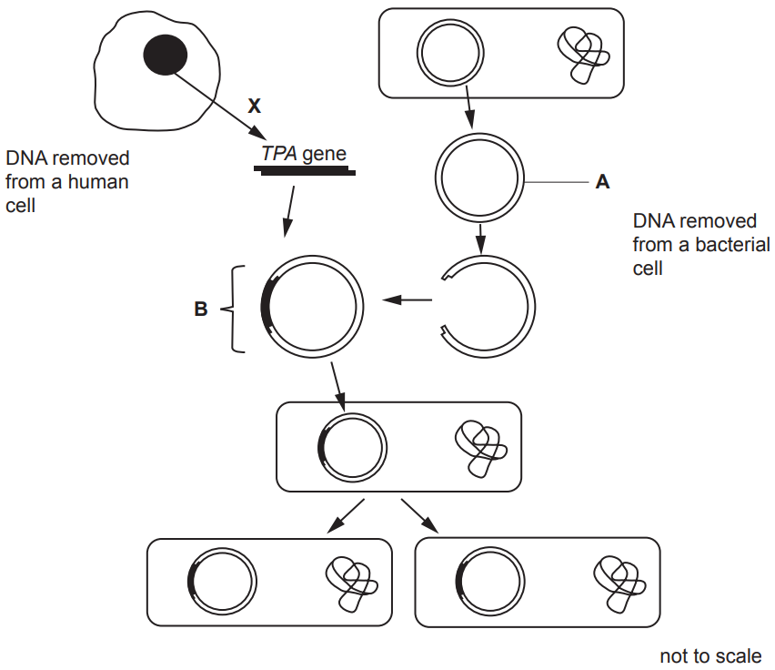

**Fig. 1**

(i)

State the name of structure **A** in Fig. 1.

[1]

(ii)

In the flow chart, **X** represents the action of an enzyme on a molecule of DNA.

State the name of this enzyme.

[1]

(iii)

The *TPA* gene is inserted into structure **A**.

Explain how the gene is inserted into structure **A** to form structure **B** as shown in Fig. 1.

[3]

(iv)

Before TPA was made by genetically-engineered bacteria it was only available from blood donated by people.

Suggest **one** advantage of producing TPA by genetically-engineered bacteria.

[1]

(v)

The genetically-engineered bacteria produce mRNA that is a copy of the human *TPA* gene.

Explain the role of mRNA in the bacterium.

[2]

*Source: 2019 0970/41 Q5B*

### Q9 — easy — 8 marks

**Q9** [1 mark]

Biological washing powders are very effective at removing stains from organic molecules, such as blood or oil.

State the substance that makes biological washing powders so effective at removing these stains.

**Q9** [2 marks]

Give **two** advantages of using biological washing powders to remove stains over non-biological washing powders.

**Q9** [4 marks]

Complete the following paragraph on the use of yeast in bread making.

Yeast will respire _______________________ in the presence of plenty of ______________________. This will produce ____________________ gas which is trapped in the dough, causing the bread to ____________.

**Q9** [1 mark]

Yeast is also involved in the production of biofuels.

State the substance produced by yeast that is used as a biofuel.

### Q10 — medium — 15 marks

**Q10** [2 marks]

A factory uses biotechnology to process apples.

Some of the apple juice is mixed with yeast and used to make ethanol.

(i)    **  **

State the type of respiration in yeast that produces ethanol.

[1]

(ii)

State the name of the substance in apple juice that is converted to ethanol by yeast.

[1]

*Source: 2018 0610/33 Q6A*

**Q10** [5 marks]

The yeast uses enzymes to produce ethanol.

(i)

Define the term **enzyme**.

[2]

(ii)

Fig. 1 shows apparatus used to find the best (optimum) temperature for making ethanol.

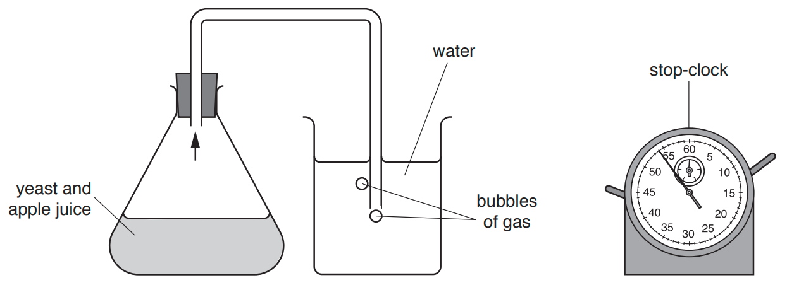

**Fig. 1**

The same apparatus was used at different temperatures.

The rate of ethanol production was compared by counting the number of bubbles of gas produced by the yeast and                  apple juice mixture per minute.

State the name of the gas produced by the yeast in Fig. 1.

(iii)

The results of the investigation are shown in Fig. 2.

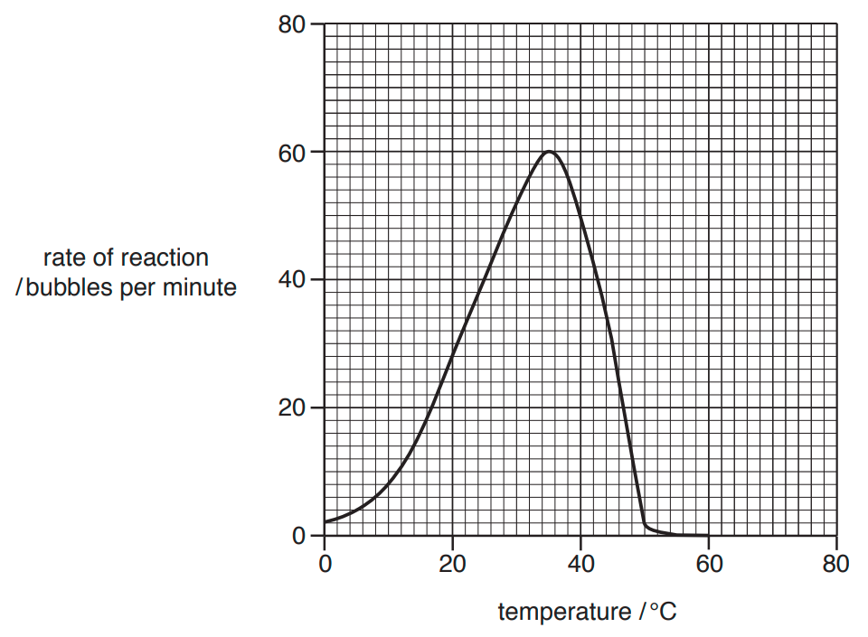

**Fig. 2**

Calculate the increase in the rate of reaction from 20 °C to 25 °C in Fig. 2.

Give your answer in bubbles per minute.

[1]

(iv)

State the optimum temperature for the reaction shown in Fig. 2.

Give your answer in °C.

[1]

*Source: 2018 0610/33 Q6B*

**Q10** [2 marks]

The cut surface of an apple usually turns brown when exposed to air. This is caused by enzymes.

Three slices of apple were given different treatments and were then exposed to air for 30 minutes.

Table 1 shows the treatments and appearance of the apple slices.

**Table 1**

| **apple slice** | **pH** | **temperature / °C** | **appearance of the apple slice at 0 minutes** | **appearance of the apple slice after 30 minutes** |
|---|---|---|---|---|
| **A** | 6 | 20 | white | brown |
| **B** | 2 | 20 | white | white |
| **C** | 6 | 4 | white | white |

Suggest why slice **B** and slice **C** did not turn brown after 30 minutes.

*Source: 2018 0610/33 Q6C*

**Q10** [3 marks]

The enzyme pectinase is used in industry for the production of apple juice.

Explain why pectinase is used when making apple juice.

*Source: 2018 0610/33 Q6D*

**Q10** [3 marks]

Hygienic conditions are required in an apple juice factory.

Describe **three** precautions workers should take to ensure that good food hygiene is maintained in the apple juice factory.

*Source: 2018 0610/33 Q6E*

### Q11 — hard — 19 marks

**Q11** [6 marks]

#### Extended Only

Penicillin is an antibiotic produced by the fungus *Penicillium chrysogenum*.

Fig. 1 shows the process used to produce penicillin.

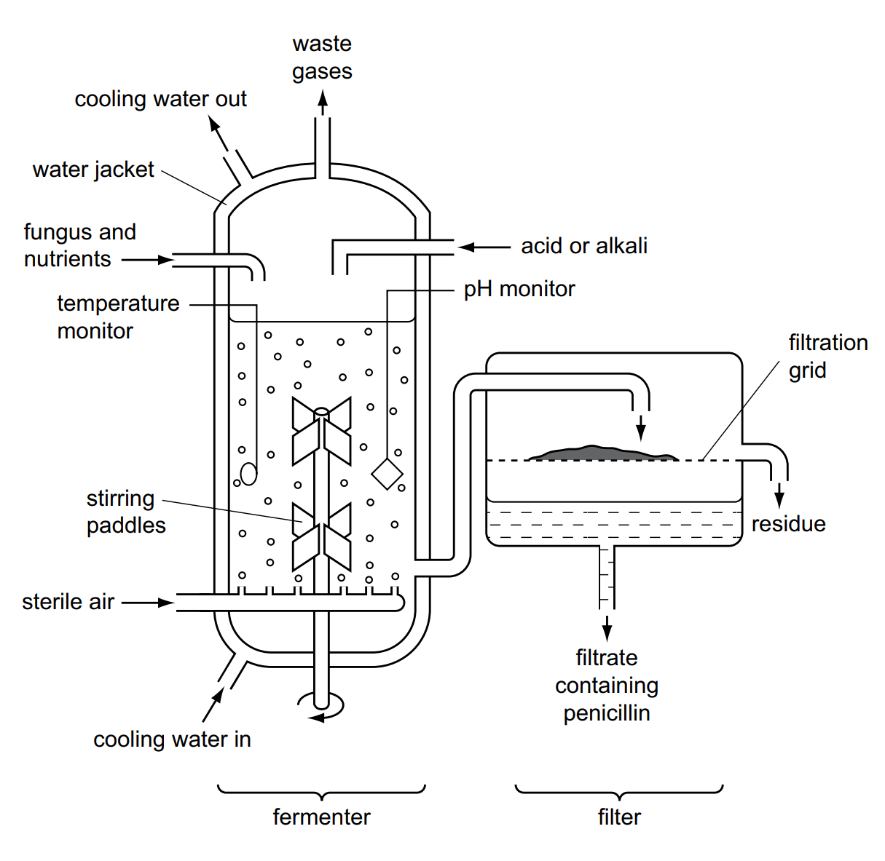

**Fig. 1**

Explain why there is a water jacket around the fermenter **and** why acids or alkalis are added to the fermenter.

*Source: 2020 0610/04 Q5A*

**Q11** [5 marks]

#### Extended Only

Fig. 2 shows the mass of fungus and the yield of penicillin during the fermentation process.

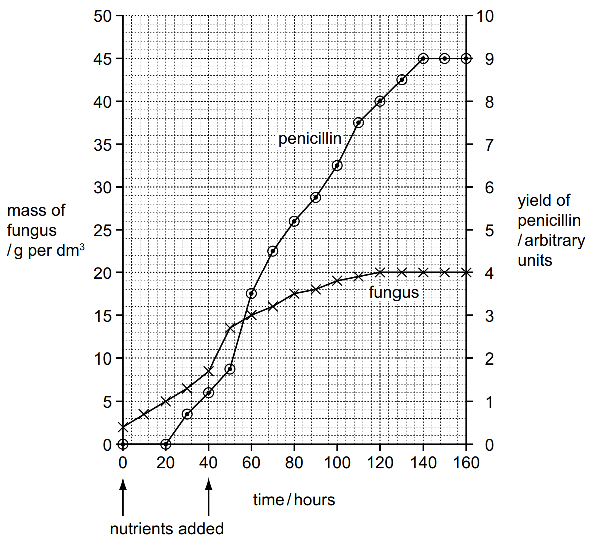

**Fig. 2**

(i)

State the time interval over which the fungus grew at its maximum rate.

Give your answer in hours.

[1]

(ii)

As the fungus grows in the fermenter, the nuclei in the fungal hyphae divide.

State the type of nuclear division that occurs during the growth of the fungus in the fermenter.

[1]

(iii)

Explain why the growth of the fungus slows down and stops.

[3]

*Source: 2020 0610/04 Q5B*

**Q11** [3 marks]

**Extract:**

Fig. 2 shows the mass of fungus and the yield of penicillin during the fermentation process.

#### Extended Only

Penicillin is not needed for the growth of *P. chrysogenum*.

(i)

State the evidence from Fig. 2 that shows that penicillin is not needed for this growth.

[2]

(ii)

The people in charge of the penicillin production emptied the fermenter after 160 hours.

Use the information in Fig. 2 to suggest why they did not allow the fermentation to continue for longer.

[1]

*Source: 2020 0610/04 Q5C*

**Q11** [3 marks]

#### Extended Only

*Downstream processing* refers to all the processes that occur to the contents of the fermenter after it is emptied. This involves making penicillin into a form that can be used as a medicine.

Suggest why downstream processing is necessary.

*Source: 2020 0610/04 Q5D*

**Q11** [2 marks]

Explain why antibiotics, such as penicillin, affect bacteria but not viruses.

*Source: 2020 0610/04 Q5E*

### Q12 — medium — 19 marks

**Q12** [1 mark]

Bacteria are useful in biotechnology and genetic engineering.

Fig. 1 shows a photomicrograph of a bacterium.

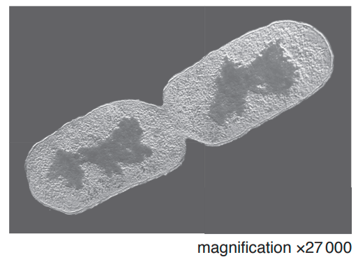

**Fig. 1**

State the name of the process that is taking place in Fig. 1.

*Source: 2018 0610/42 Q6A*

**Q12** [2 marks]

#### Extended Only

(i)

Write the formula that would be used to calculate the actual width of the bacterium.

[1]

(ii)

The actual width of the bacterium is 0.0008 mm.

Convert this value to micrometres (μm).

[1]

*Source: 2018 0610/42 Q6B*

**Q12** [6 marks]

#### Extended Only

Genetically modified bacteria can produce human insulin.

(i)

State the name of the disease that can be treated with insulin injections.

[1]

(ii)  **   **

Insulin is a protein.

Describe the process of using bacteria in genetic engineering to produce human proteins.

[5]

*Source: 2018 0610/42 Q6C*

**Q12** [6 marks]

#### Extended Only

Genetically modified bacteria are often grown in fermenters.

(i)

Suggest why steam is used to clean fermenters.

[2]

(ii)

State **three** conditions inside a fermenter that are measured and controlled.

[3]

(iii)

State the name of **one** commercial product, **other than** insulin, that is made in fermenters.

[1]

*Source: 2018 0610/42 Q6D*

**Q12** [4 marks]

#### Extended Only

Crop plants can also be genetically modified.

Describe the advantages of genetically modifying crops.

*Source: 2018 0610/42 Q6E*

