# Mark Schemes — Diffusion, Osmosis & Active Transport
**3. Movement into & out of Cells** · Cambridge (CIE) IGCSE biology (0610 & 0970)

## Alternative To Practical Questions (4 questions)

### Q1
(i)

- 0.4; **[1 mark]**

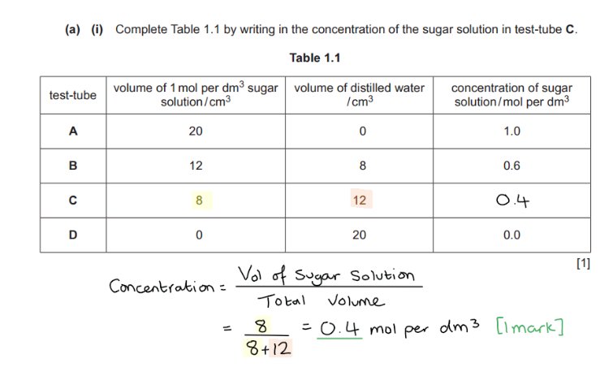

(ii)

- Table has a minimum of two columns / rows **AND** a header row; **[1 mark]**
- Headings = sugar concentration in mol per dm3 / test tube **AND** length of potato (after 20 minutes) in mm; **[1 mark]**
- Lengths of potato cylinders correctly measured; **[1 mark]**

  - A = 34/35/36
  - B = 36/37/38
  - C = 38/39/40
  - D = 41/42/43

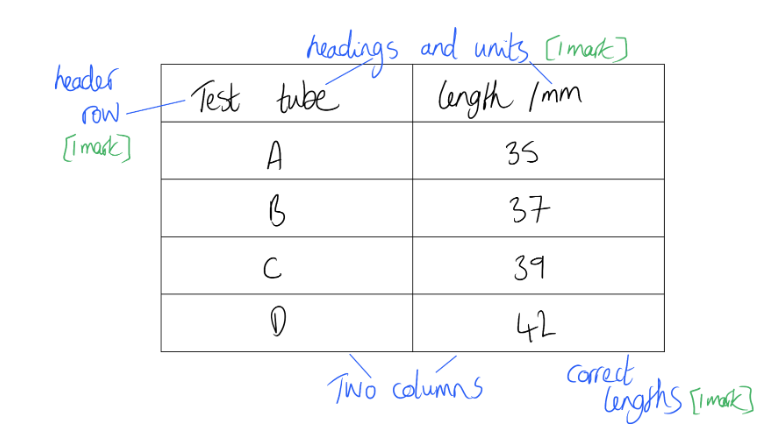

(iii)

So that the results are comparable / so that sugar concentration is the only variable that is changed **OR** to ensure that the surface area of the cylinders is the same / so that surface area does not affect the rate of osmosis; **[1 mark]**

(iv)

- Concentration of the sugar solution; **[1 mark]**

(v)

Any two from:

- Measure the mass of the cylinders (instead of length); **[1 mark]**
- Test more intermediate concentrations of sugar solution; **[1 mark]**
- Extend the range of concentrations used;**[1 mark]**
- Repeat at each concentration;**[1 mark]**
- Soak for longer than 20 minutes; **[1 mark]**
- Use warm sugar solutions (to speed up diffusion); **[1 mark]**
- Keep all test tubes at the same temperature; **[1 mark]**
- Dry the cylinders before measuring; **[1 mark]**

(vi)

- Cut away from body / cut on a wooden board/tile/flat surface / keep blade away from body / dry potato before cutting; **[1 mark]**

Note that it is not enough here to just make a general statement such as ‘take care when cutting’; you need to give a specific instruction as to how care should be taken.

**[Total: 9 marks]**
- Independent variable = carry out investigation at a minimum of 2 different temperatures; **[1 mark]**

*Variables to be kept constant; a maximum of two from:*

- Same concentration / volume of solution / water;  **[1 mark]**
- Same (initial) length / volume / mass / surface area of plant tissue;  **[1 mark]**
- Same type / age / variety of plant tissue **OR** same piece of plant tissue / same plant;  **[1 mark]**
- Same pH / use a buffer;  **[1 mark]**
- Same immersion time;  **[1 mark]**

*Method*

- Method of maintaining temperature described, e.g. a temperature-controlled water bath;  **[1 mark]**
- Use of plant tissue (e.g. potato / leaves / root / stem) immersed in water / sugar / salt solution; **[1 mark]**
- Method for measuring the dependent variable is described, e.g. measuring the length / mass / volume / surface area of plant tissue before and after immersion;  **[1 mark]**
- Allow time for tissue/solution to reach the correct temperature / to equilibrate to temperature;  **[1 mark]**
- Drying plant tissue before reweighing (if mass is being measured); [1 mark]
- Carry out at least two repeats at each temperature / a total of at least three trials; **[1 mark]**

When writing a plan for an investigation you should always consider the variable that will be changed on purpose (the independent variable), the variable that will be measured (the dependent variable) and any variables that you will need to keep constant. Describe how you will change/measure/control each of these variables. You can then gain additional marks for describing extra details of the method. Don’t forget to consider general points that will be relevant to all investigations, such as a suitable number of repeats.

**[Total: 6 marks]**
(i)

- Iodine solution;** [1 mark]**
- Positive result = blue-black; **[1 mark]**

(ii)

- Clear, single, unbroken lines **AND** no shading; **[1 mark]**
- Central cell has a minimum diameter of 56 mm; **[1 mark]**
- A double line represents the entire cell wall; **[1 mark]**
- A minimum of five starch grains are shown around the perimeter of the cell; **[1 mark]**
- One starch grain is labelled; **[1 mark]**

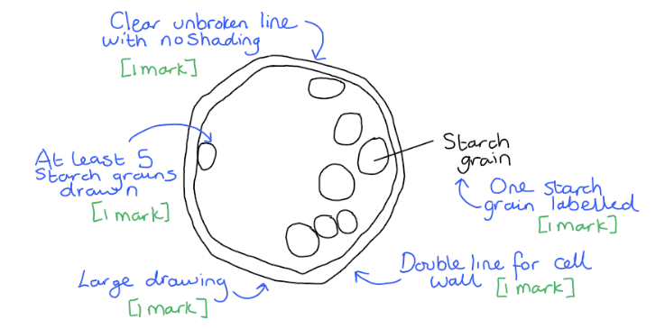

(iii)

- Length of line AB = 9/10/11 mm; **[1 mark]**

*Calculating actual diameter: *

- 10800; **[1 mark]**
- 0.013 (0.011–0.014) mm; **[1 mark]**

*Award two marks for the correct actual diameter in the absence of other calculations. *

*Note that the measurements will be different on the screen to those on a printed copy of the exam paper.*

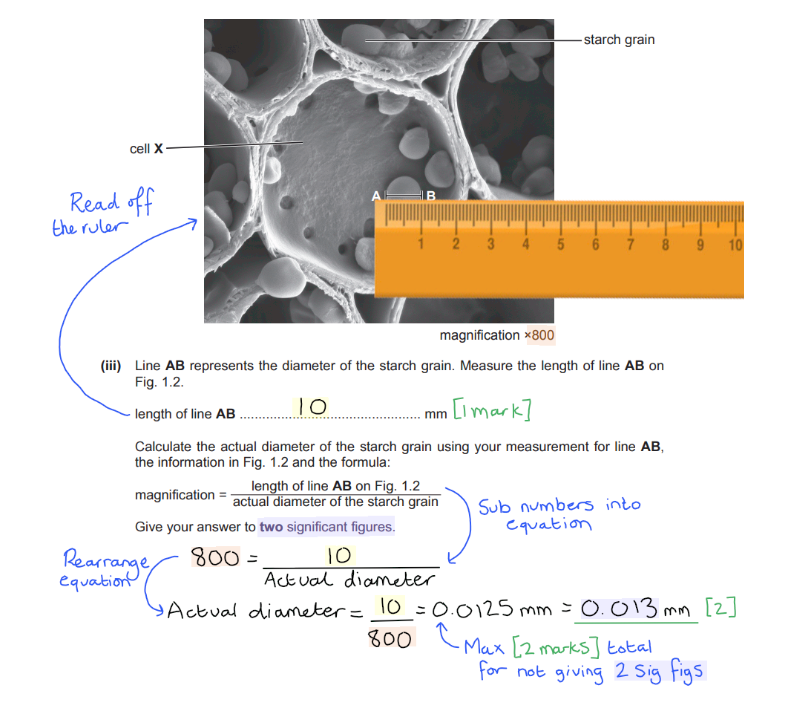

**[Total: 10 marks]**

### Q2
(i) Marks are awarded for completion of the table as follows...

- The table should have a minimum of two columns **AND** a line separating the headings from the data;** [1 mark]**
- Headings are 'Percentage/% concentration of citric acid' **AND **'Distance (travelled) / cm/mm'; **[1 mark]**
- Three correct distances recorded (see model answer); **[1 mark]**

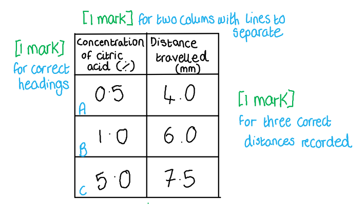

*For A accept 2 mm, for B accept 4 mm, and for C accept 5.5-6 mm (these are the distances to the edge of the red circle).*

(ii) The method for measuring the distance travelled is as follows...

- Measure from the (edge of the) hole to the edge of the (red/yellow) circle **OR **measure the diameter/radius of the (red/yellow) circle; **[1 mark]**

(iii) From these results we can conclude...

- The higher the concentration (of the solution) the further the acid/solution moves/diffuses; **[1 mark]**

(iv) The diffusion coefficient can be calculated as follows:

- 196 ÷ 30; **[1 mark]**
- 6.5 (mm2 per minute); **[1 mark]**

*Full marks can be awarded for the correct answer in the absence of other calculations.*

(v) The pH of the red and green agar can be predicted as follows...

- (Red agar pH =) 1 or 2 / value lower than 7 / acidic; **[1 mark]**
- (Green agar pH =) 7 / in the range of 7-8 / neutral; **[1 mark]**

**[Total: 9 marks]**

> *ii) The best way of determining the distance travelled by the citric acid is to measure from its starting point to its end point, so from the edge of the hole to the edge of the circle (either red or yellow depending on your criteria). Measuring the radius or diameter is given as a creditworthy answer here, but this really just provides a representation of the distance moved across the agar rather than the actual distance.*

> *iv) The diffusion coefficient can be calculated as follows:*

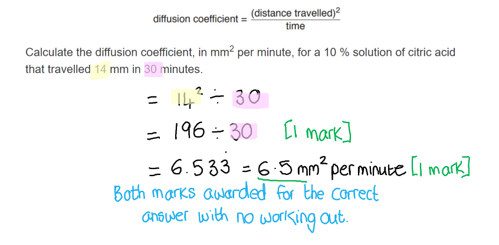
(i) Two variables that have been kept constant might include...

Any **two** of the following:

- Number of drops / three drops (of citric acid/solution in the holes);** [1 mark]**
- Agar concentration/depth/volume; **[1 mark]**
- Size of holes/wells;** [1 mark]**
- Type of indicator **OR** concentration/volume of indicator;** [1 mark]**
- Time (the investigation was left for) / investigation left for 30 minutes; **[1 mark]**
- Temperature (of the room/equipment/surroundings); **[1 mark]**
- The type of acid / using the same stock solution of citric acid; **[1 mark]**

(ii) In this investigation a source of error and the effect of this could be...

Any **pair** of points from the following:

- (Source of error =) drop sizes (of citric acid) vary; **[1 mark]**
- (Effect on results =) a larger volume produces greater diffusion distance **OR** a smaller volume produces shorter diffusion distance; **[1 mark]**

**OR**

- (Source of error =) no repeats were carried out; **[1 mark]**
- (Effect on results =) this would mean it is not possible to identify anomalous results/anomalies; **[1 mark]**

**OR**

- (Source of error =) contamination (of the pipette) / one dropping pipette used for all three solutions;** [1 mark]**
- (Effect on results =) a weaker solution would produce a smaller diffusion distance **OR** a stronger solution would produce a longer diffusion distance; **[1 mark]**

**OR**

- (Source of error =) longer diffusion time given to some tests / citric acid added at different times / circles measured at different times;** [1 mark]**
- (Effect on results =) greater distance travelled if more time was allowed **OR** less distance travelled if less time was allowed; **[1 mark]**

**OR**

- (Source of error =) difficulties in judging the position of the edge of the circle; **[1 mark]**
- (Effect on results =) over/under estimation of the diffusion distance; **[1 mark]**

**[Total: 4 marks]**

> *It is essential to remember that questions that ask about 'sources of error' in scientific investigations are not asking about mistakes that you might make, e.g. using a measuring cylinder incorrectly or reading measurements from a ruler incorrectly. Sources of error in an experiment are unavoidable limitations that result from the design of the experiment and the equipment used, such as the lack of precision of dropping pipettes, the inability of one person to measure three circles at the same time, or a lack of repeats leading to an inability to spot anomalous results.*
We could adapt the method to find the effect of temperature in the following ways...

Description of relevant method steps from part a)

Any **two** of the following:

- Use of agar plates; **[1 mark]**
- Use of indicator (in the agar); **[1 mark]**
- Holes made in the agar; **[1 mark]**
- Citric acid added (to holes); **[1 mark]**
- Left for a fixed amount of time / specific time given; **[1 mark]**
- Same measurement of diameter/radius/distance moved; **[1 mark]**

Additions to method to allow investigation of the effect of temperature on diffusion

Any **three** of the following:

- Using a range of at least 2 temperatures; **[1 mark]**
- Temperatures specified **AND **all temperatures are less than 70 °C; **[1 mark]**
- Idea of keeping the temperature constant throughout the diffusion time; **[1 mark]**
- Giving time for agar to acclimatise to/reach the temperature / equilibration time given before adding citric acid; **[1 mark]**
- Measure the time taken to reach a specified diameter / the diameter (of diffusion circle) that is reached in a specified time; **[1 mark]**

Additional points

Any **one** of the following:

- Same concentration of citric acid;** [1 mark]**
- Wear gloves / goggles; **[1 mark]**
- Repeating the investigation at least twice / three holes in each plate / use three dishes at each temperature;** [1 mark]**

**[Total: 6 marks]**

> *When a question asks for a description of an experimental method there are several things that you must be sure to do:*

- Name the independent variable; the factor that you would change (in this case temperature).
- Name the dependent variable; the factor that you would measure (in this case the circle diameter).
- >Identify some control variables; the factors that you would need to keep the same.
- Give details of the method, e.g. number of repeats, when to take measurements, safety precautions etc.

### Q3
(i) A line graph of the results is...

- Axes labelled correctly; **[1 mark]**
- Points plotted correctly +/- 1mm error; **[1 mark]**
- Key used to distinguish two lines OR two lines are distinguishable; **[1 mark]**
- Scale is at least half of the grid;** [1 mark]**

*Allow: line of best fit from 30 minutes upwards, dot-to-dot, smooth curve*

(ii) The solution the seedlings absorbed more magnesium ions in is...

- with oxygen; **[1 mark]**

**[Total 5 marks]**

> *You are only asked for a statement of conclusion so there is no need to explain why the seedlings take up more magnesium ions in the presence of oxygen. However, the reason for this is that when the plant cells have plenty of oxygen they can respire and release energy in the form of ATP. This can be used to actively pump ions, such as magnesium, from the solution into the plant cells.*

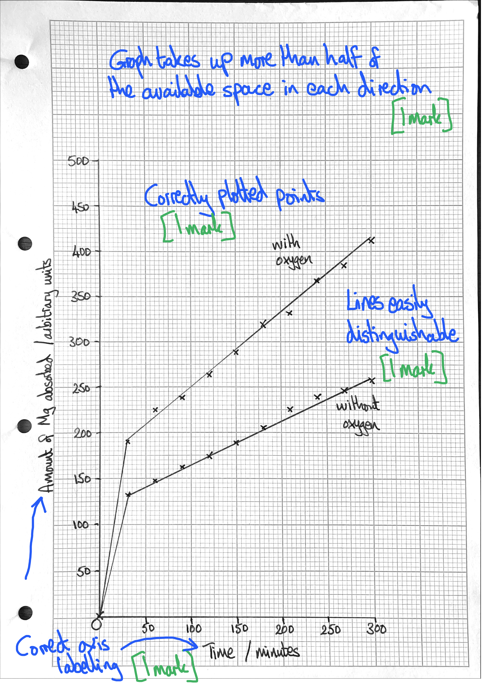
(i) The independent and dependent variables are...

- Independent: with and without oxygen / presence of oxygen; **[1 mark]**
- Dependent: amount of magnesium ions absorbed; **[1 mark]**

(ii) A variable that needs to be kept constant is...

Any **one **of the following:

- Temperature of solution; **[1 mark]**
- pH of solution; **[1 mark]**
- Volume of solution; **[1 mark]**
- Volume of gases/oxygen/nitrogen bubbled through; **[1 mark]**
- How long/time gases/oxygen/nitrogen bubbled through; **[1 mark]**

> *You do need to be **specific **here with control variables; just mentioning 'time' or 'volume' for example without the context of the question will not earn you marks.*

(iii) The percentage increase of magnesium ions absorbed with oxygen between 120 minutes and 300 minutes is..

- Difference in final and initial results = 149; **[1 mark]**
- Difference ÷ by original = 0.57; **[1 mark]**
- x100 = 57%; **[1 mark]**

(iv) The range for the level of magnesium ions absorbed without oxygen from the beginning to the end of the experiment is...

- Highest - lowest value;
- 257 - 0 = 257; **[1 mark]**

**[Total: 7 marks]**

> *Model answer for part (iii) *

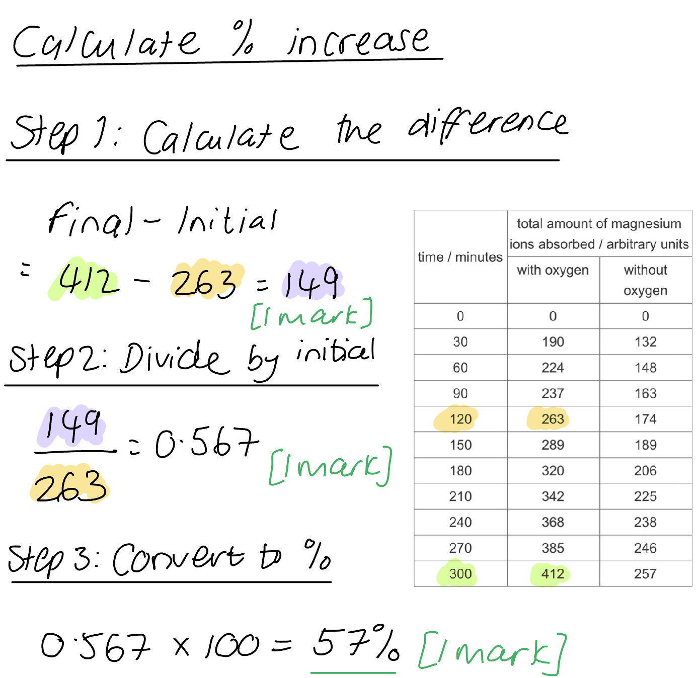

> *Model answer for part (iv):*

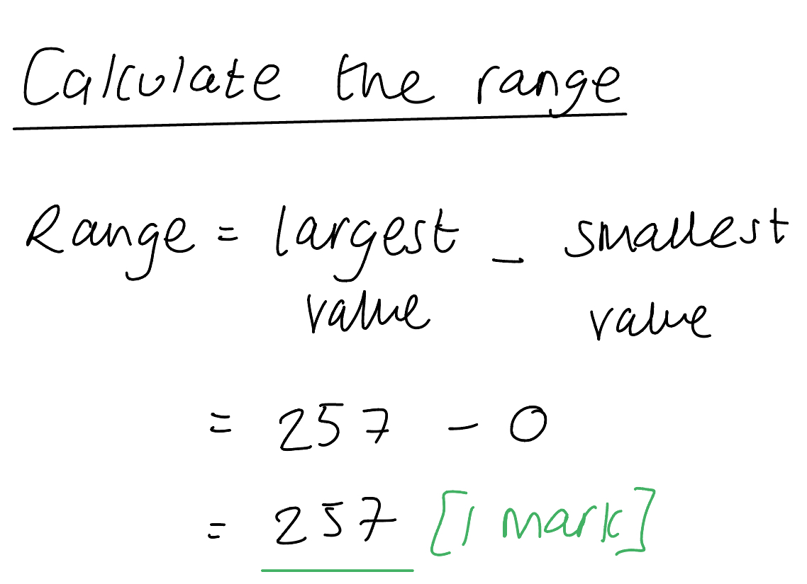
To make the results reliable...

- Repeat the results; **[1 mark]**
- At least three times; **[1 mark]**

**[Total: 2 marks]**

> *By repeating results we can spot anomalous data and errors and address these, which can then make our data more accurate overall. Anomalies can be eliminated so that the mean (average value) is more reliable. *
The scientists took data over a five hour period...

Any **two** from the following:

- To see a trend/relationship in the data; **[1 mark]**
- To see how the absorption of magnesium ions changed over time; **[1 mark]**
- To see a difference with and without oxygen on the absorption of magnesium ions; **[1 mark]**

**[Total: 2 marks]**

### Q4
(i) The final percentage concentration of the salt solution in test-tube **2** is...

- 0.5; **[1 mark]**

(ii) The mark allocation for the results table is as follows...

- Table drawn with 3 columns and header line; **[1 mark]**
- Headings and units; **[1 mark]**
- Twelve measurements within the acceptable range; **[1 mark]**
- Correct averages calculated; **[1 mark]**

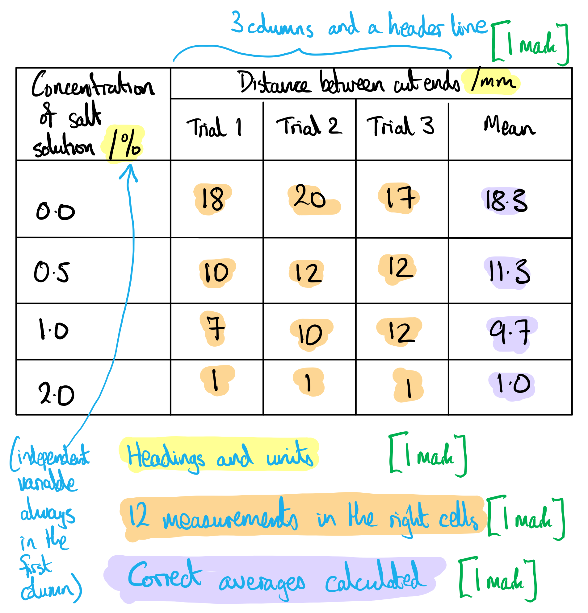

(iii) The results can be described as follows...

- The higher the salt concentration the smaller the gap **OR** the lower the salt concentration the larger/bigger the gap; **[1 mark]**

**[Total: 6 marks]**

> *Note that this question was adapted from the original by including the measurements for the gaps between the cut ends of the stem rings. This was done due to the challenge of accurately measuring from a screen. In the exam you would not have received these measurements and would have been expected to make them yourself, so don't forget to bring your ruler!*

> *The calculation for a) i):*

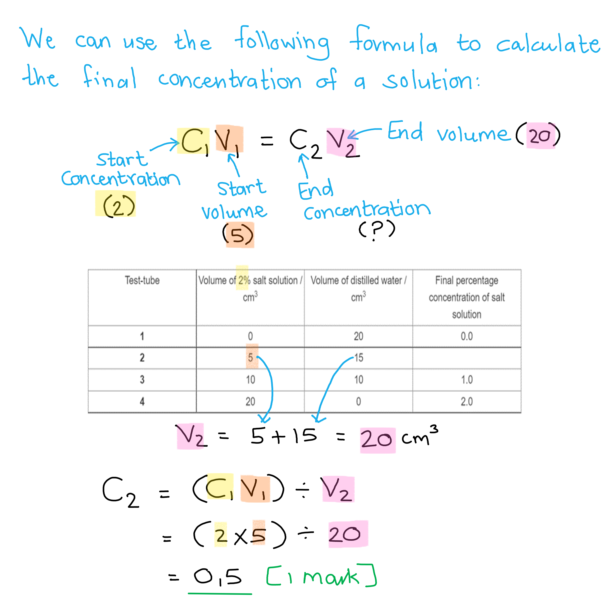
One hazard and safety precaution for step 4 would be...

*Hazard: *

- Use of a knife / cutting; **[1 mark]**

*Safety precaution: *

- Cut on a solid surface / cut away from body / avoid fingers;** [1 mark]**

*Ignore mention of cutting carefully or wearing gloves as a safety precaution. *

**[Total: 2 marks]**

> *It is expected that the investigator would handle a blade carefully when cutting, so that will not be credited as a safety precaution here. Wearing gloves would not prevent a potential cutting injury and is therefore also not considered a safety precaution in this case.*
More than one stem ring was placed in each Petri dish because...

Any **two** from the following:

- (It would enable the investigator) to find an average; **[1 mark]**
- To see if measurements are comparable;** [1 mark]**
- To find outlier/anomalous results / measurements that show variation; **[1 mark]**

**[Total: 2 marks]**

> *Each of the stem rings in the Petri dishes would serve as a repeat of the investigation, which would increase the reliability of the results.*
(i) The independent variable in this investigation would be...

- Salt <u>concentration</u>;** [1 mark]**

(ii) Variables that were kept constant in this investigation include...

Any** two** from the following:

- Number of rings (in each Petri dish); **[1 mark]**
- Volume of solution (in each test-tube / Petri dish); **[1 mark]**
- Species of plant (from which the rings were cut); **[1 mark]**
- Length of the stem rings (that were placed in salt solutions); **[1 mark]**
- Soaking time (of stem rings in the salt solutions); **[1 mark]**

*Reject mention of salt concentration as a constant variable. Ignore reference to cutting or Petri dishes as constant variables. *

**[Total: 3 marks]**

> *Being able to identify the variables (independent, dependent and constant) of a scientific investigation is very important for an alternative to practical paper, so invest some time into understanding the concept of each.*
The following errors and suggested improvements can be identified for steps 4 and 7...

Any **two** errors and **matching** improvements from the following:

| *Error* | *Improvement* |
|---|---|
| Cutting the stem rings to the same length; **[1 mark]** | Use of a ruler (to measure before cutting);** [1 mark]** |
| Stems were measured at different times; **[1 mark]** | Stagger the start of the investigation; **[1 mark]** |
| Difficult to measure the distance between ends; **[1 mark]** | Use a magnifier (to see more clearly); **[1 mark]** |
| The starting distance is not known / the stem diameter varies; **[1 mark]** | Measure the gap/diameter, before timing; **[1 mark]** |
| Evaporation of salt solutions (can affect the concentration); **[1 mark]** | Cover the Petri dishes; **[1 mark]** |
| The stem rings change during measurement; **[1 mark]** | Keep the rings in the solution; **[1 mark]** |
| Stems may get mixed up;** [1 mark]** | Label the stems; **[1 mark]** |

*The improvement must match the stated error in order to receive full marks.*

**[Total: 4 marks]**
The actual length of **AB** can be calculated as follows...

- 28 ÷ 50; **[1 mark]**
- 0.56; **[1 mark]**

*Accept correct values in cm or µm.* *Full marks awarded for the correct answer in the absence of calculations.*

**[Total: 2 marks]**

> *Note that this question was adapted from the original to include the measured length of **AB**. This is due to the challenge of accurately measuring from a screen. In the exam you would have been expected to make the measurement yourself, so don't forget that ruler!*

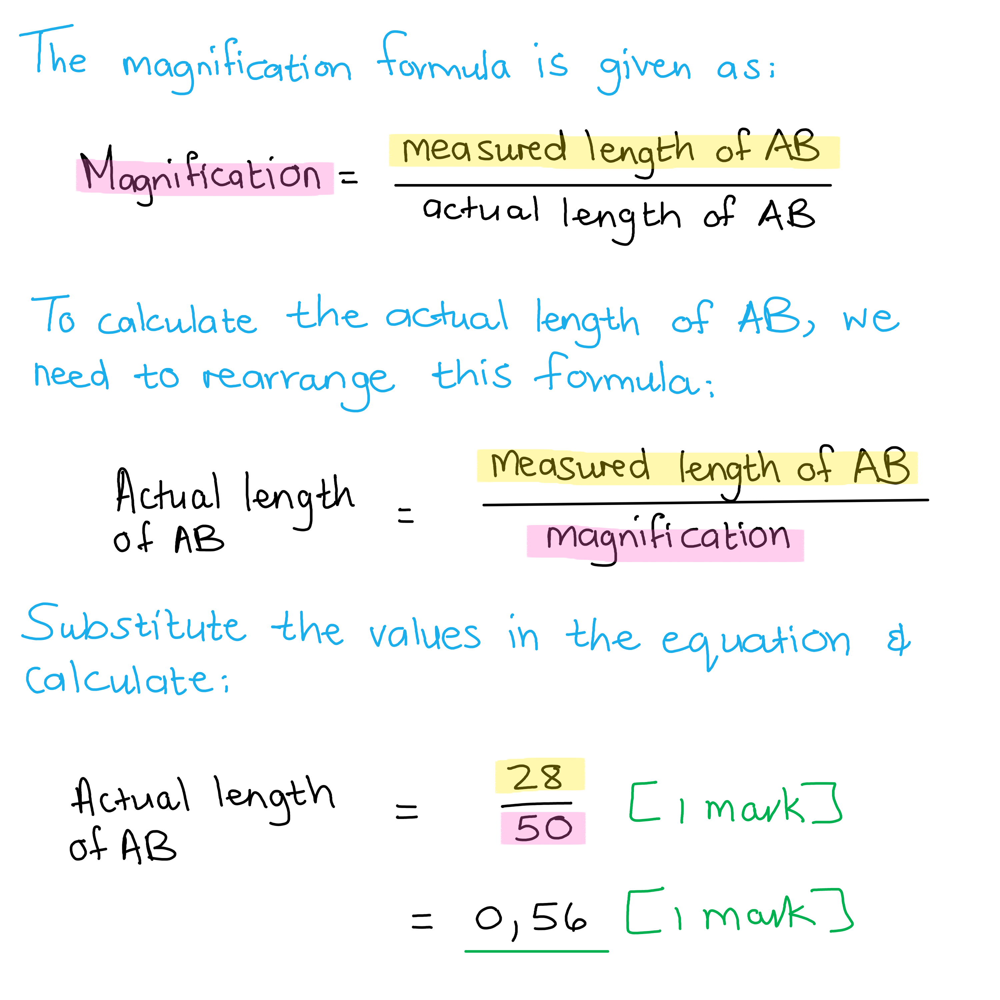

## Multiple Choice Questions (29 questions)

### Q1
**Final answer:** **The correct answer is ****A.**

- **P = carrier protein: **this is the structure needed to move ions by active transport
- **R = mitochondrion:*** *this is the structure that releases energy through respiration

The other answers are incorrect because** Q = ions: **these are the substances the cell takes up, and **S = cell wall: **this is the freely permeable outer layer of the plant cell.

### Q2
**Final answer:** **The correct answer is ****B.**

- Water acts as a solvent, so substances can dissolve in it. This allows digested substances to be transported and absorbed

**A** is incorrect because increasing the surface area of food is the role of physical digestion (for example chewing), not water.

**C*** *is incorrect because large insoluble food molecules are made into small soluble molecules by chemical digestion carried out by enzymes, not water.

**D** is incorrect because water does not provide the energy for active transport.

### Q3
**Final answer:** **The correct answer is ****A.**

- The tissue **lost mass**, so water left the cells by osmosis. This means the surrounding solution had a **lower water potential** than the plant tissue

**B **is incorrect because if the solution had a higher water potential, water would enter and mass would increase.

**C** is incorrect because osmosis only occurs through partially permeable membranes, which plant cells do have.

**D i**s incorrect because distilled water has a high water potential, meaning water would enter and mass would increase.

> **[exam-tip]**
> Don't mix up water potential* *with the concentration of the solute. Osmosis is defined as the net movement of water molecules from a region of** higher water potential** (dilute solution) to a region of **lower water potential **(concentrated solution), through a** partially permeable membrane**.

### Q4
**Final answer:** **The correct answer is C.**

- The diagram shows glucose molecules moving from a lower concentration outside the cell to a higher concentration inside the cell, i.e. against a concentration gradient
- This requires energy from respiration in the form of ATP, and uses carrier molecules in the membrane — this is active transport

**A** is incorrect as osmosis is the movement of water molecules only, not glucose. Osmosis occurs down a water potential gradient, not against the gradient.

**B** is incorrect as active transport moves particles against a concentration gradient, not with it.

**D** is incorrect as diffusion does not occur against a concentration gradient. The movement shown in the diagram is from a region of lower concentration to a region of higher concentration, so rules out diffusion.

### Q5
**Final answer:** **The correct answer is A.**

- The concentrated salt solution has a higher solute concentration than the plant cell, so water molecules move out of the plant cell via osmosis
- This causes the cytoplasm to shrink and detach from the cell wall, which is called plasmolysis

**B** is incorrect as the movement of water molecules from a region of high water potential to a region of lower water potential through a partially permeable membrane is not active transport; it is osmosis.

**C** is incorrect as, in a high salt concentration water will move out of the plant cell and not into it. The cell therefore cannot become turgid in these conditions.

**D** is incorrect as continued water loss in a concentrated salt solution will ultimately lead to plasmolysis. Flaccid described the state of cells placed in a solution with the same concentration as the cell contents.

### Q6
**Final answer:** **The correct answer is ****A****.**

- The kidney tubules must absorb all the glucose from the filtrate back into the blood stream so that it can be distributed to cells for respiration. In order to reabsorb all of the glucose, active transport is required to move the glucose against the concentration gradient from the filtrate into the epithelial cells.

**B** is incorrect because osmosis refers to the passive movement of water particles only.

**C** is incorrect because translocation refers to the process by which sugars (sucrose) moves around plants.

**D** is incorrect because transpiration describes the process by which water moves through plants driven by the evaporation of water from the leaves.

### Q7
**Final answer:** **The correct answer is ****B****.**

- This is because this is indicating the cell membrane, which is a partially permeable membrane

**A** is incorrect because this is the cell wall, which is not partially permeable.

**C** is incorrect because this is the chloroplast, which is not partially permeable.

**D** is incorrect because this is the vacuole, which is not partially permeable.

### Q8
**Final answer:** **The correct answer is ****A****.**

- This is because diffusion is the passive movement of particles from an area of high concentration to low concentration, which can also be described as moving down a concentration gradient

**B** is incorrect because the term ‘against’ a concentration gradient describes the movement of particles from an area of low concentration to high concentration, which is not how particles move by diffusion.

**C** is incorrect because particles that move by diffusion move from an area of high concentration to low concentration, not from low to high.

**D** is incorrect because this describes how particles move by active transport, not by diffusion.

### Q9
**Final answer:** **The correct answer is ****D****.**

- The mass of the potato cylinder decreased because water moved out of the potato cells by osmosis, as it flowed from a higher water concentration inside the cells to a lower concentration in the salty solution outside.

**A** is incorrect because active transport of salt wouldn’t cause mass loss, and it requires energy to move substances against a concentration gradient.

**B** is incorrect because osmosis involves water movement, not salt, and salt movement would occur via diffusion or active transport.

**C** is incorrect because the mass decreased, not increased, and water typically moves by osmosis, not active transport.

### Q10
**Final answer:** **The correct answer is ****B.**

- Oxygen and carbon dioxide move between cells and capillaries by diffusion, which is the process by which particles move from an area of high concentration to an area of low concentration.
- In this case, oxygen diffuses from the blood in the capillaries (where its concentration is high) into cells (where its concentration is lower), while carbon dioxide moves in the opposite direction, from cells to capillaries.

**A **is incorrect because breathing is the physical process of inhaling and exhaling air, moving oxygen into the lungs and carbon dioxide out.

**C **is incorrect because excretion is the removal of waste products from the body (e.g., urea via the kidneys). While carbon dioxide is a waste product, the process of moving gases between cells and capillaries is not excretion.

**D **is incorrect because respiration is the process by which cells produce energy from glucose and oxygen, releasing carbon dioxide as a byproduct.

### Q11
**Final answer:** **The correct answer is D.**

- This is because in the high concentration salt solution the water will move out of the potato cells by osmosis down the water potential gradient
- When water leaves the potato cells it causes them to become flaccid

**A**, **B** and **C** are incorrect because the lower the concentration of salt solution the less water will leave the potato cells by osmosis so the cells will be less flaccid

### Q12
**Final answer:** **The correct answer is C because:**

Active transport requires carrier proteins in the cell membrane, moves particles from lower to higher concentration, and is an active process that requires energy from respiration

**A** is incorrect because particles do not move from a higher concentration to a lower concentration during active transport.

**B** is incorrect because active transport does not involve movement from a higher concentration to a lower concentration, and does use energy from respiration.

**D** is incorrect because active transport does not involve movement from a higher concentration to a lower concentration, and does occur through a cell membrane.

### Q13
**Final answer:** **The correct answer is B because:**

Carbon dioxide and oxygen diffuse through the space in the spongy mesophyll of the leaf and the stomata to/from the mesophyll cells

**A **is incorrect because the gases are moving from an area of high concentration to low concentration and so are not moving by active transport.

**C** is incorrect because only water can move by osmosis, not carbon dioxide and oxygen.

**D** is incorrect because transpiration is the movement of water out of the leaf.

### Q14
**Final answer:** **The correct answer is ****B ****because:**

- The potato cylinder decreased in length therefore it must have lost water to the solution by osmosis
- Water moves from a dilute (less concentrated) solution to a more concentrated solution, so the solution in the potato must be more dilute
- A salt solution with a concentration of 0.0 has no solute in it (so is pure water)

### Q15
**Final answer:** **The correct answer is ****C ****because:**

This is because diffusion is the movement of particles down a concentration gradient. It is a passive process that occurs whenever there is a concentration gradient. Osmosis is the diffusion of water through a partially permeable membrane.

### Q16
**Final answer:** **The correct answer is ****C**** (All of the statements) because:**

Water is known as the universal solvent for living organisms as a very large number of substances are able to dissolve in it. Those substances that are not able to dissolve in water are usually packaged in substances that can.

- Water is the main constituent of the cytoplasm - remember this is the jelly-like solution that is enclosed within the cell membrane
- The kidneys are responsible for filtering the blood and removing urea and excess salts by forming urine. Water plays a large role in this function
- Blood plasma is the yellowish liquid that holds the blood cells in suspension; it is mainly water in which proteins, hormones, antibodies, soluble food molecules and ions (amongst other substances) dissolve to be transported around the body

### Q17
**Final answer:** **The correct answer is ****D ****because:**

The membrane is fully **permeable**, so the water and solute molecules can move according to their concentration gradients. For the water molecules, this would mean movement happening from the right (high concentration) to the left (low concentration). For the solute molecules, this would mean movement happening from the left (high concentration) to the right (low concentration).

**A **and** C** are incorrect because the solute molecules will be able to cross a fully permeable membrane so there will be net movement from left to right.

**B** is incorrect because the movement for both water and solute molecules will be in the opposite direction to what is indicated in the table.

### Q18
**Final answer:** **The correct answer is ****B**** (There would be movement of water molecules from W to X) because:**

- Osmosis is the **net** movement of water molecules from a region of higher water potential (dilute solution) to a region of lower water potential (concentrated solution), through a partially permeable membrane
- Net movement’ means ‘overall movement’ - **more **water molecules will move from solution W to solution X, but water molecules are able to move in either direction (they don’t choose to move from one solution to another, because they can’t tell if the solution they’re in is dilute or concentrated)

**A** is incorrect because the net movement of water would be from W (dilute solution) to X (concentrated solution).

**C** is incorrect because osmosis only refers to the movement of water molecules, not sugar molecules.

**D** is incorrect because solution X is more concentrated than W since there are more sugar molecules and less free water molecules in X.

### Q19
**Final answer:** **The correct answer is ****B**** (Plants are supported by the pressure of water inside the cells pressing outwards on the cell wall) because:**

When plant cells become turgid, the cell membrane pushes against the cell wall, this increases the turgor pressure providing strength and support.

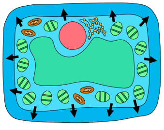

### Q20
**Final answer:** **The correct answer is ****A ****because:**

- Water always moves across cell membranes by osmosis
- Oxygen is a gas and will move by diffusion down a concentration gradient
- Minerals are taken up against their concentration gradients across the membrane of root hair cells

### Q21
**Final answer:** **The correct answer is ****C ****because:**

- Water will move by osmosis - the diffusion of water molecules from a region of high water potential to a region of lower water potential, through a partially permeable membrane
- Pure water will have a higher water potential than inside the beetroot cells, so  water will move into the cells (they may become turgid), increasing the mass of the beetroot piece
- The concentrated salt solution will have a lower water potential than the beetroot cells, so water will move out of the cells and (they may become flaccid), decreasing the size of the beetroot piece

### Q22
**Final answer:** **The correct answer is ****D ****because:**

- 1 shows the movement of water from cell to cell. Osmosis is the special diffusion of water molecules from a region of high water potential to a region of lower water potential, through a partially permeable membrane. This means that osmosis occurs when water is moving into or out of a cell
- 2 shows the evaporation of water from the surface of a spongy mesophyll into an air space inside the leaf
- 3 shows the diffusion of water vapour (a gas) out of the leaf through the stomata

### Q23
**Final answer:** **The correct answer is ****B ****because:**

- Pure water has a solute concentration of zero and has the highest possible water potential
- Water will therefore move **into red blood cells** by osmosis when they are placed in pure water
- Water moves from** low to high solute concentration** and from** high to  low water potential** through a partially permeable membrane
- This will cause the cells to swell and eventually** burst**

### Q24
**Final answer:** **The correct answer is ****D ****because:**

- The less concentrated a solution is, the higher the water potential will be in the solution
- The 0.2 mol per dm-3 salt solution is less concentrated than the solution inside the potato cells, so has a lower water potential
- We can tell this as after 24 hours the length of the potato cylinder has increased in mass because the potato cells have gained water

**A** and **B** are incorrect because the movement of water will be into the potato cells because the salt solution has a higher water potential than the cells.

**C** is incorrect because the salt solution has a higher water potential than the potato cells resulting in water moving into the cells.

### Q25
**Final answer:** **The correct answer is ****C ****because:**

This is because the solution surrounding the leaf cell is more concentrated than the solution inside the leaf cell (which is more dilute). Therefore water moves out of the cell through the partially permeable membrane. The solution surrounding the leaf cell is more concentrated than the solution inside the leaf cell (which is more dilute), so water moves out of the cell through the partially permeable membrane. The cell membrane shrinks and pulls away from the cell wall due to a process called plasmolysis.

### Q26
**The correct answer is ****B**** (Random movement of molecules) because:**

Molecules like carbon dioxide must be able to move to be able to diffuse. Individual molecules move about randomly, but overall net movement of a gas occurs from a region of high concentration to a region of low concentration.

**A** is incorrect because active transport requires protein molecules embedded within a membrane using energy released via respiration to move molecules deliberately into the cell (usually against a concentration gradient).

**C** is incorrect because respiration as a chemical process produces the waste gas carbon dioxide, but the reaction isn’t responsible for the movement of the gas.

**D** is incorrect because photosynthesis is a chemical process that requires carbon dioxide, and although a plant cell photosynthesising lowers the concentration of carbon dioxide inside the cell, it doesn’t cause the movement of carbon dioxide out of the cell.

### Q27
**Final answer:** **The correct answer is ****B**** (Diffusion) because:**

Water vapour is just water molecules in the gaseous state; in the leaf water vapour forms when water molecules evaporate from the surface of spongy mesophyll. All gas molecules move by diffusion – the movement of molecules and ions from a region of higher concentration to a region of lower concentration down a concentration gradient as a result of random movement.

**A** is incorrect because active transport requires protein molecules embedded within a membrane using energy released via respiration to move molecules deliberately into the cell (usually against a concentration gradient).

**C** is incorrect because evaporation occurs at the surface of spongy mesophyll cells in the leaf, liquid water changes state to water vapour (a gas).

**D** is incorrect because transpiration is the loss of water vapour from plant leaves by evaporation of water at the surfaces of the mesophyll cells followed by diffusion of water vapour through the stomata.

### Q28
**Final answer:** **The correct answer is ****A**** (ileum) because:**

The ileum is part of the small intestine where most food absorption occurs. The wall of the ileum is heavily folded; these finger-like folds are called villi (singular villus) which are externally covered by highly folded cells called microvilli.

**B** and **C** are incorrect because the bronchioles and atria are not adapted for diffusion at all due to their thick walls.

**D** is incorrect because even though a capillary is adapted for diffusion, it is not the best adapted from the listed structures. The ileum will collectively have a larger surface area for diffusion compared to one capillary.

### Q29
**Final answer:** **The correct answer is ****D**** (The movement of water through a partially permeable membrane from a more dilute to a more concentrated solution) because:**

Osmosis is a special type of diffusion, the passive movement of water from a dilute (high water potential)  to a more concentrated (lower water potential) solution.  Remember osmosis requires a partially permeable membrane separating two solutions (in living organisms this is a cell membrane). Water molecules can move across the membrane easily, whereas solutes like salts and sugars (e.g. sucrose) cannot.

**A** and **C** are incorrect because osmosis is a passive process, meaning it does not require energy to occur.

**B** is incorrect because the movement will occur from a dilute to a more concentrated solution, not the other way around.

## Theory Questions (16 questions)

### Q1
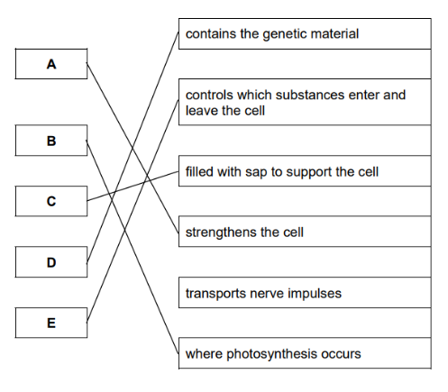

- **[1 mark]** for each correct line

**[Total: 5 marks]**
Any two from:

- Root hair;** [1 mark]**
- Palisade (mesophyll); **[1 mark]**
- Spongy (mesophyll); **[1 mark]**
- Xylem; **[1 mark]**
- Phloem; **[1 mark]**
- Guard; **[1 mark]**
- (Root) cortex / cortical; **[1 mark]**
- Epidermal / epidermis; **[1 mark]**
- Other correctly named examples of plant cells; **[1 mark]**

**[Total: 2 marks]**
(i)

- –1.0 / –1 (mm); **[1 mark]**

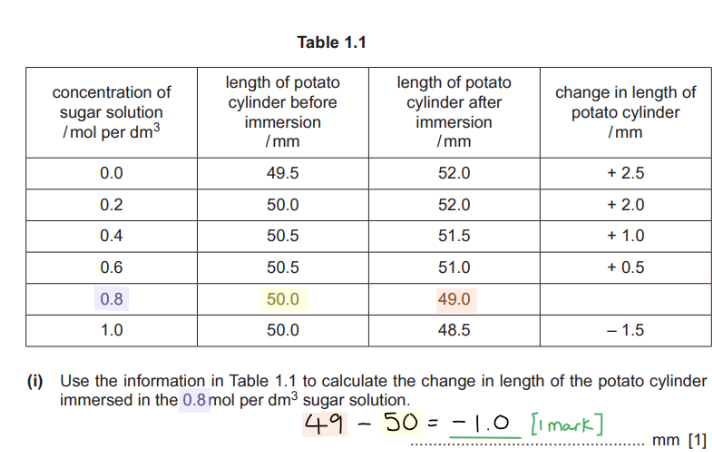

(ii)

- $\frac{2}{50}\times100$; **[1 mark]**
- 4 (%); **[1 mark]**

*Award full marks for correct answer in the absence of other calculations.*

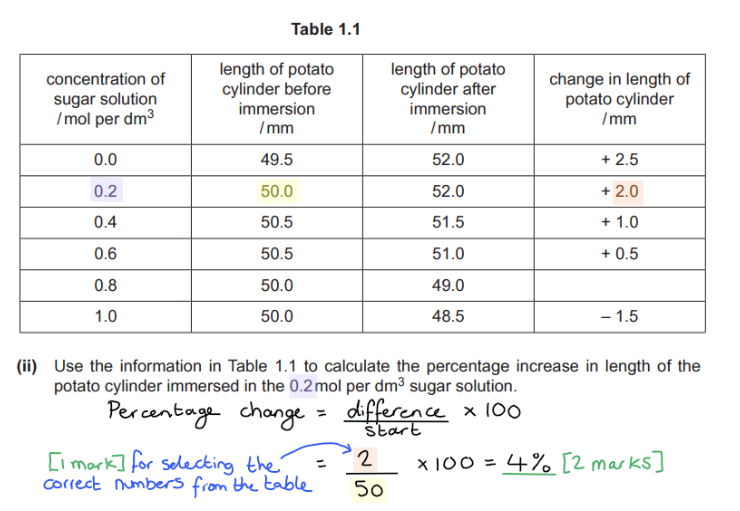

**[Total: 3 marks]**
- Osmosis; **[1 mark]**

**[Total: 1 mark]**
- The cell / cytoplasm / vacuole will shrink;** [1 mark]**

**[Total: 1 mark]**

### Q2
The method by which sugar **A**, **B** and **C** are absorbed is...

- **A** = active transport; **[1 mark]**
- **B** = diffusion; **[1 mark]**
- **C** = diffusion; **[1 mark]**

**[Total: 3 marks]**

> *With sugar solution A you can see that in the healthy intestine, the rate of absorption was much higher than in the cyanide treated intestine. This is an indication that this absorption must have been carried out by active transport which requires ATP from respiration. If the cells cannot respire because they have been treated with cyanide, then they cannot carry out active transport, hence the lower absorption with this sugar. *
The conclusion of the scientists can be explained as follows...

Any **three** of the following:

- The absorption rate of sugar **D** decreased in the intestine treated with cyanide; **[1 mark]**
- There would be less/no energy available (as cyanide prevents cellular respiration); **[1 mark]**
- Active transport / carrier protein requires energy; **[1 mark]**
- To move substances/sugar **D** against its concentration gradient; **[1 mark]**

**[Total: 3 marks]**

> *The fact that the absorption rate of sugar **D** decreased dramatically in the intestine treated with cyanide indicates that it moves across the intestinal wall by active transport. The carrier proteins will not function if no energy in the form of ATP is available leading to fewer or no molecules of sugar **D** being absorbed.*
This statement...

- Is correct because all four sugars were absorbed in the intestine treated with cyanide; **[1 mark]**
- (This is because) diffusion is a passive process that does not require energy from respiration; **[1 mark]**

**[Total: 2 marks]**

> *Initially sugars **A** and **D** most likely could be absorbed via diffusion as the sugar concentration outside the intestine (lumen) was higher (this is shown by the higher absorbency rates in the table). Once the concentration of sugar was lower outside the intestine it would have to be taken up via active transport (as it is against the concentration gradient) which was prevented in the intestine treated with cyanide.*
It is important to convert glucose into glycogen for storage because...

Any **four** of the following:

- Glucose will lower the water potential of cells; **[1 mark]**
- This would cause water to move into cells containing high concentrations of glucose; **[1 mark]**
- Animal/muscle cells do not have a cell wall; **[1 mark]**
- The cell will lyse/burst if too much water moves in by osmosis; **[1 mark]**
- Glycogen will not affect the water potential of a cell (as it is insoluble); **[1 mark]**

**[Total: 4 marks]**

### Q3
The cell that was placed in a solution that was more dilute than the cell contents was...

- (cell) B; **[1 mark]**

**[Total: 1 mark]**

> *When cells are placed in a solution that is more dilute than their cytoplasm, also known as a hypotonic solution, there is a net movement of water into the cell causing it to swell. The opposite happens when cells are placed in a solution that is more concentrated than the cell contents.*
The plant cell placed in the dilute solution has...

Any **four **of the following:

- Become turgid/swollen; **[1 mark]**
- Because water has entered the cell by <u>osmosis</u>; **[1 mark]**
- From a more dilute to a concentrated solution / from a solution with a higher water potential to a solution with a lower water potential; **[1 mark]**
- Via a partially permeable membrane; **[1 mark]**
- The cell membrane is exerting pressure on the cell wall; **[1 mark]**

*Accept reference to 'turgor pressure' at marking point 5*

**Final answer:** **[Total: 4 marks]**

> *The solution surrounding the cell has a higher water potential (is more dilute) than the intracellular environment of the plant cell. Water will always move from an area of a more dilute solution to an area of a more concentrated solution, therefore, there is a net movement of water into the cell which swells up becoming turgid. This only happens in plant cells; an animal cell would swell then burst/lyse because it does not have a cell wall. *

> *The opposite happens when the cell is placed in a concentrated solution that has a lower water potential than inside the cell. Consequently, water moves out of the cell which becomes plasmolysed (shrinks).*
(i) When a red blood cell is placed in a dilute solution...

- The red blood cell would lyse/burst;** [1 mark]**
- Due to an influx of water by osmosis;** [1 mark]**

(ii) This is different to the events occurring in a plant cell because...

- Animal cells do not have a cell wall **OR** plant cells have a cell wall; **[1 mark]**
- Which allows plant cells to become turgid without bursting / the pressure created (by the cell wall) prevents water entering (and prevents cell bursting/lysis); **[1 mark] **

**[Total: 4 marks]**

> *Take care to note the command words used here, you only need to describe (and not explain) what happens to the red blood cell, but you must explain how the reaction of a plant cell in the same situation would be different.*
The impact of hereditary spherocytosis would be:

Any **three** of the following:

- Spherical red blood cells have reduced/decreased surface area, which reduces (the efficiency of) diffusion of oxygen from the lungs; **[1 mark] **
- Spherical red blood cells transport less oxygen around the body; **[1 mark] **
- Less oxygen is available for respiration; **[1 mark] **
- Reducing the availability of energy in the cells of the sufferer; **[1 mark]**

**[Total: 3 marks]**

> *Here you are presented with an unfamiliar context, and you are expected to apply what you know about red blood cells to consider the effect that a change in the shape would have. You should know that the biconcave shape of red blood cells is vitally important in increasing surface area to volume ratio of each cell so that diffusion of oxygen (and carbon dioxide) is maximised.*

### Q4
Differences between active transport and diffusion would include...

- (In active transport) movement of particles occur from a region of lower concentration to a region of higher concentration **WHILE** in diffusion it occurs from a region of higher concentration to a region of lower concentration; **[1 mark]**
- (Active transport) requires energy/ATP (from respiration) **WHILE** diffusion does not / is a passive process; **[1 mark]**

*Accept reference to movement of particles occurring against the concentration gradient in active transport while movement occurs down the concentration gradient in diffusion for marking point 1*

*Award ***[1 mark]*** for reference to active transport requiring protein carriers while diffusion does not*

**[Total: 2 marks]**
An example of molecule **X** would include...

Any **one** of the following:

- Glucose; **[1 mark]**
- Mineral ions / named example e.g. calcium / magnesium ions; **[1 mark]**

**[Total: 1 mark]**
The role of a carrier protein in active transport includes...

Any **three **of the following:

- Substance/molecule **X** combines with the carrier protein (in the cell membrane); **[1 mark]**
- (The carrier protein) uses energy from respiration to give it more kinetic energy; **[1 mark]**
- (This results in) the carrier protein changing shape; **[1 mark]**
- To transport substance/molecule **X** across the cell membrane / against its concentration gradient; **[1 mark]**

**[Total: 3 marks]**

### Q5
The effect of diabetes insipidus on red blood cells includes...

- Red blood cells will have a higher water potential than the blood (plasma) **OR** the blood (plasma) will have a lower water potential than the red blood cells; **[1 mark]**
- There will be a net movement of water out of the red blood cells by osmosis; **[1 mark]**
- The red blood cells will become shrivelled/crenated; **[1 mark]**

**[Total: 3 marks]**

> *This is another application type question which requires you to use your knowledge of osmosis in an unfamiliar scenario.*
Diabetes insipidus may lead to blue fingernails because...

Any **two** of the following:

- Shrivelled/crenated red blood cells will have a smaller surface area (than normal red blood cells); **[1 mark]**
- This will decrease the amount of oxygen able to diffuse into the red blood cell; **[1 mark]**
- Less oxygen reaches / blood carries less oxygen to the cells of the fingers (leading to a blue colour); **[1 mark]**

**[Total: 2 marks]**

> *A large surface area makes red blood cells very efficient at transporting oxygen to cells. If their shape changes in any way that leads to a reduced surface area, it will negatively affect the amount of oxygen that it can bring to cells.*
The number of men suffering from fractures can be calculated as follows...

- (250 x 0.39) - (250 x 0.27); **[1 mark]**
- 97.5 - 67.5; **[1 mark]**
- 30; **[1 mark]**

**OR**

- (0.39 - 0.27) = 0.12; **[1 mark]**
- 0.12 x 250; **[1 mark]**
- 30; **[1 mark]**

**[Total: 3 marks]**

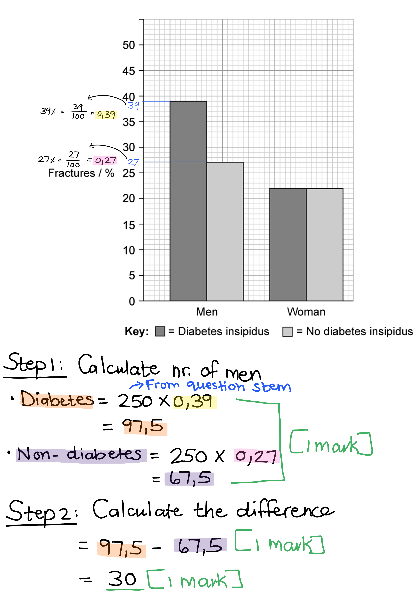
The conclusion can be evaluated as follows...

Any **four** of the following:

- Men with diabetes insipidus did sustain more fractures than men without; **[1 mark]**
- There were no difference in the percentage fractures sustained by women with and without diabetes insipidus; **[1 mark]**
- No statistical analysis were done so there is no way of knowing whether the difference (in the male groups) were significant; **[1 mark]**
- Only one hospital/area was studied **OR** the study should have been done at more than one hospital/area; **[1 mark]**
- A small sample size were studied **OR** the study should be repeated with a larger sample size; **[1 mark]**
- Only individuals between the ages of 45 and 65 were included **OR** a wider range of ages should have been included in the study; **[1 mark]**

**[Total: 4 marks]**

> *Remember that for an evaluate question you need to look at the results and state points that support the conclusion, as well as anything that would not support the conclusion that was drawn.*

### Q6
Diffusion is...

- (The movement of molecules) from a region of its higher concentration to a region of its lower concentration / down a concentration gradient; **[1 mark]**
- (This is) as a result of their random movement / Brownian motion; **[1 mark]**

**[Total: 2 marks]**
Reasons why diffusion is important to living organisms include...

Any **two** of the following:

- (It helps them) obtain the substances they require (to live / function); **[1 mark]**
- (It helps them) get rid of their waste products; **[1 mark]**
- It allows gas exchange (to occur) for respiration; **[1 mark]**

*Allow named examples of substances required or waste products produced by living organisms at marking points 1 and 2*

**[Total: 2 marks]**

> *In multicellular organisms, diffusion is the process by which required substances (such as glucose and oxygen) and waste products (such as carbon dioxide and urea) move between the cells and the transport system (such as the capillaries of the blood system in mammals). This ensures that the cells receive the substances they need to function while the waste products they produce will be transported away to the organs that will excrete it from the body.*
Substances **A**, **B** and **C** represents...

- **A** = Carbon dioxide; **[1 mark]**
- **B** = Oxygen **OR** water <u>vapour</u>; **[1 mark]**
- **C** = Water <u>vapour</u> **OR** oxygen; **[1 mark]**

*Do not accept 'water' as an answer for B or C*

**[Total: 3 marks]**

> *Mind your terminology here, remember that water moves by **osmosis**, not simple diffusion. Water (that came from the xylem vessels) evaporates from the mesophyll cell walls and then it diffuses out of the leaf via the stomata as water vapour.*
The movement of substance **A** can be described as follows...

Any **two** of the following:

- There is a higher concentration of **A**/carbon dioxide in the atmosphere compared to the air spaces between mesophyll cells; **[1 mark]**
- **A**/carbon dioxide diffuses down its concentration gradient / moves from the atmosphere into the air spaces between mesophyll cells; **[1 mark]**
- From there it diffuses into the mesophyll cells to reach the chloroplasts (for photosynthesis); **[1 mark]**

**[Total: 2 marks]**

> *During the day, the stomata remains open to allow carbon dioxide to diffuse into the leaf through the stomata, since it is needed for photosynthesis to occur. Once it is in the air spaces between the mesophyll cells it can easily diffuse across the cell membrane to reach the chloroplasts.*

### Q7
The absorption of monoglycerides in a person suffering from coeliac disease would be affected as follows...

- Less monoglycerides would be absorbed by the small intestine / there will be a decrease in the absorption of monoglycerides; **[1 mark]**
- (This is because) there is a decreased/smaller surface area (caused by shortened villi); **[1 mark]**

**[Total: 2 marks]**

> *One of the reasons that the small intestine is very efficient at absorbing nutrients is because the villi creates a large surface area for diffusion to occur. It is clear that people suffering from coeliac disease would not have the same surface area available due to the fact that their villi is much shorter than in a healthy person.*
The graph shows...

- As the concentration of monoglycerides increases, the rate of uptake of epithelial cells increases; **[1 mark]**
- The relationship is proportional / linear; **[1 mark]**
- (This is because) the steeper the concentration gradient, the faster the rate of diffusion; **[1 mark]**

**[Total: 3 marks]**
A body temperature of 37 °C maximises transport because...

Any **three **from the following:

- Temperatures lower than 37 °C would result in less kinetic energy of particles (to be transported); **[1 mark]**
- Less kinetic energy would mean slower rate of diffusion / osmosis / active transport; **[1 mark]**
- Higher temperatures may result in damage to carrier proteins / cell membranes; **[1 mark]**
- This could reduce the rate of transport across the membrane **OR** prevent transport across the membrane; **[1 mark]**

**[Total: 3 marks]**
The movement of water between the cells would be as follows...

- Water would move from cell X and Y to cell Z **OR** water would move from cell X to cell Y and Z while water would also move from cell Y to cell Z; **[1 mark]**
- (This movement is) by <u>osmosis</u>; **[1 mark]**
- (This is because) cell Z has a lower water potential than cell X and Y **OR** cell Y has a lower water potential than cell X, while cell Z has a lower water potential than X and Y; **[1 mark]**

**[Total: 3 marks]**

> *The net movement of water by osmosis will be from the cell with the most water (least sugar) to the cell with the least water (most sugar). The cell with the most water is cell **X **and the one with the least is cell **Z**. A cell with more water can be described as having a high water potential, whereas as cell with less water, and therefore more concentrated, can be described as having a lower water potential. *

### Q8
The importance of water as a solvent in living organisms includes...

Any **two** of the following:

- Dissolved substances can be easily transported around organisms **OR** a named example e.g. xylem transporting water and mineral ions / phloem transporting sucrose and amino acids / blood transporting dissolved food molecules; **[1 mark]**
- Digested food molecules in the alimentary canal dissolve in water to be absorbed into the blood (for transport to cells); **[1 mark]**
- Toxic substances/urea / substances in excess can dissolve in water to be (easily) excreted in urine; **[1 mark]**
- Ensures that metabolic reactions can occur (in solution) within cells; **[1 mark]**

**[Total: 2 marks]**

> *Make sure to familiarise yourself with the importance of water as a solvent in living organisms as this is a question you may come across in an exam paper.*
The overall direction of movement of water molecules will be...

- From left to right / to the right / towards sugar solution; **[1 mark]**

**[Total: 1 mark]**
Osmosis is...

- The diffusion/movement of water molecules from  from a high concentration <u>of water</u> to a low concentration <u>of water</u> / from a low <u>solute</u> concentration to a high <u>solute</u> concentration / from a dilute solution to a more concentrated solution / from high to low water potential; **[1 mark]**
- Across a partially permeable membrane; **[1 mark]**

**[Total: 2 marks]**

> *Remember that osmosis refers to the movement of water molecules across a partially permeable membrane. *

> *When describing the direction of movement during osmosis it is essential that you specify the type of concentration that you mean, e.g. saying 'high to low concentration' is correct in terms of water, but is incorrect in terms of solutes, so you would need to specify that it is high to low **water concentration**.*
The movement of the water molecules would be affected by the decrease in temperature in the following way...

- (The movement / osmosis) would slow down / (water) molecules would move slower (than at higher temperature); **[1 mark]**
- (This is because) water molecules lose (kinetic) energy (at lower temperatures) **OR** there would be less collisions against the cell membrane (and therefore a slower rate of movement across them); **[1 mark]**

**[Total: 2 marks]**

> *Molecules move randomly due to the kinetic energy that they have. Higher temperatures will result in more energy gained by the molecules resulting in faster movement while lower temperatures would have the opposite effect.*

### Q9
One visible adaptation of the cell and how this would facilitate diffusion includes...

- (The) cell membrane is highly folded **OR** contains <u>micro</u>villi; **[1 mark]**
- To increase the surface area (for absorption/diffusion of digested food molecules); **[1 mark]**

*Do not accept 'villi' as an answer at marking point 1*

**[Total: 2 marks]**

> *The folds in the cell membrane of these epithelial cells will allow more digested food molecules to diffuse from the lumen of the ileum into the blood capillaries of the villi than what would have been possible without them. Do not get confused between the folds / microvilli on the epithelial cells and the villi found in the small intestine. Remember that a villus is a structure found in the small intestine and its outer surface contains many epithelial cells with folded cell membranes that forms microvilli.*

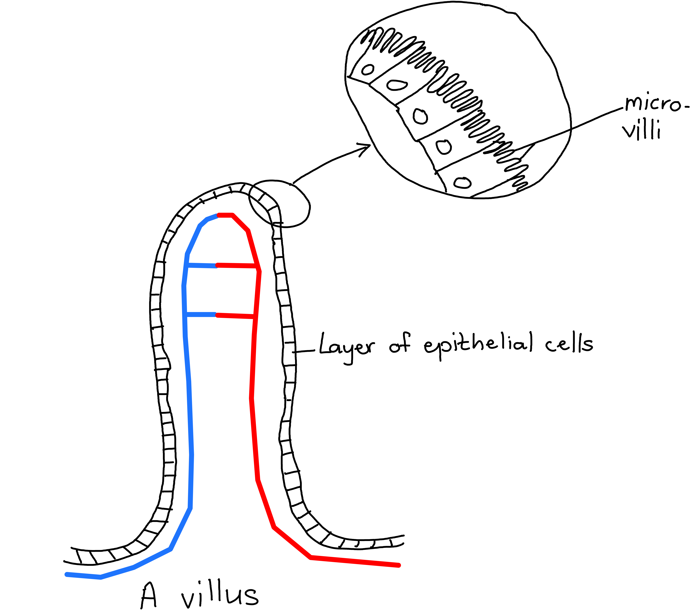
The effect of a steep increase in the number of digested food molecules on the diffusion rate would be...

- (The rate of diffusion would) increase; **[1 mark]**
- (Because) there is a greater concentration gradient (of digested food molecules) across the epithelial cells **OR** there is a greater difference in concentration (of digested food molecules) on either side of the membrane; **[1 mark]**

**[Total: 2 marks]**

> *There will be more random collisions against the cell membrane on the side with the higher concentration of digested food molecules which will result in faster diffusion across the membrane.*
A substance that cells must transport across the cell membrane might include...

**Final answer:** **Any ****one ****from the following:**

- Carbon dioxide / oxygen;  **[1 mark]**
- Glucose / amino acids / fatty acids + glycerol;  **[1 mark]**
- Mineral ions / water; **[1 mark]**

**[Total: 1 mark]**

> *There are many substances that cells need which exceed the list given in this mark scheme. The substances named in this question are key to the most fundamental processes that take place in cells, including photosynthesis and respiration.*
The gas particles should appear as follows...

- The particles should be evenly distributed in the space; **[1 mark]**

**[Total: 1 mark]**

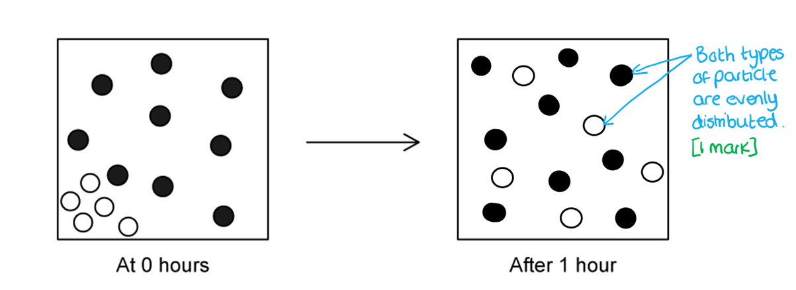

### Q10
The graph can be described as follows:

- The mass of the potato cubes increases over time **[1 mark]**
- The increase levels off after 20 / 25 minutes **[1 mark]**

This is because...

A maximum of **three** from:

- The water concentration outside of the potato is higher than inside the potato **OR **the solution outside the potato is more dilute than the solution inside **OR** the potato cells contain a solution/cytoplasm with higher solute concentration than the surroundings **[1 mark]**
- Water moves into the potato cells by osmosis **[1 mark]**
- Mass increases more quickly when the concentration gradient is steepest (between 0 and 20 minutes) **[1 mark]**
- The rate of increase slows / graph levels off because there is no longer a concentration gradient / the concentration inside the potato cells is the same as the concentration outside **[1 mark]**
- The rate of increase slows / graph levels off when the cell is turgid / can no longer expand to take on more water **[1 mark]**

**[Total: 5 marks]**

> *This is a 'describe and explain' question so you are required to do both parts in order to achieve full marks.*
The percentage increase at 15 minutes can be calculated as follows:

- (0.25 ÷ 2.5) x 100; **[1 mark]**
- 10 % (increase); **[1 mark]**

**[2 marks]**

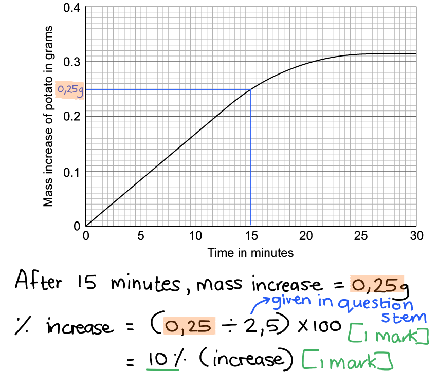
The line on the graph should look as follows:

- The mass of the potato would increase faster; **[1 mark]**
- The graph would level off at the same value of mass increase; **[1 mark]**

**[Total: 2 marks]**

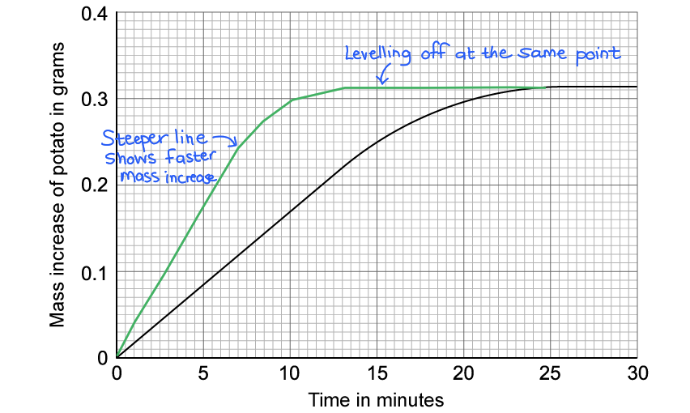
The trend drawn can be explained as follows:

- (The increase in mass occurs faster / rate of mass increase is faster because) a higher temperature means increased kinetic energy of particles / particles move more; **[1 mark]**
- Therefore the rate of osmosis is faster (into the potato); **[1 mark]**
- (The final mass levels off after the same mass increase) because the water potential gradient is the same in both investigations; **[1 mark]**
- So osmosis will continue to happen until the water potential inside the potato is the same on the inside and the outside **OR** the same mass of water will move by osmosis into the potato until the water potential inside the potato is the same on the inside and the outside; **[1 mark]**

**[Total: 4 marks]**

### Q11
The root hair cell has the following adaptations to maximise osmosis:

Any **two** of the following:

- A large surface area (to volume ratio); **[1 mark]**
- (Many) mitochondria / carrier proteins for active transport of mineral ions; **[1 mark]**
- A large vacuole for water storage (to give a steep concentration gradient); **[1 mark]**

**[Total: 2 marks]**
The lines should be drawn as follows:

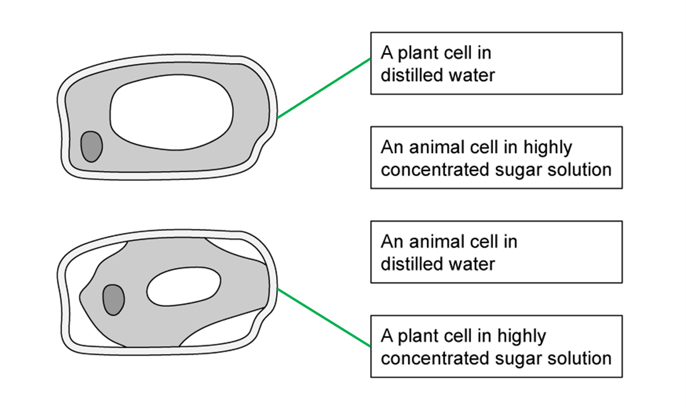

Award **[1 mark]** for each correct line.

**[Total: 2 marks]**

> *The presence of a cell wall and a large vacuole identifies these cells as plant cells. The top cell gained water by osmosis which would only occur if it had been placed in distilled water which would be more dilute than the cell contents. The bottom cell lost water which would occur if it had been placed in a concentrated sugar solution.*
The potato discs in Beaker 5 decreased in mass because...

- <u>Water</u> moved out of the potato by <u>osmosis</u>; **[1 mark]**
- From a high water concentration (in the potato cells) to a low water concentration (in the sucrose solution); **[1 mark]**

Accept from a more to a less dilute solution / from a lower to a higher solute concentration / from a higher to lower water potential for marking point 2

**[Total: 2 marks]**

> *Keep in mind that there will always be a net movement of water towards a more concentrated solution, so the fact that the potato discs in Beaker 5 decreased in mass means that the sucrose solution was more concentrated than the contents of the potato cells.*
A suitable control variable would include...

Any **one** of the following:

- Same size/thickness of potato discs; **[1 mark]**
- Cut discs from the same type of potato; **[1 mark]**
- Same <u>volume</u> of liquid in the beakers; **[1 mark]**
- Same amount of time (that discs are) left in solution; **[1 mark]**

**[Total: 1 mark]**

> *Control variables are important to ensure that any change measured in the dependent variable (mass of potato discs) is due to a change in the independent variable (concentration of solution).*

### Q12
(i) Ions move into guard cells as follows:

Any **two **from the following:

- (Ions) move against the concentration gradient; **[1 mark]**
- (Through) proteins (in the cell membrane) ; **[1 mark]**
- (Which) uses/requires energy; **[1 mark]**
- From respiration; **[1 mark]**

(ii) A description **and** explanation of how a change in the ion concentration causes the guard cells to change volume includes:

Any **six **from the following:

- **Description**
- A high(er) ion concentration results in large(r) (guard cell) volume *(or reverse argument of this)*; **[1 mark]**
- A high(er) ion concentration causes low(er) <u>water potential</u> (*or reverse argument of this)*; **[1 mark]**
- Accept a comparative data quote (from the table) with units to support any description; **[1 mark]**
- **Explanation**
- (A high ion concentration causes) water to move into (guard) cells; **[1 mark]**
- (This happens) across a partially permeable membrane; **[1 mark]**
- By <u>osmosis</u>; **[1 mark]**
- A large cell volume correlates with high turgor pressure (*or reverse argument of this)*; **[1 mark]**
- This is because cell water / membrane / cytoplasm / vacuole, pushes more on the cell wall; **[1 mark]**

(iii) **Two** environmental factors that cause plants to wilt are:

Any **two **from the following:

- Lack of water; **[1 mark]**
- High temperature; **[1 mark]**
- Low humidity / dry air; **[1 mark]**
- Wind; **[1 mark]**
- *Accept any other valid point referring to water loss from the stomata*; **[1 mark]**

**[Total: 10 marks]**

> *For part (iii), make sure you qualify responses with high/low rather than just writing about the process.  For example, "**high** temperature" will get you a mark, but just "temperature" alone will not. *
Plant roots cannot absorb these mineral ions by diffusion because...

- Diffusion is the movement of a substance down a concentration gradient / from a high to low concentration; **[1 mark]**
- To be taken up by the root the ions must be moved against the concentration gradient **OR** if diffusion were occurring the ions would move out of the roots; **[1 mark]**

**[Total: 2 marks]**
The percentage difference in calcium ions can be calculated as follows...

- (0.12 ÷ 0.15) x 100; **[1 mark]**
- 80(%); **[1 mark]**

*Full marks awarded for the correct answer in the absence of other calculations*

**[Total: 2 marks]**

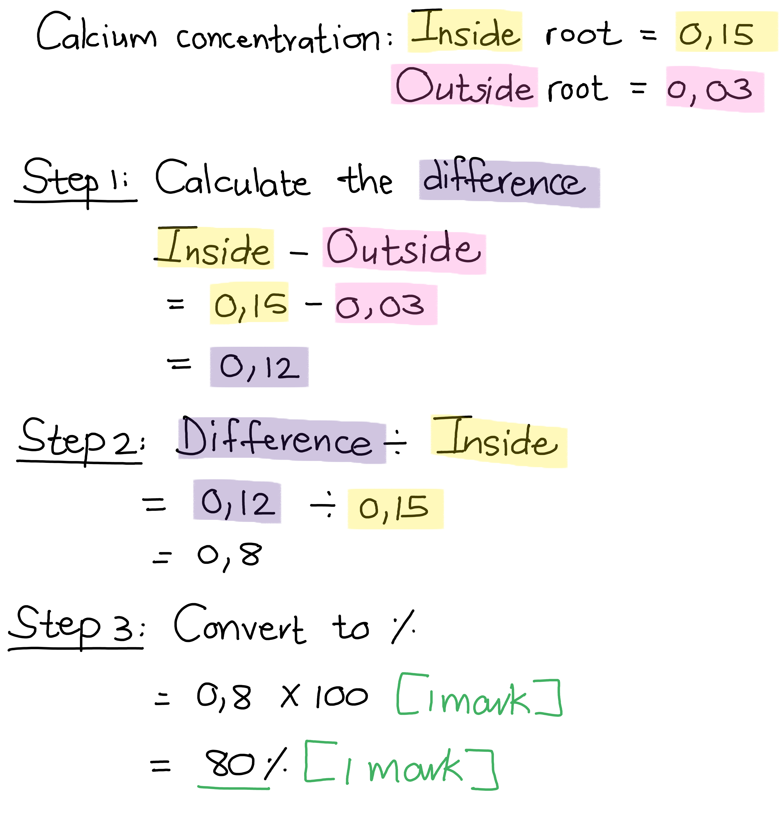

### Q13
H+ is transported out of the companion cell by process **A** in the following ways...

- It is transported by <u>active transport</u>; **[1 mark]**
- Movement of H+ occurs against the concentration gradient / from low concentration to high concentration; **[1 mark]**
- Movement of H+ occurs via a carrier protein; **[1 mark]**
- Energy / ATP is required (for transport/movement to occur); **[1 mark]**

**[Total: 4 marks]**

> *Do not panic when you see a question like this one. You may not be familiar with the sucrose loading mechanism, but the question asks you to describe active transport, which is something you should be familiar with. Questions like these require you to apply your knowledge to unfamiliar scenarios.*
Process **B** is a passive process because...

- No energy / ATP is required to move sucrose into the companion cell; **[1 mark]**
- (This is because) movement occurs down a concentration gradient **OR** movement (of sucrose) occurs from a high concentration (outside the cell) to a low concentration (inside the cell); **[1 mark]**

**[Total: 2 marks]**

> *The only passive transport process that you have learnt about so far is diffusion. This tells you that sucrose is moving down a concentration gradient for which no energy is required.*
Sucrose won't be able to enter the companion cell when temperatures are high because...

- H+ will not be able to combine with proton pump / carrier protein to be transported out of the cell; **[1 mark]**
- The H+ concentration gradient (between the inside and outside of the cell) cannot be maintained; **[1 mark]**
- Without the movement/presence of H+ (outside the cell) the cotransporter cannot transport sucrose (into the cell); **[1 mark]**

**[Total: 3 marks]**

> *It was stated in part (a) that sucrose can only enter the companion cell through the cotransporter protein if H**+** is present and also moving into the cell. Without a functional proton pump to ensure that there is a higher H**+** concentration outside the cell than inside, no H**+** will move through the cotransporter protein and therefore no sucrose will be able to enter the companion cell.*
An explanation for the quick transport of sucrose into the phloem sieve tubes would include...

- It ensures that there is always a low concentration of sucrose (molecules) inside the companion cells; **[1 mark]**
- This maintains the concentration gradient for sucrose across the cell membrane (of the companion cell); **[1 mark]**
- Which allows the movement/diffusion of sucrose into the companion cell; **[1 mark]**

**[Total: 3 marks]**

> *If the concentration of sucrose in the cytoplasm of the companion cell increased until it was similar (or higher) than the concentration outside the cell, then sucrose would be unable to diffuse into the companion cell.*

### Q14
A correctly labelled Fig. 1 showing the nucleus and one of the chloroplasts would include:

- Line ending on and labelled nucleus; **[1 mark]**
- Line ending on one of the chloroplasts and labelled; **[1 mark]**

*Allow any of the chloroplasts.*

**[Total: 2 marks]**

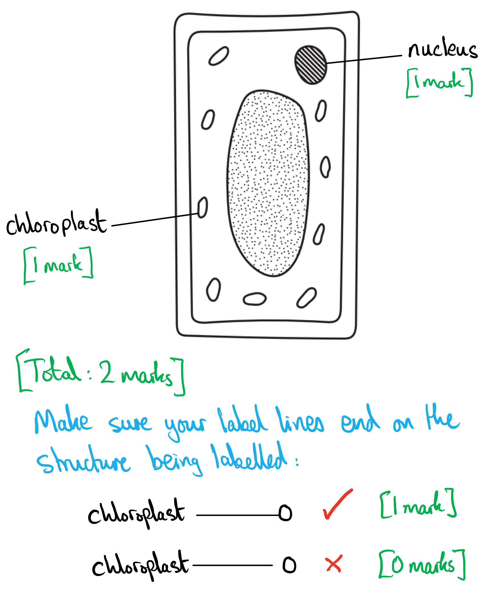

> *Just because the vacuole is the largest organelle in the diagram, does not mean it's the nucleus!*
(i) The changes that have taken place in the cell between Fig. 1 and Fig. 2 are:

Any **two **of the following from:

- The cell contents / cytoplasm / (cell) membrane, shrunk;** [1 mark]**
- The vacuole is smaller / decreased in volume; **[1 mark]**
- The cell membrane separates from the cell wall; **[1 mark]**
- The external solution fills the space between the cell wall and cell membrane; **[1 mark]**

> *Take note that the cell contents have not entered the vacuole.*

(ii) The cell in Fig. 2 has changed because:

Any **three **of the following from:

- Water moves out of the cell; **[1 mark]**
- (Water moves by) osmosis; **[1 mark]**
- Through a partially permeable membrane / AW;** [1 mark]**
- (This is because the) sugar solution is more concentrated than the cell contents / AW; **[1 mark]**

> *Remember that osmosis refers to the movement of **water molecules**, not the sugar molecules. The cell contents is more dilute than the sugar solution so the water molecules will move out of the cell to the more concentrated sugar solution.*

(iii) The cell in Fig. 2 could be treated so that it returned to its original appearance in Fig. 1 by:

- Add / place (the cell) in water **OR** (place the cell in a) dilute / less concentrated sugar solution; **[1 mark]**

> *Once the cell is placed in a solution that is more dilute than the cell contents, water molecules will move back into the cell through osmosis.*

**[Total: 6 marks]**
(i) The name of the tissue that transports water up the stem and into a leaf in a plant is:

- Xylem; **[1 mark]**

(ii) The labels **W** that show the position of the water transport tissue in each of the root, stem and leaf are as follows:

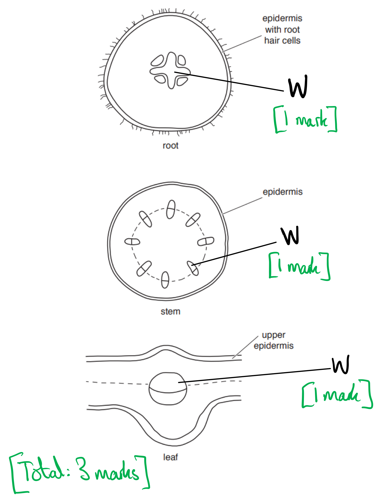

**[Total: 4 marks]**

### Q15
Particulate matter would affect gas exchange in the following ways...

- The rate of gas exchange / diffusion would decrease; **[1 mark]**
- (Due to) a reduced surface area (as a result of fewer alveoli); **[1 mark]**
- And an increased diffusion distance (due to thickened cells / alveolar walls); **[1 mark]**

**[Total: 3 marks]**

> *This is an application based question which means you should identify your relevant knowledge from the IGCSE Biology specification to answer the question about an unfamiliar scenario.*
The calculation can be completed as follows...

- 0.56 x  31 080 = 17 405; **[1 mark]**
- 0.2 x  31 080 = 6 216; **[1 mark]**
- 17 405 - 6 216 = 11 189; **[1 mark]**

**OR**

- 56% = 0.56 **AND** 20% = 0.20; **[1 mark]**
- 0.56 - 0.20 = 0.36; **[1 mark]**
- 0.36 × 31 080 = 11 189; **[1 mark]**

**[3 marks]**

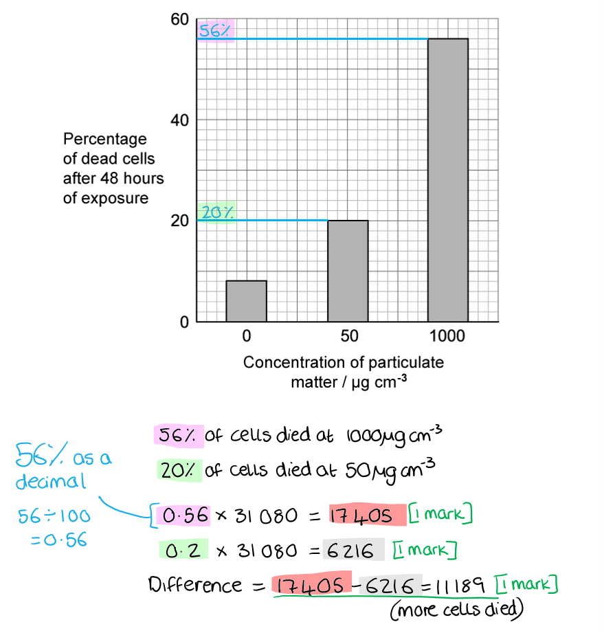
People living in urban areas with high levels of air pollution may suffer from fatigue because...

- Less oxygen reaches the cells (due to reduced gas exchange in the lungs); **[1 mark]**
- Less energy is released due to a lower rate of cellular respiration; **[1 mark]**

**[Total: 2 marks]**

> *Without sufficient oxygen, the process of cellular respiration cannot occur at its maximum rate. This will have a negative effect on the amount of energy released by the chemical reaction.*
A comparison of osmosis and active transport would include...

Any **four** of the following:

**Similarities:**

- Both osmosis and active transport occurs across a cell membrane; **[1 mark]**
- Both involve the movement of molecules; **[1 mark]**

**Differences:**

- Osmosis is a passive process / does not require energy **WHILE** active transport requires energy/ATP; **[1 mark]**
- Osmosis only applies to the movement of water molecules **WHILE** active transport applies to other molecules / not water molecules; **[1 mark]**
- In osmosis the movement of molecules occurs down a concentration gradient / from higher to lower concentration **WHILE** active transport occurs against the concentration gradient / from lower to higher concentration; **[1 mark]**
- Osmosis does not require carrier proteins to occur **WHILE** active transport does; **[1 mark]**

**[Total: 4 marks]**

> *Remember that for comparison questions you must mention both processes that are given in order to obtain full marks.*

### Q16
The results can be described as follows...

- The eggs in the (distilled) water / 0 mol dm-3 beaker **and** 0.2 mol dm-3 sugar solution gained mass/water / became heavier / showed a positive change in mass; **[1 mark]**
- The eggs in the sugar solutions with a concentration of 0.4 mol dm-3 and higher lost mass/water / became lighter / showed a negative change in mass; **[1 mark]**
- Any data point correctly quoted to support previous marking points e.g. mass of the egg in distilled water increased by 22% and the egg in the 0.2 mol dm-3 increased by 5% / mass of the egg in 0.4 mol dm-3 decreased by 7%; **[1 mark]**

**[Total: 3 marks]**

> *It is important to be able to describe data from a graph as it is a popular type of question to ask, so spend some time practising a few questions like this one in order to develop that skill.*
(i) The concentration at which the mass of the egg would not change is...

- 0.28 mol dm-3; **[1 mark]**

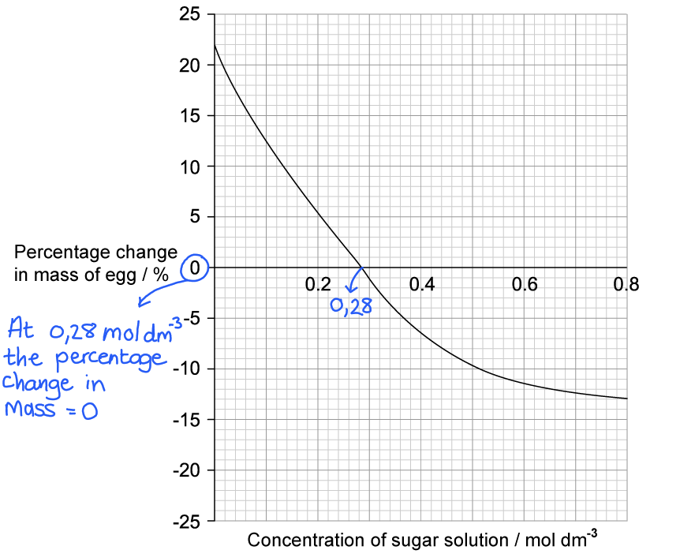

(ii) The mass of the egg would not change at this concentration because...

- The water potential inside and outside the egg would be the same; **[1 mark]**
- (Therefore) no <u>net</u> movement of water by osmosis; **[1 mark]**

*Reject reference to no movement of water at marking point 2*

**[Total: 3 marks]**

> *It is important to note that you would not receive any marks for saying that there is no movement of water taking place. Even though there is no **overall** or **net** movement of water molecules in a direction, they are still moving due to the kinetic energy that they have.*
The results in the 0.8 mol dm-3 beaker can be explained as follows...

- Water moved out of the egg by osmosis; **[1 mark]**
- Through a partially permeable membrane (of the egg); **[1 mark]**
- (This is because) the solution was more concentrated / had a lower water potential than the egg **OR** the egg was more dilute / had a higher water potential than the solution; **[1 mark]**

**[Total: 3 marks]**
A comparison of diffusion and osmosis would include...

**Similarities:**

- <u>Both</u> involve movement down a concentration gradient / from a region of higher concentration to a region of lower concentration; **[1 mark]**
- <u>Both</u> are passive / no energy is required ; **[1 mark]**

**Differences:**

- Osmosis refers to the movement of water only **WHILE** diffusion refers to the movement of any molecule type; **[1 mark]**
- Osmosis always occurs across a (partially permeable) membrane **WHILE** diffusion does not always involve a membrane; **[1 mark]**

**[Total: 4 marks]**

> *Even though osmosis is a type of diffusion, there are some differences between the two processes so make sure to familiarise yourself with them.*
