# Exam Questions — Diffusion, Osmosis & Active Transport
**3. Movement into & out of Cells** · Cambridge (CIE) IGCSE biology (0610 & 0970)
> Source: [https://www.savemyexams.com/igcse/biology/cie/23/topic-questions/](https://www.savemyexams.com/igcse/biology/cie/23/topic-questions/) · 49 questions across 3 sets

## Alternative To Practical Questions (4 questions)

### Q1 — medium — 25 marks

**Q1** [9 marks]

A student investigated the effect of the concentration of sugar solutions on osmosis in potato cells.

Step 1 	The student labelled four test-tubes A, B, C and D.

Step 2 	The volumes of 1 mol per dm3 sugar solution and distilled water shown                             in Table 1.1 were used to make solutions containing different                                                       concentrations of sugar in each test-tube.

(i) Complete Table 1.1 by writing in the concentration of the sugar solution in test-tube C.

**Table 1.1**

| test-tube | volume of 1mol per dm3 sugar solution/cm3 | volume of distilled water / cm3 | concentration of sugar solution/mol per dm3 |
|---|---|---|---|
| **A** | 20 | 0 | 1.0 |
| **B** | 12 | 8 | 0.6 |
| **C** | 8 | 12 |   |
| **D** | 0 | 20 | 0.0 |

Step 3 	The student was given four potato cylinders which had all been cut                                      from one potato. The diameters of the potato cylinders were all the                                   same but the lengths of the potato cylinders varied.

Step 4 	The student cut all four potato cylinders to exactly 40mm in length.

Step 5 	One potato cylinder was put into each labelled test-tube. The potato
                         cylinders were left in the sugar solutions for 20 minutes.

Step 6 	After 20 minutes the potato cylinders were removed from the test                                     tubes.

Fig. 1.1 is a diagram showing the actual size of the potato cylinders from test-tubes A, B, C and D at the end of step 6.

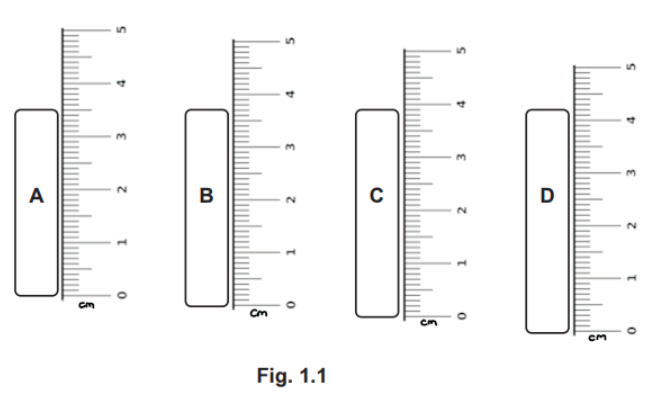

(ii) Prepare a table to record the results in the space provided.

Measure the length of each of the potato cylinders in Fig. 1.1 and record these measurements in your table.

[3]

(iii) Explain why it was important that the potato cylinders were all cut to the same length in step 4.

[1]

(iv) Identify the variable that the student changed in this investigation (independent variable).

[1]

(v) Suggest two improvements that you could make to the method used in this investigation.

[2]

(vi) Describe one safety precaution that should be taken while preparing the potato cylinders in step 4.

[1]

*Source: June 2021 paper 6 Q1A*

**Q1** [6 marks]

Plan an investigation to find out the effect of temperature on osmosis in plant tissue.

*Source: june 2021 paper 6  Q1B*

**Q1** [10 marks]

Potato cells contain starch grains.

(i) State the solution that would be used to test for the presence of starch and give the result of a positive test.

[2]

Fig. 1.2 is a photomicrograph of some plant cells that contain starch grains.

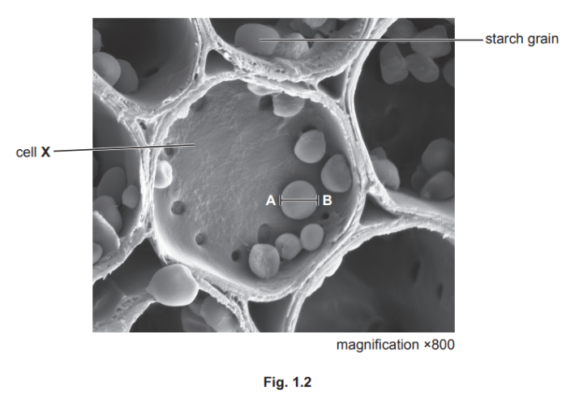

(ii) Draw a large diagram of cell X in Fig. 1.2.

Label one starch grain on your drawing.

[5]

(iii) Line AB represents the diameter of the starch grain. Measure the length of line AB on Fig. 1.2.

length of line AB ................................................ mm

Calculate the actual diameter of the starch grain using your measurement for line AB, the information in Fig. 1.2 and the formula:

Give your answer to two significant figures.

[3]

*Source: june 2021 paper 6  Q1C*

### Q2 — medium — 19 marks

**Q2** [9 marks]

A student measured the distance moved by different concentrations of citric acid solution through agar jelly. The agar contained Universal Indicator which changed colour in the presence of acid. The agar mixed with Universal Indicator was green at the beginning of the investigation.

| Step 1 | Three test-tubes were labelled **A, B **and **C. **Three different concentrations of citric acid solution were made. |
|---|---|

Table 1 shows the volumes of 5% citric acid solution and distilled water that were used to make each solution.

**Table 1**

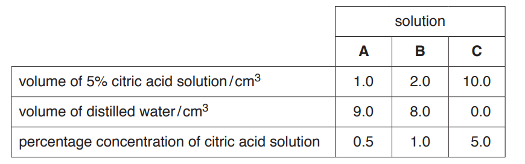

| Step 2 | The base of a Petri dish containing agar and Universal Indicator was labelled **A, B** and **C**. |
|---|---|

Three holes were cut into the agar. This is shown in Fig.1

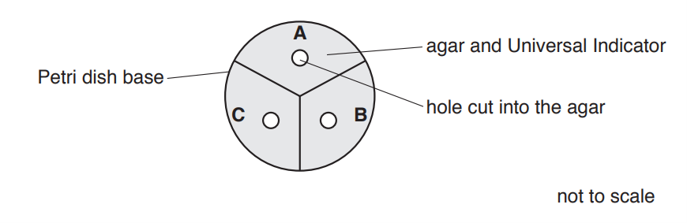

**Fig. 1**

| Step 3 | The student was provided with one dropping pipette. Three drops of solution **A** were placed into the hole in section **A** of the Petri dish. |
|---|---|
| Step 4 | Three drops of solution **B **were placed into the hole in section **B** of the Petri dish. |
| Step 5 | Three drops of solution **C** were placed into the hole in section **C** of the Petri dish. |
| Step 6 | A stop-clock was started. |
| Step 7 | After 30 minutes the student observed the colour change in the agar around the hole in each section of the Petri dish. The colour change was caused by the diffusion of the citric acid solution through the agar. |
| Step 8 | A ruler was used to measure the distance travelled by each concentration of citric acid solution through the agar. |

Fig. 2 shows the appearance of the Petri dish after 30 minutes.

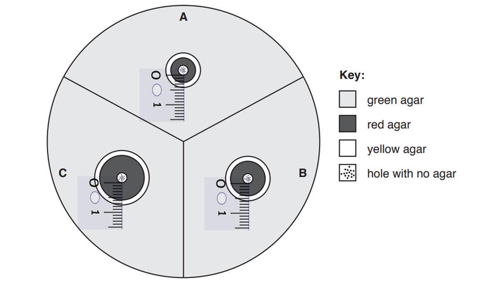

**Fig. 2**

(i)

Measure the distance travelled by each concentration of citric acid solution after 30 minutes in Fig. 2 Rulers have been added to the image to assist you in taking these measurements.

Prepare a table and record these results.

You should include:

- The concentration of the citric acid solutions
- The distance travelled by the citric acid solutions.

[3]

(ii)

Describe how you decided where to measure the distance travelled by the citric acid solutions.

[1]

(iii)

State a conclusion for these results.

[1]

(iv)

The citric acid moves through the agar by diffusion. The diffusion coefficient is used to show the effect of concentration on diffusion.

The formula to calculate the diffusion coefficient is:

Calculate the diffusion coefficient, in mm2 per minute, for a 10 % solution of citric acid that travelled 14 mm in 30 minutes.

Give your answer to two significant figures.

[2]

(v)

Universal Indicator is used to estimate the pH value of substances.

Estimate the pH value for the green agar and the red agar.

[2]

*Source: 2019 0970/61 Q1A*

**Q2** [4 marks]

**Extract:**

A student measured the distance moved by different concentrations of citric acid solution through agar jelly. The agar contained Universal Indicator which changed colour in the presence of acid. The agar mixed with Universal Indicator was green at the beginning of the investigation.

Step 1: Three test-tubes were labelled A, B and C. Three different concentrations of citric acid solution were made. Table 1 shows the volumes of 5% citric acid solution and distilled water that were used to make each solution.

Step 2: The base of a Petri dish containing agar and Universal Indicator was labelled A, B and C.
Three holes were cut into the agar.

Step 3: The student was provided with one dropping pipette. Three drops of solution A were placed into the hole in section A of the Petri dish.
Step 4: Three drops of solution B were placed into the hole in section B of the Petri dish.
Step 5: Three drops of solution C were placed into the hole in section C of the Petri dish.
Step 6: A stop-clock was started.
Step 7: After 30 minutes the student observed the colour change in the agar around the hole in each section of the Petri dish. The colour change was caused by the diffusion of the citric acid solution through the agar.
Step 8: A ruler was used to measure the distance travelled by each concentration of citric acid solution through the agar.

(i)

State **two** variables that have been kept constant in this investigation.

[2]

(ii)

Identify **one** potential source of error in this investigation and suggest how the error could affect the results.

[2]

*Source: 2019 0970/61 Q1B*

**Q2** [6 marks]

**Extract:**

A student measured the distance moved by different concentrations of citric acid solution through agar jelly. The agar contained Universal Indicator which changed colour in the presence of acid. The agar mixed with Universal Indicator was green at the beginning of the investigation.

Step 1: Three test-tubes were labelled A, B and C. Three different concentrations of citric acid solution were made. Table 1 shows the volumes of 5% citric acid solution and distilled water that were used to make each solution.

Step 2: The base of a Petri dish containing agar and Universal Indicator was labelled A, B and C. Three holes were cut into the agar.

Step 3: The student was provided with one dropping pipette. Three drops of solution A were placed into the hole in section A of the Petri dish.
Step 4: Three drops of solution B were placed into the hole in section B of the Petri dish.
Step 5: Three drops of solution C were placed into the hole in section C of the Petri dish.
Step 6: A stop-clock was started.
Step 7: After 30 minutes the student observed the colour change in the agar around the hole in each section of the Petri dish. The colour change was caused by the diffusion of the citric acid solution through the agar.
Step 8: A ruler was used to measure the distance travelled by each concentration of citric acid solution through the agar.

Describe how you could adapt this method to find the effect of temperature on the rate of diffusion. Agar melts at 70 °C.

*Source: 2019 0970/61 Q1C*

### Q3 — medium — 16 marks

**Q3** [5 marks]

Scientists grew two groups of carrot seedlings in a solution containing magnesium ions, required for the seedlings to grow. The magnesium ions in the solution were radioactively labelled.

The scientists bubbled oxygen through the solution of one group and pure nitrogen gas through the solution of the other group. Nitrogen gas will remove all dissolved oxygen from the solution.

The level of radioactive magnesium ions was measured at the start of the experiment and again, every 30 minutes for five hours. The scientists subtracted the level of magnesium ions in the solution from the starting level as a way of determining the uptake of magnesium ions by the plant. Table 1 shows the scientists' results.

**Table 1**

| time / minutes | total level of magnesium ions absorbed / arbitrary units |   |
|---|---|---|
| with oxygen | without oxygen |   |
| 0 | 0 | 0 |
| 30 | 190 | 132 |
| 60 | 224 | 148 |
| 90 | 237 | 163 |
| 120 | 263 | 174 |
| 150 | 289 | 189 |
| 180 | 320 | 206 |
| 210 | 342 | 225 |
| 240 | 368 | 238 |
| 270 | 385 | 246 |
| 300 | 412 | 257 |

(i)

Plot a <u>line graph</u> of the results shown in Table 1.

[4]

(ii)

State the solution the carrot seedlings absorbed more magnesium ions from.

[1]

**Q3** [7 marks]

**Extract:**

Scientists grew two groups of carrot seedlings in a solution containing magnesium ions, required for the seedlings to grow. The magnesium ions in the solution were radioactively labelled.

The scientists bubbled oxygen through the solution of one group and pure nitrogen gas through the solution of the other group. Nitrogen gas will remove all dissolved oxygen from the solution. 

The level of radioactive magnesium ions was measured at the start of the experiment and again, every 30 minutes for five hours. The scientists subtracted the level of magnesium ions in the solution from the starting level as a way of determining the uptake of magnesium ions by the plant. Table 1 shows the scientists' results.

Table 1
| time / minutes | total level of magnesium ions absorbed / arbitrary units |
| with oxygen | without oxygen |
| 0 | 0 | 0 |
| 30 | 190 | 132 |
| 60 | 224 | 148 |
| 90 | 237 | 163 |
| 120 | 263 | 174 |
| 150 | 289 | 189 |
| 180 | 320 | 206 |
| 210 | 342 | 225 |
| 240 | 368 | 238 |
| 270 | 385 | 246 |
| 300 | 412 | 257 |

(i)

Identify the independent **and **dependent variables in the investigation.

[2]

(ii)

Identify a variable that needs to be kept constant (control variable) throughout the investigation.

[1]

(iii)

Calculate the percentage increase of magnesium ions absorbed with oxygen between 120 minutes and 300 minutes.

[3]

(iv)

Calculate the range for the level of magnesium ions absorbed without oxygen from the beginning to the end of the experiment.

[1]

**Q3** [2 marks]

Describe how the scientists could make the results reliable.

**Q3** [2 marks]

**Extract:**

Scientists grew two groups of carrot seedlings in a solution containing magnesium ions, required for the seedlings to grow. The magnesium ions in the solution were radioactively labelled.

The scientists bubbled oxygen through the solution of one group and pure nitrogen gas through the solution of the other group. Nitrogen gas will remove all dissolved oxygen from the solution. 

The level of radioactive magnesium ions was measured at the start of the experiment and again, every 30 minutes for five hours. The scientists subtracted the level of magnesium ions in the solution from the starting level as a way of determining the uptake of magnesium ions by the plant. Table 1 shows the scientists' results.

Explain why the scientists took data over a five hour period.

### Q4 — medium — 19 marks

**Q4** [6 marks]

A student investigated the effect of different concentrations of salt solution on a hollow plant stem.

They were provided with a 2% salt solution and distilled water. The student used these to make up different concentrations of salt solution.

| Step 1 | Four test-tubes were labelled **1**, **2**, **3** and **4**. |
|---|---|
| Step 2 | The information in Table 1 was used to make up the four different salt solutions in the test-tubes. |

**Table 1**

| Test-tube | Volume of 2% salt solution / cm3 | Volume of distilled water / cm3 | Final percentage concentration of salt solution |
|---|---|---|---|
| **1** | 0 | 20 | 0.0 |
| **2** | 5 | 15 |   |
| **3** | 10 | 10 | 1.0 |
| **4** | 20 | 0 | 2.0 |

(i)

Complete Table 1 by calculating the final percentage concentration of the salt solution in test-tube **2**.

[1]

| Step 3 | The contents of each test-tube were poured into four Petri dishes labelled **1**, **2**, **3** and **4**. |
|---|---|
| Step 4 | A hollow stem was cut into 12 rings using a sharp scalpel. Each stem ring was approximately 2mm long, as shown in Fig.1 |

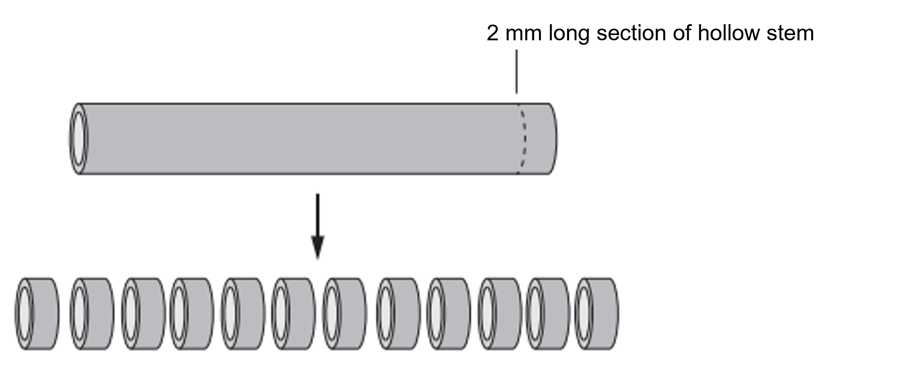

**Fig. 1**

| Step 5 | Each stem ring was then cut open as shown in Fig. 2. |
|---|---|

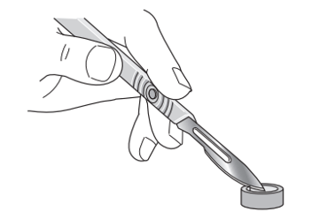

**Fig. 2**

| Step 6 | Three cut stem rings were put into each of the different salt solutions in the labelled Petri dishes and left for 10 minutes. |
|---|---|

Fig. 3 shows the appearance of the cut stem rings **after** 10 minutes.

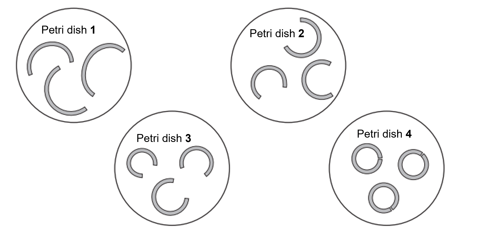

**Fig. 3**

| Step 7 | The distance between the two cut ends of each stem ring can be measured, as shown in Fig. 4 |
|---|---|

In the example shown in Fig. 4 the distance is 12 mm.

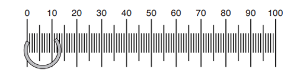

**Fig. 4**

The measurements of each stem ring were as follows:

- Petri dish **1**: 18 mm, 20 mm, 17 mm
- Petri dish **2**: 10 mm, 12 mm, 12 mm
- Petri dish **3**: 7 mm, 10 mm, 12 mm
- Petri dish **4**: 1 mm, 1 mm, 1 mm

(ii)

Prepare a table and record your measurements in your table.

Your table should show:

- all of your results
- a calculated average for each solution.

[4]

(iii)

Use Table 1 and your measurements to describe the results shown in Fig. 3

[1]

*Source: 2018 0610/63 Q1A*

**Q4** [2 marks]

**Extract:**

| Step 4 | A hollow stem was cut into 12 rings using a sharp scalpel. Each stem ring was approximately 2mm long, as shown in Fig.1 |

Identify one hazard in step 4 and describe a suitable safety precaution.

*Source: 2018 0610/63 Q1B*

**Q4** [2 marks]

**Extract:**

Three cut stem rings were put into each of the different salt solutions in the labelled Petri dishes and left for 10 minutes.

Explain why more than one ring of the hollow stem was placed into each Petri dish.

*Source: 2018 0610/63 Q1C*

**Q4** [3 marks]

**Extract:**

A student investigated the effect of different concentrations of salt solution on a hollow plant stem.

They were provided with a 2% salt solution and distilled water. The student used these to make up different concentrations of salt solution.

| Step 1 | Four test-tubes were labelled 1, 2, 3 and 4. |
| Step 2 | The information in Table 1 was used to make up the four different salt solutions in the test-tubes. |
| Step 3 | The contents of each test-tube were poured into four Petri dishes labelled 1, 2, 3 and 4. |
| Step 4 | A hollow stem was cut into 12 rings using a sharp scalpel. Each stem ring was approximately 2mm long, as shown in Fig.1 |
| Step 5 | Each stem ring was then cut open as shown in Fig. 2. |
| Step 6 | Three cut stem rings were put into each of the different salt solutions in the labelled Petri dishes and left for 10 minutes. |
| Step 7 | The distance between the two cut ends of each stem ring can be measured, as shown in Fig. 4 |

The measurements of each stem ring were as follows:

- Petri dish 1: 18 mm, 20 mm, 17 mm
- Petri dish 2: 10 mm, 12 mm, 12 mm
- Petri dish 3: 7 mm, 10 mm, 12 mm
- Petri dish 4: 1 mm, 1 mm, 1 mm

(i)

State the variable that was changed (independent variable) in this investigation.

[1]

(ii)

Identify **two **variables that were kept constant in this investigation.

[2]

*Source: 2018 0610/63 Q1D*

**Q4** [4 marks]

**Extract:**

| Step 4 | A hollow stem was cut into 12 rings using a sharp scalpel. Each stem ring was approximately 2mm long, as shown in Fig.1 |
| Step 7 | The distance between the two cut ends of each stem ring can be measured, as shown in Fig. 4 |
In the example shown in Fig. 4 the distance is 12 mm.

There are potential errors in steps 4 and 7.

Identify **two** of these errors and suggest an improvement for each.

*Source: 2018 0610/63 Q1E*

**Q4** [2 marks]

**Extract:**

The measured length of AB on Fig. 5 is 28 mm.

Calculate the actual length of AB using the following equation:

magnification = measured length of AB / actual length of AB

Fig. 5 shows a section through a hollow plant stem observed through a light microscope.

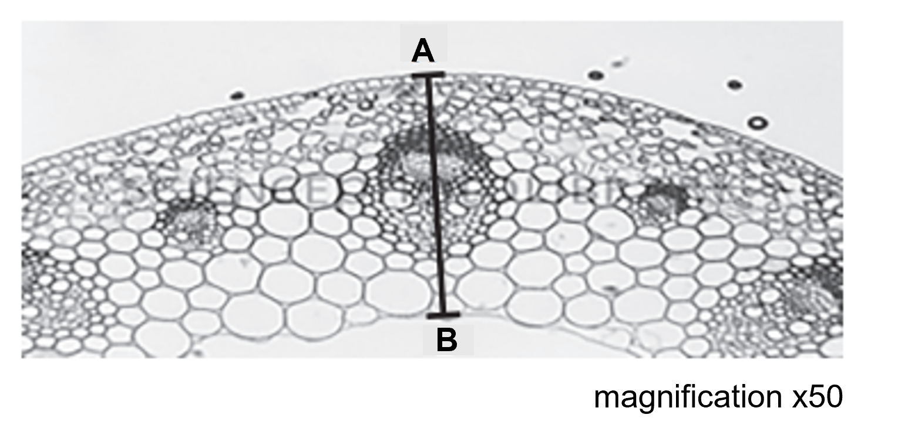

**Fig. 5**

The measured length of **AB** on Fig. 5 is 28 mm.

Calculate the actual length of **AB** using the following equation:

$\mathrm{magnification}=\frac{\mathrm{measured} \mathrm{length} \mathrm{of} \mathrm{AB}}{\mathrm{actual} \mathrm{length} \mathrm{of} \mathrm{AB}}$

Show your working.

*Source: 2018 0610/63 Q1F*

## Multiple Choice Questions (29 questions)

### Q1 — hard — 1 marks

**Q1** [1 mark]

The diagram shows a root hair cell.

Which row correctly matches each labelled part to its role in active transport?

|   | Structure needed for moving ions | Structure supplying energy |
|---|---|---|
| **A** | P | R |
| **B** | S | Q |
| **C** | R | P |
| **D** | P | Q |

### Q2 — easy — 1 marks

**Q2** [1 mark]

What is the role of water in digestion?

### Q3 — medium — 1 marks

**Q3** [1 mark]

A potato tissue sample has an initial mass of 5.0 g.

It is immersed in an unknown solution.

Its mass after 1 hour is 4.2 g.

Which statement is correct?

### Q4 — medium — 1 marks

**Q4** [1 mark]

The diagram below shows glucose molecules moving from the lumen of the intestines into surrounding epithelial cells.

Which row correctly describes the movement of glucose shown?

|   | **type of transport** | **Against concentration gradient?** | **ATP required** |
|---|---|---|---|
| **A** | osmosis | yes | no |
| **B** | active transport | no | yes |
| **C** | active transport | yes | yes |
| **D** | diffusion | no | no |

### Q5 — medium — 1 marks

**Q5** [1 mark]

A plant cell is placed in a concentrated salt solution.

Which of the following correctly describes the events that occur after this?

### Q6 — easy — 1 marks

**Q6** [1 mark]

Which process is involved in the uptake of glucose by the epithelial cells of kidney tubules?

*Source: June 2021 0970/21 Q8*

### Q7 — easy — 1 marks

**Q7** [1 mark]

The diagram shows a section through a mesophyll cell of a leaf.

Which part is partially permeable?

*Source: June 2022 paper 1 Q8*

### Q8 — easy — 1 marks

**Q8** [1 mark]

Which statement describes the net movement of particles during diffusion?

*Source: June 2022 paper 1 Q7*

### Q9 — medium — 1 marks

**Q9** [1 mark]

A cylinder of potato tissue was placed in a beaker of very salty water. After one hour the mass of the potato cylinder had decreased.

Why did this happen?

*Source: June 2021 0970/11 Q8*

### Q10 — easy — 1 marks

**Q10** [1 mark]

By which process do oxygen and carbon dioxide move between cells and capillaries?

*Source: June 2021 0970/11 Q7*

### Q11 — hard — 1 marks

**Q11** [1 mark]

Four freshly cut potato cylinders were soaked for one hour in different salt solutions The potato cylinders were then pinned to cork blocks. Two of the potato cylinders are shown.

Which solution would cause the potato cylinder to be the most flaccid?

*Source: Specimen 2023 0970/02 Q6*

### Q12 — easy — 1 marks

**Q12** [1 mark]

What are the features of active transport?

|   | occurs through a cell membrane | particles move from a higher concentration to a lower concentration | uses energy from respiration |
|---|---|---|---|
| **A** | Yes | Yes | Yes |
| **B** | Yes | Yes | No |
| **C** | Yes | No | Yes |
| **D** | No | Yes | Yes |

*Source: Specimen 2023 0970/01 Q8*

### Q13 — medium — 1 marks

**Q13** [1 mark]

How do carbon dioxide and oxygen move into and out of a mesophyll cell?

*Source: Specimen 2023 0970/01 Q7*

### Q14 — hard — 1 marks

**Q14** [1 mark]

A group of students carried out an investigation into osmosis using cylinders of potato.

The results from their experiment are shown below.

| concentration of salt solution / mol dm-3 | length of potato cylinder at start / mm | length of potato cylinder after 24 hours / mm |
|---|---|---|
| ? | 35 | 33 |

Which statement below correctly explains this change in length and shows the concentration of the salt solution?

|   | concentration of salt solution | cause of this movement |
|---|---|---|
| **A** | 0.0 | the salt solution is more concentrated than the solution inside the potato. |
| **B** | 0.6 | the solution in the potato is more dilute than the solution around the potato. |
| **C** | 0.6 | the solution in the potato is less dilute than the solution around the potato. |
| **D** | 0.0 | the salt solution is less concentrated than the solution inside the potato. |

### Q15 — medium — 1 marks

**Q15** [1 mark]

Which of the following statements would be correct for both diffusion and osmosis?

|   | does not require energy from the cell | molecules must be separated by a partially permeable membrane | molecules move from a dilute to a more concentrated solution |
|---|---|---|---|
| **A** | **✓** | **✓** | **X** |
| **B** | **X** | **X** | **✓** |
| **C** | **✓** | **X** | **X** |
| **D** | **✓** | **X** | **✓** |

### Q16 — medium — 1 marks

**Q16** [1 mark]

Three statements about the role of water in mammals are given below:

1. Water forms a major part of the cytoplasm, allowing substances to dissolve and participate in metabolic reactions within the cell
2. Substances, such as urea and excess salts, are able to dissolve in water making them easier to remove from the body in urine
3. Allows substances to be transported around the body in the blood

Which of the statements above are true?

### Q17 — hard — 1 marks

**Q17** [1 mark]

#### Extended only

The image below shows molecules in two solutions separated by a membrane.

In which direction would there be movement?

|   | water molecules | solute molecules |
|---|---|---|
| **A** | right to left | no net movement |
| **B** | left to right | right to left |
| **C** | left to right | no net movement |
| **D** | right to left | left to right |

### Q18 — medium — 1 marks

**Q18** [1 mark]

#### Extended only

The image below shows two solutions separated by a partially permeable membrane.

Which of the statements below would be true in relation to the image?

### Q19 — medium — 1 marks

**Q19** [1 mark]

Which of the statements below correctly describes the importance of osmosis in plant tissues?

### Q20 — medium — 1 marks

**Q20** [1 mark]

Plants take in various essential substances through their roots.

Which row in the table below accurately identifies the substances taken up by the roots and the processes involved in their uptake?

|   | minerals | oxygen | water |
|---|---|---|---|
| **A** | active transport | diffusion | osmosis |
| **B** | active transport | not absorbed | transpiration |
| **C** | diffusion | diffusion | osmosis |
| **D** | active transport | not absorbed | osmosis |

### Q21 — hard — 1 marks

**Q21** [1 mark]

Two identical square pieces of beetroot are cut. Each square of beetroot has a mass of 3.0 g. One (S) is placed in a concentrated salt solution, the other (T) is placed in pure water.

What would the masses of the two pieces of beetroot be after 3 hours?

|   | mass of beetroot squares |   |
|---|---|---|
|   | S | T |
| **A** | 3.0 | 3.2 |
| **B** | 2.7 | 3.0 |
| **C** | 2.9 | 3.2 |
| **D** | 3.1 | 2.9 |

### Q22 — hard — 1 marks

**Q22** [1 mark]

The image below shows part of a cross-section through a leaf.

Which row of the table below correctly shows the movement of various substances?

|   | evaporation of water | movement of water by osmosis | diffusion of water vapour |
|---|---|---|---|
| **A** | 3 | 1 | 2 |
| **B** | 2 | 3 | 1 |
| **C** | 3 | 2 | 1 |
| **D** | 2 | 1 | 3 |

### Q23 — medium — 1 marks

**Q23** [1 mark]

#### Extended only

A number of red blood cells were immersed in pure water before being observed under a microscope. There was a dramatic change in their appearance.

Which row of the table below correctly describes what happened to the red blood cells?

|   | direction of water movement | from higher to lower solute concentration | from higher to lower water potential | effect |
|---|---|---|---|---|
| **A** | in | **✓** | **X** | cells burst |
| **B** | in | **X** | **✓** | cells burst |
| **C** | out | **✓** | **X** | cells shrink |
| **D** | out | **✓** | **✓** | cells shrink |

### Q24 — hard — 1 marks

**Q24** [1 mark]

A group of students carried out an investigation into osmosis using cylinders of potatoes. The potatoes were put into a solution of salt.

The results from their experiment are shown below.

| concentration of salt solution / mol dm-3 | mass of potato cylinder at start / g | mass of potato cylinder after 24 hours / g |
|---|---|---|
| 0.2 | 2.5 | 2.7 |

Which statement below correctly explains this change in mass?

|   | Direction of movement of water | Cause of this movement |
|---|---|---|
| **A** | out of the potato cells | the salt solution has a lower water potential than the potato cells. |
| **B** | out of the potato cells | the salt solution has a higher water potential than the potato cells. |
| **C** | into the potato cells | the salt solution has a lower water potential than the potato cells. |
| **D** | into the potato cells | the salt solution has a higher water potential than the potato cells. |

### Q25 — easy — 1 marks

**Q25** [1 mark]

#### Extended only

The image below shows a leaf palisade cell:

What would the correct appearance of the leaf palisade cell be after it has been placed in a highly concentrated solution of sugar after an hour?

### Q26 — easy — 1 marks

**Q26** [1 mark]

What causes the diffusion of carbon dioxide out of a living cell?

### Q27 — easy — 1 marks

**Q27** [1 mark]

How does a water vapour molecule move out of the air space of a leaf into the atmosphere on a dry day?

### Q28 — easy — 1 marks

**Q28** [1 mark]

Which of the structures below is best adapted for diffusion?

### Q29 — easy — 1 marks

**Q29** [1 mark]

#### Extended only

Osmosis is:

## Theory Questions (16 questions)

### Q1 — medium — 12 marks

**Q1** [5 marks]

Fig. 1.1 is a diagram of a plant cell.

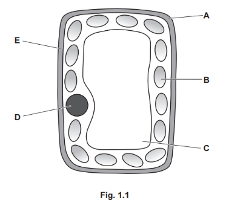

The boxes on the left contain the letters that identify some parts of the plant cell in Fig. 1.1.

The boxes on the right show the functions of some parts of a cell.

Draw five lines to link each letter to its correct function.

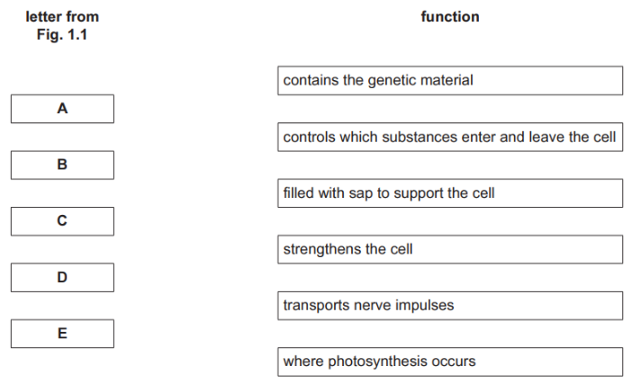

*Source: June 2022 paper 3  Q1A*

**Q1** [2 marks]

State the names of** two** different types of plant cell.

*Source: june 2022 paper 3 Q1B*

**Q1** [3 marks]

**Extract:**

A student used a potato as a source of plant tissue. The student cut six cylinder-shaped pieces from the potato. 

Each potato cylinder had the same diameter. Each potato cylinder was immersed in either water or one of five different concentrations of sugar solution. 

The student measured the length of the potato cylinders before immersion and after being immersed for 30 minutes. 

Table 1.1 shows the results.

Table 1.1

| concentration of sugar solution /mol per dm^3^ | length of potato cylinder before immersion /mm | length of potato cylinder after immersion /mm | change in length of potato cylinder /mm |
| --- | --- | --- | --- |
| 0.0 | 49.5 | 52.0 | + 2.5 |
| 0.2 | 50.0 | 52.0 | + 2.0 |
| 0.4 | 50.5 | 51.5 | + 1.0 |
| 0.6 | 50.5 | 51.0 | + 0.5 |
| 0.8 | 50.0 | 49.0 |   |
| 1.0 | 50.0 | 48.5 | – 1.5 |

A student used a potato as a source of plant tissue. The student cut six cylinder-shaped pieces from the potato.

Each potato cylinder had the same diameter. Each potato cylinder was immersed in either water or one of five different concentrations of sugar solution.

The student measured the length of the potato cylinders before immersion and after being immersed for 30 minutes.

Table 1.1 shows the results.

**Table 1.1**

| concentration of sugar solution /mol per dm3 | length of potato cylinder before immersion /mm | length of potato cylinder after immersion /mm | change in length of potato cylinder /mm |
|---|---|---|---|
| 0.0 | 49.5 | 52.0 | + 2.5 |
| 0.2 | 50.0 | 52.0 | + 2.0 |
| 0.4 | 50.5 | 51.5 | + 1.0 |
| 0.6 | 50.5 | 51.0 | + 0.5 |
| 0.8 | 50.0 | 49.0 |   |
| 1.0 | 50.0 | 48.5 | – 1.5 |

(i) Use the information in Table 1.1 to calculate the change in length of the potato cylinder immersed in the 0.8mol per dm3 sugar solution.

................................................... mm [1]

(ii) Use the information in Table 1.1 to calculate the percentage increase in length of the potato cylinder immersed in the 0.2mol per dm3 sugar solution

. ............................................................ % [2]

*Source: june 2022 paper 3 Q1C*

**Q1** [1 mark]

**Extract:**

A student used a potato as a source of plant tissue. The student cut six cylinder-shaped pieces from the potato.  Each potato cylinder had the same diameter. Each potato cylinder was immersed in either water or one of five different concentrations of sugar solution.  The student measured the length of the potato cylinders before immersion and after being immersed for 30 minutes.  Table 1.1 shows the results.

State the name of the process that causes water to enter or leave the potato cells.

*Source: June 2022 paper 6  Q1D*

**Q1** [1 mark]

**Extract:**

Each potato cylinder was immersed in either water or one of five different concentrations of sugar solution. The student measured the length of the potato cylinders before immersion and after being immersed for 30 minutes. Table 1.1 shows the results.

| concentration of sugar solution /mol per dm^3^ | length of potato cylinder before immersion /mm | length of potato cylinder after immersion /mm | change in length of potato cylinder /mm |
| --- | --- | --- | --- |
| ... |
| 1.0 | 50.0 | 48.5 | – 1.5 |

Describe the expected change in appearance of a potato cell that was immersed in a 1.0mol per dm3 sugar solution.

*Source: june 2022 paper 3 Q1E*

### Q2 — medium — 12 marks

**Q2** [3 marks]

A group of scientists investigated the rates of absorption of different sugars using two pieces of the intestine.

One of these pieces were treated with cyanide, which is a toxin that prevents cellular respiration from occurring.

The results of the investigation are shown in Table 1.

**Table 1**

| sugar | absorption rate / arbitrary units |   |
|---|---|---|
| healthy intestine | intestine treated with cyanide |   |
| A | 121 | 62 |
| B | 47 | 45 |
| C | 68 | 67 |
| D | 89 | 35 |

Suggest the method by which sugar **A**, **B** and **C** are absorbed by the intestine.

**Q2** [3 marks]

**Extract:**

A group of scientists investigated the rates of absorption of different sugars using two pieces of the intestine. One of these pieces were treated with cyanide, which is a toxin that prevents cellular respiration from occurring. The results of the investigation are shown in Table 1.

Table 1
| sugar | absorption rate / arbitrary units |
| healthy intestine | intestine treated with cyanide |
| A | 121 | 62 |
| B | 47 | 45 |
| C | 68 | 67 |
| D | 89 | 35 |

The scientists concluded that sugar **D** is absorbed by active transport.

Explain how they came to this conclusion by using evidence from Table 1.

**Q2** [2 marks]

**Extract:**

A group of scientists investigated the rates of absorption of different sugars using two pieces of the intestine.

One of these pieces were treated with cyanide, which is a toxin that prevents cellular respiration from occurring.

The results of the investigation are shown in Table 1.

Table 1

| sugar | absorption rate / arbitrary units |
| healthy intestine | intestine treated with cyanide |
| A | 121 | 62 |
| B | 47 | 45 |
| C | 68 | 67 |
| D | 89 | 35 |

One of the scientists states that 'All four of the sugars investigated could be absorbed by diffusion'.

Determine whether this statement is correct by using the information in Table 1 and your knowledge of diffusion.

**Q2** [4 marks]

#### Extended only

The wall of the intestine contains smooth muscle cells which convert glucose into glycogen. Glycogen is insoluble in water which makes it very suitable as an energy storage molecule.

Using your knowledge of osmosis, suggest an explanation as to why it is important for glucose to be stored as glycogen in muscle cells.

### Q3 — medium — 12 marks

**Q3** [1 mark]

#### Extended only

Fig. 1 shows two plant cells, each placed in a solution with a different concentration.

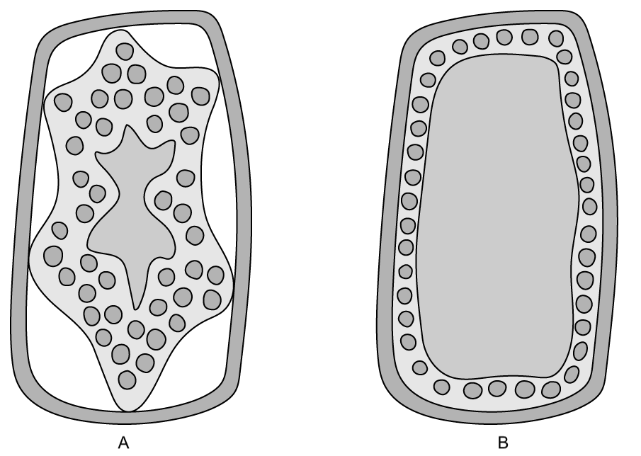

**Fig. 1**

Which of the plant cells above (**A** or **B**) was placed in a solution that was more dilute than the cell contents?

**Q3** [4 marks]

**Extract:**

The cell that was placed in a solution that was more dilute than the cell contents was...
- (cell) B; [1 mark]

When cells are placed in a solution that is more dilute than their cytoplasm, also known as a hypotonic solution, there is a net movement of water into the cell causing it to swell.

#### Extended only

Explain what has happened to the plant cell you identified in part (a).

**Q3** [4 marks]

**Extract:**

The plant cell placed in the dilute solution has...

Any four of the following:

- Become turgid/swollen; [1 mark]
- Because water has entered the cell by osmosis; [1 mark]
- From a more dilute to a concentrated solution / from a solution with a higher water potential to a solution with a lower water potential; [1 mark]
- Via a partially permeable membrane; [1 mark]
- The cell membrane is exerting pressure on the cell wall; [1 mark]

The solution surrounding the cell has a higher water potential (is more dilute) than the intracellular environment of the plant cell. Water will always move from an area of a more dilute solution to an area of a more concentrated solution, therefore, there is a net movement of water into the cell which swells up becoming turgid. This only happens in plant cells; an animal cell would swell then burst/lyse because it does not have a cell wall.

#### Extended only

When placed in different solutions, animal cells will also change.

Fig. 2** **below** **shows a red blood cell.

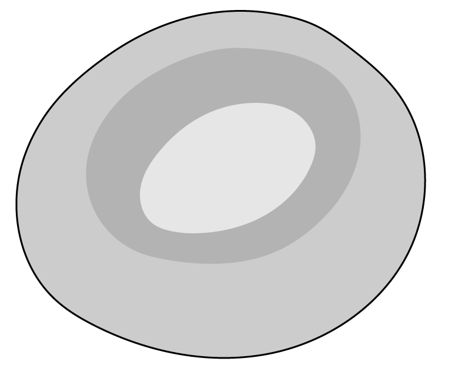

**Fig. 2**

(i)

Describe what would happen if a red blood cell was placed in a solution that was more dilute than the cell contents.

[2]

(ii)

Explain why the description at part (i) would be different from what would happen to a plant cell.

[2]

**Q3** [3 marks]

Hereditary spherocytosis is a rare inherited condition that produces red blood cells with an abnormal spherical shape, as shown in Fig. 3.

**Fig. 3**

Suggest the possible impact of this condition on a sufferer.

### Q4 — easy — 6 marks

**Q4** [2 marks]

Fig. 1 shows the process of active transport.

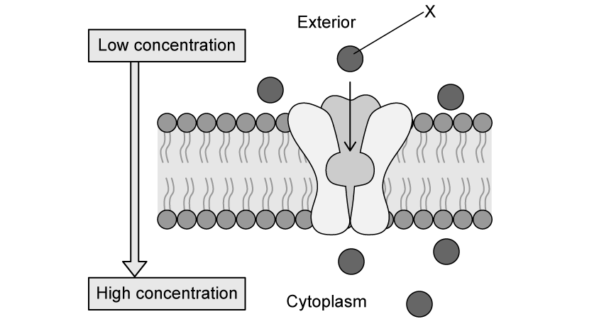

**Fig. 1**

State **two** differences between active transport and diffusion.

**Q4** [1 mark]

#### Extended only

Molecule **X** in Fig. 1 enters the cell by active transport.

Give **one** example of molecule **X**.

**Q4** [3 marks]

**Extract:**

Fig. 1 shows the process of active transport.

(In active transport) movement of particles occur from a region of lower concentration to a region of higher concentration WHILE in diffusion it occurs from a region of higher concentration to a region of lower concentration; (Active transport) requires energy/ATP (from respiration) WHILE diffusion does not / is a passive process; Award [1 mark] for reference to active transport requiring protein carriers while diffusion does not

Molecule **X** from Fig. 1 requires a carrier protein to enter the cell.

Describe the role of a carrier protein in active transport.

### Q5 — hard — 12 marks

**Q5** [3 marks]

#### Extended only

Diabetes insipidus is a disease that results in a large amount of dilute urine being excreted by the kidneys. This leads to blood which is more concentrated than normal.

Explain the effect that diabetes insipidus may have on red blood cells.

**Q5** [2 marks]

**Extract:**

Diabetes insipidus is a disease that results in a large amount of dilute urine being excreted by the kidneys. This leads to blood which is more concentrated than normal.

The effect of diabetes insipidus on red blood cells includes...

- Red blood cells will have a higher water potential than the blood (plasma) OR the blood (plasma) will have a lower water potential than the red blood cells; 
- There will be a net movement of water out of the red blood cells by osmosis; 
- The red blood cells will become shrivelled/crenated;

One of the symptoms of diabetes insipidus is blue fingernails, which indicates a lack of oxygen.

Suggest an explanation for this.

**Q5** [3 marks]

**Extract:**

The study was done at a hospital and included men and women between the ages of 45 and 65 that were admitted with bone fractures.
- Men and women were divided up into two groups each; those with diabetes insipidus and those without.
- Each of the four groups consisted of 250 individuals.
- The data gathered was used to calculate the percentage prevalence of fractures in each group.

Fig. 1 shows the results of this study.

[From Fig. 1:]
- Percentage prevalence of fractures in men with diabetes insipidus: 39%
- Percentage prevalence of fractures in men without diabetes insipidus: 27%

Central diabetes insipidus is a form of the disease that is believed to have a negative effect on the bone density of a sufferer which may leave them with an increased risk of sustaining fractures.

A study was conducted on the effect of central diabetes insipidus on the risk of sustaining fractures.

The study was done at a hospital and included men and women between the ages of 45 and 65 that were admitted with bone fractures.

- Men and women were divided up into two groups each; those with diabetes insipidus and those without.
- Each of the four groups consisted of 250 individuals.
- The data gathered was used to calculate the percentage prevalence of fractures in each group.

Fig. 1 shows the results of this study.

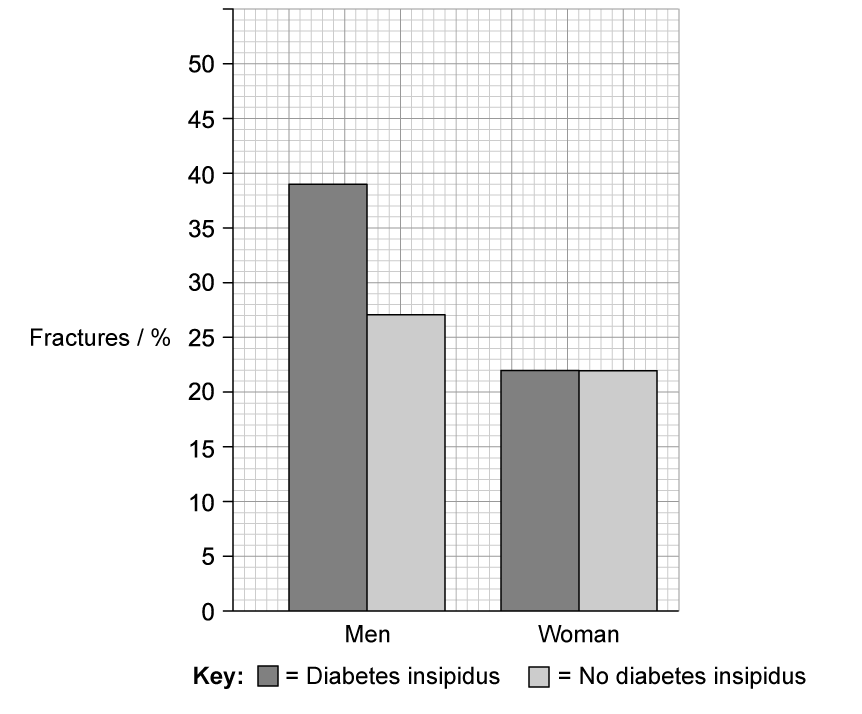

**Fig. 1**

Calculate the difference in the number of men suffering from fractures between those with diabetes insipidus and those without. Show your calculations.

**Q5** [4 marks]

**Extract:**

A study was conducted on the effect of central diabetes insipidus on the risk of sustaining fractures.

The study was done at a hospital and included men and women between the ages of 45 and 65 that were admitted with bone fractures.

- Men and women were divided up into two groups each; those with diabetes insipidus and those without.
- Each of the four groups consisted of 250 individuals.
- The data gathered was used to calculate the percentage prevalence of fractures in each group.

Fig. 1 shows the results of this study.

[Figure shows percentage prevalence of fractures in men and women with and without diabetes insipidus: Men with DI: 39%, Men without DI: 27%, Women with DI: 35%, Women without DI: 35%]

The scientists concluded that diabetes insipidus does increase the risk of sustaining fractures.

Evaluate this conclusion.

### Q6 — easy — 9 marks

**Q6** [2 marks]

Molecules may move by the process of diffusion.

Define the term 'diffusion'.

**Q6** [2 marks]

Give **two** reasons why diffusion is important to living organisms.

**Q6** [3 marks]

**Extract:**

Substances A, B and C represents...

- A = Carbon dioxide; [1 mark]
- B = Oxygen OR water vapour; [1 mark]
- C = Water vapour OR oxygen; [1 mark]

*Do not accept 'water' as an answer for B or C*

Fig. 1 is a cross section through a leaf showing the movement of several substances (**A**, **B** and **C**) through the stomata during the day.

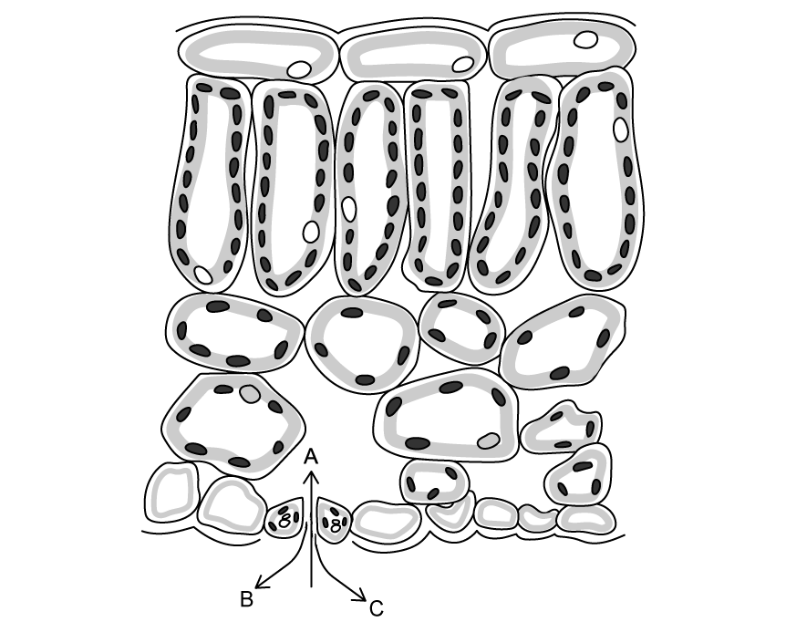

**Fig. 1**

Identify substances **A**, **B** and **C**.

**Q6** [2 marks]

**Extract:**

Fig. 1 is a cross section through a leaf showing the movement of several substances (A, B and C) through the stomata during the day.
A = Carbon dioxide

Describe the movement of substance **A** in Fig. 1.

### Q7 — hard — 11 marks

**Q7** [2 marks]

Monoglycerides are molecules made up of glycerol and one fatty acid tail. They are absorbed into the epithelial cells of the small intestine by diffusion across the cell membrane.

Some people suffer from coeliac disease that affects the lining of their small intestine.

Fig. 1 compares the lining of the small intestine of a healthy person and a person suffering from coeliac disease.

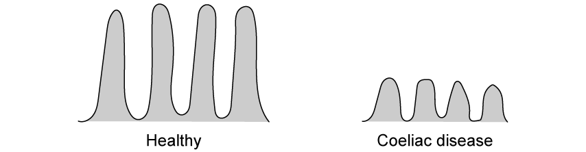

**Fig. 1**

Based on the information provided, explain the effect that coeliac disease would have on the absorption of monoglycerides.

**Q7** [3 marks]

Fig. 2 shows the rate of uptake of monoglycerides in the small intestine.

**Fig. 2**

Describe and explain what the graph shows.

**Q7** [3 marks]

Human body temperature is approximately 37 °C, which provides the optimum temperature for activity of protein molecules such as enzymes.

Suggest why a temperature of 37 °C helps to maximise the rate of transport of substances across the cell membrane.

**Q7** [3 marks]

**Extract:**

Cell X: 3% sugar solution
Cell Y: 4% sugar solution
Cell Z: 5% sugar solution

#### Extended only

Fig. 3 shows the concentration of sugars in three different cells.** X, Y** and** Z.**

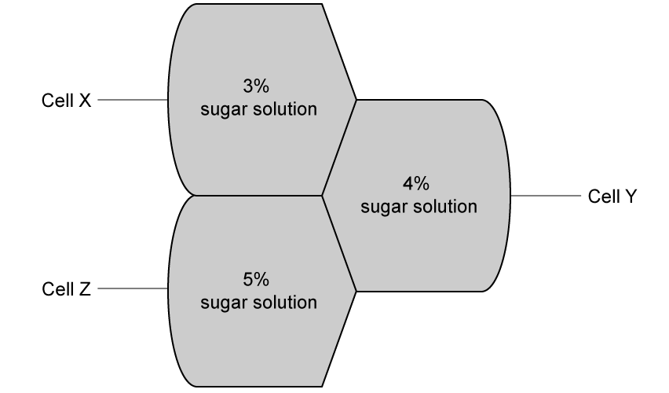

**Fig. 3**

Describe and explain the movement of water between the cells in Fig. 3.

### Q8 — easy — 7 marks

**Q8** [2 marks]

Water is important for living organisms as many substances are able to dissolve in it.

Give **two** examples of the importance of water as a solvent in living organisms.

**Q8** [1 mark]

Fig. 1 shows water and a sugar solution separated by a partially permeable membrane.

**Fig. 1**

State the overall direction in which water molecules will move.

**Q8** [2 marks]

Osmosis occurred in Fig. 1.

Define the term 'osmosis'.

**Q8** [2 marks]

**Extract:**

Fig. 1 shows water and a sugar solution separated by a partially permeable membrane.

Osmosis is...
- The diffusion/movement of water molecules from from a high concentration of water to a low concentration of water / from a low solute concentration to a high solute concentration / from a dilute solution to a more concentrated solution / from high to low water potential; [1 mark]
- Across a partially permeable membrane; [1 mark]

A second beaker, similar to the one from Fig. 1, was set up and placed in a water bath that was 10°C lower than the beaker from Fig. 1.

Explain how the movement of the water molecules would be affected by this decrease in temperature.

### Q9 — easy — 6 marks

**Q9** [2 marks]

Fig. 1 shows an epithelial cell found in the ileum of the digestive system.

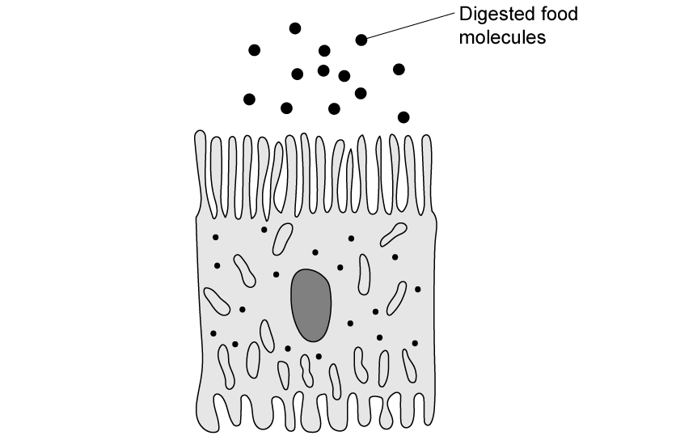

**Fig. 1**

Give one visible adaptation of this cell **and **state how this would facilitate diffusion of digested food molecules.

**Q9** [2 marks]

There is a steep increase in the number of digested food molecules in the ileum.

Explain the effect this would have on the rate of diffusion of these molecules.

**Q9** [1 mark]

Organisms must transport substances to and from the external environment.

Identify** one** substance which cells must transport across the cell membrane to support cell functions.

**Q9** [1 mark]

Fig. 2 shows particles of two gases.

**Fig. 2**

Sketch the arrangement of the gas particles after 1 hour.

### Q10 — hard — 13 marks

**Q10** [5 marks]

A student carried out an investigation into the effect of osmosis on plant tissue.

They cut a potato into cubes and recorded the change in mass over a 30 minute period.

Fig. 1 shows the results the student obtained from one cube of potato.

**Fig. 1**

Describe **and** explain the trend shown on the graph.

**Q10** [2 marks]

**Extract:**

The potato cube from Fig. 1 had an initial mass of 2.5 g. After 15 minutes, the increase in mass was 0.25 g.

The potato cube from Fig. 1 had an initial mass of 2.5 g.

Calculate the percentage increase that the potato cube had shown after 15 minutes.

**Q10** [2 marks]

**Extract:**

A student carried out an investigation into the effect of osmosis on plant tissue. They cut a potato into cubes and recorded the change in mass over a 30 minute period. Fig. 1 shows the results the student obtained from one cube of potato. The graph can be described as follows: As time increases, the mass of the potato cube increases; The increase is not proportional OR the increase in mass occurs more quickly in the first 15/20 minutes and then more slowly after 20 minutes / the graph levels off; This is because... The water concentration outside of the potato is higher than inside the potato; (So) water moves into the potato cells by osmosis; The rate occurs more quickly when the concentration gradient is steepest (between 0 and 15/20 minutes); The rate of increase slows / graph levels off because there is no longer a concentration gradient / the concentration of water inside the potato is the same as / similar to the concentration outside of the potato; The rate of increase slows / graph levels off when the cell is turgid/full / cannot absorb any more water.

The student repeated the investigation but with the beaker placed in a water bath at 30°C.

Draw a second line on the graph to show the trend expected from these results.

**Q10** [4 marks]

**Extract:**

The student repeated the investigation but with the beaker placed in a water bath at 30°C.

The mass of the potato would increase faster; The graph would level off at the same value of mass increase.

#### Extended only

Explain your line drawn for part (c).

### Q11 — easy — 7 marks

**Q11** [2 marks]

#### Extended only

Fig. 1 shows a root hair cell.

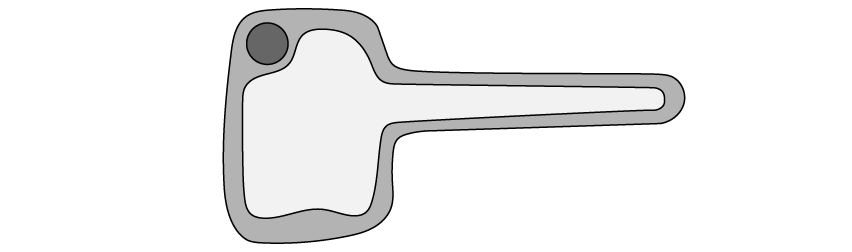

**Fig. 1**

Describe how this cell is adapted for absorption of water by osmosis.

**Q11** [2 marks]

#### Extended only

Fig. 2 shows two cells after the effects of osmosis.

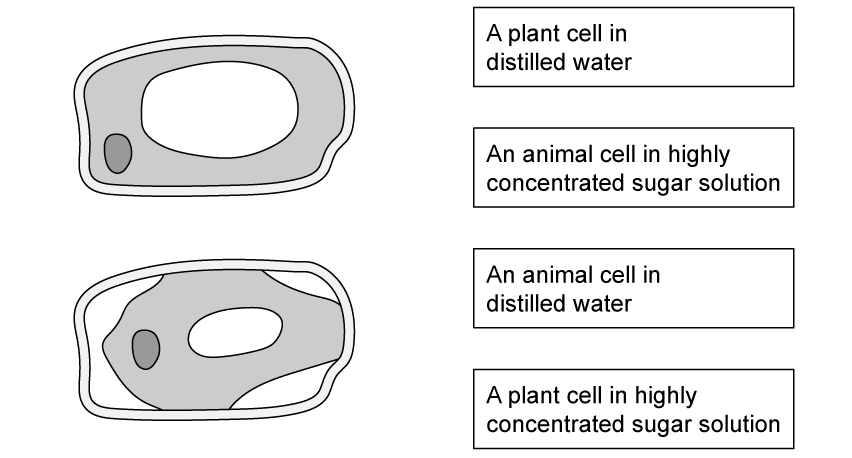

**Fig. 2**

Identify the correct description for each cell by drawing a line between the cell and the box that contains the most accurate description.

**Q11** [2 marks]

**Extract:**

Each beaker contained potato discs in a solution of sugar or distilled water. The student found that the potato discs in Beaker 5 decreased in mass.

The presence of a cell wall and a large vacuole identifies these cells as plant cells. The top cell gained water by osmosis which would only occur if it had been placed in distilled water which would be more dilute than the cell contents. The bottom cell lost water which would occur if it had been placed in a concentrated sugar solution.

A student carried out an experiment on osmosis in plant tissue. They set up their investigation as shown in Fig. 3.

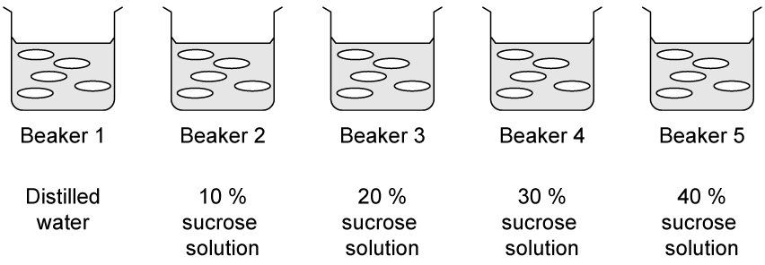

**Fig. 3**

Each beaker contained potato discs in a solution of sugar or distilled water. The student found that the potato discs in Beaker 5 decreased in mass.

Explain the reason for this.

**Q11** [1 mark]

**Extract:**

A student carried out an experiment on osmosis in plant tissue. They set up their investigation as shown in Fig. 3.

Each beaker contained potato discs in a solution of sugar or distilled water.

Give **one** example of a variable that would need to be controlled during the experiment from part (c).

### Q12 — medium — 14 marks

**Q12** [10 marks]

#### Extended only

More than 40 years ago, botanists studied the leaves of broad bean plants and discovered that guard cells control the opening and closing of stomata. They found that stomata were open when the guard cells were turgid.

Table 1 shows some of their measurements.

**Table 1**

|   | closed stomata | open stomata |
|---|---|---|
| ion concentration in guard cells /pmol | 0.3 | 2.5 |
| guard cell volume/μm3 | 4000.0 | 6500.0 |
| turgor pressure in the guard cells /MPa | 2.0 | 4.8 |
| width of stomatal opening/μm | 0.0 | 8.0 |

(i)

Ions move into guard cells by active transport.

Describe how the ions move into the guard cells.

[2]

(ii)

Describe **and** explain how the change in ion concentration causes the guard cell volume to change.

Use the information in Table 1 in your answer.

[6]

(iii)

The botanists left the broad bean plants unattended for three days. During this time the broad bean plants wilted.

Suggest **two** environmental factors that can cause plants to wilt.

[2]

*Source: 2018 0610/43 Q3C*

**Q12** [2 marks]

Table 2 shows the concentrations of four mineral ions in the roots of a plant and in the surrounding soil.

These minerals are all essential to the health of the plant.

**Table 2**

| mineral ion | concentration in millimoles per gram |   |
|---|---|---|
| plant root | soil |   |
| calcium | 0.15 | 0.03 |
| magnesium | 0.06 | 0.02 |
| nitrate | 0.68 | 0.53 |
| potassium | 0.26 | 0.01 |

Based on the information in Table 2, explain why the plant roots cannot absorb these mineral ions by diffusion.

**Q12** [2 marks]

**Extract:**

Table 2

| mineral ion | concentration in millimoles per gram |
|            | plant root | soil |
| calcium    | 0.15       | 0.03 |

Calcium ions play a structural role in cell walls and membranes of the plant cell.

Calculate the percentage difference between the concentration of calcium ions inside and outside the plant root, using the data from Table 1.

### Q13 — hard — 12 marks

**Q13** [4 marks]

Plants transport sugars in the form of sucrose in phloem sieve tubes. Companion cells are located next to phloem sieve tubes and are responsible for moving sucrose into the tubes for transport.

Fig. 1 shows part of a companion cell and the mechanism by which it moves sucrose into the cytoplasm so that it can be transported into the sieve tubes.

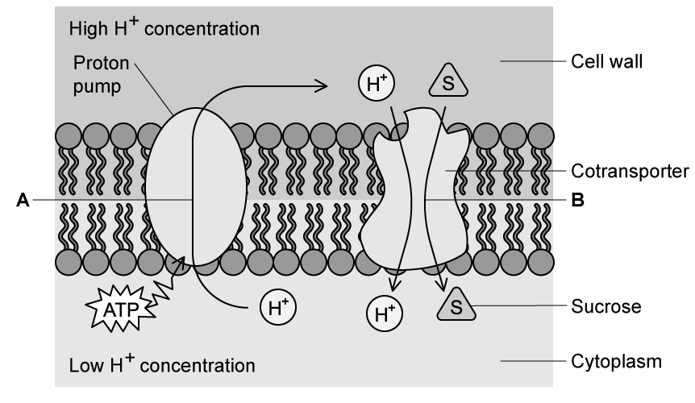

**Fig. 1**

Sucrose enters the companion cells via a cotransporter protein which will only transport sucrose in the presence of hydrogen ions (H+). This is represented by process **B** in Fig. 1.

The companion cells will transport H+ out of the cytoplasm by process **A** so that it can re-enter the cell via the cotransporter protein, allowing sucrose to enter the cell at the same time.

Use the information in Fig. 1 to describe how H+ is transported out of the companion cell by process **A**.

**Q13** [2 marks]

Process **B** in Fig. 1 is a passive process.

Explain what is meant by the term 'passive process' with reference to process **B**.

**Q13** [3 marks]

**Extract:**

Sucrose enters the companion cells via a cotransporter protein which will only transport sucrose in the presence of hydrogen ions (H^+^). This is represented by process **B** in Fig. 1. The companion cells will transport H^+^ out of the cytoplasm by process **A** so that it can re-enter the cell via the cotransporter protein, allowing sucrose to enter the cell at the same time.

#### Extended only

High temperatures will change the shape of the proton pump involved in process **A**.

Explain why sucrose won't be able to enter the companion cell in this scenario.

**Q13** [3 marks]

**Extract:**

Plants transport sugars in the form of sucrose in phloem sieve tubes. Companion cells are located next to phloem sieve tubes and are responsible for moving sucrose into the tubes for transport.

Once sucrose enters the companion cell cytoplasm, it is quickly transported into the phloem sieve tubes to be taken to other parts of the plant.

Based on your knowledge of diffusion, suggest a possible explanation for this quick transport out of the companion cells.

### Q14 — medium — 12 marks

**Q14** [2 marks]

Fig. 1 is a diagram of a palisade mesophyll cell.

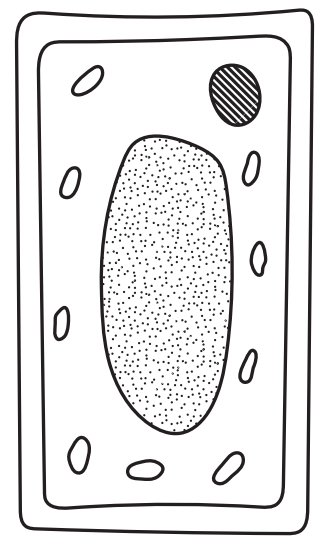

**Fig. 1**

Identify and label the nucleus and a chloroplast on Fig. 1.

*Source: 2019 0970/31 Q4A*

**Q14** [6 marks]

**Extract:**

Fig. 1 is a diagram of a palisade mesophyll cell.

Fig. 2 shows the same palisade mesophyll cell after it has been placed in a concentrated sugar solution for twenty minutes.

Fig. 2 shows the same palisade mesophyll cell after it has been placed in a concentrated sugar solution for twenty minutes.

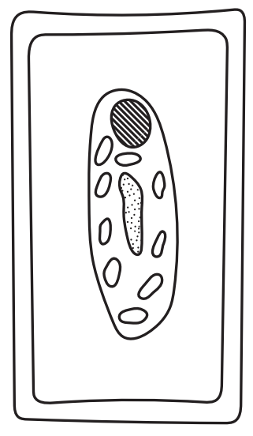

**Fig. 2**

(i)

Describe the changes that have taken place in the cell between Fig. 1 and Fig. 2.

[2]

(ii)

Explain why the cell in Fig. 2 has changed.

[3]

(iii)

Suggest how the cell in Fig. 2 could be treated so that it returned to its original appearance in Fig. 1.

[1]

*Source: 2019 0970/31 Q4B*

**Q14** [4 marks]

(i)

State the name of the tissue that transports water up the stem and into a leaf in a plant.

[1]

(ii)

Fig. 3 shows drawings of sections through a root, a stem and part of a leaf in a dicotyledonous plant.

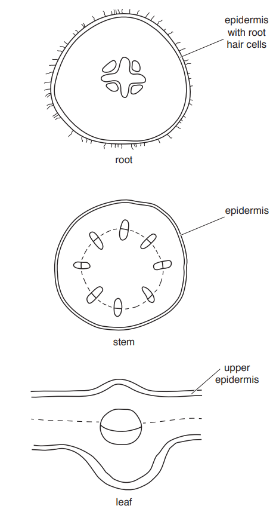

**Fig. 3**

Identify and label with the letter **W**, the position of the water transport tissue in each of the root, the stem and the leaf, on Fig. 3.

[3]

*Source: 2019 0970/31 Q4C*

### Q15 — hard — 12 marks

**Q15** [3 marks]

Particulate matter (PM) refers to the small particles in air pollution which can irritate the airways and caused damage to the alveoli. Alveoli are tiny air sacs in the lungs across which gas exchange by diffusion occurs.

Fig. 1 shows the structure of an alveolus with a capillary running next to it.

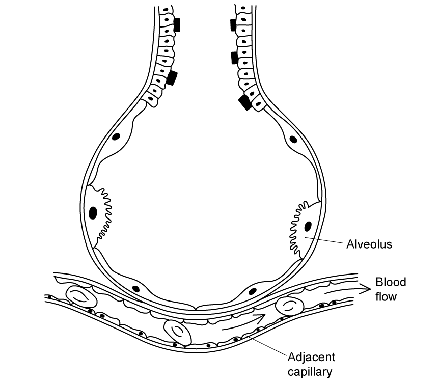

**Fig. 1**

If concentrations of PM are high, the epithelium cells of the alveoli may be killed and replaced with unspecialised cells resulting in:

- Fewer functioning alveoli
- Thickening of alveolar walls

Explain how particulate matter would affect the process of gas exchange in human lungs.

**Q15** [3 marks]

**Extract:**

Scientists studied 31 080 alveolar epithelium cells in this study.

Percentage of dead cells after 48 hours of exposure to:
- 1 000 µg cm^-3 of particulate matter: 56%
- 50 µg cm^-3 of particulate matter: 20%

Fig. 2 shows the results of an investigation into the concentration of particulate matter and the percentage of dead alveolar epithelium cells after 48 of exposure.

**Fig. 2**

Scientists studied 31 080 alveolar epithelium cells in this study.

Calculate how many more cells died after 48 hours of exposure to 1 000 µg cm-3 of particulate matter than after 48 hours of exposure to 50 µg cm-3 of particulate matter.

**Q15** [2 marks]

**Extract:**

Particulate matter (PM) refers to the small particles in air pollution which can irritate the airways and caused damage to the alveoli. Alveoli are tiny air sacs in the lungs across which gas exchange by diffusion occurs.

If concentrations of PM are high, the epithelium cells of the alveoli may be killed and replaced with unspecialised cells resulting in:
- Fewer functioning alveoli
- Thickening of alveolar walls

Particulate matter would affect gas exchange in the following ways...
- The rate of gas exchange / diffusion would decrease;
- (Due to) a reduced surface area (as a result of fewer alveoli);
- And an increased diffusion distance (due to thickened cells / alveolar walls);

Oxygen is required for the process of cellular respiration in cells. People living in urban areas with high levels of air pollution will often suffer from fatigue (feeling tired).

Use the information provided in part (a) and (c) to suggest an explanation for this.

**Q15** [4 marks]

Other than diffusion, movement of molecules in the body could also occur by osmosis and active transport.

Compare osmosis and active transport with each other.

### Q16 — medium — 13 marks

**Q16** [3 marks]

#### Extended only

A student decided to investigate the effect of different sugar solutions on the mass of chicken eggs.

They used the following method:

1. Five eggs were placed in hydrochloric acid for 24 hours to dissolve the eggshell.
2. The mass of each egg was measured and recorded.
3. Five beakers were set up; four with 200 cm3 of sugar solution of different concentrations (0.2, 0.4, 0.6 and 0.8 mol dm-3) and one with distilled water (0 mol dm-3).
4. An egg was place in each of the beakers for 1 hour.
5. The eggs were removed and dried with a paper towel whereafter the mass of each egg was measured and recorded.
6. The percentage change in the mass of each egg was calculated and a graph was drawn from these results.

Fig. 1 represents the graph that was drawn of the percentage change in mass.

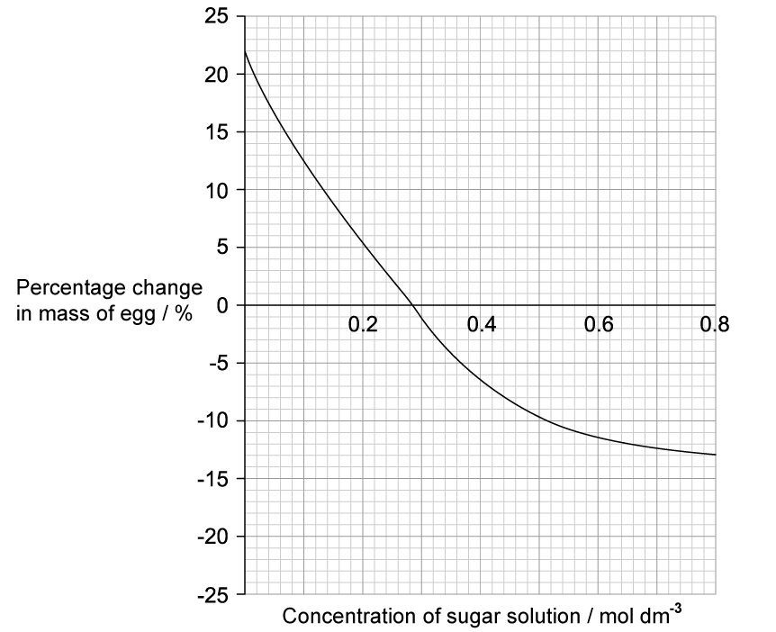

**Fig. 1**

Use the information in Fig. 1 to describe the results obtained in each beaker.

**Q16** [3 marks]

**Extract:**

A student decided to investigate the effect of different sugar solutions on the mass of chicken eggs.

They used the following method:

1. Five eggs were placed in hydrochloric acid for 24 hours to dissolve the eggshell.
2. The mass of each egg was measured and recorded.
3. Five beakers were set up; four with 200 cm^3^ of sugar solution of different concentrations (0.2, 0.4, 0.6 and 0.8 mol dm^-3^) and one with distilled water (0 mol dm^-3^).
4. An egg was place in each of the beakers for 1 hour.
5. The eggs were removed and dried with a paper towel whereafter the mass of each egg was measured and recorded.
6. The percentage change in the mass of each egg was calculated and a graph was drawn from these results.

Fig. 1 represents the graph that was drawn of the percentage change in mass.

#### Extended only

(i)

Use the graph in Fig. 1 to identify the concentration of the sugar solution where the mass of the egg would not change.

[1]

(ii)

Explain why the mass of the egg would not change at the concentration identified at part (i).

[2]

**Q16** [3 marks]

**Extract:**

A student decided to investigate the effect of different sugar solutions on the mass of chicken eggs.

They used the following method:

1. Five eggs were placed in hydrochloric acid for 24 hours to dissolve the eggshell.
2. The mass of each egg was measured and recorded.
3. Five beakers were set up; four with 200 cm^3^ of sugar solution of different concentrations (0.2, 0.4, 0.6 and 0.8 mol dm^-3^) and one with distilled water (0 mol dm^-3^).
4. An egg was place in each of the beakers for 1 hour.
5. The eggs were removed and dried with a paper towel whereafter the mass of each egg was measured and recorded.
6. The percentage change in the mass of each egg was calculated and a graph was drawn from these results.

The eggs in the sugar solutions with a concentration of 0.4 mol dm^-3^ and higher lost mass/water / became lighter / showed a negative change in mass.

#### Extended only

Explain the results that were obtained in the beaker with a concentration of 0.8 mol dm-3.

**Q16** [4 marks]

Diffusion and osmosis are two ways in which molecules can move.

Compare diffusion and osmosis with each other.
