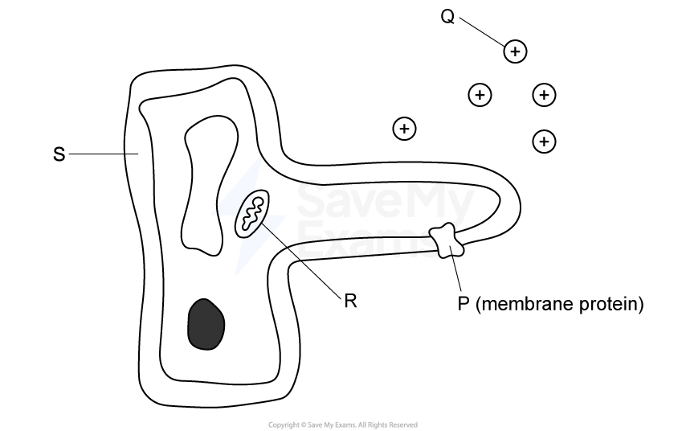
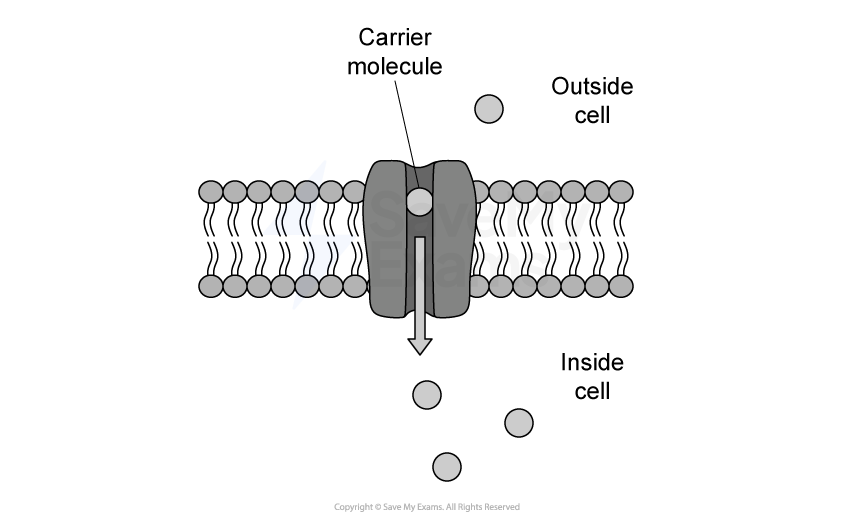
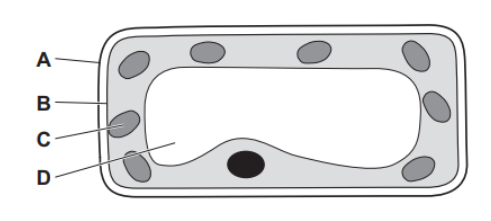
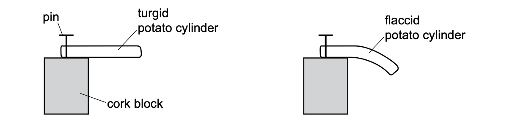
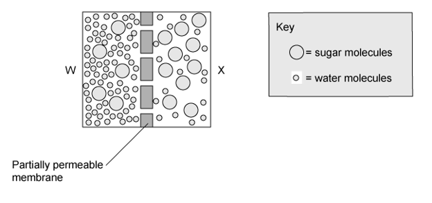

# Exam Questions — Diffusion, Osmosis & Active Transport
**3. Movement into & out of Cells** · Cambridge (CIE) IGCSE biology (0610 & 0970)
> Source: [https://www.savemyexams.com/igcse/biology/cie/23/topic-questions/](https://www.savemyexams.com/igcse/biology/cie/23/topic-questions/) · 29 questions across 1 sets

## Multiple Choice Questions (29 questions)

### Q1 — hard — 1 marks

**Q1** [1 mark]

The diagram shows a root hair cell.

Which row correctly matches each labelled part to its role in active transport?

|   | Structure needed for moving ions | Structure supplying energy |
|---|---|---|
| **A** | P | R |
| **B** | S | Q |
| **C** | R | P |
| **D** | P | Q |

### Q2 — easy — 1 marks

**Q2** [1 mark]

What is the role of water in digestion?

### Q3 — medium — 1 marks

**Q3** [1 mark]

A potato tissue sample has an initial mass of 5.0 g.

It is immersed in an unknown solution.

Its mass after 1 hour is 4.2 g.

Which statement is correct?

### Q4 — medium — 1 marks

**Q4** [1 mark]

The diagram below shows glucose molecules moving from the lumen of the intestines into surrounding epithelial cells.

Which row correctly describes the movement of glucose shown?

|   | **type of transport** | **Against concentration gradient?** | **ATP required** |
|---|---|---|---|
| **A** | osmosis | yes | no |
| **B** | active transport | no | yes |
| **C** | active transport | yes | yes |
| **D** | diffusion | no | no |

### Q5 — medium — 1 marks

**Q5** [1 mark]

A plant cell is placed in a concentrated salt solution.

Which of the following correctly describes the events that occur after this?

### Q6 — easy — 1 marks

**Q6** [1 mark]

Which process is involved in the uptake of glucose by the epithelial cells of kidney tubules?

*Source: June 2021 0970/21 Q8*

### Q7 — easy — 1 marks

**Q7** [1 mark]

The diagram shows a section through a mesophyll cell of a leaf.

Which part is partially permeable?

*Source: June 2022 paper 1 Q8*

### Q8 — easy — 1 marks

**Q8** [1 mark]

Which statement describes the net movement of particles during diffusion?

*Source: June 2022 paper 1 Q7*

### Q9 — medium — 1 marks

**Q9** [1 mark]

A cylinder of potato tissue was placed in a beaker of very salty water. After one hour the mass of the potato cylinder had decreased.

Why did this happen?

*Source: June 2021 0970/11 Q8*

### Q10 — easy — 1 marks

**Q10** [1 mark]

By which process do oxygen and carbon dioxide move between cells and capillaries?

*Source: June 2021 0970/11 Q7*

### Q11 — hard — 1 marks

**Q11** [1 mark]

Four freshly cut potato cylinders were soaked for one hour in different salt solutions The potato cylinders were then pinned to cork blocks. Two of the potato cylinders are shown.

Which solution would cause the potato cylinder to be the most flaccid?

*Source: Specimen 2023 0970/02 Q6*

### Q12 — easy — 1 marks

**Q12** [1 mark]

What are the features of active transport?

|   | occurs through a cell membrane | particles move from a higher concentration to a lower concentration | uses energy from respiration |
|---|---|---|---|
| **A** | Yes | Yes | Yes |
| **B** | Yes | Yes | No |
| **C** | Yes | No | Yes |
| **D** | No | Yes | Yes |

*Source: Specimen 2023 0970/01 Q8*

### Q13 — medium — 1 marks

**Q13** [1 mark]

How do carbon dioxide and oxygen move into and out of a mesophyll cell?

*Source: Specimen 2023 0970/01 Q7*

### Q14 — hard — 1 marks

**Q14** [1 mark]

A group of students carried out an investigation into osmosis using cylinders of potato.

The results from their experiment are shown below.

| concentration of salt solution / mol dm-3 | length of potato cylinder at start / mm | length of potato cylinder after 24 hours / mm |
|---|---|---|
| ? | 35 | 33 |

Which statement below correctly explains this change in length and shows the concentration of the salt solution?

|   | concentration of salt solution | cause of this movement |
|---|---|---|
| **A** | 0.0 | the salt solution is more concentrated than the solution inside the potato. |
| **B** | 0.6 | the solution in the potato is more dilute than the solution around the potato. |
| **C** | 0.6 | the solution in the potato is less dilute than the solution around the potato. |
| **D** | 0.0 | the salt solution is less concentrated than the solution inside the potato. |

### Q15 — medium — 1 marks

**Q15** [1 mark]

Which of the following statements would be correct for both diffusion and osmosis?

|   | does not require energy from the cell | molecules must be separated by a partially permeable membrane | molecules move from a dilute to a more concentrated solution |
|---|---|---|---|
| **A** | **✓** | **✓** | **X** |
| **B** | **X** | **X** | **✓** |
| **C** | **✓** | **X** | **X** |
| **D** | **✓** | **X** | **✓** |

### Q16 — medium — 1 marks

**Q16** [1 mark]

Three statements about the role of water in mammals are given below:

1. Water forms a major part of the cytoplasm, allowing substances to dissolve and participate in metabolic reactions within the cell
2. Substances, such as urea and excess salts, are able to dissolve in water making them easier to remove from the body in urine
3. Allows substances to be transported around the body in the blood

Which of the statements above are true?

### Q17 — hard — 1 marks

**Q17** [1 mark]

#### Extended only

The image below shows molecules in two solutions separated by a membrane.

In which direction would there be movement?

|   | water molecules | solute molecules |
|---|---|---|
| **A** | right to left | no net movement |
| **B** | left to right | right to left |
| **C** | left to right | no net movement |
| **D** | right to left | left to right |

### Q18 — medium — 1 marks

**Q18** [1 mark]

#### Extended only

The image below shows two solutions separated by a partially permeable membrane.

Which of the statements below would be true in relation to the image?

### Q19 — medium — 1 marks

**Q19** [1 mark]

Which of the statements below correctly describes the importance of osmosis in plant tissues?

### Q20 — medium — 1 marks

**Q20** [1 mark]

Plants take in various essential substances through their roots.

Which row in the table below accurately identifies the substances taken up by the roots and the processes involved in their uptake?

|   | minerals | oxygen | water |
|---|---|---|---|
| **A** | active transport | diffusion | osmosis |
| **B** | active transport | not absorbed | transpiration |
| **C** | diffusion | diffusion | osmosis |
| **D** | active transport | not absorbed | osmosis |

### Q21 — hard — 1 marks

**Q21** [1 mark]

Two identical square pieces of beetroot are cut. Each square of beetroot has a mass of 3.0 g. One (S) is placed in a concentrated salt solution, the other (T) is placed in pure water.

What would the masses of the two pieces of beetroot be after 3 hours?

|   | mass of beetroot squares |   |
|---|---|---|
|   | S | T |
| **A** | 3.0 | 3.2 |
| **B** | 2.7 | 3.0 |
| **C** | 2.9 | 3.2 |
| **D** | 3.1 | 2.9 |

### Q22 — hard — 1 marks

**Q22** [1 mark]

The image below shows part of a cross-section through a leaf.

Which row of the table below correctly shows the movement of various substances?

|   | evaporation of water | movement of water by osmosis | diffusion of water vapour |
|---|---|---|---|
| **A** | 3 | 1 | 2 |
| **B** | 2 | 3 | 1 |
| **C** | 3 | 2 | 1 |
| **D** | 2 | 1 | 3 |

### Q23 — medium — 1 marks

**Q23** [1 mark]

#### Extended only

A number of red blood cells were immersed in pure water before being observed under a microscope. There was a dramatic change in their appearance.

Which row of the table below correctly describes what happened to the red blood cells?

|   | direction of water movement | from higher to lower solute concentration | from higher to lower water potential | effect |
|---|---|---|---|---|
| **A** | in | **✓** | **X** | cells burst |
| **B** | in | **X** | **✓** | cells burst |
| **C** | out | **✓** | **X** | cells shrink |
| **D** | out | **✓** | **✓** | cells shrink |

### Q24 — hard — 1 marks

**Q24** [1 mark]

A group of students carried out an investigation into osmosis using cylinders of potatoes. The potatoes were put into a solution of salt.

The results from their experiment are shown below.

| concentration of salt solution / mol dm-3 | mass of potato cylinder at start / g | mass of potato cylinder after 24 hours / g |
|---|---|---|
| 0.2 | 2.5 | 2.7 |

Which statement below correctly explains this change in mass?

|   | Direction of movement of water | Cause of this movement |
|---|---|---|
| **A** | out of the potato cells | the salt solution has a lower water potential than the potato cells. |
| **B** | out of the potato cells | the salt solution has a higher water potential than the potato cells. |
| **C** | into the potato cells | the salt solution has a lower water potential than the potato cells. |
| **D** | into the potato cells | the salt solution has a higher water potential than the potato cells. |

### Q25 — easy — 1 marks

**Q25** [1 mark]

#### Extended only

The image below shows a leaf palisade cell:

What would the correct appearance of the leaf palisade cell be after it has been placed in a highly concentrated solution of sugar after an hour?

### Q26 — easy — 1 marks

**Q26** [1 mark]

What causes the diffusion of carbon dioxide out of a living cell?

### Q27 — easy — 1 marks

**Q27** [1 mark]

How does a water vapour molecule move out of the air space of a leaf into the atmosphere on a dry day?

### Q28 — easy — 1 marks

**Q28** [1 mark]

Which of the structures below is best adapted for diffusion?

### Q29 — easy — 1 marks

**Q29** [1 mark]

#### Extended only

Osmosis is:
