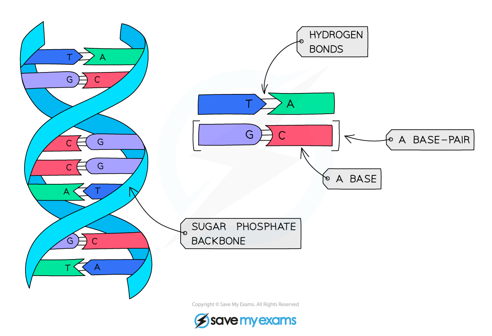
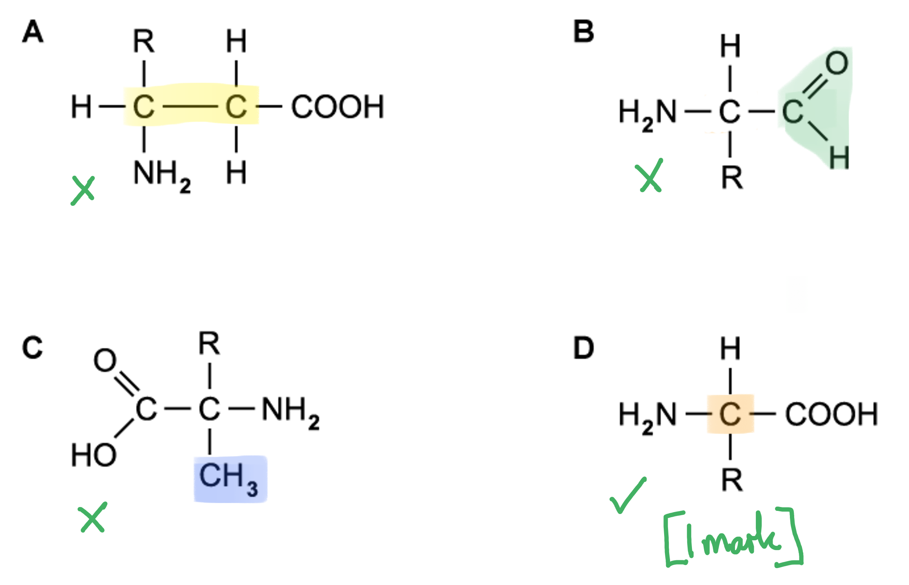

# Mark Schemes — Biological Molecules
**4. Biological Molecules** · Cambridge (CIE) IGCSE biology (0610 & 0970)

## Multiple Choice Questions (29 questions)

### Q1
**Final answer:** **The correct answer is ****D.**

- In DNA, bases pair in a fixed way: **A pairs with T** and** C pairs with G**
- Therefore the initial strand pairs with its opposite strand as follows:

**A C T G**

**Final answer:** **T G A C**

### Q2
**Final answer:** **The correct answer is ****A.**

- The tested sample contains **reducing sugar and fat only**

  - Iodine remains brown, so **starch is absent**.
  - Benedict’s turns brick-red after heating, so **reducing sugar is present**
  - Biuret remains blue, so **protein is absent**
  - A cloudy white emulsion forms, so **fat is present**
  - DCPIP remains blue, so **vitamin C is absent**

### Q3
**Final answer:** **The correct answer is D.**

- The emulsion test is used to detect lipids in a sample
- As the test tube contains a milky/cloudy emulsion, the flaxseeds must contain lipids which are soluble in ethanol

**A** is incorrect because a positive result of the Biuret test for proteins is a colour change from blue to lilac, not formation of a cloudy emulsion.

**B** is incorrect because a positive result of the iodine test for starch is a colour change from brown to blue-black, not formation of a cloudy emulsion.

**C** is incorrect because, while the test described does involve ethanol, it is called the emulsion test (not the ethanol test) and it detects lipids broadly, not oils specifically.

### Q4
**Final answer:** **The correct answer is D**

- Lipase is the enzyme that can catalyse the breakdown of fats into fatty acids and glycerol

**A** is incorrect as proteases catalyse the break down of proteins into amino acids.

**B** is incorrect as cellulase catalyses the break down of cellulose.

**C** is incorrect as amylase catalyses the break down of starch into maltose.

### Q5
**Final answer:** **The correct answer is ****C****.**

- This is because T pairs with A so if there is 20% T then there must be 20% A
- T & A together make up 40% so C & G must make up 60% (100 – 40 = 60)
- If C & G make up 60% then dividing this by 2 means that just G makes up 30% of the bases in the DNA

### Q6
**The correct answer is ****D****.**

- Due to complementary base pairing, A binds with T and C binds with G meaning that the complementary sequence will be TGGA.

All other options are incorrect as they do not show the correct complementary base pairings.

### Q7
**Final answer:** **The correct answer is ****B****.**

- This is because biuret solution turns from blue to purple in the presence of protein
- Benedict’s solution turns from blue to red when heated in the presence of (reducing) sugar

**A** and **D** are incorrect because the test for starch is the iodine test, which is not carried out in the experiments above.

**C** is incorrect because the test for starch is the iodine test, and the test for fats is the emulsion test. Neither of these are carried out in the experiments above.

### Q8
**Final answer:** **The correct answer is ****D****.**

- This is because both starch and glycogen are carbohydrates used for the storage of glucose. Starch is found in plant cells and glycogen in animal cells

**A** is incorrect because amino acids are the monomer of proteins, and fatty acids and glycerol make up lipids.

**B** is incorrect because amino acids are the monomer of proteins.

**C** is incorrect because fatty acids and glycerol are what lipids are made from.

### Q9
**Final answer:** **The correct answer is ****C****.**

- Nitrogen is found in proteins as part of amino acids, but it is not present in carbohydrates.

**A **is incorrect because carbon is found in both proteins and carbohydrates.

**B **is incorrect because hydrogen is present in both proteins and carbohydrates.

**D **is incorrect because oxygen is also found in both proteins and carbohydrates.

### Q10
**Final answer:** **The correct answer is B**

- This is because base A always pairs with base T

**A** is incorrect because base A pairs with base T and base C pairs with base G

**C **is incorrect because DNA is not made from protein, it is a polynucleotide

**D **is incorrect because DNA forms a double helix

### Q11
**Final answer:** **The correct answer is D**

The Benedict’s test for reducing sugar is positive (brick red) and the iodine test for starch is negative (brown)

**A **is incorrect because the Benedict’s test for reducing sugar is negative (blue) when it should be positive, and the iodine test for starch is positive (blue-black) when it should be negative.

**B** is incorrect because the Benedict’s test for reducing sugar is negative (blue) when it should be positive.

**C** is incorrect because the iodine test for starch is positive (blue-black) when it should be negative.

### Q12
**Final answer:** **The correct answer is ****B ****because:**

- The active site of an **enzyme **is a region with a highly specific structure that is complementary to a particular substrate(s) that can bind to it. This enables chemical reactions to occur at much faster speeds than they would at normal body temperatures
- Mammals such as humans have the ability to produce billions of slightly different **antibodies**. Antibodies with a complementary shape to an antigen on a pathogen play a vital role in the immune system
- The bases of **DNA **are read in sets of three (the triplet code) with each triplet of bases coding for a specific amino acid, allowing proteins to be made

### Q13
**Final answer:** **The correct answer is ****D ****because:**

The **ethanol emulsion **test indicates the presence of **lipids **/ fats. A positive colour change from clear to cloudy indicates the presence of lipids in a sample.

**A** is incorrect because glycogen is a large molecule made from many glucose molecules chemically bonded together. Glycogen is not found in plants.

**B** is incorrect because Biuret’s reagent is used to test for the presence of proteins, changing colour from blue to lilac/purple.

**C** is incorrect because Benedict’s solution tests for the presence of reducing sugars. A positive colour change indicating the presence of reducing sugar is from blue to brick red / orange (sometimes green if there is not a large amount of sugar present).

### Q14
**Final answer:** **The correct answer is ****A ****(starch only) because:**

Iodine tests for starch and the positive colour change from orange-brown to blue-black indicates that starch is present. Benedict’s solution tests for the presence of reducing sugars, it is blue in colour and has not changed at the end of test 1, this is a negative result indicating that no reducing sugar is present in the solution.

### Q15
**Final answer:** **The correct answer is ****C**** (Benedict's test for reducing sugars) because:**

The Benedict's test requires a heating step and a colour change is observed in a positive test.

**A** is incorrect because the test for protein (the Biuret test) does not require a heating step, even though a colour change is observed in a positive protein test.

**B** is incorrect because the test for Vitamin C (using DCPIP) does not require a heating step, even though a colour change is observed in a positive protein test.

**D** is incorrect because the emulsion test for fats (using ethanol and water) does not require a heating step. This would also be dangerous, with flammable ethanol near a naked flame.

### Q16
**Final answer:** **The correct answer is ****B ****because:**

- A positive Benedict’s test is the reagent changing colour from blue to brick-red/orange when heated (or yellow or green if a small amount of sugar is present in a sample)
- DCPIP is a reagent that can be used to indicate the presence of Vitamin C within a sample; it is a blue solution when oxidised. When mixed with Vitamin C DCPIP is reduced, becoming colourless

**A **is incorrect because this food sample contains sugar, protein and Vitamin C.

**C **is incorrect because this food sample does not contain starch only.

**D **is incorrect because this food sample contains sugar, starch and Vitamin C.

### Q17
**Final answer:** **The correct answer is ****C ****because:**

The question asks which of the statements given is **false**. Statements 1, 2 and 3 are all true.

Statement 4 is false because oils (like fats, a type of lipid) are made from glycerol and fatty acids.

Around 20 different amino acids are used to build protein molecules in almost all living cells. The basic structure of each amino acid is largely the same, with one variable region differing to produce a variety of amino acids. Glycogen and starch, as well as cellulose, are all polymers of glucose.

### Q18
**Final answer:** **The correct answer is ****C ****because:**

The bases only pair together in the following ways:

- A with T and *vice versa*
- C with G and *vice versa*

### Q19
**Final answer:** **The correct answer is ****D ****because:**

DNA consists of a double strand of nucleotides. The bases in the nucleotides can be adenine (A), thymine (T), cytosine (C) or guanine (G). The size of the bases ensures that A always pairs with T and C always pairs with G.

**A **is incorrect because the fifth base, C in the given strand, is paired with A  in the corresponding strand.

**B **is incorrect because this option shows T paired with C and A with G, which is incorrect.

**C **is incorrect because the corresponding strand has the same bases as the given strand.

The DNA strand would look like this:

**T ― G ― A ― A ― C ― T ― A ― G ― C ― C**

**A ― C ― T ― T―  G ― A ― T ― C ― G ― G**

### Q20
**Final answer:** **The correct answer is ****A ****because:**

- Benedict’s solution tests for the presence of reducing sugars. A positive colour change indicating the presence of reducing sugar is from blue to brick red / orange (sometimes green if there is not a large amount of sugar present)
- DCPIP solution tests for the presence of Vitamin C. It contains a blue dye that in the presence of Vitamin C turns colourless, allowing the original colour of the solution being tested to be seen

**B **is incorrect because this food sample contains sugar and lipids (fats and oils), as ethanol has shown a positive test result. In the presence of lipids ethanol changes from colourless to form a cloudy milky-white emulsion.

**C **is incorrect because this food sample contains protein (due to the positive colour change of the Biuret solution from blue to purple/lilac) and Vitamin C.

**D **is incorrect because this food sample contains Vitamin C and lipids.

### Q21
**Final answer:** **The correct answer is ****A ****because:**

Both glycogen and cellulose are large molecules made from many glucose molecules bonded together (glycogen is found in animal and bacterial cells, cellulose in plant and algal cells,

Oils are a type of lipid made from glycerol and fatty acids (not listed in the table).

### Q22
**Final answer:** **The correct answer is ****C**** (statements 1 & 3 only) because:**

- The sequence of amino acids used to build a protein determines the 3D structure of the protein (as the sequence affects the interaction between amino acids which causes the chain to fold in particular ways)
- Biuret reagent turns blue to purple/lilac in a positive test result for protein in a sample

Statement 2 is incorrect because amylase is an enzyme and therefore made from protein. It is made from a sequence of amino acids that form a specific 3D shape.

### Q23
**Final answer:** **The correct answer is ****D ****because:**

An amino acid always has a H- atom, an -NH2 group and a -COOH group around a central carbon atom.

**A** is incorrect because there are two central carbon atoms showing.

**B** is incorrect because the group on the right is missing an oxygen atom (-COH as opposed to -COOH).

**C** is incorrect because it has a methyl group (-CH3) where a single hydrogen atom should be.* *

### Q24
**Final answer:** **The correct answer is ****B**** (hydrogen, carbon, oxygen) because:**

These three elements are the main constituents of carbohydrates and lipids; all proteins also contain them, along with other elements.

Nitrogen, sulfur, phosphorus (not shown in the table) and trace elements are all important for life but are not found in most molecules in living organisms.

### Q25
**Final answer:** **The correct answer is ****C**** (bases, phosphate and deoxyribose sugar) because:**

These are the three main components of a nucleotide. Nucleotides vary according to which base (A, C, G or T) they contain.

**A** is incorrect because the nucleus is a cell structure (much larger than one nucleotide)

**B** is incorrect for the same reason as **A** but also because a chromosome is a length of DNA that will carry millions of nucleotides.

**D** is incorrect for the same reason as **B** in respect of a chromosome.

The table with the incorrect boxes greyed out is shown below:

| **A** | bases | phosphate | nucleus |
|---|---|---|---|
| **B** | deoxyribose sugar | nucleus | chromosome |
| **Final answer:** **C** | **Final answer:** ** bases** | **Final answer:** ** deoxyribose sugar** | **Final answer:** ** phosphate** |
| **D** | phosphate | chromosome | bases |

### Q26
**Final answer:** **The false statement is ****A ****(Fatty acids are a type of lipid) because:**

Fatty acids are part of a lipid molecule, so cannot be a type of lipid.

All the other statements about biological molecules are true.

### Q27
**Final answer:** **The correct answer is ****C ****because:**

- Cellulose is a polymer of glucose which is found in the cell wall of plant and algal cells, providing structure and support
- Enzymes and antibodies are made from protein; they have specific shapes which enable them to carry out their functions
- Water is vitally important as a solvent in all living organisms

### Q28
**Final answer:** **The correct answer is ****A ****because:**

Amino acids are the basic building blocks of protein molecules (the order of amino acids needed to build a protein is determined by the sequence of DNA bases in genes). Amino acids always contain the elements carbon, hydrogen, oxygen and nitrogen.

**B** is incorrect because glycerol is one of the basic units of fats (a type of lipid) but lipids do not contain nitrogen.

**C** is incorrect because glycerol is one of the basic units of fats (a type of lipid) but lipids do contain oxygen, not nitrogen.

**D** is incorrect because bases are the building blocks of DNA, and they contain the three main elements listed in the table as well as nitrogen and phosphorus.

### Q29
**Final answer:** **The correct answer is ****B ****because:**

The product of complete starch digestion is glucose, a simple sugar, as shown by H.

**A **is incorrect because G represents glycerol and F represents fatty acid chains; these are the products of lipid (fat and oil) digestion.

**C **is incorrect because E represents maltose molecules. Maltose is a disaccharide made from two molecules of glucose chemically bonded together. Maltose is the product of starch digestion by amylase.

**D **is incorrect because E is maltose and H is glucose. Only glucose is the final product of complete starch digestion.
