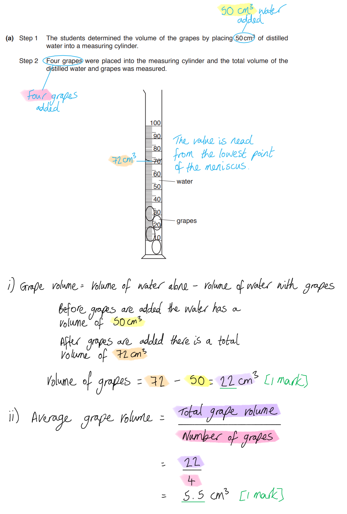
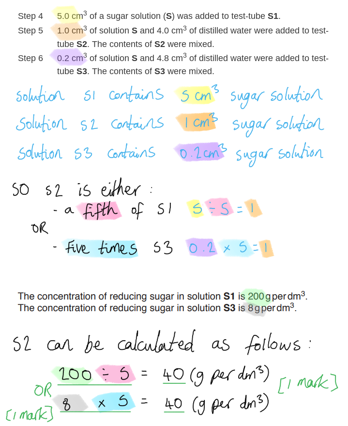
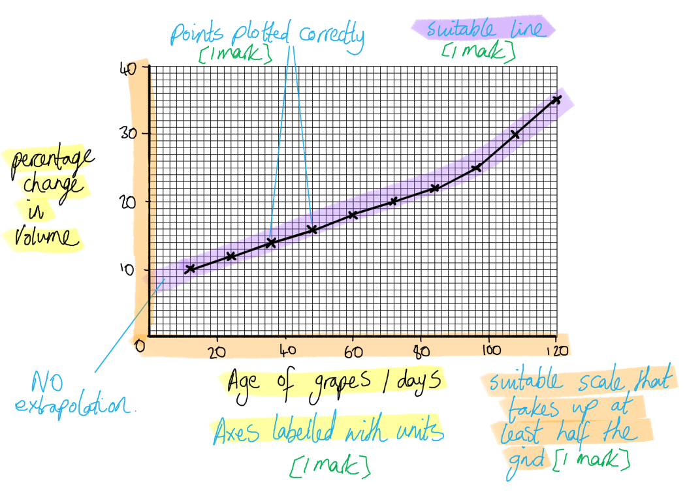
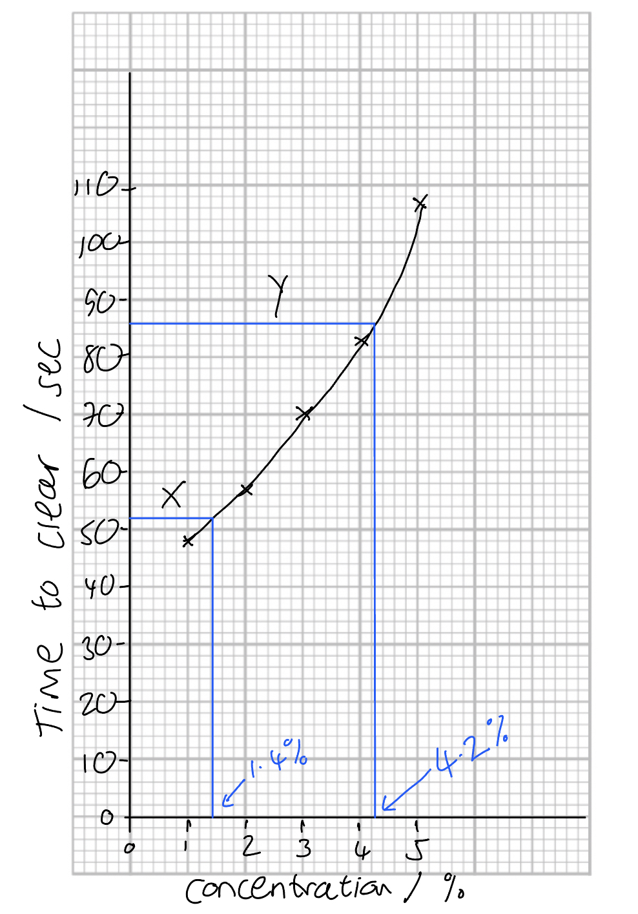
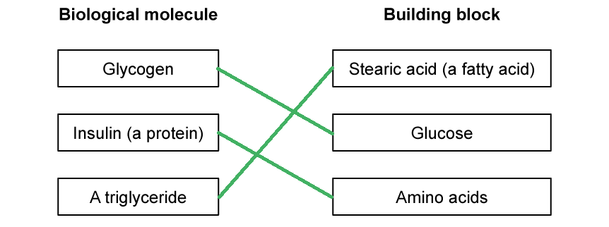
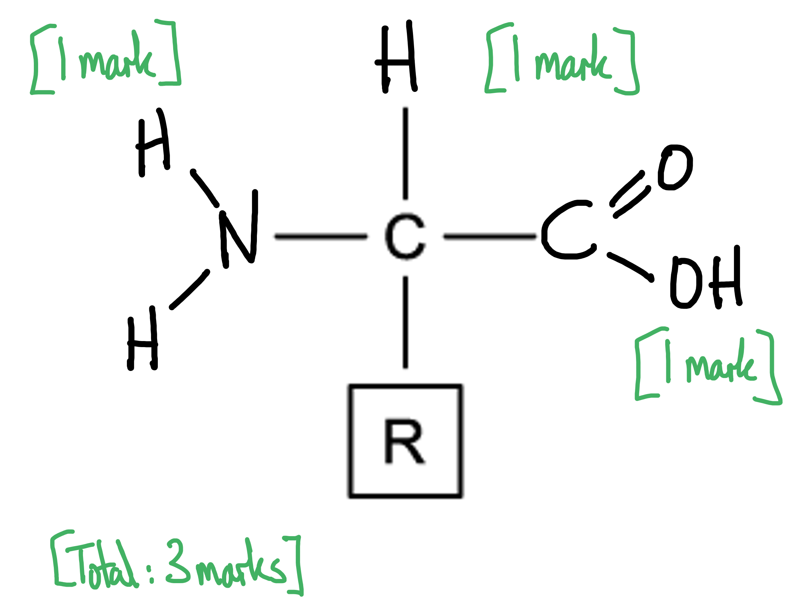
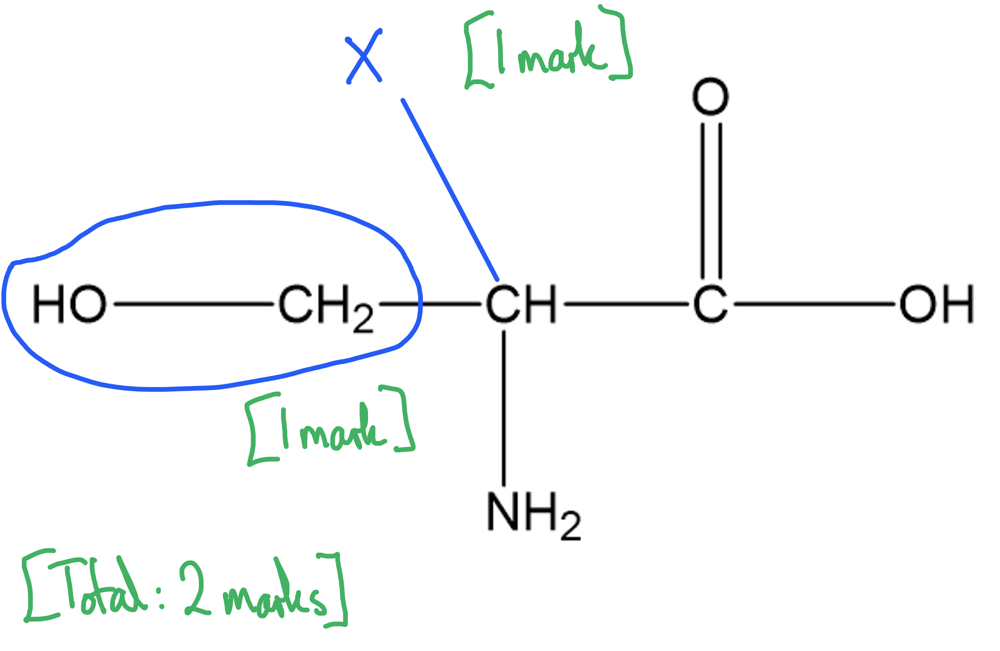
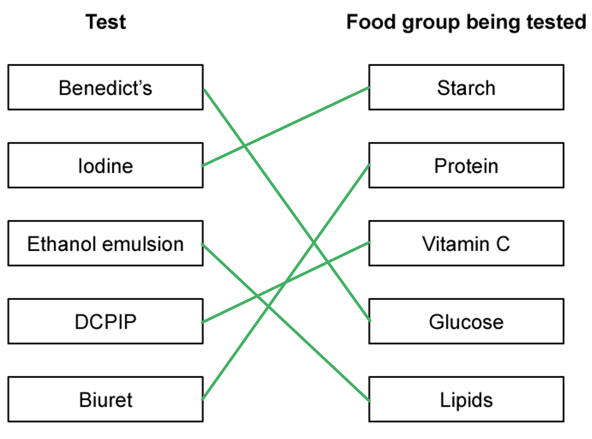

# Mark Schemes — Biological Molecules
**4. Biological Molecules** · Cambridge (CIE) IGCSE biology (0610 & 0970)

## Alternative To Practical Questions (4 questions)

### Q1
*Starch *

- Add iodine solution; **[1 mark]**
- Blue-black; **[1 mark]**

*Reducing sugars *

- Add Benedict’s solution; **[1 mark]**
- Heat (to 80 °C); **[1 mark]**
- (Brick-)red / yellow / orange / green; **[1 mark]**

**[Total: 5 marks]**

### Q2
An investigation to determine the food molecules contained by nectar would include the following...

Any **six** from the following:

- Collect samples of nectar (from plants); **[1 mark]**
- (Repeat test on) more than one sample;** [1 mark]**
- Named nutrient molecule; **[1 mark]**
- A valid safety precaution; **[1 mark]**
- Any other valid point e.g. sample from plants at different times of year to see if content changes; **[1 mark]**

*Food test details:*

A maximum of **four** from the following:

- Perform (named) food tests;; **[2 marks]**
- Details of food testing method;;** [2 marks]**
- Detail of positive and negative food test results; **[1 mark]**

**[Total: 6 marks]**

> *This question combines planning an investigation with the use of food tests. They are often asked separately, but you are likely to encounter them in almost every alternative to practical paper so spend some time to familiarise yourself with the details.*

### Q3
(i) The total volume of the four grapes is...

- 22 (cm3); **[1 mark]**

(ii) The average volume of one grape is...

- 5.5 (cm3); **[1 mark]**

***Accept ****error carried forward from part i), i.e. if the incorrect answer is given for part i) then this incorrect answer divided by 4 can still be credited as the average volume.*

iii) Marks can be awarded for a drawn table as follows...

- A suitable table is drawn, i.e. there are separate columns for the solution name and the time for colour change **AND** there is enough space for four different solutions to be recorded; **[1 mark]**
- Appropriate headings are used, e.g. 'Solution tested' **AND** 'Time at which colour change first appears / s'; **[1 mark]**
- Eight different times are recorded, i.e. the results of both trial 1 and trial 2 are both recorded; **[1 mark]**
- Times are all correctly converted to seconds; **[1 mark]**

| **Solution tested** | **Time at which colour change first appears / s** |   |
|---|---|---|
| **Trial 1** | **Trial 2** |   |
| S1 | 63 | 52 |
| S2 | 77 | 106 |
| S3 | 121 | 152 |
| G | 36 | 45 |

***Accept ****alternative wordings for column headings.*

***Reject**** marking point 2 if 's' or 'seconds' have not been included as a unit of time.*

***Reject**** marking part 3 if units have been included in the body of the table.*

**[Total: 6 marks]**

(i) The concentration of reducing sugar in solution  is...

- 200 ÷ 5 **OR** 8 x 5; **[1 mark]**
- 40 (g per dm3); **[1 mark]**

*Full marks can be awarded for the correct answer in the absence of other calculations.*

(ii) A conclusion for the reducing sugar investigation is...

Any **one **of the following:

- Grapes/G contain reducing sugars;** [1 mark]**
- Grapes/G contain more / a higher concentration of sugar than the sugar solutions / S1, S2, and S3;** [1 mark]**
- The more reducing sugar there is the less time it takes to change colour / the shorter the time before the first colour change; **[1 mark]**

**[Total: 3 marks]**

(i)  One variable that was kept constant in the reducing sugar investigation is...

Any **one **of the following:

- Volume of solutions / 5 cm3 of each solution;** [1 mark]**
- Volume of Benedict's solution / 5 cm3 Benedict's solution; **[1 mark]**
- Concentration of Benedict's solution; **[1 mark]**
- Variety/type of grape; **[1 mark]**
- Temperature (of the water bath) / 80 °C water bath;** [1 mark]**

(ii) A source of error and a possible improvement to reduce the problem could be...

Any **pair** of points from the following:

- (Source of error =) judging colour by eye / it is hard to see when the colour starts to change / people may differ in their opinion of when the colour starts to change / colour change is subjective;** [1 mark]**
- (Possible improvement =) Using a white/black background (behind the test tube) / using a colour chart/colorimeter; **[1 mark]**

**OR**

- (Source of error =) grape juice has a colour so this could mask the colour change / make the change hard to see; **[1 mark]**
- (Possible improvement =) using white grapes; **[1 mark]**

**OR**

- (Source of error =) Only three concentrations have been compared; **[1 mark]**
- (Possible improvement =) using a wider range of concentrations / colour comparisons; **[1 mark]**

**OR**

- (Source of error =) the grape juice sugar concentration is beyond the range of / higher than all the standard solutions; **[1 mark]**
- (Possible improvement =) increase the range of standard solutions tested;** [1 mark]**

**OR**

- (Source of error =) It is difficult to observe four test tubes at the same time / colour change may be missed when observing multiple test tubes; **[1 mark]**
- (Possible improvement =) measure each test tube separately / have a different person observing each test tube; **[1 mark]**

**OR**

- (Source of error =) not enough trials are carried out / two trials are not enough; **[1 mark]**
- (Possible improvement =) carry out three or more trials; **[1 mark]**

(iii) A safety precaution that should be used when carrying out this investigation and a reason for this precaution is...

Any **pair** of points from the following:

- (Precaution =) eye protection / gloves worn; **[1 mark]**
- (Reason =) Benedict's solution could damage eyes/skin / is an irritant / is toxic; **[1 mark]**

**OR**

- (Precaution =) use a water bath for heating **OR** use tongs/a stand while carrying out the experiment **OR** wear goggles/gloves; **[1 mark]**
- (Reason =) hot water / a Bunsen burner is used / could cause burns; **[1 mark]**

**[Total: 5 marks]**

> *It is essential to remember that questions that ask about 'sources of error' in scientific investigations are not asking about mistakes that you might make, e.g. being too slow with a stopwatch button or using a measuring cylinder incorrectly. Sources of error in an experiment are unavoidable limitations that result from the design of the experiment and the equipment used, such as the human eye not being good enough at determining colour, or the inability of one person to look in four places at the same time, or a lack of repeats leading to an inability to spot anomalous results.*
The method used in steps **3** to **12** could be modified in the following way to determine if there is a change in the concentration of reducing sugars in grapes during development...

Any **one **of the following:

- Taking grapes of different ages / at different points in their growth/development;** [1 mark]**
- Taking grapes (of different age) from the same bunch/group/plant; **[1 mark]**
- (Testing with Benedict's to) find time at which a colour change first appears (in each grape age group);** [1 mark]**

**[Total: 2 marks]**

> *It is not enough in questions like this to just make statements such as 'carry out experiment as described above'. You need to state exactly which of the stages would need to be carried out in order to determine the effect of the independent variable on the dependent variable.*
(i) The percentage change in volume of grapes aged 84 days is...

- 22; **[2 marks]**

*Full marks can be awarded for the correct answer in the absence of other calculations.*

(ii) Marks can be awarded for the plotting of a line on the grid as follows...

- Axes correctly labelled with 'Age of grapes / days' **AND** 'Percentage change in volume'; **[1 mark]**
- A suitable scale has been chosen for both axes (i.e. the scale is evenly distributed and can be read easily) **AND** the data takes up at least half the grid provided in both directions; **[1 mark]**
- Points are plotted accurately; **[1 mark]**
- A suitable line has been drawn; **[1 mark]**

(iii) The trends shown by the results in Table 2 and the graph include...

Any **two** of the following:

- As the age of the grapes increases / the grapes get older the percentage change in volume increases; **[1 mark]**
- Grapes aged 12-84 days increase in volume by 2 % every 12 days; **[1 mark]**
- There is a sharper/steeper increase from 84-96 days onwards / grapes ages 96-120 days increase in volume by 5 % every 12 days; **[1 mark]**

(iv) The variable that was changed (independent variable) in this investigation was...

- Age (of grapes) / how old the grapes were;** [1 mark]**

**[Total: 9 marks]**

> *When drawing a graph remember to choose a sensible scale and to label the axes correctly, with units! You should look at the shape formed by the plotted points when deciding what type of line to draw; if it is an obvious linear relationship then you can draw a straight line of best fit, or an obvious curve then draw a curved line of best fit. A safe option can often be to join the points, as shown below. Note that you must never extend your line beyond the data points; this is known as 'extrapolation' and is not appropriate in experiments like this one.*

> *When describing data it is always a good idea to quote data points or rates to support your points.*

### Q4
(i) It is necessary to start the stopwatch immediately after the enzyme has been added to the milk powder solutions because...

- The enzyme will start reacting (with the substrate/protein) straight away **OR** the enzyme will start to break down the protein/substrate immediately; **[1 mark]**
- Therefore the results will be inaccurate **OR **the true time for the reaction will not be recorded (if the stopwatch is not started immediately); **[1 mark]**

(ii) The students should repeat the investigation...

- At least three times; **[1 mark]**

(iii) If the students identify an anomalous result they should...

- Discard the anomaly; **[1 mark]**
- Repeat the result/test; **[1 mark]**

**[Total: 5 marks]**
(i) The qualitative test for protein is...

- Use of / add Biuret solution (to the solution); **[1 mark]**
- A positive test will result in a colour change from blue to lilac/purple; **[1 mark]**

(ii) A qualitative test for protein is less precise than a quantitative test because...

- Quantitative test will tell you how much protein is present whereas a qualitative test only tells you if protein is present (or not) **OR** a qualitative test cannot provide information on how much protein is present; **[1 mark]**

(iii) Using a colorimeter would increase accuracy of the experiment carried out by the class because...

- The end point/point at which the solution turns clear is compared /measured against a known standard; **[1 mark]**
- It does not rely on a person's decision of end point **OR **people might have different decision/opinion on when the end point is / judging the end point is subjective; **[1 mark]**

**[Total: 5 marks]**

> *You do not need to know how to use a colorimeter to answer this question, all the details you need have been provided for you in the question information. *
(i) The mean values for **X** and **Y** are...

- **X**: (51 + 48 + 56 + 45 + 52 + 48 + 56 + 51 + 54 + 55) ÷ 10 = 52 <u>seconds </u>; **[1 mark]**
- **Y**: (82 + 98 + 85 + 85 + 79 + 86 + 91 + 87 + 86 + 83) ÷ 10 = 86 <u>seconds</u>; **[1 mark]**

> *All the values in the table are given as whole numbers so you should also give your answers as whole numbers and round up and down accordingly. *

> *Remember to give units unless they are already given in the question. *

(ii) A graph of mean time taken for the solution to clear against concentration is...

- Time in seconds on the y axis **and **concentration in % on the x axis; **[1 mark]**
- Points plotted correctly +/- 1mm error; **[1 mark]**
- Points joined with a line of best fit; **[1 mark]**

(iii) The concentrations of samples **X** and **Y** are...

- X: 1.4 %; **[1 mark]**
- Y:  4.2 %; **[1 mark]**

***Allow ****values in the range of 4.2 % and 4.3 % for ****Y***

**[Total: 8 marks]**

> *A model answer of the graph of time taken for the solution to clear against concentration*

(i) The piece of apparatus that is the more accurate is...

- Measuring cylinder; **[1 mark]**
- Because it has small<u>er</u> graduations to measure the volume of liquids; **[1 mark]**

(ii) Two sources of error are...

Any **two **of the following:

- Determined the end point / time for the solution to clear by eye; **[1 mark]**
- Starting the stop watch immediately after adding enzyme; **[1 mark]**
- Shaking / mixing of the enzyme and milk powder solution; **[1 mark]**

**[Total: 4 marks]**

> *It is a good idea to practice spotting potential sources of error while reading through the description of the method since this is a very popular exam question. Remember that the term 'error' in this context is not referring to human error, e.g. reading the stop watch incorrectly, but instead refers to unavoidable limitations that result from the **design of the experiment** and the **equipment used**. *

## Multiple Choice Questions (29 questions)

### Q1
**Final answer:** **The correct answer is ****D.**

- In DNA, bases pair in a fixed way: **A pairs with T** and** C pairs with G**
- Therefore the initial strand pairs with its opposite strand as follows:

**A C T G**

**Final answer:** **T G A C**

### Q2
**Final answer:** **The correct answer is ****A.**

- The tested sample contains **reducing sugar and fat only**

  - Iodine remains brown, so **starch is absent**.
  - Benedict’s turns brick-red after heating, so **reducing sugar is present**
  - Biuret remains blue, so **protein is absent**
  - A cloudy white emulsion forms, so **fat is present**
  - DCPIP remains blue, so **vitamin C is absent**

### Q3
**Final answer:** **The correct answer is D.**

- The emulsion test is used to detect lipids in a sample
- As the test tube contains a milky/cloudy emulsion, the flaxseeds must contain lipids which are soluble in ethanol

**A** is incorrect because a positive result of the Biuret test for proteins is a colour change from blue to lilac, not formation of a cloudy emulsion.

**B** is incorrect because a positive result of the iodine test for starch is a colour change from brown to blue-black, not formation of a cloudy emulsion.

**C** is incorrect because, while the test described does involve ethanol, it is called the emulsion test (not the ethanol test) and it detects lipids broadly, not oils specifically.

### Q4
**Final answer:** **The correct answer is D**

- Lipase is the enzyme that can catalyse the breakdown of fats into fatty acids and glycerol

**A** is incorrect as proteases catalyse the break down of proteins into amino acids.

**B** is incorrect as cellulase catalyses the break down of cellulose.

**C** is incorrect as amylase catalyses the break down of starch into maltose.

### Q5
**Final answer:** **The correct answer is ****C****.**

- This is because T pairs with A so if there is 20% T then there must be 20% A
- T & A together make up 40% so C & G must make up 60% (100 – 40 = 60)
- If C & G make up 60% then dividing this by 2 means that just G makes up 30% of the bases in the DNA

### Q6
**The correct answer is ****D****.**

- Due to complementary base pairing, A binds with T and C binds with G meaning that the complementary sequence will be TGGA.

All other options are incorrect as they do not show the correct complementary base pairings.

### Q7
**Final answer:** **The correct answer is ****B****.**

- This is because biuret solution turns from blue to purple in the presence of protein
- Benedict’s solution turns from blue to red when heated in the presence of (reducing) sugar

**A** and **D** are incorrect because the test for starch is the iodine test, which is not carried out in the experiments above.

**C** is incorrect because the test for starch is the iodine test, and the test for fats is the emulsion test. Neither of these are carried out in the experiments above.

### Q8
**Final answer:** **The correct answer is ****D****.**

- This is because both starch and glycogen are carbohydrates used for the storage of glucose. Starch is found in plant cells and glycogen in animal cells

**A** is incorrect because amino acids are the monomer of proteins, and fatty acids and glycerol make up lipids.

**B** is incorrect because amino acids are the monomer of proteins.

**C** is incorrect because fatty acids and glycerol are what lipids are made from.

### Q9
**Final answer:** **The correct answer is ****C****.**

- Nitrogen is found in proteins as part of amino acids, but it is not present in carbohydrates.

**A **is incorrect because carbon is found in both proteins and carbohydrates.

**B **is incorrect because hydrogen is present in both proteins and carbohydrates.

**D **is incorrect because oxygen is also found in both proteins and carbohydrates.

### Q10
**Final answer:** **The correct answer is B**

- This is because base A always pairs with base T

**A** is incorrect because base A pairs with base T and base C pairs with base G

**C **is incorrect because DNA is not made from protein, it is a polynucleotide

**D **is incorrect because DNA forms a double helix

### Q11
**Final answer:** **The correct answer is D**

The Benedict’s test for reducing sugar is positive (brick red) and the iodine test for starch is negative (brown)

**A **is incorrect because the Benedict’s test for reducing sugar is negative (blue) when it should be positive, and the iodine test for starch is positive (blue-black) when it should be negative.

**B** is incorrect because the Benedict’s test for reducing sugar is negative (blue) when it should be positive.

**C** is incorrect because the iodine test for starch is positive (blue-black) when it should be negative.

### Q12
**Final answer:** **The correct answer is ****B ****because:**

- The active site of an **enzyme **is a region with a highly specific structure that is complementary to a particular substrate(s) that can bind to it. This enables chemical reactions to occur at much faster speeds than they would at normal body temperatures
- Mammals such as humans have the ability to produce billions of slightly different **antibodies**. Antibodies with a complementary shape to an antigen on a pathogen play a vital role in the immune system
- The bases of **DNA **are read in sets of three (the triplet code) with each triplet of bases coding for a specific amino acid, allowing proteins to be made

### Q13
**Final answer:** **The correct answer is ****D ****because:**

The **ethanol emulsion **test indicates the presence of **lipids **/ fats. A positive colour change from clear to cloudy indicates the presence of lipids in a sample.

**A** is incorrect because glycogen is a large molecule made from many glucose molecules chemically bonded together. Glycogen is not found in plants.

**B** is incorrect because Biuret’s reagent is used to test for the presence of proteins, changing colour from blue to lilac/purple.

**C** is incorrect because Benedict’s solution tests for the presence of reducing sugars. A positive colour change indicating the presence of reducing sugar is from blue to brick red / orange (sometimes green if there is not a large amount of sugar present).

### Q14
**Final answer:** **The correct answer is ****A ****(starch only) because:**

Iodine tests for starch and the positive colour change from orange-brown to blue-black indicates that starch is present. Benedict’s solution tests for the presence of reducing sugars, it is blue in colour and has not changed at the end of test 1, this is a negative result indicating that no reducing sugar is present in the solution.

### Q15
**Final answer:** **The correct answer is ****C**** (Benedict's test for reducing sugars) because:**

The Benedict's test requires a heating step and a colour change is observed in a positive test.

**A** is incorrect because the test for protein (the Biuret test) does not require a heating step, even though a colour change is observed in a positive protein test.

**B** is incorrect because the test for Vitamin C (using DCPIP) does not require a heating step, even though a colour change is observed in a positive protein test.

**D** is incorrect because the emulsion test for fats (using ethanol and water) does not require a heating step. This would also be dangerous, with flammable ethanol near a naked flame.

### Q16
**Final answer:** **The correct answer is ****B ****because:**

- A positive Benedict’s test is the reagent changing colour from blue to brick-red/orange when heated (or yellow or green if a small amount of sugar is present in a sample)
- DCPIP is a reagent that can be used to indicate the presence of Vitamin C within a sample; it is a blue solution when oxidised. When mixed with Vitamin C DCPIP is reduced, becoming colourless

**A **is incorrect because this food sample contains sugar, protein and Vitamin C.

**C **is incorrect because this food sample does not contain starch only.

**D **is incorrect because this food sample contains sugar, starch and Vitamin C.

### Q17
**Final answer:** **The correct answer is ****C ****because:**

The question asks which of the statements given is **false**. Statements 1, 2 and 3 are all true.

Statement 4 is false because oils (like fats, a type of lipid) are made from glycerol and fatty acids.

Around 20 different amino acids are used to build protein molecules in almost all living cells. The basic structure of each amino acid is largely the same, with one variable region differing to produce a variety of amino acids. Glycogen and starch, as well as cellulose, are all polymers of glucose.

### Q18
**Final answer:** **The correct answer is ****C ****because:**

The bases only pair together in the following ways:

- A with T and *vice versa*
- C with G and *vice versa*

### Q19
**Final answer:** **The correct answer is ****D ****because:**

DNA consists of a double strand of nucleotides. The bases in the nucleotides can be adenine (A), thymine (T), cytosine (C) or guanine (G). The size of the bases ensures that A always pairs with T and C always pairs with G.

**A **is incorrect because the fifth base, C in the given strand, is paired with A  in the corresponding strand.

**B **is incorrect because this option shows T paired with C and A with G, which is incorrect.

**C **is incorrect because the corresponding strand has the same bases as the given strand.

The DNA strand would look like this:

**T ― G ― A ― A ― C ― T ― A ― G ― C ― C**

**A ― C ― T ― T―  G ― A ― T ― C ― G ― G**

### Q20
**Final answer:** **The correct answer is ****A ****because:**

- Benedict’s solution tests for the presence of reducing sugars. A positive colour change indicating the presence of reducing sugar is from blue to brick red / orange (sometimes green if there is not a large amount of sugar present)
- DCPIP solution tests for the presence of Vitamin C. It contains a blue dye that in the presence of Vitamin C turns colourless, allowing the original colour of the solution being tested to be seen

**B **is incorrect because this food sample contains sugar and lipids (fats and oils), as ethanol has shown a positive test result. In the presence of lipids ethanol changes from colourless to form a cloudy milky-white emulsion.

**C **is incorrect because this food sample contains protein (due to the positive colour change of the Biuret solution from blue to purple/lilac) and Vitamin C.

**D **is incorrect because this food sample contains Vitamin C and lipids.

### Q21
**Final answer:** **The correct answer is ****A ****because:**

Both glycogen and cellulose are large molecules made from many glucose molecules bonded together (glycogen is found in animal and bacterial cells, cellulose in plant and algal cells,

Oils are a type of lipid made from glycerol and fatty acids (not listed in the table).

### Q22
**Final answer:** **The correct answer is ****C**** (statements 1 & 3 only) because:**

- The sequence of amino acids used to build a protein determines the 3D structure of the protein (as the sequence affects the interaction between amino acids which causes the chain to fold in particular ways)
- Biuret reagent turns blue to purple/lilac in a positive test result for protein in a sample

Statement 2 is incorrect because amylase is an enzyme and therefore made from protein. It is made from a sequence of amino acids that form a specific 3D shape.

### Q23
**Final answer:** **The correct answer is ****D ****because:**

An amino acid always has a H- atom, an -NH2 group and a -COOH group around a central carbon atom.

**A** is incorrect because there are two central carbon atoms showing.

**B** is incorrect because the group on the right is missing an oxygen atom (-COH as opposed to -COOH).

**C** is incorrect because it has a methyl group (-CH3) where a single hydrogen atom should be.* *

### Q24
**Final answer:** **The correct answer is ****B**** (hydrogen, carbon, oxygen) because:**

These three elements are the main constituents of carbohydrates and lipids; all proteins also contain them, along with other elements.

Nitrogen, sulfur, phosphorus (not shown in the table) and trace elements are all important for life but are not found in most molecules in living organisms.

### Q25
**Final answer:** **The correct answer is ****C**** (bases, phosphate and deoxyribose sugar) because:**

These are the three main components of a nucleotide. Nucleotides vary according to which base (A, C, G or T) they contain.

**A** is incorrect because the nucleus is a cell structure (much larger than one nucleotide)

**B** is incorrect for the same reason as **A** but also because a chromosome is a length of DNA that will carry millions of nucleotides.

**D** is incorrect for the same reason as **B** in respect of a chromosome.

The table with the incorrect boxes greyed out is shown below:

| **A** | bases | phosphate | nucleus |
|---|---|---|---|
| **B** | deoxyribose sugar | nucleus | chromosome |
| **Final answer:** **C** | **Final answer:** ** bases** | **Final answer:** ** deoxyribose sugar** | **Final answer:** ** phosphate** |
| **D** | phosphate | chromosome | bases |

### Q26
**Final answer:** **The false statement is ****A ****(Fatty acids are a type of lipid) because:**

Fatty acids are part of a lipid molecule, so cannot be a type of lipid.

All the other statements about biological molecules are true.

### Q27
**Final answer:** **The correct answer is ****C ****because:**

- Cellulose is a polymer of glucose which is found in the cell wall of plant and algal cells, providing structure and support
- Enzymes and antibodies are made from protein; they have specific shapes which enable them to carry out their functions
- Water is vitally important as a solvent in all living organisms

### Q28
**Final answer:** **The correct answer is ****A ****because:**

Amino acids are the basic building blocks of protein molecules (the order of amino acids needed to build a protein is determined by the sequence of DNA bases in genes). Amino acids always contain the elements carbon, hydrogen, oxygen and nitrogen.

**B** is incorrect because glycerol is one of the basic units of fats (a type of lipid) but lipids do not contain nitrogen.

**C** is incorrect because glycerol is one of the basic units of fats (a type of lipid) but lipids do contain oxygen, not nitrogen.

**D** is incorrect because bases are the building blocks of DNA, and they contain the three main elements listed in the table as well as nitrogen and phosphorus.

### Q29
**Final answer:** **The correct answer is ****B ****because:**

The product of complete starch digestion is glucose, a simple sugar, as shown by H.

**A **is incorrect because G represents glycerol and F represents fatty acid chains; these are the products of lipid (fat and oil) digestion.

**C **is incorrect because E represents maltose molecules. Maltose is a disaccharide made from two molecules of glucose chemically bonded together. Maltose is the product of starch digestion by amylase.

**D **is incorrect because E is maltose and H is glucose. Only glucose is the final product of complete starch digestion.

## Theory Questions (11 questions)

### Q1
- Carbon, hydrogen and oxygen;** [1 mark]**

Remember that both fats and carbohydrates contain C, H, and O only, however protein have C, H, O as well as N and small amounts of other elements like S.

**[Total: 1 mark]**

### Q2
The parts of the nucleotide are:

- **A**: phosphate; **[1 mark]**
- **B**: deoxyribose sugar; **[1 mark]**
- **C**: (nitrogenous) base; **[1 mark]**

*Allow: A, C, G, T in place of base Allow: adenine, cytosine, guanine, thymine in place of base*

**[Total: 3 marks]**

> *Remember that you only need to remember the letters of the four bases A, C, G and T, not their full names. *
The base pairings are:

- A-T **and **C-G; **[1 mark]**

**[Total: 1 mark]**
The term 'double helix' means:

- Spiral / coiled structure;** [1 mark]**
- Two strands wound around each other; **[1 mark]**

**[Total: 2 marks]**
A part of the nucleotide shown in part (a) that occupies the outside of the DNA double helix is:

**One** of the following:

- Sugar; **[1 mark]**
- Phosphate;** [1 mark]**

**[Total: 1 mark]**

### Q3
The correctly completed table is as follows:

| Statement | Correct? (✓) |
|---|---|
| They contain carbon, hydrogen and oxygen only | **Final answer:** **✓** |
| All are sugars |   |
| They are all formed from long chains of glucose molecules |   |
| They are the principal energy source in the animal diet | **Final answer:** **✓** |
| They include starch, cellulose and triglycerides |   |
| They form solids at room temperature but melt into liquids when warmer |   |
| The sequence of the building blocks determines their function |   |

**[1 mark]** for each correct tick

**[Total: 2 marks]**

| Statement | Correct? (✓) | > *Reason for being incorrect* |
|---|---|---|
| They contain carbon, hydrogen and oxygen only | **Final answer:** **✓** | > *-* |
| All are sugars |   | > *Not all carbohydrates are sugars eg. starch, cellulose, glycogen* |
| They are all formed from long chains of glucose molecules |   | > *Other monosaccharides eg. fructose form carbohydrates* |
| They are the principal energy source in the animal diet | **Final answer:** **✓** | > *-* |
| They include starch, cellulose and triglycerides |   | > *triglycerides are lipids, not carbohydrates* |
| They form solids at room temperature but melt into liquids when warmer |   | > *this is true of oils but not carbohydrates* |
| The sequence of the building blocks determines their function |   | > *this applies more to proteins, whereas carbohydrates can be monomers or polymers* |
The chemical elements found in carbohydrates and proteins:

**Similarities:**

- Both contain carbon, hydrogen, oxygen; **[1 mark]**

**Differences:**

- Proteins contains nitrogen / sulfur;** [1 mark]**
- **Whereas** carbohydrates do not contain nitrogen / sulfur; **[1 mark]**

*Allow use of the correct chemical symbols (C, H, O, N, S)*

**[Total: 3 marks]**

> *The command word 'Compare' is defined by CIE as requiring you to '**identify/comment on similarities and/or differences**'.*

> *Other exam boards would use the command words 'Compare **and contrast**' for the same thing. It's vitally important that your answer refers to similarities **and **differences for you to be able to access all [3 marks]. *
The molecule in **Fig. 2** is:

- <u>Maltose</u>; **[1 mark]**

**Reason**:

- Maltose is a disaccharide made from 2 glucose molecules bonded together; **[1 mark]**

**[Total: 2 marks]**
The boxes joined correctly are as follows:

**[1 mark]** for each correct line.

**[Total: 3 marks]**

### Q4
The completed diagram should show:

- NH2 group; **[1 mark]**
- COOH group; **[1 mark]**
- H atom; **[1 mark]**

*If NH**2** and COOH are not opposite: ***[2 marks]*** maximum*

**[Total: 3 marks]**

The **R** group in **Fig. 1** is:

- (A) variable group; **[1 mark]**

*Allow -H, -CH**3**, or any correct side-chain from amino acids*

**[Total: 1 mark]**
The correct order of the three structures is:

| Smallest | 1. | Amino acids |
|---|---|---|
| ↓ | 2. | Peptides |
| Largest | 3. | Proteins |

3 correct; **[2 marks]** 1 or 2 correct; **[1 mark]**

**[Total: 2 marks]**
The completed passage is as follows:

*There are only around ***twenty*** amino acids that are found in living organisms. They can be arranged in any order in proteins, creating a ***large number*** of combinations. Even if one of the amino acids is altered or not present, a very ***different*** protein will be formed. This may result in a ***non-functioning protein***.*

**[Total: 4 marks]**

### Q5
The solution used was:

- <u>Biuret</u> solution; **[1 mark]**

*Ignore capitalisation*

**[Total: 1 mark]**
The food group that the experiment in part (a) showed a positive result for was:

- Protein; **[1 mark]**

**[Total: 1 mark]**
The appearance of the mixture after the addition of cold water would be:

- An emulsion; **[1 mark]**

*Allow: cloudy*

**[Total: 1 mark]**

*Butter is over 80% fat, so you would expect the ethanol emulsion test to show a positive result when testing butter.*
The result of the test will be:

- A colour change, blue to colourless/orange; **[1 mark]**

Explanation:

- Because orange juice contains <u>vitamin C</u> / DCPIP is the test for <u>vitamin C</u>; **[1 mark]**

**[Total: 2 marks]**

### Q6
The completed sketch would be:

- Showing 1 glycerol (rectangle) **AND** three fatty acids (ovals); **[1 mark]**
- Fatty acids bonded to the same long side of the glycerol; **[1 mark]**

*Ignore labels/annotations Ignore different orientation *

**[Total: 2 marks]**

(i) The central carbon of serine would appear as follows:

- Correct central carbon, <u>labelled as X</u>; **[1 mark]**

(ii) The R group

- R group circled, consisting of -CH2 and -OH groups; **[1 mark]**

**[Total: 2 marks]**

> *The central carbon atom of any amino acid is the carbon atom that is bonded to both a -COOH group and an -NH**2** group.*

> *The R group is the whole group that is (bonded to the central carbon) not -H, -COOH or -NH**2**.*

> *Make sure to follow the instructions in the question and label the diagram as required; leaving out the label 'X' would lose you a mark, for example.*

The correct chronological order of the events is as follows:

- C,A,B,E,D; **[2 marks]**
- 2, 3 or 4 correct; **[1 mark]**
- 0 or 1 correct;** [0 marks]**

| 1st | ➙ | 2nd | ➙ | 3rd | ➙ | 4th | ➙ | 5th |
|---|---|---|---|---|---|---|---|---|
| **Final answer:** **C** |   | **Final answer:** **A** |   | **Final answer:** **B** |   | **Final answer:** **E** |   | **Final answer:** **D** |

**[Total: 2 marks]**
The test that would be used to show a positive result for the presence of protein in a sample of food is:

- Drop some <u>Biuret/biuret</u> test solution into a sample of food; **[1 mark]**
- Positive result is a colour change from blue to purple / lilac; **[1 mark]**

**[Total: 2 marks]**

### Q7
The correctly completed **Table 1** is as follows:

| hydrogen | **Final answer:** **✓** |
|---|---|
| water |   |
| sulfur | **Final answer:** **✓** |
| silicon |   |
| titanium |   |
| nitrogen | **Final answer:** **✓** |
| carbon | **Final answer:** **✓** |

All 4 correct; **[3 marks]** 3 correct; **[2 marks]** 2 correct; **[1 mark]** 0 or 1 correct; **[0 marks]**

**[Total: 3 marks]**

> *Remember that if the question asks you for a tick (**✓**), then make sure to use a tick, because a cross (✘) may be construed by the examiner as you leaving the question blank and will not earn you a mark.*

> *Carbon and hydrogen are abundant in carbohydrates, fats and many other organic molecules. Sulfur is found in proteins; nitrogen is found in proteins and DNA.*

> *Water is of course, not an element, it is a compound, so even though water is ubiquitous in organisms, it is not an element. Silicon and titanium are used e.g. in surgery, but are not found naturally in organisms, which is what the question is asking for.*

> *Note that the number of ticks does not always match the number of marks available; here you needed 4 ticks for [3 marks]. *
A group of biological molecules that contain carbon, hydrogen and oxygen only is...

**One **from the following:

- Carbohydrates; **[1 mark]**
- (Some) lipids / fats; **[1 mark]**

*Allow 'sugars'*

**[Total: 1 mark]**
The correctly completed table is as follows:

| Carbohydrate | Monosaccharide | Disaccharide | Polysaccharide |
|---|---|---|---|
| Glycogen |   |   | **Final answer:** **✓** |
| Glucose | **Final answer:** **✓** |   |   |
| Starch |   |   | **Final answer:** **✓** |
| Maltose |   | **Final answer:** **✓** |   |

**[1 mark]** for each correct row

**[Total: 4 marks]**
The molecule that, in certain fats, binds to three fatty acid molecules is:

- Glycerol; **[1 mark]**

**[Total: 1 mark]**

> *These fats are called tri**glycer**ides because they have glycerol at their heart, binding to the three fatty acids. *

### Q8
The correct use of the words from the list is:

| Fats are composed of the elements **carbon**1, hydrogen and **oxygen**1** **only. All proteins contain these three elements and the element **nitrogen**.  Glucose is a type of **carbohydrate**. Animals store excess glucose as **glycogen **in the liver.  Plants store excess glucose as **starch**. Plants also convert glucose to** ****cellulose**** **which is used to make cell walls. |
|---|

**[1 mark]** for each correct word.

1*carbon and oxygen can be in either order*

**[Total: 7 marks]**

### Q9
The term 'semi-quantitative' means:

- Different colours correspond to different glucose (reducing sugar) levels; **[1 mark]**
- Tests can be ranked on glucose content, but we don't know the exact levels / quantities; **[1 mark]**

**[Total: 2 marks]**

> *Qualitative **tests just say whether a quality is present; for example if there are people in different rooms, yes or no.*

> *Quantitative **tests give exact numerical data as the results; for example to say how many people are in each room.*

> *A **semi-quantitative** test is somewhere between. It will say that there are more people in one room than another, and maybe rank the rooms by how many people are in each one, **without giving any information about the numbers** of people in each.*
The purpose of the test tube containing just water is:

- As a control; **[1 mark]**
- To show a definite zero colour change; **[1 mark]**

**[Total: 2 marks]**

> *Water doesn't contain glucose so can be expected to show a negative result (no colour change). If the test using water had shown a colour change, even a very subtle one, the test would not be reliable as an indicator for glucose or other reducing sugars. *
The test for lipids is known as an emulsion test because:

- A suspension of small droplets is formed; **[1 mark]**
- As lipids come out of solution / are insoluble in water; **[1 mark]**

*Allow: solution turns cloudy*

**[Total: 2 marks]**

> *Here you would have to give a notion that you know what an emulsion is; think of emulsion paint, which is a liquid containing millions of tiny suspended particles to make it appear opaque.*
The colour changes of the iodine test on the food samples shown in Table 2 are:

**Table 2**

| Food sample | Iodine test result |
|---|---|
| Bagel | **Final answer:** **Blue/black** |
| Eggs | **Final answer:** **No change / orange/brown** |
| Fish | **Final answer:** **No change / orange/brown** |
| Rice | **Final answer:** **Blue/black** |
| Grapefruit | **Final answer:** **No change / orange/brown** |

All 5 rows correct; **[3 marks]** 3 or 4 rows correct; **[2 marks]** 1 or 2 rows correct; **[1 mark]**

*Ignore ticks/crosses or Yes/No given as answers*

**[Total: 3 marks]**

> *Make sure to read the question stem carefully; it asks for a **colour change**, so just indicating with a tick for a positive result will not earn the marks. This question is asking you to use your prior knowledge to identify the foods that contain starch by predicting which foods will give the positive result in the iodine test. *

### Q10
The type of bonding that holds DNA bases together in base pairs is:

- Hydrogen / H- (bonding); **[1 mark]**

**[Total: 1 mark]**
The base sequence on the opposite strand of DNA is as follows:

| A | C | G | G | A | T | C | A |
|---|---|---|---|---|---|---|---|
| **Final answer:** **T** | **Final answer:** **G** | **Final answer:** **C** | **Final answer:** **C** | **Final answer:** **T** | **Final answer:** **A** | **Final answer:** **G** | **Final answer:** **T** |

All 8 correct: **[2 marks]** 
5, 6 or 7 correct; **[1 mark]** 
0 - 4 correct; **[0 marks]**

**[Total: 2 marks]**
The correct labelling of the bases would allow:

- All 4 letters / A, C, G, T used;** [1 mark]**
- A-T / C-G complementary base pairing shown from the matching shapes; **[1 mark]**

**[Total: 2 marks]**

> *Acceptable examples include the following: any correct combination of A with T and C with G will score the marks. *

The order in which structures would be encountered when zooming in on a piece of liver tissue would be:

| **Zoomed out**  **↓**  **↓**  **Zoomed in** | **Final answer:** ** Tissue** |
|---|---|
| **Final answer:** ** Cell** |   |
| **Final answer:** ** Nucleus** |   |
| **Final answer:** ** Chromosome** |   |
| **Final answer:** ** DNA double helix** |   |
| **Final answer:** ** Nucleotide** |   |
| **Final answer:** ** Base** |   |

All 7 correct; **[3 marks]** 
4, 5 or 6 correct; **[2 marks]** 
2 or 3 correct; **[1 mark]** 
0 or 1 correct; **[0 marks]** 
*Correct sequence but zooming out; maximum* **[2 marks]**

**[Total: 3 marks]**

> *The **bases **A, C, G and T form part of the nucleotides that make up the genetic code.*

> *Nucleotides **join together in the DNA double helix.*

> *Each **DNA double helix** forms part of a chromosome. *

> *Chromosomes** form part of the nucleus.*

> *The **nucleus **is part of a cell.*

> *Cells **of the same type are joined together in tissues. *

> *Tissues **form organs.*

### Q11
The correctly-linked boxes are:

**[1 mark]** for each correct link

**[Total: 5 marks]**
The colour change that is observed when a sample of food has tested positive in the Benedict's test is:

- From (light) <u>blue</u> (solution); **[1 mark]**
- To a green/yellow/orange/red colour (precipitate); **[1 mark]**

**[Total: 2 marks]**

> *Because the question asks for a colour **change**, you get [1 mark] for stating the colour at the beginning of the test as well as [1 mark] for the colour at the end.*
(i) The safety precautions that need to be taken when conducting the Benedict's test on a sample of food are:

- Wear goggles / eye protection; **[1 mark]**

Plus **one** from:

- Handle test tubes with tongs; **[1 mark]**
- Wear heatproof gloves; **[1 mark]**
- Tie back long hair; **[1 mark]**
- Heat the test tube indirectly / with a water bath NOT directly with a Bunsen burner flame; **[1 mark]**

(ii) The additional safety precaution when performing the ethanol emulsion test on a sample of food is:

- No naked flames / Bunsen burners to be switched off; **[1 mark]**

**[Total: 3 marks]**
The completed results table would be as follows:

| food sample | colour of test sample after testing |
|---|---|
| lasagne | blue/black |
| fish | **Final answer:** **orange / brown** |
| bread | **Final answer:** **blue / black** |

**[1 mark]** for each correct answer

**[Total: 2 marks]**

*The blue / black colouring is the positive test for starch when using iodine solution, dropped onto a sample of the food. In a non-starchy food such as fish, the colour doesn't change so the orange / brown colouration is the colour of the original iodine solution.*
