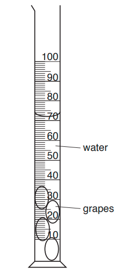
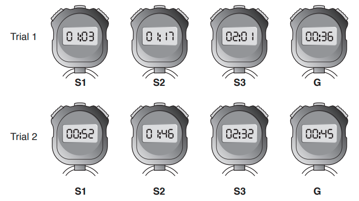
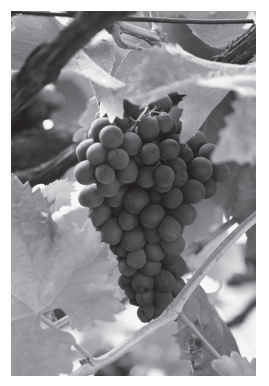
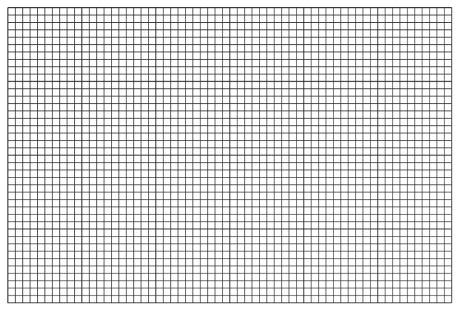
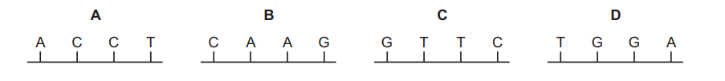
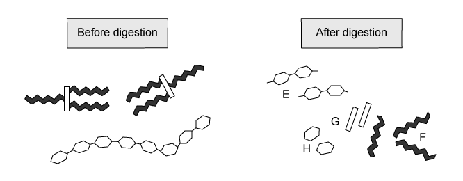
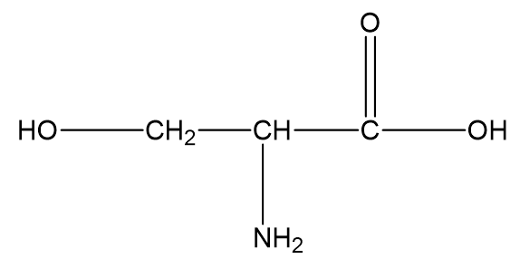

# Exam Questions — Biological Molecules
**4. Biological Molecules** · Cambridge (CIE) IGCSE biology (0610 & 0970)
> Source: [https://www.savemyexams.com/igcse/biology/cie/23/topic-questions/](https://www.savemyexams.com/igcse/biology/cie/23/topic-questions/) · 44 questions across 3 sets

## Alternative To Practical Questions (4 questions)

### Q1 — medium — 5 marks

**Q1** [5 marks]

Potatoes contain starch. Starch can be broken down into reducing sugars.

Describe the tests to identify starch and reducing sugars and give the results of the positive tests.

*Source: Specimen 2023 paper 6 Q1E*

### Q2 — medium — 6 marks

**Q2** [6 marks]

Adult monarch butterflies feed on nectar. Nectar is a liquid that is produced by plants.

Plan an investigation to determine the types of food molecules that nectar contains.

*Source: 2018 0610/63 Q2D*

### Q3 — medium — 25 marks

**Q3** [6 marks]

Grapes are soft fruits that contain sugars. Some students investigated the concentration of reducing sugars in grapes.

| Step 1 | The students determined the volume of the grapes by placing 50 cm3 of distilled water into a measuring cylinder. |
|---|---|
| Step 2 | Four grapes were placed into the measuring cylinder and the total volume of the distilled water and grapes was measured. |

Fig. 1 shows the total volume of the distilled water and grapes in the measuring cylinder.

**Fig. 1**

**Table 1**

| **Total volume of distilled water and grapes in the measuring cylinder / cm****3** | **Total volume of the grapes / cm****3** |
|---|---|
|   |   |

(i)

Calculate the total volume of the four grapes using the information in Step 1 and Fig. 1

Write your answers in Table 1

[1]

(ii)

Calculate the average volume of one grape using your answer to** a) i)**.

Give your answer in cm3.

[1]

| Step 3 | Three test-tubes were labelled, **S1**, **S2** and **S3**. |
|---|---|
| Step 4 | 5.0 cm3 of a sugar solution (**S**) was added to test-tube **S1**. |
| Step 5 | 1.0 cm3 of solution **S** and 4.0 cm3 of distilled water were added to test-tube **S2**. The contents of **S2** were mixed. |
| Step 6 | 0.2 cm3 of solution **S** and 4.8 cm3 of distilled water were added to test-tube **S3**. The contents of **S3** were mixed. |
| Step 7 | Grape juice was extracted from ten grapes. |
| Step 8 | 5.0 cm3 of the extracted grape juice was placed into a test-tube labelled **G**. |
| Step 9 | 5.0 cm3 of Benedict’s solution was added to each of test-tubes **S1**, **S2**, **S3** and **G**. |
| Step 10 | Test-tubes **S1**, **S2**, **S3** and **G** were placed into an 80 °C water-bath. |
| Step 11 | The time at which a colour change **first** appeared in each test-tube was recorded. |
| Step 12 | Steps 3 to 11 were repeated to obtain a second set of results. |

Fig. 2 shows the students’ results in minutes and seconds.

**Fig. 2**

(iii)

Prepare a table to record the results, shown in Fig. 2

Your table should include:

- The solutions tested.
- The time, in seconds, of the **first** appearance of a colour change in each solution.

*Source: 2018 0610/61 Q1A*

**Q3** [3 marks]

**Extract:**

The concentration of reducing sugar in solution S1 is 200 g per dm^3. The concentration of reducing sugar in solution S3 is 8 g per dm^3. Step 4: 5.0 cm^3 of a sugar solution (S) was added to test-tube S1. Step 5: 1.0 cm^3 of solution S and 4.0 cm^3 of distilled water were added to test-tube S2. The contents of S2 were mixed. Step 6: 0.2 cm^3 of solution S and 4.8 cm^3 of distilled water were added to test-tube S3. The contents of S3 were mixed.

(i)

The concentration of reducing sugar in solution **S1** is 200 g per dm3.

The concentration of reducing sugar in solution **S3** is 8 g per dm3.

Calculate the concentration of reducing sugar in solution **S2**, using the information in step **5**. Give your answer in g per dm3.

[2]

(ii)

State a conclusion for the reducing sugar investigation.

[1]

*Source: 2018 0610/61 Q1B*

**Q3** [5 marks]

**Extract:**

| Step 3 | Three test-tubes were labelled, S1, S2 and S3. |
| Step 4 | 5.0 cm^3^ of a sugar solution (S) was added to test-tube S1. |
| Step 5 | 1.0 cm^3^ of solution S and 4.0 cm^3^ of distilled water were added to test-tube S2. The contents of S2 were mixed. |
| Step 6 | 0.2 cm^3^ of solution S and 4.8 cm^3^ of distilled water were added to test-tube S3. The contents of S3 were mixed. |
| Step 7 | Grape juice was extracted from ten grapes. |
| Step 8 | 5.0 cm^3^ of the extracted grape juice was placed into a test-tube labelled G. |
| Step 9 | 5.0 cm^3^ of Benedict's solution was added to each of test-tubes S1, S2, S3 and G. |
| Step 10 | Test-tubes S1, S2, S3 and G were placed into an 80 °C water-bath. |
| Step 11 | The time at which a colour change first appeared in each test-tube was recorded. |
| Step 12 | Steps 3 to 11 were repeated to obtain a second set of results.

(i)

State **one** variable that was kept constant in the reducing sugar investigation.

[1]

(ii)

The method used to estimate the concentration of reducing sugar in grapes contains potential sources of error.

State **one** source of error **and **suggest an improvement to minimise the error.

[2]

(iii)

Identify **one** safety precaution that should be used when carrying out this investigation **and** give a reason for this precaution.

[2]

*Source: 2018 0610/61 Q1C*

**Q3** [2 marks]

**Extract:**

| Step 3 | Three test-tubes were labelled, S1, S2 and S3. |
| Step 4 | 5.0 cm^3^ of a sugar solution (S) was added to test-tube S1. |
| Step 5 | 1.0 cm^3^ of solution S and 4.0 cm^3^ of distilled water were added to test-tube S2. The contents of S2 were mixed. |
| Step 6 | 0.2 cm^3^ of solution S and 4.8 cm^3^ of distilled water were added to test-tube S3. The contents of S3 were mixed. |
| Step 7 | Grape juice was extracted from ten grapes. |
| Step 8 | 5.0 cm^3^ of the extracted grape juice was placed into a test-tube labelled G. |
| Step 9 | 5.0 cm^3^ of Benedict's solution was added to each of test-tubes S1, S2, S3 and G. |
| Step 10 | Test-tubes S1, S2, S3 and G were placed into an 80 °C water-bath. |
| Step 11 | The time at which a colour change first appeared in each test-tube was recorded. |
| Step 12 | Steps 3 to 11 were repeated to obtain a second set of results. |

Grapes develop in large groups attached to their parent plant. As they develop, grapes increase in size and ripen.

Fig. 3 shows one group of grapes.

**Fig. 3**

A student suggested that the concentration of reducing sugars in grapes changed as the grapes developed and ripened.

Describe how the method used in steps **3** to **12** could be modified to determine if there is a change in the concentration of reducing sugars in grapes during development.

*Source: 2018 0610/61 Q1D*

**Q3** [9 marks]

Some students placed eight grapes, that had been picked at different ages, into water. They measured the change in the volume of the grapes after 24 hours.

Table 2 shows the results of this investigation.

**Table 2**

| **Age of grapes when picked / days** | **Starting volume of grapes / cm****3** | **Final volume after 24 hours / cm****3** | **Percentage change in volume** |
|---|---|---|---|
| 12 | 5.0 | 5.5 | 10 |
| 24 | 7.6 | 8.5 | 12 |
| 36 | 12.0 | 13.7 | 14 |
| 48 | 17.0 | 19.7 | 16 |
| 60 | 22.0 | 26.0 | 18 |
| 72 | 25.0 | 30.0 | 20 |
| 84 | 30.0 | 36.6 |   |
| 96 | 36.0 | 45.0 | 25 |
| 108 | 42.0 | 54.6 | 30 |
| 120 | 55.0 | 74.3 | 35 |

(i)

Calculate the percentage change in the volume of grapes aged 84 days.

Write your answer in Table 2.

Show your working.

[2]

(ii)

Plot a line graph on the grid of the age of the grapes against the percentage change in volume.

[4]

(iii)

Describe the trends shown by the results in Table 2 and your graph.

[2]

(iv)

State the variable that was changed (independent variable) in this investigation.

[1]

*Source: 2018 0610/61 Q1E*

### Q4 — medium — 21 marks

**Q4** [5 marks]

A class investigated the protein content of powdered milk. Each class group had five standard solutions of milk powder and two unknowns. They used a calibration curve from which to estimate the concentration of protein in the two unknown samples of milk powder.

Each group carried out the following method:

1. Set out seven test tubes and label them 1%, 2%, 3%, 4%, 5%, X and Y
2. To each tube, add 10 cm3 of the milk powder solutions at each concentration and two unknown concentrations.
3. Add 5 cm3 of enzyme solution to the first tube (1%). Shake to mix thoroughly, and immediately start the stopwatch.
4. Record the time it takes for the solution to become clear by marking a cross on a piece of white paper, view the cross through the mixture, and record the time it takes for the cross to become visible.
5. Repeat with the other concentrations of milk powder, both known and unknown.

(i)

Explain why it is necessary to start the stopwatch immediately after the enzyme has been added to the milk powder solutions.

[2]

(ii)

Suggest how many repeat readings the students should carry out.

[1]

(iii)

Describe what the students should do if they identify anomalous results.

[2]

**Q4** [5 marks]

**Extract:**

A class investigated the protein content of powdered milk. Each class group had five standard solutions of milk powder and two unknowns. They used a calibration curve from which to estimate the concentration of protein in the two unknown samples of milk powder.

Each group carried out the following method:

1. Set out seven test tubes and label them 1%, 2%, 3%, 4%, 5%, X and Y
2. To each tube, add 10 cm3 of the milk powder solutions at each concentration and two unknown concentrations.
3. Add 5 cm3 of enzyme solution to the first tube (1%). Shake to mix thoroughly, and immediately start the stopwatch.
4. Record the time it takes for the solution to become clear by marking a cross on a piece of white paper, view the cross through the mixture, and record the time it takes for the cross to become visible.
5. Repeat with the other concentrations of milk powder, both known and unknown.

The results collected quantitative results. The test for protein is usually a qualitative test.

(i)

Describe the test for protein using a qualitative reagent and include what would be expected from a positive result.

[2]

(ii)

Explain why a qualitative test for protein is less precise than a quantitative test for protein.

[1]

(iii)

A piece of equipment called a colorimeter can determine the end point for a reaction, such as the one described in part (a). The colorimeter analyses the colour of a sample compared to an existing standard, usually distilled water.

Explain why using a colorimeter would increase the accuracy of the experiment carried out by the class.

[2]

**Q4** [7 marks]

Table 1 below shows the class' results.

**Table 1**

|   | **time taken for solution to clear / sec** |   |   |   |   |   |   |
|---|---|---|---|---|---|---|---|
| **student group** | **1%** | **2%** | **3%** | **4%** | **5%** | **X** | **Y** |
| 1 | 44 | 56 | 67 | 81 | 103 | 51 | 82 |
| 2 | 48 | 59 | 65 | 85 | 106 | 48 | 98 |
| 3 | 54 | 63 | 71 | 81 | 128 | 56 | 85 |
| 4 | 57 | 66 | 73 | 86 | 98 | 45 | 85 |
| 5 | 44 | 49 | 69 | 78 | 95 | 52 | 79 |
| 6 | 45 | 53 | 75 | 74 | 115 | 48 | 86 |
| 7 | 63 | 51 | 65 | 81 | 105 | 56 | 91 |
| 8 | 39 | 58 | 66 | 84 | 93 | 51 | 87 |
| 9 | 42 | 53 | 71 | 88 | 110 | 54 | 86 |
| 10 | 45 | 59 | 73 | 91 | 117 | 55 | 83 |
| Mean | 48 | 57 | 70 | 83 | 107 |   |   |

(i)

Calculate the mean values for the samples **X** and **Y**.

[2]

(ii)

Plot a graph of mean time taken for the solution to clear against concentration.

[3]

(iii)

Use the graph plotting in part (ii) to determine the concentration of samples **X** and **Y**.

[2]

**Q4** [4 marks]

**Extract:**

Each group carried out the following method:

1. Set out seven test tubes and label them 1%, 2%, 3%, 4%, 5%, X and Y
2. To each tube, add 10 cm^3 of the milk powder solutions at each concentration and two unknown concentrations.
3. Add 5 cm^3 of enzyme solution to the first tube (1%). Shake to mix thoroughly, and immediately start the stopwatch.
4. Record the time it takes for the solution to become clear by marking a cross on a piece of white paper, view the cross through the mixture, and record the time it takes for the cross to become visible.
5. Repeat with the other concentrations of milk powder, both known and unknown.

One group of students used a beaker to measure out 10cm3 of the milk powder solution. Another group used a measuring cylinder.

(i)

Explain which piece of apparatus is more accurate.

[2]

(ii)

Identify **two **sources of error that could have occurred as part of the method outlined in part (a).

[2]

## Multiple Choice Questions (29 questions)

### Q1 — medium — 1 marks

**Q1** [1 mark]

A section of one DNA strand has the bases:

**A C T G**

What is the sequence on the opposite strand?

### Q2 — hard — 1 marks

**Q2** [1 mark]

A student carries out food tests on an unknown sample. The results are shown below.

| Test | Result |
|---|---|
| Iodine solution | Brown |
| Benedict’s solution | Brick-red |
| Biuret | Blue |
| Ethanol emulsion | Cloudy white emulsion |
| DCPIP | Blue |

Which statement is correct?

### Q3 — easy — 1 marks

**Q3** [1 mark]

A chemical test is carried out on a flax seed as follows:

1. A small sample of seed is crushed and placed in a test tube
2. Approximately 2 cm³ of ethanol is added to the test tube containing the crushed seed
3. The mixture is allowed to settle for about 3 minutes and poured into a second test tube containing water
4. A milky/cloudy layer forms at the top of the test tube

Which of the following correctly names the test and the molecule that it tests for.

### Q4 — medium — 1 marks

**Q4** [1 mark]

Which enzyme can catalyses the breakdown of fats into glycerol and fatty acids?

### Q5 — hard — 1 marks

**Q5** [1 mark]

In a length of DNA, 20% of the bases were T.

What is the percentage of base G in this length of DNA?

*Source: June 2022 paper 2 Q8*

### Q6 — medium — 1 marks

**Q6** [1 mark]

The diagram shows a short section of a single strand of DNA.

Which strand of DNA will combine with this strand to form part of a double helix?

*Source: June 2021 0970/21 Q10*

### Q7 — hard — 1 marks

**Q7** [1 mark]

The diagram shows two food tests being carried out on solution X.

Which nutrients are present in solution X?

*Source: june 2022 paper 1 Q11*

### Q8 — easy — 1 marks

**Q8** [1 mark]

What are the smaller basic units of starch and glycogen molecules?

|   | starch | glycogen |
|---|---|---|
| **A** | amino acids | fatty acids and glycero |
| **B** | amino acids | glucose |
| **C** | glucose | fatty acids and glycero |
| **D** | glucose | glucose |

*Source: june 2022 paper 1 Q9*

### Q9 — easy — 1 marks

**Q9** [1 mark]

Which element is found in proteins but **not** carbohydrates?

*Source: June 2021 0970/11 Q9*

### Q10 — easy — 1 marks

**Q10** [1 mark]

Which statement about the structure of DNA is correct?

*Source: Specimen 2023 0970/02 Q8*

### Q11 — medium — 1 marks

**Q11** [1 mark]

The data shows the concentrations of sugar and starch in an onion.

| total sugar including reducing sugar /g per 100g | starch /g per 100g |
|---|---|
| 3.7 | 0.0 |

The onion is tested with Benedict’s solution and iodine solution.

Which set of results is correct?

|   | Benedict’s solution | Iodine solution |
|---|---|---|
| **A** | blue | blue-black |
| **B** | blue | brown |
| **C** | brick red | blue-black |
| **D** | brick red | brown |

*Source: Specimen 2023 0970/01 Q9*

### Q12 — hard — 1 marks

**Q12** [1 mark]

#### Extended only

The shape and structure of molecules allows them to carry out their specific functions.

Which row of the table below correctly describes a feature of each molecule that makes it specific?

|   | enzyme | antibody | DNA |
|---|---|---|---|
| **A** | binding site | active site | base order |
| **B** | active site | binding site | base order |
| **C** | active site | base order | binding site |
| **D** | binding site | base order | active site |

### Q13 — medium — 1 marks

**Q13** [1 mark]

A student mixes a food reagent with solution X in a test tube.

They observe a positive test result when a cloudy emulsion forms.

|   | **food reagent** | **food molecule present in solution X** |
|---|---|---|
| **A** | ethanol | glycogen |
| **B** | Biuret | lipids (fats and oils) |
| **C** | Benedict’s solution | glycogen |
| **D** | ethanol | lipids (fats and oils) |

Which row of the table below identifies the reagent used and molecule present in Solution X?

### Q14 — medium — 1 marks

**Q14** [1 mark]

A student carried out two food tests on solution F to determine what food groups it contains.

What food molecules does solution F contain?

### Q15 — easy — 1 marks

**Q15** [1 mark]

The drawing shows a food test being carried out in a laboratory.

Which food test is being shown and which food group is being tested for?

### Q16 — hard — 1 marks

**Q16** [1 mark]

A group of students tested four different foods using some common food tests.

Their results are shown in the table below.

|   | Benedict’s test | Biuret test | Iodine test | DCPIP test |
|---|---|---|---|---|
| **A** | brick-red | purple | brown | colourless |
| **B** | brick-red | blue | brown | colourless |
| **C** | blue | blue | black | blue |
| **D** | brick-red | blue | black | colourless |

Which food contains reducing sugar and Vitamin C but **not **protein or starch?

### Q17 — medium — 1 marks

**Q17** [1 mark]

Four statements about large biological molecules are given below:

1. Proteins are made from a number of different amino acids.
2. Both glycogen and starch are made from simple sugar base units.
3. Fats are made from glycerol and fatty acids.
4. Oils are made from glycerol only.

Which of the four statements above is/are **false**?

### Q18 — easy — 1 marks

**Q18** [1 mark]

#### Extended only

DNA is a large molecule made from two chains of nucleotides held together by cross-links between pairs of bases.

Which of the following is a correct base pair?

### Q19 — medium — 1 marks

**Q19** [1 mark]

#### Extended only

A strand of DNA is shown below:

**T ― G ― A ― A ― C ― T ― A ― G ― C ― C**

What would the correct order of bases be on the complementary strand of DNA?

### Q20 — hard — 1 marks

**Q20** [1 mark]

Four foods were tested for the following food molecules:

- reducing sugar using Benedict’s reagent
- protein using Biuret solution
- fat using ethanol
- Vitamin C using DCPIP

|   | colour of food test result |   |   |   |
|---|---|---|---|---|
|   | brick-red/orange | purple/lilac | colourless | milky-white |
| **A** | ✔ | **✘** | ✔ | **✘** |
| **B** | ✔ | **✘** | **✘** | ✔ |
| **C** | **✘** | ✔ | ✔ | **✘** |
| **D** | **✘** | **✘** | ✔ | ✔ |

Which food contains sugar and Vitamin C?

### Q21 — medium — 1 marks

**Q21** [1 mark]

The table below lists three large molecules found in living organisms.

Which row correctly describes the smaller molecules these substances are made from?

|   | **glycogen** | **cellulose** | **oils** |
|---|---|---|---|
| **A** | glucose | glucose | glycerol |
| **B** | glycerol | starch | fatty acids |
| **C** | glycerol | glucose | glucose |
| **D** | glucose | starch | glycerol |

### Q22 — medium — 1 marks

**Q22** [1 mark]

Three statements about proteins are given below.

1. Different sequences of amino acids give different shapes to protein molecules.
2. Amylase is made from a sequence of amino acids joined together forming a non-specific 3D shape.
3. When mixed with Biuret solution, there is a colour change from blue to purple.

Which of the statements above are true?

### Q23 — hard — 1 marks

**Q23** [1 mark]

Which drawing represents the general structure of an amino acid molecule that would be found in Nature?

### Q24 — easy — 1 marks

**Q24** [1 mark]

Which row shows the three main elements from the Periodic Table that are present in most molecules in living organisms?

| **A** | carbon | oxygen | nitrogen |
|---|---|---|---|
| **B** | hydrogen | carbon | oxygen |
| **C** | oxygen | sulfur | carbon |
| **D** | hydrogen | carbon | nitrogen |

### Q25 — easy — 1 marks

**Q25** [1 mark]

#### Extended only

Which row represents the three main constituents of a **DNA nucleotide**?

| **A** | bases | phosphate | nucleus |
|---|---|---|---|
| **B** | deoxyribose sugar | nucleus | chromosome |
| **C** | bases | deoxyribose sugar | phosphate |
| **D** | phosphate | chromosome | bases |

### Q26 — easy — 1 marks

**Q26** [1 mark]

Which statement is false?

### Q27 — medium — 1 marks

**Q27** [1 mark]

Which row of the table below correctly describes the role of cellulose, proteins and water in living organisms?

|   | **cellulose** | **proteins** | **water** |
|---|---|---|---|
| **A** | solvent | enzymes & antibodies | for chemical reactions |
| **B** | strengthens cell walls | to make fats & oils | solvent |
| **C** | strengthens cell walls | enzymes & antibodies | solvent |
| **D** | solvent | enzymes & antibodies | strengthens cell walls |

### Q28 — hard — 1 marks

**Q28** [1 mark]

#### Extended only

The table below shows the elements and basic units used by cells to make large biological molecules.

|   | basic units | elements | large molecule |
|---|---|---|---|
| **A** | amino acid | carbon, hydrogen, oxygen, nitrogen | protein |
| **B** | glycerol | carbon, hydrogen, oxygen, nitrogen | fats |
| **C** | glycerol | carbon, hydrogen, nitrogen | fats |
| **D** | amino acid | carbon, hydrogen, oxygen | DNA |

Which row of the table is correct?

### Q29 — medium — 1 marks

**Q29** [1 mark]

The image below shows two molecules before and after chemical digestion by enzymes in the alimentary canal.

Which letter(s) identify the product(s) of complete starch digestion?

## Theory Questions (11 questions)

### Q1 — easy — 1 marks

**Q1** [1 mark]

List the chemical elements present in fats.

*Source: Specimen 2023 0970/03 Q6D*

### Q2 — easy — 7 marks

**Q2** [3 marks]

#### Extended only

**Fig. 1** shows a nucleotide.

**Fig.1**

Label the parts of the nucleotide molecule shown as **A**, **B**, and **C**.

**Q2** [1 mark]

#### Extended only

State the base pairings between A, C, G and T in a DNA molecule.

**Q2** [2 marks]

Define the term 'double helix' in the structure of DNA.

**Q2** [1 mark]

**Extract:**

The parts of the nucleotide are:

- A: phosphate; [1 mark]
- B: deoxyribose sugar; [1 mark]
- C: (nitrogenous) base; [1 mark]

Allow: A, C, G, T in place of base Allow: adenine, cytosine, guanine, thymine in place of base

State a part of the nucleotide shown in part (a) that occupies the outside of the DNA double helix.

### Q3 — medium — 10 marks

**Q3** [2 marks]

**Table 1** contains some statements about biological molecules.

**Table 1**

|   | Correct? (✓) |
|---|---|
| They contain carbon, hydrogen and oxygen only |   |
| All are sugars |   |
| They are all formed from long chains of glucose molecules |   |
| They are the principal energy source in the animal diet |   |
| They include starch, cellulose and triglycerides |   |
| They form solids at room temperature but melt into liquids when warmer |   |
| The sequence of the building blocks determines their function |   |

Place ticks (✓) in **Table 1** to indicate statements that apply to **carbohydrates**.

**Q3** [3 marks]

Compare the chemical elements found in carbohydrates and proteins.

**Q3** [2 marks]

**Fig. 1** shows the structure of glucose.

**Fig. 1**

**Fig. 2** shows the structure of another sugar.

**Fig. 2**

Identify the sugar depicted in **Fig. 2**. Explain your choice of answer.

**Q3** [3 marks]

**Fig. 3** shows groups of biological molecules and the building blocks that make them up.

**Fig. 3**

Join the boxes in an appropriate manner using straight lines.

### Q4 — easy — 10 marks

**Q4** [3 marks]

**Fig.1 **shows a partial view of the structure of an amino acid.

Using the appropriate chemical symbols, complete **Fig. 1** to show the full structure of the amino acid.

**Fig. 1**

**Q4** [1 mark]

State what the **R** group in **Fig. 1** represents.

**Q4** [2 marks]

Place these three chemical structures in size order, starting with the smallest.

- Peptides
- Proteins
- Amino acids

**Q4** [4 marks]

Read this passage:

| *There are only around ______ amino acids that are found in living organisms. They can be arranged in any order in proteins, creating a __________ of combinations. Even if one of the amino acids is altered or not present, a very __________ protein will be formed. This may result in a __________.* |
|---|

Complete the passage by using some of the phrases in the box below.

You may use each word once, more than once or not at all.

| non-functioning protein  three  carbohydrate being formed instead | hundreds of  small number  different | large number  twenty  large |
|---|---|---|

### Q5 — easy — 5 marks

**Q5** [1 mark]

A student processed a sample of food into an aqueous solution and tested it with a test solution. The test solution changed from blue to violet.

Name the solution used in this test.

**Q5** [1 mark]

**Extract:**

A student processed a sample of food into an aqueous solution and tested it with a test solution. The test solution changed from blue to violet.

The solution used was: Biuret solution.

State the food group that the experiment in part (a) showed a positive result for.

**Q5** [1 mark]

A sample of butter was shaken with ethanol, followed by an equal volume of cold water.

Predict the appearance of the mixture after the addition of water.

**Q5** [2 marks]

A sample of freshly-squeezed orange juice was mixed with DCPIP solution.

Predict the result of this food test, and explain your prediction.

### Q6 — medium — 9 marks

**Q6** [2 marks]

**Fig. 1** shows the components of fats and oils as shapes.

Using these shapes, sketch the appearance of a triglyceride molecule that would be found in fats and oils.

**Fig. 1**

**Q6** [2 marks]

**Fig. 2 **shows the chemical structure of an amino acid called **serine**.

**Fig. 2**

(i)

Draw a label line to indicate serine's central carbon with an **X **on **Fig. 2**.

[1]

(ii)

Draw a line around the **R** group of serine on **Fig. 2**.

[1]

**Q6** [3 marks]

**Table 1** contains some statements about the fate of proteins in an animal's body.

**Table 1**

| ** A. ** | Protein undergoes chemical digestion |
|---|---|
| **B.** | Amino acids circulate in the blood |
| **C.** | Food is ingested |
| **D.** | Peptides are put together in protein synthesis |
| **E.** | Peptides are synthesised |

Place these events into a logical chronological order.

| 1st | ➙ | 2nd | ➙ | 3rd | ➙ | 4th | ➙ | 5th |
|---|---|---|---|---|---|---|---|---|
|   |   |   |   |   |   |   |   |   |

**Q6** [2 marks]

Describe the test that would be used to show a positive result for the presence of protein in a sample of food.

### Q7 — easy — 9 marks

**Q7** [3 marks]

**Table 1** lists a number of chemical substances.

**Table 1**

| hydrogen |   |
|---|---|
| water |   |
| sulfur |   |
| silicon |   |
| titanium |   |
| nitrogen |   |
| carbon |   |

Place a tick (✓) in the boxes next to the chemical elements that are found naturally in living organisms.

**Q7** [1 mark]

Name a group of biological molecules that contain **carbon**, **hydrogen **and **oxygen **only.

**Q7** [4 marks]

**Table 2** lists some carbohydrates.

Place a tick (**✓**) in the boxes that classify each carbohydrate as either a monosaccharide, a disaccharide or a polysaccharide.

** Table 2**

| Carbohydrate | Monosaccharide | Disaccharide | Polysaccharide |
|---|---|---|---|
| Glycogen |   |   |   |
| Glucose |   |   |   |
| Starch |   |   |   |
| Maltose |   |   |   |

**Q7** [1 mark]

Name the molecule that, in certain fats, binds to three fatty acid molecules.

### Q8 — medium — 7 marks

**Q8** [7 marks]

This question is about biological molecules.

Choose words or phrases from the list to complete the sentences.

Each word or phrase may be used once, more than once, or not at all.

| **calcium ** | **carbon ** | **carbon dioxide** | **carbohydrate** |
|---|---|---|---|
| **cellulose ** | **chloroplasts ** | **fat ** | **glycerol** |
| **glycogen ** | **iron ** | **methane ** | **nitrogen** |
| **oxygen ** | **protein ** | **starch** |   |

Fats are composed of the elements .............................................. , hydrogen and .............................................. only. All proteins contain these three elements and the element .............................................. .

Glucose is a type of ............................................... . Animals store excess glucose as .............................................. in the liver.

Plants store excess glucose as .............................................. . Plants also convert glucose to .............................................. which is used to make cell walls.

*Source: 2018 0610/32 Q3*

### Q9 — medium — 9 marks

**Q9** [2 marks]

**Table 1** shows four samples of food that were tested for glucose (reducing sugar) using the Benedict's test.

**Table 1**

| test number | contents |
|---|---|
| 1 | Water |
| 2 | Potato juice |
| 3 | Dilute orange juice |
| 4 | Glucose sports drink e.g. Lucozade™ |

The results are shown in **Fig.1**

**Fig. 1**

The Benedict's test is referred to as being <u>semi-quantitative</u>.

Use the information provided in **Table 1** and **Fig. 1** to suggest what the term 'semi-quantitative' means.

**Q9** [2 marks]

**Extract:**

Table 1

test number | contents
1 | Water
2 | Potato juice
3 | Dilute orange juice
4 | Glucose sports drink e.g. Lucozade™

Explain the purpose of the test tube containing just water in the experiment shown in **Fig. 1**.

**Q9** [2 marks]

Explain why the test for lipids is known as an emulsion test.

**Q9** [3 marks]

Predict the colour changes (if any) of the iodine test on the food samples shown in **Table 2**.

**Table 2**

| food sample | iodine test result |
|---|---|
| Bagel |   |
| Eggs |   |
| Fish |   |
| Rice |   |
| Grapefruit |   |

### Q10 — medium — 8 marks

**Q10** [1 mark]

#### Extended only

State the type of bonding that holds DNA bases together in base pairs.

**Q10** [2 marks]

#### Extended only

**Fig. 1** shows the base sequence on one strand of DNA.

| A | C | G | G | A | T | C | A |
|---|---|---|---|---|---|---|---|
|   |   |   |   |   |   |   |   |

**Fig. 1**

Complete **Fig.1** to show the base sequence of the opposite strand of DNA.

**Q10** [2 marks]

**Extract:**

The base sequence on the opposite strand of DNA is as follows:

| A | C | G | G | A | T | C | A |
| T | G | C | C | T | A | G | T |

Any correct combination of A with T and C with G will score the marks.

#### Extended only

**Fig. 2** shows outlines that represent the bases of DNA.

**Fig. 2**

Use your knowledge of base-pairing to label each one with the letter that each could represent.

**Note**: there is more than one possible correct answer.

**Q10** [3 marks]

The following are all aspects of the structure and organisation of an organ such as the liver.

- Chromosome
- Tissue
- Base
- DNA double helix
- Nucleus
- Cell
- Nucleotide

Using an imaginary powerful microscope with a full zoom function, list the order in which the above structures would become visible when zooming in on a piece of liver tissue.

### Q11 — easy — 12 marks

**Q11** [5 marks]

**Fig. 1 **shows five food tests and the food groups that those tests are designed to be used for.

**Fig. 1**

Using five straight lines, link each food test to the food group that the test is used for.

**Q11** [2 marks]

Describe the colour change that is observed when a sample of food has tested positive in the Benedict's test.

**Q11** [3 marks]

(i)

Describe **two **safety precautions that need to be taken when performing the Benedict's test on a sample of food.

[2]

(ii)

Describe one **additional** safety precaution when performing the ethanol emulsion test on a sample of food.

[1]

**Q11** [2 marks]

A student tested a sample of three different foods for starch.

The student's partial results are shown in **Table 1**.

**Table 1**

| food sample | colour of test sample after testing |
|---|---|
| lasagne | blue/black |
| fish |   |
| bread |   |

Complete **Table 1 **to predict the results that would be obtained.
