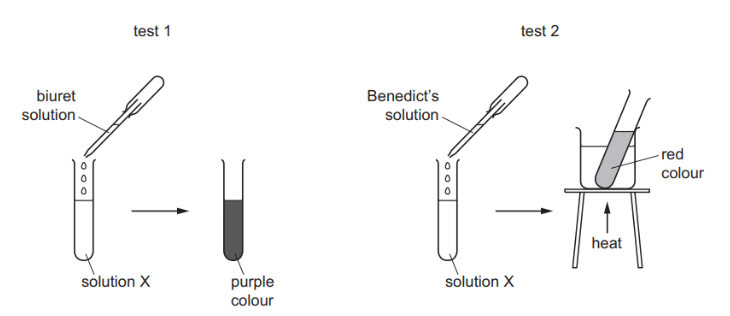
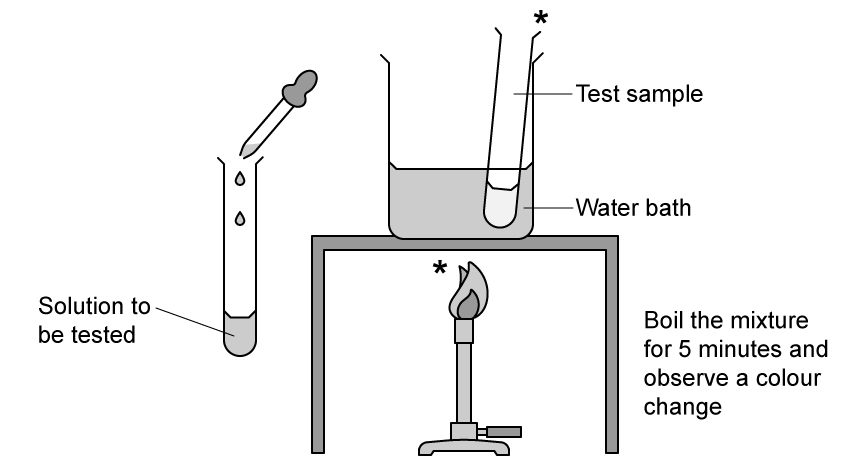

# Exam Questions — Biological Molecules
**4. Biological Molecules** · Cambridge (CIE) IGCSE biology (0610 & 0970)
> Source: [https://www.savemyexams.com/igcse/biology/cie/23/topic-questions/](https://www.savemyexams.com/igcse/biology/cie/23/topic-questions/) · 29 questions across 1 sets

## Multiple Choice Questions (29 questions)

### Q1 — medium — 1 marks

**Q1** [1 mark]

A section of one DNA strand has the bases:

**A C T G**

What is the sequence on the opposite strand?

### Q2 — hard — 1 marks

**Q2** [1 mark]

A student carries out food tests on an unknown sample. The results are shown below.

| Test | Result |
|---|---|
| Iodine solution | Brown |
| Benedict’s solution | Brick-red |
| Biuret | Blue |
| Ethanol emulsion | Cloudy white emulsion |
| DCPIP | Blue |

Which statement is correct?

### Q3 — easy — 1 marks

**Q3** [1 mark]

A chemical test is carried out on a flax seed as follows:

1. A small sample of seed is crushed and placed in a test tube
2. Approximately 2 cm³ of ethanol is added to the test tube containing the crushed seed
3. The mixture is allowed to settle for about 3 minutes and poured into a second test tube containing water
4. A milky/cloudy layer forms at the top of the test tube

Which of the following correctly names the test and the molecule that it tests for.

### Q4 — medium — 1 marks

**Q4** [1 mark]

Which enzyme can catalyses the breakdown of fats into glycerol and fatty acids?

### Q5 — hard — 1 marks

**Q5** [1 mark]

In a length of DNA, 20% of the bases were T.

What is the percentage of base G in this length of DNA?

*Source: June 2022 paper 2 Q8*

### Q6 — medium — 1 marks

**Q6** [1 mark]

The diagram shows a short section of a single strand of DNA.

Which strand of DNA will combine with this strand to form part of a double helix?

*Source: June 2021 0970/21 Q10*

### Q7 — hard — 1 marks

**Q7** [1 mark]

The diagram shows two food tests being carried out on solution X.

Which nutrients are present in solution X?

*Source: june 2022 paper 1 Q11*

### Q8 — easy — 1 marks

**Q8** [1 mark]

What are the smaller basic units of starch and glycogen molecules?

|   | starch | glycogen |
|---|---|---|
| **A** | amino acids | fatty acids and glycero |
| **B** | amino acids | glucose |
| **C** | glucose | fatty acids and glycero |
| **D** | glucose | glucose |

*Source: june 2022 paper 1 Q9*

### Q9 — easy — 1 marks

**Q9** [1 mark]

Which element is found in proteins but **not** carbohydrates?

*Source: June 2021 0970/11 Q9*

### Q10 — easy — 1 marks

**Q10** [1 mark]

Which statement about the structure of DNA is correct?

*Source: Specimen 2023 0970/02 Q8*

### Q11 — medium — 1 marks

**Q11** [1 mark]

The data shows the concentrations of sugar and starch in an onion.

| total sugar including reducing sugar /g per 100g | starch /g per 100g |
|---|---|
| 3.7 | 0.0 |

The onion is tested with Benedict’s solution and iodine solution.

Which set of results is correct?

|   | Benedict’s solution | Iodine solution |
|---|---|---|
| **A** | blue | blue-black |
| **B** | blue | brown |
| **C** | brick red | blue-black |
| **D** | brick red | brown |

*Source: Specimen 2023 0970/01 Q9*

### Q12 — hard — 1 marks

**Q12** [1 mark]

#### Extended only

The shape and structure of molecules allows them to carry out their specific functions.

Which row of the table below correctly describes a feature of each molecule that makes it specific?

|   | enzyme | antibody | DNA |
|---|---|---|---|
| **A** | binding site | active site | base order |
| **B** | active site | binding site | base order |
| **C** | active site | base order | binding site |
| **D** | binding site | base order | active site |

### Q13 — medium — 1 marks

**Q13** [1 mark]

A student mixes a food reagent with solution X in a test tube.

They observe a positive test result when a cloudy emulsion forms.

|   | **food reagent** | **food molecule present in solution X** |
|---|---|---|
| **A** | ethanol | glycogen |
| **B** | Biuret | lipids (fats and oils) |
| **C** | Benedict’s solution | glycogen |
| **D** | ethanol | lipids (fats and oils) |

Which row of the table below identifies the reagent used and molecule present in Solution X?

### Q14 — medium — 1 marks

**Q14** [1 mark]

A student carried out two food tests on solution F to determine what food groups it contains.

What food molecules does solution F contain?

### Q15 — easy — 1 marks

**Q15** [1 mark]

The drawing shows a food test being carried out in a laboratory.

Which food test is being shown and which food group is being tested for?

### Q16 — hard — 1 marks

**Q16** [1 mark]

A group of students tested four different foods using some common food tests.

Their results are shown in the table below.

|   | Benedict’s test | Biuret test | Iodine test | DCPIP test |
|---|---|---|---|---|
| **A** | brick-red | purple | brown | colourless |
| **B** | brick-red | blue | brown | colourless |
| **C** | blue | blue | black | blue |
| **D** | brick-red | blue | black | colourless |

Which food contains reducing sugar and Vitamin C but **not **protein or starch?

### Q17 — medium — 1 marks

**Q17** [1 mark]

Four statements about large biological molecules are given below:

1. Proteins are made from a number of different amino acids.
2. Both glycogen and starch are made from simple sugar base units.
3. Fats are made from glycerol and fatty acids.
4. Oils are made from glycerol only.

Which of the four statements above is/are **false**?

### Q18 — easy — 1 marks

**Q18** [1 mark]

#### Extended only

DNA is a large molecule made from two chains of nucleotides held together by cross-links between pairs of bases.

Which of the following is a correct base pair?

### Q19 — medium — 1 marks

**Q19** [1 mark]

#### Extended only

A strand of DNA is shown below:

**T ― G ― A ― A ― C ― T ― A ― G ― C ― C**

What would the correct order of bases be on the complementary strand of DNA?

### Q20 — hard — 1 marks

**Q20** [1 mark]

Four foods were tested for the following food molecules:

- reducing sugar using Benedict’s reagent
- protein using Biuret solution
- fat using ethanol
- Vitamin C using DCPIP

|   | colour of food test result |   |   |   |
|---|---|---|---|---|
|   | brick-red/orange | purple/lilac | colourless | milky-white |
| **A** | ✔ | **✘** | ✔ | **✘** |
| **B** | ✔ | **✘** | **✘** | ✔ |
| **C** | **✘** | ✔ | ✔ | **✘** |
| **D** | **✘** | **✘** | ✔ | ✔ |

Which food contains sugar and Vitamin C?

### Q21 — medium — 1 marks

**Q21** [1 mark]

The table below lists three large molecules found in living organisms.

Which row correctly describes the smaller molecules these substances are made from?

|   | **glycogen** | **cellulose** | **oils** |
|---|---|---|---|
| **A** | glucose | glucose | glycerol |
| **B** | glycerol | starch | fatty acids |
| **C** | glycerol | glucose | glucose |
| **D** | glucose | starch | glycerol |

### Q22 — medium — 1 marks

**Q22** [1 mark]

Three statements about proteins are given below.

1. Different sequences of amino acids give different shapes to protein molecules.
2. Amylase is made from a sequence of amino acids joined together forming a non-specific 3D shape.
3. When mixed with Biuret solution, there is a colour change from blue to purple.

Which of the statements above are true?

### Q23 — hard — 1 marks

**Q23** [1 mark]

Which drawing represents the general structure of an amino acid molecule that would be found in Nature?

### Q24 — easy — 1 marks

**Q24** [1 mark]

Which row shows the three main elements from the Periodic Table that are present in most molecules in living organisms?

| **A** | carbon | oxygen | nitrogen |
|---|---|---|---|
| **B** | hydrogen | carbon | oxygen |
| **C** | oxygen | sulfur | carbon |
| **D** | hydrogen | carbon | nitrogen |

### Q25 — easy — 1 marks

**Q25** [1 mark]

#### Extended only

Which row represents the three main constituents of a **DNA nucleotide**?

| **A** | bases | phosphate | nucleus |
|---|---|---|---|
| **B** | deoxyribose sugar | nucleus | chromosome |
| **C** | bases | deoxyribose sugar | phosphate |
| **D** | phosphate | chromosome | bases |

### Q26 — easy — 1 marks

**Q26** [1 mark]

Which statement is false?

### Q27 — medium — 1 marks

**Q27** [1 mark]

Which row of the table below correctly describes the role of cellulose, proteins and water in living organisms?

|   | **cellulose** | **proteins** | **water** |
|---|---|---|---|
| **A** | solvent | enzymes & antibodies | for chemical reactions |
| **B** | strengthens cell walls | to make fats & oils | solvent |
| **C** | strengthens cell walls | enzymes & antibodies | solvent |
| **D** | solvent | enzymes & antibodies | strengthens cell walls |

### Q28 — hard — 1 marks

**Q28** [1 mark]

#### Extended only

The table below shows the elements and basic units used by cells to make large biological molecules.

|   | basic units | elements | large molecule |
|---|---|---|---|
| **A** | amino acid | carbon, hydrogen, oxygen, nitrogen | protein |
| **B** | glycerol | carbon, hydrogen, oxygen, nitrogen | fats |
| **C** | glycerol | carbon, hydrogen, nitrogen | fats |
| **D** | amino acid | carbon, hydrogen, oxygen | DNA |

Which row of the table is correct?

### Q29 — medium — 1 marks

**Q29** [1 mark]

The image below shows two molecules before and after chemical digestion by enzymes in the alimentary canal.

Which letter(s) identify the product(s) of complete starch digestion?
