# Mark Schemes — Enzymes
**5. Enzymes** · Cambridge (CIE) IGCSE biology (0610 & 0970)

## Alternative To Practical Questions (7 questions)

### Q1
> **[mark-scheme]**
> - **36.9 °C** **[1 mark]**
> 
> Accept values between 36.88-36.9
> 
> Units must be included
| pH | Time taken to break down starch at 36.9°C (s) |
|---|---|
| 4 | 740 |
| 5 | 480 |
| 6 | 210 |
| 7 | 150 |
| 8 | 390 |

> **[mark-scheme]**
> Award marks as follows:
> 
> - Table drawn with ruled lines **[1 mark]**
> - Column headings: pH **AND **time **AND** unit of time = s / seconds  **[1 mark]**
> - All four results recorded correctly **AND** the water bath temperature recorded in the table or table header **[1 mark]**
> 
> Accept a table with 3 columns (temperature, pH and time taken)

> **[exam-tip]**
> When drawing a results table, always remember to include units in the column headings rather than next to each individual value.
> 
> Make sure every piece of data you have been given or have calculated is included in the table — it is easy to lose a mark by forgetting to add the temperature from a previous part.
> 
> Ruled lines separating rows and columns are expected in a properly constructed table.
> **[mark-scheme]**
> 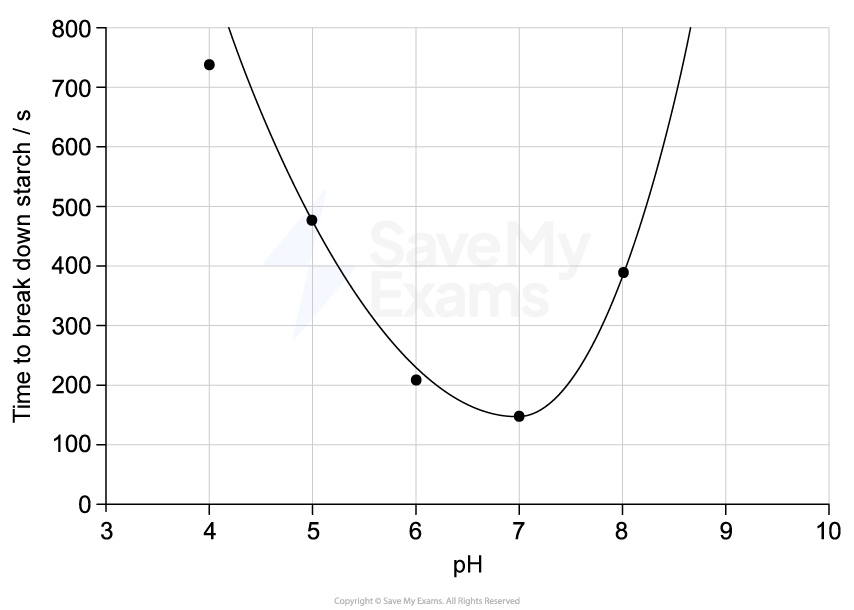
> 
> - Correct axis labels with units (pH on x-axis, Time / s on y-axis) **[1 mark]**
> - Sensible linear scale using more than half the grid in both directions **[1 mark]**
> - All four points plotted correctly (± half a small square) **[1 mark]**
> - Smooth curve of best fit drawn **[1 mark]**
> - Curve falls from pH 4 to a minimum at pH 7, then rises again. **[1 mark]**

> **[exam-tip]**
> When plotting a graph, always start by choosing sensible scales that use more than half of the grid — this makes your data easier to read and shows the examiner you can handle data presentation. Remember to label both axes with the correct variable name and unit (e.g. "Time / s" and "pH"). Plot each point carefully with a small, neat cross and then draw a smooth curve of best fit rather than joining dot-to-dot. A common mistake is to draw a straight line through the points when the data clearly suggests a curve. Make sure your curve reflects the overall trend in the data, peaking and dipping where appropriate.
> **[mark-scheme]**
> 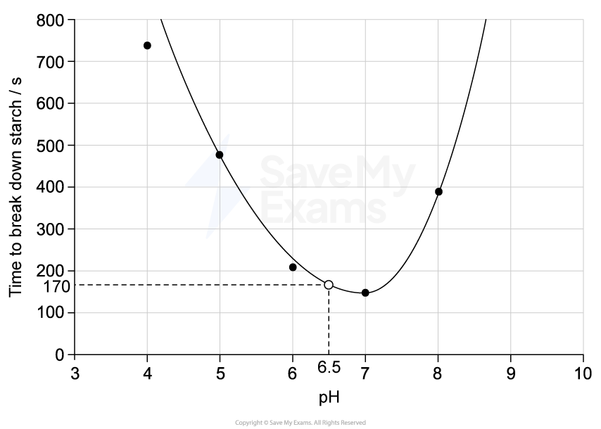
> 
> - **170**** [1 mark]**
> - Accept any value between $150  \text{s}$ and $190  \text{s}$ that is consistent with the student's drawn curve.

> **[exam-tip]**
> When reading values from a graph, always draw clear construction lines (horizontal and vertical) from the relevant axis to the curve and back to the other axis. This helps the examiner see exactly how you arrived at your answer and ensures you receive the mark even if your graph is slightly different from the expected one. Make sure you include the correct unit (seconds) in your answer.

**[1 mark]**\$
> **[mark-scheme]**
> - As pH increases from 5 to 7 the time decreases / rate increases **[1 mark]**
> - Above pH 7 the time increases / rate decreases, so pH 7 is the optimum **[1 mark]**

> **[exam-tip]**
> When describing a trend from a graph, make sure you refer to specific values from your data (e.g. pH 5, pH 7) rather than making vague statements. Break the trend into sections if it changes direction — here the trend changes at pH 7, so you need to describe what happens both before and after this point. Avoid using the word "explain" or giving reasons; the command word "describe" only requires you to state what the data shows.
> **[mark-scheme]**
> Any **two **from:
> 
> - volume of starch solution
> - volume of amylase
> - concentration of starch
> - concentration of amylase
> - temperature of water bath
> - time intervals for testing
> 
> **[2 marks]**

> **[exam-tip]**
> When asked to state controlled variables, think about all the factors in the experiment that could affect the results if they were changed. Make sure you name specific variables rather than giving vague answers such as "the amount of solution" — always specify which solution you mean.
> 
> Avoid listing the independent or dependent variable by mistake; controlled variables are those deliberately kept the same throughout the investigation.
> **[mark-scheme]**
> Any** pair** from (1 mark per point):
> 
> - Judgement of the endpoint is subjective / endpoint is qualitative
> - Compare to a colour standard / compare to a colour chart / compare to one that had already changed colour / use a colorimeter
> 
> **OR**
> 
> - Volume (of iodine or mixture) not directly measured / inconsistent drop size / using a dropping pipette
> - Use a syringe / use a burette / use a graduated pipette / measure the exact volume
> 
> **[2 marks]**
> 
> 1 mark for the source of error and 1 mark for the correctly linked improvement

> **[exam-tip]**
> This question asks specifically about sources of error in determining the end point of starch breakdown — that is, the point at which the iodine solution no longer changes colour. Any source of error you suggest must relate directly to this judgement, not to the experiment more broadly. For example, inconsistent mixing might introduce error into the reaction itself, but it does not affect how accurately you can identify the end point.
> 
> Make sure your error and improvement are clearly linked — stating an error about colour judgement and then suggesting a burette as the improvement would not earn both marks, as the improvement does not address the error.
> **[mark-scheme]**
> Any pair from (1 mark per pair):
> 
> - **Hazard:** iodine (solution) is an irritant/harmful/toxic
> - **Precaution:** wear safety goggles / wear gloves / avoid skin contact
> 
> **OR**
> 
> - **Hazard:** breaking glass/test-tubes/spotting tile
> - **Precaution:** keep apparatus away from the edge of the desk / handle with care / sweep up broken glass with a brush and dustpan
> 
> **[1 mark]**
> 
> The candidate must correctly identify a valid hazard and link it to a sensible precaution to reduce the risk. Both the hazard and the linked precaution are required for the mark.

> **[exam-tip]**
> Make sure you name a specific hazard (e.g. iodine solution or broken glass) rather than giving a vague answer like "chemicals" or "equipment". You then need to link it to a practical precaution — for example, if the hazard is an irritant chemical, the precaution should relate to protecting yourself from that chemical (e.g. wearing gloves or goggles).
> 
> Avoid vague precautions like "be more careful" — instead, be specific about what you would do and why it would help. Make sure your suggestion is practical and relevant to the method described.
> **[mark-scheme]**
> Any **one **from:
> 
> - to identify anomalous results
> - to improve reliability
> - to allow a mean to be calculated
> 
> **[1 mark]**

> **[exam-tip]**
> Make sure you link your answer directly to the purpose of repeating experiments. A strong answer will mention identifying anomalous results or improving the reliability of the data. Avoid vague statements such as "to make it more accurate" — accuracy and reliability are different concepts, and repeats specifically help with reliability by allowing you to spot anomalous results.
Any **six **from:

- Test at least three different temperatures (e.g. 20, 30, 40°C) [independent variable]
- Time taken for iodine solution to stay yellow-brown / time for starch to disappear [dependent variable]
- Keep concentration of amylase constant
- Keep volume of amylase constant
- Keep pH constant
- Keep concentration of starch constant
- Keep volume of starch constant
- Equilibrate both solutions in the water bath before mixing
- Use a spotting tile with iodine solution and take samples at regular intervals
- Repeat at each temperature and calculate a mean
- Record results in a table with columns for temperature (°C) and time taken for starch to break down (s)
- Plot a line graph of time taken (y-axis) against temperature (x-axis)
- Wear safety goggles

**[6 marks]**

> **[mark-scheme]**
> Award 1 mark for each valid point, up to a maximum of 6 marks from the seven listed above.
> 
> The question asks students to "plan" an investigation, so credit should be given for clearly describing variables, a logical method, and how results are recorded and presented.

> **[exam-tip]**
> When planning an investigation, make sure you clearly state the independent variable (what you change), the dependent variable (what you measure) and at least two control variables (what you keep the same). Many students lose marks by forgetting to mention how they would ensure a fair test — for example, keeping the pH and the volumes/concentrations of enzyme and substrate constant.
> 
> Always describe how you would use iodine solution to test for the presence of starch at regular intervals, and state the specific time interval (e.g. every 30 seconds). Remember to mention repeating the experiment at each temperature and calculating a mean, as this improves the reliability of your results. Finally, don't forget to say how you would present your data — a table for raw results and a line graph to show the trend.

### Q2
(i)

**Answer:**

- Table with two columns / rows with a line separating headings from body of table **AND** suitable headings; **[1 mark]**
- Recording of blue / no change in W10 **AND** orange in** **A10; **[1 mark] **

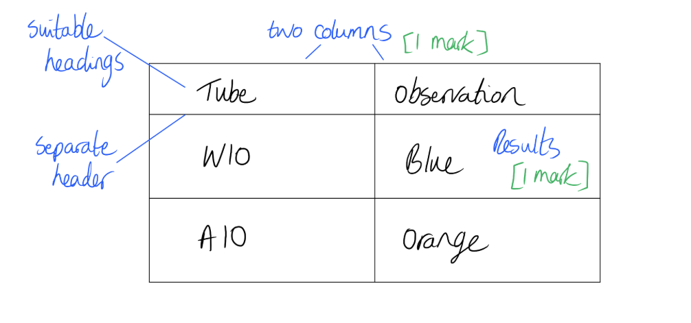

(ii)

**Answer:**

- Starch in the rice is broken down into (reducing) sugar / broken down by amylase **OR** (reducing) sugar is produced when amylase is present; **[1 mark]**

The orange colour observed in tube A10 is a positive result for the Benedict’s test, indicating the presence of a reducing sugar. This sugar would have come from the breakdown of starch in the rice after the addition of amylase solution. The rice in tube A10 has not been broken down because distilled water was added instead of amylase.

(iii)

**Answer:**

Any two from:

- Mass of rice; **[1 mark] **
- Type of rice;** [1 mark] **
- Temperature of the water-bath; **[1 mark] **
- Time for which tube is left in water bath; **[1 mark] **
- Volume of water **AND** amylase solution added;** [1 mark] **
- Volume of liquid sample removed (for testing); **[1 mark] **
- Volume of Benedict’s solution; 11**[1 mark] **

(iv)

**Answer:**

- As a control / for comparison / to show what would happen if no amylase were present / to show that the colour change was due to amylase; **[1 mark] **

(v)

**Answer:**

Any one from:

- W10 will change colour / turn yellow/green/orange/red;** [1 mark] **
- There will be a positive result in W10; **[1 mark] **
- Reducing sugar will be present in W10;** [1 mark] **
- Both test-tubes will show a positive result with Benedict’s solution; **[1 mark] **

It was important that step 3 was carried out before step 4 so that the measuring cylinder was not contaminated with amylase before it was used to measure out distilled water.  If step 4 were carried out first then any remnants of the amylase solution in the measuring cylinder would be added to tube W, resulting in the breakdown of starch in the rice and a positive result in W10 after incubation and testing.

(vi)

**Answer:**

Any one from:

- Thermostatically controlled water-bath; **[1 mark] **
- Thermo-isolated container / insulated jacket / insulation, e.g. foam;** [1 mark] **
- A lid on the water bath;** [1 mark] **
**Answer:**

- Test rice with iodine / iodine in potassium iodide solution;** [1 mark] **
- Look for a blue-black colour (if starch present); **[1 mark] **
(i)

**Answer:**

- Amylase activity / mass of sugar produced increases **AND** then decreases (as the temperature increased);** [1 mark] **
- Peak / optimum temperature is 34/35/36 °C;** [1 mark] **

(ii)

**Answer:**

- 30; **[1 mark] **
- 6 (mg per minute); **[1 mark] **

*Award full marks for the correct answer without any additional calculations.*

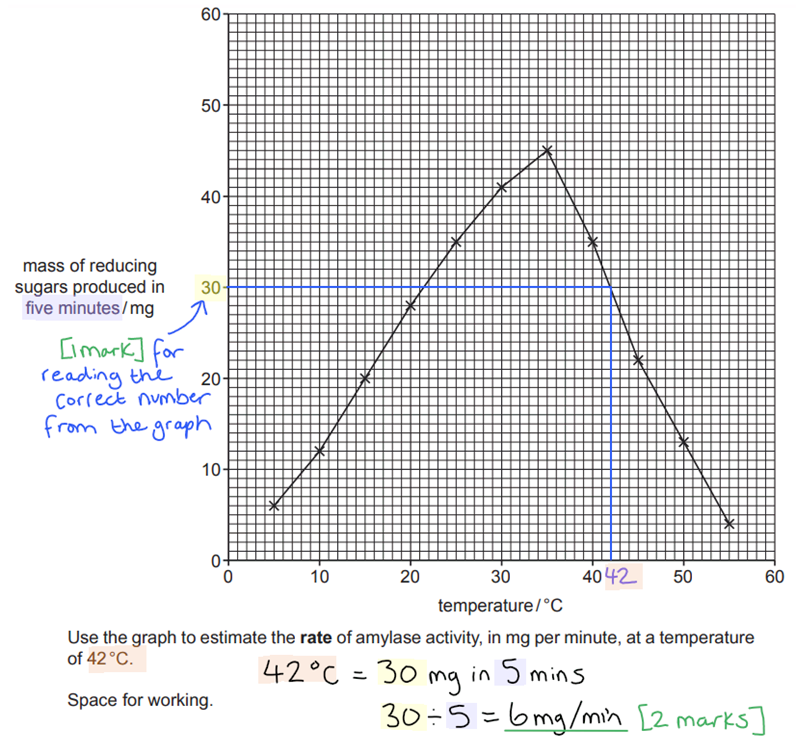

(iii)

**Answer:**

- Test at smaller intervals of temperature;** [1 mark] **
- Select a narrower range of temperatures around 35 °C; **[1 mark] **
**Answer:**

**Description of the reducing sugar method: **

- Independent variable = at least two pH values tested; **[1 mark] **
- Dependent variable = time to colour change **OR** colour of Benedict’s solution after a set period of time **OR** mass of (reducing) sugars; **[1 mark] **

*Variables kept constant: a maximum of two from:*

- Volume of pH solution;** [1 mark]  **
- Concentration of amylase; **[1 mark] **
- Volume/quantity of amylase;** [1 mark] **
- Type of amylase solution;** [1 mark] **
- Temperature;** [1 mark] **
- Volume of starch suspension;** [1 mark] **
- Concentration of starch suspension; **[1 mark] **
- Source of starch suspension;** [1 mark] **
- Volume of Benedict’s;** [1 mark] **

*Additional details of method; a maximum of four from:*

- Collect liquid samples of a fixed volume; **[1 mark] **
- Test with Benedict’s; **[1 mark] **
- Heat / incubate at 80 °C;** [1 mark] **

- Use of buffer (to control pH); **[1 mark] **
- Use of colorimeter / colour chart (for reading results); **[1 mark] **
- Use of balance to measure mass (of reducing sugars / precipitate);** [1 mark]**
- Repeat investigation (at least) twice more;** [1 mark] **
- Relevant safety precaution, e.g. gloves / goggles / tongs / test-tube holder; **[1 mark] **
- Other valid suggestions, e. g. equilibration time in the water bath before mixing;** [1 mark]  **

**Description of the disappearance of starch method**:

- Independent variable = at least two pH values tested / two pH values stated; **[1 mark]  **
- Dependent variable = time for iodine solution to stay yellow-brown / disappearance of starch;** [1 mark]  **

*Variables kept constant: a maximum of two from:*

- Volume of pH solution; **[1 mark]   **
- Concentration of amylase;** [1 mark]  **
- Volume / quantity, of amylase solution; **[1 mark]   **
- Type of amylase solution;** [1 mark]    **
- Temperature;** [1 mark]   **
- Volume of starch suspension / mass of rice / mass of plant tissue;
- Concentration of starch suspension;** [1 mark]   **
- Same source of starch;** [1 mark]  **

*Additional details of method; a maximum of four from:*

- Collect liquid samples of a fixed volume**; [1 mark] **
- Take samples at regular intervals;** [1 mark]**
- Use of buffer;** [1 mark]  **
- Test with iodine solution;** [1 mark]  **
- Use of spotting tile;** [1 mark] **
- Repeat investigation at least twice more; **[1 mark] **
- Relevant safety precaution, e.g. gloves / goggles;** [1 mark]**
- Other valid suggestions, e. g. equilibration time in the water bath before mixing;** [1 mark] **

When writing a plan for an investigation you should always begin by considering the variable that will be changed on purpose (the independent variable), the variable that will be measured (the dependent variable) and any variables that you will need to keep constant. You can then gain additional marks for describing extra details of the method. Don’t forget to consider general points that will be relevant to all investigations, such as a suitable number of repeats and safety considerations.

### Q3
(i)

- Table drawn with header lines and at least two columns; **[1 mark]**
- Headings with units; **[1 mark]**
- Height of the foam for both cooked and uncooked potato recorded; **[1 mark]**

| Type of potato | Height of foam / cm |
|---|---|
| Uncooked | 3.2 |
| Cooked | 1.0 |

Remember when drawing a results table to put your units in the headings but **not** next to each number.

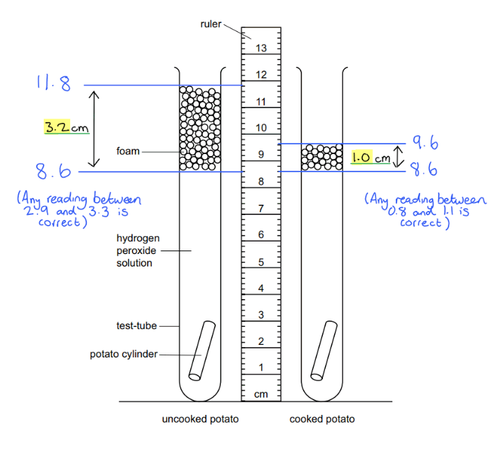

(ii)

- 2.2 ± 0.2 cm; **[1 mark]**

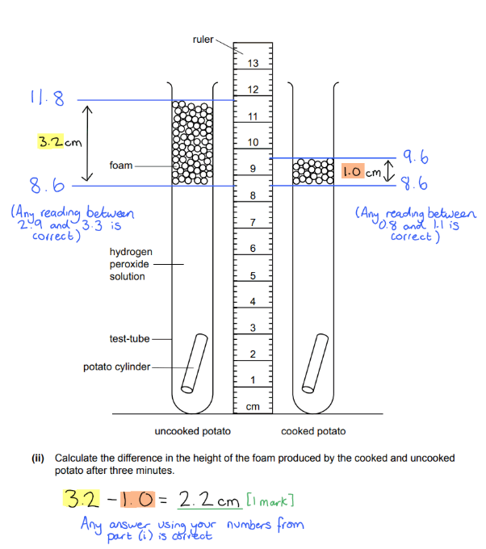

(iii)

Any one from:

- Uncooked potato produces more foam / oxygen; **[1 mark]**
- Catalase / enzyme is more active in the uncooked potato; **[1 mark]**

**[Total: 5 marks]**
(i)

- Treatment of potato / cooked or uncooked potato; **[1 mark]**

Remember that the independent variable is the thing you change and the dependent variable is the thing you measure, which in this case would be the height of the foam.

(ii)

- Same surface area; **[1 mark]**

(iii)

Any two from:

- Volume of hydrogen peroxide solution; **[1 mark]**
- Concentration of hydrogen peroxide solution; **[1 mark]**
- Time potato is in hydrogen peroxide solution; **[1 mark]**

Remember to avoid using vague measurement terms like ‘amount’. Get into the habit of using more scientifically accurate terms like ‘volume’ and ‘concentration’.

**[Total: 4 marks]**
Any one from:

- Cooked potato was not dried before adding to the hydrogen peroxide solution;**[1 mark]**
- Cooked potato was not cooled before adding to the hydrogen peroxide solution;**[1 mark]**
- Uncooked potato was not soaked in (cold) water;**[1 mark]**
- Uneven surface of the foam; **[1 mark]**
- Foam is unstable / bubbles might burst before the measurement is taken;** [1 mark]**

**[Total: 1 mark]**
*Independent variable *

- At least two different species of plant; **[1 mark]**

*Variables that are kept constant *

**Max of two from:**

- Same size / mass of plant; **[1 mark]**
- Same volume of hydrogen peroxide solution; **[1 mark]**
- Same concentration of hydrogen peroxide solution; **[1 mark]**
- Same temperature; **[1 mark]**
- Same pH; **[1 mark]**
- Same time; **[1 mark]**
- Tissue from the same part of the plant e.g. roots or leaves;**[1 mark]**
- Same size / diameter test-tube;**[1 mark]**

*Dependent variable *

- Measure the height of the foam / measure the volume of oxygen produced / count bubbles; **[1 mark]**

*Detail of given method *

- Adding hydrogen peroxide solution to plant tissue;**[1 mark]**
- Preparation of plant material / method used to achieve the same surface area;**[1 mark]**

*Novel method *

- Collecting volume of gas with gas syringe / upturned measuring cylinder; **[1 mark]**

*Control *

- Test hydrogen peroxide solution with no plants / boiled plants; **[1 mark]**
- Two or more replicates / repeats; **[1 mark]**
- Relevant safety precaution e.g. wear safety goggles;**[1 mark]**

When planning an investigation always remember the three main variables: independent, dependent and control. Try to include as much detail as possible. Carrying out repeats and a safety precaution are often standard marking points so try to remember to include that information when answering future questions about planning an investigation.

**[Total: 6 marks]**

### Q4
The final concentration of the pectinase solution in test-tube **P3** is...

- (5 x 0.25) ÷ 1; **[1 mark]**
- 1.3 / 1.2 (%); **[1 mark]**

*Full marks awarded for the correct answer rounded to one decimal place, in the absence of calculation.*

**[Total: 2 marks]**

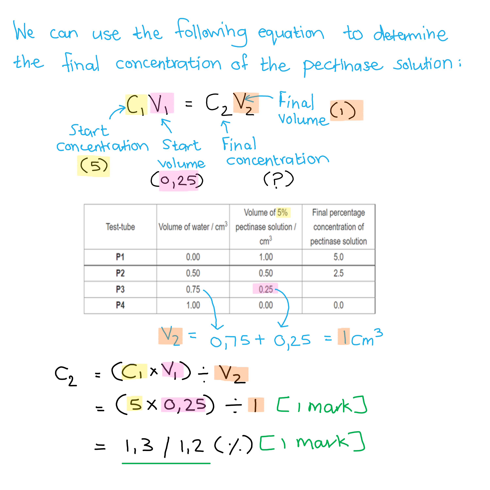

> *Note that if you are struggling with deciding how to calculate your answer, you can always use the other figures in the table to test out your method to check that you can achieve the correct answer.*
The mark allocation for the results table would be as follows...

- A suitable table drawn;** [1 mark]**
- Headings with units;** [1 mark]**
- Correct measurements recorded; **[1 mark]**
- The height of the precipitate at 5 minutes is greater than at 10 minutes for P1, P2 and P3; **[1 mark]**

| **Time / min** | **Height of the precipitate / mm** |   |   |   |
|---|---|---|---|---|
| **P1** | **P2** | **P3** | **P4** |   |
| 0 | 0 | 0 | 0 | 0 |
| 5 | 20 | 35 | 40 | 0 |
| 10 | 15 | 20 | 33 | 0 |

**[Total: 4 marks]**

> *Note that this question was adjusted from the original to include the measurements for the height of the precipitate, due to the challenge of measuring on a screen. In the exam you would have been expected to make the measurements yourself, so don't forget your ruler and remember to line the '0' up with the bottom of the test-tube as shown in Fig. 2.*
A conclusion for the results would be...

Any **two** from the following:

- A greater concentration (of pectinase) means clearer juice / less precipitate; **[1 mark]**
- (In P4) the juice does not clear / no precipitate formed if pectinase is absent;** [1 mark]**
- The longer the time the less precipitate forms / the precipitate settles over time (so precipitate is denser) / pectinase has broken down the precipitate (so less is present); **[1 mark]**

**[Total: 2 marks]**
(i) The independent variable in this investigation is...

- Concentration/percentage of pectinase; **[1 mark]**

(ii) Variables that should have been kept constant include...

Any **two** from the following:

- The volume of the pectinase solution;** [1 mark]**
- The volume of apple juice; **[1 mark]**
- (Use the same) sample of apple juice / type of juice / type of fruit/apple;** [1 mark]**
- Stirring a set number of times; **[1 mark]**
- Take measurements at 5 and 10 minutes / at set times/intervals; **[1 mark]**
- (Use the same) diameter/size test-tube OR (have the same) total/final volume of solution in each test-tube; **[1 mark]**
- (Same) temperature; **[1 mark]**
- (Same) pH; **[1 mark]**

(iii) A possible error and suggested improvement at step 6 would be...

Any **one** error and **matching** improvement from the following:

*Error 1:*

- (There is) no clear demarcation of where the precipitate ends **OR** it is difficult to measure (the height of the precipitate) accurately / reliably with a ruler; **[1 mark]**

*Improvement 1:*

- Measure the mass of the precipitate / have a white back-ground/grid (against the test-tube) / use measuring cylinders/graduated test-tubes / use callipers/syringe (to take measurements); **[1 mark]**

**OR**

*Error 2: *

- (It is) difficult to measure all (the test-tubes) at the same time;** [1 mark]**

*Improvement 2:*

- Do each test separately;** [1 mark]**

**[Total: 5 marks]**

> *Remember that the independent variable is the one that is changed by the investigator to test the effect of that change on the dependent variable.*

> *Always be specific when listing the constant variables; e.g. do not simply write 'pectinase solution', you must specify that it is the **volume** of pectinase solution that should be kept constant.*

> *Keep in mind that an error does not refer to a 'mistake' that was made by the investigator, such as taking an incorrect measurement. An error often results from limitations of the apparatus used during an investigation, such as using a ruler to measure the height of the precipitate. It is difficult to establish where the border of the precipitate is, so using a different measuring technique (measuring mass of precipitate) or more accurate measuring tools (using callipers / graduated test-tubes) will deliver more accurate results.*
The purpose of test-tube **P4** is...

- (It/**P4**) is a control;** [1 mark]**
- (P4) confirms that it is pectinase / enzyme is causing the effect; **[1 mark]**

**[Total: 2 marks]**

> *The purpose of a control in any investigation is to ensure that it is the change to the independent variable (in this case the concentration of pectinase) that is having an effect on the dependent variable and not because of some other factor.*
An investigation to test whether pectinase will reduce the vitamin C content of fruit juice would include...

Any **six** from the following:

- Use test-tubes with and without pectinase; **[1 mark]**
- Do a minimum of three repeats (both with and without pectinase); **[1 mark]**
- Using DCPIP (to test for vitamin C); **[1 mark]**
- Method of measuring the volume of DCPIP used (e.g. use a pipette / burette or count drops);** [1 mark]**
- Shake (test-tubes) after each addition of DCPIP / description of end point; **[1 mark]**
- Colour (of the solution) changes from blue to colourless if vitamin C is present; **[1 mark]**
- Mention of a relevant safety point e.g. wearing eye protection; **[1 mark]**

*Controlled variables:*

A maximum of **two** from the following:

- Same concentration of pectinase; **[1 mark]**
- Same volume of fruit juice; **[1 mark]**
- Same type of juice / same age of fruit / same species / from same tree; **[1 mark]**
- Same temperature;** [1 mark]**
- Same pH / use a buffer (solution); **[1 mark]**
- Same concentration of DCPIP; **[1 mark]**

*Accept other methods of estimating vitamin C e.g. iodine titration.*

**[Total: 6 marks]**

> *Describing the steps in an investigation is a very popular exam question so it will be worth your while to become familiar with what is expected of you when constructing an answer.*
The mark allocation for the tomato drawing is as follows...

*Lines: *

- Single clear and continuous; **[1 mark]**

*Size of drawing: *

- At least 85 mm in diameter; **[1 mark]**

*Details of drawing: *

- Wall is drawn and five compartments; **[1 mark]**
- Solid tissue mass shown in each compartment; **[1 mark]**

**[Total: 4 marks]**

> *Make sure that you do not sketch your drawing, the lines should be single, clear and continuous. Resist the urge to shade anything on your drawing as this will definitely cost you a mark. When making a drawing remember that bigger is almost always better, fill up most of the space provided in the question paper.*

> *Your drawing would look something like this:*

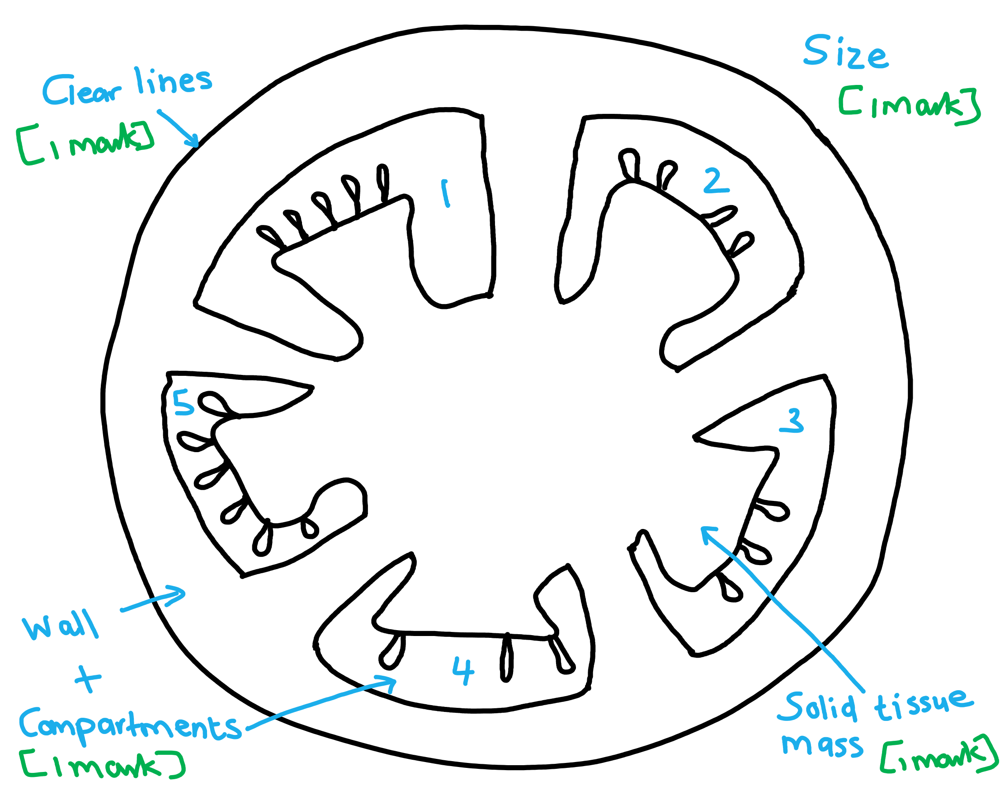
The result for a positive test for starch would be...

- (The iodine solution would turn) blue-black; **[1 mark]**

**[Total: 1 mark]**

> *Make sure that you know your food tests off by heart, it is one of the few content-based questions in an alternative to practical paper.*

### Q5
The results table should appear as follows...

- Complete table with lines neatly drawn ( table must have an appropriate number of cells); **[1 mark]**
- (Column/row heading –) number of pieces/cubes of sweet potato **OR **cube number; **[1 mark]**
- (Column/row) heading –) number of bubbles in 1 minute; **[1 mark]**
- (Column/row) heading –) height of foam **AND** correct units; **[1 mark]**
- (Number of bubbles recorded) 12, 23 and 38; **[1 mark]**
- (Foam height values recorded) 42, 63, 76; **[1 mark]**

| **Number of pieces of sweet potato **OR** Cube number** | **Number of bubbles in 1 minute** | **Height of foam / mm** |
|---|---|---|
| 1 | 12 | 42 |
| 2 | 23 | 63 |
| 8 **OR** 3 (for cube number) | 38 | 76 |

***Reject ****marking points 5 and/or 6 if units are included in the body of the table.*

**[Total: 6 marks]**

> *In an exam you would be expected to measure the distances on the diagrams (such as the height of the foam) using a ruler, so make sure to always take a ruler that is capable of measuring in mm into your exam.  *
(i) Two variables that the students kept constant in this investigation are...

Any **two **of the following:

- Same volume/concentration of H2O2/hydrogen peroxide; **[1 mark]**
- Same volume of (initial) potato cube; **[1 mark]**
- Potato is left in the solution for the same amount/length of time;** [1 mark]**

(ii) You could improve the method that they followed by...

Any **three** of the following:

- Repeating the experiment **AND** calculating a mean; **[1 mark]**
- Excluding anomalies from mean calculation; **[1 mark]**
- Collecting the gas (eg. using a syringe or an upside down measuring cylinder submerged in water) **AND** measuring the volume that is produced; **[1 mark]**
- Drying the (sweet) potato cubes before adding them into the hydrogen peroxide / test tubes (to avoid adding extra water into the hydrogen peroxide solution); **[1 mark]**
- Cutting the cubes from the same (sweet) potato / the same part of one sweet potato;** [1 mark]**
- Stating that the tubes should be kept at the same temperature (as each other); **[1 mark]**
- Stating the concentration of hydrogen peroxide solution that should be used; **[1 mark]**

**[Total: 5 marks]**

> *Note that part i) refers specifically to the investigation carried out by the students, so your answers should all be taken directly from the information provided in the question.*

> *Any method detail that would improve the validity of the results is creditworthy here, including ways of ensuring that results are repeatable, improving the precision of the measurements, and ensuring that control variables are kept constant.*
A conclusion that can be drawn from these results is...

- (Catalase) activity is proportional to surface area / the greater the surface area the greater the (catalase) activity;** [1 mark]**

**[Total: 1 mark]**
(i) A similar investigation to test this hypothesis is...

Any **six **of the following:

- Test a range of at least 4 temperatures; **[1 mark]**
- Describe how temperature would be changed, e.g. use a water-bath set to different temperatures; **[1 mark]**
- Leave the equipment in the water for a set amount of time before the experiment to allow them to reach the correct temperature; **[1 mark]**
- (Include an experimental control tube that contains) an inert/boiled cube **OR **the same volume of water as hydrogen peroxide; **[1 mark]**
- Appropriate description of how the volume of gas will be measured / bubbles counted, e.g. using a gas syringe or an inverted measuring cylinder; **[1 mark]**
- Appropriate statement regarding time, e.g. stop experiment after 5 minutes;** [1 mark]**
- <u>Surface area</u> of potato controlled / should be the same for each temperature; **[1 mark]**
- Another control variable stated, e.g. pH / cubes taken from the same potato / concentration of hydrogen peroxide is the same for all temperatures etc.; **[1 mark]**
- Repeat at least three times and calculate a mean for each temperature; **[1 mark]**

(ii) One safety precaution that you would need to take when performing this experiment is...

Any **one **of the following:

- Safety goggles / gloves; **[1 mark]**
- Reference to avoiding burns from hot liquid/objects, e.g. the use of tongs / heatproof gloves;** [1 mark]**

**[Total: 7 marks]**

> *Whenever you are describing the method of an experiment you need to make sure you're covering all of the variables:*

- Independent; how will you change this variable?
- Dependent; what method/equipment will you use to measure this?
- Several control variables.

> *Other valid points that are often relevant to an experiment include the use of an experimental control, and the importance of repeating the experiment and calculating a mean. Points relating to safety can also often be included in a long answer like this one, but this section has been separated into part ii) in this particular case.*

### Q6
(i) The mark allocation for the results table is...

- Table drawn with header lines **AND** at least two columns; **[1 mark]**
- Headings with units; **[1 mark]**
- Height of the foam for both cooked **AND** uncooked potato recorded;** [1 mark]**

| **Potato cylinder** | **Height of foam / cm** |
|---|---|
| Cooked | 1.0 |
| Uncooked | 3.2 |

*Accept values for foam height in the range of 0.8 to 1.1 cm for cooked potato and 2.9 - 3.3 cm for uncooked potato.*

(ii) The difference in foam height of cooked and uncooked potato is...

- (3.2 - 1.0 =) 2.2; **[1 mark]**

*'Error carried forward' would apply here, meaning that a correct calculation using incorrect measurements from 1 a) i) would still be credited.*

(iii) One conclusion for these results would be...

Any **one** from the following:

- Uncooked potato produces more foam/oxygen (than a cooked potato) **OR** cooked potato produces less foam/oxygen (than an uncooked potato); **[1 mark]**
- Catalase / the enzyme was more active in uncooked potato **OR** catalase / the enzyme was less active in cooked potato; **[1 mark]**

**[Total: 5 marks]**

> *Measuring the height of the foam for a) i) and the calculation for a) ii):*

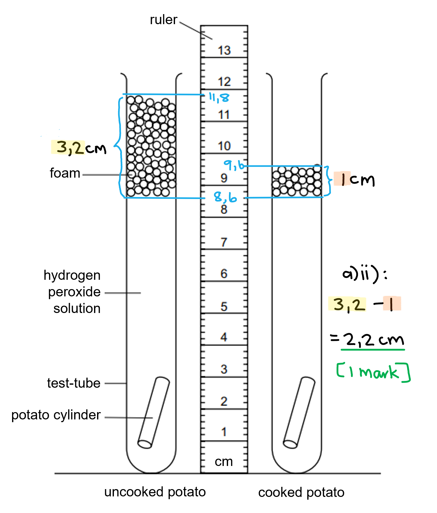
(i) The independent variable in this investigation is...

- (The) treatment of the potato / whether the potato was cooked or uncooked; **[1 mark]**

(ii) The potato cylinders must be the same shape and size because...

- (They must have the) same surface area; **[1 mark]**

(iii) Other variables that were kept constant includes...

Any **two** from the following:

- Volume of hydrogen peroxide solution; **[1 mark]**
- (The) concentration of hydrogen peroxide solution; **[1 mark]**
- (The amount/length of) time the potato is in the hydrogen peroxide solution; **[1 mark]**

**[Total: 4 marks]**

> *The independent variable is the one that the investigators are studying and that is therefore changed on purpose, i.e. whether the potato cylinder is cooked or uncooked.*

> *In order to obtain reliable results, the potato cylinders must expose the same amount of surface area for catalase to work on, therefore it is important to ensure that the cylinders are the same shape and size.*

> *When listing the variables that are kept constant it is important to be very specific. For b) iii) you cannot simply say 'hydrogen peroxide solution', you must state that it is the volume or the concentration of the solution that must be the same in the test tubes.*
A source of error would include the following...

Any **one** of the following:

- The cooked potato was not dried before adding it to the hydrogen peroxide solution (meaning that water on the surface of the potato might dilute the hydrogen peroxide solution to a greater or lesser extent); **[1 mark]**
- The cooked potato was not cooled before adding it to the hydrogen peroxide solution (meaning that temperature would affect the rate of reaction);** [1 mark]**
- The uncooked potato was not soaked in (cold) water (meaning that temperature would affect the rate of reaction); **[1 mark]**
- The uneven surface of the foam (makes accurate measurement difficult); **[1 mark]**
- The foam is unstable / the bubbles (of the foam) will pop quickly / height of the foam will change quickly (making accurate measurement difficult); **[1 mark]**

> *You must practice to spot potential sources of error while reading through the description of the method since this is a very popular exam question. *

> *Remember that the term 'error' in this context is not referring to human error, e.g. cutting the potato cylinders to the wrong size or taking incorrect readings from the ruler, but instead refers to unavoidable limitations that result from the **design of the experiment** and the **equipment used**. In this case, such limitations include the failure to dry or cool the potato cylinders and the unstable nature of the resulting foam.*
An investigation to test the catalase activity in different species of plants would include...

Independent variable

- Use at least two different species of plant; **[1 mark]**

Variables that are kept constant

A maximum of **two** from the following:

- Same size/mass of plant; **[1 mark]**
- Same volume of hydrogen peroxide solution;** [1 mark]**
- Same concentration of hydrogen peroxide solution; **[1 mark]**
- (Investigation must be conducted at the) same temperature; **[1 mark]**
- pH must be kept the same;** [1 mark]**
- (Plant tissue must be left in the solution for the) same (amount/length of) time;** [1 mark]**
- Tissue from the same part of the plant, e.g. roots or leaves, must be used; **[1 mark]**
- (The) test-tubes must be the same size/diameter; **[1 mark]**

Dependent variable

- Measure the height of the foam / the volume of oxygen produced / count the (number of) bubbles (released); **[1 mark]**

Detail of given method

- Adding hydrogen peroxide solution to plant tissue; **[1 mark]**
- A description of the preparation of plant material / method used to achieve the same surface area; **[1 mark]**
- A description of collecting volume of gas with gas syringe / upturned measuring cylinder; **[1 mark]**
- Two or more replicates/repeats; **[1 mark]**
- Named relevant safety precaution, e.g. wearing eye protection while conducting experiment;** [1 mark]**

Control

- Test (the activity of) hydrogen peroxide solution with no plants / boiled plant material; **[1 mark]**

**[Total: 6 marks]**

> *There are many possible marks up for grabs here, so make sure you know the basic steps of writing a method for a scientific investigation. You should always aim to include:*

- The independent variable that will be changed during the experiment.
- The dependent variable that will be measured.
- Examples of control variables that will be kept constant.
- Details of the method, e.g. how materials are prepared, the equipment used to measure the dependent variable, the number of repeats carried out, safety precautions, and the option of an experimental control.

> *When describing the variables remember to always be specific, i.e. don't just say 'use different plants', mention that you must use two (or three) different **species** of plant. You will not gain marks for vague descriptions.*
The test for starch and reducing sugar can be done as follows...

Starch

- Add iodine solution (to food sample/potato);** [1 mark]**
- (If starch is present then the iodine solution will turn) blue-black; **[1 mark]**

Reducing sugars

- Add Benedict's solution (to food sample/solution); **[1 mark]**
- (Then) heat (the solution to 80 °C); **[1 mark]**
- (If reducing sugar is present then a) (brick-)red/yellow/orange/green (precipitate will form); **[1 mark]**

**[Total: 5 marks]**

> *Food tests are one of the few content-based questions that can be asked in an alternative to practical paper so make sure that you know them off by heart.*

### Q7
The table should appear as follows:

| **Time / minutes** | **Clotting conditions in each test tube** |   |   |
|---|---|---|---|
| **P** | **Q** | **R** |   |
| 1 | Some | None | None |
| 2 | All | None | None |
| 3 | All | None | None |
| 4 | All | Some | None |
| 5 | All | Some | None |

- One table drawn with at least three columns and a line separating headings from data;** [1 mark]**
- Column / row headings with appropriate units for each heading; **[1 mark]**
- Five correct clot records for each of three test-tubes; **[1 mark]**

*Reject if units are given in data cells.*

**[Total: 3 marks]**

> *Make sure to not include units in your data cells, for example, once you've put (minutes) in your heading then you don't need to write units next to each of the numbers. You can loose marks for doing this. *
A conclusion for these results is...

Any **two **from the following:

- Rennin/enzyme acts / forms clots quickest / is optimum / is best in acidic conditions; **[1 mark]**
- Rennin/enzyme acts / forms clots more slowly in water / neutral conditions;** [1 mark]**
- Rennin/enzyme does not act / does not form clots in alkaline / basic conditions; **[1 mark]**

**[Total: 2 marks]**
(i) All of the test-tubes were placed into a water-bath for three minutes before mixing the contents together because...

- Equilibration / allowing time for test-tube contents to reach the same temperature / to keep all test-tubes at the same temperature; **[1 mark]**

(ii) Two variables that were kept constant in this investigation were...

Any **two **from the following:

- Volume / 5 cm3 / mass of milk;** [1 mark]**
- Volume / 2 drops of acid / alkali / distilled water; **[1 mark]**
- Volume / 1 cm3 of enzyme / rennin; **[1 mark]**
- Concentration / 0.1% of enzyme / rennin;** [1 mark]**
- Temperature / 40°C; **[1 mark] **
- Equilibration time / 3 minutes **OR** total time / 5 minutes (for investigation); **[1 mark]**

*Ignore reference to 'time' only.*

**[Total: 3 marks]**

> *Avoid using the word **amount **when describing quantities. You can see from this mark scheme that you need to be specific when describing mass, volume or concentration. You will also need to be specific about the time that you are referring to i.e. **equilibration** time or **total** time.*
Four sources of error in this investigation are...

Any **four **from the following:

- Subjective nature of deciding on clotting point; **[1 mark]**
- Three test-tubes observed at different times (step 11) / **Q** and **R** were kept longer in the water-bath before being tested / different mixing times (step 9); **[1 mark]**
- No repeats were done;** [1 mark]**
- Insufficient time intervals; **[1 mark]**
- Drops (of acid / water / alkali) could be of different volumes / sizes / amounts;** [1 mark]**
- Some contents remain in the test-tube when adding to other test-tube, so volumes vary; **[1 mark]**
- The tip and rotate (of the test-tube) were not standardised;** [1 mark]**
- The same dropping pipette (for acid / water / alkali) could have been used leading to contamination; **[1 mark]**
- Temperature of the water-bath was not maintained; **[1 mark]**
- No control (to show that milk does not clot without rennin); **[1 mark]**

**[Total: 4 marks]**
One hazard associated with this procedure that would require the use of eye protection is...

- Use of acid / alkali / enzyme; **[1 mark]**

**[Total: 1 mark]**
You could find out if there was any protein remaining in the liquid part by...

- Add biuret (reagent) (to liquid part); **[1 mark]**
- Purple / mauve / lilac, colour indicates, the presence of protein / is a positive result; **[1 mark]**

**[Total: 2 marks]**

> *Ensure that you are familiar with the food tests as you will most likely come across this type of question in your exam paper.*
The name of the test that would be used to test the milk for the presence of fat is...

- Ethanol emulsion test / add ethanol and a white emulsion forms; **[1 mark]**

**[Total: 1 mark]**
A method that could be used to test this hypothesis is:

Any **six **from the following:

- At least 3 stated temperature values: <u>37 °C</u> and at least one above and one below;** [1 mark]**
- Method of maintaining temperature given;** [1 mark]**
- Clot / white solid / changed milk from the same sample of milk;** [1 mark]**
- Same pH (pH 7) of solutions;** [1 mark]**
- Same concentration / volume of enzyme / (named) protease; **[1 mark]**
- Equilibrate temperature of enzyme and milk solutions before mixing;** [1 mark]**
- Time how long for samples to become colourless **or **shortest time has greatest activity / is the optimum **or** if optimum is 37 ºC the hypothesis is correct; **[1 mark]**
- Repeat at least twice (and calculate the mean); **[1 mark]**
- Valid safety precaution, e.g. eye protection / gloves; **[1 mark]**
- Crush / blend clotted milk sample; **[1 mark]**
- Valid control experiment described; **[1 mark]**

*A maximum of ***[2 marks] ***from marking points 4, 5 and 6.*

**[Total: 6 marks]**

> *Whenever you are describing the method of an experiment you need to make sure you're covering all of the variables: independent, dependent and several control variables. You always need to describe how you're going to set up your independent variable and the equipment you would use to measure the dependent. Repeating the experiment and calculating the mean is universal for all experiments. *

## Multiple Choice Questions (25 questions)

### Q1
**Final answer:** **The correct answer is ****D.**

- Amylase is an **enzyme**
- Heating to **80 °C** likely **denatured** the enzyme.
- The heat breaks bonds, changing the shape of the **active site** permanently so that the substrate (starch) cannot fit

**A** is incorrect because cooling alone does not permanently stop enzymes from working.

**B** is incorrect because the problem is the enzyme, not the substrate.

**C **is incorrect because the enzyme was heated before the reaction started, so it was not used up by reacting.

### Q2
**Final answer:** **The correct answer is ****B.**

- Enzymes are specific because each enzyme has an **active site** with a shape that is **complementary to a particular substrate**, so only the correct substrate fits properly

**A** is incorrect because enzymes can work over a range of temperatures, though they have an optimum.

**C** is incorrect because enzymes are not normally changed permanently after each reaction.

**D **is incorrect because specificity depends on shape and fit, not just the size of the substrate.

### Q3
**Final answer:** **The correct answer is B.**

- Sucrase has an active site that is complementary in shape to sucrose, not lactose
- Lactose cannot fit into the active site of sucrase, so no enzyme-substrate complex can form and the reaction cannot be catalysed

**A** is incorrect as, even if lactose were present, sucrase would still be unable to break it down.

**C** is incorrect as "same shape" and "complementary shape" do not mean the same thing. For a substrate to fit into an active site, the two must be complementary — meaning they interlock, like a lock and key. If the active site were the same shape as the substrate, they would not fit together at all.

**D** is incorrect as enzymes are biological catalysts and are not used up during reactions.

### Q4
**Final answer:** **The correct answer is C.**

- Protease enzymes in the test tube break down the dietary proteins into amino acids
- Amino acids are the product of the reaction, and their volume increases as the reaction progresses

**A** is incorrect as hydrochloric acid is not produced during the reaction

**B** is incorrect as the concentration of protease will remain the same throughout

**D** is incorrect as the dietary protein is used up, so there would be a decrease in its volume over time

### Q5
**Final answer:** **The correct answer is ****A****.**

- This is because enzymes are made from proteins. When exposed to high temperatures the bonds holding the protein molecule together break, causing the enzyme to lose its shape and become denatured
- When the shape is lost it means that the active site can no longer bind with the substrate and therefore the enzyme cannot carry out its typical function

**B** is incorrect because the active site and substrate cannot bind together when the enzyme is denatured due to exposure to high temperatures.

**C** and** D** are incorrect because enzymes do not denature at low temperatures, only high temperatures.

### Q6
**Final answer:** **The correct answer is ****A****.**

- This is because an enzyme is a biological catalyst that speeds up chemical reactions in living organisms without being used up in the process
- An enzyme is a protein made from amino acids that are bonded together and folded into a 3D shape in order to carry out its function

**B** and **D** are incorrect because a substrate is a reactant molecule that binds to the active site of the enzyme, however it is not part of the enzyme itself.

**C** and **D** are incorrect because the product is what is produced after the reaction has been catalysed by the enzyme, however this detaches from the enzyme after the reaction and is not part of the enzyme itself.

### Q7
**Final answer:** **The correct answer is ****D****.**

- A catalyst is a substance that increases the rate of a chemical reaction and is not used up or changed by the reaction.

**A **is incorrect because a catalyst actually increases the rate of a chemical reaction instead of decreasing it, and it remains unchanged by the reaction.

**B **is incorrect because a catalyst is not changed by the reaction; rather, it facilitates the reaction without being consumed.

**C **is incorrect because while a catalyst increases the rate of a chemical reaction, it is not changed by the reaction, which contradicts this statement.

### Q8
**Final answer:** **The correct answer is ****B.**

- The pH in the stomach is highly acidic, which denatures amylase and prevents it from digesting starch.

**A **is incorrect because starch digestion is not completed in the mouth; some digestion continues in the small intestine.

**C** is incorrect because while food does move quickly from the stomach to the small intestine, the lack of starch digestion is primarily due to the unsuitable pH rather than the duration spent in the stomach.

**D** is incorrect because the temperature in the stomach is suitable for amylase activity; it is the acidic environment that inhibits the enzyme's function.

### Q9
**Final answer:** **The correct answer is A**

- The **active site **of an enzyme is **complementary** to an area on the substrate.
- This area on the substrate can fit into it to form an **enzyme-substrate** complex’.

**B** is incorrect because the active site of the enzyme is not similar to the substrate, it is the opposite shape, which is called complementary. When the substrate binds to the enzyme it is called an enzyme-substrate complex

**C **is incorrect because the area of the enzyme that the substrate binds to is called the active site. When the substrate binds to the enzyme it is called an enzyme-substrate complex

**D **is incorrect because the area of the enzyme that the substrate binds to is called the active site. The active site of the enzyme is not similar to the substrate, it is the opposite shape, which is called complementary

### Q10
**Final answer:** **The correct answer is C because:**

All of the labels are pointing to the correct parts of the diagram

**A** is incorrect because the product label is pointing to the substrate instead of the product.

**B** is incorrect because the product label should say substrate.

**D** is incorrect because the substrate label should say enzyme.

### Q11
**Final answer:** **The correct answer is ****B.**** (enzymes) because:**

Enzymes are **biological** **catalysts **which help ensure metabolic reactions take place in living organisms.

**A** is incorrect because although enzymes are proteins, this is not the correct term for the answer.

**C** is incorrect because although enzymes are catalysts, the question stem refers to living organisms which means that the catalyst has to be a biological catalyst.

**D** is incorrect because hormones do not ensure that metabolic reactions take place.

### Q12
**Final answer:** **The correct answer is ****C ****because:**

The **enzyme-substrate complex** (F) forms when the substrate enters the **active site** of the enzyme. This makes it easier for a reaction to occur, and the **products** (H) are released from the enzyme (G)** **which remains unchanged at the end of the reaction.

The other answers are not correct as they do not describe the enzyme chemical reaction as shown.

### Q13
**Final answer:** **The correct answer is ****B ****because:**

Increasing the temperature (X) initially increases the rate of reaction; but above the optimum temperature (Y) the enzyme denatures.

The other answers are incorrect as these do not correctly describe the shape of the graph.

### Q14
**Final answer:** **The correct answer is ****D.**** (Each enzyme works best at a different pH) because:**

For enzyme 1, the rate of reaction is quickest at pH 1.5, making this its optimum pH. For enzyme 2, the rate of reaction is quickest at pH 7, making this its optimum pH. And for enzyme 3, the rate of reaction is quickest at pH 14, making this its optimum pH.

**A** is incorrect because the graph gives no information about temperature.

**B** is incorrect because only enzyme 2 works best in neutral conditions.

**C** is incorrect because only enzyme 1 works best in acidic conditions.

### Q15
**Final answer:** **The correct answer is ****D.**** (It may increase or decrease the rate) because:**

- Whether the **rate** of enzyme activity increases or decreases **depends** on what the **optimum** pH for the enzyme is. In mammals, it would depend if the enzyme acts inside cells, or if it were a digestive enzyme
- If the increase in pH takes the pH away from the optimum in either direction, then the rate will slow down
- If the increase in pH moves the pH towards the optimum, then the rate will increase

The other answers are incorrect because they do not correctly state how changing the pH will affect the rate of reaction.

### Q16
**Final answer:** **The correct answer is ****C ****because:**

C is the only enzyme **shape** which is **complementary** to both the reactants and the subsequent product.

The others are incorrect as they do not show the correct specificity of substrate into the enzyme active site.

### Q17
**Final answer:** **The correct answer is ****B.**** (They are not changed by the reaction) because:**

A feature of all catalysts is that they remain **unchanged** at the end of a reaction, and can go on to catalyse subsequent reactions.

**A** is incorrect because although enzymes, as biological catalysts, are made from proteins, other catalysts not found in living organisms are not made of proteins (many metals can act as catalysts in certain chemical reactions for example).

**C** and **D **are incorrect because catalysts are not changed by the chemical reactions they speed up.

### Q18
**Final answer:** **The correct answer is ****C ****because:**

**Increasing** the **temperature** from 15°C to 30°C increases the **kinetic** energy of both **enzymes** and their **substrates**, which consequently increases the **frequency** of effective **collisions**. Increasing the temperature from 15°C to 30°C does not alter the shape of the active site.

The other answers are incorrect as they do not correctly describe the effect of increasing temperature.

### Q19
**Final answer:** **The correct answer is ****D.**** (20°C and 40°C) because:**

**D **has the **highest** number of bubbles recorded at **30°C**, but the highest number of bubbles (and therefore the fastest rate of reaction) could be at a temperature **anywhere between 20°C and 40°C.** Further intervals between these temperatures would need to be investigated to determine a narrower range for the optimum temperature. ** **

### Q20
**The correct answer is ****C ****because**:

The rate of reaction is quickest when starch takes the **least** amount of time to be digested.

**A **is incorrect because this point has the slowest rate of reaction.

**B** is incorrect because this has the second fastest rate of reaction.

**D** is incorrect because this has the second slowest rate of reaction.

### Q21
**Final answer:** **The correct answer is ****B ****because:**

Different enzymes work best at different pH levels, each enzyme will have an optimum pH. Enzymes are made from **proteins**, which themselves are made from **amino acids** chemically bonded together. Enzymes also move about **randomly** in a fluid; they don’t ‘choose’ to collide with substrates.

The other answers are incorrect as they do not describe features of enzymes that are true for all enzymes.* *

### Q22
**Final answer:** **The correct answer is ****D.**** (A protein that functions as a biological catalyst) because:**

Enzymes are **proteins** (formed from chains of amino acids) which **increase** the **rate** of chemical **reactions** without being changed by it. This makes them catalysts, and because they are found in living organisms they are **‘biological catalysts**’ (many catalysts in chemistry are metals which are obviously not biological!)

**A **and **B** are incorrect because enzymes, as catalysts, are not used up in the process of speeding up reactions.

**C** is incorrect because enzymes are made from protein, not carbohydrates.

### Q23
**Final answer:** **The correct answer is ****D.**** (pH) because:**

If the condition being investigated is pH, then this is the **independent** **variable** and should be different in each test tube to get a good range of results.

**A** is incorrect because the temperature is one factor that can affect enzyme activity and should not be changed if pH is being altered.

**B** is incorrect because the concentration of the enzyme is another factor that needs to be kept the same (not changed) to make the experiment fair as it can also affect enzyme activity.

**C** is incorrect because the volume of the lipid solution is one of the things that needs to be kept the same to make the experiment valid; the more lipid (substrate) there is, the longer it will take for the reaction to complete.

### Q24
**Final answer:** **The correct answer is ****A ****because:**

The **substrate** (starch) fits into the **active** **site** of the enzyme forming an enzyme-substrate complex. A product is formed.

### Q25
**Final answer:** **The correct answer is ****B ****because:**

- For most enzymes found in living organisms, the optimum (highest rate of enzyme activity) temperature is usually between 30°C to 50°C
- **Increasing** the **temperature** from 0°C  to 50°C would increase the **activity** of the enzyme as the more **energy** the molecules have the **faster** they move, and the number of successful **collisions** between substrate molecules and enzymes increases, leading to the reaction taking less time to occur (increasing the rate)
- Heating to high temperatures (**beyond** the **optimum**) will **break/**alter the bonds that hold the enzyme together and it will lose its shape. This is known as **denaturation**. Substrates cannot fit into the active site of denatured enzymes as they have lost their complementary structures, so above optimum temperatures there is a **rapid** **decrease** in enzyme activity
- Denaturation is irreversible - once enzymes are denatured they cannot regain their proper shape and activity will stop

**A **and **D **are incorrect because both graphs show enzyme activity as being extremely high at very low temperatures and very high temperatures, which is not possible - at low temperatures, the frequency of collisions is low (due to molecules having less kinetic energy) and at higher temperatures enzymes denature (due to destabilisation of enzyme structure permanently distorting the shape of the active site).

**C** is incorrect because this graph shows a gradual decrease in enzyme activity above the optimum temperature, which is incorrect as enzyme activity past the optimum decreases rapidly leading to denaturation.

## Theory Questions (22 questions)

### Q1
> **[mark-scheme]**
> Any **three** from:
> 
> - Lactic acid is acidic / lowers the pH of cells / cytoplasm **[1 mark]**
> - Lactic acid / low pH inhibits enzyme activity **OR** enzymes become denatured **[1 mark]**
> - Metabolic reactions slow down / rate of respiration decreases **[1 mark]**
> - Muscle cells do not release enough energy / muscles become fatigued **[1 mark]**
> 
> Accept "low pH / acidic conditions cause damage to cell membranes / disrupts cell structure" for 1 mark.

> **[exam-tip]**
> This is an applied link between respiration and enzyme theory. You have to recognise that lactic acid is acidic and would therefore lower cell pH.
> 
> Even if the question is about a whale, the chemistry of the enzymes is the same.

### Q2
> **[mark-scheme]**
> - Fat/lipid fits into the active site / active site is complementary to the fat/lipid **[1 mark]**
> - Enzyme-substrate complex formed **[1 mark]**
> - Fat/lipid broken down into fatty acids and glycerol (as products) **[1 mark]**
> 
> Accept oil for fat/lipid.

> **[exam-tip]**
> Always mention the **active site**. This is the most commonly missed mark — students say "the substrate fits into the enzyme" without saying active site and are not awarded the mark.
> 
> While you will be used to referring to substrates and products when describing enzyme action, this question is specifically about lipase action, so you should name the specific substrate (fats/lipids) and specific products (fatty acids and glycerol) in order to gain full marks.

### Q3
- (A catalyst) increases the rate of a (chemical) reaction; [1 mark]
- (A catalyst) is not changed (by the reaction); [1 mark]
- Carbon, hydrogen **and** oxygen circled; [1 mark]
- Nitrogen circled; [1 mark]

**[Total for question 3: 13 marks]**

### Q4
(i)

- 8; [1 mark]

(ii)

- 10; [1 mark]

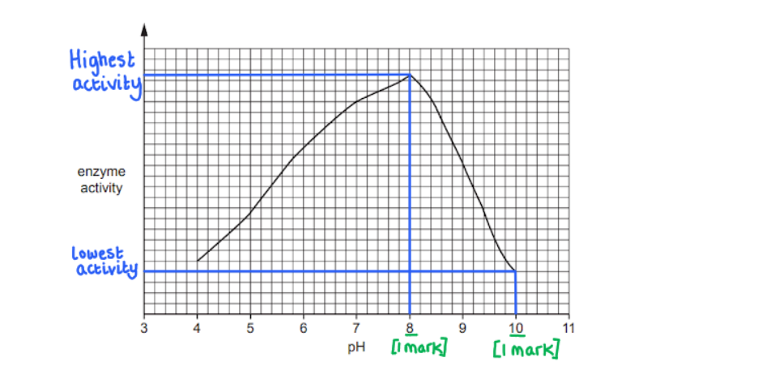

(iii)

- Temperature;  [1 mark]

*Accept other valid suggestions e.g. substrate concentration or enzyme concentration; [1 mark]*

### Q5
(i)

- Fungus/fungi; **[1 mark] **

(ii)

- Aerobic respiration;** [1 mark]**

Note that you need to identify aerobic respiration for the mark here, as anaerobic respiration does not take place inside mitochondria.

**[Total: 2 marks]**
Any two from:

- Sucrase enzymes are specific (to sucrose); **[1 mark]**
- The shape of the active site is complementary to the substrate/sucrose; **[1 mark]**
- The substrate/sucrose to binds to / fits with the enzyme/sucrase/active site; **[1 mark]**

Remember that active sites are **complementary** to their substrate, meaning that they have the opposite shape. Avoid stating that they have the same shape as each other.

**[Total: 2 marks]**
*Describe*

A maximum of four from:

- Sucrase / the enzyme is active between pH2 and pH12;** [1 mark]**
- Activity increases and then decreases / reaches a peak; **[1 mark]**
- Peak/maximum/100% activity occurs at pH 6; **[1 mark]**
- The steepest rate of increase is between pH 5–6 **OR** the steepest rate of decrease is between pH 9–10; **[1 mark]**
- Minimum/10% activity is at pH 12; **[1 mark]**
- More activity in acidic conditions/low pH  than in alkaline conditions/high pH; **[1 mark]**

*Explain*

- pH affects the shape of sucrase / the active site / the enzyme; **[1 mark]**
- At pH 6 most enzyme-substrate complexes form; **[1 mark]**
- At low / high / extremes of pH the enzyme is (partially) denatured; **[1 mark]**
- Substrate molecules can no longer bind with enzyme (due to shape change); **[1 mark]**

Note that you need to include both description and explanation here to gain full marks.

When describing data it is always a good idea to include numbers, e.g.  here you need to state the exact pH at which different events occur.

**[Total: 6 marks]**

### Q6
(i)

- Mouth; **[1 mark]**
- Small intestine;** [1 mark]**

Remember that the salivary amylase is denatured in the stomach acid and so no starch digestion takes place here. The salivary amylase is replaced with amylase from the pancreas as it enters the duodenum of the small intestine.

(ii) Any **three** from:

- (Enzyme has an) active site; [1 mark]
- Active site must be complementary shape to substrate / starch; [1 mark]
- To make enzyme-substrate complex / to allow substrate to bind to enzyme; [1 mark]
- (The active site) only fits one substrate / is specific to one substrate; [1 mark]

Remember that the shape of the active site is absolutely essential to its function. This is why the enzyme stops functioning when it is denatured and the shape changes.

**[Total: 5 marks]**

### Q7
(i)

- 32.5 (°C); **[1 mark]**

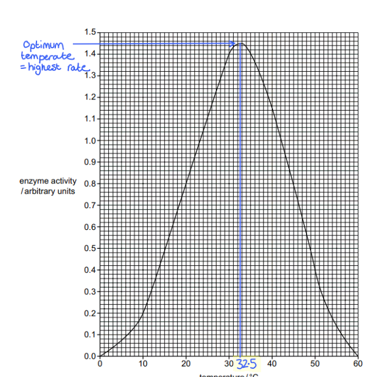

(ii)

- Enzymes denature; **[1 mark]**

**[Total: 2 marks]**
- pH; **[1 mark]**

You could also get the mark for saying enzyme concentration or substrate concentration.

**[Total: 1 mark]**

### Q8
The medicine is successful at treating liver cancer in people with the mutation because...

- Enzyme X no longer works / is not effective/active **and **enzyme Y is inhibited (by the gene mutation); **[1 mark]**
- Therefore the cancer cells cannot divide / are destroyed; **[1 mark]**
- So tumours (of the liver) cannot develop/get bigger/grow **OR **tumours (of the liver) are less likely to spread **OR **tumours (of the liver) are less likely to develop into secondary tumours; **[1 mark]**

**[Total: 3 marks]**

> *You do not need to know about cancer to answer this question, all the information is given to you in the information at the start of the question. Here you are applying your knowledge of enzymes to a new context.*
The medicine would not be effective in someone who does not have the genetic mutation because...

- Enzyme X would still be produced; **[1 mark]**
- Therefore the cells would still divide uncontrollably **OR **cancer cells would not be destroyed **OR **tumours could still develop; **[1 mark]**

**[Total: 2 marks]**
The action of the glutaminase on amino acids in cancerous liver cells is...

Any **four **from the following:

- Glutaminase has an active site that is <u>complementary</u> to the amino acid/substrate (in the cancer cells); **[1 mark]**
- Glutaminase and substrate/amino acid form an enzyme-substrate complex; **[1 mark]**
- Glutaminase catalyses the reaction ; **[1 mark]**
- Amino acid is no longer functional / cannot form proteins (for the cell); **[1 mark]**
- Cancer cells cannot continue growth; **[1 mark]**

**[Total: 4 marks]**

> *Here you are applying your knowledge of how enzymes work to a specific named enzyme. Don't be put off by this, all enzymes work in the same way. You can also pick up marks by bringing in your knowledge of proteins and their role for growth and repair and the impact this would have on a cancer cell if amino acids were no longer functional. Pretty cool cancer treatment by the humble enzyme!*

### Q9
(i) The temperature at which catalase is most active will be:

- 33 (°C); **[1 mark]**

*Values of 32 °C or 34 °C can also be accepted.*

(ii) There is no enzyme activity at 60°C because:

- (The) enzymes are destroyed / does not work / have become inactive / denatured; **[1 mark]**

*Reject any reference to enzymes being 'killed' or that they have 'died'.*

**[Total: 2 marks]**

> *For part (a)( i):*

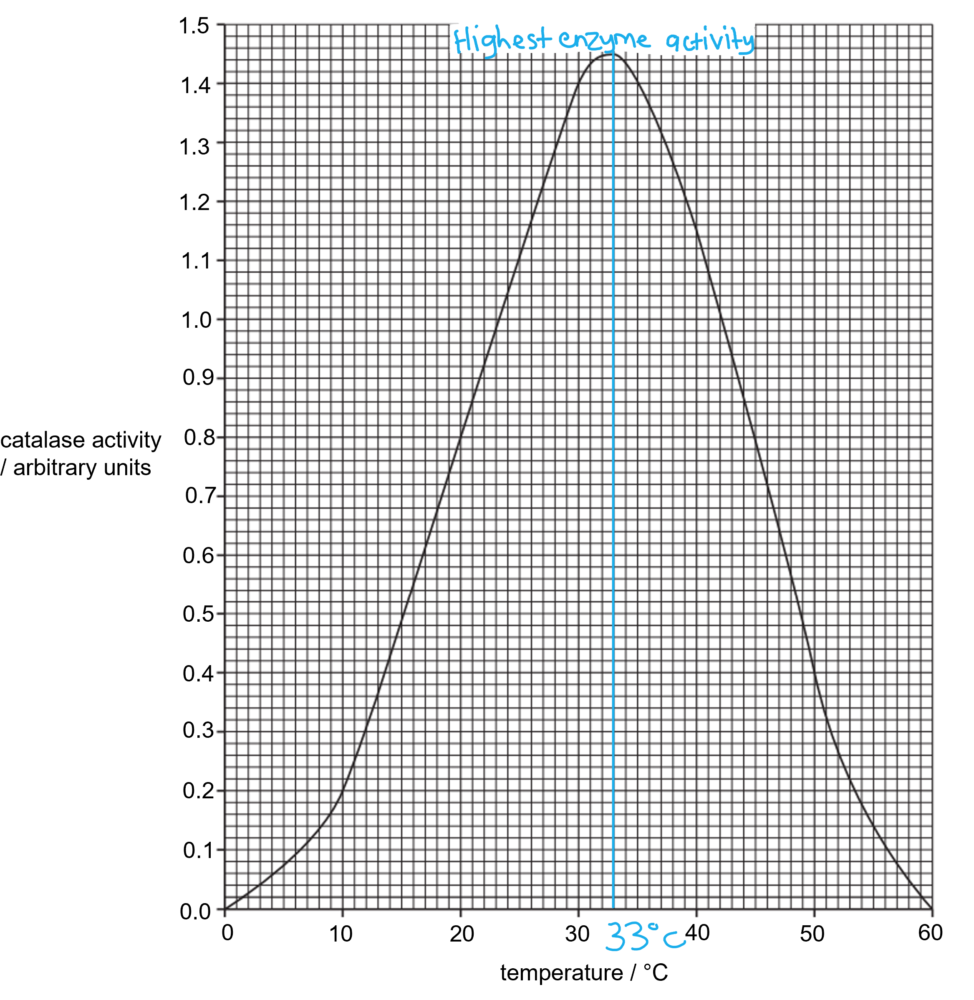
A factor other than temperature that will affect enzyme activity is:

Any **one** from the following:

- pH; **[1 mark]**
- Enzyme / substrate concentration; **[1 mark]**
- (Enzyme) inhibitors; **[1 mark]**

**[Total: 1 mark]**
The completed diagram:

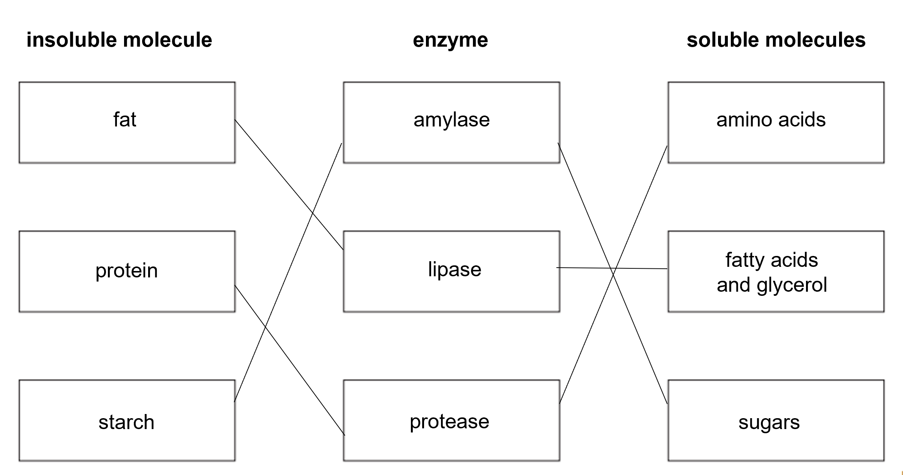

- 6 correct links; **[5 marks]**
- 4 or 5 correct links; **[4 marks]**
- 3 correct links; **[3 marks]**
- 2 correct links; **[2 marks]**
- 1 correct link; **[1 mark]**

**[Total: 5 marks]**

> *It is very important to ensure that you have a thorough knowledge of the digestive enzymes, the substrates that they work on and the products that form from the digestion of these substrate molecules.*

> *When drawing lines you **must **use a ruler to make your lines straight. If you draw wiggly lines that aren't clear, the examiner will give you zero marks. *
The optimum pH for gastric protease is...

- pH 2; **[1 mark]**

***Accept**** any pH value less than 7*

**[Total: 1 mark]**

### Q10
(i) The student used iodine because...

- Iodine reacts with starch **OR **iodine turns blue/black colour in presence of starch; **[1 mark]**
- Clearly visible when starch has been digested (by amylase) **OR **easy to tell when starch has been digested (by amylase); **[1 mark]**

(ii) The range of results for time in seconds is...

- 196 - 42 (seconds); **[1 mark]**
- 154 (seconds); **[1 mark]**

**[Total: 4 marks]**
(i) The pH tested that is the optimum for amylase is...

- pH 6; **[1 mark]**

(ii) The reason for this is...

- This is the quickest reaction **OR** amylase digested starch in the quickest time (at pH 6); **[1 mark]**

**[Total: 2 marks]**
The student concluded the optimum pH was not shown in the results because...

- The optimum could be between pH 6 and pH 8; **[1 mark]**
- **Because **these values had lower reaction times; **[1 mark]**
- **Because **it is impossible to tell where the optimum is without testing a smaller range of pH values **OR** pH values between 6 and 8 should be tested; **[1 mark]**

**[Total: 3 marks]**

### Q11
The following has happened to the enzyme...

- The active site has changed <u>shape</u>; **[1 mark]**
- It has been denatured; **[1 mark]**

**[Total: 2 marks]**
A sketch for the substrate is...

- Substrate drawn with complimentary shape to enzyme active site; **[1 mark]**

**[Total: 1 mark]**

> *You need to take note that the enzyme on the right in Fig. 1 has been denatured so you should be drawing a shape for the enzyme on the left in its optimum conditions.*

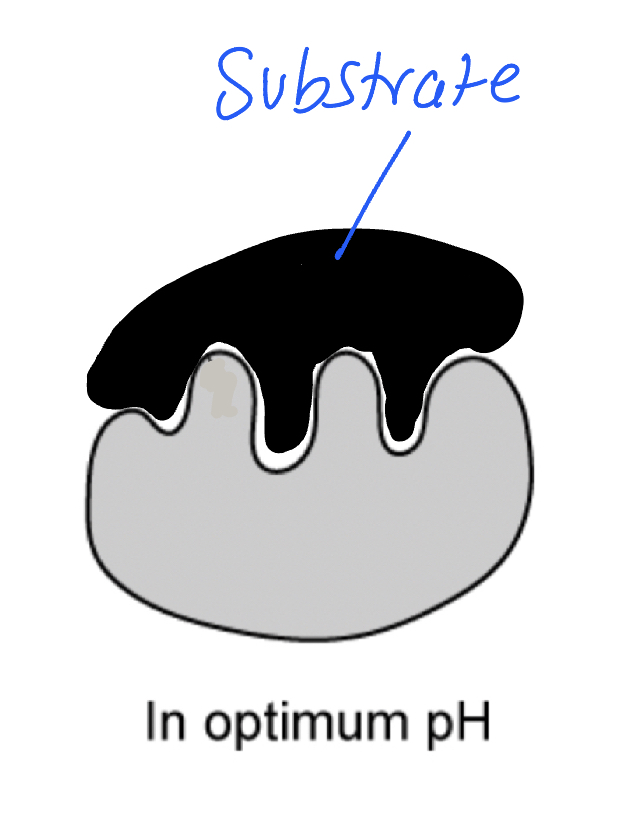
The optimum pH for the carrot seedlings is...

- pH 5; **[1 mark]**
- Because this had the highest percentage germination; **[1 mark]**

**[Total: 2 marks]**
The farmer's suggestion may be incorrect because...

Any **two** from the following:

- Radish (seedlings) will contain different enzymes (to carrot seedlings); **[1 mark]**
- Therefore radish (seedlings) will have a different optimum pH; **[1 mark]**
- Radish may be denatured at the optimum pH for carrot seedlings; **[1 mark]**

**[Total: 2 marks]**

### Q12
The student is incorrect because...

- Salivary amylase works best around pH 7/alkali /non-acidic conditions;** [1 mark]**
- The stomach is acidic / has low pH and would denature salivary amylase;** [1 mark]**
- Salivary amylase (the enzyme) would have to pass through the stomach (to get to the small intestine);** [1 mark]**

**[Total: 3 marks]**** **

> *You can achieve the third marking point by making a comparison between the values in** **Table 1 such as: at pH 3 (most similar to stomach acid pH) it took 38 mins for starch to be digested, **whereas **at pH 8 (most similar to the small intestine) it took only 8 minutes.*

> *The key point is you must use the data provided to you in the question.*

> *Take care in how you describe pH – an increase in acidity causes pH levels to fall. Any description of pancreatic amylase is not required here – you are asked to **use **the results from the experiment to explain why.*
According to the results, temperature affects digestion by...

Any **three** from the following:

- Below 40 °C an increase in temperature increases rate / speed of reaction;** [1 mark]**
- As temperature increases, the likelihood of a collision between starch molecules and amylase increases / molecules move faster; **[1 mark]**
- Optimum / best temperature for enzyme activity is 40 °C / in the range of 31 - 39 °C;** [1 mark]**
- Above 40 °C the rate of digestion / breakdown slows due to denaturation of enzyme/amylase; **[1 mark]**

**[Total: 3 marks]**

> *You must not use the word ‘killed’ when describing enzyme denaturation. You would achieve the fourth marking point if you described how the active site of amylase loses its complementary shape to starch at higher temperatures (but it is easier to state that the enzyme denatures). If you incorrectly stated that the enzyme is denatured at lower temperatures, you would not be awarded the fourth marking point.*
Digestion of food by enzymes in the intestine is not inhibited by the acid produced in the stomach because:

Any **two** from the following:

- Bile is produced in the liver (and released into the small intestine/duodenum); **[1 mark]**
- Stomach acid is neutralised by the alkaline bile;** [1 mark]**
- Pancreatic amylase is released into the duodenum/small intestine which has a neutral pH**; [1 mark]**
- Enzymes in the small intestine work more effectively / better or the optimum pH for enzymes in the small intestine is pH 7 / pH 8; **[1 mark]**

**[Total: 2 marks]**

> *This is a synoptic question relating to Topic 7 of your course, Chemical Digestion. *

> *The role of bile is often overlooked – make sure you understand that bile is alkaline and neutralises stomach acid. It also has a role in emulsifying fat – fat digestion begins in the small intestine (unlike protein digestion which begins in the stomach and carbohydrates in the mouth).*

### Q13
(i) The completed table is as follows:

| **enzyme** | **substrate** | **product(s)** |
|---|---|---|
| amylase | starch | glucose / maltose; **[1 mark]** |
| maltase | maltose | glucose; **[1 mark]** |
| protease | protein | amino acids; **[1 mark]** |

**One mark is awarded for each correct row of the table.**

(ii) The temperature of baby food must be controlled when the enzymes are added because:

Any **two **from the following:

- High temperatures denature enzymes / will change the shape of the (enzyme) active site; **[1 mark]**
- Low temperatures result in low energy / fewer collisions / slower reactions (between substrate and active site/enzymes); **[1 mark]**
- Enzymes work best / most efficient at optimum temperature; **[1 mark]**

(iii) One other condition that must also be controlled to optimise enzyme activity is:

Any **one **from the following:

- pH; **[1 mark]**
- Enzyme concentration; **[1 mark]**
- Substrate concentration; **[1 mark]**

**[Total: 6 marks]**

> *Part (i) is testing your knowledge on enzymes related to the digestive system from Topic 7.*

> *Remember that you must be specific when giving information about carbohydrates such as starch. You can't just say "carbohydrate" as your answer. *

> *Remember that enzymes are affected by low temperatures as well as high ones. *
The labels added to the graph are:

- Optimum labelled at the peak of the curve in line with 37°C; **[1 mark]**
- Denatured labelled anywhere from 40°C to where the curve stops at 52°C; **[1 mark]**

**[Total: 2 marks]**

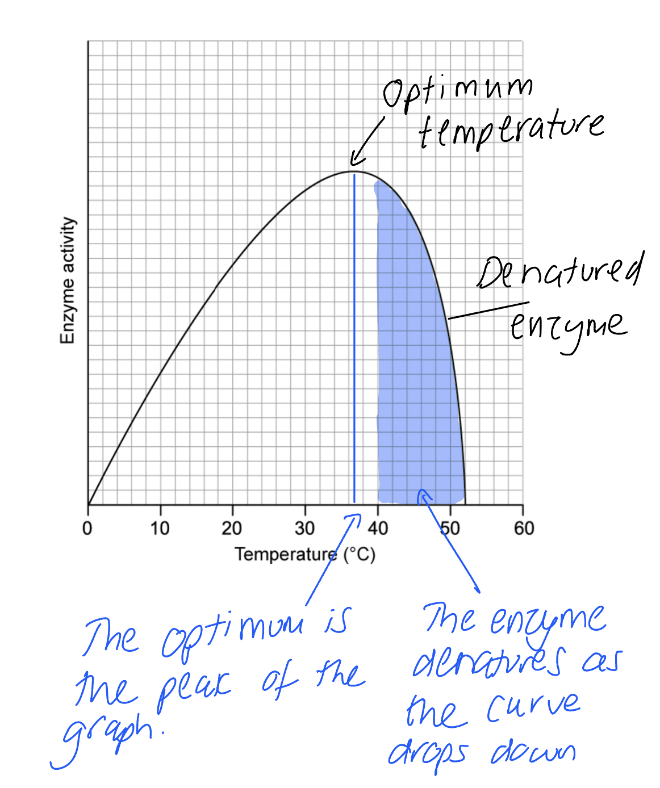
Baby food must be thrown away if heated above 37 oC because...

Any **two** from the following:

- Above 37 oC the enzymes (in the baby food) will <u>denature</u>; **[1 mark]**
- Denaturation is permanent/irreversible; **[1 mark]**
- The baby food will no longer contain enzymes that work; **[1 mark]**

**[Total: 2 marks]**
It is important to heat food to the correct temperature because...

Any **one** from the following:

- Kills (pathogenic) bacteria; **[1 mark]**
- To prevent spread of disease/pathogenic bacteria; **[1 mark]**
- To prevent contamination of food; **[1 mark]**

**[Total: 1 mark]**

> *This is a synoptic question applying knowledge from Topic 10 of your course. *

### Q14
The enzyme responsible for this reaction is:

- C; **[1 mark]**

**[Total: 1 mark]**

> *Here the reactants have to fit perfectly into the groove of the enzyme called the active site. *
If a substrate with a shape that is not complementary to the enzyme tries to enter the active site...

- The substrate is not able to bind efficiently to the enzyme/active site; **[1 mark]**
- No reaction is catalysed/proceeds/occurs; **[1 mark]**

**[Total: 2 marks]**
The completed graph and line of best fit is...

- **All** points plotted correctly to +/- 0.5 small square; **[1 mark]**
- A line showing a steady increase that levels off at 30au/40g; **[1 mark]**

***Accept**** dot-to-dot line*

**[Total: 2 marks]**

> *Make sure you finish off your answer by drawing a line to get full marks.*

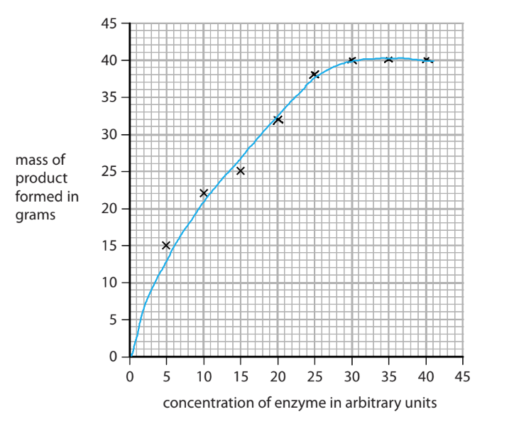
The effect that enzyme concentration has on the mass of product formed is...

Any **two** from the following:

- The mass of product formed increases as enzyme concentration increases; **[1 mark]**
- Then (the mass of product formed) remains the same / then levels off; **[1 mark]**
- 30 au/40 g is point where mass of product remains the same; **[1 mark]**

**[Total: 2 marks]**

> *Always look at the number of marks available for a question and give a full description of the trend shown by a graph. There is no need to provide any reasons behind the trend as this question only asks you to describe.*

### Q15
(i) The optimum temperature is...

- 32.5 (°C); **[1 mark]**

*Accept answers within the range 32-34 (°C)*

(ii) There is no enzyme activity at 60°C because...

- The enzymes have become denatured; **[1 mark]**

**[Total: 2 marks]**

> *High temperatures disturb the structure of the enzymes resulting in a misshapen active site, which can no longer form an enzyme-substrate complex.*
Another factor which affects enzyme activity is:

Any **one **from the following:

- pH; **[1 mark]**

*Also accept enzyme concentration ****OR**** substrate concentration.*

**[Total: 1 mark]**

> *Note that knowledge of how enzyme concentration and substrate concentration affect enzyme activity are not required for the specification but are also relevant.*
The table should be completed as follows:

| Insoluble molecule | Enzyme | Soluble molecules |
|---|---|---|
| starch | amylase | reducing sugars |
| fat | lipase; **[1 mark]** | fatty acids; **[1 mark]**  glycerol; **[1 mark]** |
| protein; **[1 mark]** | protease | amino acids; **[1 mark]** |

**[Total: 5 marks]**
The chemical elements present are:

- Carbon, hydrogen and oxygen; **[1 mark]**

*All three elements are required to obtain the mark.*

**[Total: 1 mark]**

> *Although this question is not about enzymes, in this past paper question you can see how examiners will link topics together within a question. *
Protease is secreted from the:

Any **one **from the following:

- Pancreas; **[1 mark]**
- Stomach; **[1 mark]**
- Small intestine; **[1 mark]**

**[Total: 1 mark]**

> *Protease is a category of enzyme so there are several different types released at different points throughout the digestive system to ensure efficient break down of proteins. *

### Q16
It is better to use a gas syringe because...

- (It allows for) more accurate/precise measurement (of the volume/amount of gas); **[1 mark]**

***Allow**** 'gas could dissolve in water / less gas can escape'* ***Ignore**** 'gives exact measurement of gas release'*

**[Total: 1 mark]**

> *The volume of carbon dioxide released would be small so the graduations on a measuring cylinder would be more appropriate for collecting large volumes of gas. A gas syringe would allow for more precise measurements due to the smaller intervals between markings.*
(i) The mean rate of gas produced at 25°C can be calculated as follows...

- (25 + 22 + 24) ÷ 3 = 23.67.; **[1 mark]**
- 23.67. ÷ 15 = 1.58; **[1 mark]**
- =1.6 (cm3/min);** [1 mark]**

*Full marks awarded for the correct answer in the absence of other calculations* ***Award*** **[1 mark]** *for rounding incorrect answer to one decimal place*

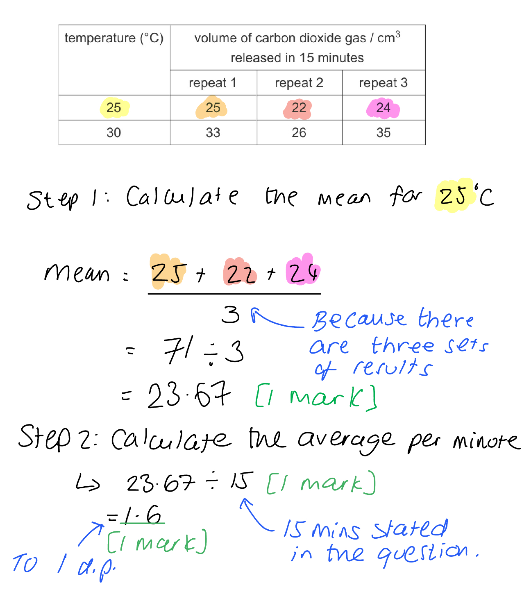

> *Be sure to read the question carefully. The data in the table is the volume of gas produced per 10 minutes, whereas you are asked to calculate the rate of gas produced **per minute**. *

(ii) The rate of gas produced is greater at 30°C because...

- (This is due to) increased movement of molecules / increased kinetic energy; **[1 mark]**
- Therefore, there is more chance of substrate colliding with enzymes/active sites; **[1 mark]**
- (And) more chance of substrate entering active site **OR** more enzyme-substrate complexes forming; **[1 mark]**

***Award*** **[2 marks] ***for 'increased kinetic energy of enzymes and substrates leads to more collisions'*

(iii) The teacher suggested to repeat the results for 30°C because...

- There is an anomalous result/outlier for repeat 2 **OR **26 cm3 is anomalous/an outlier; **[1 mark]**

**[Total: 7 marks]**
Phenols inhibit enzymes in the following way...

- (Phenols) alter the shape of the active site/enzyme **OR** phenols block the active site/enzyme; **[1 mark]**
- So the substrate no longer fits/binds with the active site/enzyme; **[1 mark]**

***Ignore**** references to denaturing*

**[Total: 2 marks]**

> *An enzyme will be inhibited when the active site is no longer able to bind to the substrate. This can occur when the shape of the active site changes (in this case when phenol binds to a different part of the enzyme) or when the active site is blocked (when phenol binds to it instead of the substrate). No enzyme-substrate complexes can form and no products will be produced.*

### Q17
The advantages of using this method rather than the method used by the students is...

Any **two** of the following:

- (A colorimeter is) more accurate / the result will be closer to the true value; **[1 mark]**
- Colorimetry gives results that are quantitative (rather than qualitative) / can be plotted on a graph / analysed using statistical analysis; **[1 mark]**
- The results are less/not subjective / not subject to (student) opinion;** [1 mark]**

***Accept ****converse answers relating to colour observation.*

**[Total: 2 marks]**

> *This is a **suggest** question, meaning that you need to **apply your knowledge** of good practical procedures to the example provided. When measuring results during an investigation it is always preferable to use a method that will give accurate results that are not subject to opinion. It can also be an advantage to gain quantitative results as they can be analysed more thoroughly.*
The final concentration of protein in this solution after 20 seconds was...

- 0.5 (%); **[1 mark]**

**[Total: 1 mark]**

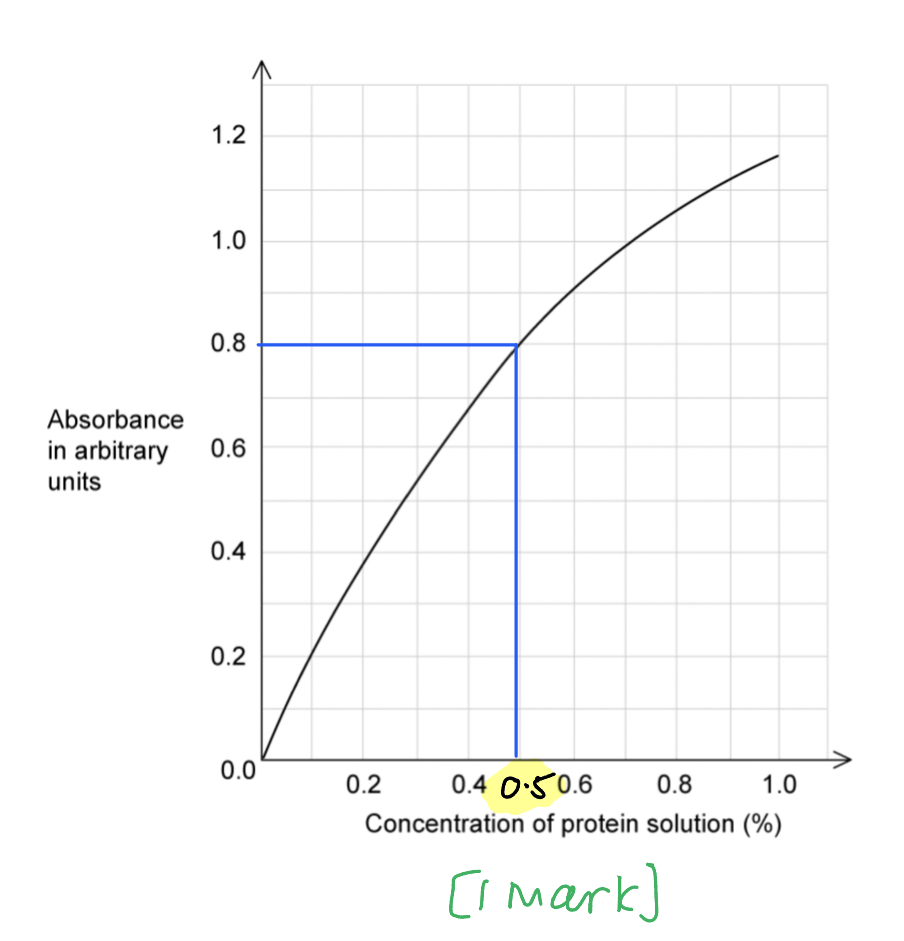
The concentration of protein in the solution at 10 °C after 1 minute is different from the concentration at 30 °C after 1 minute because...

- Protein is broken down less quickly at 10 °C / more quickly at 30 °C; **[1 mark]**
- At 10 °C molecules (substrate / enzymes) have less kinetic energy than 30 °C; **[1 mark]**

**[Total: 2 marks]**
The absorbance was measured at approximately 1.14 arbitrary units because...

- At 80 °C the enzyme / protease has denatured; **[1 mark]**
- So protein is not broken down (at all) / the concentration would remain 1%; **[1 mark]**

**[Total: 2 marks]**

> *The key to answering this question is an understanding that the protease is a protein so would have denatured at such high temperatures. Therefore there will be no enzyme activity and the protein in the solution won't be digested, thus the absorbance will be the same before and after the experiment. In reality there may be a small change in absorbance as denatured proteins may absorb light differently*

### Q18
The completed sentences are:

**One** mark for each correct answer:

- All enzymes are proteins. Proteins are made of **amino acids.**; **[1 mark]**
- An enzyme acts as a **biological** catalyst.; **[1 mark]**
- In order to work rapidly, enzymes need the correct **temperature** and pH.; **[1 mark]**
- An example of an enzyme that works in acidic conditions in the stomach is **protease/pepsin/trypsin**.; **[1 mark]**
- Acidic conditions will kill many of the **bacteria** present in food.; **[1 mark]**
- Salivary **amylase** stops working in acidic conditions.; **[1 mark]**
- Fats are broken down by **lipase**.; **[1 mark]**

**[Total: 7 marks]**

> *You need to draw upon your knowledge of digestive enzymes here, a common skill when answering questions about enzymes. *
The keywords and their definitions are...

**[1 mark]** for each correct definition

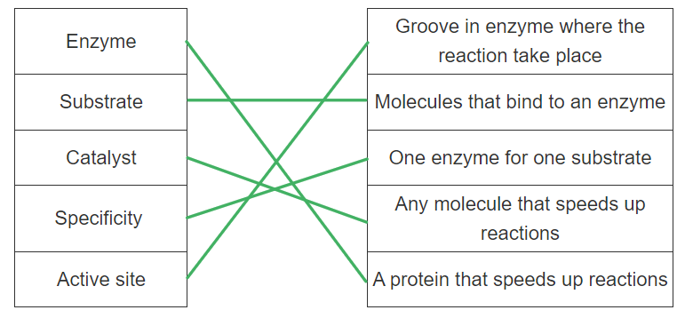

**[Total: 5 marks]**

> *It is very important not to confuse the terms 'enzyme' and 'substrate' with 'active site'.*
An enzyme-substrate complex is...

- (When) the substrate moves into / binds with the enzyme’s active site; **[1 mark]**

**[Total: 1 mark]**

### Q19
Stains on clothes that are washed at temperatures above 45 °C are not always removed because...

- Active site / shape (of enzymes) is changed / destroyed (above 45 °C); **[1 mark]**
- Therefore the enzyme no longer fits / binds to substrates (of the stain); **[1 mark]**

**[Total: 2 marks]**

> *Make sure you use the word denature and do not write "killed" as this is not biologically correct and you will lose marks. *
It is expected that by using the washing powder he user can the user can increase the cleaning performance of their laundry cycle because...

Any **two** from the following:

- Clothes can be washed at a higher temperature / up to 80 °C; **[1 mark]**
- Therefore enzyme action will be quicker **OR** enzymes have greater kinetic energy and so collide (with substrate/stains) more; **[1 mark]**
- Because the enzymes are not destroyed at high temperature / 80 °C; **[1 mark]**

**[Total: 2 marks]**
A comparison of the washing powders is...

- Washing powder A removed highest percentage/95% of stains in 20 minutes **whereas** washing powder B removes highest percentage/95% after 30 minutes; **[1 mark]**
- Washing powder B removes great<u>er</u> percentage of stains than washing powder A up until 18 (±1) minutes; **[1 mark]**
- After 20 minutes washing powder A effectiveness decreases **whereas** washing powder B effectiveness increases; **[1 mark]**
- <u>Both</u> (washing powders) are able to remove 95% of stains; **[1 mark]**

**[Total: 4 marks]**

> *You are asked to compare the results so you do not need to explain why the results occur or what they mean. You do need to ensure you are using comparative words such as whereas / great**er **/ small**er** etc. *
An evaluation of the scientist's claim is:

Any **three **from the following:

- It is unclear which washing powder the claim is referring to; **[1 mark]**
- Washing powder B does remove 95% of stains in 30 minutes **whereas **washing powder A decreases stain removal / is less effective after 20 minutes; **[1 mark]**
- It is unclear what type of stain was treated **OR **only tested on stain produced in the lab/by scientists; **[1 mark]**
- The washing powder was only tested on cotton cloth; **[1 mark]**
- No statistical analysis has been carried out; **[1 mark]**
- Washing powders have only been tested once **OR **only one trial carried out; **[1 mark]**

**[Total: 3 marks]**

> *In an evaluate question it is important to consider all the information provided in the question and address each point clearly. *

### Q20
The importance of enzyme specificity in the digestion of food is...

Any **four **from the following:

- Enzymes are proteins and have a specific 3D shape; **[1 mark]**
- Enzymes have a specific shaped <u>active site</u>; **[1 mark]**
- The active site is complementary to the substrate/food molecule; **[1 mark]**
- Enzyme forms an enzyme-substrate complex with the substrate; **[1 mark]**
- Products of enzyme digestion/activity are absorbed through the small intestine; **[1 mark]**
- If the enzyme does not form an enzyme substrate complex there are no products of digestion (to be absorbed); **[1 mark]**
- This could lead to malnutrition/weight loss; **[1 mark]**

**[Total: 4 marks]**
Pancreatic cancer may lead to weight loss because...

Any **four **from the following:

- Reduced / no enzyme production / release (from pancreas); **[1 mark]**
- Therefore food is not broken down fully **OR **food is not digested fully; **[1 mark]**

**Any pair of the following for** **[2 marks]**

- Fewer amino acids absorbed **OR **fewer amino acids pass into the blood(stream); **[1 mark]**
- Therefore fewer amino acids are available for making new protein for repair / replacement / growth; **[1 mark]**

**OR**

- Less glucose / sugar absorbed **OR **less glucose / sugar passes into the blood(stream); **[1 mark]**
- Therefore less glucose available for respiration so more (body / stored) fat is used up in metabolism/respiration; **[1 mark]**

**OR**

- Fewer fatty acids absorbed **or** fewer fatty acids pass into the blood(stream); **[1 mark]**
- Therefore fewer fatty acids available so less fat is stored in the body; **[1 mark]**

***Allow ****named examples of enzymes throughout*

**[Total: 4 marks]**

> *This is a synoptic question relating to Topic 7 of your course. You also have to apply your knowledge to a novel context here, being that of cancer and weight loss. The question specifically asks your answer to refer to enzymes so you will not get marks for discussing other factors that may lead to weight loss such as the effects of chemotherapy or hormones produced by the pancreas. *
A comparison of the activity and nature of antibodies with those of enzymes is...

Any **three** from the following:

- **Both** carry out complementary binding to another molecule; **[1 mark]**
- **Both **have specificity for one particular molecule; **[1 mark]**
- **Both** are made of proteins; **[1 mark]**
- **Both** can be recycled / used again; **[1 mark]**
- Antibodies bind to antigens **whereas** enzymes bind to substrates; **[1 mark]**
- The idea that enzymes speed up reactions/used in metabolic processes **whereas** antibodies are used in immune response; **[1 mark]**

**[Total: 3 marks]**

> *This is a synoptic question referring to Topic 10 of your course. It is important in a comparison question to cover both aspects of content asked for in the question. *

### Q21
The conclusion that can be drawn about the function of enzymes is...

- Enzymes can break down/degrade molecules; **[1 mark]**
- Enzymes can build-up/synthesise molecules;** [1 mark]**

**[Total: 2 marks]**

> *It is important to remember that enzymes can either put substrates together to build up molecules (anabolism) or they can break down substrates to break molecules into smaller/simpler molecules (catabolism). You would not be awarded any marks if you had just said that enzymes can make DNA or nucleotides, this was just used as an example.*
The mean result for pH 3.5 is...

- Disregard the anomalous result of 26; **[1 mark]**
- (15 + 16 + 14 + 17) ÷ 4 = 15.5 ; **[1 mark]**
- Rounding to whole number = 16; **[1 mark]**

**[Total: 3 marks]**

*You need to look carefully at the data and notice the anomalous result. This should be removed from your calculation. In practise this trial should be taken again and a new result recorded. It is also important to note the values used in the table - no decimals have been used so your answer should follow suit. A tip is to look at the number of marks available here, you should notice that for ***[3 marks]*** this is more than simply a calculate-the-mean question. *

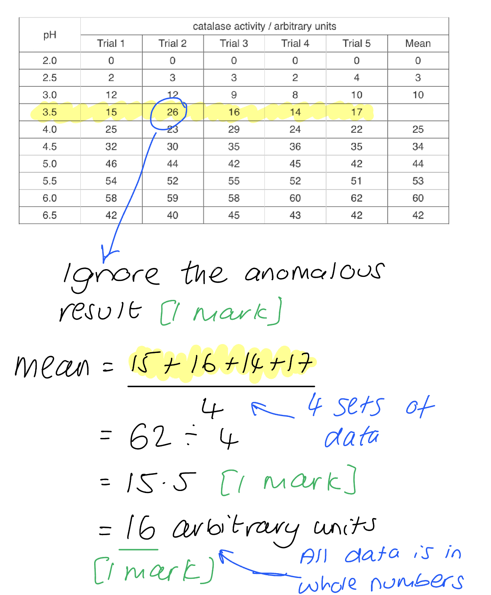
A graph of the scientist's results is...

- Axis labelled: x axis = pH, y axis = mean catalase activity in arbitrary units; **[1 mark]**
- Scale takes up more than half the grid; **[1 mark]**
- Points plotted correctly +/- 1mm error; **[1 mark]**
- Line of best fit drawn; **[1 mark]**

**[Total: 4 marks]**

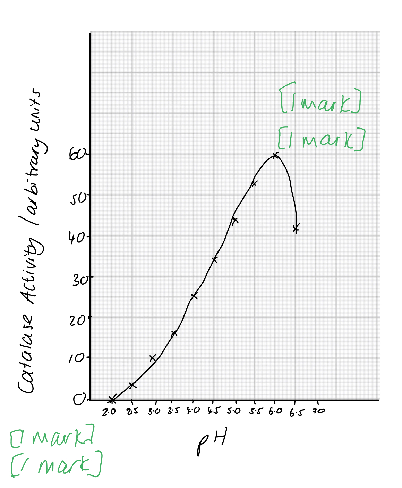
(i)  The results show that...

Any **three **of the following from:

- As pH increases the catalase/enzyme activity increases until pH 6; **[1 mark]**
- After pH 6 the catalase/enzyme activity decreases; **[1 mark]**
- The optimum pH is pH 6 **OR **the highest enzyme activity is at pH 6; **[1 mark]**
- There is no catalase/enzyme activity at pH 2; **[1 mark]**

(ii) A prediction of the catalase activity at pH 7 is...

- A value less than 42 (arbitrary units); **[1 mark]**

(iii) The is no catalase activity at pH 2 because...

- Catalase/the enzyme has been denatured **OR **the active site had changed <u>shape</u>; **[1 mark]**

**[Total: 5 marks]**

### Q22
The enzyme molecule on the figure is:

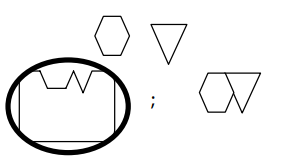

**[Total: 1 mark]**

> *You can tell this is the enzyme because it has indents to show the active site.  The indents are the same shape as the smaller molecules (the substrates) so they fit together like the pieces of a jigsaw puzzle. *
(i) The term catalyst means:

- (A substance that) speeds up / increases the rate of a chemical reaction; **[1 mark]**
- (But) is not changed/used up by the reaction; **[1 mark]**

(ii) Enzymes are important organisms because:

- Without enzymes, reactions would be too slow to sustain life; **[1 mark]**

**[Total: 3 marks]**
The enzyme-substrate complex on the diagram is...

- Correctly positioned and labelled enzyme-substrate complex; **[1 mark]**

**[Total: 1 mark]**

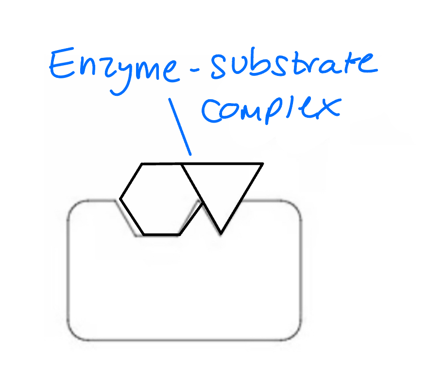
The action of enzymes is...

- Correct sentence including the word collide; **[1 mark]**
- Correct sentence including the word randomly; **[1 mark]**
- Correct sentence including the word complementary; **[1 mark]**
- Correct sentence including the word recycled; **[1 mark]**

**[Total: 4 marks]**

> *An example description is:*

> *Enzymes and substrates move about **randomly**.*

> *The enzyme has an active site with **complementary** shape the substrates.*

> *Enzymes and substrates **collide **and form an enzyme-substrate complex.*

> *The products leave and the enzyme is free to be **recycled**. *
