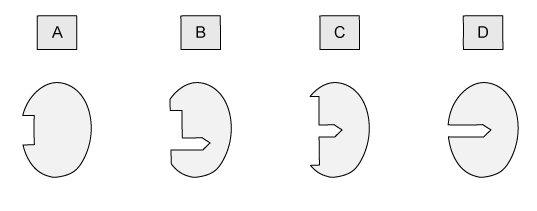
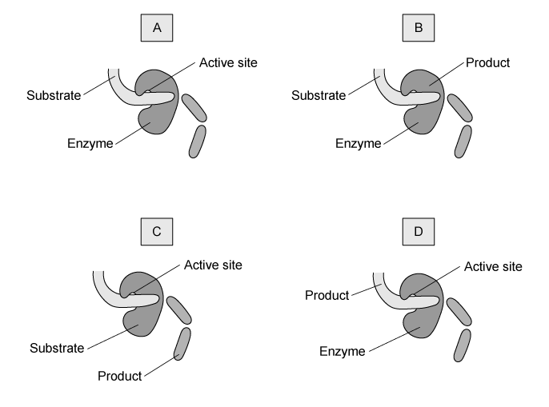

# Exam Questions — Enzymes
**5. Enzymes** · Cambridge (CIE) IGCSE biology (0610 & 0970)
> Source: [https://www.savemyexams.com/igcse/biology/cie/23/topic-questions/](https://www.savemyexams.com/igcse/biology/cie/23/topic-questions/) · 25 questions across 1 sets

## Multiple Choice Questions (25 questions)

### Q1 — hard — 1 marks

**Q1** [1 mark]

A student heats an amylase solution to 80 °C for 10 minutes, then cools it back to 25 °C before adding starch.

The reaction rate stays very low.

What is the best explanation for this?

### Q2 — easy — 1 marks

**Q2** [1 mark]

Why are enzymes said to be specific?

### Q3 — medium — 1 marks

**Q3** [1 mark]

Sucrase is an enzyme that catalyses the breakdown of the sugar sucrose, but that is unable to break down another sugar, lactose.

Which of the following correctly explains why sucrase cannot catalyse the breakdown of lactose.

### Q4 — medium — 1 marks

**Q4** [1 mark]

An enzyme-controlled reaction takes place in a test tube.

During the reaction the contents of the test tube include: water, dietary protein, protease, amino acids and hydrochloric acid.

The graph below shows the progress of the reaction.

Which component of the test tube contents is represented on the Y axis in the graph above?

### Q5 — easy — 1 marks

**Q5** [1 mark]

Which statement describes the effect of temperature on enzymes?

*Source: june 2022 paper 2 Q10*

### Q6 — easy — 1 marks

**Q6** [1 mark]

Some terms used to describe enzyme-controlled reactions are listed.

1    catalyst

2    product

3    protein

4    substrate

Which terms describe an enzyme?

*Source: June 2022 paper 1 Q10*

### Q7 — easy — 1 marks

**Q7** [1 mark]

Which statement describes a catalyst?

*Source: June 2021 0970/11 Q11*

### Q8 — medium — 1 marks

**Q8** [1 mark]

Starch is digested by amylase in the mouth, but it is not digested in the stomach.

What is the reason for this?

*Source: June 2021 0970/11 Q10*

### Q9 — easy — 1 marks

**Q9** [1 mark]

A student wrote some notes about enzymes.

She wrote:

‘The …1… of an enzyme is …2… to an area on the substrate.

This area on the substrate can fit into it to form an …3… complex’.

Which words correctly complete gaps 1, 2 and 3?

|   | 1 | 2 | 3 |
|---|---|---|---|
| **A** | active site | complementary | enzyme-substrate |
| **B** | active site | similar | enzyme-product |
| **C** | shape | complementary | enzyme-product |
| **D** | shape | similar | enzyme-substrate |

*Source: Specimen 2023 0970/02 Q10*

### Q10 — easy — 1 marks

**Q10** [1 mark]

The diagrams show a protease enzyme catalysing the breaking of part of a protein molecule into smaller pieces.

Which diagram has three correct labels?

*Source: Specimen 2023 0970/01 Q10*

### Q11 — easy — 1 marks

**Q11** [1 mark]

What is the name for the group of compounds that ensures metabolic reactions take place in living organisms at a speed necessary to sustain life?

### Q12 — hard — 1 marks

**Q12** [1 mark]

#### Extended

The action of an enzyme in a chemical reaction is outlined in the diagram below.

Which row of the table below is correct?

| ** ** | product | enzyme | enzyme-substrate complex |
|---|---|---|---|
| **A** | E | H | G |
| **B** | E | G | F |
| **C** | H | G | F |
| **D** | H | F | G |

### Q13 — medium — 1 marks

**Q13** [1 mark]

#### Extended

Temperature affects the rate of all enzyme-controlled reactions, as shown in the graph below.

Which row correctly describes what is happening at the points on the graph?

| ** ** | X | Y |
|---|---|---|
| **A** | the enzyme has been denatured | the rate of reaction is decreasing |
| **B** | the rate of reaction is increasing | the enzyme is becoming denatured |
| **C** | the reaction is taking less time | the rate of reaction is increasing |
| **D** | the rate of reaction is decreasing | the enzyme is becoming denatured |

### Q14 — easy — 1 marks

**Q14** [1 mark]

The effect of pH on the rate of reaction of three different enzymes is shown in the graph below.

What does the graph show?

### Q15 — medium — 1 marks

**Q15** [1 mark]

#### Extended

The pH of an enzyme controlled reaction is decreased by a pH of 2.

How does this affect the rate of the reaction?

### Q16 — hard — 1 marks

**Q16** [1 mark]

The image below represents a chemical reaction.

Which of the following best represents the enzyme responsible for catalysing this reaction?

### Q17 — easy — 1 marks

**Q17** [1 mark]

What is a feature of all catalysts?

### Q18 — medium — 1 marks

**Q18** [1 mark]

#### Extended

Which of the following correctly describes the effect of increasing temperature from 15°C to 30°C on an enzyme-controlled reaction?

| ** ** | kinetic energy of enzymes and substrates | frequency of effective collisions | shape of active site |
|---|---|---|---|
| **A** | no change | decreases | denatured |
| **B** | increases | increases | denatured |
| **C** | increases | increases | no change |
| **D** | decreases | no change | no change |

### Q19 — hard — 1 marks

**Q19** [1 mark]

Liver cells produce an enzyme called catalase which breaks down toxic hydrogen peroxide into water and oxygen.

A student set up an experiment where cubes of cows' liver in a test tube were incubated with hydrogen peroxide at different temperatures.

The student counted the number of bubbles of oxygen released per minute at each temperature.

Their results are shown in the table below:

| temperature / oC | 10 | 20 | 30 | 40 | 50 |
|---|---|---|---|---|---|
| number of bubbles / minute | 35 | 68 | 79 | 63 | 5 |

The results suggest that the optimum temperature for catalase is between which two values?

### Q20 — hard — 1 marks

**Q20** [1 mark]

Starch is digested by the enzyme amylase. Four identical mixtures of starch and amylase were kept at different temperatures.

The graph below shows the time taken for the starch to be digested at each temperature.

At which temperature is the rate of reaction highest?

### Q21 — easy — 1 marks

**Q21** [1 mark]

What can be said to be true of all enzymes?

| ** ** | their optimum pH is 7 | they are made from amino acids | they move about randomly in a fluid |
|---|---|---|---|
| **A** | **X** | **X** | **X** |
| **B** | **X** | ✔ | ✔ |
| **C** | ✔ | **X** | ✔ |
| **D** | ✔ | ✔ | **X** |

### Q22 — easy — 1 marks

**Q22** [1 mark]

Which of the following best describes what an enzyme is?

### Q23 — medium — 1 marks

**Q23** [1 mark]

A student decided to investigate the effect of pH on the activity of the enzyme lipase.

Five different test tubes are set up. Each test tube contains a mixture of the enzyme lipase and its substrate, a lipid.

Which condition should not be kept the same in each of the five test tubes?

### Q24 — hard — 1 marks

**Q24** [1 mark]

#### Extended

The diagrams below show an amylase enzyme catalysing the breakdown of part of a starch molecule into smaller molecules of maltose.

Which diagram has three correct labels?

### Q25 — medium — 1 marks

**Q25** [1 mark]

Which graph in the image below shows the correct effect of temperature on the activity of an enzyme?

