# Exam Questions — Enzymes
**5. Enzymes** · Cambridge (CIE) IGCSE biology (0610 & 0970)
> Source: [https://www.savemyexams.com/igcse/biology/cie/23/topic-questions/](https://www.savemyexams.com/igcse/biology/cie/23/topic-questions/) · 54 questions across 3 sets

## Alternative To Practical Questions (7 questions)

### Q1 — medium — 24 marks

**Q1** [1 mark]

A student investigated the effect of pH on the activity of the enzyme amylase. Amylase breaks down starch into maltose. The student used the following method:

- **Step 1:** set up four test-tubes, each containing the same volume of starch solution and amylase
- **Step 2:** add a different pH buffer solution to each test-tube
- **Step 3:** place all four test-tubes in a water-bath
- **Step 4:** every 30 seconds, remove a drop of the mixture from each test-tube and add it to a drop of iodine solution on a spotting tile
- **Step 5:** record the time taken for the iodine solution to remain yellow-brown (i.e. the point at which no colour change occurs)

**Fig. 1** shows the thermometer reading from the water bath at the start of the experiment.

**Fig. 1**

Record the temperature shown in **Fig. 1.**

**Q1** [3 marks]

**Extract:**

A student investigated the effect of pH on the activity of the enzyme amylase. Amylase breaks down starch into maltose. The student used the following method: 

- **Step 1:** Set up four test-tubes, each containing the same volume of starch solution and amylase.
- **Step 2:** Add a different pH buffer solution to each test-tube.
- **Step 3:** Place all four test-tubes in a water-bath.
- **Step 4:** Every 30 seconds, remove a drop of the mixture from each test-tube and add it to a drop of iodine solution on a spotting tile.
- **Step 5:** Record the time taken for the iodine solution to remain yellow-brown.

**Fig. 1.1** shows the thermometer reading from the water bath at the start of the experiment.

Record the temperature shown in **Fig. 1.1**.

The student recorded the following results in their notebook:

*pH 4 — starch broken down after 740 s*

*pH 5 — starch broken down after 480 s*

*pH 6 — starch broken down after 210 s*

*pH 7 — starch broken down after 150 s*

*pH 8 — starch broken down after 390 s*

Draw a table and record all the results above. The table should also make reference to your answer to (a).

**Q1** [5 marks]

**Extract:**

The student recorded the following results in their notebook:

*pH 5 — starch broken down after 480 s* 

*pH 6 — starch broken down after 210 s* 

*pH 7 — starch broken down after 150 s* 

*pH 8 — starch broken down after 390 s*

Plot a line graph of time taken to break down starch against pH. Sketch a smooth curve of best fit.

**Q1** [1 mark]

**Extract:**

The student recorded the following results in their notebook:

*pH 5 — starch broken down after 480 s* 

*pH 6 — starch broken down after 210 s* 

*pH 7 — starch broken down after 150 s* 

*pH 8 — starch broken down after 390 s*

Plot a line graph of time taken to break down starch against pH. Draw a smooth curve of best fit.

Using your graph, determine the time taken to break down starch at pH 6.5.

**Q1** [2 marks]

**Extract:**

The student recorded the following results in their notebook:

*pH 5 — starch broken down after 480 s* 

*pH 6 — starch broken down after 210 s* 

*pH 7 — starch broken down after 150 s* 

*pH 8 — starch broken down after 390 s*

Plot a line graph of time taken to break down starch against pH. Draw a smooth curve of best fit.

Describe the trend shown in your graph.

**Q1** [2 marks]

**Extract:**

A student investigated the effect of pH on the activity of the enzyme amylase. Amylase breaks down starch into maltose. The student used the following method:

- **Step 1:** Set up four test-tubes, each containing the same volume of starch solution and amylase.
- **Step 2:** Add a different pH buffer solution to each test-tube.
- **Step 3:** Place all four test-tubes in a water-bath.
- **Step 4:** Every 30 seconds, remove a drop of the mixture from each test-tube and add it to a drop of iodine solution on a spotting tile.
- **Step 5:** Record the time taken for the iodine solution to remain yellow-brown.

State two variables that were kept constant during this investigation.

**Q1** [2 marks]

**Extract:**

A student investigated the effect of pH on the activity of the enzyme amylase. Amylase breaks down starch into maltose. The student used the following method:

- **Step 1:** Set up four test-tubes, each containing the same volume of starch solution and amylase.
- **Step 2:** Add a different pH buffer solution to each test-tube.
- **Step 3:** Place all four test-tubes in a water-bath.
- **Step 4:** Every 30 seconds, remove a drop of the mixture from each test-tube and add it to a drop of iodine solution on a spotting tile.
- **Step 5:** Record the time taken for the iodine solution to remain yellow-brown.

Suggest **one **source of error in determining the end point of starch breakdown, and suggest an improvement to reduce this error.

**Q1** [1 mark]

**Extract:**

A student investigated the effect of pH on the activity of the enzyme amylase. Amylase breaks down starch into maltose. The student used the following method: 

- **Step 1:** Set up four test-tubes, each containing the same volume of starch solution and amylase.
- **Step 2:** Add a different pH buffer solution to each test-tube.
- **Step 3:** Place all four test-tubes in a water-bath.
- **Step 4:** Every 30 seconds, remove a drop of the mixture from each test-tube and add it to a drop of iodine solution on a spotting tile.
- **Step 5:** Record the time taken for the iodine solution to remain yellow-brown.

Identify **one **hazard in this investigation and state how the risk could be reduced.

**Q1** [1 mark]

The student only carried out the investigation once at each pH. Explain why it is important to repeat the investigation.

**Q1** [6 marks]

Plan an investigation to find out how temperature affects the rate at which amylase breaks down starch.

Your answer should include the independent and dependent variables, control variables, a step-by-step method, and how you would record and present your results.

### Q2 — medium — 20 marks

**Q2** [8 marks]

Rice contains starch. Amylase is an enzyme that catalyses the breakdown of starch to form reducing sugars. A student investigated the effect of amylase on cooked rice. The student used this method:

Step 1   Two small beakers were prepared; each beaker contained 20g of                           cooked white rice. One beaker was labelled** W** and one beaker was                      labelled **A. **

Step 2   Both of the beakers were put into a 40°C water-bath.

Step 3   A measuring cylinder was used to add 20cm3 of distilled water to                             the rice in beaker **W. **

Step 4   The same measuring cylinder was then used to add 20cm3 of a 1%                          amylase solution to the rice in beaker **A. **

Step 5   The beakers were left in the water-bath for 10 minutes.

Step 6   One test-tube was labelled **W10** and a second test-tube was                                        labelled **A10. **

Step 7   After 10 minutes, a glass rod was used to stir the contents of beaker                       **W**.

Step 8   A clean pipette was used to remove 2cm3 of the liquid surrounding                        the rice in beaker** W**. The 2 cm3 of liquid was put into test-tube**                                   W10.**

Step 9   Steps 7 and 8 were repeated with beaker A and test-tube **A10**.

Step 10   A syringe was used to add 2cm3 of Benedict’s solution to each of                            test-tubes** W10** and **A10**.

Step 11   Test-tubes **W10** and **A10** were put into an **80°C** water-bath for five                         minutes.

Step 12   After five minutes, the colours of the contents of test-tubes** W10**                              and **A10** were observed.

The student’s observations are shown in Fig. 1.1.

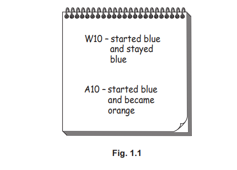

(i) Prepare a table to record the results shown in Fig. 1.1.

[2]

(ii) State a conclusion for the results shown in Fig. 1.1.

[1]

(iii) State** two** variables that were kept constant in this investigation

[2]

(iv) State the purpose of adding distilled water to the beaker of cooked rice labelled W.

[1]

(v) It was important that step 3 was carried out before step 4. Predict the effect on the results if step 4 was carried out before step 3.

[1]

(vi) The temperature of the 40°C water-bath was not maintained and decreased during the investigation.

State** one** piece of equipment that could be used to maintain the temperature at 40°C

[1]

*Source: 0970/June 2022 61 Q1A*

**Q2** [2 marks]

State how you could show that cooked rice contains starch.

[2]

*Source: 0970/June 2022 61 Q1B*

**Q2** [4 marks]

Some students investigated the effect of temperature on the rate of amylase activity. They measured the mass of reducing sugars produced in five minutes, at different temperatures.

The results of this investigation are shown in Fig. 1.2

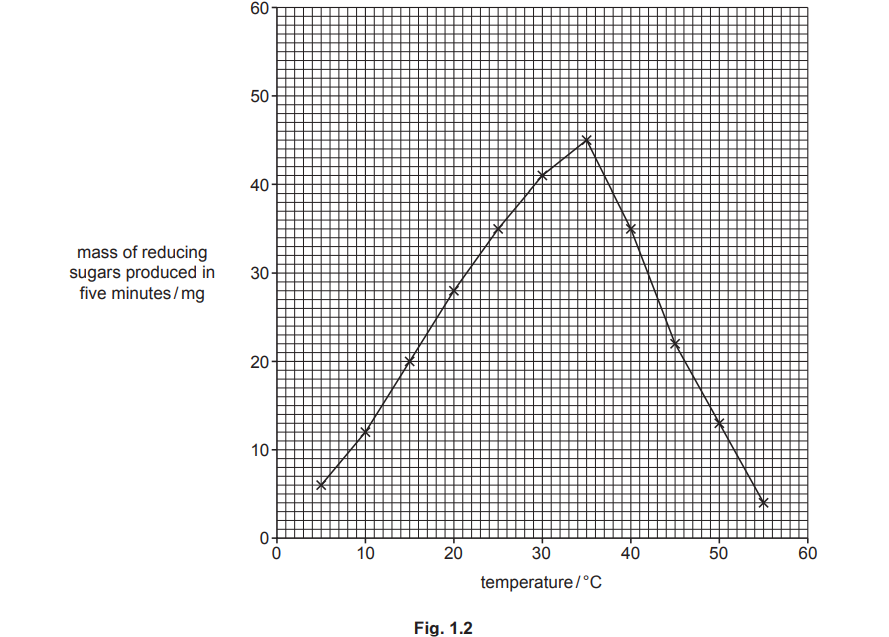

(i) Describe the effect of temperature on the activity of amylase shown in the graph in Fig. 1.2.

[2]

(ii) Use the graph to estimate the **rate** of amylase activity, in mg per minute, at a temperature of 42°C.

........................................ mg per minute

[2]

(iii) The students wanted to obtain a more accurate value for the temperature at which amylase works best. Suggest further investigative work that the students should carry out.

*Source: 0970/June 2020 61 Q1C*

**Q2** [6 marks]

**Extract:**

Rice contains starch. Amylase is an enzyme that catalyses the breakdown of starch to form reducing sugars. A student investigated the effect of amylase on cooked rice. The student used this method: 

Step 1   Two small beakers were prepared; each beaker contained 20g of cooked white rice. One beaker was labelled W and one beaker was labelled A.

Step 2   Both of the beakers were put into a 40°C water-bath. 

Step 3   A measuring cylinder was used to add 20cm^3 of distilled water to the rice in beaker W.

Step 4   The same measuring cylinder was then used to add 20cm^3 of a 1% amylase solution to the rice in beaker A.

Step 5   The beakers were left in the water-bath for 10 minutes. 

Step 6   One test-tube was labelled W10 and a second test-tube was labelled A10.

Step 7   After 10 minutes, a glass rod was used to stir the contents of beaker W. 

Step 8   A clean pipette was used to remove 2cm^3 of the liquid surrounding the rice in beaker W. The 2 cm^3 of liquid was put into test-tube W10.

Step 9   Steps 7 and 8 were repeated with beaker A and test-tube A10.

Step 10   A syringe was used to add 2cm^3 of Benedict's solution to each of test-tubes W10 and A10.

Step 11   Test-tubes W10 and A10 were put into an 80°C water-bath for five minutes.

Step 12   After five minutes, the colours of the contents of test-tubes W10 and A10 were observed.

Plan an investigation to determine the effect of pH on the activity of amylase

[6]

*Source: 0970/June 2022 61 Q1D*

### Q3 — medium — 16 marks

**Q3** [5 marks]

Catalase is an enzyme found in plant and animal cells. It catalyses the breakdown of hydrogen peroxide to form water and oxygen. The oxygen produced forms a foam. You can measure the height of the foam to determine catalase activity.

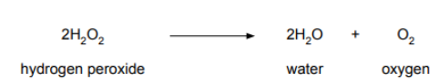

A student investigated catalase activity in cooked and uncooked potato tissue.

The student:

| Step 1 | cut two potato cylinders so that they were identical in shape and size |
|---|---|
| Step 2 | put 5 cm3 of 3% hydrogen peroxide solution into a test-tube labelled** cooked potato** |
| Step 3 | put 5 cm3 of 3% hydrogen peroxide solution into a test-tube labelled **uncooked potato** |
| Step 4 | put one of the potato cylinders into a beaker of hot water for five minutes |
| Step 5 | removed the potato cylinder from the hot water and put it into the test-tube labelled **cooked potato ** |
| Step 6 | put the uncooked potato cylinder into the test-tube labelled **uncooked potato** |
| Step 7 | left the potato cylinders in the 3% hydrogen peroxide solution for three minutes and then measured the height of the foam produced in each of the test-tubes. |

Fig 1.1 shows the test-tubes after three minutes.

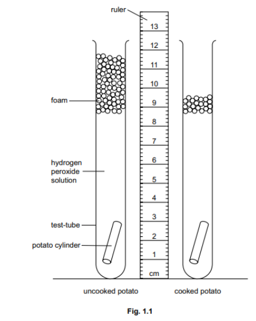

(i) Prepare a table to record your results.

Measure the height of the foam in each of the test-tubes in Fig. 1.1. Record these measurements in your table.

[3]

(ii) Calculate the difference in the height of the foam produced by the cooked and uncooked potato after three minutes.

[1]

(iii) State **one** conclusion for these results.

[1]

*Source: specimen 2023 Paper 6 Q1A*

**Q3** [4 marks]

**Extract:**

Catalase is an enzyme found in plant and animal cells. It catalyses the breakdown of hydrogen peroxide to form water and oxygen. The oxygen produced forms a foam. You can measure the height of the foam to determine catalase activity. 

A student investigated catalase activity in cooked and uncooked potato tissue. 

The student: 

| Step 1 | cut two potato cylinders so that they were identical in shape and size |
| Step 2 | put 5 cm^3^ of 3% hydrogen peroxide solution into a test-tube labelled** cooked potato** |
| Step 3 | put 5 cm^3^ of 3% hydrogen peroxide solution into a test-tube labelled **uncooked potato** |
| Step 4 | put one of the potato cylinders into a beaker of hot water for five minutes |
| Step 5 | removed the potato cylinder from the hot water and put it into the test-tube labelled **cooked potato ** |
| Step 6 | put the uncooked potato cylinder into the test-tube labelled **uncooked potato** |
| Step 7 | left the potato cylinders in the 3% hydrogen peroxide solution for three minutes and then measured the height of the foam produced in each of the test-tubes. |

(i) Identify the independent variable in this investigation.

[1]

(ii) State why it is important that the two potato cylinders were identical in shape and size.

[1]

(iii) State **two other** variables that were kept constant in this investigation.

[2]

*Source: specimen 2023 paper 6 Q1B*

**Q3** [1 mark]

**Extract:**

A student investigated catalase activity in cooked and uncooked potato tissue. 

The student: 

| Step 1 | cut two potato cylinders so that they were identical in shape and size |
| Step 2 | put 5 cm^3^ of 3% hydrogen peroxide solution into a test-tube labelled** cooked potato** |
| Step 3 | put 5 cm^3^ of 3% hydrogen peroxide solution into a test-tube labelled **uncooked potato** |
| Step 4 | put one of the potato cylinders into a beaker of hot water for five minutes |
| Step 5 | removed the potato cylinder from the hot water and put it into the test-tube labelled **cooked potato ** |
| Step 6 | put the uncooked potato cylinder into the test-tube labelled **uncooked potato** |
| Step 7 | left the potato cylinders in the 3% hydrogen peroxide solution for three minutes and then measured the height of the foam produced in each of the test-tubes. |

Identify **one** possible source of error in the method used in this investigation.

*Source: specimen 2023 paper 6 Q1C*

**Q3** [6 marks]

**Extract:**

Catalase is an enzyme found in plant and animal cells. It catalyses the breakdown of hydrogen peroxide to form water and oxygen. The oxygen produced forms a foam. You can measure the height of the foam to determine catalase activity.

A student stated that:

**‘Catalase activity is the same in all species of plants.’ **

Plan an investigation to test this statement.

*Source: specimen 2023 paper 6 Q1D*

### Q4 — medium — 26 marks

**Q4** [2 marks]

Fruit juice can be produced by crushing and squeezing fresh fruit. The juice produced in this way is often cloudy.

The enzyme pectinase is used to produce clear fruit juice. This process is called clarification.

Fig. 1 shows fruit juice before and after clarification.

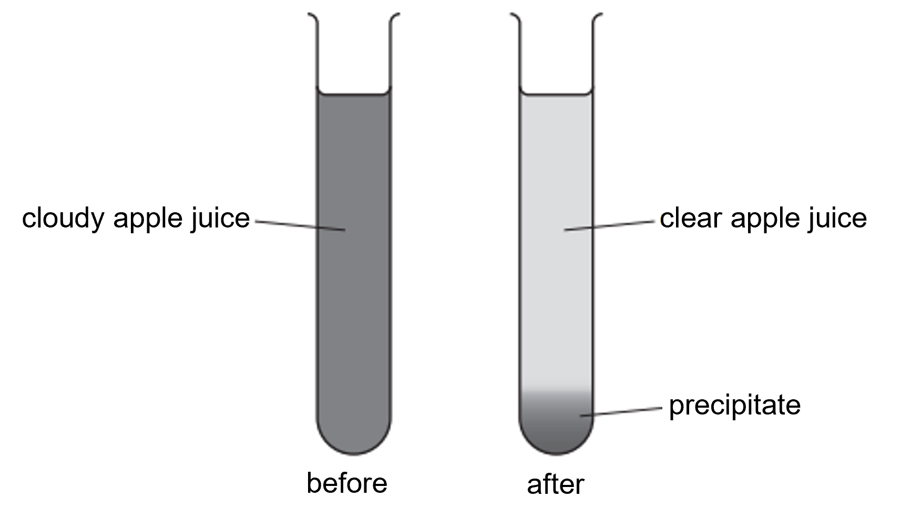

**Fig. 1**

A student investigated the effect of pectinase concentration on the clarification of apple juice.

The student was provided with freshly prepared apple juice, water and a 5% pectinase solution.

| Step 1 | Four test-tubes were labelled **P1**, **P2**, **P3** and **P4**. |
|---|---|
| Step 2 | Syringes were used to add the volumes of water and 5% pectinase solution shown in Table 1.1 to each of the test-tubes. |

**Table 1**

| Test-tube | Volume of water / cm3 | Volume of 5% pectinase solution / cm3 | Final percentage concentration of pectinase solution |
|---|---|---|---|
| **P1** | 0.00 | 1.00 | 5.0 |
| **P2** | 0.50 | 0.50 | 2.5 |
| **P3** | 0.75 | 0.25 |   |
| **P4** | 1.00 | 0.00 | 0.0 |

Calculate the final concentration of the pectinase solution in test-tube **P3**.

Show your working and write your answer to one decimal place.

*Source: 2018 0610/62 Q1A*

**Q4** [4 marks]

**Extract:**

Fruit juice can be produced by crushing and squeezing fresh fruit. The juice produced in this way is often cloudy.

The enzyme pectinase is used to produce clear fruit juice. This process is called clarification.

Fig. 1 shows fruit juice before and after clarification.

A student investigated the effect of pectinase concentration on the clarification of apple juice.

The student was provided with freshly prepared apple juice, water and a 5% pectinase solution.

| Step 1 | Four test-tubes were labelled **P1**, **P2**, **P3** and **P4**. |
|---|---|
| Step 2 | Syringes were used to add the volumes of water and 5% pectinase solution shown in Table 1.1 to each of the test-tubes. |

**Table 1**

| Test-tube | Volume of water / cm3 | Volume of 5% pectinase solution / cm3 | Final percentage concentration of pectinase solution |
|---|---|---|---|
| **P1** | 0.00 | 1.00 | 5.0 |
| **P2** | 0.50 | 0.50 | 2.5 |
| **P3** | 0.75 | 0.25 |   |
| **P4** | 1.00 | 0.00 | 0.0 |

| Step 3 | 5cm3 of apple juice was added to each of test-tubes **P1**, **P2**, **P3** and** P4**. |
|---|---|
| Step 4 | The contents of each test-tube were carefully mixed using a glass rod. |
| Step 5 | A stop-clock was immediately started. |
| Step 6 | After five minutes, the height of the precipitate formed was measured using a ruler, as shown in Fig. 2 If no precipitate had formed in the test-tube, it was recorded as ‘0’. |

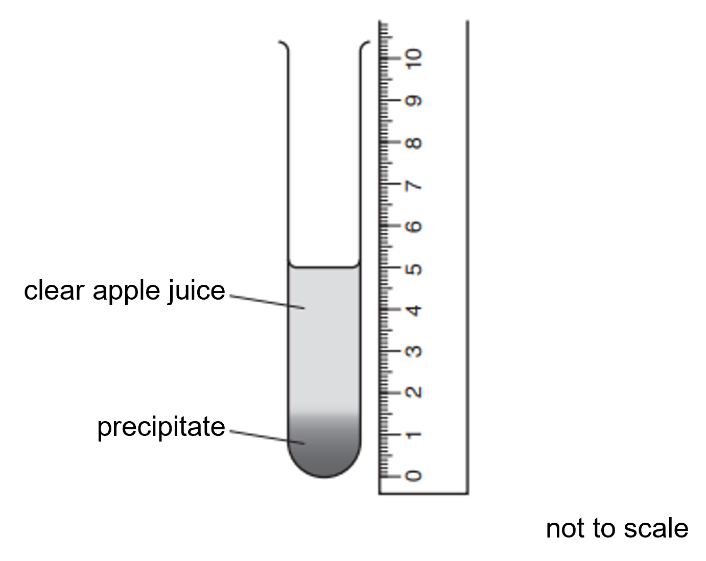

**Fig. 2**

Care was taken not to shake the test-tubes.

| Step 7 | After a further five minutes, the student repeated the measurement of the precipitates in the test-tubes. |
|---|---|

Fig.3 shows the test-tubes at 0, 5 and 10 minutes.

Note that the height of the precipitate is given for each test-tube.

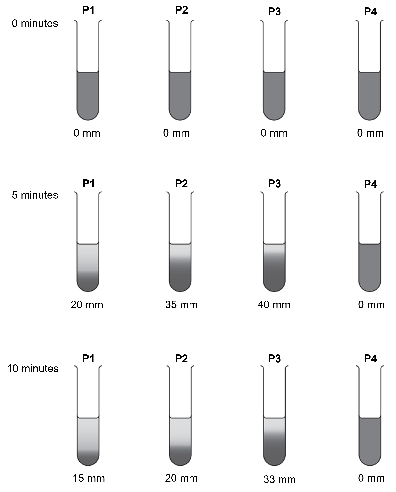

**Fig. 3**

Prepare a table to record the results.

*Source: 2018 0610/62 Q1B*

**Q4** [2 marks]

**Extract:**

A student investigated the effect of pectinase concentration on the clarification of apple juice.

| Test-tube | Volume of water / cm^3^ | Volume of 5% pectinase solution / cm^3^ | Final percentage concentration of pectinase solution |
| **P1** | 0.00 | 1.00 | 5.0 |
| **P2** | 0.50 | 0.50 | 2.5 |
| **P3** | 0.75 | 0.25 |   |
| **P4** | 1.00 | 0.00 | 0.0 |

| **Time / min** | **Height of the precipitate / mm** |
| **P1** | **P2** | **P3** | **P4** |
| 0 | 0 | 0 | 0 | 0 |
| 5 | 20 | 35 | 40 | 0 |
| 10 | 15 | 20 | 33 | 0 |

State a conclusion for the results.

*Source: 2018 0610/62 Q1C*

**Q4** [5 marks]

**Extract:**

A student investigated the effect of pectinase concentration on the clarification of apple juice.

The student was provided with freshly prepared apple juice, water and a 5% pectinase solution.

| Step 1 | Four test-tubes were labelled P1, P2, P3 and P4. |
| Step 2 | Syringes were used to add the volumes of water and 5% pectinase solution shown in Table 1.1 to each of the test-tubes. |
| Test-tube | Volume of water / cm^3 | Volume of 5% pectinase solution / cm^3 | Final percentage concentration of pectinase solution |
| P1 | 0.00 | 1.00 | 5.0 |
| P2 | 0.50 | 0.50 | 2.5 |
| P3 | 0.75 | 0.25 |   |
| P4 | 1.00 | 0.00 | 0.0 |

| Step 3 | 5cm^3 of apple juice was added to each of test-tubes P1, P2, P3 and P4. |
| Step 4 | The contents of each test-tube were carefully mixed using a glass rod. |
| Step 5 | A stop-clock was immediately started. |
| Step 6 | After five minutes, the height of the precipitate formed was measured using a ruler, as shown in Fig. 2 If no precipitate had formed in the test-tube, it was recorded as '0'. |
Care was taken not to shake the test-tubes.

| Step 7 | After a further five minutes, the student repeated the measurement of the precipitates in the test-tubes. |

(i)

State the variable that was changed (independent variable) in this investigation.

[1]

(ii)

State **two** variables that should have been kept constant in this investigation.

[2]

(iii)

Identify **one** possible error in step 6 and suggest an improvement.

[2]

*Source: 2018 0610/62 Q1D*

**Q4** [2 marks]

**Extract:**

| Test-tube | Volume of water / cm^3^ | Volume of 5% pectinase solution / cm^3^ | Final percentage concentration of pectinase solution |
| **P1** | 0.00 | 1.00 | 5.0 |
| **P2** | 0.50 | 0.50 | 2.5 |
| **P3** | 0.75 | 0.25 |   |
| **P4** | 1.00 | 0.00 | 0.0 |

Explain the purpose of test-tube **P4**.

*Source: 2018 0610/62 Q1E*

**Q4** [6 marks]

**Extract:**

Fruit juice can be produced by crushing and squeezing fresh fruit. The juice produced in this way is often cloudy.

The enzyme pectinase is used to produce clear fruit juice. This process is called clarification.

Fig. 1 shows fruit juice before and after clarification.

A student investigated the effect of pectinase concentration on the clarification of apple juice.

The student was provided with freshly prepared apple juice, water and a 5% pectinase solution.

| Step 1 | Four test-tubes were labelled **P1**, **P2**, **P3** and **P4**. |
|---|---|
| Step 2 | Syringes were used to add the volumes of water and 5% pectinase solution shown in Table 1.1 to each of the test-tubes. |

**Table 1**

| Test-tube | Volume of water / cm3 | Volume of 5% pectinase solution / cm3 | Final percentage concentration of pectinase solution |
|---|---|---|---|
| **P1** | 0.00 | 1.00 | 5.0 |
| **P2** | 0.50 | 0.50 | 2.5 |
| **P3** | 0.75 | 0.25 |   |
| **P4** | 1.00 | 0.00 | 0.0 |

| Step 3 | 5cm3 of apple juice was added to each of test-tubes **P1**, **P2**, **P3** and** P4**. |
|---|---|
| Step 4 | The contents of each test-tube were carefully mixed using a glass rod. |
| Step 5 | A stop-clock was immediately started. |
| Step 6 | After five minutes, the height of the precipitate formed was measured using a ruler, as shown in Fig. 2 If no precipitate had formed in the test-tube, it was recorded as ‘0’. |

Care was taken not to shake the test-tubes.

| Step 7 | After a further five minutes, the student repeated the measurement of the precipitates in the test-tubes. |
|---|---|

Fig.3 shows the test-tubes at 0, 5 and 10 minutes.

Note that the height of the precipitate is given for each test-tube.

A student stated the hypothesis:

**“Treating fruit juice with pectinase reduces the vitamin C content of the fruit juice”.**

Plan an investigation to test this hypothesis.

*Source: 2018 0610/62 Q1F*

**Q4** [4 marks]

Fig. 4 shows a cross-section of a tomato fruit.

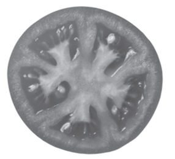

**Fig. 4**

Sketch a large drawing of the cross-section of tomato fruit.

*Source: 2018 0610/62 Q1G*

**Q4** [1 mark]

A student wanted to find out if tomatoes contained starch.

State the result you would expect for a positive test for starch.

*Source: 2018 0610/62 Q1H*

### Q5 — medium — 19 marks

**Q5** [6 marks]

Some students investigated the activity of catalase.

Catalase is an enzyme found in plant and animal tissues. It catalyses the breakdown of hydrogen peroxide into water and oxygen. The activity of this enzyme can be measured by collecting the oxygen produced.

2H2O2                     →          2H2O     +     O2 hydrogen peroxide                   water        oxygen

The students used the apparatus shown in Fig. 1 to compare the activity of catalase using pieces of sweet potato of different sizes.

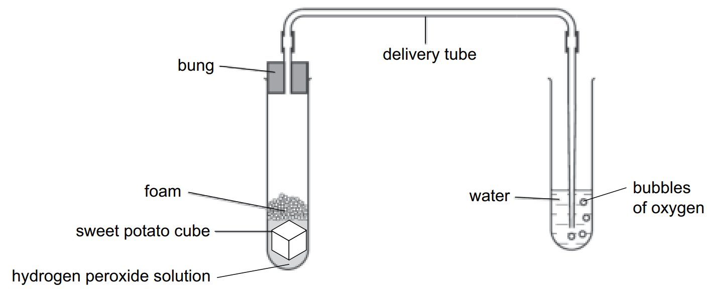

**Fig. 1**

Three cubes of 10 mm × 10 mm × 10 mm of sweet potato were used.

**Cube 1** was placed into the test-tube and 5 cm3 of hydrogen peroxide was added. The bung was quickly replaced into the top of the test-tube. The students carefully counted the number of bubbles of oxygen delivered into the water in one minute and then measured the final height of foam in the test-tube. For** cube 1**, they counted 12 bubbles in one minute. The height of the foam was 42 mm. They then discarded the contents of the test-tube and rinsed it with clean water.

**Cube 2** was cut into two pieces of approximately the same size. Both of these pieces were placed into the test-tube and 5 cm3 of hydrogen peroxide was added as before. For **cube 2**, they counted 23 bubbles in one minute. The height of foam was 63 mm. They then discarded the contents of the test-tube and rinsed it with clean water.

**Cube 3** was cut into eight small pieces which were all placed into the test-tube and 5 cm3 of hydrogen peroxide was added as before. For **cube 3**, they counted 38 bubbles in one minute. The height of foam was 76 mm.

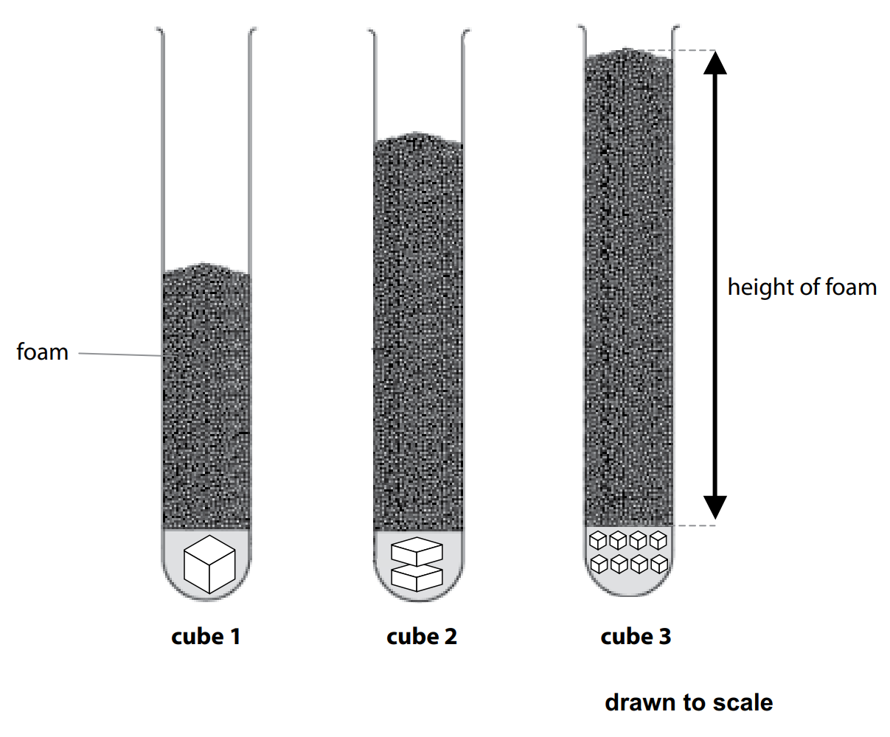

**Fig. 2**

Prepare a table for the results from this investigation.

Use information provided in the question to complete your table.

*Source: 2020 0610/06 Q1A*

**Q5** [5 marks]

**Extract:**

Catalase is an enzyme found in plant and animal tissues. It catalyses the breakdown of hydrogen peroxide into water and oxygen. The activity of this enzyme can be measured by collecting the oxygen produced.  2H2O2 → 2H2O + O2 (hydrogen peroxide → water + oxygen)

The students used the apparatus shown in Fig. 1 to compare the activity of catalase using pieces of sweet potato of different sizes.  Three cubes of 10 mm × 10 mm × 10 mm of sweet potato were used.

Cube 1 was placed into the test-tube and 5 cm3 of hydrogen peroxide was added. The bung was quickly replaced into the top of the test-tube. The students carefully counted the number of bubbles of oxygen delivered into the water in one minute and then measured the final height of foam in the test-tube. For cube 1, they counted 12 bubbles in one minute. The height of the foam was 42 mm. They then discarded the contents of the test-tube and rinsed it with clean water.

Cube 2 was cut into two pieces of approximately the same size. Both of these pieces were placed into the test-tube and 5 cm3 of hydrogen peroxide was added as before. For cube 2, they counted 23 bubbles in one minute. The height of foam was 63 mm. They then discarded the contents of the test-tube and rinsed it with clean water.

Cube 3 was cut into eight small pieces which were all placed into the test-tube and 5 cm3 of hydrogen peroxide was added as before. For cube 3, they counted 38 bubbles in one minute. The height of foam was 76 mm.

(i)

State **two** variables that the students kept constant in this investigation.

[2]

(ii)

Suggest how you could improve the method that they followed.

[3]

*Source: 2020 0610/06 Q1B*

**Q5** [1 mark]

**Extract:**

Three cubes of 10 mm × 10 mm × 10 mm of sweet potato were used. Cube 1 was placed into the test-tube and 5 cm^3^ of hydrogen peroxide was added. For cube 1, they counted 12 bubbles in one minute. The height of the foam was 42 mm. Cube 2 was cut into two pieces of approximately the same size. For cube 2, they counted 23 bubbles in one minute. The height of foam was 63 mm. Cube 3 was cut into eight small pieces. For cube 3, they counted 38 bubbles in one minute. The height of foam was 76 mm.

State a conclusion that can be drawn from these results.

*Source: 2020 0610/06 Q1C*

**Q5** [7 marks]

**Extract:**

Catalase is an enzyme found in plant and animal tissues. It catalyses the breakdown of hydrogen peroxide into water and oxygen. The activity of this enzyme can be measured by collecting the oxygen produced.  2H~2~O~2~ → 2H~2~O + O~2~ hydrogen peroxide water oxygen  The students used the apparatus shown in Fig. 1 to compare the activity of catalase using pieces of sweet potato of different sizes.  Three cubes of 10 mm × 10 mm × 10 mm of sweet potato were used.  Cube 1 was placed into the test-tube and 5 cm^3^ of hydrogen peroxide was added. The bung was quickly replaced into the top of the test-tube. The students carefully counted the number of bubbles of oxygen delivered into the water in one minute and then measured the final height of foam in the test-tube. For cube 1, they counted 12 bubbles in one minute. The height of the foam was 42 mm. They then discarded the contents of the test-tube and rinsed it with clean water.  Cube 2 was cut into two pieces of approximately the same size. Both of these pieces were placed into the test-tube and 5 cm^3^ of hydrogen peroxide was added as before. For cube 2, they counted 23 bubbles in one minute. The height of foam was 63 mm. They then discarded the contents of the test-tube and rinsed it with clean water.  Cube 3 was cut into eight small pieces which were all placed into the test-tube and 5 cm^3^ of hydrogen peroxide was added as before. For cube 3, they counted 38 bubbles in one minute. The height of foam was 76 mm.

(i)

The students were given a hypothesis that said:

**“The activity of catalase increases with increasing temperature”.**

Describe a similar investigation to the one carried out in **a)** to test this hypothesis.

[6]

(ii)

Outline **one** safety precaution that you would need to take when performing this experiment.

[1]

*Source: 2020 0610/06 Q1D*

### Q6 — medium — 21 marks

**Q6** [5 marks]

Catalase is an enzyme found in plant and animal cells. It catalyses the breakdown of hydrogen peroxide to form water and oxygen.

The oxygen produced forms a foam. You can measure the height of the foam to determine catalase activity.

A student investigated catalase activity in cooked and uncooked potato tissue.

The student:

| Step 1 | Cut two potato cylinders so that they were identical in shape and size |
|---|---|
| Step 2 | Put 5 cm3 of 3 % hydrogen peroxide solution into a test-tube labelled **cooked potato** |
| Step 3 | Put 5 cm3 of 3 % hydrogen peroxide solution into a test-tube labelled **uncooked potato** |
| Step 4 | Put one of the potato cylinders into a beaker of hot water for five minutes |
| Step 5 | Removed the potato cylinder from the hot water and put it into the test-tube labelled **cooked potato** |
| Step 6 | Put the uncooked potato cylinder into the test-tube labelled **uncooked potato** |
| Step 7 | Left the potato cylinders in the 3 % hydrogen peroxide solution for three minutes and then measured the height of the foam produced in each of the test-tubes. |

Fig. 1 shows the test-tubes after three minutes.

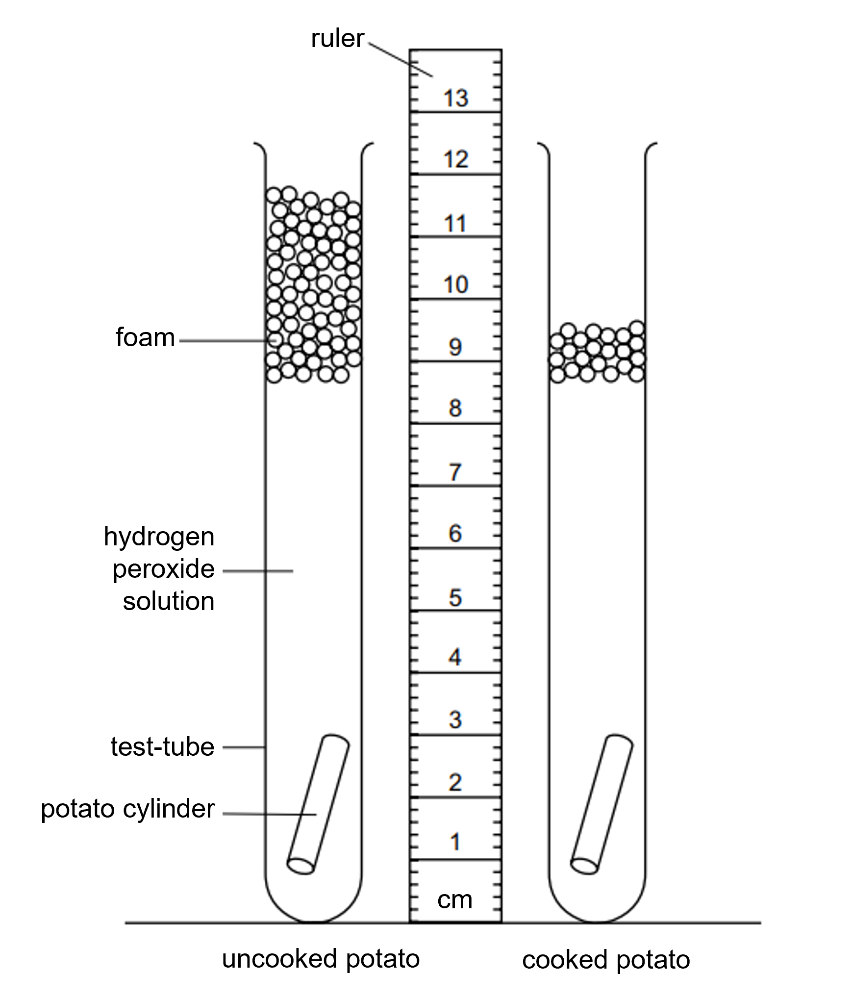

**Fig. 1**

(i)

Prepare a table to record your results.

Measure the height of the foam in each of the test-tubes in Fig. 1 Record these measurements in your table.

[3]

(ii)

Calculate the difference in the height of the foam produced by the cooked and uncooked potato after three minutes.

[1]

(iii)

State **one** conclusion for these results.

[1]

*Source: 2023 0970/06 Q1A*

**Q6** [4 marks]

**Extract:**

Catalase is an enzyme found in plant and animal cells. It catalyses the breakdown of hydrogen peroxide to form water and oxygen.

A student investigated catalase activity in cooked and uncooked potato tissue. 

The student: 

| Step 1 | Cut two potato cylinders so that they were identical in shape and size |
| Step 2 | Put 5 cm^3^ of 3 % hydrogen peroxide solution into a test-tube labelled **cooked potato** |
| Step 3 | Put 5 cm^3^ of 3 % hydrogen peroxide solution into a test-tube labelled **uncooked potato** |
| Step 4 | Put one of the potato cylinders into a beaker of hot water for five minutes |
| Step 5 | Removed the potato cylinder from the hot water and put it into the test-tube labelled **cooked potato** |
| Step 6 | Put the uncooked potato cylinder into the test-tube labelled **uncooked potato** |
| Step 7 | Left the potato cylinders in the 3 % hydrogen peroxide solution for three minutes and then measured the height of the foam produced in each of the test-tubes. |

(i)

Identify the independent variable in this investigation.

[1]

(ii)

State why it is important that the two potato cylinders were identical in shape and size.

[1]

(iii)

State **two other** variables that were kept constant in this investigation.

[2]

*Source: 2023 0970/06 Q1B*

**Q6** [1 mark]

**Extract:**

A student investigated catalase activity in cooked and uncooked potato tissue. 

The student: 

| Step 1 | Cut two potato cylinders so that they were identical in shape and size |
| Step 2 | Put 5 cm^3^ of 3 % hydrogen peroxide solution into a test-tube labelled **cooked potato** |
| Step 3 | Put 5 cm^3^ of 3 % hydrogen peroxide solution into a test-tube labelled **uncooked potato** |
| Step 4 | Put one of the potato cylinders into a beaker of hot water for five minutes |
| Step 5 | Removed the potato cylinder from the hot water and put it into the test-tube labelled **cooked potato** |
| Step 6 | Put the uncooked potato cylinder into the test-tube labelled **uncooked potato** |
| Step 7 | Left the potato cylinders in the 3 % hydrogen peroxide solution for three minutes and then measured the height of the foam produced in each of the test-tubes. |

Identify **one** possible source of error in the method used in this investigation.

*Source: 2023 0970/06 Q1C*

**Q6** [6 marks]

**Extract:**

Catalase is an enzyme found in plant and animal cells. It catalyses the breakdown of hydrogen peroxide to form water and oxygen.

The oxygen produced forms a foam. You can measure the height of the foam to determine catalase activity.

A student investigated catalase activity in cooked and uncooked potato tissue. 

The student: 

| Step 1 | Cut two potato cylinders so that they were identical in shape and size |
| Step 2 | Put 5 cm^3^ of 3 % hydrogen peroxide solution into a test-tube labelled **cooked potato** |
| Step 3 | Put 5 cm^3^ of 3 % hydrogen peroxide solution into a test-tube labelled **uncooked potato** |
| Step 4 | Put one of the potato cylinders into a beaker of hot water for five minutes |
| Step 5 | Removed the potato cylinder from the hot water and put it into the test-tube labelled **cooked potato** |
| Step 6 | Put the uncooked potato cylinder into the test-tube labelled **uncooked potato** |
| Step 7 | Left the potato cylinders in the 3 % hydrogen peroxide solution for three minutes and then measured the height of the foam produced in each of the test-tubes. |

A student stated that:

**'Catalase activity is the same in all species of plants'**

Plan an investigation to test this statement.

*Source: 2023 0970/06 Q1D*

**Q6** [5 marks]

Potatoes contain starch. Starch can be broken down into reducing sugars.

Describe the tests to identify starch and reducing sugars and give the results of the positive tests.

*Source: 2023 0970/06 Q1E*

### Q7 — medium — 22 marks

**Q7** [3 marks]

Young mammals feed on milk containing protein.

Some mammals produce an enzyme called rennin. Rennin changes the protein in milk so that it can be digested by another enzyme.

The action of rennin causes small lumps or clots to form in the milk.

An investigation was carried out to find the effect of pH on the activity of the enzyme rennin.

| Step 1 | Three test-tubes were labelled **P**, **Q** and **R**. |
|---|---|
| Step 2 | A syringe was used to add 5cm3 of milk to each of these test-tubes. |
| Step 3 | A dropping pipette was used to add two drops of acid to test-tube **P**. |
| Step 4 | A dropping pipette was used to add two drops of distilled water to test-tube **Q**. |
| Step 5 | A dropping pipette was used to add two drops of alkali to test-tube** R**. |
| Step 6 | Another three test-tubes were labelled** P1**, **Q1** and **R1**. |
| Step 7 | A clean syringe was used to add 1cm3 of 0.1% rennin solution to each of test-tubes** P1**, **Q1** and **R1**. |
| Step 8 | All six test-tubes were placed into a water-bath at 40°C and left for three minutes. |
| Step 9 | The contents of test-tube **P1** were added to test-tube **P**. The contents of test-tube **Q1** were added to test-tube **Q**. The contents of test-tube **R1** were added to test-tube **R**. |
| Step 10 | Test-tubes **P**, **Q **and **R** were kept in the water-bath and a stop-clock was started. |
| Step 11 | After one minute, test-tube **P** was removed from the water-bath.It was tipped and rotated as shown in Fig.1.The appearance of the milk was observed, and the stage of clotting was decided by comparing it to the diagrams in Fig.1. |
|   |   |

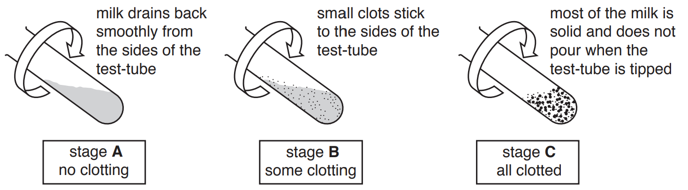

**Fig. 1**

| Step 12 | Test-tube **P** was returned to the water-bath. |
|---|---|
| Step 13 | Steps 11 and 12 were repeated for test-tubes **Q** and** R**. |
| Step 14 | Steps 11, 12 and 13 were repeated every minute for five minutes. |
| The results are shown in Fig. 2. |   |

| Test-tube** P** had some clotting at one minute and was all clotted at two minutes. Test-tube **Q **had no clotting at one, two or three minutes but some clotting at four and five minutes. Test-tube **R** had no clotting throughout the investigation, and remained unchanged after five minutes. |
|---|

**Fig. 2**

Prepare a table in which to record these results. Use the information in Fig. 2 to complete this table.

*Source: 2018 (Series 1) 0610/61 Q1A*

**Q7** [2 marks]

**Extract:**

Test-tube P had some clotting at one minute and was all clotted at two minutes. Test-tube Q had no clotting at one, two or three minutes but some clotting at four and five minutes. Test-tube R had no clotting throughout the investigation, and remained unchanged after five minutes.

State a conclusion for these results.

*Source: 2018 (Series 1) 0610/61 Q1B*

**Q7** [3 marks]

**Extract:**

Step 8 | All six test-tubes were placed into a water-bath at 40°C and left for three minutes.
Step 2 | A syringe was used to add 5cm^3^ of milk to each of these test-tubes.
Step 3 | A dropping pipette was used to add two drops of acid to test-tube P.
Step 4 | A dropping pipette was used to add two drops of distilled water to test-tube Q.
Step 5 | A dropping pipette was used to add two drops of alkali to test-tube R.
Step 7 | A clean syringe was used to add 1cm^3^ of 0.1% rennin solution to each of test-tubes P1, Q1 and R1.

(i)

Suggest why, in step 8, all of the test-tubes were placed into a water-bath for three minutes before mixing the contents together in step 9.

[1]

(ii)

State **two** variables that were kept constant in this investigation.

[2]

*Source: 2018 (Series 1) 0610/61 Q1C*

**Q7** [4 marks]

**Extract:**

Young mammals feed on milk containing protein.

Some mammals produce an enzyme called rennin. Rennin changes the protein in milk so that it can be digested by another enzyme.

The action of rennin causes small lumps or clots to form in the milk.

An investigation was carried out to find the effect of pH on the activity of the enzyme rennin.

| Step 1 | Three test-tubes were labelled P, Q and R. |
| Step 2 | A syringe was used to add 5cm^3^ of milk to each of these test-tubes. |
| Step 3 | A dropping pipette was used to add two drops of acid to test-tube P. |
| Step 4 | A dropping pipette was used to add two drops of distilled water to test-tube Q. |
| Step 5 | A dropping pipette was used to add two drops of alkali to test-tube R. |
| Step 6 | Another three test-tubes were labelled P1, Q1 and R1. |
| Step 7 | A clean syringe was used to add 1cm^3^ of 0.1% rennin solution to each of test-tubes P1, Q1 and R1. |
| Step 8 | All six test-tubes were placed into a water-bath at 40°C and left for three minutes. |
| Step 9 | The contents of test-tube P1 were added to test-tube P. The contents of test-tube Q1 were added to test-tube Q. The contents of test-tube R1 were added to test-tube R. |
| Step 10 | Test-tubes P, Q and R were kept in the water-bath and a stop-clock was started. |
| Step 11 | After one minute, test-tube P was removed from the water-bath. It was tipped and rotated as shown in Fig.1. The appearance of the milk was observed, and the stage of clotting was decided by comparing it to the diagrams in Fig.1. |
| Step 12 | Test-tube P was returned to the water-bath. |
| Step 13 | Steps 11 and 12 were repeated for test-tubes Q and R. |
| Step 14 | Steps 11, 12 and 13 were repeated every minute for five minutes. |
| The results are shown in Fig. 2. |
| Test-tube P had some clotting at one minute and was all clotted at two minutes. Test-tube Q had no clotting at one, two or three minutes but some clotting at four and five minutes. Test-tube R had no clotting throughout the investigation, and remained unchanged after five minutes. |

Identify** four** sources of error in this investigation.

*Source: 2018 (Series 1) 0610/61 Q1D*

**Q7** [1 mark]

**Extract:**

A dropping pipette was used to add two drops of acid to test-tube P. A dropping pipette was used to add two drops of distilled water to test-tube Q. A dropping pipette was used to add two drops of alkali to test-tube R. A clean syringe was used to add 1cm^3^ of 0.1% rennin solution to each of test-tubes P1, Q1 and R1.

Identify** one **hazard associated with this procedure that would require the use of eye protection.

*Source: 2018 (Series 1) 0610/61 Q1E*

**Q7** [2 marks]

Clotting separates milk into a solid part and a liquid part.

Describe how you could find out if there was any protein remaining in the liquid part.

*Source: 2018 (Series 1) 0610/61 Q1F*

**Q7** [1 mark]

**Extract:**

Clotting separates milk into a solid part and a liquid part.

State the name of the test that would be used to test the milk for the presence of fat.

*Source: 2018 (Series 1) 0610/61 Q1G*

**Q7** [6 marks]

After rennin has changed the protein in milk into a white solid, protease enzymes can be used to digest the protein. The digested protein forms a colourless liquid.

A hypothesis stated:

**The optimum temperature for protease enzymes to digest changed milk protein is 37°C.**

Describe a method that could be used to test this hypothesis.

*Source: 2018 (Series 1) 0610/61 Q1H*

## Multiple Choice Questions (25 questions)

### Q1 — hard — 1 marks

**Q1** [1 mark]

A student heats an amylase solution to 80 °C for 10 minutes, then cools it back to 25 °C before adding starch.

The reaction rate stays very low.

What is the best explanation for this?

### Q2 — easy — 1 marks

**Q2** [1 mark]

Why are enzymes said to be specific?

### Q3 — medium — 1 marks

**Q3** [1 mark]

Sucrase is an enzyme that catalyses the breakdown of the sugar sucrose, but that is unable to break down another sugar, lactose.

Which of the following correctly explains why sucrase cannot catalyse the breakdown of lactose.

### Q4 — medium — 1 marks

**Q4** [1 mark]

An enzyme-controlled reaction takes place in a test tube.

During the reaction the contents of the test tube include: water, dietary protein, protease, amino acids and hydrochloric acid.

The graph below shows the progress of the reaction.

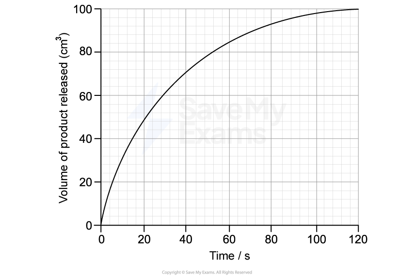

Which component of the test tube contents is represented on the Y axis in the graph above?

### Q5 — easy — 1 marks

**Q5** [1 mark]

Which statement describes the effect of temperature on enzymes?

*Source: june 2022 paper 2 Q10*

### Q6 — easy — 1 marks

**Q6** [1 mark]

Some terms used to describe enzyme-controlled reactions are listed.

1    catalyst

2    product

3    protein

4    substrate

Which terms describe an enzyme?

*Source: June 2022 paper 1 Q10*

### Q7 — easy — 1 marks

**Q7** [1 mark]

Which statement describes a catalyst?

*Source: June 2021 0970/11 Q11*

### Q8 — medium — 1 marks

**Q8** [1 mark]

Starch is digested by amylase in the mouth, but it is not digested in the stomach.

What is the reason for this?

*Source: June 2021 0970/11 Q10*

### Q9 — easy — 1 marks

**Q9** [1 mark]

A student wrote some notes about enzymes.

She wrote:

‘The …1… of an enzyme is …2… to an area on the substrate.

This area on the substrate can fit into it to form an …3… complex’.

Which words correctly complete gaps 1, 2 and 3?

|   | 1 | 2 | 3 |
|---|---|---|---|
| **A** | active site | complementary | enzyme-substrate |
| **B** | active site | similar | enzyme-product |
| **C** | shape | complementary | enzyme-product |
| **D** | shape | similar | enzyme-substrate |

*Source: Specimen 2023 0970/02 Q10*

### Q10 — easy — 1 marks

**Q10** [1 mark]

The diagrams show a protease enzyme catalysing the breaking of part of a protein molecule into smaller pieces.

Which diagram has three correct labels?

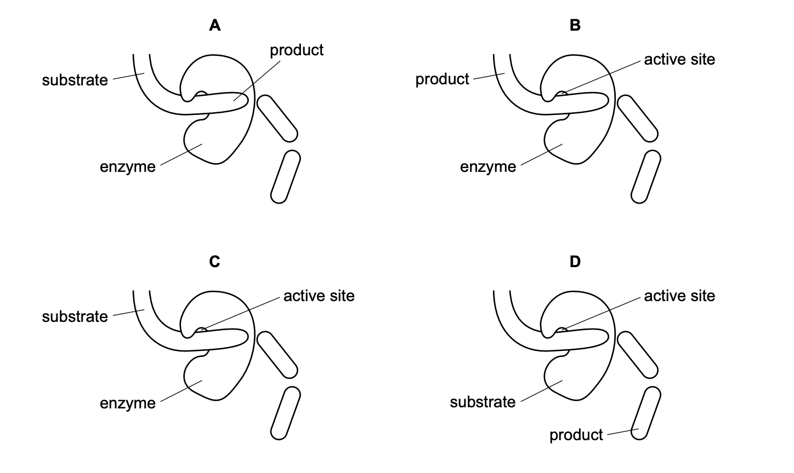

*Source: Specimen 2023 0970/01 Q10*

### Q11 — easy — 1 marks

**Q11** [1 mark]

What is the name for the group of compounds that ensures metabolic reactions take place in living organisms at a speed necessary to sustain life?

### Q12 — hard — 1 marks

**Q12** [1 mark]

#### Extended

The action of an enzyme in a chemical reaction is outlined in the diagram below.

Which row of the table below is correct?

| ** ** | product | enzyme | enzyme-substrate complex |
|---|---|---|---|
| **A** | E | H | G |
| **B** | E | G | F |
| **C** | H | G | F |
| **D** | H | F | G |

### Q13 — medium — 1 marks

**Q13** [1 mark]

#### Extended

Temperature affects the rate of all enzyme-controlled reactions, as shown in the graph below.

Which row correctly describes what is happening at the points on the graph?

| ** ** | X | Y |
|---|---|---|
| **A** | the enzyme has been denatured | the rate of reaction is decreasing |
| **B** | the rate of reaction is increasing | the enzyme is becoming denatured |
| **C** | the reaction is taking less time | the rate of reaction is increasing |
| **D** | the rate of reaction is decreasing | the enzyme is becoming denatured |

### Q14 — easy — 1 marks

**Q14** [1 mark]

The effect of pH on the rate of reaction of three different enzymes is shown in the graph below.

What does the graph show?

### Q15 — medium — 1 marks

**Q15** [1 mark]

#### Extended

The pH of an enzyme controlled reaction is decreased by a pH of 2.

How does this affect the rate of the reaction?

### Q16 — hard — 1 marks

**Q16** [1 mark]

The image below represents a chemical reaction.

Which of the following best represents the enzyme responsible for catalysing this reaction?

### Q17 — easy — 1 marks

**Q17** [1 mark]

What is a feature of all catalysts?

### Q18 — medium — 1 marks

**Q18** [1 mark]

#### Extended

Which of the following correctly describes the effect of increasing temperature from 15°C to 30°C on an enzyme-controlled reaction?

| ** ** | kinetic energy of enzymes and substrates | frequency of effective collisions | shape of active site |
|---|---|---|---|
| **A** | no change | decreases | denatured |
| **B** | increases | increases | denatured |
| **C** | increases | increases | no change |
| **D** | decreases | no change | no change |

### Q19 — hard — 1 marks

**Q19** [1 mark]

Liver cells produce an enzyme called catalase which breaks down toxic hydrogen peroxide into water and oxygen.

A student set up an experiment where cubes of cows' liver in a test tube were incubated with hydrogen peroxide at different temperatures.

The student counted the number of bubbles of oxygen released per minute at each temperature.

Their results are shown in the table below:

| temperature / oC | 10 | 20 | 30 | 40 | 50 |
|---|---|---|---|---|---|
| number of bubbles / minute | 35 | 68 | 79 | 63 | 5 |

The results suggest that the optimum temperature for catalase is between which two values?

### Q20 — hard — 1 marks

**Q20** [1 mark]

Starch is digested by the enzyme amylase. Four identical mixtures of starch and amylase were kept at different temperatures.

The graph below shows the time taken for the starch to be digested at each temperature.

At which temperature is the rate of reaction highest?

### Q21 — easy — 1 marks

**Q21** [1 mark]

What can be said to be true of all enzymes?

| ** ** | their optimum pH is 7 | they are made from amino acids | they move about randomly in a fluid |
|---|---|---|---|
| **A** | **X** | **X** | **X** |
| **B** | **X** | ✔ | ✔ |
| **C** | ✔ | **X** | ✔ |
| **D** | ✔ | ✔ | **X** |

### Q22 — easy — 1 marks

**Q22** [1 mark]

Which of the following best describes what an enzyme is?

### Q23 — medium — 1 marks

**Q23** [1 mark]

A student decided to investigate the effect of pH on the activity of the enzyme lipase.

Five different test tubes are set up. Each test tube contains a mixture of the enzyme lipase and its substrate, a lipid.

Which condition should not be kept the same in each of the five test tubes?

### Q24 — hard — 1 marks

**Q24** [1 mark]

#### Extended

The diagrams below show an amylase enzyme catalysing the breakdown of part of a starch molecule into smaller molecules of maltose.

Which diagram has three correct labels?

### Q25 — medium — 1 marks

**Q25** [1 mark]

Which graph in the image below shows the correct effect of temperature on the activity of an enzyme?

## Theory Questions (22 questions)

### Q1 — very_hard — 3 marks

**Q1** [3 marks]

**Extract:**

Blue whales can dive for up to 20 minutes. During these dives, the whale's heart rate slows significantly, and the muscle cells switch to anaerobic respiration.

Explain why the build-up of lactic acid in the muscles would be dangerous if the whale did not return to the surface.

### Q2 — medium — 3 marks

**Q2** [3 marks]

One of the enzymes produced by this cell is lipase.

Describe how lipase functions in the digestive system, including the products formed.

### Q3 — easy — 4 marks

**Q3** [2 marks]

Enzymes are biological catalysts.

Define the term catalyst.

[2]

*Source: June 2021 0970/31 Q3D*

**Q3** [2 marks]

Enzymes are proteins.

Circle the elements that all enzymes contain.

**Calcium	      carbon	 hydrogen	            iodine**

**Iron		 magnesium            nitrogen	        oxygen**

[2]

### Q4 — medium — 3 marks

**Q4** [3 marks]

Alcohol dehydrogenase is an enzyme that breaks down alcohol in the body.

Fig. 3.2 shows the activity of alcohol dehydrogenase at different pH values.

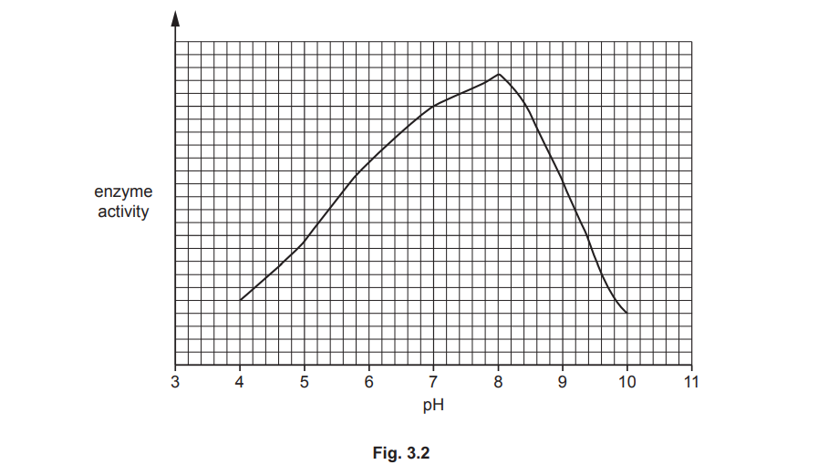

(i) State the pH value with the highest enzyme activity in Fig. 3.2.

[1]

(ii) State the pH value with the lowest enzyme activity in Fig. 3.2.

[1]

(iii) Suggest one other factor that could affect the activity of the enzyme alcohol dehydrogenase.

[1]

*Source: June 2021 0970/31 Q3A*

### Q5 — medium — 10 marks

**Q5** [2 marks]

Some students were studying the activity of yeast. They made a fact file, as shown in Fig. 1.1.

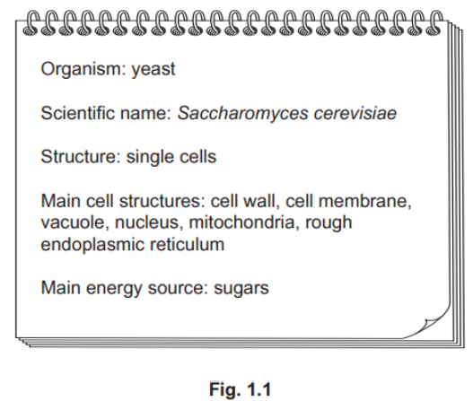

(i) State the kingdom in which yeast is classified.

[1]

(ii) State the process that occurs in mitochondria to provide energy for yeast cells.

[1]

*Source: june 2022 paper 4 Q1A*

**Q5** [2 marks]

Yeast cells make the enzyme sucrase. Sucrase catalyses the breakdown of sucrose to glucose and fructose.

Enzymes are made of protein.

Explain how the shape of a sucrase molecule is related to its function.

*Source: june 2022 paper 4 Q1B*

**Q5** [6 marks]

**Extract:**

The students made an extract of sucrase from yeast cells. 

They investigated the activity of the sucrase extract at different pH values. They determined the rate of reaction at each pH. 

They then calculated the rate of each reaction as a percentage of the fastest reaction, to give the percentage activity of sucrase.

The results of this investigation are shown in Fig. 1.2. 

[Graph showing sucrose activity versus pH, peaking at 6 pH with 100% activity, declining sharply past pH 9 and pH 3.]

Describe and explain the effect of pH on the activity of sucrase shown in Fig. 1.2.

The students made an extract of sucrase from yeast cells.

They investigated the activity of the sucrase extract at different pH values. They determined the rate of reaction at each pH.

They then calculated the rate of each reaction as a percentage of the fastest reaction, to give the percentage activity of sucrase.

The results of this investigation are shown in Fig. 1.2.

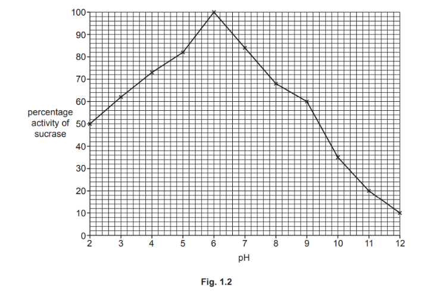

Describe and explain the effect of pH on the activity of sucrase shown in Fig. 1.2.

*Source: june 2022 paper 4 Q1C*

### Q6 — easy — 5 marks

**Q6** [5 marks]

Marine iguanas feed on seaweed. Seaweed contains starch.

(i)

State the names of **two** parts of the digestive system where starch is digested by enzymes.

(ii)

Explain why the shape of an enzyme is important for digestion

*Source: Specimen 2023 0970/04 Q5B*

### Q7 — easy — 3 marks

**Q7** [2 marks]

The effect of temperature on enzyme activity was investigated.

The results are shown in Fig. 6.1.

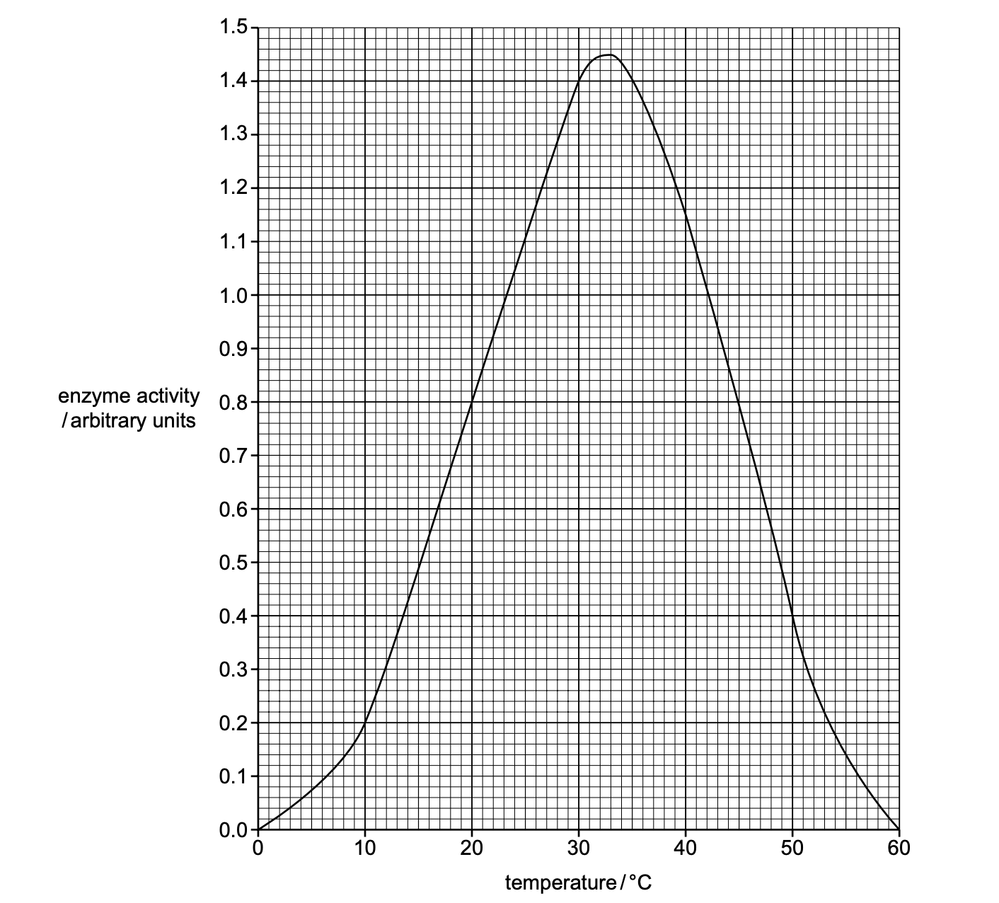

**Fig. 6.1**

(i) 
State the optimum temperature for the enzyme in Fig. 6.1.

...................................................... °C [1]

(ii) 
State why there is** no** enzyme activity at 60 °C

[1]

*Source: Specimen 2023 0970/03 Q6A*

**Q7** [1 mark]

State** one f**actor other than temperature that affects enzyme activity

*Source: Specimen 2023 0970/03 Q6B*

### Q8 — hard — 9 marks

**Q8** [3 marks]

Enzymes are involved in controlling cell division. Fig. 1 shows how cell division can be accelerated by two enzymes, enzymes X and Y, in cancerous liver cells. Most cancer cells produce both enzymes X and Y.

Cancer cells are likely to develop into cancerous tumours inside the liver by uncontrolled cell division.

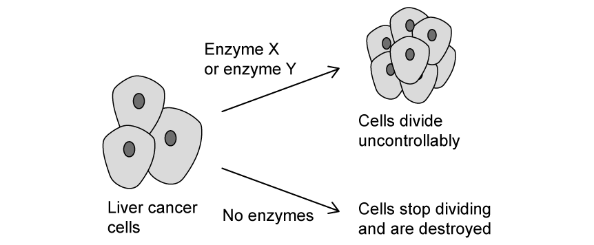

**Fig. 1**

Some people carry a genetic mutation that inhibits enzyme X. A drug company has produced a medicine that inhibits enzyme Y. This medicine has been trialled in people who have the mutation and liver cancer.  The medicine has been found to be successful at treating liver cancer.

Explain why.

**Q8** [2 marks]

**Extract:**

Enzymes are involved in controlling cell division. Fig. 1 shows how cell division can be accelerated by two enzymes, enzymes X and Y, in cancerous liver cells. Most cancer cells produce both enzymes X and Y.

Some people carry a genetic mutation that inhibits enzyme X. A drug company has produced a medicine that inhibits enzyme Y. This medicine has been trialled in people who have the mutation and liver cancer. The medicine has been found to be successful at treating liver cancer.

Explain why the medicine could **not** be used to treat liver cancer in a patient that does not have the genetic mutation.

**Q8** [4 marks]

#### Extended only

Glutaminase is another enzyme that has shown success in treating cancer. It is within a group of enzymes called amino acid deprivation enzymes which act on and destroy specific amino acids in cancerous cells.

Explain the action of the glutaminase on amino acids in cancer cells.

### Q9 — medium — 9 marks

**Q9** [2 marks]

Catalase is an enzyme that catalyses the breakdown of hydrogen peroxide into water and oxygen.

The effect of temperature on catalase activity was investigated.

The results are shown in Fig. 1

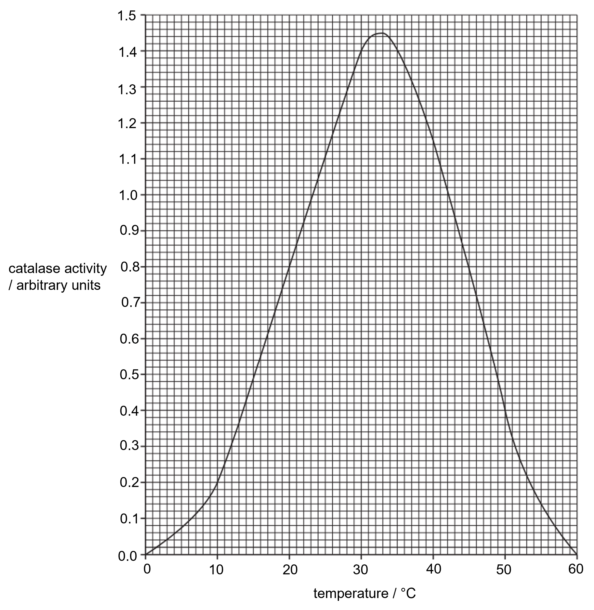

**Fig. 1**

(i)

State the temperature at which catalase is most active in Fig. 1. Give your answer in °C.

[1]

(ii)

Explain why there is no enzyme activity at 60°C.

[1]

*Source: 2018 (Series 1) 0610/31 Q8A*

**Q9** [1 mark]

State **one** factor other than temperature that affects enzyme activity.

*Source: 2018 (Series 1) 0610/31 Q8B*

**Q9** [5 marks]

Digestive enzymes are used in chemical digestion to break down large insoluble molecules to smaller soluble molecules.

The boxes show some large insoluble molecules, some digestive enzymes and some smaller soluble molecules that are produced during digestion.

Draw **one** straight line from each enzyme to the insoluble molecule it acts on.

Draw another line from each enzyme to the smaller soluble molecule that is produced.

Draw a total of **six** lines.

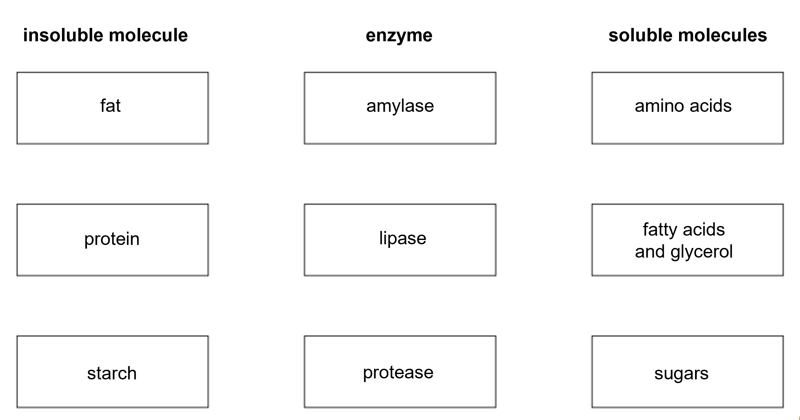

[5]

*Source: 2018 (Series 1) 0610/31 Q8C*

**Q9** [1 mark]

Digestive enzymes are secreted in different parts of the body.

Gastric proteases are found in the stomach.

Suggest the optimum pH for gastric protease.

### Q10 — easy — 9 marks

**Q10** [4 marks]

A student investigated the effect of pH on the activity amylase on starch solution. The student used iodine solution as an indicator to see when the amylase was active.

Their results are shown in the table below.

| pH of solution | time for iodine test to stop turning blue-black / seconds |
|---|---|
| 2 | 196 |
| 4 | 187 |
| 6 | 42 |
| 8 | 54 |

(i)

Describe why the student used iodine solution.

[2]

(ii)

Calculate the range of results for the time in seconds

[2]

**Q10** [2 marks]

**Extract:**

| pH of solution | time for iodine test to stop turning blue-black / seconds |
| 2 | 196 |
| 4 | 187 |
| 6 | 42 |
| 8 | 54 |

(i)

State which of the pH values tested is the optimum for amylase.

[1]

(ii)

Explain your answer to part (i)

[1]

**Q10** [3 marks]

**Extract:**

| pH of solution | time for iodine test to stop turning blue-black / seconds |
| 2 | 196 |
| 4 | 187 |
| 6 | 42 |
| 8 | 54 |

Another student concluded that the optimum pH was **not **shown in the results in Table 1.

Explain why the student concluded this.

### Q11 — medium — 7 marks

**Q11** [2 marks]

#### Extended only

Fig. 1 shows an enzyme in its optimum pH and in a pH that is much lower.

**Fig. 1**

Describe what has happened to the enzyme.

**Q11** [1 mark]

**Extract:**

Fig. 1 shows an enzyme in its optimum pH and in a pH that is much lower.

The enzyme on the left in Fig. 1 is in optimum pH. The active site has a specific shape at optimum pH.

#### Extended only

Sketch an appropriate substrate for the enzyme shown in Fig. 1

**Q11** [2 marks]

#### Extended only

A farmer tested a range of pHs on the soil in a section of a field and recorded the percentage of germination of carrot seedlings at each pH.

**Fig. 2** shows the results.

**Fig. 2**

Describe and explain which pH is the optimum pH for the carrot seedlings.

**Q11** [2 marks]

**Extract:**

The optimum pH for the carrot seedlings is... pH 5; Because this had the highest percentage germination.

#### Extended only

Another farmer suggested they plant radish seedlings at the carrot seedling's optimum pH shown in** **Fig. 2.

Explain why this farmer's suggestion may be incorrect.

### Q12 — medium — 8 marks

**Q12** [3 marks]

#### Extended only

Salivary amylase is an enzyme that is produced and secreted by salivary gland cells in the mouth.

Carbohydrate digestion, by amylase, begins in the mouth.

Starch, a polysaccharide, is hydrolysed into the disaccharide maltose by the enzyme salivary amylase.

The effect of changing pH and temperature on the digestion of starch was investigated by a group of students. The results are shown in **Table 1** and **Table 2 **below.

**Table 1 - Effect of pH**

| pH | time taken to digest starch / minutes |
|---|---|
| 3.0 | 38 |
| 4.0 | 26 |
| 5.0 | 17 |
| 6.0 | 13 |
| 7.0 | 7 |
| 8.0 | 8 |

**   **

**Table 2 - Effect of temperature**

| temperature / •C | time taken to digest starch / minutes |
|---|---|
| 10 | 20 |
| 20 | 14 |
| 30 | 11 |
| 40 | 6 |
| 50 | 12 |
| 60 | 23 |

A student reads the following statement on the Internet: ‘The main site for carbohydrate digestion is the small intestine.’

One of the students states that salivary amylase must be responsible for digesting starch in the small intestine. The student is incorrect.

Use the results in **Table 1** to explain why.

**Q12** [3 marks]

**Extract:**

The effect of changing pH and temperature on the digestion of starch was investigated by a group of students. The results are shown in Table 1 and Table 2 below.

Table 2 - Effect of temperature

temperature / ^•^C | time taken to digest starch / minutes
10 | 20
20 | 14
30 | 11
40 | 6
50 | 12
60 | 23

Using the results shown in **Table 2**, explain how temperature affects digestion.

**Q12** [2 marks]

#### Extended only

A second form of amylase, pancreatic amylase, is responsible for continued carbohydrate digestion in the small intestine.

Explain how the digestion of food by enzymes in the intestine is not inhibited by the acid produced in the stomach.

### Q13 — easy — 11 marks

**Q13** [6 marks]

#### Extended only

The digestive systems of young mammals are not fully developed.

Enzymes such as amylase, maltase and protease are often added to baby food to aid chemical digestion.

(i)

Complete **Table 1 **by stating the substrate and product(s) for each enzyme reaction.

**Table 1**

| enzyme | substrate | product(s) |
|---|---|---|
| amylase |   |   |
| maltase |   |   |
| protease |   |   |

[3]

(ii)

Suggest why the temperature of baby food must be controlled when the enzymes are added.

[2]

(iii)

State **one** other condition that must also be controlled to optimise enzyme activity.

[1]

*Source: 2018 (Series 1) 0610/41 Q6B*

**Q13** [2 marks]

The optimum temperature for the enzymes in the baby food to work was found to be 37°C.

Fig. 1 below shows a graph of the activity of an enzyme as temperature increases.

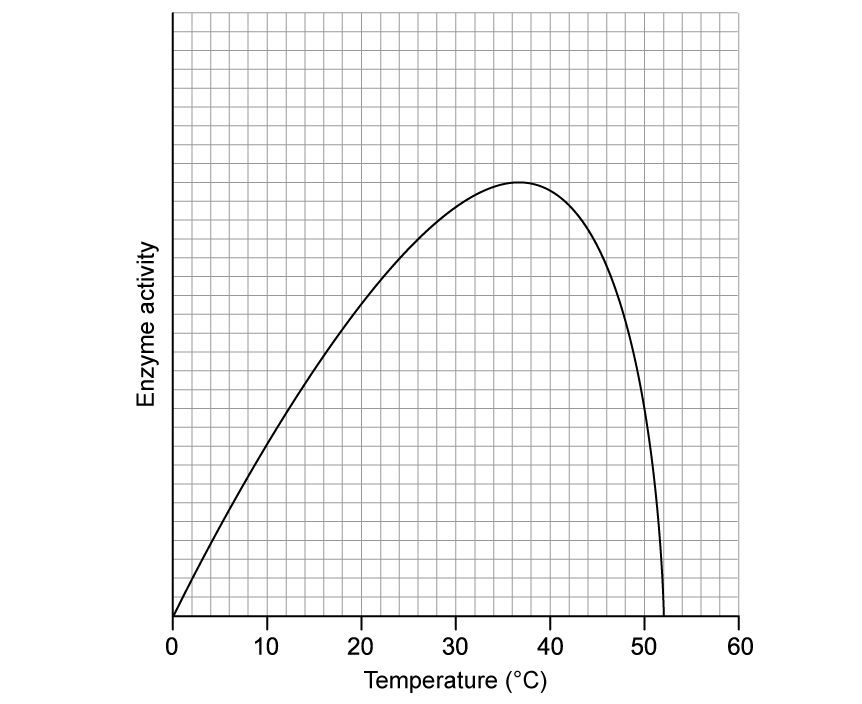

**Fig. 1**

Label the following key terms on to the graph:

- Optimum temperature
- Denatured enzyme

**Q13** [2 marks]

**Extract:**

Enzymes such as amylase, maltase and protease are often added to baby food to aid chemical digestion.
The temperature of baby food must be controlled when the enzymes are added because:
- High temperatures denature enzymes / will change the shape of the (enzyme) active site; 
- Enzymes work best / most efficient at optimum temperature; 
The optimum temperature for the enzymes in the baby food to work was found to be 37°C.
Denatured labelled anywhere from 40°C to where the curve stops at 52°C.

The label on the jar of baby food states that food must be thrown away if heated above 37°C.

Explain the need for this label.

**Q13** [1 mark]

Any food must be heated to its correct temperature as specified on cooking instructions.

State another reason why it is important to heat food to the correct temperature.

### Q14 — easy — 7 marks

**Q14** [1 mark]

Fig. 1 represents the reactants and products in a chemical reaction and four different enzymes (**A**, **B**, **C** or **D**).

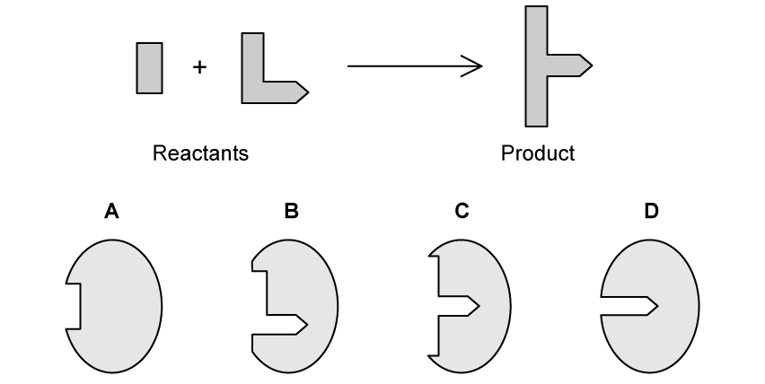

**Fig. 1**

State the letter of the enzyme responsible for this reaction.

**Q14** [2 marks]

State what happens when a substrate with a shape that is not complementary to the enzyme tries to enter the active site.

**Q14** [2 marks]

A student investigated the effect of enzyme concentration on the mass of product formed in one hour.

Fig. 2 shows the results of this investigation.

| concentration of enzyme / arbitrary units | mass of product formed / grams |
|---|---|
| 5 | 15 |
| 10 | 22 |
| 15 | 25 |
| 20 | 32 |
| 25 | 38 |
| 30 | 40 |
| 35 | 40 |
| 40 | 40 |

**Fig. 2**

Complete the graph by plotting the points and drawing a line to show the trend in the data. The first three points have been plotted for you.

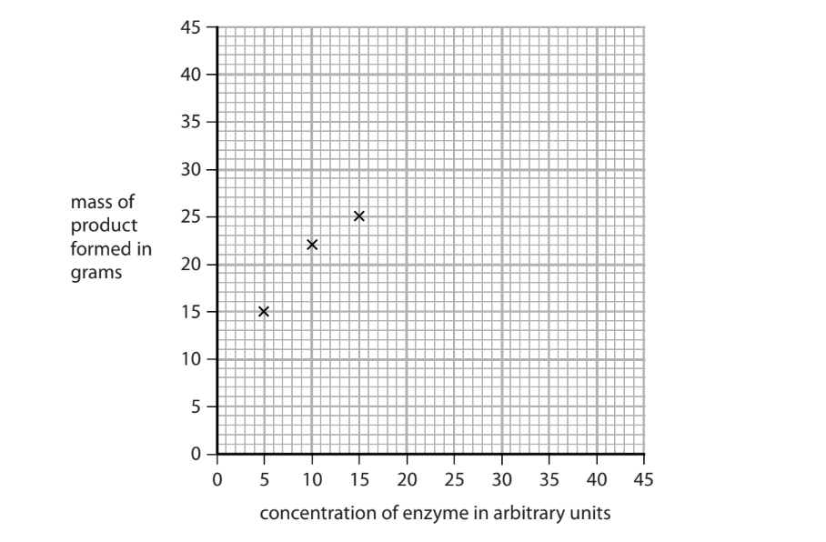

**Q14** [2 marks]

**Extract:**

A student investigated the effect of enzyme concentration on the mass of product formed in one hour.

| concentration of enzyme / arbitrary units | mass of product formed / grams |
| 5 | 15 |
| 10 | 22 |
| 15 | 25 |
| 20 | 32 |
| 25 | 38 |
| 30 | 40 |
| 35 | 40 |
| 40 | 40 |
**Fig. 2**

A line showing a steady increase that levels off at 30au/40g.

Describe the effect that enzyme concentration has on the mass of product formed.

### Q15 — medium — 10 marks

**Q15** [2 marks]

The effect of temperature on enzyme activity was investigated. The results are shown in Fig. 1.

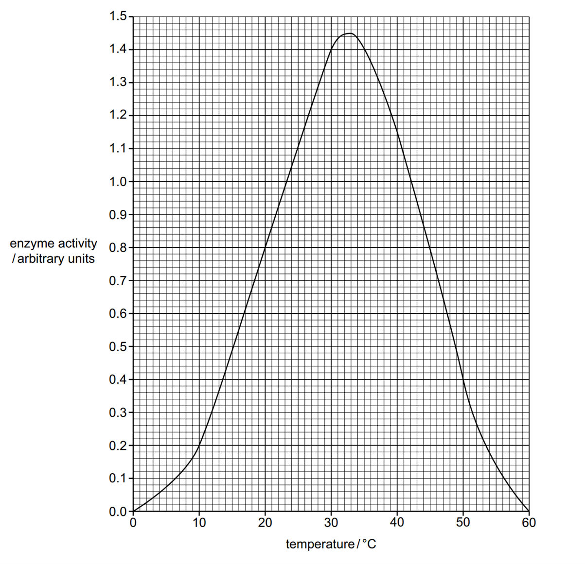

**Fig. 1**

(i)

State the optimum temperature for the enzyme in Fig. 6.1. Give your answer in °C.

[1]

(ii)

State why there is no enzyme activity at 60 °C.

[1]

*Source: 2023 0970/03 Q6A*

**Q15** [1 mark]

State **one **factor other than temperature that affects enzyme activity.

*Source: 2023 3/1/0970 Q6B*

**Q15** [5 marks]

**Table 1** shows some large insoluble molecules, some digestive enzymes and some smaller soluble molecules that are produced during digestion.

**Table 1**

| insoluble molecule | enzyme | soluble molecules |
|---|---|---|
| starch | amylase | reducing sugars |
| fat |   |   |
|   | protease |   |

Complete Table 1 by writing the names of the missing enzyme and molecules.

The first row has been done for you.

*Source: 2023 3/1/0970 Q6C*

**Q15** [1 mark]

List the chemical elements present in fats.

*Source: 2023 3/1/0970 Q6D*

**Q15** [1 mark]

State where in the digestive system protease is secreted.

*Source: 2023 3/1/0970 Q6E*

### Q16 — medium — 10 marks

**Q16** [1 mark]

During the fermentation of yeast, enzymes that break down sugar release carbon dioxide gas. The volume of carbon dioxide released can be used to measure how fast these enzymes are working.

A student investigates if fermentation works faster at two different temperatures: 25°C or 30°C. They measured the volume of carbon dioxide released in 15 minutes. Fig. 1 shows the apparatus she uses.

**Fig. 1**

The student used a gas syringe, as shown in Fig. 1 to collect and measure the volume of carbon dioxide released. They could have measured the volume of carbon dioxide by collecting the gas over water in a measuring cylinder.

Use the information provided in Fig. 1 to suggest why it is better to use a gas syringe.

**Q16** [7 marks]

**Extract:**

During the fermentation of yeast, enzymes that break down sugar release carbon dioxide gas. The volume of carbon dioxide released can be used to measure how fast these enzymes are working.

A student investigates if fermentation works faster at two different temperatures: 25°C or 30°C. They measured the volume of carbon dioxide released in 15 minutes. Fig. 1 shows the apparatus she uses.

The student used a gas syringe, as shown in Fig. 1 to collect and measure the volume of carbon dioxide released. They could have measured the volume of carbon dioxide by collecting the gas over water in a measuring cylinder.

The student’s results are shown in** **

**Table 1**

| temperature (°C) | volume of carbon dioxide gas released in 15 minutes / cm3 |   |   |
|---|---|---|---|
| repeat 1 | repeat 2 | repeat 3 |   |
| 25 | 25 | 22 | 24 |
| 30 | 33 | 26 | 35 |

(i)

Calculate the** **mean rate of gas produced at 25°C in cm3/minute. Give your answer to **1 **decimal place.

[3]

(ii)

The rate of gas produced at 30°C is greater than at 25°C. Use your knowledge of enzymes to explain why.

[3]

(iii)

The teacher tells the student to repeat the results for 30°C.  Explain why the teacher advised this.

[1]

**Q16** [2 marks]

#### Extended

Enzymes can be inhibited by chemicals called phenols during fermentation.

Phenols bind to amino acids on enzyme molecules.

Suggest how phenols inhibit enzymes.

### Q17 — hard — 7 marks

**Q17** [2 marks]

A group of students carried out the following practical to establish the effect of temperature on protein breakdown:

- Place a drop of biuret solution into every well in a spotting tile.

  - Put 4 cm3 of 1 % protein solution into a boiling tube.
  - Put 4 cm3 of pepsin solution into a second boiling tube.
  - Put both boiling tubes into a water bath at 20 °C.
  - After 4 minutes add the pepsin solution to the protein solution together in one boiling tube, mixing together with a stirring rod.
  - After 20 seconds add a drop of the protein/pepsin mixture to a drop of biuret solution in one well of the spotting tile.
  - Repeat step 6 until the biuret solution no longer changes colour.
  - Repeat steps 1–7 at 10 °C (using an ice water bath), 30 °C, 40 °C and 50 °C.

The concentration of protein present in the solution can also be measured using a colorimeter.

In a colorimeter, the amount of light that cannot pass through a solution is measured; giving the ‘absorbance’ of a solution. The darker the colour, the higher the absorbance.

Suggest advantages of using the colorimeter method rather than the method used by the students.

**Q17** [1 mark]

The graph below shows a calibration curve of concentration of protein versus absorbance.

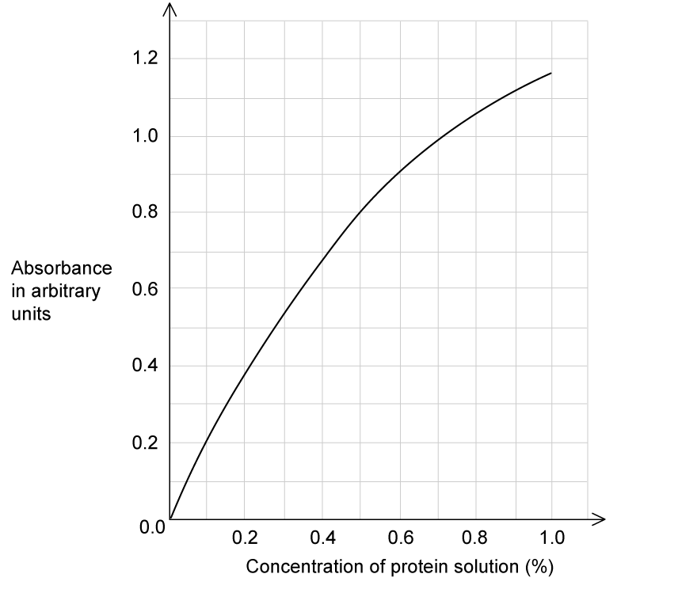

An experiment was carried out to investigate the effect of a protease enzyme on a 1 % protein solution.

The absorbance at 30 °C was 0.8 arbitrary units after 20 seconds.Using the calibration curve, estimate the final concentration of protein in this solution after 20 seconds.

**Q17** [2 marks]

**Extract:**

A group of students carried out the following practical to establish the effect of temperature on protein breakdown:

- Place a drop of biuret solution into every well in a spotting tile.
- Put 4 cm^3^ of 1 % protein solution into a boiling tube.
- Put 4 cm^3^ of pepsin solution into a second boiling tube.
- Put both boiling tubes into a water bath at 20 °C.
- After 4 minutes add the pepsin solution to the protein solution together in one boiling tube, mixing together with a stirring rod.
- After 20 seconds add a drop of the protein/pepsin mixture to a drop of biuret solution in one well of the spotting tile.
- Repeat step 6 until the biuret solution no longer changes colour.
- Repeat steps 1–7 at 10 °C (using an ice water bath), 30 °C, 40 °C and 50 °C.

The concentration of protein present in the solution can also be measured using a colorimeter.

In a colorimeter, the amount of light that cannot pass through a solution is measured; giving the 'absorbance' of a solution. The darker the colour, the higher the absorbance.

Explain why the concentration of protein in the solution at 10 °C after 1 minute is different from the concentration at 30 °C after 1 minute in the graph in part (b).

**Q17** [2 marks]

**Extract:**

A group of students carried out the following practical to establish the effect of temperature on protein breakdown:

- Place a drop of biuret solution into every well in a spotting tile.
- Put 4 cm^3^ of 1 % protein solution into a boiling tube.
- Put 4 cm^3^ of pepsin solution into a second boiling tube.
- Put both boiling tubes into a water bath at 20 °C.
- After 4 minutes add the pepsin solution to the protein solution together in one boiling tube, mixing together with a stirring rod.
- After 20 seconds add a drop of the protein/pepsin mixture to a drop of biuret solution in one well of the spotting tile.
- Repeat step 6 until the biuret solution no longer changes colour.
- Repeat steps 1–7 at 10 °C (using an ice water bath), 30 °C, 40 °C and 50 °C.

The concentration of protein present in the solution can also be measured using a colorimeter.

In a colorimeter, the amount of light that cannot pass through a solution is measured; giving the 'absorbance' of a solution. The darker the colour, the higher the absorbance.

The student repeated the experiment but incubated the protease and 1% protein solution at 80 °C.

The absorbance was measured at approximately 1.14 arbitrary units.

Suggest a reason for this result.

### Q18 — easy — 13 marks

**Q18** [7 marks]

This question is about enzymes.

Choose words from the list to complete the sentences.

Each word may be used once, more than once, or not at all.

| **amino acid** | **amylase** | **bacteria** | **biological** |
|---|---|---|---|
| **fatty acid** | **glucose** | **humidity** | **lipase** |
| **living** | **protease** | **salivary** | **temperature** |

All enzymes are proteins. Proteins are made of ........................................................ .

An enzyme acts as a ......................................catalyst.

In order to work rapidly, enzymes need the correct ......................................... and pH.

An example of an enzyme that works in the acidic conditions in the stomach is ........................................................... .

Acidic conditions will kill many of the .................................................................... present in food.

Salivary  ............................................................ stops working in acidic conditions.

Fats are broken down by ....................................................... .

*Source: 2018 0610/32 Q6*

**Q18** [5 marks]

Match up the key terms to their definition.

| Enzyme |   | Groove in enzyme where the reaction take place |
|---|---|---|
| Substrate | Molecules that bind to an enzyme |   |
| Catalyst | One enzyme for one substrate |   |
| Specificity | Any molecule that speeds up reactions |   |
| Active site | A protein that speeds up reactions |   |

**Q18** [1 mark]

#### Extended

Define what is meant by the term *enzyme-substrate complex*.

### Q19 — hard — 11 marks

**Q19** [2 marks]

#### Extended only

Biological washing powders contain enzymes and have to be used at temperatures below 45 °C.

Stains on clothes that are washed at temperatures above 45 °C are not always removed.

Explain why.

**Q19** [2 marks]

#### Extended only

Thermophilic bacteria are a special type of bacteria that live in hot springs at temperatures of 80 °C.

Scientists have extracted enzymes from thermophilic bacteria. The scientists added these enzymes to biological washing powder in the lab and tested them on a range of lab produced stains on cotton cloth.

It is expected that by using the washing powder the user can increase the cleaning performance of their laundry cycle.

Suggest why.

**Q19** [4 marks]

#### Extended only

The scientists compared two different washing powders each containing a different enzyme from thermophilic bacteria.

They washed stained items of clothing for different periods of time and recorded the percentage of stain removal. Their results are shown in **Fig.1** below.

**Fig. 1**

Compare the results of the two washing powders.

**Q19** [3 marks]

**Extract:**

Scientists have extracted enzymes from thermophilic bacteria. The scientists added these enzymes to biological washing powder in the lab and tested them on a range of lab produced stains on cotton cloth.

The scientists compared two different washing powders each containing a different enzyme from thermophilic bacteria. They washed stained items of clothing for different periods of time and recorded the percentage of stain removal. Their results are shown in Fig.1 below.

Washing powder A removed highest percentage/95% of stains in 20 minutes whereas washing powder B removes highest percentage/95% after 30 minutes; Washing powder B removes greater percentage of stains than washing powder A up until 18 (±1) minutes; After 20 minutes washing powder A effectiveness decreases whereas washing powder B effectiveness increases; Both (washing powders) are able to remove 95% of stains.

#### Extended only

A scientist released a report with the claim, "A 30 minute wash can rid your clothes of 95% of stains with new thermophilic washing powder".

Evaluate this claim.

### Q20 — hard — 11 marks

**Q20** [4 marks]

#### Extended only

The pancreas is an organ that produces enzymes used in digestion.

Explain the importance of enzyme specificity in the digestion of food.

**Q20** [4 marks]

#### Extended only

Pancreatic cancer develops when a malignant tumour grows inside the pancreas.

One symptom of pancreatic cancer is weight loss.

With reference to enzymes, explain how pancreatic cancer may cause a person to lose weight.

**Q20** [3 marks]

#### Extended only

Certain types of antibodies, called monoclonal antibodies, have been used to treat pancreatic cancer.

Compare the activity and nature of antibodies with those of enzymes.

### Q21 — hard — 14 marks

**Q21** [2 marks]

#### Extended only

Fig. 1 illustrates the results of two enzyme-controlled reactions involving two different types of enzyme.

**Fig. 1**

From these reactions, determine what conclusion can be drawn about the function of enzymes.

**Q21** [3 marks]

**Extract:**

pH 3.5 | 15 | 26 | 16 | 14 | 17 |

#### Extended

Catalase is an enzyme found in many different tissues in plants and animals. It speeds up the rate of the following reaction.

**Fig. 2**

A scientist investigated the effect of pH on the activity of the enzyme catalase in a geranium plant.

**Table 1** shows the scientist's results.

**Table 1**

| pH | catalase activity / arbitrary units |   |   |   |   |   |
|---|---|---|---|---|---|---|
| Trial 1 | Trial 2 | Trial 3 | Trial 4 | Trial 5 | Mean |   |
| 2.0 | 0 | 0 | 0 | 0 | 0 | 0 |
| 2.5 | 2 | 3 | 3 | 2 | 4 | 3 |
| 3.0 | 12 | 12 | 9 | 8 | 10 | 10 |
| 3.5 | 15 | 26 | 16 | 14 | 17 |   |
| 4.0 | 25 | 23 | 29 | 24 | 22 | 25 |
| 4.5 | 32 | 30 | 35 | 36 | 35 | 34 |
| 5.0 | 46 | 44 | 42 | 45 | 42 | 44 |
| 5.5 | 54 | 52 | 55 | 52 | 51 | 53 |
| 6.0 | 58 | 59 | 58 | 60 | 62 | 60 |
| 6.5 | 42 | 40 | 45 | 43 | 42 | 42 |

Calculate a mean result for pH 3.5

**Q21** [4 marks]

**Extract:**

Table 1

| pH | catalase activity / arbitrary units |
| Trial 1 | Trial 2 | Trial 3 | Trial 4 | Trial 5 | Mean |
| 2.0 | 0 | 0 | 0 | 0 | 0 | 0 |
| 2.5 | 2 | 3 | 3 | 2 | 4 | 3 |
| 3.0 | 12 | 12 | 9 | 8 | 10 | 10 |
| 3.5 | 15 | 26 | 16 | 14 | 17 |   |
| 4.0 | 25 | 23 | 29 | 24 | 22 | 25 |
| 4.5 | 32 | 30 | 35 | 36 | 35 | 34 |
| 5.0 | 46 | 44 | 42 | 45 | 42 | 44 |
| 5.5 | 54 | 52 | 55 | 52 | 51 | 53 |
| 6.0 | 58 | 59 | 58 | 60 | 62 | 60 |
| 6.5 | 42 | 40 | 45 | 43 | 42 | 42 |

The mean result for pH 3.5 is 16 (after disregarding the anomalous result of 26 and averaging the remaining values).

#### Extended

Use the grid below to draw a graph of the scientist's results.

**Fig. 3**

**Q21** [5 marks]

**Extract:**

Table 1

| pH | catalase activity / arbitrary units |
| Trial 1 | Trial 2 | Trial 3 | Trial 4 | Trial 5 | Mean |
| 2.0 | 0 | 0 | 0 | 0 | 0 | 0 |
| 2.5 | 2 | 3 | 3 | 2 | 4 | 3 |
| 3.0 | 12 | 12 | 9 | 8 | 10 | 10 |
| 3.5 | 15 | 26 | 16 | 14 | 17 |   |
| 4.0 | 25 | 23 | 29 | 24 | 22 | 25 |
| 4.5 | 32 | 30 | 35 | 36 | 35 | 34 |
| 5.0 | 46 | 44 | 42 | 45 | 42 | 44 |
| 5.5 | 54 | 52 | 55 | 52 | 51 | 53 |
| 6.0 | 58 | 59 | 58 | 60 | 62 | 60 |
| 6.5 | 42 | 40 | 45 | 43 | 42 | 42 |

Use the grid below to draw a graph of the scientist's results.

#### Extended

Use Table 1 and the graph to answer the following:

(i)

Describe the results shown in the graph.

[3]

(ii)

Predict the catalase activity at pH 7.

[1]

(iii)

Explain why the catalase activity is zero at pH 2.

[1]

### Q22 — easy — 9 marks

**Q22** [1 mark]

**Fig. 1** shows a model of how an enzyme works.

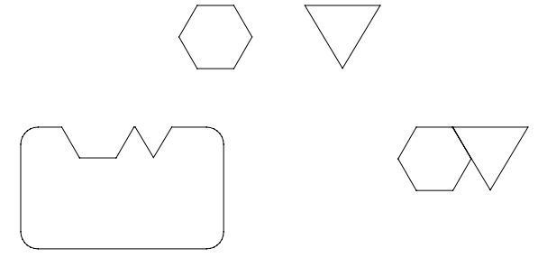

**Fig. 1**

Label the enzyme molecule on **Fig. 1**.

*Source: 2020 0610/03 Q4A*

**Q22** [3 marks]

Enzymes are biological catalysts.

(i)

Explain what is meant by the term *catalyst*.

[2]

(ii)

State why enzymes are important in organisms.

[1]

*Source: 2020 0610/03 Q4B*

**Q22** [1 mark]

**Extract:**

**Fig. 1** shows a model of how an enzyme works.

Label the enzyme molecule on **Fig. 1**.

You can tell this is the enzyme because it has indents to show the active site. The indents are the same shape as the smaller molecules (the substrates) so they fit together like the pieces of a jigsaw puzzle.

Sketch in the appearance of an enzyme-substrate complex on the diagram in **Fig. 1**.

The diagram is provided again here for you.

**Fig. 1**

**Q22** [4 marks]

#### Extended only

Describe the action of enzymes.

Use the following words as part of your answer:

collide     complementary     randomly     recycled
