# Mark Schemes — Photosynthesis & Leaf Structure
**6. Plant Nutrition** · Cambridge (CIE) IGCSE biology (0610 & 0970)

## Alternative To Practical Questions (3 questions)

### Q1
Do not draw individual cells.

**Answer:**

- The outline is a single, clear, unbroken line; **[1 mark]**
- Drawing is larger than 90 mm diagonally (top left to bottom right); **[1 mark]**
- At least four projections are drawn; **[1 mark]**
- At least four vascular bundles are drawn **OR** hairs are drawn on at least two of the projections; **[1 mark]**

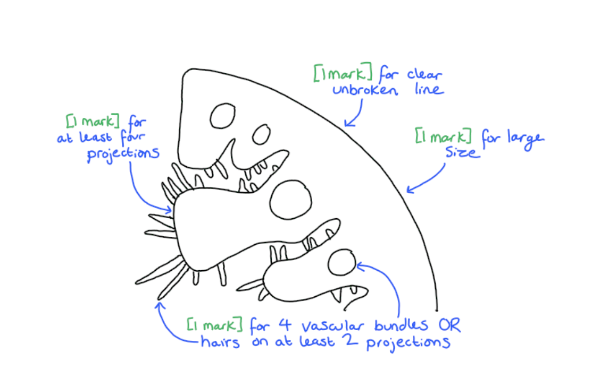

**Answer:**

- Length of line PQ = 111/112/113 (mm); **[1 mark]**

*Actual diameter calculations*

- Actual diameter = 112 ÷ 120; **[1 mark]**
- 0.9 (mm); **[1 mark]**

*Award 2 marks for the correct actual diameter in the absence of other calculations.*

*Note that the measurements will be different on the screen to those on a printed copy of the exam paper*

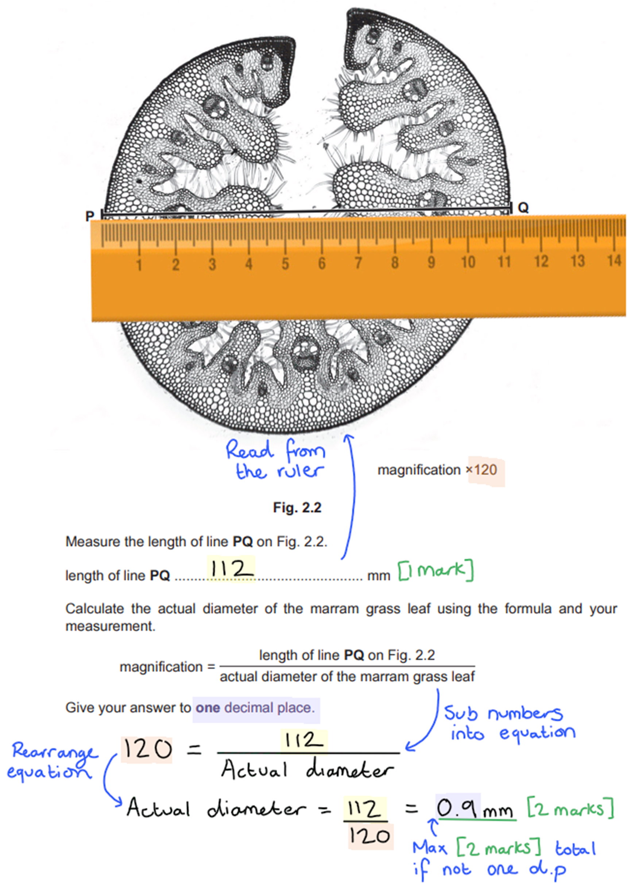
(i)

**Answer:**

- Independent variable = concentration of sodium chloride solution;** [1 mark]**
- Dependent variable = length of roots; **[1 mark]**

(ii)

**Answer:**

Any two from:

- Repeating the investigation; **[1 mark] **
- A large number of / 15 seeds at each concentration;** [1 mark]**
- Seedlings are measured after the same growth period / after 20 days; **[1 mark]**
- Same plant species / all marram grass seeds; **[1 mark]**
(i)

**Answer:**

- 19 (mm) **AND **13 (mm); **[1 mark]**
- 19-1319 x 100; **[1 mark]**
- 31.6 (%); **[1 mark]**

*Award full marks for the correct answer in the absence of other calculations.*

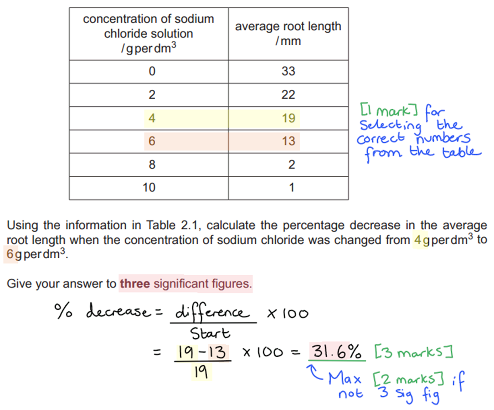

(ii)

**Answer:**

- Axes are labelled **AND** units are included;** [1 mark]**
- A suitable even scale is used **AND** plotting area occupies at least half the grid in both directions; **[1 mark]**
- Six points are plotted accurately to within half a small square;** [1 mark]**
- A suitable line is drawn; **[1 mark]**

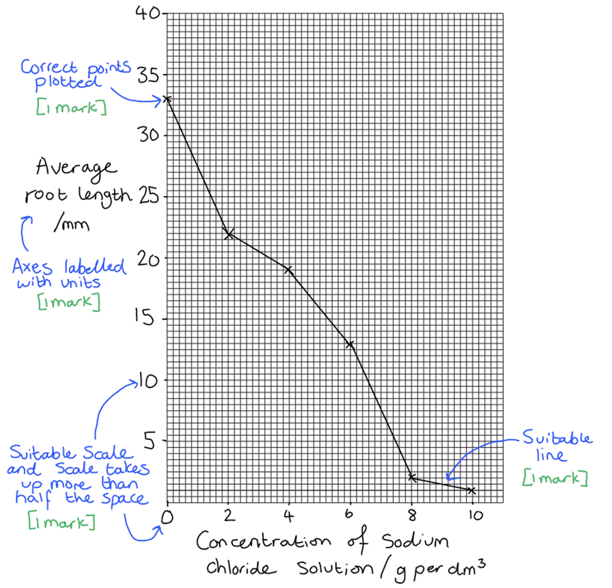

### Q2
(i) The mark allocation for the results table would be as follows...

- A suitable table was drawn with at least three columns; **[1 mark]**
- Appropriate headings with units are used e.g. Distance from lamp / cm **AND** Rate of photosynthesis / bubbles min-1; **[1 mark]**
- Results for both trials 1 and 2 were correctly recorded / ten measurements were correctly recorded; **[1 mark]**
- Raw data was correctly converted to bubbles per minute; **[1 mark]**

> *Your results table would look like this:*

| **Distance from the lamp / cm** | **Rate of photosynthesis / bubbles min****-1** |   |
|---|---|---|
| **Trial 1** | **Trial 2** |   |
| 10 | 35 | 36 |
| 20 | 22 | 24 |
| 30 | 8 | 7 |
| 40 | 5 | 4 |
| 50 | 2 | 1 |

> *Remember that the raw data shows the number of bubbles counted over 2 minutes so you would have to divide these measurements by 2 to get the number of bubbles per minute. It is important to round your values to the nearest whole number as you cannot have a fraction of a bubble! *

> *Another important thing to remember when constructing results tables is that the units must only appear in the column headings, never in the body of the table.*

(ii) A conclusion for the results would be the following...

- The greater the distance from the lamp / the lower the light intensity, the lower the rate of photosynthesis / the less bubbles are released; **[1 mark]**

*Accept the converse argument as a valid conclusion*

**[Total: 5 marks]**
The difference in the mean rate of photosynthesis can be calculated as follows...

- Mean at 10 cm = 36 **AND **mean at 50 cm = 1 cm; **[1 mark]**
- (36 - 1) = 35 (bubbles min-1); **[1 mark]**

*Full marks awarded for the correct answer in the absence of other calculations Accept mean values of 36 and 2 at marking point 1 if values from results table from part (a)(i) were used Accept an answer of 34 if values from results table from part (a)(i) were used*

**[Total: 2 marks]**

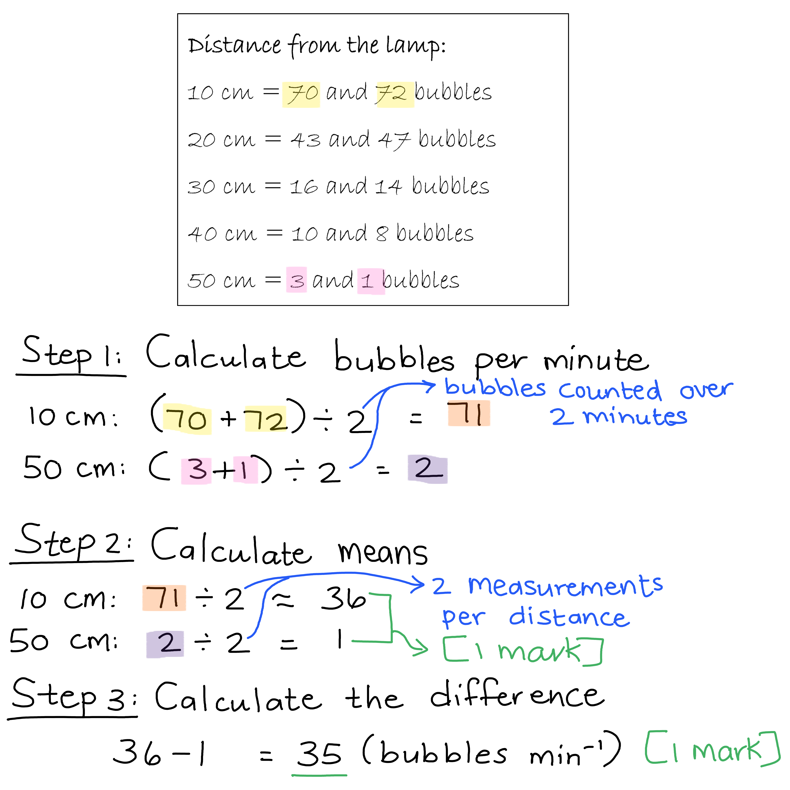
(i) The independent variable for this investigation is...

- Light intensity / distance from the lamp; **[1 mark]**

> *The independent variable is always the one that is changed by the investigator, so in this case, it would be the distance between the lamp and the pondweed which changes the light intensity.*

(ii) Variables that should be kept constant for this investigation...

Any **two** of the following:

- Temperature (of the water around the pondweed); **[1 mark]**
- The carbon dioxide concentration of the water (around the pondweed); **[1 mark]**
- The time that the pondweed is left to equilibrate before readings are taken **OR** the time during which bubbles are counted; **[1 mark]**

> *Keeping these variables constant between readings will ensure that no other factor other than light intensity would affect the rate of photosynthesis in the pondweed.*

(iii) An improvement in determining the rate of photosynthesis would be...

- Measure the volume of oxygen released (instead of counting the number of bubbles) **OR** a description of measuring the volume of oxygen e.g. use an inverted graduated measuring cylinder / use a syringe attached to a delivery tube connected to a funnel; **[1 mark]**

> *The size of the bubbles will vary and is therefore not the most accurate way of determining the rate of photosynthesis. Measuring the volume of oxygen released over a period of time will provide a more accurate indication of the rate of photosynthesis.*

**[Total: 4 marks]**
The experiment could be adapted to investigate the effect of carbon dioxide on the rate of photosynthesis in the following ways...

**Descriptions of relevant points of original method**

A maximum of **two** from the following:

- Use 10 cm section of *Elodea* pondweed placed at a distance of 10 cm away from a lamp; **[1 mark]**
- Place a glass tank with water between the lamp and beakers containing the pondweed (to absorb heat from lamp); **[1 mark]**
- Leave the pondweed for 5 minutes before taking readings/measurements (to equilibrate); **[1 mark]**
- Repeat the experiment at least once; **[1 mark]**

**Additions / changes to the method**

A maximum of **three** from the following:

- Use at least three different concentrations of sodium hydrogen carbonate solution; **[1 mark]**
- Concentration of sodium hydrogen carbonate solutions in a range of 0.1% to 1% (independent variable); **[1 mark]**
- Count the number of bubbles released in 1 minute **OR** measure the volume of gas released in 1 minute (dependent variable); **[1 mark]**
- Calculate the mean rate of photosynthesis (for each sodium hydrogen carbonate solution); **[1 mark]**

**Control variables / safety precautions**

Any **one** of the following:

- Keep the distance between the lamp and the pondweed constant throughout experiment; **[1 mark]**
- Monitor the temperature of the water using a thermometer (to ensure it doesn't vary); **[1 mark]**
- Use the same species / length of pondweed during the investigation; **[1 mark]**
- Use forceps when handling pondweed; **[1 mark]**
- Cut away from yourself when cutting the pondweed into sections; **[1 mark]**

*Accept any other valid control variable or safety precaution*

**[Total: 6 marks]**

### Q3
(i) Marks are awarded for the following features in your drawing...

- Lines should be clear single and continuous **AND **there should be no shading; **[1 mark]**
- Size of diagram should be at least half of the space provided; **[1 mark]**
- Proportions should be approximately correct (for each of the layers of the leaf); **[1 mark]**

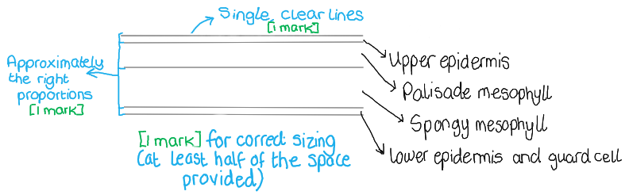

(ii) Actual length should be calculated as follows...

- Length of line AB = 4 cm/40 mm;** [1 mark]**
- 40 ÷ 100; **[1 mark]**
- 0.4 mm;**[1 mark]**

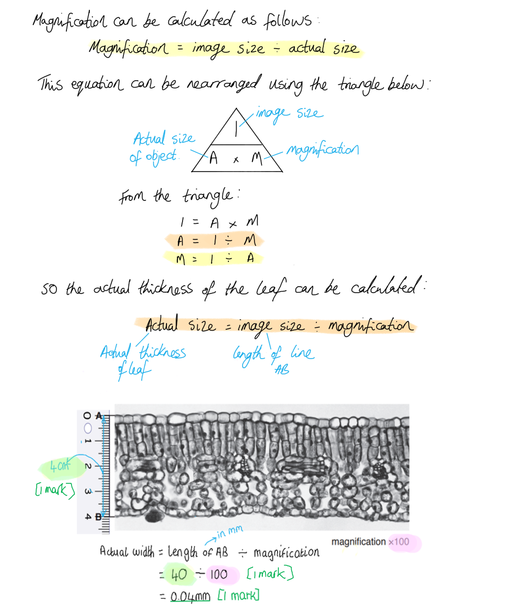

(iii) This tissue type should be labelled as follows...

- X should be written on the spongy mesophyll of drawing; **[1 mark]**

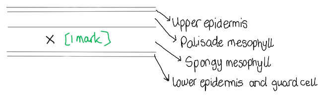

**[Total: 7 marks]**
(i) Scientists used a large sample of leaves to...

Any **one **of the following:

- Obtain a representative leaf size ;**[1 mark] **
- Identify anomalous results; **[1 mark]**

(ii) Leaves were selected at random to...

Any **one **of the following:

- Avoid bias / gain a representative sample; ** [1 mark]**
- Allow a comparison to be made (between the different light intensities); **[1 mark]**

*Accept a description that includes the idea that leaves may be different sizes depending on their height on the stem.*

(iii) A grid could have been used in the following way...

Any **two **of the following:

- Draw round the outline of the leaf on a grid / place leaf under a (transparent) grid;** [1 mark]**
- Count the squares (within the outline);** [1 mark]**
- Include any squares more than half covered / other valid method described, e.g. estimating percentage cover;** [1 mark]**

(iv) The variable that was changed was...

- Light intensity; **[1 mark]**

**[Total: 5 marks]**
(i) The percentage difference can be calculated as follows...

- (2600 ÷ 3900) x 100; **[1 mark]**
- 67 (%); **[1 mark]**

(ii) The bar chart should be plotted as follows...

- Axis headings should include 'Light intensity / arbitrary units/a.u.' **AND** 'Average leaf area / mm2' **AND** 'Species A' and 'Species B' are labelled / key given; **[1 mark]**
- A suitable scale has been used for leaf area **AND** sequential bars are used on the x-axis **AND** plotting area occupies at least half the grid in both directions; **[1 mark]**
- Six values plotted accurately ± ½ small square; **[1 mark]**
- Bars are the same width (at least 1 small square wide) **AND** gaps are present between bars / pairs of bars;** [1 mark]**

(iii) The trends in the graph can be described as follows...

- (Species A =) as the light intensity decreases the (average) leaf area increases; **[1 mark]**
- (Species B = average) leaf area increases with increasing light intensity (to maximum at 50 a.u.) and then decreases; **[1 mark]**

*Accept reverse arguments, e.g. for species A as light intensity increases the average leaf area decreases.*

(iv) The method could be modified in the following way...

- Measure leaf growth at a narrower range of light intensities around 50 (a.u.);** [1 mark]**

**[Total: 9 marks]**

> *i) Percentage difference can be calculated:*

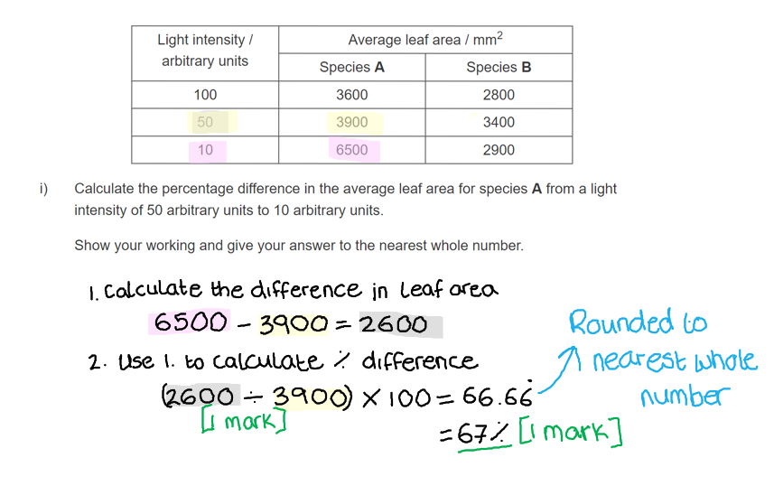

> *ii) When drawing a graph you should always be aware what marks will be awarded for:*

- Correctly labelled axes with units.
- An appropriate, even scale.
- Good use of the space provided.
- Accurate plotting/drawing of data points.
- An appropriate line drawn through points (this is not relevant in this particular question)

> *Note that If bars are drawn touching each other rather than with a space in between, this represents continuous data and is known as a histogram rather than a bar chart.*

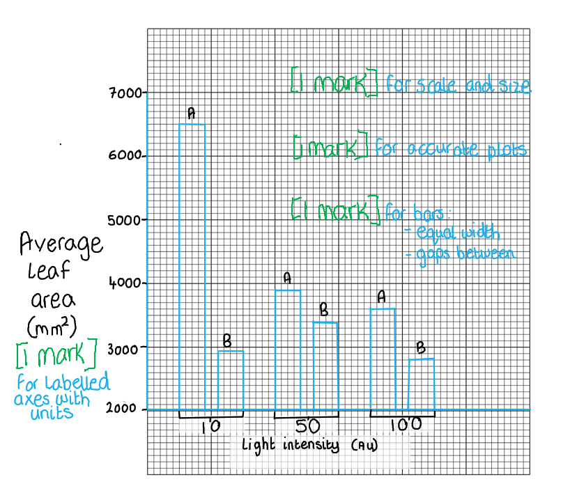

> *iii) The results for species B show that the largest leaf area was found in leaves at a light intensity of 50 arbitrary units. Either side of this, the size decreases. Testing leaf size at light intensity in between 10 and 50 or in between 50 and 100 may give a better indication as to which light intensity results in the largest leaf size.*

## Multiple Choice Questions (29 questions)

### Q1
**Final answer:** **The correct answer is ****A.**

- If the rate stops increasing even when **light intensity continues to increase**, then **light is no longer the limiting factor**. Another factor must now be limiting the rate

**B** is incorrect because if light stopped reaching the leaf, the rate would decrease.

**C** is incorrect because the graph shows the rate has levelled off, not fallen to zero.

**D** is incorrect because chlorophyll is not used up in photosynthesis.

### Q2
**Final answer:** **The correct answer is ****A.**

- The word equation for photosynthesis is:

**carbon dioxide + water → glucose + oxygen **

- **Reactants **are the starting materials in a chemical reaction, while **products** are the new substances formed as a result

**B** is incorrect because glucose is a product and water is a reactant.

**C** is incorrect oxygen is a product and carbon dioxide is a reactant.

**D **is incorrect because it shows the reactants and products of aerobic respiration, not photosynthesis.

> **[exam-tip]**
> The substances in photosynthesis and aerobic respiration are arranged in reverse, so this can help you remember the equations. Always think about which process is building glucose (photosynthesis) and which is breaking glucose down to release energy (respiration).

### Q3
**Final answer:** **The correct answer is B.**

- Nitrate ions are needed to make amino acids, and therefore proteins, so low nitrogen availability leads to poor growth
- Magnesium ions are needed to make chlorophyll, so high magnesium availability means chlorophyll can still be produced and leaves remain green

### Q4
**Final answer:** **The correct answer is B.**

- The aluminium foil prevents sunlight from entering the test tube
- The plant will respire but will be unable to photosynthesise
- More carbon dioxide is released than is used up
- This results in the hydrogencarbonate indicator solution changing colour to yellow

**A** is incorrect as no colour change will only occur in a control test tube without a plant cutting.

**C** is incorrect as the colour red in this instance indicates that photosynthesis and respiration are occurring at the same rate.

**D** is incorrect as the colour change to purple can only occur if the rate of photosynthesis is greater than that of respiration.

### Q5
**Final answer:** **The correct answer is D.**

- Palisade cells are positioned at the top of the leaf where most sunlight hits
- They are also packed with chloroplasts, which contain chlorophyll to absorb light energy

**A** is incorrect as it is the spongy mesophyll, not the upper epidermis, that contains air spaces for gas diffusion.

**B** is incorrect as water is transported from the roots by the xylem, not the phloem.

**C** is incorrect as the description of being waterproof and transparent better describes the waxy cuticle.

### Q6
**Final answer:** **The correct answer is ****B****.**

- This is because they create open space for the movement of gases by diffusion. It is important that carbon dioxide moves through the leaf quickly in order to be used for photosynthesis

**A** is incorrect because the air spaces do not store any gases, just allow gases to pass through.

**C** is incorrect because the leaves do have a large surface area, but this is unrelated to the air spaces in the spongy mesophyll.

**D** is incorrect because rainwater does not enter leaf tissues in most cases.

### Q7
**Final answer:** **The correct answer is ****D****.**

- This is because temperature and carbon dioxide concentration are not limiting factors in this condition, and in 5 the addition of the light increased production, so therefore light must be a limiting factor in 4

**A** is incorrect because there are several limiting factors for 1, which is the cause of the low production.

**B** is incorrect because temperature is not a limiting factor at 3 because the glasshouse is heated.

**C** is incorrect because carbon dioxide is not a limiting factor for 4 and 5 because it is provided in those conditions.

### Q8
**Final answer:** **The correct answer is ****C****.**

- This is because the phloem and xylem are both transport vessels that run through the plant

**A** is incorrect because the palisade mesophyll is a tissue found in the leaf that is not part of a vascular bundle.

**B** is incorrect because the palisade mesophyll and spongy mesophyll are both tissues found in the leaf that are not part of a vascular bundle.

**D** is incorrect because the spongy mesophyll is a tissue found in the leaf that is not part of a vascular bundle.

### Q9
**Final answer:** **The correct answer is ****C****.**

- This is because oxygen is a waste product from the process of photosynthesis. When it is produced in excess of what is needed by the plants for respiration the rest of the oxygen diffuses out of the leaf via the stomata

**A** is incorrect because carbon dioxide diffuses into the leaf via the stomata, not out. Carbon dioxide is needed for photosynthesis inside the leaf.

**B** is incorrect because glucose is used up in the process of respiration or stored as starch. It does not move out of a leaf via the stomata.

**D** is incorrect because water evaporates out of the leaf via the stomata but is not a product of photosynthesis. The water that diffuses out of the stomata travels to the leaf via the xylem and originates in the soil and enters the plant via the roots.

### Q10
**Final answer:** **The correct answer is ****B.**

- The palisade mesophyll cells are found underneath the upper epidermis. These cells are adapted to maximise the absorption of sunlight for photosynthesis and so are tightly packed.

**A **is incorrect because it represents the upper epidermis of the leaf.

**C** is incorrect because it identifies the vascular bundle (xylem and the phloem) of the plant.

**D** is incorrect because it shows the spongy mesophyll cells which are adapted for gas exchange.

### Q11
**Final answer:** **The correct answer is ****A.**

- Iodine changes from yellow-brown to blue-black in the presence of starch.
- Glucose from photosynthesis is stored as starch in the green parts of the leaf where chloroplasts are present.
- Leaf A shows a positive result in the green striped region and a negative result in the white striped regions.

**B** is incorrect because the iodine would cause the outer white regions of the leaf to be coloured yellow-brown.

**C** is incorrect because the central part of the leaf would no longer be green as the chlorophyll has been removed. The outer white regions of the leaf have no starch and so would be coloured yellow-brown due to the iodine.

**D** is incorrect because the central part will not be green as chlorophyll has been removed.

### Q12
**Final answer:** **The correct answer is A because:**

All amino acids contain nitrogen atoms

**B** is incorrect because fatty acids are mostly hydrocarbon chains with a small number of oxygen atoms.

**C** is incorrect because the formula for glucose is C6H12O6, so it contains no nitrogen.

**D** is incorrect because starch is made from glucose, which only contains carbon, hydrogen and oxygen.

### Q13
**Final answer:** **The correct answer is C because:**

Cell labelled X is a palisade mesophyll cell

**A** is incorrect because the epidermis is the upper and lower layer of cells in a leaf.

**B** is incorrect because the guard cells sit in the bottom of the leaf in the lower epidermis, where they control the opening and closing of the stomata.

**D** is incorrect because the spongy mesophyll cells sit below the palisade layer and can be identified by the large air spaces around the cells.

### Q14
**Final answer:** **The correct answer is C because:**

The plant in the tube is exposed to light, so is carrying out photosynthesis

Photosynthesis uses carbon dioxide

**A** is incorrect because the plant is in the dark, so is not carrying out photosynthesis. In addition to this the aquatic animal is releasing carbon dioxide during respiration.

**B** is incorrect because the plant is in the dark so is not carrying out photosynthesis.

**D** is incorrect because the aquatic animal will be releasing carbon dioxide as a waste product from respiration.

### Q15
**Final answer:** **The correct answer is ****C ****because:**

- At 1, the **rate** of photosynthesis has yet to level off (neither temperature nor concentration of carbon dioxide are limiting in this experiment) so light intensity is still the limiting factor
- At 2, the **rate** of photosynthesis is **no longer increasing** even though the **light intensity is still increasing**, so some other factor is limiting (in the table, we can see the temperature for experiment 2 is 20℃, so the temperature is the limiting factor)
- At 3, the **rate** of photosynthesis is **no longer increasing** even though the light intensity is still increasing, so **some other factor is limiting **(in the table, we can see the carbon dioxide concentration is lower than other experiments, so carbon dioxide concentration is the limiting factor)

**A** is incorrect because **temperature** is the limiting factor for experiment 2, not light intensity.

**B** is incorrect because **light intensity **is the limiting factor in experiment 1, not temperature.

**D** is incorrect because **temperature** is the limiting factor for experiment 2, and **carbon** **dioxide** is the limiting factor for experiment 3.

### Q16
**Final answer:** **The correct answer is ****C ****(Chemical) because:**

When glucose is made in photosynthesis, light energy is transferred to chemical potential energy in the chemical (covalent) bonds that hold the atoms in a glucose molecule together.

**A** is incorrect because light energy is essential to drive the reactions of photosynthesis (reacting carbon dioxide and water together to form glucose).

**B** is incorrect because photosynthesis is an endothermic reaction. Heat energy is released when an exothermic reaction occurs.

**D** is incorrect because mechanical energy is the sum of kinetic and potential energy in an object used to do work (a machine), not the stored energy found in glucose molecules.

### Q17
**Final answer:** **The correct answer is ****B ****because:**

The concentration of carbon dioxide in the leaf would be at its lowest in regions where the rate of photosynthesis is highest (as carbon dioxide is used up to produce glucose). The cells in the leaf with the highest rate of photosynthesis are the palisade mesophyll cells (cell **B**).

**A** is incorrect because epidermal cells do not have chloroplasts and so do not photosynthesise, so would not be using up carbon dioxide.

**C** is incorrect because xylem and phloem cells do not have chloroplasts, so would not be using up carbon dioxide.

**D** is incorrect because spongy mesophyll cells do not photosynthesise as much as palisade mesophyll cells, as they don’t contain as many chloroplasts.

### Q18
**Final answer:** **The correct answer is ****D**** (1 → 4 in the presence of 3) because:**

The correct balanced equation for photosynthesis is:

`6 CO _ 2 + 6 H _ 2 O -> from chlorophyll to light of C _ 6 H _ 12 O _ 6 + 6 O _ 2`

6 molecules of carbon dioxide react with 6 molecules of water to form 1 molecule of glucose and 6 molecules of oxygen.

**A** is incorrect because this option has 1 molecule of carbon dioxide reacting with 6 molecules of water to form 6 molecules of glucose and 6 molecules of oxygen which is not balanced.

**B** is incorrect because this option has 1 molecule of carbon dioxide reacting with 6 molecules of water to form 1 molecule of glucose and 6 molecules of oxygen which is not balanced.

**C** is incorrect because this option has 6 molecules of carbon dioxide reacting with 6 molecules of water to form 6 molecules of glucose and 6 molecules of oxygen which is not balanced.

### Q19
**Final answer:** **The correct answer is ****C ****because:**

- The green area of the leaf would have been able to **photosynthesise**, producing glucose which is converted into **starch**. When the chlorophyll which is green has been removed from the leaf, the **starch** in that area would turn **iodine** **blue-black**
- The outer rim of the leaf does not contain chlorophyll (as it is white) so would not be able to photosynthesise, so no starch would be present and the iodine remains yellow-brown

**A** is incorrect because the outer part of the leaf does not contain chlorophyll and would therefore not be able to photosynthesise, so starch would not be present in this area to turn iodine blue-black.

**B** is incorrect because no area of the leaf remains green after chlorophyll has been extracted. The iodine would stain the inner region blue-black.

**D** is incorrect because iodine would stain the outer rim of the leaf yellow-brown, it would not remain white.

### Q20
**Final answer:** **The correct answer is ****B ****because:**

**Palisade** mesophyll cells contain the **most** chloroplasts, followed by spongy mesophyll cells. **Guard** **cells** contain a **small** **number** of **chloroplasts** (far fewer than either mesophyll cell).

Palisade mesophyll cells are found towards the top of the leaf and therefore have access to more sunlight hitting them than the cells of the spongy mesophyll; this is why they contain greater numbers of chloroplasts than spongy mesophyll cells.

Guard cells have a smaller number of chloroplasts; they indirectly help control stomatal opening and closing.

Epidermal cells in the leaf do not contain chloroplasts. Cells in the upper epidermal layer need to allow light to penetrate the mesophyll layers below, and cells in the lower epidermal layer do not receive enough sunlight to photosynthesise.

### Q21
**Final answer:** **The correct answer is ****D ****because:**

In the presence of **low** levels of **carbon dioxide** hydrogencarbonate **indicator** changes colour from red to **purple**, whereas in high levels of carbon dioxide hydrogencarbonate indicator changes colour from red to **yellow**.

The leaf in the test tube on the left is able to **photosynthesise** as it is exposed to **light**, so carbon dioxide is absorbed from the air surrounding the leaf, lowering the level of carbon dioxide so that the indicator turns **purple**. Even though the plant leaf will be respiring, the rate of respiration will probably be lower than the rate of photosynthesis.

The leaf in the test tube on the right is not exposed to light and so will not photosynthesise (it is in the dark). However, it will **respire**, **producing carbon dioxide**. Levels of carbon dioxide in the air surrounding the leaf increase, turning the indicator yellow.

### Q22
**Final answer:** **The correct answer is ****C ****because:**

- The test tube contains pondweed, which in the presence of light can **photosynthesise**. As a result, carbon dioxide levels in the water will decrease
- A carbon dioxide diffusion gradient is set up between the water and the leaves  as photosynthesis occurs, resulting in **diffusion** of carbon dioxide **into** the leaf for photosynthesis

**A** is incorrect because there is nothing in the test tube photosynthesising or respiring, so the concentration of carbon dioxide in the water will not change.

**B** is incorrect because although the **pondweed** in the test tube will be **photosynthesising** and therefore decreasing the carbon dioxide concentration of the water, the **snail** will be **respiring** and so releasing carbon dioxide. There will be more carbon dioxide than in test tube **C**.

**D** is incorrect because the test tube contains a snail which will be **respiring** and therefore releasing carbon dioxide into the water, increasing the overall amount.

### Q23
**Final answer:** **The correct answer is ****B**** (Oxygen) because:**

The two products of photosynthesis are **glucose** and **oxygen** gas. Glucose will stay within the plant to be used or stored while oxygen gas diffuses out of photosynthesising cells into the air spaces of the leaf and then out through the stomata.

**A** is incorrect because water is a reactant in the reactions of photosynthesis, not a product of photosynthesis.

**C** is incorrect because carbon dioxide is a reactant in the reactions of photosynthesis, not a product of photosynthesis.

**D** is incorrect because glucose is a product of photosynthesis. Some glucose is converted into starch or other useful substances in the cells in which it is made. Glucose that needs to be moved around the plant is converted into sucrose and transported through the phloem by translocation.

### Q24
**Final answer:** **The correct answer is ****A ****because:**

**A** is a palisade mesophyll cell which is where most photosynthesis takes place (due to palisade mesophyll cells having the highest concentration of chloroplasts). The more photosynthesis occurring, the greater the amount of oxygen produced as a waste product. Some oxygen will be used up by each type of plant cell in the process of aerobic respiration, but the amounts are similar in each type of cell.

**B** is incorrect because it is part of the vascular bundle (xylem and phloem); these tissues do not contain chloroplasts.

**C** is incorrect because it is a spongy mesophyll cell which has fewer chloroplasts than the palisade cells (so photosynthesises less).

**D** is incorrect because it is an epidermal cell. Epidermal cells do not contain chloroplasts so do not photosynthesise.

### Q25
**Final answer:** **The correct answer is ****D ****(transfers light energy into chemical potential energy in glucose molecules which are used in the synthesis of other carbohydrates) because:**

- chlorophyll absorbs light energy (from the Sun or artificial light sources)
- light energy is used to drive a reaction between water and carbon dioxide, producing glucose (a carbohydrate)
- glucose can be converted into other carbohydrates, such as sucrose, starch and cellulose

**A** is incorrect because chlorophyll molecules do contain magnesium ions, but this doesn’t outline its role in photosynthesis.

**B** is incorrect because chlorophyll absorbs light energy, not chemical potential energy, to drive the synthesis of organic molecules such as glucose (light energy is transferred to chemical potential energy stored in the bonds of glucose molecules).

**C** is incorrect because chlorophyll absorbs energy from sunlight to drive reactions between inorganic molecules (carbon dioxide and water) to produce glucose (an organic molecule). Glucose can then be converted into other molecules (such as amino acids) which are used in growth.

### Q26
**Final answer:** **The correct answer is ****A ****because:**

- Magnesium ions are an essential part of a chlorophyll molecule. **Chlorophyll** molecules have a green colour as they absorb red and blue light wavelengths, reflecting **green** light. Leaves **deficient** in **chlorophyll** appear **yellow**
- Nitrate ions are needed by plants to synthesise amino acids and therefo**re **proteins. Without them, a plant cannot grow correctly

### Q27
**Final answer:** **The correct answer is ****B ****because:**

- Glucose is converted into cellulose which is needed to form cell walls
- Glucose is converted into starch for storage within the cell, as starch is insoluble and therefore doesn’t influence water levels in the cells (glucose is soluble and can affect osmosis)
- Glucose is also converted to fats and oils for energy storage in seeds

**A** and **D** are incorrect because cellulose is not used for storage and starch is not used to build cell walls.

**C** is incorrect because glucose is converted into sucrose to be transported around the plant (via the phloem), but cellulose is not used for storage.

### Q28
**Final answer:** **The correct answer is ****B**** (the size of the aquatic plant and time exposed to light.) because:**

- A smaller plant would photosynthesise less than a larger plant, affecting the amount of gas produced each time
- The time of exposure to **light** is also a control variable as light is necessary for photosynthesis to occur, so each time the experiment is run the plants should be exposed to the same amount of light

**A** is incorrect because neither the beaker nor the funnel will affect the rate of photosynthesis.

**C** is incorrect because water is already in excess, the exact amount is not important as long as there is water in the measuring cylinder to be displaced by any gas produced by the plant and readings are taken before and after each experiment.

**D** is incorrect because the amount of gas in the measuring cylinder is the dependent variable, not a control variable.

### Q29
**Final answer:** **The correct answer is ****D ****because:**

It represents the chloroplasts which are the organelles where photosynthesis occurs. They contain chlorophyll which absorb light energy.

**A** is incorrect because this is the nucleus where genetic information is stored.

**B** is incorrect because this is the vacuole, which contains a solution of sugars and salts and helps the cell maintain its shape.

**C** is incorrect because this is the cell wall which contains the polymer cellulose which provides structural support to the cell.

## Theory Questions (20 questions)

### Q1
> **[mark-scheme]**
> - Minute 4 = 17 breaths per minute **[1 mark]**
> - Minute 8 = 29 breaths per minute **[1 mark]**
To calculate the total number of breaths the runner takes during the race:

- Multiply the average breath rate by the total number of minutes

= 26 x 7 **[1 mark]**

= **182** (breaths) **[1 mark]**

> **[mark-scheme]**
> Award full marks for the correct answer in the absence of additional calculations.

### Q2
(i)

- carbon dioxide + water;** [1 mark]**
- → glucose + oxygen;** [1 mark]**

*Note that the question specifically asks for the word equation so you would not achieve marks for using the symbols.*

(ii)

- Water **OR** optimum / suitable temperature; **[1 mark]**

### Q3
(i)

- Water; **[1 mark]**

The results show that seeds with access to water grew whereas those without did not.

(ii)

- Light; **[1 mark]**

The results show that seeds with no access to light still grew if they had access to water.

(iii)

- No seeds germinate / grow; **[1 mark]**
- (Because) seeds are killed / damaged **OR** enzymes are destroyed;**[1 mark]**

### Q4
(i) 
Any three from:

- (Water moves) into the root; **[1 mark]**
- (Via) root hair cells; **[1 mark]**
- Through the cell walls; **[1 mark]**
- Across a partially permeable membrane; **[1 mark]**
- By osmosis; **[1 mark]**

(ii)

- Support / transport of mineral ions / solvent / coolant; **[1 mark]**

(iii)

- Xylem; **[1 mark]**

(iv)

- Stoma(ta); **[1 mark]**

**[Total: 6 marks]**

### Q5
Any four from:

- Chlorophyll is required (for photosynthesis); **[1 mark]**
- Chlorophyll absorbs light energy (for photosynthesis); **[1 mark]**
- Only the green part contains chlorophyll; **[1 mark]**
- And produces glucose; **[1 mark]**
- Glucose is converted to / stored as starch; **[1 mark]**

The reverse points said about the white part of the leaf could also gain marks here, for example instead of saying that that green part contains chlorophyll you could say that the white part does not contain chlorophyll for that mark instead.

Remember that glucose must be stored as starch to prevent it affecting osmosis in the cells of the leaf.

**[Total: 4 marks]**

### Q6
Plants take up carbon dioxide during photosynthesis because:

- Carbon dioxide is a raw material / substrate/reactant; **[1 mark]**
- The concentration of carbon dioxide is higher outside the leaf than inside (so carbon dioxide diffuses into the leaf); **[1 mark]**

***Accept*** *for one mark the statement that carbon dioxide is used in photosynthesis to make glucose.*

**[Total: 2 marks]**

> *Be careful not to describe the **production** of carbon dioxide in respiration, as this is not what the question is asking about!*

> *This question part covers core content but is taken from an extended paper 4 question.*
The results from the apparatus can be used to calculate the rate of photosynthesis in the following way:

Any **two **from the following:

- Subtract the concentration of carbon dioxide at the end / leaving the chamber from the concentration at the start / entering the chamber; **[1 mark]**
- Divide by the time (taken) / per unit time; **[1 mark]**
- Taking (rate of) respiration into account; **[1 mark]**

**[Total: 2 marks]**

> *The key here is to find the **difference** between the concentrations of carbon dioxide entering the leaf (this is the air entering the chamber)and leaving the leaf (this is the air leaving the chamber), and then to divide this value by the **time taken**. The reason it is important to take the **rate of respiration** of the leaf into account is that some of the carbon dioxide produced by respiration is then used in photosynthesis, so this will slightly reduce the accuracy of the measurements.*

> *This question part covers core content but is taken from an extended paper 4 question.*
(i) Environmental factors that should have been kept constant in this investigation include:

Any **one **from the following:

- Light <u>intensity</u>; **[1 mark]**
- Water (supply/availability); **[1 mark]**
- Humidity; **[1 mark]**

(ii) The effect of temperature on the rate of photosynthesis when carbon dioxide concentration **A** was supplied can be described as follows:

- Increases **AND** reaches a plateau / remains constant / levels off; **[1 mark]**
- Increases (from 10 °C) to 30 °C / levels off at 30 °C;** [1 mark]**
- Any comparative use of figures for rate with units at least once, e.g. photosynthesis rate increases from 12 μm per m2 per s to 22 μm per m2 per s; **[1 mark]**

(iii) The percentage increase in the rate of photosynthesis at 30 °C when the carbon dioxide concentration was increased from **A** to **B** was:

- (8 ÷ 22) x 100; **[1 mark]**
- 36 (%); **[1 mark]**

(iv) The effect of increasing temperature on the rate of photosynthesis, for carbon dioxide concentration **B**, can be explained as follows:

Any **three **from the following:

- <u>Temperature</u> is the limiting factor (over whole range); **[1 mark]**
- Increased temperature increases <u>kinetic</u> energy / <u>KE</u> (of molecules); **[1 mark]**
- (Increased movement of molecules) increases rate of diffusion of carbon dioxide (into leaf); **[1 mark]**
- Temperature influences/affects (activity of) <u>enzymes</u>; **[1 mark]**
- More (effective) collisions occur between substrate molecules and enzymes (in plants) / more enzyme-substrate complexes form; **[1 mark]**
- More carbon dioxide is fixed / used in photosynthesis / converted into sugar; **[1 mark]**
- Carbon dioxide (concentration) is <u>not</u> limiting; **[1 mark]**

*A maximum of ***[2 marks]*** to be awarded here if the term ****limiting factor**** is not used.*

(v) The evidence for the conclusion that carbon dioxide concentration is the factor limiting the rate of photosynthesis between 30 °C and 35 °C, for the results shown for **A**, is as follows:

- **B** shows that the rate of photosynthesis is higher / continues to increase if carbon dioxide is increased (at all temperatures); **[1 mark]**

**[Total: 10 marks]**

> *In (c) (i) you would not gain marks for carbon dioxide concentration or temperature as these factors are given in the question and are factors that are deliberately being changed; i.e. they are independent variables. You must use the term '**intensity**' when referring to light as an experimental variable - 'light' on its own is not sufficient.*

> *When quoting rates of photosynthesis in (c) (ii) be careful to include the units and take special care to include the units **in** **full** (e.g. don't forget to include the '**per s**' at the end of the units)!*

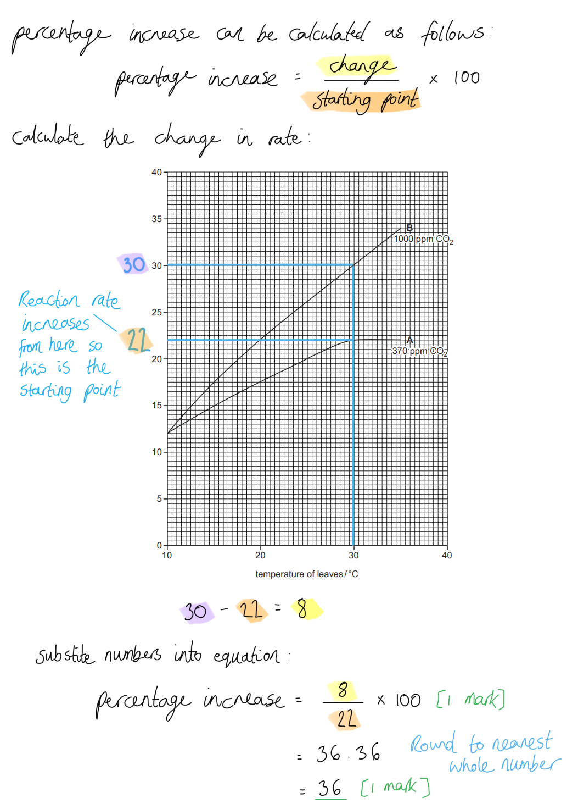

> *Remember; if a plant is given unlimited light, CO**2** (and water) and is at a warm temperature, the limit on the rate at which it can photosynthesise is simply its **own ability** to absorb these materials and allow them to react. However, most often plants do not have unlimited supplies of these raw materials, so their rate of photosynthesis is **limited** by whatever factor is the **lowest** at that time - in this case, **temperature**.*
A correct prediction of what would happen to the rate of photosynthesis if the investigation is continued at temperatures higher than 45 °C would be:

- The rate of photosynthesis remains constant/decreases/slows; **[1 mark]**

A correct explanation for this would be:

Any **one** from the following:

- Enzymes/active sites are denatured (at high temperatures); **[1 mark]**
- Stomata close so little/no carbon dioxide can enter leaves; **[1 mark]**
- Plant is adapted to survive at high temperatures; **[1 mark]**

**[Total: 2 marks]**

### Q7
The following conclusions can be made about the conditions needed for photosynthesis:

- Light is needed (for photosynthesis); **[1 mark]**
- Carbon dioxide is needed for / increases the rate (of photosynthesis) **OR** no / low levels of carbon dioxide results in a low rate of photosynthesis / few bubbles released; **[1 mark]**

**[Total: 2 marks]**

> *Light and carbon dioxide are essential for photosynthesis to occur. Sunlight is trapped by chlorophyll in plant cells to provide energy for the process of photosynthesis. Carbon dioxide is an important raw material needed to produce glucose.*
The effect that an increase in temperature would have on the results of test **2** and **3** would be as follows:

**Test 2:**

A maximum of **two **of the following:

- (The results) will stay the same / no (oxygen) bubbles (are released / produced); **[1 mark]**
- (This is because) no photosynthesis occurred; **[1 mark]**
- (Due to) no light / carbon dioxide (being present); **[1 mark]**

**Test 3:**

A maximum of **two **of the following:

- The number of oxygen bubbles increases; **[1 mark]**
- (This is because) there is an increase in the rate of photosynthesis/reaction / more photosynthesis is occurring; **[1 mark]**
- (Due to) enzymes being more active / gaining more/increased (kinetic) energy; **[1 mark]**

**OR**

- The number of oxygen bubbles decreases; **[1 mark]**
- (This is because) there is a decrease in the rate of photosynthesis/reaction / less/no photosynthesis is occurring; **[1 mark]**
- (Due to) high temperatures causing enzymes to denature / not work **OR** (due to) a decrease in the solubility of carbon dioxide; **[1 mark]**

**[Total: 4 marks]**

> *For this question, you need to be familiar with the effects of an increase in temperature on photosynthesis. Remember that in test 2 there is no light or carbon dioxide present, so increasing the temperature will have no effect, but in test 3 the increase in temperature will have a definite impact on the rate of photosynthesis.*
The correct statements that refers to diffusion is as follows:

**[Total: 2 marks]**

> *Diffusion is the movement of particles from a high to a low concentration. Another way of saying this is that particles move down their concentration gradient. This is a process that occurs in all living cells, but it can also occur in the environment around us (think about how odours can spread across a room or how a few drops of food colouring can change the colour of water in a glass if left for long enough). No energy is required for this type of movement and it occurs due to the random movement of particles.*
(i) The percentage water used during photosynthesis can be calculated as follows...

- (2.6 ÷ 265) x 100; **[1 mark]**
- 0.98 (%); **[1 mark]**

*Full marks awarded in the absence of other calculations Maximum of ***[1 mark]*** if answer is not given to two decimal places*

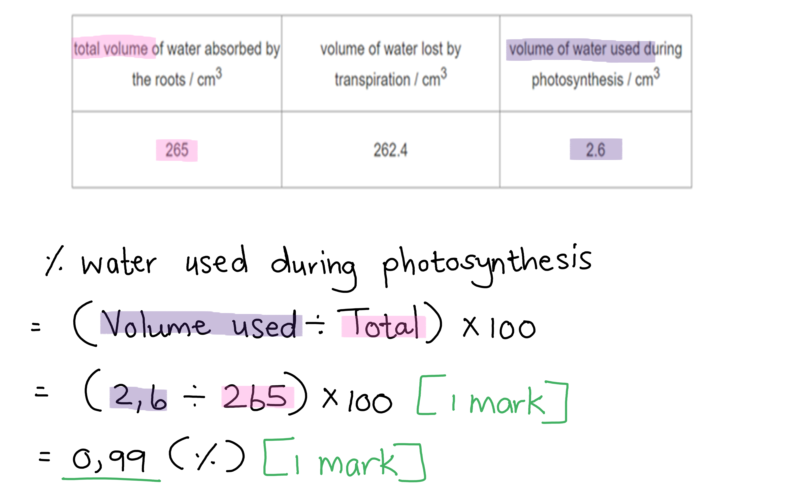

(ii) The reason why water is usually not a limiting factor...

- Very little water is used during / required for photosynthesis **OR** most water is lost during transpiration; **[1 mark]**

**[Total: 3 marks]**

### Q8
Light intensity and temperature affected the rate of photosynthesis in the following ways...

Any **four** of the following:

- As temperature increases, the rate of photosynthesis also increases (for both light intensities) until the optimum temperature is reached; **[1 mark]**
- (This is because) enzyme activity is faster/increases as temperature increases **OR** as temperature increases it becomes less of a limiting factor; **[1 mark]**
- Plants grown at a low(er) light intensity had a lower rate of photosynthesis (than those grown at high(er) light intensity); **[1 mark]**
- (This is because) at low light intensity, light is a limiting factor / less light is available for photosynthesis **OR** at high light intensity there is more light available for photosynthesis / light is not a limiting factor; **[1 mark]**
- Any data point correctly read from the graph to support marking points e.g. optimum temperature for plants grown at low light intensity is 16/17/18°C;** [1 mark]**

**[Total: 4 marks]**

> *Correctly reading from a graph to support your answer is always worth a mark in questions that require you to describe or explain trends in a graph.*
The limiting factors between point **X** and **Y** is...

- Temperature; **[1 mark]**
- Light <u>intensity</u>; **[1 mark]**

**[Total: 2 marks]**
The percentage difference in the rate of photosynthesis at 25°C can be calculated as follows...

- (1.45 ÷ 1.5) x 100; **[1 mark]**
- 96.7(%); **[1 mark]**

*Full marks awarded for the correct answer in the absence of other calculations*

**[Total: 2 marks]**

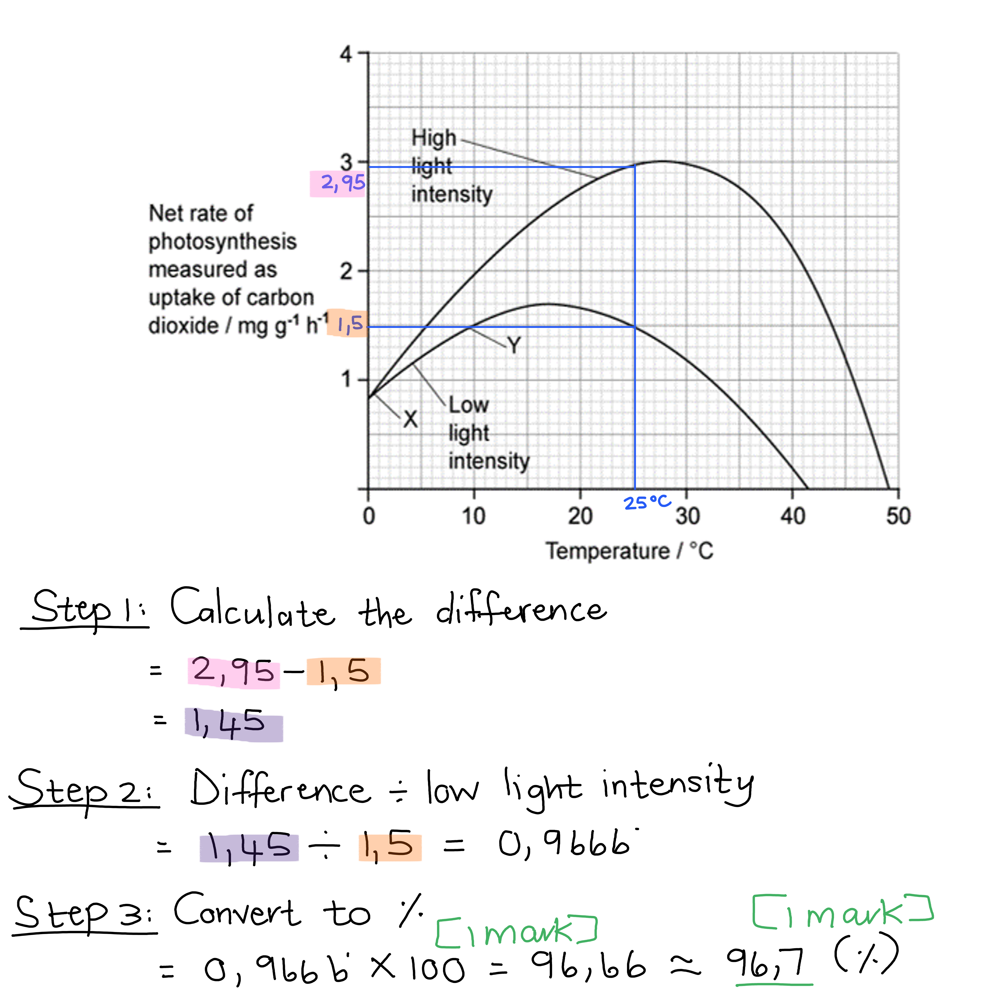
Light intensity is no longer limiting the rate of photosynthesis at temperatures higher than 30°C because...

- The enzymes (involved with photosynthesis) will denature at high temperatures; **[1 mark]**
- This will decrease the rate of photosynthesis (regardless of the level of light intensity); **[1 mark]**

**[Total: 2 marks]**

### Q9
The student will have made the following observation...

- The plant that had been provided with water and magnesium / plant 2 will have shown a greater amount of growth (compared to the other plant / plant 1); **[1 mark]**
- Plant 1 will have yellow leaves; **[1 mark]**

**[Total: 2 marks]**
An explanation of the prediction at part (a) would include...

Any **four** from the following:

- Magnesium is needed for production of chlorophyll / chloroplasts; **[1 mark]**
- **In plant 1, lack of chlorophyll results in yellow leaves; [1 mark]**
- In plant 1, chlorophyll / chloroplasts are limiting factors **OR ** in plant 2 there is more chlorophyll / chlorophyll is not a limiting factor; **[1 mark]**
- More chlorophyll means more light can be absorbed for photosynthesis; **[1 mark]**
- More photosynthesis means more glucose; **[1 mark]**
- More glucose means more growth / more proteins / cellulose; **[1 mark]**

**[Total: 4 marks]**
The student selected leaves with the same number of leaves..

Any **three** from the following:

- To ensure results were valid / comparable; **[1 mark]**
- It was a control variable; **[1 mark]**
- More leaves would mean more chlorophyll / chloroplasts; **[1 mark]**
- (More chloroplasts would lead to) a faster rate of / more photosynthesis; **[1 mark]**

*Allow converse explanations*

**[Total: 3 marks]**
Testing the leaves with iodine would show that photosynthesis has occurred because...

- Glucose (from photosynthesis) is stored as starch (in the leaves); **[1 mark]**
- The presence of starch is shown when iodine changes from brown to black; **[1 mark]**

**[Total: 2 marks]**

### Q10
The rate of photosynthesis at 45 °C should be calculated as follows:

- (1.9 + 2.2) ÷ 2; **[1 mark]**
- 2.1 cm3 / hour; **[1 mark]**

**OR**

**Allow [1 mark] for an answer which includes the anomalous result as follows:**

- **(1.9 + 14.2 + 2.2) ÷ 3 = 6.1**

**[Total: 2 marks]**

> *Note that the 14.2 reading was excluded from the results as it is an anomaly.*

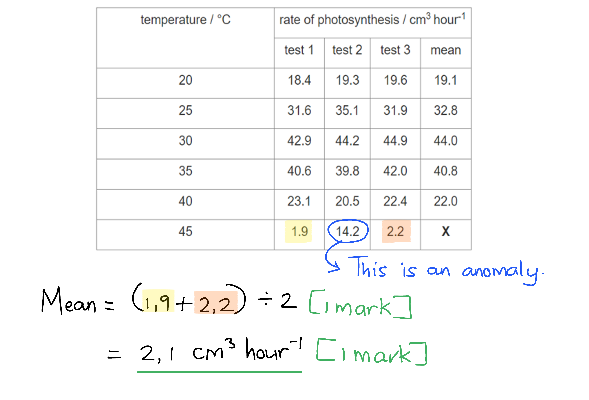
The graph should be plotted as follows:

- Sensible, linear scale;** [1 mark]**
- Axis labelled correctly (both X and Y); **[1 mark]**
- Points plotted correctly; **[1 mark]**
- Line chart with suitable line/curve of best fit; **[1 mark]**
- Units included; **[1 mark]**

**[Total: 5 marks]**

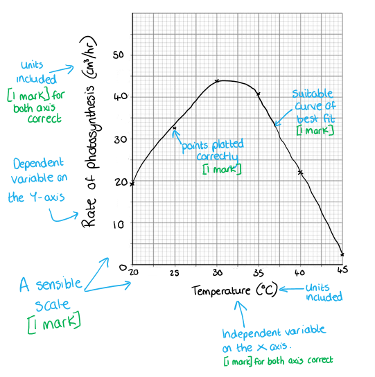
The results on the graph can be explained as follows:

Any **four** from the following:

- As temperature increases, so does the rate of photosynthesis, up to 30 °C; **[1 mark]**
- This is because an increase in temperature increases enzyme activity / kinetic energy so the rate of reaction increases; **[1 mark]**
- After 30 °C the rate of photosynthesis decreases; **[1 mark]**
- This is because an increase in temperature past the optimum temperature results in enzymes being denatured so photosynthesis cannot occur; **[1 mark]**
- The optimum temperature is between 30 and 35 °C; **[1 mark]**

**[Total: 4 marks]**
The rate of photosynthesis that the farmer achieved at 30 °C can be calculated as follows:

- Predicted rate = 44 cm3 / hr; **[1 mark]**
- 11.5 %  = (44 / 100) X 11.5 = 5.06; **[1 mark]**
- Actual rate = 44 - 5.06; **[1 mark]**
- = 38.94 / 38.9 / 39 cm3 hr-1; **[1 mark]**

*Allow full marks for correct calculations using readings from students own graph*

**[Total: 4 marks]**

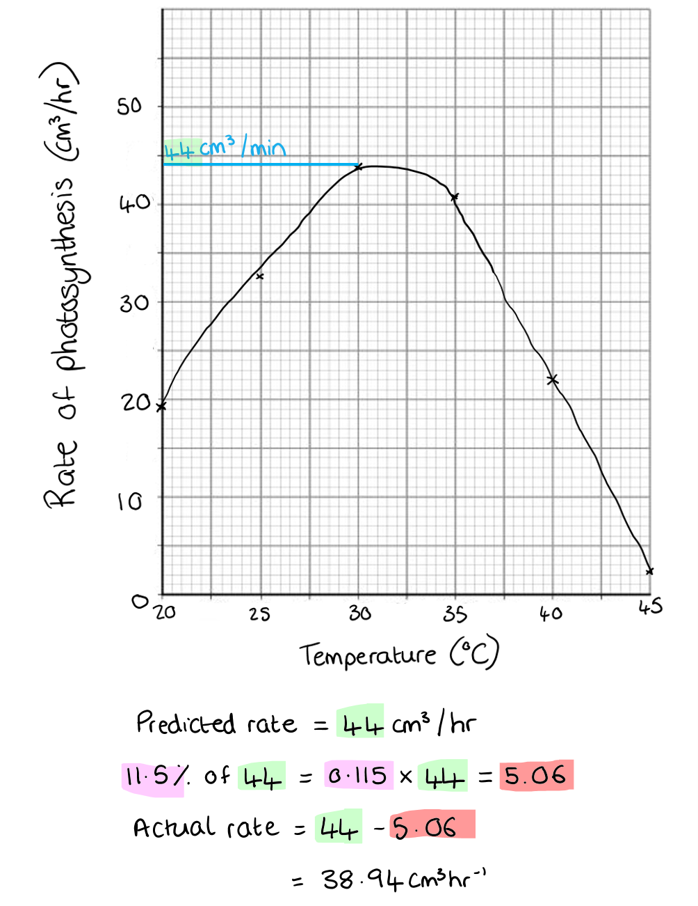
The farmer may not have achieved a rate of photosynthesis as high as predicted because...

- Another factor is limiting photosynthesis;** [1 mark]**
- (This could include) carbon dioxide / light intensity; **[1 mark]**

**[2 marks]**

### Q11
(i) The temperature at which the aquatic plant produced the most bubbles of gas in two minutes is:

- 30 (°C); **[1 mark]**

(a) (ii) The number of bubbles of gas produced by the aquatic plant, in two minutes, at 15 °C and at 25 °C is:

- 85 and 170; **[1 mark]**

(a) (iii) The percentage increase in the number of bubbles of gas produced by the aquatic plant at 15 °C and at 25 °C is:

- 100 %; **[2 marks] **

***Accept**** error carried forward for part (iii), i.e. a correctly calculated percentage increase using the wrong number from part (ii) can still be credited for full marks.*

**[Total: 4 marks]**

> *If you got the answer to part (ii) wrong but used the correct calculation in part (iii) you can still get two marks for the correct outcome of your calculation. This is why it is always important to show your working. *

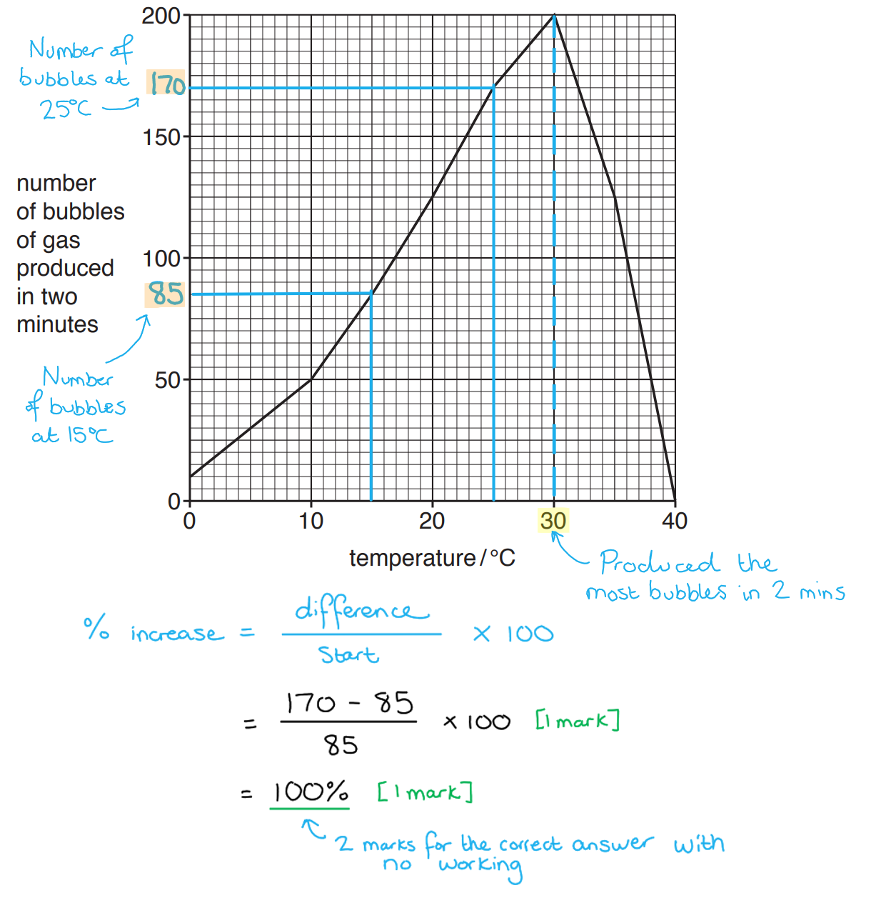
A description of the results shown in Fig. 2 is:

Any **three **from the following:

- Rises and falls / rises and peaks / peaks and falls; **[1 mark]**
- Slow increase and fast decrease / slower increase (to peak) **OR** steeper / faster decrease; **[1 mark]**
- Slowest rise between 0 °C and 10 °C / increase more rapid between 10 °C and 25 °C; **[1 mark]**
- Decrease is most rapid after 35 °C; **[1 mark]**
- (No bubbles / gas) stops at 40 °C; **[1 mark]**

**[Total: 3 marks]**

> *Remember to always quote numbers from the graph in your description. You do not need to explain any science about the results because you have not been asked to do so. *
Between 30°C and 40°C...

- The enzymes (involved with photosynthesis) denatured / active sites changed shape; **[1 mark]**
- Which decreased the rate of photosynthesis (leading to less bubbles being released); **[1 mark]**

**[Total: 2 marks]**

> *For questions where you have to explain parts of a graph, you need to think of reasons why the shape of the graph looks the way it does. In this case, there is a clear decrease in the number of bubbles released, which indicates that the rate of photosynthesis has decreased (since the bubbles are being released as a result of photosynthesis). This is another synoptic question that requires you to refer back to Topic 5 on Enzymes. Enzymes are proteins that are sensitive to high temperatures because this will denature them and negatively affect their ability to catalyse reactions (such as those involved with photosynthesis).*
The purpose of adding sodium hydrogen carbonate to the water is...

- To act as a source of / provide carbon dioxide/CO2 (to the plant); **[1 mark]**

**[Total: 1 mark]**

> *Making sure that the aquatic plant has an abundant supply of carbon dioxide will prevent it from being a limiting factor in this investigation. If carbon dioxide becomes a limiting factor, it will decrease the rate of photosynthesis which will then not give an accurate reflection of the effect of temperature on photosynthesis.*

### Q12
The results can be explained as follows:

Any **four **from the following:

- Chlorophyll is required (for photosynthesis); **[1 mark]**
- (Because) chlorophyll absorbs light energy (for photosynthesis); **[1 mark]**
- Only the green part (of the leaf) contains chlorophyll / chlorophyll is only found where the leaf is green **OR **there is no chlorophyll in the white parts; **[1 mark] **
- (Photosynthesis results in) production of glucose **OR** glucose is produced in photosynthesis/the green parts **OR **no glucose can be produced in the white parts/where there is no chlorophyll; **[1 mark] **
- This glucose is converted to / stored as starch (in the green parts of the leaf) **OR **the white parts will not store any starch (as there is no glucose produced); **[1 mark]**

**[Total: 4 marks]**

> *The chloroplasts of a plant cell contain chlorophyll, a green pigment which gives leaves their colour. Photosynthesis occurs in the chloroplasts and therefore the green parts of the leaf. When testing the leaf you would expect there to be no starch in the parts of the leaf where there is no glucose being produced.*
(i) The leaf is boiled at the start of the procedure because...

- To kill the cells **and** break down the cell membranes; **[1 mark]**

*Allow 'to make the cells more permeable for the iodine solution' as an answer*

(ii) Ethanol is heated in a water bath because...

- Ethanol is flammable / to avoid ethanol catching fire; **[1 mark]**

**[Total: 2 marks]**

> *You should spend some time becoming familiar with the steps of the starch test, as well as the safety precautions that must be followed when performing it. Ethanol must never be heated over an open flame as it can catch fire and cause much damage in the process.*
The balanced chemical equation for photosynthesis is...

- 6CO2 + 6H2O → C6H12O6 + 6O2; **[3 marks]**

*Reactants: CO**2** ****and**** H**2**O; ***[1 mark]** 
*Products: C**6**H**12**O**6** ****and**** O**2**; ***[1 mark]** 
*Correctly balanced; ***[1 mark]**

**[Total: 3 marks]**

> *You will not receive marks for writing the word equation here since the question is asking for the chemical equation. Remember that a chemical equation must always be balanced correctly so pay close attention to that part. It is also not a mathematical equation so avoid separating the reactants and products with an equal sign (=) instead of an arrow (→).*
The energy conversion occurring during photosynthesis is...

- <u>Light</u> energy is converted into <u>chemical</u> (potential) energy; **[1 mark]**

**[Total: 1 mark]**

> *The chemical energy is stored in the bonds between the atoms in the glucose molecules. When these bonds are broken during respiration, the chemical energy stored in them are released to be used by the cells.*

### Q13
The correct adaptation for each structure is...

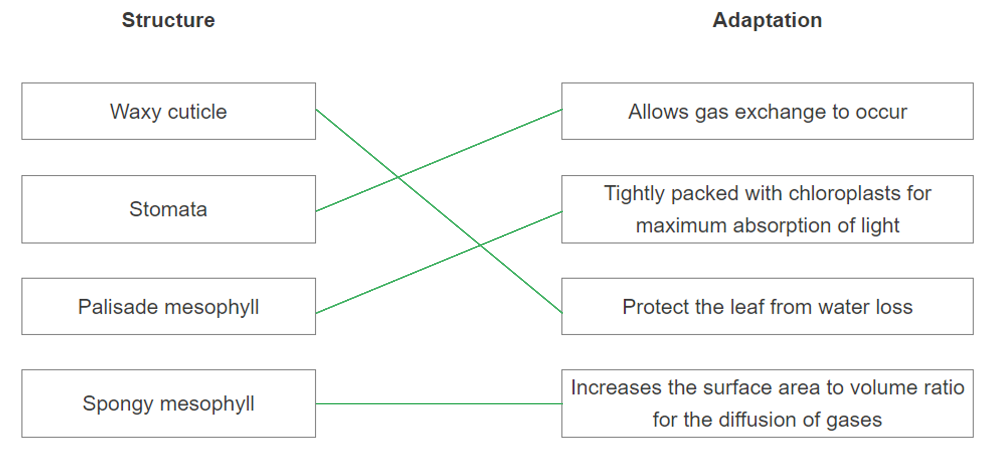

*Award ***[1 mark]*** for each correct line drawn*

**[Total: 4 marks]**
(i) The types of tissue that can be found in structure **Y** are...

- Xylem (vessels); **[1 mark]**
- Phloem (sieve tubes); **[1 mark]**

(ii) The function of each type of tissue is...

- Xylem transports water (and mineral ions) into the leaf for the mesophyll cells **OR** thick cell walls of xylem help to support the stem and leaf; **[1 mark]**
- Phloem transports sucrose and amino acids around the plant; **[1 mark]**

**[Total: 4 marks]**

> *Make sure that you know the structure of a leaf very well, as these types of recall questions is an easy way to obtain marks in an exam.*
(i) A visible difference between layer **X** and **Z** is...

Any **one** of the following:

- **X** has no guard cells/stomata while **Z** does; **[1 mark]**
- The cells in **X** is larger than in **Z**; **[1 mark]**
- **X** consists of fewer cells than **Z**; **[1 mark]**

*Accept the converse statement for the marking points above*

> *You must mention both **X** and **Z** in order to obtain the mark as the question is asking you to state a **difference **between them.*

(ii) The cells in **X** are transparent because...

Any **two** of the following:

- To allow sunlight through; **[1 mark]**
- To (reach) the <u>palisade mesophyll</u> cells; **[1 mark]**
- For maximum photosynthesis (to occur); **[1 mark]**

> *You must be very specific in stating that it is the palisade mesophyll cells that must receive the light since this is the layer where most photosynthesis occur. Simply stating mesophyll cells will not gain you any marks here.*

**[Total: 3 marks]**
The movement of carbon dioxide is as follows...

Any **three** of the following:

- There is a higher concentration of carbon dioxide/CO2 in the atmosphere compared to inside the leaf; **[1 mark]**
- Carbon dioxide/CO2 diffuses into the leaf through (open) stomata; **[1 mark]**
- Into the air spaces between <u>spongy mesophyll</u> cells;** [1 mark]**
- It diffuses through the cell wall and cell membrane (of mesophyll cells); **[1 mark]**
- It dissolves in the cytoplasm (before diffusing into chloroplasts); **[1 mark]**

**[Total: 3 marks]**

> *Be careful of how you word your answer; the air spaces are found between **spongy mesophyll cells** and carbon dioxide moves by **diffusion**. Do not get confused and start discussing osmosis, since that only refers to the movement of water molecules in liquid form. All gases move by diffusion.*

### Q14
(i) Two times when the carbon dioxide concentration was 37 arbitrary units:

- 02:00 **and** 05:00; **[1 mark]**

(ii) The difference in carbon dioxide concentration between 04:00 and 12:00 was:

- 11 (arbitrary units); **[1 mark]**

(a) (iii) The concentration of carbon dioxide decreases between 04:00 and 09:00 because:

Any **three** from the following:

- (Sun)light is present / it is sunrise; **[1 mark]**
- Carbon dioxide is absorbed / used (by the plants); **[1 mark]**
- (for) photosynthesis; **[1 mark]**
- Photosynthesis is using carbon dioxide faster / at a higher rate than respiration can provide / replace it **OR** (the rate of) photosynthesis is higher/faster than (the rate of) respiration; **[1 mark]**

**[Total: 5 marks]**

> *Reading the times from the graph for (a) (i):*

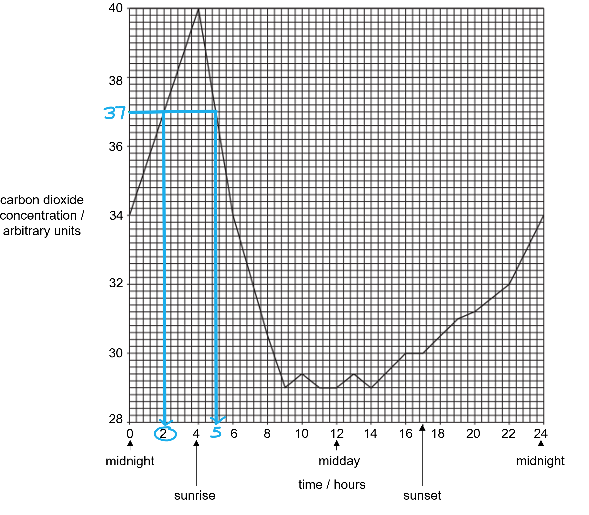

> *The calculation for (a) (ii) is as follows:*

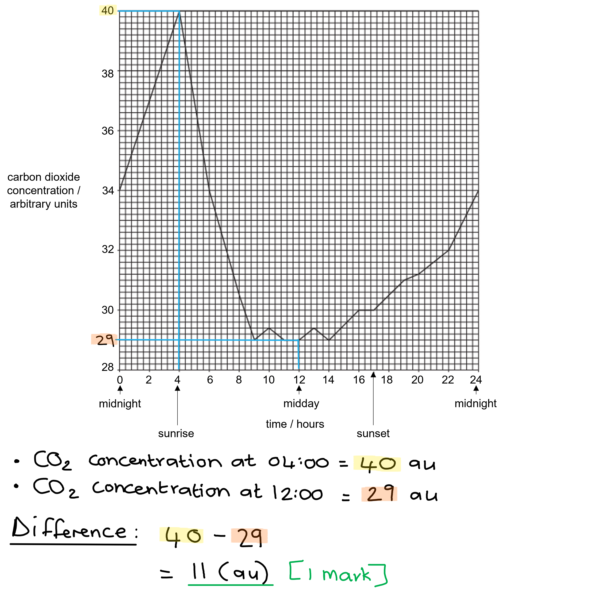
Environmental factors that would affect the results of this investigation:

Any **two **from the following:

- Rain / precipitation; **[1 mark]**
- Wind / movement of air; **[1 mark]**
- Humidity; **[1 mark]**
- Temperature; **[1 mark]**
- Shade / (the presence of) clouds / time of the year/season; **[1 mark]**

**[Total: 2 marks]**
The carbon dioxide concentration between 16:00 and sunset...

- Did not change / remained the same/constant; **[1 mark]**
- (This is because) the rate of photosynthesis was equal to the rate of (aerobic) respiration; **[1 mark]**
- (This means) the amount of carbon dioxide absorbed (by photosynthesis) was the same as the amount of carbon dioxide released (by aerobic respiration); **[1 mark]**

**[Total: 3 marks]**

> *Remember that respiration is occurring in the plant cells during the day and night. During the day, respiration and photosynthesis are occurring simultaneously. Whether there is a net absorption or release of carbon dioxide by the plant depends on the respective rates of respiration and photosynthesis. When the rates are equal, then there will be no overall increase or decrease in the carbon dioxide levels outside the plant.*
The carbon dioxide concentration was highest at sunrise because...

- No photosynthesis occurred during the night; **[1 mark]**
- (This means) no carbon dioxide was absorbed by the plant / the plant only released carbon dioxide (by respiration); **[1 mark]**

**[Total: 2 marks]**

### Q15
The carbohydrates can be used as follows...

Any **four** of the following:

- It may be converted into starch molecules for storage (of energy); **[1 mark]**
- It may be converted into cellulose to build cell walls; **[1 mark]**
- Glucose can be used in respiration to release energy (to the plant); **[1 mark]**
- It could be converted into sucrose for transport (in the phloem); **[1 mark]**
- It may form nectar to attract insects for pollination; **[1 mark]**

**[Total: 4 marks]**
The function of lipids and amino acids is...

- Lipids is an energy source in seeds **OR** for synthesis of new cellular material eg. membranes; **[1 mark]**
- Amino acids are used to make proteins that facilitates growth in a plant; **[1 mark]**

**[Total: 2 marks]**

> *Spend some time familiarising yourself with the functions of the different molecules in a plant as these types of questions require you to simply recall knowledge.*
Two other chemical elements found in amino acids include...

Any **two** of the following:

- Carbon; **[1 mark]**
- Hydrogen; **[1 mark]**
- Oxygen; **[1 mark]**
- Sulphur; **[1 mark]**

**[Total: 2 marks]**

> *Remember that all the biological molecules that you've learned about in Topic 4 contains the same three elements, namely carbon, hydrogen and oxygen. Amino acids which makes up proteins, also contains nitrogen while some may contain sulphur as well.*
Plants with a nitrate deficiency will have the following appearance...

- They may be short / show poor/stunted growth; **[1 mark]**
- Their leaves will turn yellow / yellowing of the leaves will occur; **[1 mark]**

**[Total: 2 marks]**

> *Proteins formed by amino acids, are an essential part of the structure and functioning of the plant cell. Enzymes that catalyse biochemical reactions within the cell are all proteins. A lack of protein (caused by a lack of nitrate) will prevent the plant cells from functioning as normal and this will have a negative impact on the growth of a plant.*

### Q16
(i)  Water enters the plant in the following way:

Any **three **from the following:

- Water enters the root (from the soil); **[1 mark]**
- Via the <u>root hair cells</u>; **[1 mark]**
- Water moves through the cell walls; **[1 mark]**
- Then it travels across a partially permeable (cell) membrane (into the cytoplasm); **[1 mark]**
- Water travels by <u>osmosis</u>**; [1 mark]**

(ii)  One function of water in the plant could be:

Any **one **from the following:

- Support (of cells/stems/tissues); **[1 mark]**
- Transport of mineral ions/named mineral ions (around the plant); **[1 mark]**
- A solvent / to dissolve mineral ions/sugars/soluble substances into; **[1 mark]**
- A coolant **OR **to maintain optimum temperatures for plant growth; **[1 mark]**

*Also accept the idea of water to be used to stimulate germination of seedlings*

(a)(iii)  Water is transported in the:

- Xylem; **[1 mark]**

(a)(iv)  The name of the part of the leaf is... :

- The stoma/stomata ; **[1 mark]**

**[Total: 6 marks]**
The completed sentences would be as follows...

- Chlorophyll is a pigment found in <u>**chloroplasts**</u>; **[1 mark]** within plant cells. It is responsible for transferring energy from <u>**light**</u>; **[1 mark]** into <u>**chemical**</u>; **[1 mark]** energy.

**[Total: 3 marks]**
Another raw material required for photosynthesis along with a description of how the plant obtains it includes...

- Carbon dioxide/CO2; **[1 mark]**
- (Carbon dioxide) diffuses into the leaf through the stomata; **[1 mark]**

**[Total: 2 marks]**

### Q17
(i) The tissues can be named as follows:

- **A**: (Upper) <u>epider</u>mis; **[1 mark]**
- **B**: Palisade (mesophyll); **[1 mark]**

(ii) It is necessary to have a large surface area because:

Any **three **from the following:

- (Cell surfaces are sites of) gas exchange; **[1 mark]**
- (This means there is) movement of gases by diffusion; **[1 mark]**
- (A large surface area gives) efficient / faster gas exchange / diffusion / photosynthesis; **[1 mark]**
- This is because carbon dioxide is raw material / needed for photosynthesis; **[1 mark]**
- (Diffusion allows) absorption of carbon dioxide (when light is available); **[1 mark]**
- (Diffusion also allows) loss of oxygen (when light available) / absorption of oxygen; **[1 mark] **
- Oxygen is required for (aerobic) respiration; **[1 mark]**
- (Larger surface area also allows) more evaporation; **[1 mark]**
- Idea of maximising light absorption; **[1 mark]**

> *The best answers here would consider both the maximal absorption of light and gas exchange.*

(iii) There are interconnecting spaces because:

Any **two **from the following:

- It allows for movement of (named/oxygen/carbon dioxide/water vapour) gases / diffusion / gas exchange throughout the whole of the leaf; **[1 mark]**
- (This leads to) faster / (more) efficient diffusion / gas exchange; **[1 mark]**
- (Gas exchange) allows photosynthesis / respiration / transpiration / evaporation; **[1 mark]**
- Reference to storage of carbon dioxide (within the airspaces); **[1 mark]**
- (Air spaces) connect (to outside air) via stomata; **[1 mark]**

**[Total: 7 marks]**
The function of the stomata is:

Any **three **from the following:

- For gas <u>exchange</u> / <u>diffusion</u> of gases; **[1 mark]**
- For photosynthesis / respiration / transpiration; **[1 mark]**
- For diffusion of carbon dioxide <u>into</u> the cell / oxygen <u>out</u> of the cell; **[1 mark]**
- Controls the <u>rate</u> of diffusion / transpiration / photosynthesis **OR** prevents wilting / excess water loss (from the plant); **[1 mark]**
- Aids in transpiration pull of water (from the roots to the leaves); **[1 mark]**

**[Total: 3 marks]**

> *Remember that stomata have roles in both transpiration and the exchange of gases. It is a common error to focus on just one of these functions.*

> *This question covers core knowledge taken from an extended only paper 4 question.*
Plants growing in soil lacking magnesium struggle to photosynthesise and therefore do not grow to their full potential because...

Any **four** from the following:

- Magnesium is needed to synthesise <u>chlorophyll</u>; **[1 mark]**
- (Chlorophyll) absorbs light to provide energy needed for photosynthesis; **[1 mark]**
- (Less light absorbed means) <u>less</u> photosynthesis so the plant can synthesise/make/produce less glucose; **[1 mark]**
- (Less glucose means) <u>less </u>respiration **and therefore** less energy is released for growth; **[1 mark]**
- (Less glucose means)<u> less</u> materials (amino acids / proteins / cellulose) available for growth; **[1 mark]**

**[Total: 4 marks]**

> *The word 'less' has been underlined in the mark scheme to emphasize that the processes are reduced but not stopped. It is important to acknowledge that when processes, such as photosynthesis (but also respiration) are limited, it usually doesn't mean that it is stopped completely so you should pick your wording carefully to show you understand this.*

### Q18
(i) The word equation for photosynthesis is:

- Reactants: carbon dioxide + water; **[1 mark]**
- Products: glucose + oxygen; **[1 mark]**

*The products and the reactants can be in any order i.e. water + carbon dioxide, or oxygen + glucose*

(ii) The green substance needed for photosynthesis is:

- Chlorophyll; **[1 mark]**

**[Total: 3 marks]**

> *The full equation should be: **carbon dioxide + water → glucose + oxygen.*

> *If you put CO**2** or any other symbol you can't get the mark because the question asked for the **word** equation, not the symbol equation. Another common mistake is to use an = sign rather than an arrow to represent the reaction.  *

> *Remember that chloroplasts are the organelles that **contain** chlorophyll. The two are not interchangeable. *
(i) The gas being collected in Fig. 1 is...

- Oxygen; **[1 mark]**

(ii) The purpose of using an aquatic plant is...

- The oxygen that is released can be seen as bubbles (because the plant is in water); **[1 mark]**
- This enables (the investigator) to count the number of bubbles produced in a minute **OR** counting the number of bubbles can be used to determine the rate of photosynthesis; **[1 mark]**

**[Total: 3 marks]**

> *We cannot see oxygen gas being released from land based plants, since it is a colourless gas. Using aquatic plants in investigations on the rate of photosynthesis provides a visual way of obtaining data.*
The observation that the student would make is...

- The number of bubbles released (by the plant) would increase; **[1 mark]**
- This is because the rate of photosynthesis would increase (due to the increase in temperature); **[1 mark]**

**[Total: 2 marks]**

> *The enzymes catalysing the process of photosynthesis would be working at a faster rate when the temperature increases, which in turn speeds up photosynthesis resulting in more oxygen bubbles being released in the same amount of time.*
One factor, other than temperature, that affects the rate of photosynthesis is:

Any **one **from the following:

- Light intensity / brightness of light;** [1 mark]**
- Size of plant / number of leaves / size of leaves / surface area of leaves;** [1 mark]**
- Availability/concentration/amount of CO2;** [1 mark]**
- Amount of chlorophyll / number of chloroplasts;** [1 mark]**
- Species/type of plant;** [1 mark]**
- Water;** [1 mark]**

**[Total: 1 mark]**

### Q19
The gardener should follow the advice of friend...

- Y; **[1 mark]**

Any **one **from the following:

- Opening the windows will keep the temperature cool; **[1 mark]**
- Covering the windows with black card will prevent light energy getting in **OR** light will be the limiting factor **OR **plants need the light for photosynthesis; **[1 mark]**

**[Total: 2 marks]**
The three limiting factors that were investigated were...

- Carbon dioxide; **[1 mark]**
- Light <u>intensity</u>; **[1 mark]**
- Temperature; **[1 mark]**

**[Total: 3 marks]**

> *These factors are all tested in a range of different quantities as shown in the detail in the graph. You have to examine the graph carefully, it's not just the x-axis variable (CO**2** concentration) being tested. *
The optimum conditions would be as follows:

- 30 °C;**[1 mark]**
- 600 ppm (or above);**[1 mark]**
- Bright light; **[1 mark]**

**[Total: 3 marks]**

> *The optimum conditions are those which provide the biggest growth in the strawberry plants. The optimum carbon dioxide reading can be taken anywhere after the point where the graph levels off, although in reality, the gardener will pick the lowest quantity that will give the maximum growth.*
The gardener made this decision because...

- There was no further increase in photosynthesis after 600 ppm; **[1 mark]**
- It would cost more to increase the levels higher than that / it would not be cost effective; **[1 mark]**

**[Total: 2 marks]**

### Q20
(i) The part of the leaf labelled G after iodine solution has been added is:

- Yellow / brown; **[1 mark]**

(ii) The colour of the part of the leaf labelled H after iodine solution has been added is:

- Blue-black; **[1 mark]**

(iii) A conclusion about chlorophyll from this investigation is:

- Chlorophyll is required for photosynthesis / production of starch or glucose; **[1 mark]**

**[Total: 3 marks]**

> *You are told about chlorophyll in the question stem so it is important to pay attention to the information you are given. *
The leaf contained no starch because:

Any **one **from the following:

- Light required for photosynthesis / to make starch or glucose; **[1 mark]**
- No photosynthesis took place; **[1 mark]**

**[Total: 1 mark]**

> *Remember that plants still respire in the dark and so they need to use the glucose from their starch storage to keep them going. *
Plant cells do not use glucose as a storage molecule because...

Any **two** of the following:

- Glucose is soluble so will decrease the water potential (of the plant cell); **[1 mark]**
- Water will move by osmosis from neighbouring cells; **[1 mark]**
- This will increase the turgor pressure/turgidity of the cells; **[1 mark]**

**[Total: 2 marks]**

> *This synoptic question requires you to refer back to Topic 3 that covered osmosis and its effect on plant and animal cells.*
(i) The step that must be included before the experiment can be done is...

- Destarch the plant / place the plant in a dark cupboard for 24 hours; **[1 mark]**

(ii) The importance of this step is...

- To ensure that any starch present in the leaf is used up / removed; **[1 mark]**
- This will avoid a positive result/test (for starch) in parts that were not exposed to light; **[1 mark]**

**[Total: 3 marks]**

> *Destarching a plant before investigating the need for light (or carbon dioxide) is a crucial step that cannot be skipped. If the starch that is already present in the leaf is not removed first, then the entire leaf will test positive for starch and your results will not be accurate.*
