# Exam Questions — Photosynthesis & Leaf Structure
**6. Plant Nutrition** · Cambridge (CIE) IGCSE biology (0610 & 0970)
> Source: [https://www.savemyexams.com/igcse/biology/cie/23/topic-questions/](https://www.savemyexams.com/igcse/biology/cie/23/topic-questions/) · 52 questions across 3 sets

## Alternative To Practical Questions (3 questions)

### Q1 — medium — 3 marks

**Q1** [1 mark]

Fig. 2.1 is a photomicrograph of a section through part of a marram grass leaf, Ammophila arenaria.

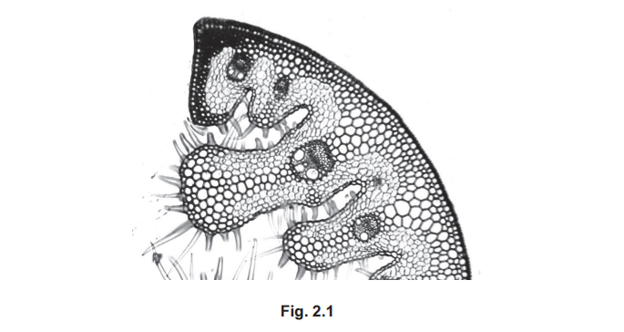

(i) Draw a large diagram of the section of marram grass leaf shown in Fig. 2.1.

Do **not** draw individual cells.

(ii) Fig. 2.2 shows a cross-section of a whole marram grass leaf.

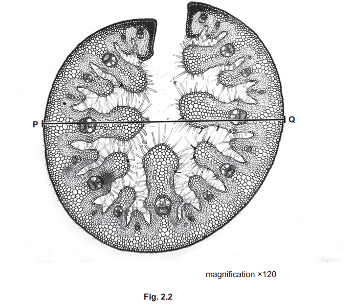

Measure the length of line **PQ** on Fig. 2.2.

length of line **PQ** ................................................ mm

Calculate the actual diameter of the marram grass leaf using the formula and your measurement.

$\mathrm{magnification}=\frac{\mathrm{length} \mathrm{of} \mathrm{line} \mathrm{PQ} \mathrm{on} \mathrm{Fig}2.2}{\mathrm{actual} \mathrm{diameter} \mathrm{of} \mathrm{the} \mathrm{marram} \mathrm{grass} \mathrm{leaf}}$

Give your answer to** one** decimal place.

......................................................... mm

[3]

*Source: 0970/June 2022 61 Q2A*

**Q1** [1 mark]

Scientists investigated the effect of different concentrations of sodium chloride solution on the germination and growth of marram grass.

Marram grass seeds were germinated in Petri dishes on filter paper which had been soaked in one of the different sodium chloride solutions. Each Petri dish contained 15 seeds and the investigation was repeated four times.

After 20 days, the lengths of the seedling roots were measured with a ruler.

(i) State the variable that was changed (independent variable) and the variable that was measured (dependent variable) in this investigation.

independent variable ......................................................................................................... .........

dependent variable .................................................................................................................

[2]

(ii) State** two** ways the scientists designed the investigation to produce valid and reliable results.

[2]

*Source: 0970/June 2022 61 Q2B*

**Q1** [1 mark]

**Extract:**

Scientists investigated the effect of different concentrations of sodium chloride solution on the germination and growth of marram grass. Marram grass seeds were germinated in Petri dishes on filter paper which had been soaked in one of the different sodium chloride solutions. Each Petri dish contained 15 seeds and the investigation was repeated four times. After 20 days, the lengths of the seedling roots were measured with a ruler.

Table 2.1
| concentration of sodium chloride solution /g per dm^3 | average root length /mm |
| --- | --- |
| 0 | 33 |
| 2 | 22 |
| 4 | 19 |
| 6 | 13 |
| 8 | 2 |
| 10 | 1 |

The results of the investigation described in** 2(b)** are shown in Table 2.1.

**Table 2.1 **

| **concentration of sodium chloride solution /g perdm****3** | **average root length /mm** |
|---|---|
| 0 | 33 |
| 2 | 22 |
| 4 | 19 |
| 6 | 13 |
| 8 | 2 |
| 10 | 1 |

(i) Using the information in Table 2.1, calculate the percentage decrease in the average root length when the concentration of sodium chloride was changed from 4 g perdm3 to 6 g perdm3.

Give your answer to** three **significant figures.

............................................................ % [3]

(ii) Plot a line graph on the grid of the data in Table 2.1.

[4]

*Source: 0970/June 2022 61 Q2C*

### Q2 — medium — 17 marks

**Q2** [5 marks]

A student investigated the effect of light intensity on the rate of photosynthesis.

1. They placed a 10 cm piece of *Elodea* pondweed in a beaker of water placed 10 cm away from a lamp.
2. A glass tank with water was placed between the lamp and the beaker containing the pondweed.
3. The pondweed was left for 5 minutes before the number of bubbles were counted and recorded over a period of 2 minutes.
4. A thermometer was used to monitor the temperature throughout the experiment.
5. Step 3 was repeated when the lamp was placed at different distances from the pondweed.
6. The experiment was repeated once more.

Fig. 1 shows the experimental setup.

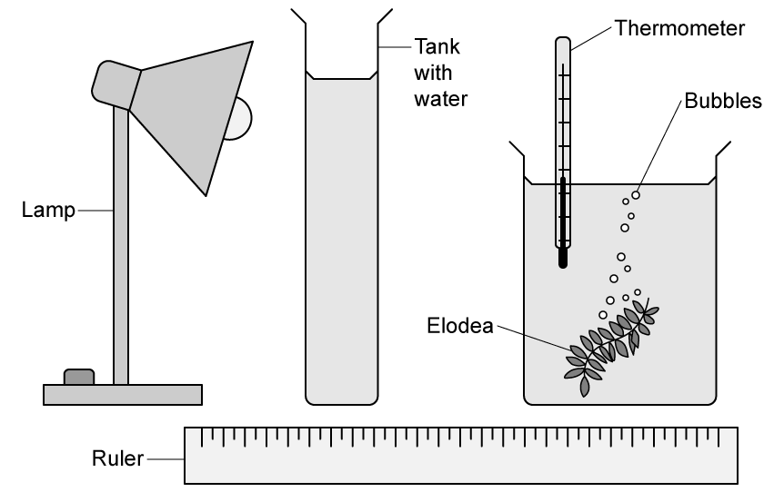

**Fig. 1**

Fig. 2 shows the results for the two repeats that the student wrote in their notebook.

**Fig. 2**

(i)

Prepare a suitable results table to present the data.

Your table should include:

- Distance from the lamp
- The rate of photosynthesis in bubbles min-1 

[4]

(ii)

State a conclusion for the results.

[1]

**Q2** [2 marks]

**Extract:**

Distance from the lamp: 10 cm = 70 and 72 bubbles; 50 cm = 3 and 1 bubbles. Bubbles counted over 2 minutes. To calculate bubbles per minute: (70 + 72) ÷ 2 = 71 (for 10 cm); (3 + 1) ÷ 2 = 2 (for 50 cm). To calculate means: 10 cm: 71 ÷ 2 ≈ 36; 50 cm: 2 ÷ 2 = 1. The difference in the mean rate of photosynthesis: 36 - 1 = 35 (bubbles min^-1^).

Calculate the difference in the mean rate of photosynthesis when the lamp was moved from a distance of 10 cm to 50 cm away from the pondweed.

**Q2** [4 marks]

**Extract:**

A student investigated the effect of light intensity on the rate of photosynthesis.

1. They placed a 10 cm piece of Elodea pondweed in a beaker of water placed 10 cm away from a lamp.
2. A glass tank with water was placed between the lamp and the beaker containing the pondweed.
3. The pondweed was left for 5 minutes before the number of bubbles were counted and recorded over a period of 2 minutes.
4. A thermometer was used to monitor the temperature throughout the experiment.
5. Step 3 was repeated when the lamp was placed at different distances from the pondweed.
6. The experiment was repeated once more.

(i)

State the independent variable for this investigation.

[1]

(ii)

State **two** variables that should be kept constant in this investigation.

[2]

(iii)

Suggest an improvement for determining the rate of photosynthesis in this investigation.

[1]

**Q2** [6 marks]

**Extract:**

A student investigated the effect of light intensity on the rate of photosynthesis.

1. They placed a 10 cm piece of Elodea pondweed in a beaker of water placed 10 cm away from a lamp.
2. A glass tank with water was placed between the lamp and the beaker containing the pondweed.
3. The pondweed was left for 5 minutes before the number of bubbles were counted and recorded over a period of 2 minutes.
4. A thermometer was used to monitor the temperature throughout the experiment.
5. Step 3 was repeated when the lamp was placed at different distances from the pondweed.
6. The experiment was repeated once more.

Describe how this experiment could be adapted to investigate the effect of carbon dioxide on the rate of photosynthesis.

### Q3 — medium — 21 marks

**Q3** [7 marks]

Fig. 1 is a photomicrograph of a cross-section of part of a leaf.

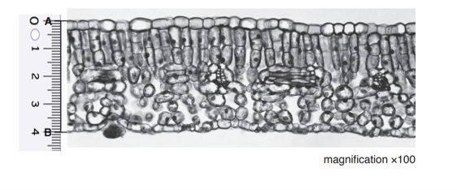

**Fig. 1**

(i)

Draw a large diagram to show the layers present in the leaf section shown in Fig.1.

Do not draw any cells.

[3]

(ii)

Measure the thickness of the leaf along the line **AB** on Fig.1.

Calculate the actual thickness of the leaf using your measurement and the formula.

Include the units.

$\mathrm{magnification}=\frac{\mathrm{length} \mathrm{of} \mathrm{line} \mathrm{AB} \mathrm{on} \mathrm{Fig}.1}{\mathrm{actual} \mathrm{thickness} \mathrm{of} \mathrm{leaf}}$

[3]

(iii)

Fig. 2 shows a photomicrograph of cells from one type of tissue found in leaves.

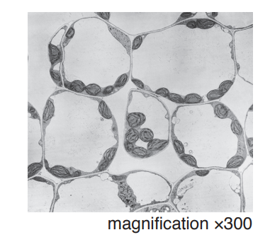

**Fig. 2**

Label the layer on your drawing, with the letter **X**, to show where this type of tissue is found.

[1]

*Source: 2019 0970/61 Q2A*

**Q3** [5 marks]

Scientists carried out an investigation into the effect of light on the growth of leaves.

Plants of the same species (**A**) were grown in three different light intensities.

The plants were grown in the same soil and kept in glasshouses with automatic watering.

A sample of 100 leaves was selected at random and collected from plants in each of the three different light intensities. A total of 300 leaves were collected.

The scientists studied the variations in the size and structure of the leaves in each sample.

(i)

Suggest why the scientists used large samples of leaves.

[1]

(ii)

Suggest why the leaves in each light intensity were selected at random.

[1]

(iii)

A grid, divided into millimetre squares, was used to measure the surface area of the leaves.

Outline how the grid could have been used.

[2]

(iv)

State the variable that was changed (independent variable) in this investigation.

[1]

*Source: 2019 0970/61 Q2B*

**Q3** [9 marks]

**Extract:**

Table 1

| Light intensity / arbitrary units | Average leaf area / mm^2^ |
| Species A | Species B |
| 100 | 3600 | 2800 |
| 50 | 3900 | 3400 |
| 10 | 6500 | 2900 |

(i)
Calculate the percentage difference in the average leaf area for species A from a light intensity of 50 arbitrary units to 10 arbitrary units.

Show your working and give your answer as a percentage to the nearest whole number.

(ii)
Plot a bar chart on the grid to show the average leaf area for species A and B, at each light intensity.

(iii)
Describe the trends shown in your graph for species A and species B.

(iv)
The scientists want to determine more precisely the light intensity that results in the largest leaf area for species B.

Suggest how the method used in the investigation could be modified to achieve this.

The scientists collected data from one other plant species (**B**).

Table 1 shows the results.

**Table 1**

| **Light intensity / arbitrary units** | **Average leaf area / mm****2** |   |
|---|---|---|
| **Species** **A** | **Species** **B** |   |
| 100 | 3600 | 2800 |
| 50 | 3900 | 3400 |
| 10 | 6500 | 2900 |

(i)

Calculate the percentage difference in the average leaf area for species **A** from a light intensity of 50 arbitrary units to 10 arbitrary units.

Show your working and give your answer as a percentage to the nearest whole number.

[2]

(ii)

Plot a bar chart on the grid to show the average leaf area for species **A** and **B**, at each light intensity.

[4]

(iii)

Describe the trends shown in your graph for species **A** and species **B**.

[2]

(iv)

The scientists want to determine more precisely the light intensity that results in the largest leaf area for species **B**.

Suggest how the method used in the investigation could be modified to achieve this.

[1]

*Source: 2019 0970/61 Q2C*

## Multiple Choice Questions (29 questions)

### Q1 — hard — 1 marks

**Q1** [1 mark]

The graph shows the effect of increasing light intensity on the rate of photosynthesis.

Which does point A show?

### Q2 — easy — 1 marks

**Q2** [1 mark]

Which row correctly identifies the reactants and products of photosynthesis?

|   | Reactants | Products |
|---|---|---|
| A | carbon dioxide and water | glucose and oxygen |
| B | carbon dioxide and glucose | water and oxygen |
| C | oxygen and water | carbon dioxide and glucose |
| D | glucose and oxygen | carbon dioxide and water |

### Q3 — medium — 1 marks

**Q3** [1 mark]

In which conditions will there be poor plant growth but no yellowing of leaves?

|   | **Nitrogen availability** | **Magnesium availability** |
|---|---|---|
| **A** | high | high |
| **B** | low | high |
| **C** | low | low |
| **D** | high | low |

### Q4 — hard — 1 marks

**Q4** [1 mark]

To investigate the effect of light and dark conditions on gas exchange in an aquatic plant, a test tube is set up as follows:

1. The test tube is filled with hydrogencarbonate indicator solution
2. A cutting from a green aquatic plant is added
3. The tube is covered with aluminium foil and closed with a bung
4. The tube is exposed to sunlight for 24 hours

What result will the test tube show after 24 hours?

### Q5 — medium — 1 marks

**Q5** [1 mark]

How is a leaf adapted for photosynthesis?

### Q6 — medium — 1 marks

**Q6** [1 mark]

How do the air spaces in the spongy mesophyll of a leaf help to adapt it for photosynthesis?

*Source: june 2022 paper 2 Q12*

### Q7 — hard — 1 marks

**Q7** [1 mark]

Tomato fruit production was measured in five different environmental conditions.

What is a correct conclusion for the data shown in the graph?

*Source: june 2022 paper 2 Q11*

### Q8 — easy — 1 marks

**Q8** [1 mark]

Which tissues are found in vascular bundles?

*Source: june 2022 paper 1 Q13*

### Q9 — medium — 1 marks

**Q9** [1 mark]

Which chemical is a product of photosynthesis that moves out of a green leaf through its stomata?

*Source: june 2022 paper 1  Q12*

### Q10 — easy — 1 marks

**Q10** [1 mark]

The diagram shows a section through the leaf of a plant.

Which label shows a palisade mesophyll cell?

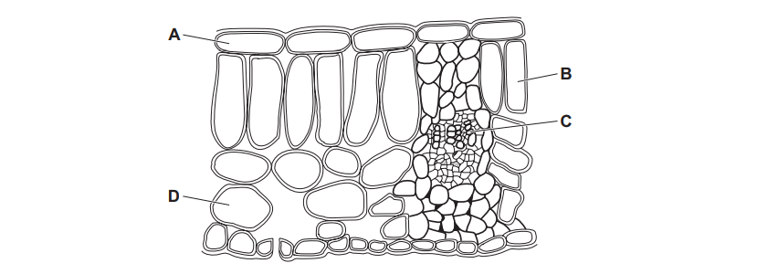

*Source: June 2021 0970/11 Q13*

### Q11 — hard — 1 marks

**Q11** [1 mark]

A plant with striped leaves was kept in bright light for six hours.

A leaf was taken from the plant and the chlorophyll was removed. The leaf was then tested for starch using iodine solution.

Which diagram shows the result of the test?

*Source: June 2021 0970/11 Q12*

### Q12 — medium — 1 marks

**Q12** [1 mark]

Why do plants need nitrate ions?

*Source: Specimen 2023 0970/01 Q13*

### Q13 — easy — 1 marks

**Q13** [1 mark]

The diagram shows a cross-section of part of a leaf

What is the name of the cell labelled X?

*Source: Specimen 2023 0970/01 Q12*

### Q14 — hard — 1 marks

**Q14** [1 mark]

The apparatus shown was used in an experiment.

The carbon dioxide content of the water in each test-tube was measured at the start of the experiment and again three hours later.

In which test-tube will the carbon dioxide concentration decrease?

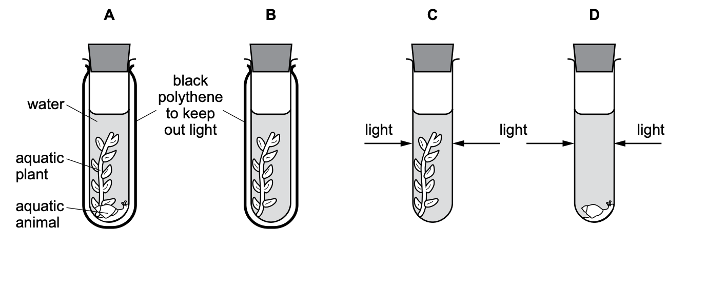

*Source: Specimen 2023 0970/01 Q11*

### Q15 — hard — 1 marks

**Q15** [1 mark]

#### Extended only

The diagram below shows how the rate of photosynthesis is affected by different conditions.

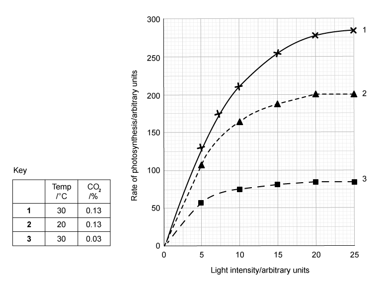

What of the following correctly identifies the limiting factor for photosynthesis at the three points on the graph?

|   | 1 | 2 | 3 |
|---|---|---|---|
| **A** | light intensity | light intensity | carbon dioxide concentration |
| **B** | temperature | temperature | light intensity |
| **C** | light intensity | temperature | carbon dioxide concentration |
| **D** | light intensity | carbon dioxide concentration | temperature |

### Q16 — easy — 1 marks

**Q16** [1 mark]

The glucose molecules formed during photosynthesis have which form of energy stored within them?

### Q17 — hard — 1 marks

**Q17** [1 mark]

The diagram below shows a cross-section through a leaf as seen under a microscope.

In which part of the leaf would the concentration of carbon dioxide be lowest on a warm, sunny day?

### Q18 — hard — 1 marks

**Q18** [1 mark]

#### Extended only

The following could be used to write a balanced symbol equation for photosynthesis.

1. 6CO2 + 6H2O
2. CO2 + 6H2O
3. Light and chlorophyll
4. C6H12O6 + 6O2
5. 6C6H12O6 + 6O2

Which of the following show the correct balanced chemical equation for photosynthesis?

### Q19 — hard — 1 marks

**Q19** [1 mark]

A student sets up a photosynthesis experiment.

A plant with striped leaves (similar to the one shown below) was kept in bright light for four hours.

A leaf was removed from the plant and treated with ethanol in hot water to remove chlorophyll before iodine was used to test for starch.

Which diagram shows the result of the test?

### Q20 — medium — 1 marks

**Q20** [1 mark]

The average number of chloroplasts found in four different types of cell from the leaf of a plant are shown in the bar chart below.

What are the names of the four types of cell?

|   | 1 | 2 | 3 | 4 |
|---|---|---|---|---|
| **A** | spongy mesophyll cell | epidermal cell | palisade mesophyll cell | guard cell |
| **B** | palisade mesophyll cell | guard cell | spongy mesophyll cell | epidermal cell |
| **C** | epidermal cell | spongy mesophyll cell | palisade mesophyll cell | guard cell |
| **D** | palisade mesophyll cell | spongy mesophyll cell | guard cell | epidermal cell |

### Q21 — hard — 1 marks

**Q21** [1 mark]

Two test tubes are set up with two similar leaves inside them, as shown in the diagram below.

One test tube is exposed to light, while the other is kept in the dark.

The test tubes are left for 4 hours.

What colour will the hydrogencarbonate indicator solution be in each test tube?

|   | dark | light |
|---|---|---|
| **A** | purple | yellow |
| **B** | colourless | yellow |
| **C** | purple | colourless |
| **D** | yellow | purple |

### Q22 — easy — 1 marks

**Q22** [1 mark]

An experiment is set up with four test tubes as shown in the diagram below.

All four test tubes are left in sunlight for 6 hours.

Which test tube would contain the least amount of dissolved carbon dioxide after 6 hours?

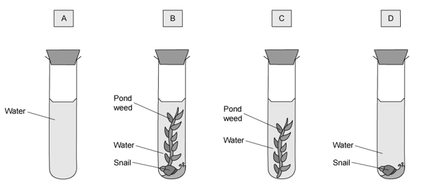

### Q23 — easy — 1 marks

**Q23** [1 mark]

Name the product of photosynthesis that diffuses out of a green leaf through its stomata.

### Q24 — easy — 1 marks

**Q24** [1 mark]

The diagram below shows a section through a leaf.

Which cell type would have the highest concentration of oxygen on a bright, sunny day?

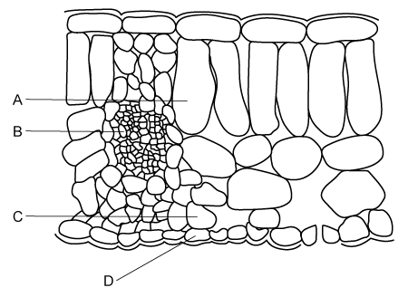

### Q25 — medium — 1 marks

**Q25** [1 mark]

Which of the following options is the best explanation for the role of chlorophyll in photosynthesis?

Chlorophyll...

### Q26 — medium — 1 marks

**Q26** [1 mark]

Which row of the table below shows the correct effects of deficiencies of essential minerals for plant growth?

|   | effect of magnesium ion deficiency | effect of nitrate ion deficiency |
|---|---|---|
| **A** | yellow leaves | stunted growth |
| **B** | stunted growth | long roots |
| **C** | small leaves | yellow leaves |
| **D** | stunted growth | yellow leaves |

### Q27 — medium — 1 marks

**Q27** [1 mark]

Which of the following correctly identifies some of the molecules produced from the glucose synthesised by photosynthesis?

|   | 1 | 2 | 3 |
|---|---|---|---|
| **A** | cellulose for storage | fats and oils for  energy storage | starch to build cell walls |
| **B** | cellulose to build cell walls | fats and oils for energy storage | starch for storage |
| **C** | sucrose to be transported around the plant | fats and oils for energy storage | cellulose for storage |
| **D** | sucrose to be transported around the plant | starch to build cell walls | cellulose for storage |

### Q28 — medium — 1 marks

**Q28** [1 mark]

A student sets up an experiment to measure the rate of oxygen production of an aquatic plant when it is photosynthesising.

The student repeated the experiment several times to calculate the average amount of oxygen collected.

Which two factors should be kept constant during the student’s experiment?

### Q29 — easy — 1 marks

**Q29** [1 mark]

The diagram below shows a palisade mesophyll cell found in the leaves of plants.

In which region of the cell would starch be stored?

## Theory Questions (20 questions)

### Q1 — medium — 4 marks

**Q1** [2 marks]

A student monitored their breathing rate before, during, and after an exercise period. The exercise period began at minute 1 and ended at minute 7.

The results are shown in Fig. 2.1.

**Fig. 2.1**

Determine the breathing rate at minute 4 and at minute 8 in Fig. 2.1.

**Q1** [2 marks]

During a race, a runner's breathing rate remains constant at 26 breaths per minute for 7 minutes.

Calculate the total number of breaths the runner takes during the race.

### Q2 — easy — 3 marks

**Q2** [3 marks]

Photosynthesis and germination have different requirements.

(i) State the word equation for photosynthesis.

[2]

(ii) State the name of **one** condition needed for both photosynthesis and germination.

[1]

*Source: June 2021 0970/31 Q8B*

### Q3 — medium — 4 marks

**Q3** [4 marks]

A student investigated the conditions needed for germination of seeds.

Fig. 8.1 shows the apparatus and conditions used.

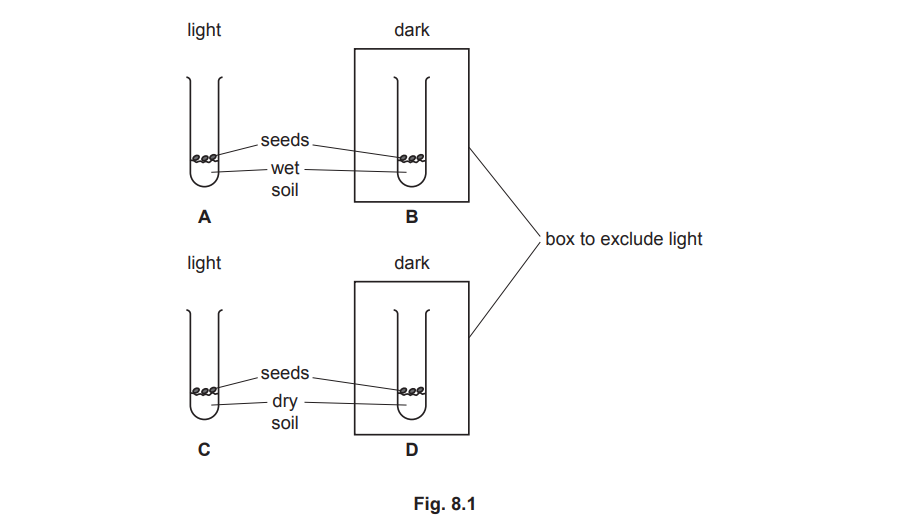

The seeds in test-tubes **A** and **B **germinated but the seeds in test-tubes **C** and **D** did not germinate.

(i) Use the information in Fig. 8.1 to state** one **condition required for germination.

[1]

(ii) Use the information in Fig. 8.1 to state** one **condition not required for germination.

[1]

(iii) The investigation was repeated with seeds that had been boiled for 10 minutes and then cooled.

Predict and explain the effect of boiling on the results.

[2]

*Source: June 2021 0970/31 Q8A*

### Q4 — easy — 6 marks

**Q4** [6 marks]

Water is required for the process of photosynthesis.

(i)

Describe where and how water enters a plant.

[3]

(ii)

Describe one function of water in a plant other than for photosynthesis.

[1]

(iii)

State the name of the tissue in a plant that transports water.

[1]

(iv)

State the name of the part of a leaf through which most water vapour is lost from the plant

[1]

*Source: Specimen 2023 0970/03 Q4B*

### Q5 — medium — 4 marks

**Q5** [4 marks]

Fig. 4.1 is a diagram of a variegated leaf from a plant. The plant was exposed to sunlight so that it could photosynthesise.

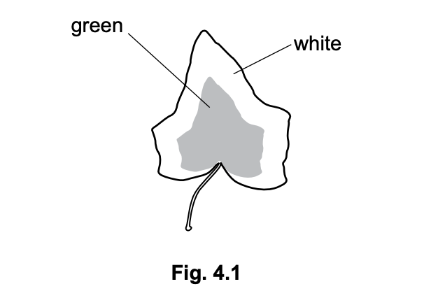

A student tested the leaf for starch and found that:

• starch was present in the green part of the leaf 
• there was no starch in the white part of the leaf.

Explain the results of this test.

*Source: Specimen 2023 0970/03 Q4A*

### Q6 — hard — 16 marks

**Q6** [2 marks]

The rate of photosynthesis of terrestrial plants can be determined by measuring the uptake of carbon dioxide.

Explain why plants take up carbon dioxide during photosynthesis.

*Source: 2019 0970/41 Q2A*

**Q6** [2 marks]

The rate of photosynthesis of parts of individual leaves can be measured using a hand-held device as shown in Fig. 1.

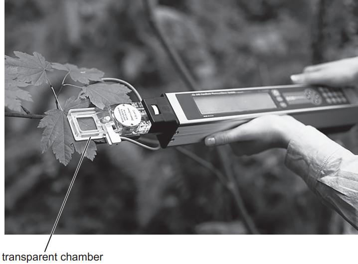

**Fig. 1**

This apparatus allows air to flow through the transparent chamber that encloses part of the leaf. The apparatus measures the carbon dioxide concentration of the air entering and leaving the chamber.

Explain how the results from the apparatus can be used to calculate the rate of photosynthesis.

*Source: 2019 0970/41 Q2B*

**Q6** [10 marks]

**Extract:**

A student used the apparatus shown in Fig. 1 to investigate the effect of temperature on the rate of photosynthesis of the leaves of Chinese plantain, Plantago asiatica, at two different concentrations of carbon dioxide, A and B. Fig. 2 shows the results of the investigation. In Fig. 2, the rate of photosynthesis (μmol per m^2 per s) is plotted against the temperature of leaves (°C) for two CO2 concentrations: A (370 ppm CO2) and B (1000 ppm CO2). At 30°C, the rate of photosynthesis for A is 22 μmol per m^2 per s and for B is 30 μmol per m^2 per s. The percentage increase in rate at 30°C when CO2 is increased from A to B is calculated as ((8 ÷ 22) × 100) = 36%.

#### Extended Only

A student used the apparatus shown in Fig. 1 to investigate the effect of temperature on the rate of photosynthesis of the leaves of Chinese plantain, *Plantago asiatica*, at two different concentrations of carbon dioxide, **A** and **B**.

Fig. 2 shows the results of the investigation.

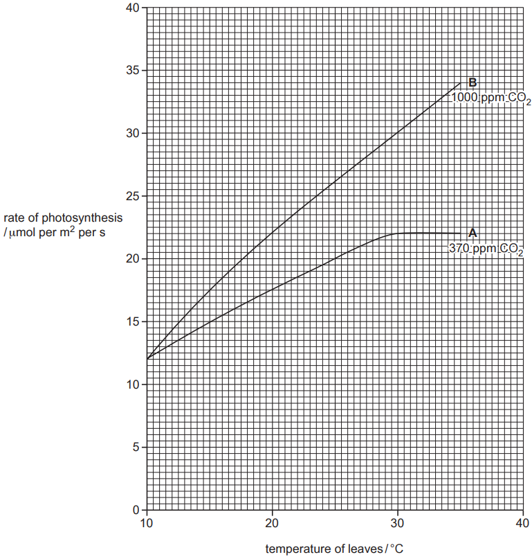

**Fig. 2**

(i)

State **one** environmental factor that should have been kept constant in this investigation.

[1]

(ii)

Describe the effect of temperature on the rate of photosynthesis when carbon dioxide concentration **A** was supplied.

Use the data from Fig. 2 in your answer.

[3]

(iii)

Calculate the percentage increase in the rate of photosynthesis at 30 °C when the carbon dioxide concentration was increased from **A** to **B** as shown in Fig. 2.

Show your working and give your answer to the nearest whole number.

[2]

(iv)

Explain the effect of increasing temperature on the rate of photosynthesis for carbon dioxide concentration **B**.

Use the term *limiting factor* in your answer.

[3]

(v)

The student concluded that carbon dioxide concentration is the factor limiting the rate of photosynthesis between 30 °C and 35 °C for the results shown for **A** in Fig. 2.

State the evidence for this conclusion.

[1]

*Source: 2019 0970/41 Q2C*

**Q6** [2 marks]

#### Extended Only

A similar investigation was carried out on Arizona honeysweet, *Tidestromia oblongifolia*, that grows in Death Valley in California where the highest temperatures may be greater than 45 °C.

The results are shown in Fig. 3.

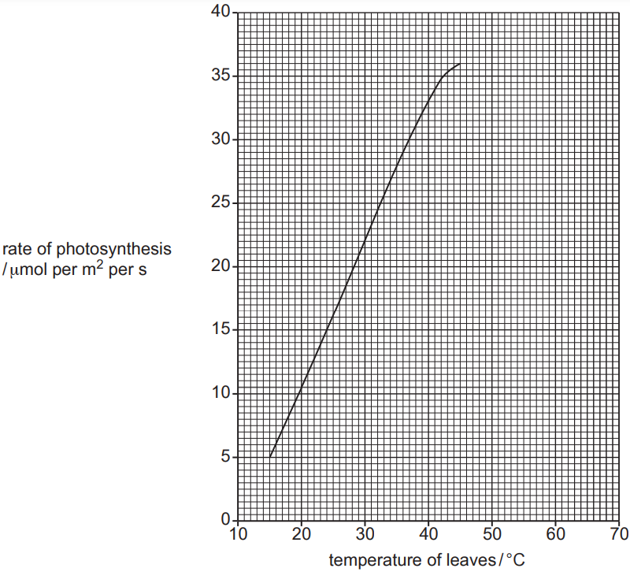

**Fig. 3**

Predict **and** explain what would happen to the rate of photosynthesis if the investigation is continued at temperatures higher than 45 °C.

*Source: 2019 0970/41 Q2D*

### Q7 — hard — 11 marks

**Q7** [2 marks]

The apparatus shown in Fig. 1 was used to investigate the effects of different conditions on the rate of photosynthesis in an aquatic plant.

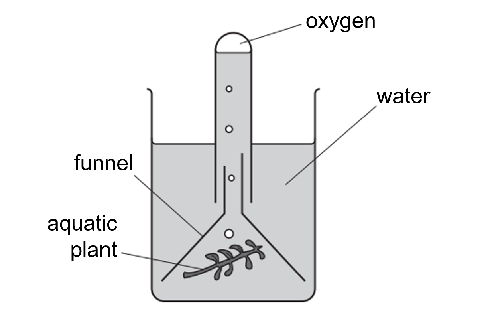

**Fig. 1**

A student investigated the effects of light and carbon dioxide on the rate of photosynthesis.

The number of bubbles of oxygen produced in one minute was counted in four different conditions.

Table 1 shows the results.

**Table 1**

| test | conditions | number of bubbles of oxygen per minute |   |
|---|---|---|---|
| light | carbon dioxide source added to the water |   |   |
| 1 | present | no | 2 |
| 2 | absent | no | 0 |
| 3 | present | yes | 20 |
| 4 | absent | yes | 0 |

State **two** conclusions about the conditions needed for photosynthesis using the information in Table 1.

*Source: 2018 (Series 1) 0610/31 Q2A*

**Q7** [4 marks]

**Extract:**

| test | conditions | number of bubbles of oxygen per minute |
| light | carbon dioxide source added to the water |
| 1 | present | no | 2 |
| 2 | absent | no | 0 |
| 3 | present | yes | 20 |
| 4 | absent | yes | 0 |

The investigation was carried out at 15 °C. It was repeated at 25 °C.

Suggest **and** explain the effect this had on the results of test **2** and test **3**.

*Source: 2018 (Series 1) 0610/31 Q2B*

**Q7** [2 marks]

Carbon dioxide enters plant cells by diffusion.

The word diffusion on the left can be joined to two boxes on the right to make two correct statements about diffusion.

Draw **two** straight lines from diffusion to the boxes to complete the two statements.

*Source: 2018 (Series 1) 0610/31 Q2C*

**Q7** [3 marks]

**Extract:**

Table 2:
| total volume of water absorbed by the roots / cm^3 | volume of water lost by transpiration / cm^3 | volume of water used during photosynthesis / cm^3 |
| 265 | 262.4 | 2.6 |

Table 2 shows the volume of water absorbed, as well as the water usage by a plant over a period of 24 hours.

**Table 2**

| total volume of water absorbed by the roots / cm3 | volume of water lost by transpiration / cm3 | volume of water used during photosynthesis / cm3 |
|---|---|---|
| 265 | 262.4 | 2.6 |

(i)

Calculate the percentage of water used during photosynthesis.

Show your working and give your answer to **two** decimal places.

[2]

(ii)

Use the information in Table 2 and your answer at part (i) to explain why water is usually **not** a limiting factor of photosynthesis.

[1]

### Q8 — hard — 10 marks

**Q8** [4 marks]

#### Extended only

Fig. 1 shows the effect of several different factors on the growth of strawberry plants in a greenhouse.

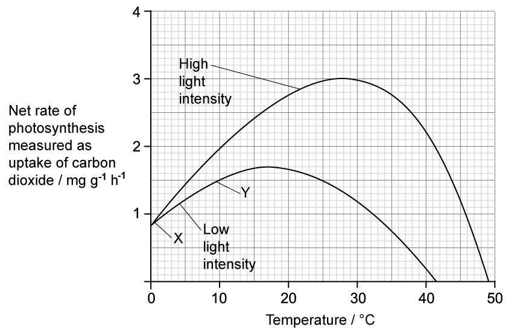

**Fig. 1**

Describe and explain how temperature and light intensity affected the rate of photosynthesis up until 20°C.

**Q8** [2 marks]

#### Extended only

Identify the limiting factor(s) between point **X** and **Y** in Fig. 1.

**Q8** [2 marks]

**Extract:**

At 25°C, the net rate of photosynthesis for plants grown at high light intensity is 2.95 mg g⁻¹ h⁻¹ and for plants grown at low light intensity is 1.5 mg g⁻¹ h⁻¹.

#### Extended only

Calculate the percentage difference in the rate of photosynthesis at 25°C in the plants grown at low and high light intensity. Show your working and give your answer to one decimal place.

**Q8** [2 marks]

**Extract:**

Light intensity and temperature affected the rate of photosynthesis in the following ways...

Any four of the following:

- As temperature increases, the rate of photosynthesis also increases (for both light intensities) until the optimum temperature is reached; [1 mark]
- (This is because) enzyme activity is faster/increases as temperature increases OR as temperature increases it becomes less of a limiting factor; [1 mark]
- Plants grown at a low(er) light intensity had a lower rate of photosynthesis (than those grown at high(er) light intensity); [1 mark]
- (This is because) at low light intensity, light is a limiting factor / less light is available for photosynthesis OR at high light intensity there is more light available for photosynthesis / light is not a limiting factor; [1 mark]
- Any data point correctly read from the graph to support marking points e.g. optimum temperature for plants grown at low light intensity is 16/17/18°C; [1 mark]

Correctly reading from a graph to support your answer is always worth a mark in questions that require you to describe or explain trends in a graph.

#### Extended only

Explain why light intensity is no longer limiting the rate of photosynthesis at temperatures higher than 30°C.

### Q9 — hard — 11 marks

**Q9** [2 marks]

A student carried out an investigation into the effect of soil magnesium on plant growth.

In this investigation, the student set up two different environments as follows:

1. One plant was grown in sterile soil, provided with distilled water and placed in bright light.
2. One plant was grown in sterile soil, provided with magnesium dissolved in distilled water and placed in bright light.

Predict what the student will have observed after two weeks of growing in these conditions.

**Q9** [4 marks]

**Extract:**

A student carried out an investigation into the effect of soil magnesium on plant growth.

In this investigation, the student set up two different environments as follows:

1. One plant was grown in sterile soil, provided with distilled water and placed in bright light.
2. One plant was grown in sterile soil, provided with magnesium dissolved in distilled water and placed in bright light.

Predict what the student will have observed after two weeks of growing in these conditions.

The student will have made the following observation...

- The plant that had been provided with water and magnesium / plant 2 will have shown a greater amount of growth (compared to the other plant / plant 1);
- Plant 1 will have yellow leaves;

Explain your prediction from part (a).

**Q9** [3 marks]

**Extract:**

A student carried out an investigation into the effect of soil magnesium on plant growth.

In this investigation, the student set up two different environments as follows:

1. One plant was grown in sterile soil, provided with distilled water and placed in bright light.
2. One plant was grown in sterile soil, provided with magnesium dissolved in distilled water and placed in bright light.

When selecting the plants for the investigation in part (a), the student made sure that they picked plants with the same number of leaves.

Explain why this was necessary.

**Q9** [2 marks]

One method that can be used to show that photosynthesis has occurred is to test the leaves with iodine.

Explain how this shows that photosynthesis has occurred.

### Q10 — hard — 17 marks

**Q10** [2 marks]

An investigation was carried out to test the effect of temperature on the rate of photosynthesis of pondweed.

The volume of oxygen produced per hour was measured. The results can be seen in Table 1**.**

**Table 1**

| temperature / °C | rate of photosynthesis / cm3 hour-1 |   |   |   |
|---|---|---|---|---|
| test 1 | test 2 | test 3 | mean |   |
| 20 | 18.4 | 19.3 | 19.6 | 19.1 |
| 25 | 31.6 | 35.1 | 31.9 | 32.8 |
| 30 | 42.9 | 44.2 | 44.9 | 44.0 |
| 35 | 40.6 | 39.8 | 42.0 | 40.8 |
| 40 | 23.1 | 20.5 | 22.4 | 22.0 |
| 45 | 1.9 | 14.2 | 2.2 | **X** |

Calculate the mean rate of photosynthesis per hour when the temperature was 45 °C.

**Q10** [5 marks]

**Extract:**

| temperature / °C | rate of photosynthesis / cm^3 ^hour^-1^ |
| test 1 | test 2 | test 3 | mean |
| 20 | 18.4 | 19.3 | 19.6 | 19.1 |
| 25 | 31.6 | 35.1 | 31.9 | 32.8 |
| 30 | 42.9 | 44.2 | 44.9 | 44.0 |
| 35 | 40.6 | 39.8 | 42.0 | 40.8 |
| 40 | 23.1 | 20.5 | 22.4 | 22.0 |
| 45 | 1.9 | 14.2 | 2.2 | **X** |

Plot the results from Table 1 onto an appropriate graph using the graph paper in Fig. 1.

**Fig. 1**

**Q10** [4 marks]

**Extract:**

An investigation was carried out to test the effect of temperature on the rate of photosynthesis of pondweed.

The volume of oxygen produced per hour was measured. The results can be seen in Table 1.

Table 1

temperature / °C | rate of photosynthesis / cm^3 hour^-1^
| test 1 | test 2 | test 3 | mean |
| 20 | 18.4 | 19.3 | 19.6 | 19.1 |
| 25 | 31.6 | 35.1 | 31.9 | 32.8 |
| 30 | 42.9 | 44.2 | 44.9 | 44.0 |
| 35 | 40.6 | 39.8 | 42.0 | 40.8 |
| 40 | 23.1 | 20.5 | 22.4 | 22.0 |
| 45 | 1.9 | 14.2 | 2.2 | X |

Note that the 14.2 reading was excluded from the results as it is an anomaly.

Describe and explain the results shown in the graph.

**Q10** [4 marks]

**Extract:**

Table 1

temperature / °C | rate of photosynthesis / cm^3 ^hour^-1^ | test 1 | test 2 | test 3 | mean
...
30 | 42.9 | 44.2 | 44.9 | 44.0
...

The mean rate of photosynthesis per hour when the temperature was 30 °C is 44.0 cm^3^/hr.

A farmer growing strawberries in his greenhouse used the results in Table 1 to decide on the best temperature for his greenhouse. He decided to heat the greenhouse to 30 °C.

When the farmer measured the rate of photosynthesis of his plants, he found the rate to be 11.5% slower than the data suggested.

Calculate the rate of photosynthesis that the farmer actually achieved at 30 °C.

**Q10** [2 marks]

**Extract:**

A farmer growing strawberries in his greenhouse used the results in Table 1 to decide on the best temperature for his greenhouse. He decided to heat the greenhouse to 30 °C.

When the farmer measured the rate of photosynthesis of his plants, he found the rate to be 11.5% slower than the data suggested.

#### Extended only

Suggest why the farmer may not have achieved a rate of photosynthesis as high as the data in Fig. 1 predicted.

### Q11 — medium — 10 marks

**Q11** [4 marks]

A group of students used an aquatic plant to investigate the effect of temperature on the rate of photosynthesis.

Fig. 1 shows the apparatus the students used.

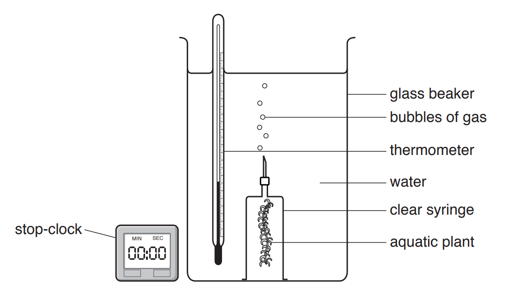

**Fig. 1**

The students counted the number of bubbles of gas the aquatic plant produced, in two minutes, at different temperatures.

Fig. 2 shows a graph of their results.

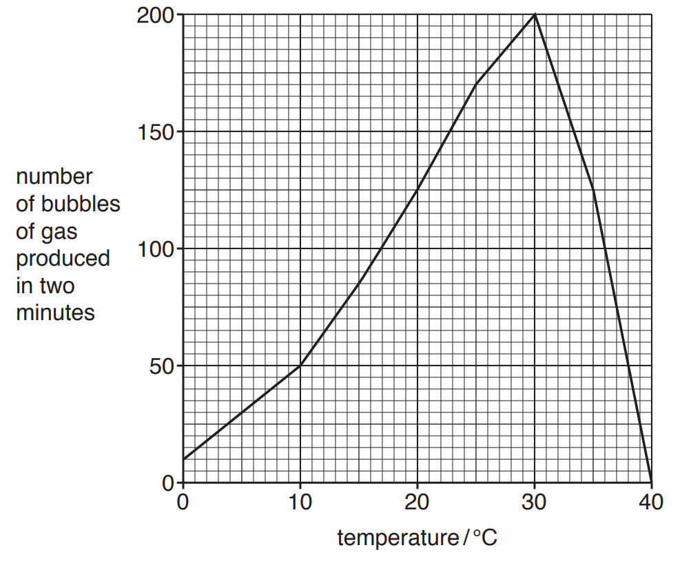

**Fig. 2**

(i)

State the temperature at which the aquatic plant produced the most bubbles of gas in two minutes.

Give your answer in °C.

[1]

(ii)

Use Fig. 2 to find the number of bubbles of gas produced by the aquatic plant, in two minutes, at 15 °C **and** at 25 °C.

[1]

(iii)

Use your answer to (a)(ii) to calculate the percentage increase in the number of bubbles of gas produced by the aquatic plant at 15 °C and at 25 °C.

Show your working.

[2]

*Source: 2018 (Series 3) 0610/33 Q2B*

**Q11** [3 marks]

**Extract:**

The students counted the number of bubbles of gas the aquatic plant produced, in two minutes, at different temperatures. Fig. 2 shows a graph of their results.

Describe the results shown in Fig. 2.

*Source: 2018 (Series 3) 0610/33 Q2C*

**Q11** [2 marks]

**Extract:**

- Decrease is most rapid after 35 °C; (No bubbles / gas) stops at 40 °C;

#### Extended only

Use your knowledge on enzymes to suggest an explanation for the results obtained between 30°C and 40°C in Fig. 2.

**Q11** [1 mark]

**Extract:**

A group of students used an aquatic plant to investigate the effect of temperature on the rate of photosynthesis.

The students counted the number of bubbles of gas the aquatic plant produced, in two minutes, at different temperatures.

The students added sodium hydrogen carbonate (NaHCO3) to the water in the beaker in Fig.1.

State the purpose of this.

### Q12 — medium — 10 marks

**Q12** [4 marks]

Fig. 1 is a diagram of a variegated leaf from a plant. The plant was exposed to sunlight so that it could photosynthesise.

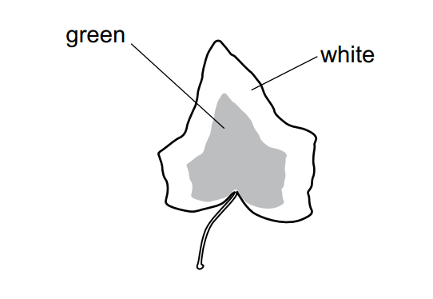

**Fig. 1**

A student tested the leaf for starch and found that:

- Starch was present in the green part of the leaf
- There was **no** starch in the white part of the leaf.

Explain the results of this test.

*Source: 2023 0970/03 Q4A*

**Q12** [2 marks]

Testing a leaf for the presence of starch involves several steps. Explain the following:

(i)

Boiling the leaf at the start of the procedure.

[1]

(ii)

Heating ethanol in a water bath.

[1]

**Q12** [3 marks]

#### Extended only

Photosynthesis occurred in certain parts of the leaf in Fig. 1.

Give the balanced chemical equation for photosynthesis.

**Q12** [1 mark]

#### Extended only

Energy is converted from one form to another during the process of photosynthesis.

Describe this energy conversion.

### Q13 — easy — 14 marks

**Q13** [4 marks]

A plant leaf contains various structures that makes it adapted for the process of photosynthesis.

Complete the following by drawing lines to connect each listed structure with the correct adaptation.

| **Structure** |   | **Adaptation** |
|---|---|---|
|   |   |   |
| Waxy cuticle |   | Allows gas exchange to occur |
|   |   |   |
| Stomata |   | Tightly packed with chloroplasts for maximum absorption of light |
|   |   |   |
| Palisade mesophyll |   | Protect the leaf from water loss |
|   |   |   |
| Spongy mesophyll |   | Increases the surface area to volume ratio for the diffusion of gases |

**Q13** [4 marks]

Fig. 1 shows the cross section of a leaf.

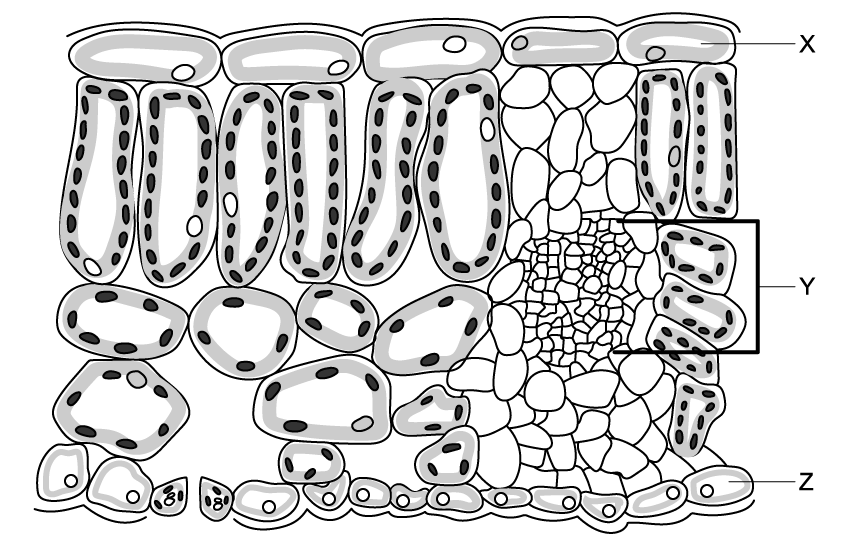

**Fig. 1**

Structure **Y** represents a vascular bundle.

(i)

Identify **two** types of tissue found in structure **Y**.

[2]

(ii)

Describe the function of each type of tissue identified at part (i).

[2]

**Q13** [3 marks]

**Extract:**

Fig. 1 shows the cross section of a leaf.

Structure Y represents a vascular bundle.

Layer **X** and **Z** in Fig. 1 form the outer boundaries of the leaf.

(i)

State **one visible** difference between layer **X** and **Z**.

[1]

(ii)

The cells in layer **X** are transparent.

Explain the importance of this to the plant.

[2]

**Q13** [3 marks]

Carbon dioxide must enter the chloroplasts within plant cells for photosynthesis to occur.

Describe the movement of carbon dioxide from the atmosphere into the chloroplasts.

### Q14 — medium — 12 marks

**Q14** [5 marks]

In an investigation, the carbon dioxide concentration in the air above a crop of maize plants was measured for 24 hours.

There was no wind blowing during the 24 hours of the investigation.

The results of this investigation are shown in Fig. 1.

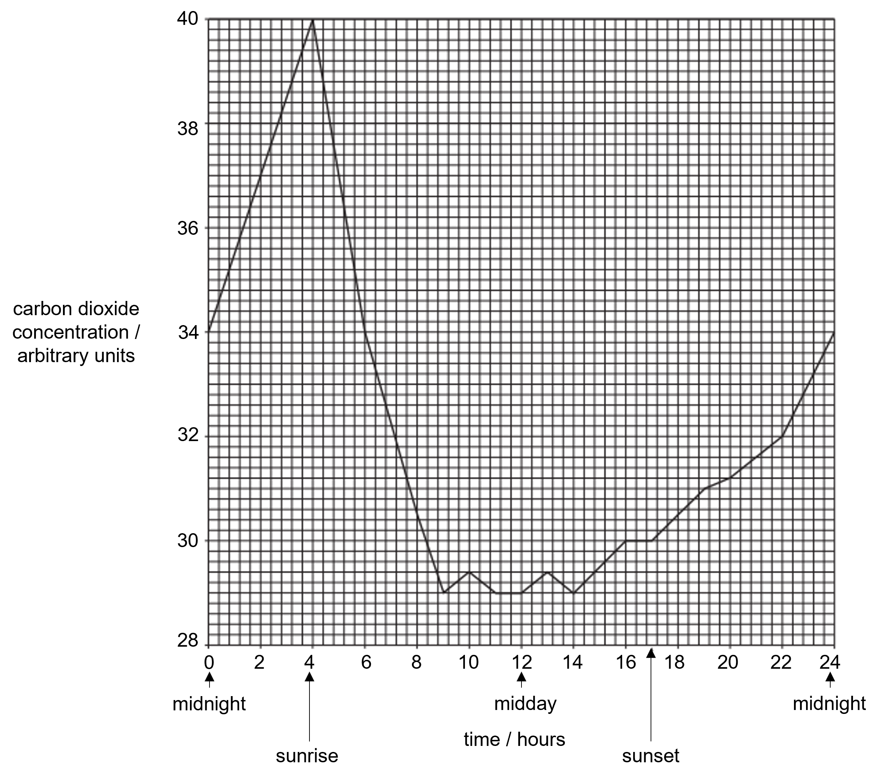

**Fig. 1**

(i)

State the **two** times, on Fig. 1, at which the carbon dioxide concentration in the air was 37 arbitrary units.

[1]

(ii)

Calculate the difference in the carbon dioxide concentration in the air between 04:00 (sunrise) and 12:00 (midday) on Fig. 1. Give your answer in arbitrary units.

[1]

(iii)

Explain why the concentration of carbon dioxide decreases between 04:00 and 09:00.

[3]

*Source: 2018 0610/31 Q9A*

**Q14** [2 marks]

**Extract:**

In an investigation, the carbon dioxide concentration in the air above a crop of maize plants was measured for 24 hours. There was no wind blowing during the 24 hours of the investigation.

State **two** environmental factors that would affect the results of this investigation.

*Source: 2018 0610/31 Q9B*

**Q14** [3 marks]

**Extract:**

In an investigation, the carbon dioxide concentration in the air above a crop of maize plants was measured for 24 hours. There was no wind blowing during the 24 hours of the investigation. The results of this investigation are shown in Fig. 1.

Describe and explain the concentration of carbon dioxide between 16:00 and sunset in Fig. 1.

**Q14** [2 marks]

**Extract:**

In an investigation, the carbon dioxide concentration in the air above a crop of maize plants was measured for 24 hours. There was no wind blowing during the 24 hours of the investigation. The results of this investigation are shown in Fig. 1. (Sun)light is present / it is sunrise; Carbon dioxide is absorbed / used (by the plants); (for) photosynthesis; Photosynthesis is using carbon dioxide faster / at a higher rate than respiration can provide / replace it OR (the rate of) photosynthesis is higher/faster than (the rate of) respiration.

The concentration of carbon dioxide was highest at sunrise.

Suggest a reason for this.

### Q15 — easy — 10 marks

**Q15** [4 marks]

Carbohydrates are produced during photosynthesis.

Describe **four** ways in which a plant may use the carbohydrates produced during photosynthesis.

**Q15** [2 marks]

The carbohydrates produced during photosynthesis may also be converted to lipids and amino acids.

State the function of lipids and amino acids in a plant.

**Q15** [2 marks]

Nitrate is an important source of nitrogen which is needed to make amino acids.

Other than nitrogen, identify **two** other chemical elements that could be found in amino acids.

**Q15** [2 marks]

Some plants may grow in nutrient poor soils where they are not able to absorb enough nitrate through their roots.

Describe the appearance of a plant that is deficient in nitrate.

### Q16 — easy — 11 marks

**Q16** [6 marks]

Water is required for the process of photosynthesis.

(i)

Describe where** and **how water enters a plant.

[3]

(ii)

Describe** one** function of water in a plant other than for photosynthesis.

[1]

(iii)

State the name of the tissue in a plant that transports water.

[1]

(iv)

State the name of the part of a leaf through which most water vapour is lost from the plant

[1]

*Source: 2023 3/1/0970 Q4B*

**Q16** [3 marks]

Chlorophyll is another requirement for photosynthesis to occur.

Complete the following sentences on chlorophyll.

Chlorophyll is a pigment found in ___________________ within plant cells. It is responsible for transferring energy from ___________________ into __________________ energy.

**Q16** [2 marks]

State **one** other raw material besides water that is required for photosynthesis and describe how the plant obtains this substance.

### Q17 — medium — 14 marks

**Q17** [7 marks]

Fig. 1 is a scanning electron micrograph of a vertical section through part of the leaf of a broad bean plant, *Vicia faba.*

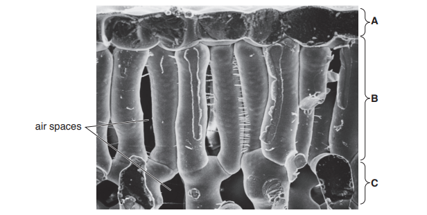

**Fig. 1**

(i)

State the names of the tissues labelled **A** and **B**.

[2]

(ii)

The cells in regions **B** and **C** in Fig. 1 have a large surface area.

Explain why this is necessary for the functioning of the leaf cells.

[3]

(iii)

Explain why there are many interconnecting air spaces within the leaf.

[2]

*Source: 2018 0610/43 Q3A*

**Q17** [3 marks]

Stomata are found on the lower surface of broad bean leaves.

Describe the function of stomata.

*Source: 2018 0610/43 Q3B*

**Q17** [4 marks]

Plants growing in soils lacking magnesium ions struggle to photosynthesise and therefore do not grow to their full potential.

Suggest an explanation why.

### Q18 — easy — 9 marks

**Q18** [3 marks]

(i)

State the word equation for photosynthesis.

[2]

(ii)

State the name of the green substance plants need for photosynthesis.

[1]

*Source: 2018 (Series 3) 0610/33 Q2A*

**Q18** [3 marks]

A student wanted to test the effect of temperature on the rate of photosynthesis.

Fig. 1 shows how the student set up his investigation.

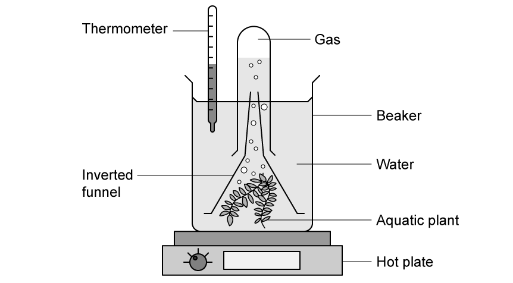

**Fig. 1**

(i)

Identify the gas that is being collected in Fig. 1.

[1]

(ii)

Explain the purpose of using an aquatic plant in this investigation.

[2]

**Q18** [2 marks]

**Extract:**

The gas being collected in Fig. 1 is... Oxygen. The purpose of using an aquatic plant is... The oxygen that is released can be seen as bubbles (because the plant is in water); This enables (the investigator) to count the number of bubbles produced in a minute OR counting the number of bubbles can be used to determine the rate of photosynthesis.

The temperature is increased from 10°C to 25°C.

State and explain the observation that the student would make.

**Q18** [1 mark]

State **one** factor, other than temperature, that affects the rate of photosynthesis.

*Source: 2018 (Series 3) 0610/33 Q2D*

### Q19 — easy — 10 marks

**Q19** [2 marks]

#### Extended only

A gardener is setting up his greenhouse.

He is given advice from two friends on the correct conditions for his greenhouse to grow the most vegetables.

**Friend X **suggested that he provide plenty of water to his vegetables but should cover all the windows in black card to stop the plants getting too hot.

**Friend Y **suggested that he provide plenty of water and open the windows of the greenhouse but did not suggest covering them.

Should the farmer follow the advice of friend **X** or friend **Y**?

Explain your choice.

**Q19** [3 marks]

#### Extended only

The graph in Fig. 1 shows how the rate of photosynthesis of strawberry plants is affected by changes in **three** limiting factors.

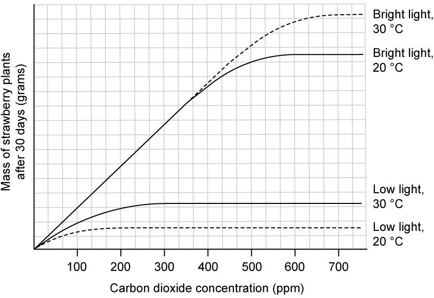

**Fig. 1**

Identify which **three** limiting factors were investigated to produce this graph.

**Q19** [3 marks]

**Extract:**

The graph in Fig. 1 shows how the rate of photosynthesis of strawberry plants is affected by changes in three limiting factors.
The three limiting factors that were investigated were...
- Carbon dioxide
- Light intensity
- Temperature
These factors are all tested in a range of different quantities as shown in the detail in the graph. You have to examine the graph carefully, it's not just the x-axis variable (CO~2~ concentration) being tested.

#### Extended only

Finding the optimum conditions for photosynthesis will ensure that growth is maximised.

Using Fig. 1 , complete the following sentences to identify which conditions gave the fastest rate of photosynthesis and therefore, the maximum growth.

Optimum temperature would be __________

Optimum carbon dioxide % would be __________

Optimum light intensity would be __________

**Q19** [2 marks]

**Extract:**

The optimum conditions would be as follows:

- 30 °C;[1 mark]
- 600 ppm (or above);[1 mark]
- Bright light; [1 mark]

The optimum conditions are those which provide the biggest growth in the strawberry plants. The optimum carbon dioxide reading can be taken anywhere after the point where the graph levels off, although in reality, the gardener will pick the lowest quantity that will give the maximum growth.

#### Extended only

A gardener used the results in Fig. 1 to decide how much carbon dioxide to pump into the greenhouse.

He decided to increase the atmospheric levels to 600 ppm rather than 700 ppm.

Suggest why he made this decision.

### Q20 — medium — 9 marks

**Q20** [3 marks]

Fig. 1 shows a diagram of a leaf.

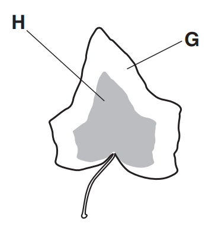

**Fig. 1**

- The part of the leaf labelled **G** contains no chlorophyll and is a white colour.
- The part of the leaf labelled **H** contains chlorophyll and is a green colour.

Glucose produced during photosynthesis is stored in the leaf as starch.

The leaf was boiled in ethanol to remove the chlorophyll. The leaf was then tested for the presence of starch with iodine solution.

(i)

Predict the colour of the part of the leaf labelled **G** after iodine solution has been added.

[1]

(ii)

Predict the colour of the part of the leaf labelled **H** after iodine solution has been added.

[1]

(iii)

State a conclusion about chlorophyll from this investigation.

[1]

*Source: 2018 (Series 2) 0610/32 Q2A*

**Q20** [1 mark]

**Extract:**

Glucose produced during photosynthesis is stored in the leaf as starch. Chlorophyll is required for photosynthesis / production of starch or glucose.

A similar leaf was kept in the dark for 24 hours and then tested for the presence of starch.

The leaf contained no starch.

Explain why the leaf contained no starch.

*Source: 2018 (Series 2) 0610/32 Q2B*

**Q20** [2 marks]

#### Extended only

Glucose is converted into insoluble starch for storage.

Use your knowledge about osmosis to explain why plant cells do not use glucose as a storage molecule.

**Q20** [3 marks]

**Extract:**

Fig. 1 shows a diagram of a leaf.
- The part of the leaf labelled G contains no chlorophyll and is a white colour.
- The part of the leaf labelled H contains chlorophyll and is a green colour.
Glucose produced during photosynthesis is stored in the leaf as starch.
The leaf was boiled in ethanol to remove the chlorophyll. The leaf was then tested for the presence of starch with iodine solution.
A similar leaf was kept in the dark for 24 hours and then tested for the presence of starch.
The leaf contained no starch.

A student modified the experiment from part (a) in order to investigate if light is needed for photosynthesis. Before carrying out the experiment, the student had to include an important step to ensure they obtain accurate results.

(i)

Describe this step.

[1]

(ii)

Explain the importance of the step described at part (i).

[2]
