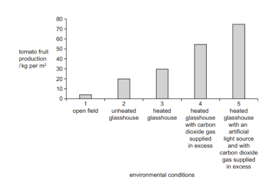
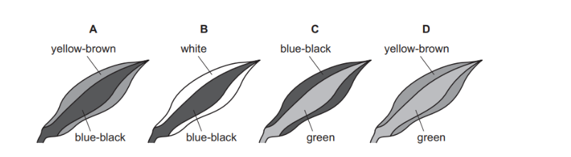
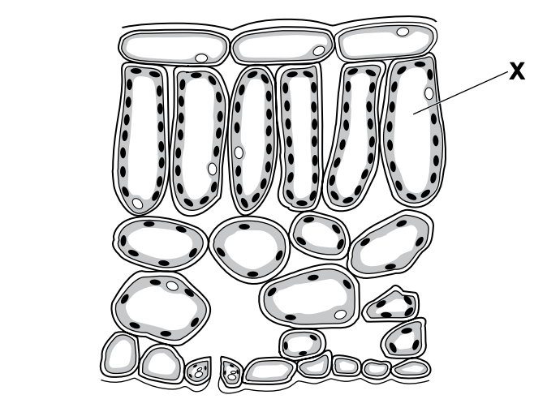
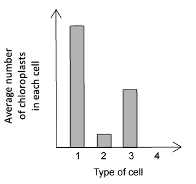
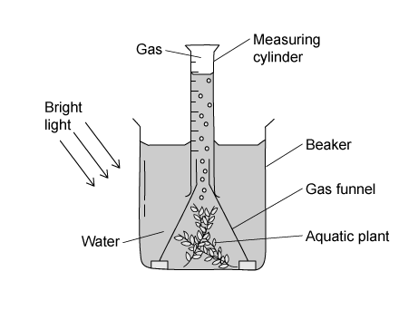

# Exam Questions — Photosynthesis & Leaf Structure
**6. Plant Nutrition** · Cambridge (CIE) IGCSE biology (0610 & 0970)
> Source: [https://www.savemyexams.com/igcse/biology/cie/23/topic-questions/](https://www.savemyexams.com/igcse/biology/cie/23/topic-questions/) · 29 questions across 1 sets

## Multiple Choice Questions (29 questions)

### Q1 — hard — 1 marks

**Q1** [1 mark]

The graph shows the effect of increasing light intensity on the rate of photosynthesis.

Which does point A show?

### Q2 — easy — 1 marks

**Q2** [1 mark]

Which row correctly identifies the reactants and products of photosynthesis?

|   | Reactants | Products |
|---|---|---|
| A | carbon dioxide and water | glucose and oxygen |
| B | carbon dioxide and glucose | water and oxygen |
| C | oxygen and water | carbon dioxide and glucose |
| D | glucose and oxygen | carbon dioxide and water |

### Q3 — medium — 1 marks

**Q3** [1 mark]

In which conditions will there be poor plant growth but no yellowing of leaves?

|   | **Nitrogen availability** | **Magnesium availability** |
|---|---|---|
| **A** | high | high |
| **B** | low | high |
| **C** | low | low |
| **D** | high | low |

### Q4 — hard — 1 marks

**Q4** [1 mark]

To investigate the effect of light and dark conditions on gas exchange in an aquatic plant, a test tube is set up as follows:

1. The test tube is filled with hydrogencarbonate indicator solution
2. A cutting from a green aquatic plant is added
3. The tube is covered with aluminium foil and closed with a bung
4. The tube is exposed to sunlight for 24 hours

What result will the test tube show after 24 hours?

### Q5 — medium — 1 marks

**Q5** [1 mark]

How is a leaf adapted for photosynthesis?

### Q6 — medium — 1 marks

**Q6** [1 mark]

How do the air spaces in the spongy mesophyll of a leaf help to adapt it for photosynthesis?

*Source: june 2022 paper 2 Q12*

### Q7 — hard — 1 marks

**Q7** [1 mark]

Tomato fruit production was measured in five different environmental conditions.

What is a correct conclusion for the data shown in the graph?

*Source: june 2022 paper 2 Q11*

### Q8 — easy — 1 marks

**Q8** [1 mark]

Which tissues are found in vascular bundles?

*Source: june 2022 paper 1 Q13*

### Q9 — medium — 1 marks

**Q9** [1 mark]

Which chemical is a product of photosynthesis that moves out of a green leaf through its stomata?

*Source: june 2022 paper 1  Q12*

### Q10 — easy — 1 marks

**Q10** [1 mark]

The diagram shows a section through the leaf of a plant.

Which label shows a palisade mesophyll cell?

*Source: June 2021 0970/11 Q13*

### Q11 — hard — 1 marks

**Q11** [1 mark]

A plant with striped leaves was kept in bright light for six hours.

A leaf was taken from the plant and the chlorophyll was removed. The leaf was then tested for starch using iodine solution.

Which diagram shows the result of the test?

*Source: June 2021 0970/11 Q12*

### Q12 — medium — 1 marks

**Q12** [1 mark]

Why do plants need nitrate ions?

*Source: Specimen 2023 0970/01 Q13*

### Q13 — easy — 1 marks

**Q13** [1 mark]

The diagram shows a cross-section of part of a leaf

What is the name of the cell labelled X?

*Source: Specimen 2023 0970/01 Q12*

### Q14 — hard — 1 marks

**Q14** [1 mark]

The apparatus shown was used in an experiment.

The carbon dioxide content of the water in each test-tube was measured at the start of the experiment and again three hours later.

In which test-tube will the carbon dioxide concentration decrease?

*Source: Specimen 2023 0970/01 Q11*

### Q15 — hard — 1 marks

**Q15** [1 mark]

#### Extended only

The diagram below shows how the rate of photosynthesis is affected by different conditions.

What of the following correctly identifies the limiting factor for photosynthesis at the three points on the graph?

|   | 1 | 2 | 3 |
|---|---|---|---|
| **A** | light intensity | light intensity | carbon dioxide concentration |
| **B** | temperature | temperature | light intensity |
| **C** | light intensity | temperature | carbon dioxide concentration |
| **D** | light intensity | carbon dioxide concentration | temperature |

### Q16 — easy — 1 marks

**Q16** [1 mark]

The glucose molecules formed during photosynthesis have which form of energy stored within them?

### Q17 — hard — 1 marks

**Q17** [1 mark]

The diagram below shows a cross-section through a leaf as seen under a microscope.

In which part of the leaf would the concentration of carbon dioxide be lowest on a warm, sunny day?

### Q18 — hard — 1 marks

**Q18** [1 mark]

#### Extended only

The following could be used to write a balanced symbol equation for photosynthesis.

1. 6CO2 + 6H2O
2. CO2 + 6H2O
3. Light and chlorophyll
4. C6H12O6 + 6O2
5. 6C6H12O6 + 6O2

Which of the following show the correct balanced chemical equation for photosynthesis?

### Q19 — hard — 1 marks

**Q19** [1 mark]

A student sets up a photosynthesis experiment.

A plant with striped leaves (similar to the one shown below) was kept in bright light for four hours.

A leaf was removed from the plant and treated with ethanol in hot water to remove chlorophyll before iodine was used to test for starch.

Which diagram shows the result of the test?

### Q20 — medium — 1 marks

**Q20** [1 mark]

The average number of chloroplasts found in four different types of cell from the leaf of a plant are shown in the bar chart below.

What are the names of the four types of cell?

|   | 1 | 2 | 3 | 4 |
|---|---|---|---|---|
| **A** | spongy mesophyll cell | epidermal cell | palisade mesophyll cell | guard cell |
| **B** | palisade mesophyll cell | guard cell | spongy mesophyll cell | epidermal cell |
| **C** | epidermal cell | spongy mesophyll cell | palisade mesophyll cell | guard cell |
| **D** | palisade mesophyll cell | spongy mesophyll cell | guard cell | epidermal cell |

### Q21 — hard — 1 marks

**Q21** [1 mark]

Two test tubes are set up with two similar leaves inside them, as shown in the diagram below.

One test tube is exposed to light, while the other is kept in the dark.

The test tubes are left for 4 hours.

What colour will the hydrogencarbonate indicator solution be in each test tube?

|   | dark | light |
|---|---|---|
| **A** | purple | yellow |
| **B** | colourless | yellow |
| **C** | purple | colourless |
| **D** | yellow | purple |

### Q22 — easy — 1 marks

**Q22** [1 mark]

An experiment is set up with four test tubes as shown in the diagram below.

All four test tubes are left in sunlight for 6 hours.

Which test tube would contain the least amount of dissolved carbon dioxide after 6 hours?

### Q23 — easy — 1 marks

**Q23** [1 mark]

Name the product of photosynthesis that diffuses out of a green leaf through its stomata.

### Q24 — easy — 1 marks

**Q24** [1 mark]

The diagram below shows a section through a leaf.

Which cell type would have the highest concentration of oxygen on a bright, sunny day?

### Q25 — medium — 1 marks

**Q25** [1 mark]

Which of the following options is the best explanation for the role of chlorophyll in photosynthesis?

Chlorophyll...

### Q26 — medium — 1 marks

**Q26** [1 mark]

Which row of the table below shows the correct effects of deficiencies of essential minerals for plant growth?

|   | effect of magnesium ion deficiency | effect of nitrate ion deficiency |
|---|---|---|
| **A** | yellow leaves | stunted growth |
| **B** | stunted growth | long roots |
| **C** | small leaves | yellow leaves |
| **D** | stunted growth | yellow leaves |

### Q27 — medium — 1 marks

**Q27** [1 mark]

Which of the following correctly identifies some of the molecules produced from the glucose synthesised by photosynthesis?

|   | 1 | 2 | 3 |
|---|---|---|---|
| **A** | cellulose for storage | fats and oils for  energy storage | starch to build cell walls |
| **B** | cellulose to build cell walls | fats and oils for energy storage | starch for storage |
| **C** | sucrose to be transported around the plant | fats and oils for energy storage | cellulose for storage |
| **D** | sucrose to be transported around the plant | starch to build cell walls | cellulose for storage |

### Q28 — medium — 1 marks

**Q28** [1 mark]

A student sets up an experiment to measure the rate of oxygen production of an aquatic plant when it is photosynthesising.

The student repeated the experiment several times to calculate the average amount of oxygen collected.

Which two factors should be kept constant during the student’s experiment?

### Q29 — easy — 1 marks

**Q29** [1 mark]

The diagram below shows a palisade mesophyll cell found in the leaves of plants.

In which region of the cell would starch be stored?

