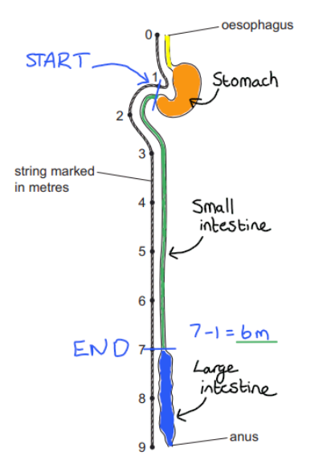

# Mark Schemes — Human Diet & Digestion
**7. Human Nutrition** · Cambridge (CIE) IGCSE biology (0610 & 0970)

## Multiple Choice Questions (33 questions)

### Q1
**Final answer:** **The correct answer is C.**

- Amylase breaks down starch to simple reducing sugars

**A** is incorrect as amino acids are the product of protease activity, not amylase.

**B** is incorrect as fatty acids and glycerol are the products of lipase activity, not amylase.

**D** is incorrect as starch is the substrate of the reaction, not the product.

### Q2
**Final answer:** **The correct answer is C.**

- **Tooth 1 **is a premolar as it has a smaller grinding surface than a molar
- **Tooth 2** is a molar as it has a broad grinding surface for crushing and grinding food
- **Tooth 3** is an incisor as it has a broad, chisel-like biting edge
- **Tooth 4** is a canine as it has a pointed tip

### Q3
**Final answer:** **The correct answer is B.**

- **Organ 1** is the salivary glands: small, rounded structures located in the jaw region
- **Organ 2** is the stomach: a J-shaped organ that forms part of the alimentary canal
- **Organ 3** is the liver: a large organ that is not connected to the oesophagus and therefore is not part of the alimentary canal
- **Organ 4** is the pancreas: a leaf-shaped structure located close to the stomach and duodenum

The teeth are not technically an organ, and are also located in a different position to organ 1 within the mouth.

Organ 1 could potentially also be the mouth, but there are other reasons why these rows must be incorrect.

The gall bladder is a small structure attached to the liver. It is visible in this diagram but not labelled as 1-4.

The small intestine forms the coiled, tubular structure in the lower abdomen and is clearly visible as a separate, unlabelled structure in the diagram.

### Q4
**Final answer:** **The correct answer is C.**

- The pH of the stomach is between 1.5 and 3 due to the presence of hydrochloric acid
- Pathogens cannot survive in this acidic environment

**A** is incorrect as stomach conditions are acidic, not alkaline.

**B** is incorrect as, while protease enzymes are likely to play a role in the digestion of pathogenic proteins, they are not the main factor in reducing pathogen numbers.

**D** is incorrect as, though stomach churning may aid pathogen destruction by ensuring thorough mixing of the stomach contents, it is not the main factor.

### Q5
**Final answer:** **The correct answer is ****C.**

- In coeliac disease, the villi become **damaged and flattened**, so the **surface area of the small intestine is reduced**. This means **fewer digested nutrients are absorbed into the blood**, so the person may become undernourished even if they eat enough food

**A **is incorrect because reducing surface area mainly affects absorption, not the whole process of chemical digestion.

**B **is incorrect because damaged villi do not mainly prevent digestive enzymes from being secreted.

**D **is incorrect because danaged villi will not cause the food to move slowly.

### Q6
**Final answer:** **The correct answer is ****D.**

- **Trypsin** is a **protease**, so it breaks down **protein**

**A **is incorrect because amylase breaks down starch, not fats.

**B **is incorrect because maltase breaks down maltose to glucose, not starch.

**C **is incorrect because pepsin is another protease that breaks down protein, not starch.

> **[exam-tip]**
> While **pepsin **breaks down proteins in the **acidic **conditions of the stomach, **trypsin **continues to break down proteins in the **alkaline **conditions of the small intestine.

### Q7
**Final answer:** **The correct answer is ****B.**

- Physical digestion breaks food into smaller pieces, which **increases the surface area** available for enzymes

**A** is incorrect because changing large insoluble molecules into small soluble molecules is chemical digestion, not physical digestion.

**C** is incorrect because acidic conditions are provided by hydrochloric acid in the stomach, not by physical digestion.

**D** is incorrect because physical digestion does not move nutrients into the blood, and absorption happens after digestion.

### Q8
**Final answer:** **The correct answer is C.**

- Rickets is a deficiency condition, caused by a lack of vitamin D, that is characterised by soft, weak bones
- Vitamin D supplementation ensures adequate vitamin D levels
- Sunlight can stimulate the body to naturally produce vitamin D
- Calcium is an essential mineral for bones and teeth

**A** is incorrect as protein and iron do not prevent rickets.

**B** is incorrect as sunlight exposure stimulates the body to produce vitamin D, so it should not be avoided.

**D** is incorrect as vitamin A and fibre do not prevent rickets.

### Q9
**Final answer:** **The correct answer is B.**

- The product already contains:

  - protein (from soya protein)
  - mineral ions (iron, and calcium from low fat milk)
  - fibre
  - water
- To be a truly balanced diet smoothie, it still needs carbohydrates, vitamins (C and D), and fats and oils

**A** is incorrect as the product already contains calcium in the low fat milk

**C** is incorrect as the product already contains mineral ions (calcium and iron)

**D** is incorrect as the product already contains calcium in the low fat milk, and also requires carbohydrates, fats and oils

### Q10
**Final answer:** **The correct answer is ****B****.**

- This is because the small intestine starts below the stomach at 1 m and ends above the large intestine at 7 m.
- 7 - 1 = 6 m

### Q11
**Final answer:** **The correct answer is ****C****.**

- Ingestion takes place in the mouth because ingestion is the word used to describe taking food into the body which we do when we eat

**A** is incorrect because the anus is where egestion takes place, which is when waste materials (faeces) leave the body.

**B** is incorrect because the liver produces bile but is not where food is ingested.

**D** is incorrect because the stomach is where food is digested by pepsin and pathogens are destroyed but there is no ingestion that takes place here.

### Q12
**Final answer:** **The correct answer is ****B****.**

- This is because fibre is not digested by enzymes in the alimentary canal and instead pushes all the way through and helps to move food along

**A** is incorrect because protein helps with growth and repair, not fibre.

**C** is incorrect because vitamins and minerals, such as calcium, help to maintain strong bones and teeth.

**D** is incorrect because carbohydrates help to provide energy, not fibre.

### Q13
**Final answer:** **The correct answer is ****C****.**

- Most of the absorption of water occurs in the small intestine, where the absorption of nutrients creates a water concentration gradient to drive absorption of water through osmosis.

**A** is incorrect because, although the colon absorbs some water, the majority of water absorption occurs in the small intestine.

**B** is incorrect because the oesophagus primarily serves as a passageway for food and does not absorb significant amounts of water.

**D** is incorrect because the stomach mainly functions in the digestion of food and does not absorb significant amounts of water.

### Q14
**Final answer:** **The correct answer is ****A****.**

- Amino acids are the building blocks of proteins

**B** is incorrect because fatty acids are the products of lipid (fat) digestion, not protein breakdown.

**C** is incorrect because glycerol is a component of lipids and is produced during the breakdown of fats, not proteins.

**D** is incorrect because simple sugars, such as glucose, are the end products of carbohydrate digestion, not protein breakdown.

### Q15
**Final answer:** **The correct answer is ****D****.**

- The small intestine is the primary site for the absorption of most digested food nutrients into the bloodstream.

**A** is incorrect because the colon primarily absorbs water and not digested food nutrients.

**B** is incorrect because the kidneys filter waste products from the blood and do not absorb digested food.

**C** is incorrect because the liver produces bile which aids digestion of lipids and is involved in the assimilation of amino acids for protein synthesis, but is not involved in the actual absorption of digested food.

### Q16
**Final answer:** **The correct answer is D because:**

Scurvy is caused by a lack of vitamin C

**A **is incorrect because AIDS is caused by infection by the HIV pathogen.

**B** is incorrect because coronary heart disease is caused by lifestyle factors, among other things.

**C** is incorrect because rickets is caused by a lack of vitamin D.

### Q17
**Final answer:** **The correct answer is C because:**

This is the pancreas, which produces lipase that is released into the small intestine for digestion

**A** is incorrect because the gallbladder does not produce lipase.

**B** is incorrect because the oesophagus does not produce lipase.

**D** is incorrect because the large intestine does not produce lipase.

### Q18
**Final answer:** **The correct answer is C because:**

The mouth carries out physical digestion during the process of chewing

**A** is incorrect because the gallbladder stores bile, and therefore does not carry out digestion.

**B** is incorrect because the liver makes bile, and therefore does not carry out digestion.

**D** is incorrect because the pancreas makes and releases digestive enzymes, and therefore does not carry out digestion.

### Q19
**Final answer:** **The correct answer is ****A**** (1 and 2) because:**

**1** is a **premolar** tooth and **2** is a **molar** tooth. Premolars and molars have **larger**, flatter **surfaces** with ridges at the edges for **chewing** and grinding up food.

**B** is incorrect because **3** is an **incisor**, which is chisel shaped for **biting** and cutting.

**C** is incorrect because **1** (premolar) is also responsible for chewing and grinding of food.

**D** is incorrect because **3** is an **incisor**, which is for **biting** and cutting while **4** is a **canine**, which is pointed for tearing, **holding** and biting.

### Q20
**Final answer:** **The correct answer is ****A**** (W and Y) because:**

**Protein** digestion begins in the **stomach** (**W**) by action of acid and the enzyme pepsin. It also occurs in the small intestine (mainly in the **duodenum - Y**) as a result of proteases (such as trypsin) produced by the **pancreas** and the small intestine.

**B** and **C** are incorrect because **Z** is the **liver**, which produces **bile** to aid lipid digestion. The liver doesn’t play an active part in digestion.

**D** is incorrect because **X** is the **pancreas**, which produces enzymes that can digest proteins (proteases) but no digestion occurs here (the pancreas is an accessory organ that secretes enzymes into ducts which mix with food as it passes through the duodenum).

### Q21
**Final answer:** **The correct answer is ****B**** (Starch being broken down into glucose molecules.) because:**

The digestion of starch involves enzymes that break large insoluble starch molecules up into smaller soluble glucose molecules. Whenever enzymes are involved then it is an example of chemical digestion, not physical digestion.

**A**, **B** and **D** are incorrect because these are all examples of physical digestion where large food particles are mechanically broken down into smaller particles. This is done to increase the surface area on which the digestive enzymes can work during chemical digestion to change large insoluble molecules into smaller soluble ones.

### Q22
**Final answer:** **The correct answer is ****C ****because:**

A vitamin **D** **deficiency** leads to **brittle** **bones**, as it is required for bones to be able to **absorb** **calcium** ions in the **bloodstream**. Calcium is the mineral which is needed to strengthen bones; the less calcium the weaker they are. Vitamin D can be **synthesized** in the body when **cholesterol** in skin cells is **converted** into **Vitamin D**; this reaction is driven by **UV** from sunlight.

**A** is incorrect because the effect is not linked to a deficiency in iron.

**B** is incorrect because the cause is incorrect.

**D** is incorrect because the deficiency does not match the cause or the effect.

### Q23
**Final answer:** **The correct answer is ****C**** because:**

Although **water** is also absorbed in the **colon** (large intestine), **most** absorption occurs in the **small intestine**. This is because the absorption of** soluble **food molecules and salts (ions) from food occurs in the small intestine, **lowering the water potential **of the blood, drawing water in by osmosis.

**A** is incorrect because no absorption of water occurs in the oesophagus.

**B** is incorrect because no absorption of water occurs in the pancreas. Remember the pancreas is an accessory organ, and not part of the alimentary canal so no food passes through it.

**D** is incorrect because some absorption would occur in the large intestine, but the question asks where **most** absorption takes place.

### Q24
**Final answer:** **The correct answer is ****B**** because:**

**Absorption** is the movement of soluble food molecules and ions through the intestinal wall into the blood to be transported to the cells. Once it reaches the cells these food molecules and ions will cross the cell membrane during **assimilation** in order to become part of the cell. Any food that hasn't been digested or absorbed will move along the alimentary canal and leave the body through the anus during **egestion**.

**A** is incorrect because egestion does not involve excretion. The waste products that leave the body during the process of excretion comes from metabolic reactions that occur **within cells**. Waste products that leave the body during egestion was created **outside cells**.

**C** is incorrect because the description of absorption and assimilation has been switched around.

**D** is incorrect because all three descriptions is incorrect for the reasons mentioned above.

### Q25
**Final answer:** **The correct answer is ****C**** (Vitamin D assists with the absorption of calcium and is therefore needed to build strong bones and teeth.) because:**

Vitamin D facilitates the absorption of calcium into bones and teeth, which is required to provide strength to these parts. Without sufficient vitamin D intake, a child may develop rickets where the bones develop poorly.

**A** is incorrect because vitamin C is needed to make collagen, not vitamin D.

**B** is incorrect because even though a lack of vitamin D is loosely linked to an increased risk of ligament tears, the lack of the vitamin itself will not directly cause the tear. A physical impact of some kind would cause the tear.

**D** is incorrect because iron is an important component of haemoglobin and therefore plays a role in the transport of oxygen in the body.

### Q26
**Final answer:** **The correct answer is ****D**** because:**

**Villi** **increase** the **surface** **area** over which **absorption** of digested food molecules into the **blood** can occur in the small intestine. A **reduction** in the number of villi would result in a **decreased** **surface** **area** for absorption so **less** **absorption** would occur as food passes through the lumen of the small intestine and more would be lost from the body. This could lead to weight loss.

**A** is incorrect because a person would not gain weight if they cannot absorb food molecules adequately. Weight gain is caused by an unbalanced diet; with the energy associated with food intake exceeded that expended.

**B** is incorrect because there may be reduced maltose digestion (as maltase is produced by cells lining the villi, reduced villi surface area would lead to less maltase) but this would not lead to weight gain.

**C** is incorrect because lipid digestion is unlikely to be affected, although lipid absorption would be.

### Q27
**Final answer:** **The correct answer is ****C**** because:**

Vessels **B** and **C** are both **lacteals, **the lymphatic vessels of the small intestines that absorb fatty acids and glycerol (the products of lipid digestion). Lacteal **B** is entering the villus, where it will absorb fatty acids and glycerol, so lacteal** C, **which is leaving the villus, will have the highest concentration of fatty acids.

**A** is incorrect because it represents a **capillary** entering the villus.

**B** is incorrect because it is a lacteal **entering** the villus to absorb the products of lipid digestion.

**D** is incorrect because it is a **capillary** leaving the villus. Although some fatty acid molecules will be absorbed into the bloodstream, far more end up in the lacteals.

### Q28
**Final answer:** **The correct answer is ****C**** (Glucose) because:**

**Starch**, a large biomolecule, is made from many molecules of **glucose** molecules bonded together. **Salivary** **amylase**, an enzyme produced by the salivary glands, acts on starch and breaks it down into **maltose** (a disaccharide). **Amylase** is also produced by the **pancreas**, to help digest any remaining starch in the small intestine. Maltose is broken down by the enzyme **maltase** (which is found in the lining of the small intestine), producing **glucose** molecules.

**A** and **B** are incorrect because amino acids are the product of protein digestion, which begins in the stomach, not the mouth.

**D** is incorrect because starch was the starting molecule in this process (starch is a polymer of glucose molecules).

### Q29
**Final answer:** **The correct answer is ****B**** (4 only) because:**

Structure **4** is the **pancreas** which produces the majority of **lipases** involved in digestion.

**A** is incorrect because the **stomach** (2) only produces **proteases** for protein digestion.

**C** is incorrect because the **liver** (3) produces **bile** which aids lipid digestion (by emulsifying lipids to increase their surface area) but it does not produce lipases.

**D** is incorrect because the **mouth** (1) contains salivary glands which secrete **salivary** **amylase** to digest carbohydrates. No lipases are made here.

### Q30
**Final answer:** **The correct answer is ****D**** (To increase the surface area of lipids for digestion) because:**

Bile works by **breaking** up **large** globules of lipids (fats and oils) into much **smaller** ones, **increasing** the **surface** **area** and making it easier for lipase enzymes to digest them into fatty acids. This is known as **emulsification**.

**A** is incorrect because bile emulsifies lipids, not proteins. Protein digestion begins in the stomach, where the conditions are acidic.

**B** is incorrect because even though bile does neutralise the food entering the duodenum, the food from the stomach is **acidic**, not alkaline. Bile is an alkaline solution.

**C** is incorrect because bile does not contain any enzymes.

### Q31
**Final answer:** **The correct answer is ****D**** (All 4) because:**

All the reactions listed can occur in the duodenum.

The **pancreas** produces **lipases**, pancreatic **amylase** and **proteases**; these enzymes mix with food that leaves the stomach in the duodenum, allowing digestion to continue to occur.

Starch digestion begins in the mouth, but not all starch there will be digested by salivary amylase (and this enzyme is denatured by acid in the stomach). Protein digestion begins in the stomach and continues in the duodenum.

**Maltase** is an enzyme produced by cells lining the small intestine, allowing **maltose** (a disaccharide) to be broken down into **glucose**.

### Q32
**Final answer:** **The correct answer is ****C ****because:**

**Gastric** juice contains **hydrochloric** **acid**, which lowers the **pH** of the stomach to make conditions unsuitable for any microorganisms present in food, as well as **optimising** the pH for **pepsin**, a protease that works best around pH 2.

**A** is incorrect because **trypsin** is a protease that is made and secreted by the **pancreas** and it functions in the** small intestine**, not the stomach.

**B** is incorrect because **bile** is stored in the gallbladder, but it is made in the **liver**. The effect described is correct.

**D** is incorrect because bile neutralises acidic food and gastric juices entering the **duodenum** from the **stomach**.

### Q33
**Final answer:** **The correct answer is ****D**** (Increasing the rate of starch breakdown into glucose molecules) because:**

**Amylase** breaks down **starch** into **maltose**.  **Maltase**, produced by the **epithelial** cells lining the small intestine, breaks maltose down into **glucose** which can be readily absorbed into the bloodstream. Therefore option **D** is not a function of salivary amylase as starch is not broken down into glucose by amylase.
