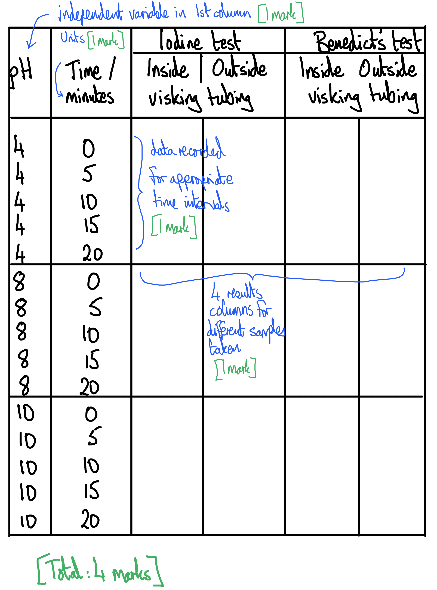
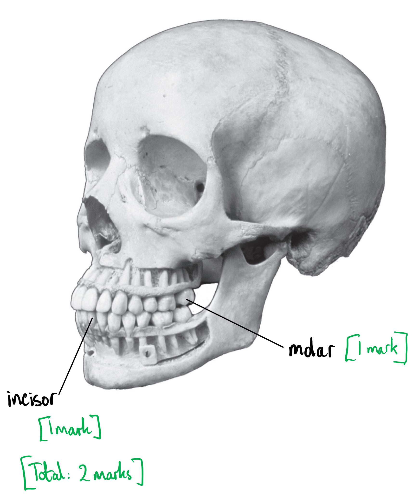
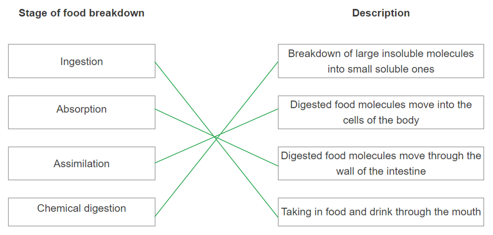
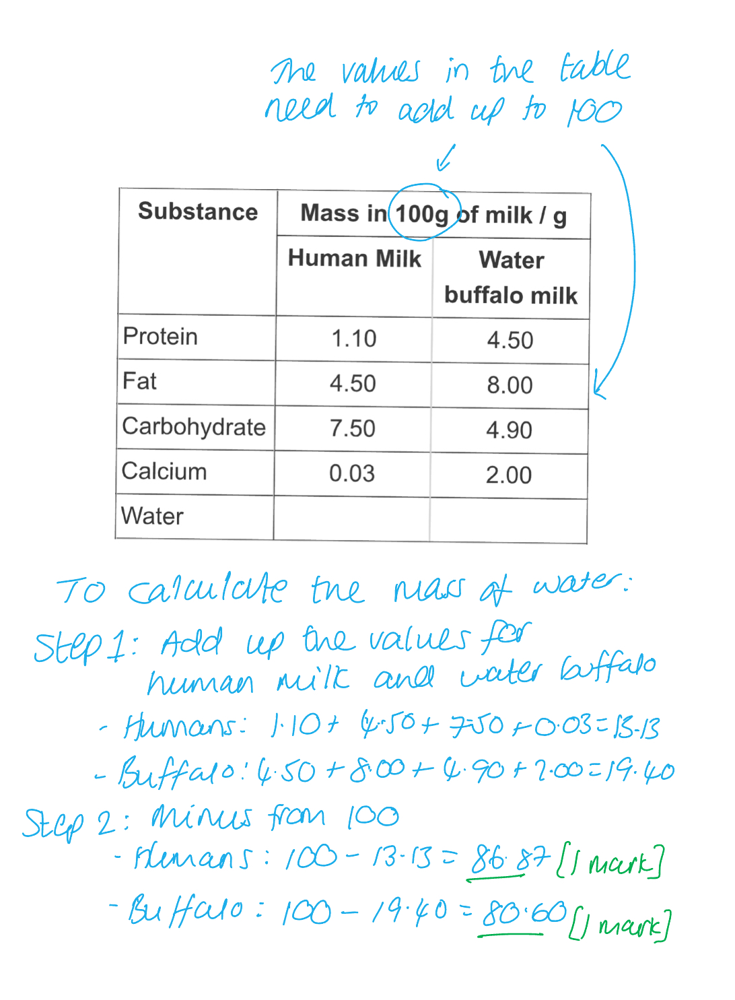
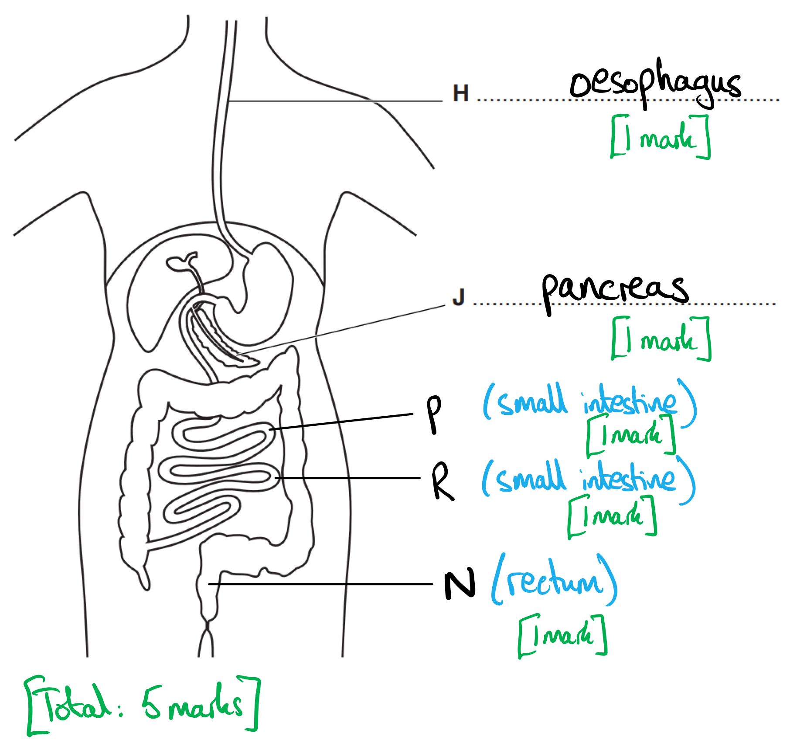
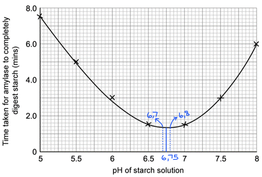
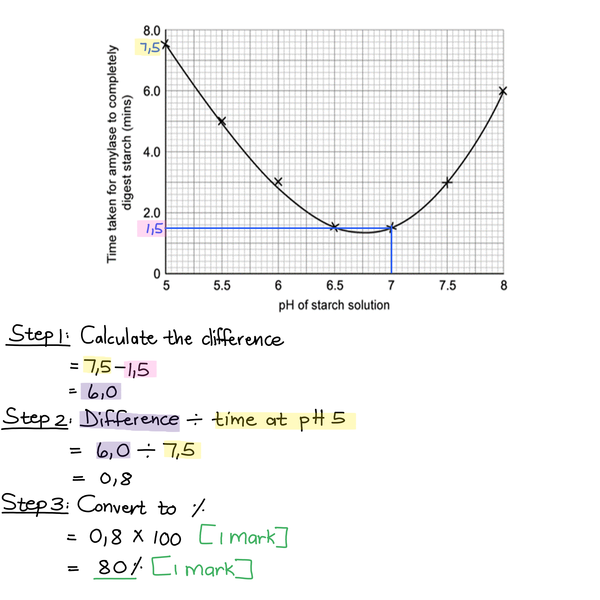

# Mark Schemes — Human Diet & Digestion
**7. Human Nutrition** · Cambridge (CIE) IGCSE biology (0610 & 0970)

## Alternative To Practical Questions (1 questions)

### Q1
(i) The independent variable in this investigation is:

- pH / pH level; **[1 mark]**

(ii) Two tests that can be carried out to determine progress of the enzyme-catalysed reaction are:

- Iodine test (for starch); **[1 mark]**
- Benedict's test (for glucose/reducing sugar); **[1 mark]**

(iii) A  way to determine whether the buffer solution is performing its role effectively is:

- To test the reaction mixture with a pH probe / universal indicator paper (periodically); **[1 mark]**
- To show whether the pH is being held at the required level; **[1 mark]**

**[Total: 5 marks]**

> *The independent variable is the one that the experimenters change deliberately, to examine the effect of changing it on the way the reaction proceeds. Here, they are looking at the effect of changing pH. *

> *The relative amounts of starch and glucose/reducing sugar will indicate how far the reaction has progressed under the various conditions. *

> *A pH probe or piece of universal indicator paper, dipped into the reaction solution, will confirm that the various pH buffers are doing their job and holding the pH at those levels. *
(i) The important action that has been missed out from the students' method above, during Step 4, is:

- Heat / heating the Benedict's solution with the test sample / boiling; **[1 mark]**

(ii) A blank results table for the investigation would have the following features:

- Independent variable / pH in the first / left-hand column; **[1 mark]**
- Units of time included (seconds/minutes); **[1 mark]**
- Times at 5 minute intervals from zero (maximum time any time 20 minutes+); **[1 mark]**
- 4 results columns, 2 for iodine test (inside Visking tubing and outside), 2 for Benedict's test (inside Visking tubing and outside); **[1 mark]**

**[Total: 5 marks]**

(i) The iodine test results could be recorded as:

**One** from:

- Positive (for starch) / negative; **[1 mark]**
- Blue/black or reddish brown; **[1 mark]**

(ii) The Benedict's test results could be recorded as:

**One** from:

- Positive / negative; **[1 mark]**
- Coloured (precipitate) is formed; **[1 mark]**
- Colour change from light blue to green/yellow/orange/brick red; **[1 mark]**

(c) (iii) The results can be made more reliable by:

- Performing repeats / doing the experiment again; **[1 mark]**
- (so that) anomalies can be identified and eliminated; **[1 mark]**

**[Total: 4 marks]**
(i) At pH 4:

- The enzyme is denatured (by the acidic condition) so starch remains present; **[1 mark]**

At pH 8:

- Amylase is near its optimum pH, so it can break starch down so after 10 minutes, all the starch has disappeared;** [1 mark]**

At pH 10

- Amylase can function though not very well, so the breakdown of starch is slow **OR** starch is still present at the end; **[1 mark]**

(ii) From Fig. 2, the fastest time to digest the starch is:

- Any time between 5 and 10 minutes / 5 > *t* > 10 minutes; **[1 mark]**

(iii) A further experiment to give a more accurate answer to the answer in part (d) (ii) is:

- To carry out the experiment with a narrower range of pH values; **[1 mark]**
- Between pH 4 and pH 8; **[1 mark]**

**[Total: 6 marks]**

> *By testing a narrower range of pH values you will be able to determine nearer to the true optimum value for amylase; this would be a more accurate test to carry out. *
A change to the experimental equipment that could increase the chances of a more definitive positive result being recorded could be:

**Change:**

Any **one** from the following:

- Use a larger/longer/wider Visking tubing / more reaction mixture; **[1 mark]**
- Suspend the Visking tubing in a smaller body of water / use a boiling tube in place of a beaker; **[1 mark]**

**Explanation:**

Any **two** from the following:

- Benedict's test gives different strength colour changes for different concentrations of glucose/reducing sugar; **[1 mark]**
- Having a smaller body of water will increase the concentration (of glucose); **[1 mark]**
- And give a stronger colour change / more definitive result; **[1 mark]**

**[Total: 3 marks]**

> *You could argue that increasing the amylase concentration or the proportion of starch in the Visking tubing would result in more glucose being able to diffuse out, but that is missing the point of the question. Another suggestion could be that the experiment is conducted at a warmer temperature. This is because the question asks about a change to the **equipment** in the experiment, not the reagents used or the conditions, like temperature, that the experiment is carried out under. *

## Multiple Choice Questions (33 questions)

### Q1
**Final answer:** **The correct answer is C.**

- Amylase breaks down starch to simple reducing sugars

**A** is incorrect as amino acids are the product of protease activity, not amylase.

**B** is incorrect as fatty acids and glycerol are the products of lipase activity, not amylase.

**D** is incorrect as starch is the substrate of the reaction, not the product.

### Q2
**Final answer:** **The correct answer is C.**

- **Tooth 1 **is a premolar as it has a smaller grinding surface than a molar
- **Tooth 2** is a molar as it has a broad grinding surface for crushing and grinding food
- **Tooth 3** is an incisor as it has a broad, chisel-like biting edge
- **Tooth 4** is a canine as it has a pointed tip

### Q3
**Final answer:** **The correct answer is B.**

- **Organ 1** is the salivary glands: small, rounded structures located in the jaw region
- **Organ 2** is the stomach: a J-shaped organ that forms part of the alimentary canal
- **Organ 3** is the liver: a large organ that is not connected to the oesophagus and therefore is not part of the alimentary canal
- **Organ 4** is the pancreas: a leaf-shaped structure located close to the stomach and duodenum

The teeth are not technically an organ, and are also located in a different position to organ 1 within the mouth.

Organ 1 could potentially also be the mouth, but there are other reasons why these rows must be incorrect.

The gall bladder is a small structure attached to the liver. It is visible in this diagram but not labelled as 1-4.

The small intestine forms the coiled, tubular structure in the lower abdomen and is clearly visible as a separate, unlabelled structure in the diagram.

### Q4
**Final answer:** **The correct answer is C.**

- The pH of the stomach is between 1.5 and 3 due to the presence of hydrochloric acid
- Pathogens cannot survive in this acidic environment

**A** is incorrect as stomach conditions are acidic, not alkaline.

**B** is incorrect as, while protease enzymes are likely to play a role in the digestion of pathogenic proteins, they are not the main factor in reducing pathogen numbers.

**D** is incorrect as, though stomach churning may aid pathogen destruction by ensuring thorough mixing of the stomach contents, it is not the main factor.

### Q5
**Final answer:** **The correct answer is ****C.**

- In coeliac disease, the villi become **damaged and flattened**, so the **surface area of the small intestine is reduced**. This means **fewer digested nutrients are absorbed into the blood**, so the person may become undernourished even if they eat enough food

**A **is incorrect because reducing surface area mainly affects absorption, not the whole process of chemical digestion.

**B **is incorrect because damaged villi do not mainly prevent digestive enzymes from being secreted.

**D **is incorrect because danaged villi will not cause the food to move slowly.

### Q6
**Final answer:** **The correct answer is ****D.**

- **Trypsin** is a **protease**, so it breaks down **protein**

**A **is incorrect because amylase breaks down starch, not fats.

**B **is incorrect because maltase breaks down maltose to glucose, not starch.

**C **is incorrect because pepsin is another protease that breaks down protein, not starch.

> **[exam-tip]**
> While **pepsin **breaks down proteins in the **acidic **conditions of the stomach, **trypsin **continues to break down proteins in the **alkaline **conditions of the small intestine.

### Q7
**Final answer:** **The correct answer is ****B.**

- Physical digestion breaks food into smaller pieces, which **increases the surface area** available for enzymes

**A** is incorrect because changing large insoluble molecules into small soluble molecules is chemical digestion, not physical digestion.

**C** is incorrect because acidic conditions are provided by hydrochloric acid in the stomach, not by physical digestion.

**D** is incorrect because physical digestion does not move nutrients into the blood, and absorption happens after digestion.

### Q8
**Final answer:** **The correct answer is C.**

- Rickets is a deficiency condition, caused by a lack of vitamin D, that is characterised by soft, weak bones
- Vitamin D supplementation ensures adequate vitamin D levels
- Sunlight can stimulate the body to naturally produce vitamin D
- Calcium is an essential mineral for bones and teeth

**A** is incorrect as protein and iron do not prevent rickets.

**B** is incorrect as sunlight exposure stimulates the body to produce vitamin D, so it should not be avoided.

**D** is incorrect as vitamin A and fibre do not prevent rickets.

### Q9
**Final answer:** **The correct answer is B.**

- The product already contains:

  - protein (from soya protein)
  - mineral ions (iron, and calcium from low fat milk)
  - fibre
  - water
- To be a truly balanced diet smoothie, it still needs carbohydrates, vitamins (C and D), and fats and oils

**A** is incorrect as the product already contains calcium in the low fat milk

**C** is incorrect as the product already contains mineral ions (calcium and iron)

**D** is incorrect as the product already contains calcium in the low fat milk, and also requires carbohydrates, fats and oils

### Q10
**Final answer:** **The correct answer is ****B****.**

- This is because the small intestine starts below the stomach at 1 m and ends above the large intestine at 7 m.
- 7 - 1 = 6 m

### Q11
**Final answer:** **The correct answer is ****C****.**

- Ingestion takes place in the mouth because ingestion is the word used to describe taking food into the body which we do when we eat

**A** is incorrect because the anus is where egestion takes place, which is when waste materials (faeces) leave the body.

**B** is incorrect because the liver produces bile but is not where food is ingested.

**D** is incorrect because the stomach is where food is digested by pepsin and pathogens are destroyed but there is no ingestion that takes place here.

### Q12
**Final answer:** **The correct answer is ****B****.**

- This is because fibre is not digested by enzymes in the alimentary canal and instead pushes all the way through and helps to move food along

**A** is incorrect because protein helps with growth and repair, not fibre.

**C** is incorrect because vitamins and minerals, such as calcium, help to maintain strong bones and teeth.

**D** is incorrect because carbohydrates help to provide energy, not fibre.

### Q13
**Final answer:** **The correct answer is ****C****.**

- Most of the absorption of water occurs in the small intestine, where the absorption of nutrients creates a water concentration gradient to drive absorption of water through osmosis.

**A** is incorrect because, although the colon absorbs some water, the majority of water absorption occurs in the small intestine.

**B** is incorrect because the oesophagus primarily serves as a passageway for food and does not absorb significant amounts of water.

**D** is incorrect because the stomach mainly functions in the digestion of food and does not absorb significant amounts of water.

### Q14
**Final answer:** **The correct answer is ****A****.**

- Amino acids are the building blocks of proteins

**B** is incorrect because fatty acids are the products of lipid (fat) digestion, not protein breakdown.

**C** is incorrect because glycerol is a component of lipids and is produced during the breakdown of fats, not proteins.

**D** is incorrect because simple sugars, such as glucose, are the end products of carbohydrate digestion, not protein breakdown.

### Q15
**Final answer:** **The correct answer is ****D****.**

- The small intestine is the primary site for the absorption of most digested food nutrients into the bloodstream.

**A** is incorrect because the colon primarily absorbs water and not digested food nutrients.

**B** is incorrect because the kidneys filter waste products from the blood and do not absorb digested food.

**C** is incorrect because the liver produces bile which aids digestion of lipids and is involved in the assimilation of amino acids for protein synthesis, but is not involved in the actual absorption of digested food.

### Q16
**Final answer:** **The correct answer is D because:**

Scurvy is caused by a lack of vitamin C

**A **is incorrect because AIDS is caused by infection by the HIV pathogen.

**B** is incorrect because coronary heart disease is caused by lifestyle factors, among other things.

**C** is incorrect because rickets is caused by a lack of vitamin D.

### Q17
**Final answer:** **The correct answer is C because:**

This is the pancreas, which produces lipase that is released into the small intestine for digestion

**A** is incorrect because the gallbladder does not produce lipase.

**B** is incorrect because the oesophagus does not produce lipase.

**D** is incorrect because the large intestine does not produce lipase.

### Q18
**Final answer:** **The correct answer is C because:**

The mouth carries out physical digestion during the process of chewing

**A** is incorrect because the gallbladder stores bile, and therefore does not carry out digestion.

**B** is incorrect because the liver makes bile, and therefore does not carry out digestion.

**D** is incorrect because the pancreas makes and releases digestive enzymes, and therefore does not carry out digestion.

### Q19
**Final answer:** **The correct answer is ****A**** (1 and 2) because:**

**1** is a **premolar** tooth and **2** is a **molar** tooth. Premolars and molars have **larger**, flatter **surfaces** with ridges at the edges for **chewing** and grinding up food.

**B** is incorrect because **3** is an **incisor**, which is chisel shaped for **biting** and cutting.

**C** is incorrect because **1** (premolar) is also responsible for chewing and grinding of food.

**D** is incorrect because **3** is an **incisor**, which is for **biting** and cutting while **4** is a **canine**, which is pointed for tearing, **holding** and biting.

### Q20
**Final answer:** **The correct answer is ****A**** (W and Y) because:**

**Protein** digestion begins in the **stomach** (**W**) by action of acid and the enzyme pepsin. It also occurs in the small intestine (mainly in the **duodenum - Y**) as a result of proteases (such as trypsin) produced by the **pancreas** and the small intestine.

**B** and **C** are incorrect because **Z** is the **liver**, which produces **bile** to aid lipid digestion. The liver doesn’t play an active part in digestion.

**D** is incorrect because **X** is the **pancreas**, which produces enzymes that can digest proteins (proteases) but no digestion occurs here (the pancreas is an accessory organ that secretes enzymes into ducts which mix with food as it passes through the duodenum).

### Q21
**Final answer:** **The correct answer is ****B**** (Starch being broken down into glucose molecules.) because:**

The digestion of starch involves enzymes that break large insoluble starch molecules up into smaller soluble glucose molecules. Whenever enzymes are involved then it is an example of chemical digestion, not physical digestion.

**A**, **B** and **D** are incorrect because these are all examples of physical digestion where large food particles are mechanically broken down into smaller particles. This is done to increase the surface area on which the digestive enzymes can work during chemical digestion to change large insoluble molecules into smaller soluble ones.

### Q22
**Final answer:** **The correct answer is ****C ****because:**

A vitamin **D** **deficiency** leads to **brittle** **bones**, as it is required for bones to be able to **absorb** **calcium** ions in the **bloodstream**. Calcium is the mineral which is needed to strengthen bones; the less calcium the weaker they are. Vitamin D can be **synthesized** in the body when **cholesterol** in skin cells is **converted** into **Vitamin D**; this reaction is driven by **UV** from sunlight.

**A** is incorrect because the effect is not linked to a deficiency in iron.

**B** is incorrect because the cause is incorrect.

**D** is incorrect because the deficiency does not match the cause or the effect.

### Q23
**Final answer:** **The correct answer is ****C**** because:**

Although **water** is also absorbed in the **colon** (large intestine), **most** absorption occurs in the **small intestine**. This is because the absorption of** soluble **food molecules and salts (ions) from food occurs in the small intestine, **lowering the water potential **of the blood, drawing water in by osmosis.

**A** is incorrect because no absorption of water occurs in the oesophagus.

**B** is incorrect because no absorption of water occurs in the pancreas. Remember the pancreas is an accessory organ, and not part of the alimentary canal so no food passes through it.

**D** is incorrect because some absorption would occur in the large intestine, but the question asks where **most** absorption takes place.

### Q24
**Final answer:** **The correct answer is ****B**** because:**

**Absorption** is the movement of soluble food molecules and ions through the intestinal wall into the blood to be transported to the cells. Once it reaches the cells these food molecules and ions will cross the cell membrane during **assimilation** in order to become part of the cell. Any food that hasn't been digested or absorbed will move along the alimentary canal and leave the body through the anus during **egestion**.

**A** is incorrect because egestion does not involve excretion. The waste products that leave the body during the process of excretion comes from metabolic reactions that occur **within cells**. Waste products that leave the body during egestion was created **outside cells**.

**C** is incorrect because the description of absorption and assimilation has been switched around.

**D** is incorrect because all three descriptions is incorrect for the reasons mentioned above.

### Q25
**Final answer:** **The correct answer is ****C**** (Vitamin D assists with the absorption of calcium and is therefore needed to build strong bones and teeth.) because:**

Vitamin D facilitates the absorption of calcium into bones and teeth, which is required to provide strength to these parts. Without sufficient vitamin D intake, a child may develop rickets where the bones develop poorly.

**A** is incorrect because vitamin C is needed to make collagen, not vitamin D.

**B** is incorrect because even though a lack of vitamin D is loosely linked to an increased risk of ligament tears, the lack of the vitamin itself will not directly cause the tear. A physical impact of some kind would cause the tear.

**D** is incorrect because iron is an important component of haemoglobin and therefore plays a role in the transport of oxygen in the body.

### Q26
**Final answer:** **The correct answer is ****D**** because:**

**Villi** **increase** the **surface** **area** over which **absorption** of digested food molecules into the **blood** can occur in the small intestine. A **reduction** in the number of villi would result in a **decreased** **surface** **area** for absorption so **less** **absorption** would occur as food passes through the lumen of the small intestine and more would be lost from the body. This could lead to weight loss.

**A** is incorrect because a person would not gain weight if they cannot absorb food molecules adequately. Weight gain is caused by an unbalanced diet; with the energy associated with food intake exceeded that expended.

**B** is incorrect because there may be reduced maltose digestion (as maltase is produced by cells lining the villi, reduced villi surface area would lead to less maltase) but this would not lead to weight gain.

**C** is incorrect because lipid digestion is unlikely to be affected, although lipid absorption would be.

### Q27
**Final answer:** **The correct answer is ****C**** because:**

Vessels **B** and **C** are both **lacteals, **the lymphatic vessels of the small intestines that absorb fatty acids and glycerol (the products of lipid digestion). Lacteal **B** is entering the villus, where it will absorb fatty acids and glycerol, so lacteal** C, **which is leaving the villus, will have the highest concentration of fatty acids.

**A** is incorrect because it represents a **capillary** entering the villus.

**B** is incorrect because it is a lacteal **entering** the villus to absorb the products of lipid digestion.

**D** is incorrect because it is a **capillary** leaving the villus. Although some fatty acid molecules will be absorbed into the bloodstream, far more end up in the lacteals.

### Q28
**Final answer:** **The correct answer is ****C**** (Glucose) because:**

**Starch**, a large biomolecule, is made from many molecules of **glucose** molecules bonded together. **Salivary** **amylase**, an enzyme produced by the salivary glands, acts on starch and breaks it down into **maltose** (a disaccharide). **Amylase** is also produced by the **pancreas**, to help digest any remaining starch in the small intestine. Maltose is broken down by the enzyme **maltase** (which is found in the lining of the small intestine), producing **glucose** molecules.

**A** and **B** are incorrect because amino acids are the product of protein digestion, which begins in the stomach, not the mouth.

**D** is incorrect because starch was the starting molecule in this process (starch is a polymer of glucose molecules).

### Q29
**Final answer:** **The correct answer is ****B**** (4 only) because:**

Structure **4** is the **pancreas** which produces the majority of **lipases** involved in digestion.

**A** is incorrect because the **stomach** (2) only produces **proteases** for protein digestion.

**C** is incorrect because the **liver** (3) produces **bile** which aids lipid digestion (by emulsifying lipids to increase their surface area) but it does not produce lipases.

**D** is incorrect because the **mouth** (1) contains salivary glands which secrete **salivary** **amylase** to digest carbohydrates. No lipases are made here.

### Q30
**Final answer:** **The correct answer is ****D**** (To increase the surface area of lipids for digestion) because:**

Bile works by **breaking** up **large** globules of lipids (fats and oils) into much **smaller** ones, **increasing** the **surface** **area** and making it easier for lipase enzymes to digest them into fatty acids. This is known as **emulsification**.

**A** is incorrect because bile emulsifies lipids, not proteins. Protein digestion begins in the stomach, where the conditions are acidic.

**B** is incorrect because even though bile does neutralise the food entering the duodenum, the food from the stomach is **acidic**, not alkaline. Bile is an alkaline solution.

**C** is incorrect because bile does not contain any enzymes.

### Q31
**Final answer:** **The correct answer is ****D**** (All 4) because:**

All the reactions listed can occur in the duodenum.

The **pancreas** produces **lipases**, pancreatic **amylase** and **proteases**; these enzymes mix with food that leaves the stomach in the duodenum, allowing digestion to continue to occur.

Starch digestion begins in the mouth, but not all starch there will be digested by salivary amylase (and this enzyme is denatured by acid in the stomach). Protein digestion begins in the stomach and continues in the duodenum.

**Maltase** is an enzyme produced by cells lining the small intestine, allowing **maltose** (a disaccharide) to be broken down into **glucose**.

### Q32
**Final answer:** **The correct answer is ****C ****because:**

**Gastric** juice contains **hydrochloric** **acid**, which lowers the **pH** of the stomach to make conditions unsuitable for any microorganisms present in food, as well as **optimising** the pH for **pepsin**, a protease that works best around pH 2.

**A** is incorrect because **trypsin** is a protease that is made and secreted by the **pancreas** and it functions in the** small intestine**, not the stomach.

**B** is incorrect because **bile** is stored in the gallbladder, but it is made in the **liver**. The effect described is correct.

**D** is incorrect because bile neutralises acidic food and gastric juices entering the **duodenum** from the **stomach**.

### Q33
**Final answer:** **The correct answer is ****D**** (Increasing the rate of starch breakdown into glucose molecules) because:**

**Amylase** breaks down **starch** into **maltose**.  **Maltase**, produced by the **epithelial** cells lining the small intestine, breaks maltose down into **glucose** which can be readily absorbed into the bloodstream. Therefore option **D** is not a function of salivary amylase as starch is not broken down into glucose by amylase.

## Theory Questions (26 questions)

### Q1
> **[mark-scheme]**
> - Bile emulsifies fats / breaks fats into smaller droplets **[1 mark]**
> - Increases surface area (of fats) for lipase to act on / for enzyme action **[1 mark]**
> 
> **Reject** references to bile breaking down molecules in marking point 1.

> **[exam-tip]**
> **Don't say that bile digests fats**. This is the most common mistake — bile is not an enzyme so it does not chemically break down fats.
> **[mark-scheme]**
> Any **three** from:
> 
> - Pancreatic enzymes / enzymes produced in the pancreas cannot reach the small intestine
> - Protease / trypsin cannot digest proteins into amino acids
> - Carbohydrase / amylase cannot digest starch into maltose / sugars
> - New proteins cannot be produced for growth **OR** less energy available for growth (from respiration of glucose)
> 
> **AND**
> 
> - Undigested fats cannot be absorbed **SO** pass out in faeces
> 
> **[4 marks]**
> 
> Reject pepsin for marking point 2.
> 
> Reject references to energy being made or produced for marking point 4.

> **[exam-tip]**
> A good starting point here is to recall that lipase, protease, and amylase are all produced by the pancreas. From here, think carefully about which enzyme is responsible for digesting which substrate, and what the consequences are for growth when each enzyme cannot reach the small intestine.
> 
> The mark scheme is structured so that you must gain at least one mark from the fatty stools section as well as marks from the growth section — covering only one will prevent you from accessing full marks.
In order to calculate the percentage change you need to use the following equation:

percentage increase = (change ÷ original) × 100

- Calculate the change in absorption:

= 50 − 12

= 38 g

- Substitute into the percentage increase formula:

= (38 ÷ 12) × 100 **[1 mark]**

= 316.67 **[1 mark]**

- Round to two significant figures:

**320** % **[1 mark]**

> **[mark-scheme]**
> Full marks can be awarded for the correct answer in the absence of additional calculations.

### Q2
> **[mark-scheme]**
> - Iodine solution **[1 mark] **
> - Turns blue-black if starch is present** [1 mark]**
> 
> **AND**
> 
> - Biuret reagent** [1 mark] **
> - Turns purple / lilac / violet if protein is present **[1 mark]**
> 
> The results must be linked with the correct tests for marking points 2 and 4 to be awarded.
> **[mark-scheme]**
> (i) The name of the solution used to test for reducing sugars, and the positive result is:
> 
> - Benedict's (solution / reagent) **[1 mark]**
> - Brick red / orange precipitate forms **[1 mark]**
> 
> (ii) The effect on the enzyme and the reaction rate will be:
> 
> - Enzyme denatures / is denatured **[1 mark]**
> - Rate of reaction decreases to zero / the reaction will stop **[1 mark]**
> **[mark-scheme]**
> (i) The condition caused by a lack of vitamin C is:
> 
> - Scurvy **[1 mark]**
> 
> (ii) The name of the condition caused by a lack of vitamin D is:
> 
> - Rickets **[1 mark]**
> 
> (iii) Humans need fibre in their diet because:
> 
> - To keep food moving through the gut / prevent constipation **[1 mark]**
> 
> Accept to reduce the risk of bowel cancer for part (iii).

### Q3
> **[mark-scheme]**
> Any **two** from:
> 
> - Breaking down/hydrolysing maltose
> - Into glucose
> - On the membranes of the epithelial cells
> 
> **[2 marks]**

> **[exam-tip]**
> Make sure you name both the substrate (maltose) and the product (glucose) when describing the action of an enzyme. A common mistake is to say maltase "breaks down sugar" without specifying which sugar or what it is broken down into. Remember that maltase acts at the membrane of epithelial cells lining the small intestine, so mentioning the location can earn you an additional mark.

### Q4
(i) (Blood) plasma;** [1 mark]**

(ii) Assimilation; **[1 mark]**

(iii) Any **two **from**:**

- Antibodies; **[1 mark]**
- Insulin; **[1 mark]**
- Glucagon; **[1 mark]**
- Fibrin(ogen); **[1 mark]**
- Haemoglobin;**[1 mark]**

**[Total 4 marks]**

> *You can also get the mark for any other correct answers, such as enzymes like the ones in phagocytes, or any other named hormone.*

### Q5
- Pancreas / stomach / small intestine; **[1 mark]**

The stomach contains the protease enzyme pepsin and the pancreas secretes the protease enzyme trypsin into the small intestine.

**[Total: 1 mark]**

### Q6
| insoluble molecule | enzyme | soluble molecules |
|---|---|---|
| starch | amylase | reducing sugars |
| fat | lipase;  **[1 mark]** | fatty acids ;  **[1 mark]** glycerol ; **[1 mark]** |
| protein ; **[1 mark]** | protease | amino acids ;  **[1 mark]** |

**[Total: 5 marks]**

### Q7
(i) The diet shown in Fig. 1 is** **not** **considered to be a balanced diet because:

Any **two **from the following:

- High in (named) carbohydrates; **[1 mark]**
- High in (named) fats; **[1 mark]**
- Too high in energy/calories/kJ; **[1 mark]**
- Lacks protein; **[1 mark]**
- Lacks (named ) vitamins; **[1 mark]**
- Lacks (named ) minerals; **[1 mark]**
- Lacks fibre; **[1 mark]**
- Lacking fruits / vegetables / water; **[1 mark]**

(ii) The man could reduce his weight by:

Any **two **from the following:

- Eat less (named) carbohydrate / eat less (named) fat / reduce calorie intake / reduce kJ intake / reduce energy consumption; **[1 mark]**
- Consume fibre/vegetables/fruit/water/protein; **[1 mark]**
- Exercise/physical activity; **[1 mark]**
- Using up fat reserves; **[1 mark]**
- Having an energy* *input that is less than his output; **[1 mark]**

**[Total: 4 marks]**
The terms should be used to complete the sentence in the sequence below:

- Vitamin C; **[1 mark] **
- Scurvy; **[1 mark] **
- Teeth; **[1 mark] **
- Vitamin D/calcium; **[1 mark] **
- Constipation; **[1 mark] **

*Terms must be used in the correct sequence for marks to be awarded.*

**[Total: 5 marks]**
A woman’s dietary needs will change when she is pregnant because:

Any **four **from the following:

- Women will require more energy/food; **[1 mark]**
- For the growth/development of foetus; **[1 mark]**
- More carbohydrates / proteins / fats / named vitamin / named mineral (need to be consumed); **[up to 2 marks]**
- Role of named nutrient (must be linked to named nutrient), e.g. carbohydrates for energy / protein for growth etc; **[up to 2 marks]**

**[Total: 4 marks]**

> *For an **explain** question like this you need to say **why **the needs change, as well as **how **they change. *

### Q8
The correctly-completed table from labels in Fig. 1 is:

| **Description of function** | **Letter in Fig. 1** |
|---|---|
| Where egestion takes place | **Final answer:** **K** |
| Where lipase is made | **Final answer:** **G** |
| Where mechanical digestion occurs | **Final answer:** **A / F** |
| Where the **most** water is absorbed | **Final answer:** **J** |

**[1 mark] ***for each correct letter.*

**[Total: 4 marks]**

> *It's a common misconception that most ingested water is absorbed in the large intestine (H), but this is incorrect. The large intestine absorbs mainly water, but these two statements don't mean the same thing. By the time the stream of food reaches the large intestine, typically about 80% of its water content has already been absorbed in the small intestine (J), mainly in the duodenum. *
(i) Cholera is caused by:

- bacterium / bacteria;** [1 mark]**

> *Be careful not to describe the disease here instead of stating the type of pathogen, as that would not gain you any marks. *

(ii) Diarrhoea is:

- A loss of watery/liquid/runny faeces/excrement; **[1 mark]**

> *Avoid the pitfall of describing the consequences of diarrhoea here; stick to what diarrhoea actually is!*

(iii) The treatment for diarrhoea is:

- <u>Oral rehydration</u> therapy/treatment; **[1 mark]**
- The intake of water containing salt/minerals/ions and sugar; **[1 mark]**

**[Total: 4 marks]**
Ways in which the body can defend itself against pathogens include:

**Two** from:

- Skin; **[1 mark]**
- Hairs in the nose; **[1 mark]**
- Mucus (traps pathogens); **[1 mark]**
- Acid in the stomach; **[1 mark]**
- White blood cells / phagocytosis / antibodies; **[1 mark]**

**[Total: 2 marks]**

> *This question is not asking about how humans can take additional defence measures against disease by taking vaccinations etc. It's about the natural defences we have already. *

### Q9
The purpose of the gallbladder is...

- It stores bile (produced by the liver); **[1 mark]**
- Releases the bile into the duodenum via the bile duct; **[1 mark]**

**[Total: 2 marks]**
A possible reason for following a low fat diet after having the gallbladder removed includes...

Any **three** of the following:

- (Without a gallbladder) less concentrated / a smaller volume of bile will enter the duodenum; **[1 mark]**
- This will decrease the emulsification of large fat droplets; **[1 mark]**
- Which results in less / smaller surface area (of droplets); **[1 mark]**
- Which will decrease the rate at which lipase can break down lipids (into fatty acids and glycerol); **[1 mark]**

**[Total: 3 marks]**

> *The purpose of emulsification of fat droplets is to expose a larger surface area of the droplets to the action of lipase. With less droplets being emulsified, less surface area is available for lipase, which decreases the rate of fat digestion. If consuming large amounts of fat in the diet, this may lead to diarrhoea and cramping.*
People without gallbladders may develop deficiencies in fat soluble vitamins because...

- Less fat soluble vitamins will be present in low fat foods/diet; **[1 mark]**
- These vitamins will not be efficiently absorbed into the blood / less vitamins will be absorbed into the blood (due to a decrease in lipid/fat digestion); **[1 mark]**

**[Total: 2 marks]**

> *Use the information given to construct your answer. The question stem in part (c) tells you that fat soluble vitamins are present in high fat foods and need to be absorbed alongside digested lipids. From part (b) we know that patients without gallbladders must follow a low fat diet which will contain less fat soluble vitamins. There will also be less digested lipids in their small intestine, which will further decrease the amount of fat soluble vitamins that are able to move into the blood.*
A possible impact of removing a child's gallbladder may include...

- (They) may develop a vitamin D deficiency; **[1 mark]**
- Which could result in rickets; **[1 mark]**
- This is characterised by poor bone development/growth; **[1 mark]**

**[Total: 3 marks]**

> *Vitamin D would be poorly absorbed by the body in the absence of a gallbladder. If the child develops a deficiency in this vitamin, it will decrease the absorption of calcium into the bones which leads to the characteristic symptoms associated with rickets.*

### Q10
A correctly-labelled diagram is as follows:

- (Any) incisor correctly labelled; **[1 mark]**
- (Any) molar correctly labelled;** [1 mark]**

**[Total: 2 marks]**

> *You can label any of the incisors or any of the molars to gain the marks. Incisors are the teeth primarily for cutting up food, whereas molars are more for grinding food when chewing. *
(i) Physical digestion can be defined as follows...

- It is the breakdown of large pieces of food into smaller ones; **[1 mark]**
- Without chemical change to the food molecules; **[1 mark]**

(ii) The purpose of physical digestion is...

- To help increase the surface area (of food) for the action of enzymes (during chemical digestion); **[1 mark]**

**[Total: 3 marks]**

> *Make sure that you are familiar with the definitions of the different stages of food breakdown, as questions like these ones are easy ways to obtain marks.*
One other example of physical digestion is...

Any **one** of the following:

- Churning action of the stomach; **[1 mark]**
- Emulsification of fats by bile; **[1 mark]**

**[Total: 1 mark]**

> *Remember that during physical digestion, food is broken up into smaller pieces but the food molecules remain unchanged. The bonds in these molecules can only be broken by enzyme action during chemical digestion.*

### Q11
Hydrochloric acid is important in the stomach because...

- It kills bacteria in food because the low pH denatures their enzymes; **[1 mark]**
- This means they cannot carry out any cell reactions to maintain life; **[1 mark]**
- It ensures that the pH (in the stomach) is at an optimum for the working of pepsin; **[1 mark]**

**[Total: 3 marks]**
*H. pylori* may lead to the formation of a peptic ulcer in the following ways...

- Less/no mucus secreted by damaged/infected goblet cells; **[1 mark]**
- This leaves epithelial cells exposed / no protection against (the effects of) gastric juice/hydrochloric acid; **[1 mark]**
- Gastric juice/hydrochloric acid may cause damage to epithelial cells / stomach lining (resulting in an ulcer); **[1 mark]**

**[Total: 3 marks]**

> *It is an important skill to be able to apply your knowledge to an unfamiliar scenario such as this one. The question stem gives you information about how the mucus layer protects the epithelial cells against the gastric juice, so if this layer is compromised in any way it will leave these cells exposed to the effects of hydrochloric acid (which is corrosive).*
PPI's could act as a treatment for peptic ulcers because...

- (It would lead to) less hydrochloric acid being produced; **[1 mark]**
- (This would) prevent further damage to the lining / allow the lining to heal/repair; **[1 mark]**

**[Total: 2 marks]**

> *Hydrochloric acid in gastric juice is corrosive and will damage the epithelial cells that make up the lining. With less hydrochloric acid being released, the amount of damage done will decrease and allow the stomach lining to repair itself.*
The effect of PPI's on digestion could include...

- It may lead to an increase in the pH of the gastric juice (due to less hydrochloric acid produced); **[1 mark]**
- This (increase in pH) may not be the optimum for <u>pepsin</u> to work; **[1 mark]**
- There may be a decrease in <u>protein</u> digestion; **[1 mark]**

*Ignore reference to 'enzymes' and 'digestion' for marking points 2 and 3*

**[Total: 3 marks]**

> *You must be specific in your answer for this question. Remember that protein digestion occurs mainly in the stomach so this is what you should be focussing on. From part (c) you know that less hydrochloric acid is released when someone is treated with PPI's, which may lead to an increase in the pH of the gastric juice. If the pH increases to above the optimum for pepsin, it will not be able to effectively catalyse the breakdown of proteins.*

### Q12
The names of **A **to** D** in Fig. 1 are:

- **A** - substrate; **[1 mark]**
- **B** - active site; **[1 mark]**
- **C** - enzyme-substrate complex; **[1 mark]**
- **D** - product(s); **[1 mark]**

**[Total: 4 marks]**

> *The words, 'substance' and 'substrate' look similar but are very different words; make sure you choose the right one for the context. *
The importance of chemical digestion is:

**Two** from:

- (For the) production of, small(er) / soluble / simple(r), <u>molecules</u>; **[1 mark]**
- (Small molecules can be) absorbed / reference to absorption / large molecules cannot be absorbed; **[1 mark]**
- (Moves through) cell membranes / wall of intestine / into blood / into cells; **[1 mark]**

**[Total: 2 marks]**

> *Try to avoid the pitfall of explaining physical digestion in this question. Chemical digestion involves changing molecules in chemical reactions, so avoid using vague terms like 'particles' or 'substances' in this context. *

> *This question covers core knowledge taken from an extended only paper 4 question.*
(c) The correctly completed Table 1 is as follows:

| Function | Letter from Fig. 2 | Name of Structure |
|---|---|---|
| Site of starch digestion | **Final answer:** **A**  **Final answer:** **J/E** | mouth / buccal cavity  small intestine |
| Reabsorption of water | **Final answer:** **J/E**  **Final answer:** **H**  **Final answer:** **F** | small intestine  colon / large intestine  rectum |
| Secretion of pepsin | **Final answer:** **C** | stomach |
| Site of maltose digestion | **Final answer:** **J/E** | small intestine |
| Secretion of bile | **Final answer:** **K**  **Final answer:** **L** | liver  gall bladder |
| Storage of faeces | **F** | rectum |
| Secretion of lipase and trypsin | **Final answer:** **D** | pancreas |

**[1 mark] **for each correct row of the table

*The letter must agree with the name; if more than one letter or name mark first one only.*

**[Total: 6 marks]**

### Q13
The table should be completed as follows:

| **Name of type of tooth** | **Letter on Fig. 2** | **Function** | **Mark allocation** |
|---|---|---|---|
| **Final answer:** **canine** | **R** | **Final answer:** **Tearing / holding / biting / separate pierce / break into smaller pieces** | ; **[1 mark]** |
| Incisor | **Final answer:** **S** | **Final answer:** **Biting / cutting / gripping / separate / break into smaller pieces** | ; **[1 mark]** |
| **Final answer:** **molars** | **Final answer:** **P** | Grinding | ; **[1 mark]** |
| Premolar | **Final answer:** **Q** | Tearing and grinding | ; **[1 mark]** |

**[1 mark]** *for each correct row.*

**[Total: 4 marks]**

> *Make sure you are able to identify the different types of teeth from a diagram, as well as the function of each.*

### Q14
Table 1 can be completed as follows:

| food type | enzyme acting on the food type | simpler substances produced |
|---|---|---|
| Protein | Protease | Amino acids / (poly) peptides; **[1 mark]** |
| Starch; **[1 mark]** | Amylase | Glucose / sugar / Maltose; **[1 mark]** |
| Fats / lipids / oils; **[1 mark]** | Lipase; **[1 mark]** | Fatty acids and glycerol |

**[Total: 5 marks]**
The completed diagram would look as follows...

*Award ***[1 mark]*** for each correct line*

**[Total: 4 marks]**
Parts of the digestive system where chemical digestion occurs include...

Any **two** of the following:

- Mouth; **[1 mark]**
- Stomach; **[1 mark]**
- Small intestine / duodenum; **[1 mark]**

**[Total: 2 marks]**

> *For this question, you have to think about the parts of the digestive system where enzymes are found. You know that salivary amylase is found in the mouth and is responsible for starting starch digestion. The stomach contains protease enzymes that will chemically digest proteins, while the duodenum contains secretions with many digestive enzymes in it to finish chemical digestion of food molecules.*

### Q15
Mechanical digestion in the alimentary canal can be outlined as follows:

Any **four **from the following:

- (Food) is broken down into smaller pieces (without chemical change); **[1 mark]**

The site of mechanical digestion might include:

- The mouth / buccal cavity (in context mechanical);** [1 mark]**
- Stomach (in context of mechanical); **[1 mark]**

Mechanical digestion occurs in the following way:

- Chewing / mastication; **[1 mark]**
- Role of a named teeth e.g. molars/pre-molars/canines; **[1 mark]**
- Reference to the involvement of tongue (in mechanical digestion); **[1 mark]**
- Reference to movement of the jaw; **[1 mark]**
- Churning / muscular action of the stomach; **[1 mark]**

**[Total: 4 marks]**

> *Chemical digestion also occurs in both the mouth and the stomach, but it is important to be clear that you are referring to the mechanical processes to obtain full marks in this question. Mechanical digestion is alternatively referred to as 'physical digestion'.*

> *Note that while bile does not carry out chemical digestion (it contains no digestive enzymes), it is also not considered mechanical digestion here because it emulsifies fats to increase surface area for lipase rather than physically breaking food down by chewing or muscular churning.*

> *This question covers core knowledge taken from an extended only paper 4 question.*
(b) The table should be completed as follows:

| Part of the alimentary canal | Enzyme | Substrate | Product(s) |
|---|---|---|---|
| mouth | **Final answer:** **amylase** | starch | **Final answer:** **maltose** |
| stomach | **Final answer:** **pepsin** | **Final answer:** **protein** | peptides |
| **Final answer:** **small intestine / duodenum / ileum** | **Final answer:** **lipase** | fat | fatty acids and glycerol |

Award** [1 mark] **for each correct row

***Accept**** protease (for enzyme in the stomach)*

***Reject ****pancreas (for part of the alimentary canal which produces lipase)*

**[Total: 3 marks]**

> *The alimentary canal refers to the parts of the digestive system through which the partially digested food moves. Therefore, the pancreas cannot be included in this table as it is not part of the alimentary canal, but sits to one side of the alimentary canal, secreting substances into it.*
(i) The storage carbohydrate is:

- <u>Glycogen</u>; **[1 mark]**

(ii) The type of protein used in the immune system is:

- <u>Antibody</u>; **[1 mark]**

(iii) One function of this layer of fat is:

- (Thermal) insulation; **[1 mark]**

***Accept ****(energy) storage or protection (of organs)*

**[Total: 3 marks]**

> *Take care with your spelling of glycogen here to ensure that it cannot be mistaken with glucagon (the hormone involved in breaking down glycogen to release glucose)*

### Q16
(i) The function of villi is as follows...

- <u>Absorption</u> of nutrients into the <u>blood;</u> **[1 mark]**

(ii) The structure of a villus can be described as follows...

Any **three** of the following:

- (Villi) have a large surface area / increase the surface area (of the small intestine/ileum); **[1 mark]**
- Microvilli (further increase the surface area); **[1 mark]**
- Blood vessels / capillaries (flow near the surface of villi); **[1 mark]**
- The lacteal / lymph/lymphatic vessels (pass through the middle of each villus); **[1 mark]**
- (Are surrounded by intestinal) epithelium (cells); **[1 mark]**

***Accept ****other valid descriptive points e.g. references to intestinal epithelium containing goblet cells or the intestinal epithelium being one cell thick.*

**[Total: 4 marks]**

> *The structure of villi aids their function, which is to maximise the absorption of nutrients into the blood.*

> *The folded structure of villi increases the surface area of the small intestine lining, which is further increased by infoldings of the cell surface membranes of the epithelial cells, known as microvilli. Blood flows close to the surface of the villi, removing nutrients as they are absorbed. Some nutrients (fatty acids and glycerol) are absorbed into the lymphatic vessels located within each villus. The layer of cells that surrounds villi and that make up the intestinal epithelium is one cell thick, reducing the diffusion distance for nutrients.*
(i) The component of blood that transports nutrients is the...

- (Blood) plasma; **[1 mark]**

(ii) The name of the process by which nutrients in the blood become part of cells is...

- Assimilation; **[1 mark]**

(iii) Examples of proteins that are found in the blood include...

Any **two** of the following:

- Antibodies; **[1 mark]**
- Insulin; **[1 mark]**
- Glucagon; **[1 mark]**
- Fibrin(ogen); **[1 mark]**
- Haemoglobin; **[1 mark]**

***Accept**** other correct examples of proteins, e.g. enzymes *

**[Total: 4 marks]**

> *Part (b) (iii) requires examples of proteins that are found in the blood, so avoid using membrane proteins such as antigens, or examples of digestive enzymes, in your answer.*

> *This question covers core knowledge but is taken from an extended paper 4 question.*
Cholera bacteria affect the digestive system as follows...

Any **four **of the following:

- (Bacteria) produce toxins / a toxin; **[1 mark]**
- The toxin causes secretion of choride ions / Cl-; **[1 mark]**
- (The chloride ions are secreted) into the small intestine; **[1 mark]**
- Water potential (of small intestine) decreases / is lowered/reduced; **[1 mark]**
- Water moves into the gut/intestine (due to reduced water potential); **[1 mark]**
- (Water moves into intestine) by osmosis; **[1 mark]**
- (The increased volume of water in the intestine) results in diarrhoea; **[1 mark]**

**[Total: 4 marks]**

> *This question covers core knowledge but is taken from an extended paper 4 question.*

### Q17
(i) Organ **X** is the...

- Pancreas; **[1 mark]**

(ii) The function of organ **X** is...

Any **four** of the following...

- Produces digestive <u>enzymes</u>; **[1 mark]**
- Protease, (pancreatic) amylase **and** lipase; **[1 mark]**
- (These enzymes are) used in digestion to break down proteins, sugars/starch **and** lipids; **[1 mark]**
- Secretes (these enzymes in) an alkaline fluid into the duodenum; **[1 mark]**
- To increase the pH of the fluid/chyme coming from the stomach; **[1 mark]**

**[Total: 5 marks]**

> *Remember that the pancreas is also responsible for secreting insulin and glucagon, which are hormones that control blood glucose levels. Since the question at part (ii) only asks for the function of the pancreas in digestion, you do not need to mention this here.*
Chewing on a piece of bread for a long time will result in a sweet taste because...

Any **three** of the following:

- Bread has a high starch content / contains lots of starch; **[1 mark]**
- Amylase in saliva/salivary amylase starts to hydrolyse/digest/breakdown the starch; **[1 mark]**
- Into simpler sugars/carbohydrates/maltose; **[1 mark]**
- These simple (soluble) sugars taste sweet compared to starch (which is insoluble); **[1 mark]**

**[Total: 3 marks]**

> *Even though most of the chemical digestion of starch will happen in the small intestine, the process will begin in the mouth with salivary amylase.*
Protease enzymes cannot break down any other type of molecule because...

- Its <u>active site</u> has a specific shape; **[1 mark]**
- That is <u>complementary</u> to the shape of a protein / its substrate; **[1 mark]**
- (This ensures that) the enzyme/protease and substrate/protein molecule fit/bind together / form an enzyme-substrate complex; **[1 mark]**
- Other substrates/molecules are not complementary (in shape) so the protease cannot catalyse reactions that breaks them down; **[1 mark]**

*Reject reference to the shape of the enzyme and substrate being similar for marking point 2*

**[Total: 4 marks]**

> *This synoptic question requires you to refer back to Topic 5 on Enzymes. Remember that enzymes are very specific in the reactions that they are able to catalyse due to the shape of their active site. Be mindful of your wording here, the shape of the active site is **complementary** to the substrate molecule, it is not the same. Think of a jigsaw puzzle, the pieces are all different in shape but they fit together because they are complementary in shape.*

### Q18
(i) The mass of water in both the human milk and the water buffalo milk is:

- (Human milk) 86.87 (g); **[1 mark]**
- (Water buffalo milk) 80.60 (g); **[1 mark]**

(ii) The name of the substance in Table 1 that is present in a higher concentration in human milk than in water buffalo milk is

- Carbohydrate / water;** [1 mark]**

(iii)  The name of one component of a balanced diet that is missing from Table 1 is:

Any **one** of the following from:

- Fibre; **[1 mark]**
- Iron; **[1 mark]**
- Vitamins; **[1 mark]**
- A named vitamin; **[1 mark]**

(iv) The name of the group of animals that produce milk is:

- Mammals; **[1 mark]**

**[Total: 5 marks]**

> *For part (i), note how the values in the table are given to 2 decimal places, your answer should also be given to 2 decimal places.*

Young animals use the substances listed in Table 1 for:

- **Protein**: is needed for growth / a given example of growth / for repair / replacement (of old / damaged cells); **[1 mark]**
- **Fat**: is needed for energy / insulation / storage / protection (of tissues / organs); **[1 mark]**
- **Carbohydrate**: is needed for energy; **[1 mark]**
- **Calcium**: is needed for making bones / teeth / *(accept any other valid point such as for strong bones)*; **[1 mark]**
- **Water**: is used as a solvent / lubricant / used in (metabolic)reactions *(accept alternative wording here)*; **[1 mark]**

**[Total: 5 marks]**
**Two** health problems that could be caused by eating a high-fat diet are:

Any **two **from the following:

- Obesity / *(Accept alternative wording here such as high BMI)*; **[1 mark]**
- Coronary heart disease / CHD / blockage of coronary arteries; **[1 mark]**

**[Total: 2 marks]**

> *A diet high in saturated fat can cause cholesterol to build up in the arteries supplying the heart tissue. This can lead to heart disease and even a heart attack. A low fat diet is essential to maintain good health. Where fat is included it must be unsaturated.*

### Q19
(i) The names of structures **A **to **F** are as follows:

- **A** = dentine
- **B** = cement
- **C** = incisors
- **D** = canine(s)
- **E** = premolars
- **F** = molars

5 or 6 correct; **[3 marks]**

3 or 4 correct; **[2 marks]**

1 or 2 correct; **[1 mark]**

(ii) The type of digestion that breaks down large pieces of food is called:

- <u>Mechanical</u> (digestion); **[1 mark]**

**[Total: 4 marks]**

> *This question covers core knowledge but is taken from an extended paper 4 question.*

### Q20
The regions labelled on the diagram are:

- **A** = epithelium / epithelial lining; **[1 mark]**
- **B** = lacteal; **[1 mark]**
- **C** = capillary / blood vessel; **[1 mark]**

**[Total: 3 marks]**
The cells from region **A** have many microvilli and many mitochondria because:

Any **three **from the following:

*microvilli*

- Increases/large surface area; **[1 mark]**
- For absorption / diffusion / active transport (into villus); **[1 mark]**

*mitochondria*

- (For) respiration; **[1 mark]**
- Provide energy/ATP; **[1 mark]**
- For active uptake/transport; **[1 mark]**

**[Total: 3 marks]**

> *Epithelial cells can carry out both active transport and diffusion depending on the concentration of the nutrient in the lumen of the small intestine. This means that they need to have adaptations for both. *

### Q21
The labelled structures of the tooth can be identified as follows:

- **F** = enamel; **[1 mark]**
- **G** = dentine; **[1 mark]**
- **H** = blood vessel / capillary / nerve / pulp (cavity); **[1 mark]**

**[Total: 3 marks]**
(i) The functions of teeth includes the following:

Any **two **from the following:

- (To) bite / tear / cut / hold / rip (food); **[1 mark]**
- (Responsible for) chewing / grinding / crushing / producing small(er) pieces / mechanical digestion (of food particles); **[1 mark]**
- (This will) increase the surface area (of food); **[1 mark]**
- (In animals teeth is used for) killing prey / defence (against danger) / cleaning fur; **[1 mark]**

(ii) Teeth is important in the digestion of food because:

Any **two** from the following:

- (Chewing) produces small pieces of food / breaks food down mechanically; **[1 mark]**
- (This) increases the surface area (of food); **[1 mark]**
- (Smaller food pieces are) easier to swallow; **[1 mark]**

**[Total: 4 marks]**

> *Teeth play an important role in breaking food down into smaller particles through mechanical digestion. These smaller food particles are easier to swallow and will increase the surface area for the digestive enzymes to work on.*

> *A common misconception is that teeth play a role in the chemical breakdown of food. Teeth do not break down molecules;  that is the job of enzymes. The action of teeth changes the physical presentation of food to allow enzymes the best chance of performing the chemical breakdown most effectively. *

### Q22
(i) The structures **H **and **J **are named:

- **H **– oesophagus; **[1 mark]**
- **J **– pancreas; **[1 mark]**

*See diagram below*

(ii) Label lines - see diagram below

**[Total: 5 marks]**

> *A common misconception is that because the large intestine absorbs mainly water (and not much else) then it is in fact the site where most water is absorbed. This is not the case; most water (around 80% of the volume taken in through ingestion) is absorbed in the **small **intestine, along with the products of food digestion such as glucose, amino acids etc.*
(i) The name of the process that is defined as the movement of digested food molecules into the cells of the body where they are used, becoming part of the cells is:

- Assimilation; **[1 mark]**

(ii) The name of the process that removes faeces from the body is:

- Egestion; **[1 mark]**

**[Total: 2 marks]**

> *These answers are subtly different to 'absorption' and 'excretion', which would not earn you the marks. Absorption applies to all digested molecules, whether they are used to build up body tissues or not (some are used to release energy, like glucose). Excretion applies to the removal of all types of waste, including carbon dioxide and urea, neither of which are removed in faeces. Be sure to use the exact keyword that applies specifically to the wording of the question. *
(i) The effect of the increase in pH on the rate of reaction shown in Fig. 2 is...

Any **two** from the following:

- (Rate of reaction) increases and decreases; **[1 mark]**
- Peak / optimum at pH 8.1–8.7; **[1 mark] **
- Data quote for both axes with units; **[1 mark]**

> *This question's command word is 'describe' so you have to resist the temptation to launch into an **explanation **of why the curve is shaped the way it is. A useful rule-of-thumb in a 'describe' question is to outline what the graph is showing as if relating it to a person who can't see the graph, and to quote selected data from both axes, such as the optimum pH & rate of reaction. *

(ii) Another factor which may affect enzyme activity is...

Any **one **from the following:

- Temperature; **[1 mark]**
- Concentration of substrate; **[1 mark]**
- Concentration of enzyme; **[1 mark]**

**[Total: 3 marks]**

### Q23
(i) Features that are used to classify animals as reptiles include...

- (Dry and) scaly skin; **[1 mark]**
- Leathery eggs / eggs with soft shells; **[1 mark]**

(ii) Structures that are present in plant cells that are not present in the cells of reptiles include...

Any **two **of the following:

- (The presence of) cellulose / a cell wall; **[1 mark]**
- Chloroplasts / chlorophyll; **[1 mark]**
- (Large / permanent / central) vacuole; **[1 mark]**

**[Total: 4 marks]**

> *This question covers core knowledge but is taken from an extended paper 4 question.*
(i) Parts of the digestive system where starch is digested by enzymes include...

- Mouth; **[1 mark]**
- <u>Small</u> intestine; **[1 mark]**

(ii) The shape of an enzyme is important for digestion because...

Any **three** of the following:

- (Enzymes have a region known as the) active site; **[1 mark]**
- The active site must have a shape/structure that is <u>complementary</u> to the substrate/starch; **[1 mark]**
- This allows the substrate/starch to bind to the enzyme / allows an enzyme-substrate complex to form; **[1 mark]**
- The shape of the active site is specific to / fits only one substrate; **[1 mark]**

**[Total: 5 marks]**

### Q24
The term chemical digestion refers to...

- Breakdown of large to small <u>molecules</u>; **[1 mark]**
- (Conversion of molecules ) from insoluble to soluble; **[1 mark]**

**[Total: 2 marks]**

> *Remember that chemical digestion is not just the breaking down of large molecules into smaller ones, but is also the conversion of insoluble molecules to soluble molecules.*

> *This question covers core knowledge but is taken from an extended paper 4 question.*
(i) The results from tubes 1-3 can be explained as follows...

*Test tube 1: less cloudy but not fully clear*

- The pH of the solution is too high; **[1 mark]**
- High pH denatures / reduces the activity of the pepsin/enzyme; **[1 mark]**
- The break down of protein/egg white is slowed down; **[1 mark]**

*Test tube 2: clear*

- Hydrochloric acid causes low pH; **[1 mark]**
- Pepsin works best in low pH / acidic conditions; **[1 mark]**

*Test tube 3: cloudy*

- Boiling denatures pepsin / the enzyme; **[1 mark]**
- Pepsin/enzyme unable to break down protein/egg white; **[1 mark]**

*General points*

- When enzyme function is reduced there are fewer enzyme-substrate complexes / fewer successful collisions; **[1 mark]**
- Denaturing changes the shape of the active site; **[1 mark]**

(ii) The purpose of test tube 4 is to...

Any **two** of the following:

- Function as a control; **[1 mark]**
- Show that pepsin is responsible for digestion of protein (and no other substance within the test tubes); **[1 mark]**
- Show that hydrochloric acid does not digest protein; **[1 mark]**

(iii) The name of the organ in the body that produces pepsin is...

- Stomach; **[1 mark]**

**[Total: 8 marks]**

> *Note that the command word here for part (i) and (ii) is 'explain', meaning that you are expected to provide an **explanation** of the results shown and no marks will be awarded for simply describing what has happened. The explanations are all to do with the level of enzyme activity:*

- *Test tube 1 shows some enzyme activity but not as much as test tube 2; the raised pH in the absence of hydrochloric acid means that enzyme conditions are not optimal and the rate of reaction is reduced*
- *Test tube 2 shows complete digestion of protein; the hydrochloric acid is providing optimal conditions for enzyme activity*
- *Test tube 3 shows no enzyme activity; boiling the enzymes has denatured them, meaning that the active sites have changed shape and can no longer form enzyme-substrate complexes with protein*
- *Test tube 4 is the experimental control, the purpose of which is to demonstrate that any results observed are due to the variable of interest and not any other facto; here the control shows that it is the enzyme and not the hydrochloric acid that is carrying out protein digestion*
The action of maltase involves...

Any **two **of the following:

- Breaking down maltose; **[1 mark]**
- (Maltose is broken down into) glucose; **[1 mark]**
- (This occurs) on the membranes of the epithelial cells/lining; **[1 mark]**

**AND**

The part of the alimentary canal in which maltase acts is...

- The small intestine / duodenum; **[1 mark]**

**[Total: 3 marks]**

> *Maltase is one of two enzymes involved in the breakdown of starch, and it is important that you don't mix them up. Amylase breaks down starch into maltose, which is then further broken down by maltase into glucose. *

> *While amylase acts in various parts of the digestive system maltase is only found on the membranes of the epithelial cells lining the small intestine.*

### Q25
(i) The letter and the name of the part responsible for each function is as follows...

| **Function** | **Letter in Fig. 1** | **Name of the part** |
|---|---|---|
| Produces insulin | D; **[1 mark]** | Pancreas; **[1 mark]** |
| Produces hydrochloric acid | B; **[1 mark]** | Stomach; **[1 mark]** |

(ii) The letter of the part of the body where egestion occurs is...

- G; **[1 mark]**

(iii) The function of hydrochloric acid in the body is...

Any **one **of the following:

- Kills bacteria/pathogens (in food); **[1 mark]**
- Provides an acidic / optimum pH for (stomach) enzymes; **[1 mark]**

**[Total: 6 marks]**

> *Egestion is the removal of solid waste from the body. This occurs via the muscle known as the anus which is located at the end of the rectum, which in turn is found at the end of the large intestine (F).*

> *Hydrochloric acid provides an acidic pH for the **enzymes** of the stomach to function effectively; it does not carry out digestion on its own. An additional role of hydrochloric acid in the stomach is that it destroys pathogens that may enter along with the food.*

### Q26
(i) The optimum pH of amylase is...

- 6.75; **[1 mark]**

*Accept values within the range of 6.7 to 6.8*

(ii) The reason for this is...

- (At this pH) the time taken for amylase to completely digest starch was the shortest/least; **[1 mark]**
- (Which indicates that) amylase was catalysing the reaction at its maximum rate; **[1 mark]**

**[Total: 3 marks]**

> *Do not get confused when reading the information in this graph and make sure you read the axes labels carefully. We would usually associate an increase in the graph as an increase in the rate of a reaction but in this case, it will be the opposite. The faster the rate of the reaction, the shorter the amount of time taken for amylase to digest starch completely, so the optimum pH would be located at the lowest point on the graph.*
The percentage decrease in time can be calculated as follows...

- (6.0 ÷ 7.5) x 100; **[1 mark]**
- 80(%); **[1 mark]**

*Full marks awarded in the absence of other calculations*

**[Total: 2 marks]**

The shape of the graph between pH 7 and 8 can be described and explained as follows...

Any **four **of the following:

- As pH increases (from pH 7 to 8) there is an increase in the time taken for amylase to completely digest starch; **[1 mark]**
- (This is because) the bonds that hold the amino acid chain (in amylase) together are destroyed (by the increase in pH); **[1 mark]**
- This will change the <u>shape</u> of the <u>active site</u> (of amylase); **[1 mark]**
- So that starch will no longer fit / be <u>complementary</u> in shape to the <u>active site</u> (of amylase); **[1 mark]**
- A data point correctly quoted from the graph to support marking point 1, e.g. time taken to digest starch increased from 1.5 minutes at pH 7 to 6.0 minutes at pH 8; **[1 mark]**

**[Total: 4 marks]**

> *Remember that you also need to **explain** the shape of the graph, so think of the reasons why there might be an increase in the amount of time taken for amylase to digest starch when the pH increases. This will require you to refer back to Topic 5 on enzymes and pH. We know that **enzymes are proteins** and that they are sensitive to pH values that are too high or too low because this affects the chemical bonds that hold the shape of their active site in position. When the pH value increases from 7 to 8, these bonds are broken in amylase and the active site will lose its **shape**, meaning the enzyme will lose its ability to catalyse the breakdown of starch. This will reduce the reaction rate, which results in the increase in time taken to break down starch.*
The process of starch digestion can be outlined as follows...

Any **five** of the following:

- Starch digestion begins in the mouth; **[1 mark]**
- When amylase (in saliva) starts to break down starch into <u>maltose</u>; **[1 mark]**
- This will continue in the <u>duodenum</u>; **[1 mark]**
- With the secretion of amylase from the <u>pancreas</u>; **[1 mark]**
- (Membranes of the) cells of the epithelium lining (in the small intestine) secrete <u>maltase</u>; **[1 mark]**
- Maltase will digest / break down maltose into glucose; **[1 mark]**
- Glucose is soluble and can be absorbed into the blood; **[1 mark]**

**[Total: 5 marks]**

> *Pay close attention to the wording of your answer, do not confuse maltose and maltase with each other. Malt**ose** is a disaccharide that is formed when amylase breaks down starch. Malt**ase** is an enzyme that will complete starch digestion by breaking down maltose into glucose (which is a monosaccharide). Remember that enzyme names often end with -ase.*
