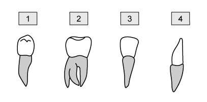
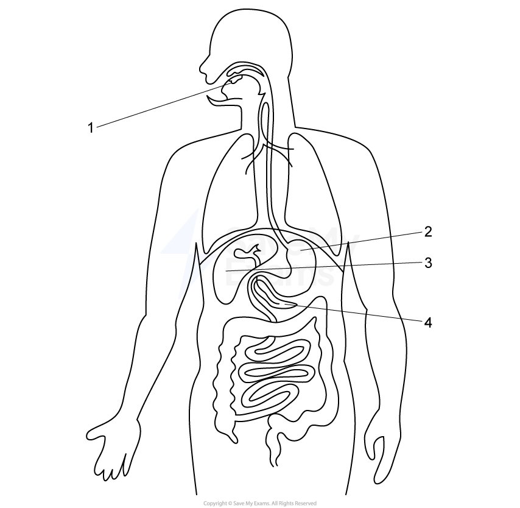
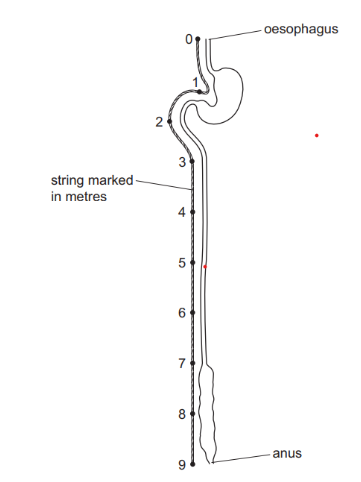
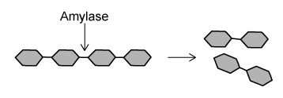

# Exam Questions — Human Diet & Digestion
**7. Human Nutrition** · Cambridge (CIE) IGCSE biology (0610 & 0970)
> Source: [https://www.savemyexams.com/igcse/biology/cie/23/topic-questions/](https://www.savemyexams.com/igcse/biology/cie/23/topic-questions/) · 33 questions across 1 sets

## Multiple Choice Questions (33 questions)

### Q1 — easy — 1 marks

**Q1** [1 mark]

Amylase is a digestive enzyme.

Which of the following correctly identifies the product(s) of amylase digestion.

### Q2 — medium — 1 marks

**Q2** [1 mark]

Below are diagrams of human teeth.

Which row correctly identifies the teeth shown?

|   | **1** | **2** | **3** | **4** |
|---|---|---|---|---|
| **A** | Premolar | Molar | Canine | Canine |
| **B** | Molar | Premolar | Incisor | Canine |
| **C** | Premolar | Molar | Incisor | Canine |
| **D** | Incisor | Molar | Premolar | Incisor |

### Q3 — medium — 1 marks

**Q3** [1 mark]

Below is a diagram of the digestive system

Which row correctly identifies the labelled organs?

|   | Organ 1 | Organ 2 | Organ 3 | Organ 4 |
|---|---|---|---|---|
| **A** | Teeth | Stomach | Gall bladder | Liver |
| **B** | Salivary glands | Stomach | Liver | Pancreas |
| **C** | Mouth | Liver | Stomach | Pancreas |
| **D** | Mouth | Liver | Gall bladder | Small intestine |

### Q4 — medium — 1 marks

**Q4** [1 mark]

The graph below shows the change in concentration of pathogens as food passes through the stomach.

Which of the following is the main factor that explains the shape of the curve?

### Q5 — hard — 1 marks

**Q5** [1 mark]

The diagram shows villi in a healthy small intestine and in a person with coeliac disease.

A person with coeliac disease may become undernourished even if they eat enough food.

Which is the best explanation?

### Q6 — medium — 1 marks

**Q6** [1 mark]

Which row correctly matches the enzyme to what it breaks down?

|   | enzyme | what it breaks down |
|---|---|---|
| A | amylase | fats |
| B | maltase | starch |
| C | pepsin | starch |
| D | trypsin | protein |

### Q7 — easy — 1 marks

**Q7** [1 mark]

How does physical digestion help chemical digestion?

### Q8 — medium — 1 marks

**Q8** [1 mark]

Which of the following describe prevention methods for rickets?

### Q9 — medium — 1 marks

**Q9** [1 mark]

A new smoothie that claims to provide a balanced diet contains the following ingredients:

| **Ingredients** |
|---|
| Soya protein |
| Iron |
| Fibre |
| Low-fat milk |
| Water |

What ingredients are missing from the smoothie for it to be a balanced diet product?

### Q10 — medium — 1 marks

**Q10** [1 mark]

The diagram shows the human alimentary canal, with a string marked in metres beside it.

How long is the small intestine?

*Source: june 2022 paper 1 Q16*

### Q11 — medium — 1 marks

**Q11** [1 mark]

In which part of the alimentary canal does ingestion take place?

*Source: june 2022 paper 1 Q15*

### Q12 — easy — 1 marks

**Q12** [1 mark]

What is the dietary importance of fibre in humans?

*Source: june 2022 paper 1 Q14*

### Q13 — easy — 1 marks

**Q13** [1 mark]

Where does **most** of the absorption of water take place in the alimentary canal?

*Source: June 2021 0970/11 Q16*

### Q14 — easy — 1 marks

**Q14** [1 mark]

What are the products when proteins are broken down?

*Source: June 2021 0970/11 Q15*

### Q15 — easy — 1 marks

**Q15** [1 mark]

In humans, where does most of the absorption of digested food take place?

*Source: June 2021 0970/11 Q14*

### Q16 — easy — 1 marks

**Q16** [1 mark]

Which disease can be caused by a lack of vitamin C?

*Source: Specimen 2023 0970/01 Q25*

### Q17 — medium — 1 marks

**Q17** [1 mark]

The diagram shows part of the human digestive system.

Which structure produces lipase?

*Source: Specimen 2023 0970/01 Q15*

### Q18 — easy — 1 marks

**Q18** [1 mark]

In which part of the body of a mammal does physical digestion occur?

*Source: Specimen 2023 0970/01 Q14*

### Q19 — easy — 1 marks

**Q19** [1 mark]

The diagram below shows four different types of human teeth.

Which teeth would be used to grind and chew food?

### Q20 — medium — 1 marks

**Q20** [1 mark]

#### Extended only

The diagram below shows the organs of the digestive system.

In which organs does the digestion of proteins take place?

### Q21 — easy — 1 marks

**Q21** [1 mark]

Which of the following is **not** an example of physical digestion?

### Q22 — medium — 1 marks

**Q22** [1 mark]

Which of the following is a correct cause and effect?

|   | **deficiency** | **cause** | **effect** |
|---|---|---|---|
| **A** | iron | diet deficient in red meat, leafy green vegetables and liver | brittle bones (rickets) |
| **B** | iron | lack of sunlight, fish and eggs | anaemia - tiredness and weakness due to not enough oxygen being delivered to tissues |
| **C** | vitamin D | lack of sunlight | brittle bones (rickets) |
| **D** | vitamin D | diet deficient in red meat, leafy green vegetables and liver | anaemia - tiredness and weakness due to not enough oxygen being delivered to tissues |

### Q23 — easy — 1 marks

**Q23** [1 mark]

The diagram below shows part of the human digestive system.

In which structure is most of the water from food absorbed?

### Q24 — medium — 1 marks

**Q24** [1 mark]

Which of the following descriptions are correctly matched to the different stages of food breakdown?

|   | **absorption** | **assimilation** | **egestion** |
|---|---|---|---|
| **A** | small soluble food molecules move into the bloodstream | small soluble food molecules cross the cell membrane of cells | excretion of undigested or unabsorbed food through the anus |
| **B** | small soluble food molecules move into the bloodstream | small soluble food molecules cross the cell membrane of cells | passing out of undigested or unabsorbed food through the anus |
| **C** | small soluble food molecules cross the cell membrane of cells | small soluble food molecules move into the bloodstream | passing out of undigested or unabsorbed food through the anus |
| **D** | small soluble food molecules cross the cell membrane of cells | small soluble food molecules move into the bloodstream | excretion of undigested or unabsorbed food through the anus |

### Q25 — easy — 1 marks

**Q25** [1 mark]

Which of the following best describes the function of vitamin D in a human?

### Q26 — medium — 1 marks

**Q26** [1 mark]

#### Extended only

Which of the following could be the correct effect and explanation of a disease that results in a reduced number of villi in the small intestine?

|   | **effect** | **explanation** |
|---|---|---|
| **A** | weight gain | reduced absorption of digested food molecules |
| **B** | weight gain | reduced digestion of maltose to glucose, less glucose absorbed |
| **C** | weight loss | reduced lipid digestion and absorption |
| **D** | weight loss | reduced absorption of digested food molecules |

### Q27 — medium — 1 marks

**Q27** [1 mark]

#### Extended only

The diagram below shows a villus.

In which vessel would the concentration of fatty acids be highest?

### Q28 — hard — 1 marks

**Q28** [1 mark]

A student ate a meal which contained a type of biomolecule, **X**.

The digestion of biomolecule **X **started in the mouth, and finished in the duodenum.

What is the product of the digestion of biomolecule **X**?

### Q29 — hard — 1 marks

**Q29** [1 mark]

The diagram below shows the organs of the digestive system, including the alimentary canal and accessory organs.

Where are most of the digestive lipase enzymes made in the body?

### Q30 — easy — 1 marks

**Q30** [1 mark]

#### Extended only

Which of the following is a correct function of bile?

### Q31 — hard — 1 marks

**Q31** [1 mark]

Below is a list of chemical reactions that occur during digestion.

1. Protein → amino acids
2. Starch → maltose
3. Lipids → fatty acids + glycerol
4. Maltose → glucose

Which of the chemical reactions above might occur in the duodenum?

### Q32 — hard — 1 marks

**Q32** [1 mark]

Which of the following shows the correct role of a substance made during digestion?

|   | **substance** | **made by** | **effect** |
|---|---|---|---|
| **A** | trypsin | stomach | digests proteins into amino acids |
| **B** | bile | gallbladder | neutralising acidic mixture of food entering the duodenum from the stomach |
| **C** | gastric juice | stomach | denaturing enzymes in harmful microorganisms and optimising pH for pepsin activity |
| **D** | bile | liver | neutralising alkaline mixture of food entering the duodenum from the stomach |

### Q33 — hard — 1 marks

**Q33** [1 mark]

#### Extended only

The diagram below shows the activity of salivary amylase on a starch molecule.

Which of the following is **not **a function of salivary amylase?
