# Exam Questions — Human Diet & Digestion
**7. Human Nutrition** · Cambridge (CIE) IGCSE biology (0610 & 0970)
> Source: [https://www.savemyexams.com/igcse/biology/cie/23/topic-questions/](https://www.savemyexams.com/igcse/biology/cie/23/topic-questions/) · 60 questions across 3 sets

## Alternative To Practical Questions (1 questions)

### Q1 — medium — 23 marks

**Q1** [5 marks]

A group of students used the experimental setup shown in Fig. 1 to model the effects of the digestion of starch in the human digestive system.

The aim is to determine the optimum pH for the action of amylase on starch.

**Fig. 1**

The students set up 3 beakers the same as the one shown in Fig. 1. They used buffer solutions to keep the pH of each experimental setup at the following three pH levels: pH4, pH8 and pH10.

Visking tubing (sometimes called dialysis tubing) is a non-living, partially permeable membrane made from cellulose. Pores in the membrane are small enough to prevent the passage of large molecules (such as starch and sucrose) but allow smaller molecules (such as glucose) to pass through by diffusion.

(i)

State the independent variable in this investigation.

[1]

(ii)

Suggest **two **tests that can be carried out to determine the progress of the enzyme-catalysed reaction.

[2]

(iii)

Suggest and explain a way to determine whether the buffer solution is performing its role effectively.

[2]

**Q1** [5 marks]

**Extract:**

A group of students used the experimental setup shown in Fig. 1 to model the effects of the digestion of starch in the human digestive system. The aim is to determine the optimum pH for the action of amylase on starch. The students set up 3 beakers the same as the one shown in Fig. 1. They used buffer solutions to keep the pH of each experimental setup at the following three pH levels: pH4, pH8 and pH10. Visking tubing (sometimes called dialysis tubing) is a non-living, partially permeable membrane made from cellulose. Pores in the membrane are small enough to prevent the passage of large molecules (such as starch and sucrose) but allow smaller molecules (such as glucose) to pass through by diffusion. The independent variable in this investigation is: pH / pH level. Two tests that can be carried out to determine progress of the enzyme-catalysed reaction are: Iodine test (for starch); Benedict's test (for glucose/reducing sugar).

The students wrote out their experimental method as follows:

1. Set up each reaction mixture with identical volumes of amylase, starch solution and buffer solution. Each reaction mixture totals 20cm3 in volume. Start the stopwatch
2. Immediately withdraw a small volume (< 0.5 cm3) of the reaction mixture into one pipette and the same volume of the surrounding water into another pipette
3. Place 1 drop of the reaction mixture into the well of a spotting tile and add a drop of iodine solution. Note any colour changes
4. Every 5 minutes withdraw a small volume (< 0.5 cm3) of each reaction mixture using the dropping pipette. Also test a sample of the water from around the outside of the Visking tubing.
5. Add the remaining contents of the dropping pipette to 2 cm of Benedict's solution in a test tube. Note any colour changes.
6. Repeat steps 2-5 at 5 minute intervals until no further colour changes are observed
7. Collate the results in a results table

(i)

An important action has been missed out from the students' method above, during Step 5. Suggest what this action should be.

[1]

(ii)

Draw a blank results table that the students could fill in to record the progress of their investigation. Use suitable column headings and units.

[4]

**Q1** [4 marks]

**Extract:**

The students wrote out their experimental method as follows:

1. Set up each reaction mixture with identical volumes of amylase, starch solution and buffer solution. Each reaction mixture totals 20cm^3^ in volume. Start the stopwatch
2. Immediately withdraw a small volume (< 0.5 cm^3^) of the reaction mixture into one pipette and the same volume of the surrounding water into another pipette
3. Place 1 drop of the reaction mixture into the well of a spotting tile and add a drop of iodine solution. Note any colour changes
4. Every 5 minutes withdraw a small volume (< 0.5 cm^3^) of each reaction mixture using the dropping pipette. Also test a sample of the water from around the outside of the Visking tubing.
5. Add the remaining contents of the dropping pipette to 2 cm of Benedict's solution in a test tube. Note any colour changes.
6. Repeat steps 2-5 at 5 minute intervals until no further colour changes are observed
7. Collate the results in a results table

A blank results table for the investigation would have the following features:
- Independent variable / pH in the first / left-hand column
- Units of time included (seconds/minutes)
- Times at 5 minute intervals from zero (maximum time any time 20 minutes+)
- 4 results columns, 2 for iodine test (inside Visking tubing and outside), 2 for Benedict's test (inside Visking tubing and outside)

Two tests that can be carried out to determine progress of the enzyme-catalysed reaction are:
- Iodine test (for starch)
- Benedict's test (for glucose/reducing sugar)

Before beginning the investigation, the students decided on observations to record for each of the tests performed, as described in the method.  These observations would be written in the table they constructed in part (b) (ii).

(i)

Suggest the observations the students could record to show the results of the iodine test.

[1]

(ii)

Suggest the observations the students could record to show the results of the Benedict's test.

[1]

(iii)

Describe a way for the results that the students observed to be made more reliable.

[2]

**Q1** [6 marks]

**Extract:**

A group of students used the experimental setup shown in Fig. 1 to model the effects of the digestion of starch in the human digestive system. 

The aim is to determine the optimum pH for the action of amylase on starch.

The students set up 3 beakers the same as the one shown in Fig. 1. They used buffer solutions to keep the pH of each experimental setup at the following three pH levels: pH4, pH8 and pH10.

Visking tubing (sometimes called dialysis tubing) is a non-living, partially permeable membrane made from cellulose. Pores in the membrane are small enough to prevent the passage of large molecules (such as starch and sucrose) but allow smaller molecules (such as glucose) to pass through by diffusion.

Fig. 2 shows the appearance of the spotting tile that the students used for their iodine tests. The colours they observed are shown in the key at the bottom of Fig. 2

**Fig. 2**

(i)

Explain the results at each pH level.

[3]

(ii)

Use the results in Fig. 2 to estimate the fastest time taken to fully digest the starch

[1]

(iii)

Suggest a further experiment to give a more accurate answer to the answer you gave in part (d) (ii)

[2]

**Q1** [3 marks]

**Extract:**

Visking tubing (sometimes called dialysis tubing) is a non-living, partially permeable membrane made from cellulose. Pores in the membrane are small enough to prevent the passage of large molecules (such as starch and sucrose) but allow smaller molecules (such as glucose) to pass through by diffusion.

The aim is to determine the optimum pH for the action of amylase on starch.

The students set up 3 beakers the same as the one shown in Fig. 1. They used buffer solutions to keep the pH of each experimental setup at the following three pH levels: pH4, pH8 and pH10.

The students noticed that the results of the Benedict's test on the water outside the Visking tubing showed only very weak colour changes, when positive.

Suggest and explain a change to the experimental equipment that could increase the chances of a more definitive positive result being produced.

## Multiple Choice Questions (33 questions)

### Q1 — easy — 1 marks

**Q1** [1 mark]

Amylase is a digestive enzyme.

Which of the following correctly identifies the product(s) of amylase digestion.

### Q2 — medium — 1 marks

**Q2** [1 mark]

Below are diagrams of human teeth.

Which row correctly identifies the teeth shown?

|   | **1** | **2** | **3** | **4** |
|---|---|---|---|---|
| **A** | Premolar | Molar | Canine | Canine |
| **B** | Molar | Premolar | Incisor | Canine |
| **C** | Premolar | Molar | Incisor | Canine |
| **D** | Incisor | Molar | Premolar | Incisor |

### Q3 — medium — 1 marks

**Q3** [1 mark]

Below is a diagram of the digestive system

Which row correctly identifies the labelled organs?

|   | Organ 1 | Organ 2 | Organ 3 | Organ 4 |
|---|---|---|---|---|
| **A** | Teeth | Stomach | Gall bladder | Liver |
| **B** | Salivary glands | Stomach | Liver | Pancreas |
| **C** | Mouth | Liver | Stomach | Pancreas |
| **D** | Mouth | Liver | Gall bladder | Small intestine |

### Q4 — medium — 1 marks

**Q4** [1 mark]

The graph below shows the change in concentration of pathogens as food passes through the stomach.

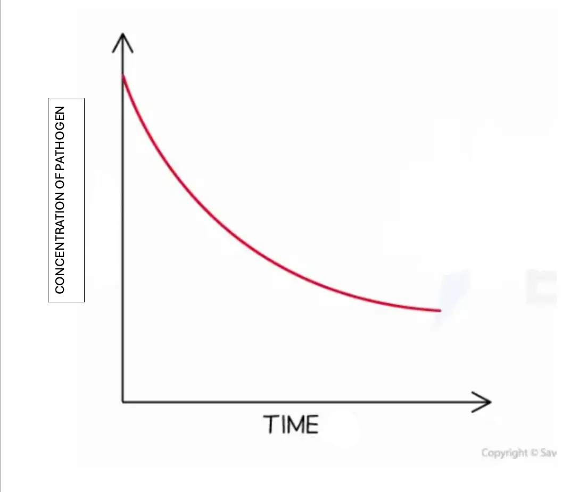

Which of the following is the main factor that explains the shape of the curve?

### Q5 — hard — 1 marks

**Q5** [1 mark]

The diagram shows villi in a healthy small intestine and in a person with coeliac disease.

A person with coeliac disease may become undernourished even if they eat enough food.

Which is the best explanation?

### Q6 — medium — 1 marks

**Q6** [1 mark]

Which row correctly matches the enzyme to what it breaks down?

|   | enzyme | what it breaks down |
|---|---|---|
| A | amylase | fats |
| B | maltase | starch |
| C | pepsin | starch |
| D | trypsin | protein |

### Q7 — easy — 1 marks

**Q7** [1 mark]

How does physical digestion help chemical digestion?

### Q8 — medium — 1 marks

**Q8** [1 mark]

Which of the following describe prevention methods for rickets?

### Q9 — medium — 1 marks

**Q9** [1 mark]

A new smoothie that claims to provide a balanced diet contains the following ingredients:

| **Ingredients** |
|---|
| Soya protein |
| Iron |
| Fibre |
| Low-fat milk |
| Water |

What ingredients are missing from the smoothie for it to be a balanced diet product?

### Q10 — medium — 1 marks

**Q10** [1 mark]

The diagram shows the human alimentary canal, with a string marked in metres beside it.

How long is the small intestine?

*Source: june 2022 paper 1 Q16*

### Q11 — medium — 1 marks

**Q11** [1 mark]

In which part of the alimentary canal does ingestion take place?

*Source: june 2022 paper 1 Q15*

### Q12 — easy — 1 marks

**Q12** [1 mark]

What is the dietary importance of fibre in humans?

*Source: june 2022 paper 1 Q14*

### Q13 — easy — 1 marks

**Q13** [1 mark]

Where does **most** of the absorption of water take place in the alimentary canal?

*Source: June 2021 0970/11 Q16*

### Q14 — easy — 1 marks

**Q14** [1 mark]

What are the products when proteins are broken down?

*Source: June 2021 0970/11 Q15*

### Q15 — easy — 1 marks

**Q15** [1 mark]

In humans, where does most of the absorption of digested food take place?

*Source: June 2021 0970/11 Q14*

### Q16 — easy — 1 marks

**Q16** [1 mark]

Which disease can be caused by a lack of vitamin C?

*Source: Specimen 2023 0970/01 Q25*

### Q17 — medium — 1 marks

**Q17** [1 mark]

The diagram shows part of the human digestive system.

Which structure produces lipase?

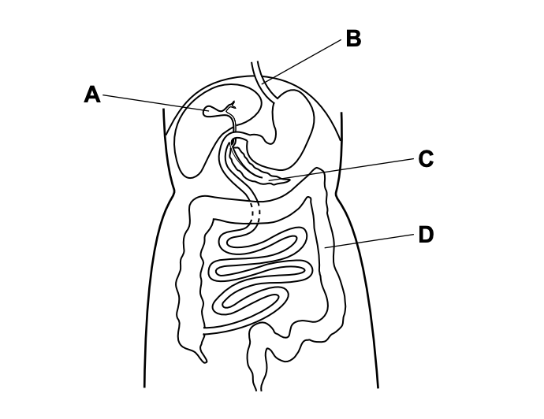

*Source: Specimen 2023 0970/01 Q15*

### Q18 — easy — 1 marks

**Q18** [1 mark]

In which part of the body of a mammal does physical digestion occur?

*Source: Specimen 2023 0970/01 Q14*

### Q19 — easy — 1 marks

**Q19** [1 mark]

The diagram below shows four different types of human teeth.

Which teeth would be used to grind and chew food?

### Q20 — medium — 1 marks

**Q20** [1 mark]

#### Extended only

The diagram below shows the organs of the digestive system.

In which organs does the digestion of proteins take place?

### Q21 — easy — 1 marks

**Q21** [1 mark]

Which of the following is **not** an example of physical digestion?

### Q22 — medium — 1 marks

**Q22** [1 mark]

Which of the following is a correct cause and effect?

|   | **deficiency** | **cause** | **effect** |
|---|---|---|---|
| **A** | iron | diet deficient in red meat, leafy green vegetables and liver | brittle bones (rickets) |
| **B** | iron | lack of sunlight, fish and eggs | anaemia - tiredness and weakness due to not enough oxygen being delivered to tissues |
| **C** | vitamin D | lack of sunlight | brittle bones (rickets) |
| **D** | vitamin D | diet deficient in red meat, leafy green vegetables and liver | anaemia - tiredness and weakness due to not enough oxygen being delivered to tissues |

### Q23 — easy — 1 marks

**Q23** [1 mark]

The diagram below shows part of the human digestive system.

In which structure is most of the water from food absorbed?

### Q24 — medium — 1 marks

**Q24** [1 mark]

Which of the following descriptions are correctly matched to the different stages of food breakdown?

|   | **absorption** | **assimilation** | **egestion** |
|---|---|---|---|
| **A** | small soluble food molecules move into the bloodstream | small soluble food molecules cross the cell membrane of cells | excretion of undigested or unabsorbed food through the anus |
| **B** | small soluble food molecules move into the bloodstream | small soluble food molecules cross the cell membrane of cells | passing out of undigested or unabsorbed food through the anus |
| **C** | small soluble food molecules cross the cell membrane of cells | small soluble food molecules move into the bloodstream | passing out of undigested or unabsorbed food through the anus |
| **D** | small soluble food molecules cross the cell membrane of cells | small soluble food molecules move into the bloodstream | excretion of undigested or unabsorbed food through the anus |

### Q25 — easy — 1 marks

**Q25** [1 mark]

Which of the following best describes the function of vitamin D in a human?

### Q26 — medium — 1 marks

**Q26** [1 mark]

#### Extended only

Which of the following could be the correct effect and explanation of a disease that results in a reduced number of villi in the small intestine?

|   | **effect** | **explanation** |
|---|---|---|
| **A** | weight gain | reduced absorption of digested food molecules |
| **B** | weight gain | reduced digestion of maltose to glucose, less glucose absorbed |
| **C** | weight loss | reduced lipid digestion and absorption |
| **D** | weight loss | reduced absorption of digested food molecules |

### Q27 — medium — 1 marks

**Q27** [1 mark]

#### Extended only

The diagram below shows a villus.

In which vessel would the concentration of fatty acids be highest?

### Q28 — hard — 1 marks

**Q28** [1 mark]

A student ate a meal which contained a type of biomolecule, **X**.

The digestion of biomolecule **X **started in the mouth, and finished in the duodenum.

What is the product of the digestion of biomolecule **X**?

### Q29 — hard — 1 marks

**Q29** [1 mark]

The diagram below shows the organs of the digestive system, including the alimentary canal and accessory organs.

Where are most of the digestive lipase enzymes made in the body?

### Q30 — easy — 1 marks

**Q30** [1 mark]

#### Extended only

Which of the following is a correct function of bile?

### Q31 — hard — 1 marks

**Q31** [1 mark]

Below is a list of chemical reactions that occur during digestion.

1. Protein → amino acids
2. Starch → maltose
3. Lipids → fatty acids + glycerol
4. Maltose → glucose

Which of the chemical reactions above might occur in the duodenum?

### Q32 — hard — 1 marks

**Q32** [1 mark]

Which of the following shows the correct role of a substance made during digestion?

|   | **substance** | **made by** | **effect** |
|---|---|---|---|
| **A** | trypsin | stomach | digests proteins into amino acids |
| **B** | bile | gallbladder | neutralising acidic mixture of food entering the duodenum from the stomach |
| **C** | gastric juice | stomach | denaturing enzymes in harmful microorganisms and optimising pH for pepsin activity |
| **D** | bile | liver | neutralising alkaline mixture of food entering the duodenum from the stomach |

### Q33 — hard — 1 marks

**Q33** [1 mark]

#### Extended only

The diagram below shows the activity of salivary amylase on a starch molecule.

Which of the following is **not **a function of salivary amylase?

## Theory Questions (26 questions)

### Q1 — medium — 9 marks

**Q1** [2 marks]

Bile is required for the effective digestion of fats.

Outline the role of bile in fat digestion.

**Q1** [4 marks]

In patients with cystic fibrosis, thick mucus blocks the pancreatic duct.

Explain why a blockage of the pancreatic duct leads to poor growth and 'fatty stools' (faeces containing undigested fats).

**Q1** [3 marks]

Patients with cystic fibrosis often take enzyme supplement capsules with every meal.

A patient with cystic fibrosis absorbs 12 g of fat per day without enzyme capsules. When taking enzyme supplement capsules with every meal, they absorb 50 g of fat per day.

Calculate the percentage increase in fat absorption when using the capsules.

Give your answer to two significant figures.

### Q2 — hard — 11 marks

**Q2** [4 marks]

A student analysed the nutritional content of a 60 g "high-energy" snack bar. They suspected that the bar contained starch and protein.

Describe the food tests they would use to confirm the presence of these two nutrients.

**Q2** [4 marks]

The snack bar contained the sugar lactose, found naturally in milk. In the human body, lactose is broken down by the enzyme lactase.

Lactase breaks down lactose into smaller sugar molecules known as reducing sugars.

(i) State the name of the solution used to test for reducing sugars, and describe the positive result you would expect to see.

[2]

(ii) The optimum temperature for lactase is 37 °C.

Describe what will happen to the enzyme and the rate of reaction when the temperature is increased to 80 °C.

[2]

**Q2** [3 marks]

A person who ate only these snack bars for a long period of time could develop deficiency conditions.

(i) State the name of the condition caused by a lack of vitamin C.

[1]

(ii) State the name of the condition caused by a lack of vitamin D.

[1]

(iii) State **one** reason why humans need fibre in their diet.

[1]

### Q3 — hard — 2 marks

**Q3** [2 marks]

Maltase is another digestive enzyme.

Outline the action of maltase.

### Q4 — easy — 4 marks

**Q4** [4 marks]

(i)

Blood transports nutrients.

State the component of the blood that transports nutrients.

[1]

(ii)

The nutrients in the blood can be used to become part of cells. State the name of this process.

[1]

(iii)

Amino acids are used to make proteins. State two examples of proteins that are found in the blood.

[2]

*Source: Specimen 2023 0970/04 Q1B*

### Q5 — easy — 1 marks

**Q5** [1 mark]

State where in the digestive system protease is secreted.

*Source: Specimen 2023 0970/03 Q6E*

### Q6 — easy — 5 marks

**Q6** [5 marks]

Table 6.1 shows some large insoluble molecules, some digestive enzymes and some smaller soluble molecules that are produced during digestion.

**Table 6.1**

| insoluble molecule | enzyme | soluble molecules |
|---|---|---|
| starch | amylase | reducing sugars |
| fat |   |   |
|   | protease |   |

Complete Table 6.1 by writing the names of the missing enzyme and molecules.

The first row has been done for you.

*Source: Specimen 2023 0970/03 Q6C*

### Q7 — medium — 13 marks

**Q7** [4 marks]

A man is overweight.

Fig. 1 shows his diet. He consumes 15 000 kJ a day.

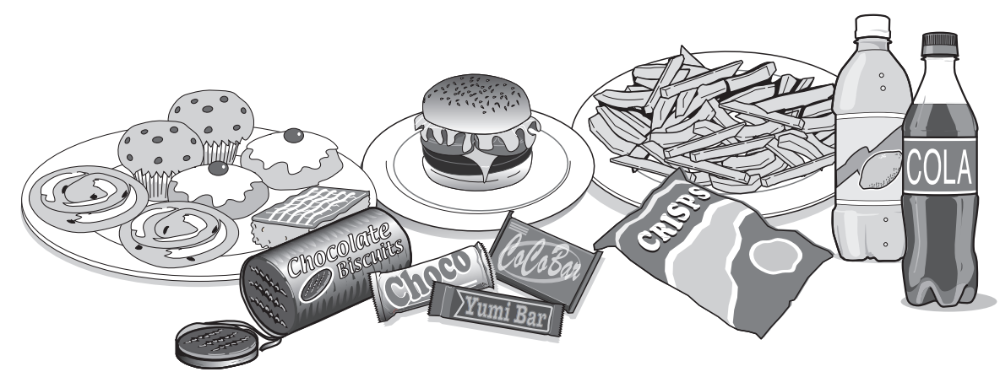

**Fig. 1**

(i)

Suggest why the diet shown in Fig. 1 is **not **considered to be a balanced diet.

[2]

(ii)

Suggest and explain how the man could reduce his weight.

[2]

*Source: 2018 (Series 3) 0610/33 Q3A*

**Q7** [5 marks]

The following sentences describe the importance of some foods.

Choose words from the list to complete the sentences.

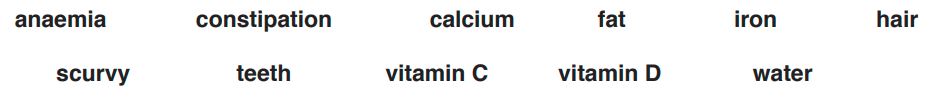

Oranges and lemons are fruits which are a good source of ............................................... and help to prevent ............................................... .

Foods made from milk are important for making healthy bones and ............................................... because they are a good source of ............................................... .

Fibre is important because it helps to prevent ............................................... .

*Source: 2018 (Series 3) 0610/33 Q3B*

**Q7** [4 marks]

Explain how a woman’s dietary needs will change when she is pregnant.

*Source: 2018 (Series 3) 0610/33 Q3C*

### Q8 — medium — 10 marks

**Q8** [4 marks]

Fig. 1 is a diagram of the alimentary canal and associated organs.

Some parts are identified by letters.

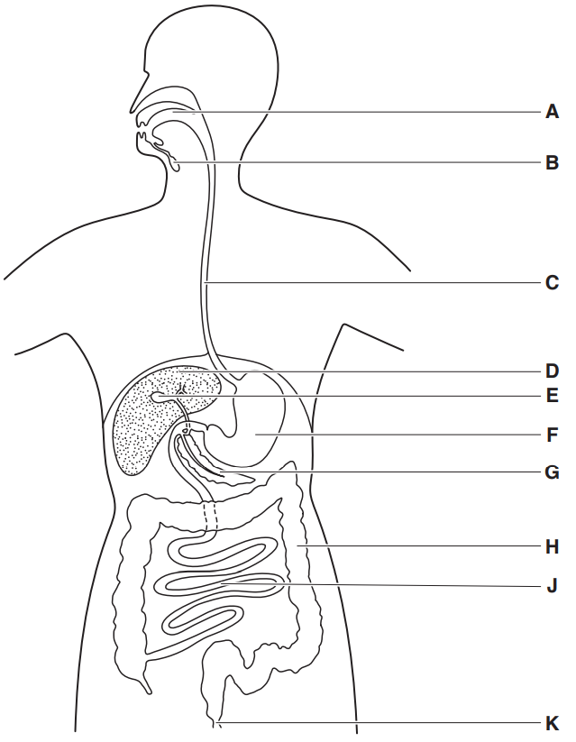

**Fig. 1**

Complete Table 1 by inserting the letter from Fig. 1 which identifies the part that carries out the function described.

**Table 1**

| **Description of function** | **Letter in Fig. 1** |
|---|---|
| Where egestion takes place |   |
| Where lipase is made |   |
| Where mechanical digestion occurs |   |
| Where the **most** water is absorbed |   |

*Source: 2019 0970/31 Q3A*

**Q8** [4 marks]

Cholera is a transmissible disease.

(i)

State the type of pathogen that causes cholera.

(ii)

One of the symptoms of cholera is diarrhoea.

Describe what is meant by the term *diarrhoea*.

[1]

(iii)

Outline the treatment for diarrhoea.

[2]

*Source: 2019 0970/31 Q3B*

**Q8** [2 marks]

State **two **ways in which the body can defend itself against pathogens.

*Source: 2019 0970/31 Q3C*

### Q9 — hard — 10 marks

**Q9** [2 marks]

#### Extended only

Fig. 1 shows the location of the gallbladder in the human digestive system.

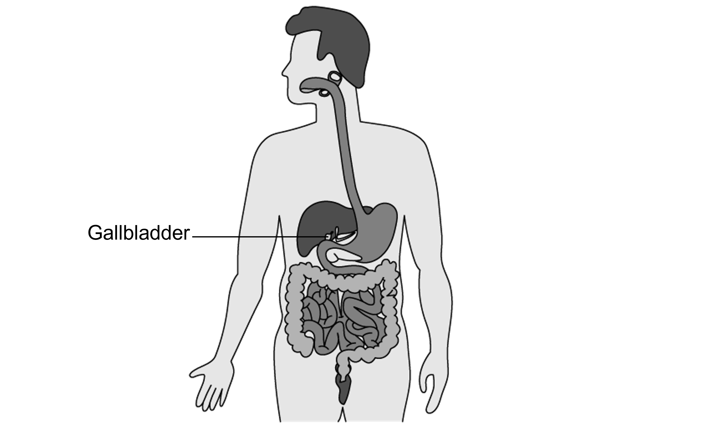

**Fig. 1**

Explain the purpose of the gallbladder.

**Q9** [3 marks]

#### Extended only

The gallbladder may become inflamed or blocked by gallstones, which may cause much pain. In such cases, it is best to surgically remove the gallbladder. Doctors may recommend that patients with no gallbladder follow a low fat diet after surgery.

Suggest a possible reason for this recommendation.[3]

**Q9** [2 marks]

**Extract:**

The gallbladder may become inflamed or blocked by gallstones, which may cause much pain. In such cases, it is best to surgically remove the gallbladder. Doctors may recommend that patients with no gallbladder follow a low fat diet after surgery.

A possible reason for following a low fat diet after having the gallbladder removed includes...

- (Without a gallbladder) less concentrated / a smaller volume of bile will enter the duodenum;
- This will decrease the emulsification of large fat droplets;
- Which results in less / smaller surface area (of droplets);
- Which will decrease the rate at which lipase can break down lipids (into fatty acids and glycerol);

Certain vitamins are known as fat soluble vitamins. They are often found in food with a high fat content and are best absorbed into the blood along with digested lipids.

#### Extended only

Certain vitamins are known as fat soluble vitamins. They are often found in food with a high fat content and are best absorbed into the blood along with digested lipids.

Based on the information provided in part (b) and (c), explain why people without gallbladders may develop deficiencies in these vitamins.

**Q9** [3 marks]

**Extract:**

The purpose of the gallbladder is... It stores bile (produced by the liver); Releases the bile into the duodenum via the bile duct.

A possible reason for following a low fat diet after having the gallbladder removed includes... (Without a gallbladder) less concentrated / a smaller volume of bile will enter the duodenum; This will decrease the emulsification of large fat droplets; Which results in less / smaller surface area (of droplets); Which will decrease the rate at which lipase can break down lipids (into fatty acids and glycerol).

Certain vitamins are known as fat soluble vitamins. They are often found in food with a high fat content and are best absorbed into the blood along with digested lipids. People without gallbladders may develop deficiencies in fat soluble vitamins because... Less fat soluble vitamins will be present in low fat foods/diet; These vitamins will not be efficiently absorbed into the blood / less vitamins will be absorbed into the blood (due to a decrease in lipid/fat digestion).

Vitamin D is an example of a fat soluble vitamin. In some cases, children may need to have their gallbladders removed due to inflammation. In most cases, this will not have a significant impact on their long term health, but in some extreme cases, it might.

Suggest a possible impact that this may have on their health.

[3]

### Q10 — easy — 6 marks

**Q10** [2 marks]

Fig. 1 shows teeth in a human skull.

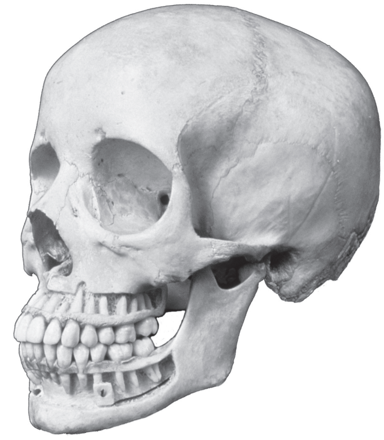

**Fig. 1**

Add label lines and labels to Fig. 1 to identify an incisor tooth and a molar tooth.

*Source: 2018 0610/32 Q4A*

**Q10** [3 marks]

The teeth are responsible for the physical digestion of food molecules when we chew.

(i)

Define the term 'physical digestion'.

[2]

(ii)

Describe the purpose of physical digestion.

[1]

**Q10** [1 mark]

Other than the chewing action of teeth, state **one** example of physical digestion.

### Q11 — hard — 11 marks

**Q11** [3 marks]

The stomach produces gastric juice which contains hydrochloric acid.

Explain the importance of hydrochloric acid in the stomach.

**Q11** [3 marks]

Normally the epithelial cells in the lining of the stomach are protected from the effects of gastric juice by a layer of mucus secreted by goblet cells found in the stomach lining.

Sometimes a type of bacteria called *Helicobacter pylori* can penetrate the mucus layer and cause damage to the goblet cells. This leads to the formation of a peptic ulcer.

Fig. 1 compares a healthy stomach lining with one that has been infected by *H. pylori*.

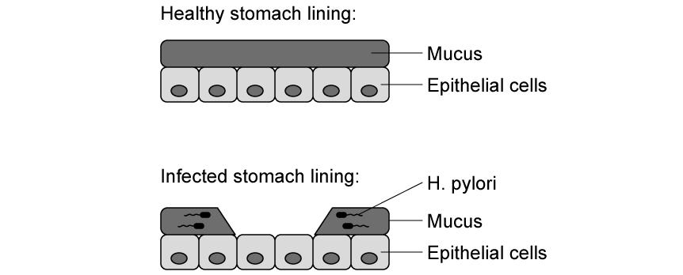

**Fig. 1**

Based on the information in Fig. 1, suggest how *H. pylori* may lead to the formation of a peptic ulcer.

**Q11** [2 marks]

**Extract:**

Sometimes a type of bacteria called Helicobacter pylori can penetrate the mucus layer and cause damage to the goblet cells. This leads to the formation of a peptic ulcer.

*H. pylori* may lead to the formation of a peptic ulcer in the following ways...

- Less/no mucus secreted by damaged/infected goblet cells; [1 mark]
- This leaves epithelial cells exposed / no protection against (the effects of) gastric juice/hydrochloric acid; [1 mark]
- Gastric juice/hydrochloric acid may cause damage to epithelial cells / stomach lining (resulting in an ulcer); [1 mark]

It is an important skill to be able to apply your knowledge to an unfamiliar scenario such as this one. The question stem gives you information about how the mucus layer protects the epithelial cells against the gastric juice, so if this layer is compromised in any way it will leave these cells exposed to the effects of hydrochloric acid (which is corrosive).

Patients suffering from peptic ulcers may receive treatment with substances called proton pump inhibitors (PPI's). These substances will suppress the cells in the lining of the stomach that produce hydrochloric acid.

Explain how PPI's could act as a treatment for peptic ulcers.

**Q11** [3 marks]

**Extract:**

Patients suffering from peptic ulcers may receive treatment with substances called proton pump inhibitors (PPI's). These substances will suppress the cells in the lining of the stomach that produce hydrochloric acid.

PPI's could act as a treatment for peptic ulcers because...

- (It would lead to) less hydrochloric acid being produced;

#### Extended only

Based on the information from part (c), suggest the effect the PPI's could have on digestion in the stomach.

### Q12 — medium — 12 marks

**Q12** [4 marks]

#### Extended Only

The reactions of chemical digestion are catalysed by enzymes.

Fig. 1 shows the stages of an enzyme-catalysed reaction.

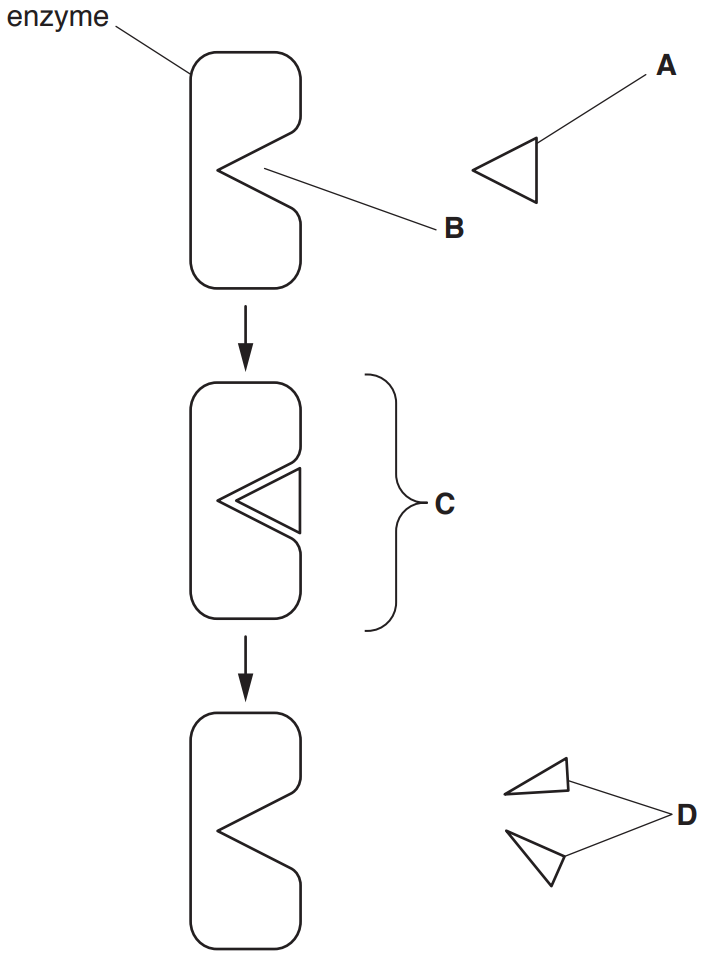

**Fig. 1**

State the names of **A **to **D **in Fig. 1.

*Source: 2018 0610/41 Q1A*

**Q12** [2 marks]

Explain the importance of chemical digestion.

*Source: 2018 0610/41 Q1B*

**Q12** [6 marks]

#### Extended Only

Fig. 2 shows the human alimentary canal and associated organs.

The functions of some of these parts of the body are given in Table 1.

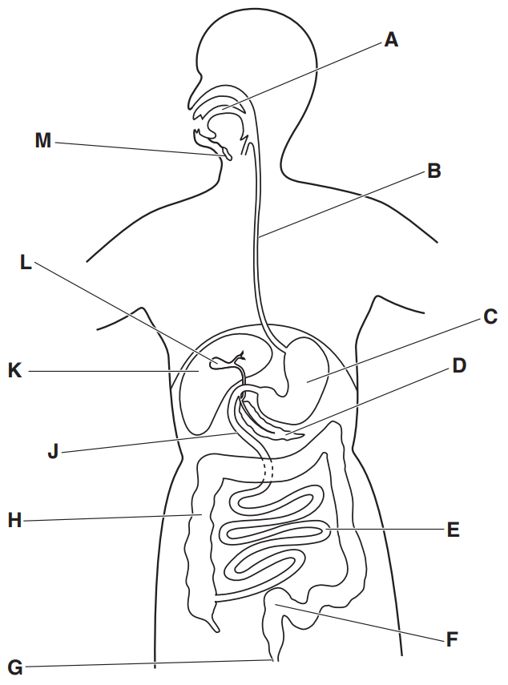

**Fig. 2**

Complete Table 1. One row has been done for you.

**Table 1**

| Function | Letter from Fig. 2 | Name of Structure |
|---|---|---|
| Site of starch digestion |   |   |
| Reabsorption of water |   |   |
| Secretion of pepsin |   |   |
| Site of maltose digestion |   |   |
| Secretion of bile |   |   |
| Storage of faeces | **F** | rectum |
| Secretion of lipase and trypsin |   |   |

*Source: 2018 0610/41 Q1C*

### Q13 — medium — 4 marks

**Q13** [4 marks]

Fig. 1 shows the four different types of human teeth.

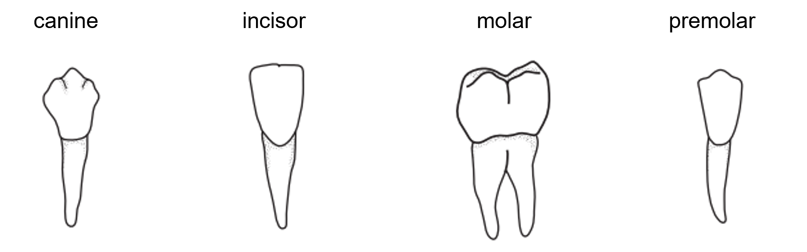

**Fig. 1**

Fig. 2 shows a diagram of the position of the different types of teeth in the mouth.

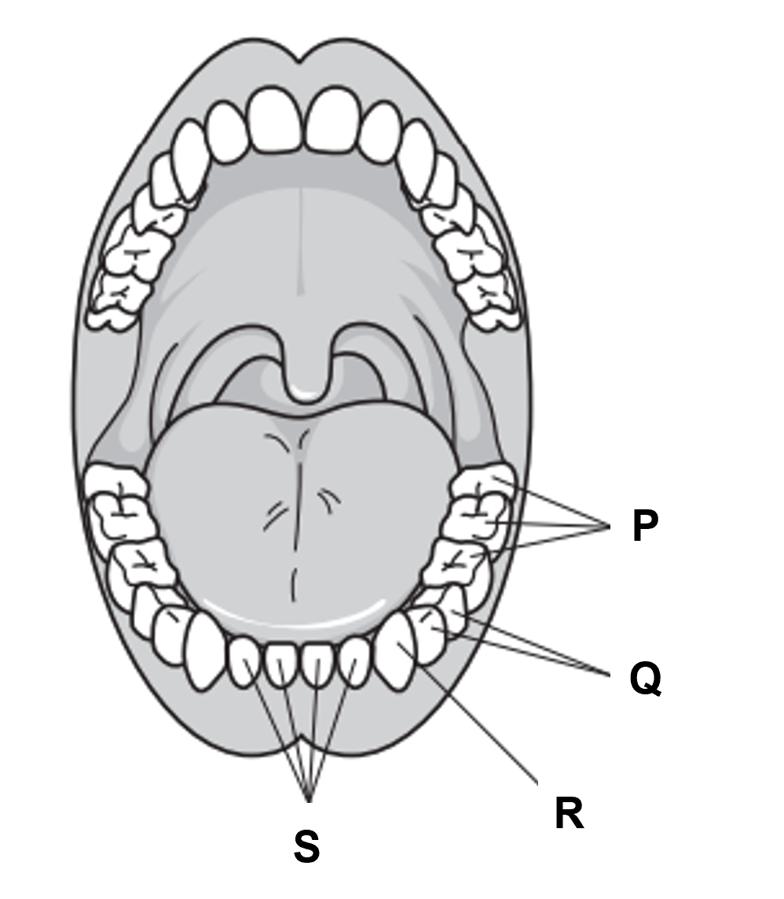

**Fig. 2**

Complete Table 1 by writing the names, positions and functions of the different types of teeth in the mouth shown in Fig. 2.

**Table 1**

| **Name of type of tooth** | **Letter on Fig. 2** | **Function** |
|---|---|---|
|   | **R** |   |
| Incisor |   |   |
|   |   | Grinding |
| Premolar |   | Tearing and grinding |

*Source: 2018 (Series 1) 0610/31 Q4A*

### Q14 — easy — 11 marks

**Q14** [5 marks]

During digestion, enzymes act on different types of food to produce simpler substances that can be absorbed.

Complete Table 1 by inserting the missing information.

**Table 1**

| food type | enzyme acting on the food type | simpler substances produced |
|---|---|---|
| Protein | Protease |   |
|   | Amylase |   |
|   |   | Fatty acids and glycerol |

*Source: 2018 0610/31 Q8A*

**Q14** [4 marks]

The following diagram includes some of the stages of food breakdown and descriptions of these stages.

Complete the following by drawing lines to connect each stage of food breakdown with the correct description.

| **Stage of food breakdown** |   | **Description** |
|---|---|---|
|   |   |   |
| Ingestion |   | Breakdown of large insoluble molecules into small soluble ones |
|   |   |   |
| Absorption |   | Digested food molecules move into the cells of the body |
|   |   |   |
| Assimilation |   | Digested food molecules move through the wall of the intestine |
|   |   |   |
| Chemical digestion |   | Taking in food and drink through the mouth |

**Q14** [2 marks]

Enzymes are involved with the chemical digestion of food molecules.

State **two** parts of the digestive system where chemical digestion occurs.

### Q15 — medium — 10 marks

**Q15** [4 marks]

Two functions of the alimentary canal are mechanical digestion and chemical digestion.

Outline where **and** how mechanical digestion occurs in the alimentary canal.

*Source: 2018 0610/43 Q1A*

**Q15** [3 marks]

Enzymes catalyse the reactions of chemical digestion. Table 1 gives information about chemical digestion in three parts of the alimentary canal.

Complete Table 1.

**Table 1**

| Part of the alimentary canal | Enzyme | Substrate | Product(s) |
|---|---|---|---|
| mouth |   | starch |   |
| stomach |   |   | peptides |
|   |   | fat | fatty acids and glycerol |

*Source: 2018 0610/43 Q1B*

**Q15** [3 marks]

Substances that are absorbed from the alimentary canal may enter cells and become part of the cells.

(i)

State the storage carbohydrate made from glucose in liver cells.

[1]

(ii)

State the type of protein used in the immune system that is produced from amino acids by lymphocytes.

[1]

(iii)

Fat is produced from fatty acids and glycerol by cells in the fatty tissue beneath the skin.

State **one** function of this layer of fat.

[1]

*Source: 2018 0610/43 Q1C*

### Q16 — easy — 12 marks

**Q16** [4 marks]

#### Extended Only

Fig. 1 is a photomicrograph showing a surface view of many villi in the small intestine.

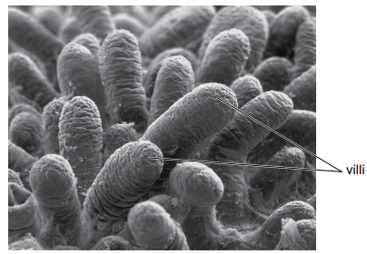

**Fig. 1**

(i)

State the function of villi.

[1]

(ii)

Describe the structure of a villus.

[3]

*Source: 2023 970/04 Q1A*

**Q16** [4 marks]

(i)

Blood transports nutrients.

State the component of the blood that transports nutrients.

[1]

(ii)

The nutrients in the blood can be used to become part of cells.

State the name of this process.

[1]

(iii)

Amino acids are used to make proteins.

State **two** examples of proteins that are found in the blood.

[2]

*Source: 2023 970/04 Q1B*

**Q16** [4 marks]

Explain the effect of cholera bacteria on the digestive system.

*Source: 2023 970/04 Q1C*

### Q17 — hard — 12 marks

**Q17** [5 marks]

Fig. 1 shows the human digestive system.

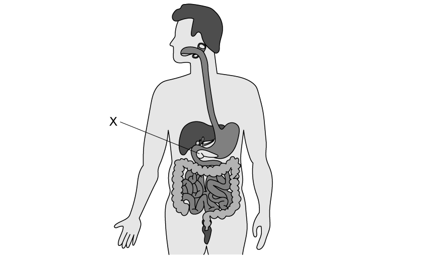

**Fig. 1**

(i)

Identify organ **X** in Fig. 1.

[1]

(ii)

Describe the function of organ **X** in digestion.

[4]

**Q17** [3 marks]

#### Extended only

Chewing on a piece of bread will result in a sweet taste developing in the mouth after a while.

Explain the reason for this.

**Q17** [4 marks]

#### Extended only

Protease enzymes chemically break down protein molecules.

Explain why protease enzymes cannot break down any other type of molecule.

### Q18 — easy — 12 marks

**Q18** [5 marks]

Some animals produce milk to feed their offspring.

Table 1 shows the mass of the substances found in 100g of milk from two animals.

**Table 1**

| substance | mass in 100g of milk / g |   |
|---|---|---|
| human milk | water buffalo milk |   |
| protein | 1.10 | 4.50 |
| fat | 4.50 | 8.00 |
| carbohydrate | 7.50 | 4.90 |
| calcium | 0.03 | 2.00 |
| water |   |   |

(i)

Calculate the mass of water in both the human milk and the water buffalo milk.

[2]

(ii)

State the name of the substance in Table 1 that is present in a higher concentration in human milk than in water buffalo milk.

[1]

(iii)

State the name of **one** component of a balanced diet that is missing from Table 1.

[1]

(iv)

Producing milk for offspring is a characteristic of a particular group of animals.

State the name of this group of animals.

[1]

*Source: 2018 0610/32 Q7A*

**Q18** [5 marks]

**Extract:**

Table 1 shows the mass of the substances found in 100g of milk from two animals.

| substance | mass in 100g of milk / g |
| human milk | water buffalo milk |
| protein | 1.10 | 4.50 |
| fat | 4.50 | 8.00 |
| carbohydrate | 7.50 | 4.90 |
| calcium | 0.03 | 2.00 |
| water |   |   |

State how young animals use the substances listed in Table 1.

*Source: 2018 0610/32 Q7B*

**Q18** [2 marks]

An adult eats a high-fat diet.

State **two** health problems that could be caused by eating a high-fat diet.

*Source: 2018 0610/32 Q7C*

### Q19 — medium — 4 marks

**Q19** [4 marks]

Red pandas, *Ailurus fulgens*, and humans have a similar arrangement of teeth.

Fig. 1 shows a section through one tooth of a red panda. Fig. 2 shows the side view of the lower jaw of a red panda.

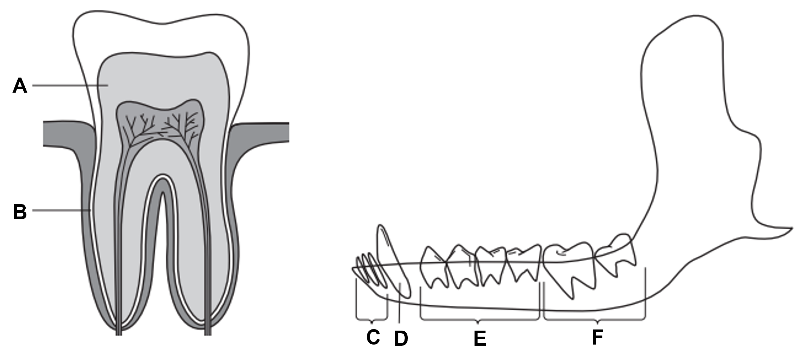

**                 Fig. 1                                                      Fig. 2**

(i)

State the names of the structures labelled **A** to **F** in Fig. 1 and Fig. 2.

[3]

(ii)

State the type of digestion that breaks down large pieces of food.

[1]

*Source: 2018 0610/42 Q1A*

### Q20 — medium — 6 marks

**Q20** [3 marks]

#### Extended Only

Fig. 1 shows a villus from the small intestine of a mammal and an enlarged view of a cell from region** A**.

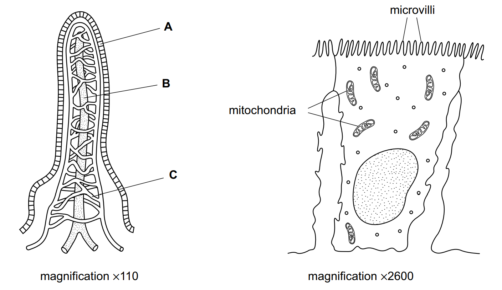

**Fig. 1**

Name regions **A**, **B** and **C**.

*Source: 2020 0610/04 Q6A*

**Q20** [3 marks]

**Extract:**

The regions labelled on the diagram are:

- **A** = epithelium / epithelial lining;

#### Extended Only

Explain why the cells from region **A** have many microvilli and many mitochondria.

*Source: 2020 0610/04 Q6B*

### Q21 — medium — 7 marks

**Q21** [3 marks]

Fig. 1 shows a section through a tooth.

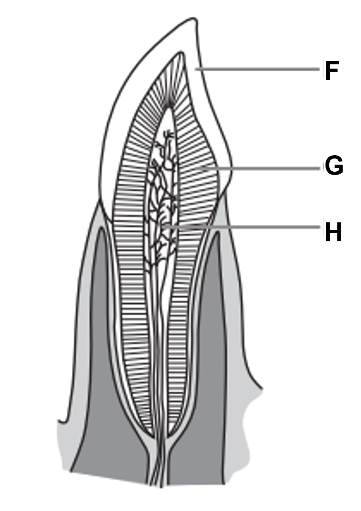

**Fig. 1**

State the names of structures **F**, **G** and **H**.

*Source: 2018 0610/31 Q6A*

**Q21** [4 marks]

(i)

State **two** functions of teeth.

[2]

(ii)

Describe the importance of teeth in the digestion of food.

[2]

*Source: 2018 0610/31 Q6B*

### Q22 — easy — 10 marks

**Q22** [5 marks]

Fig. 1 shows a diagram of part of the alimentary canal and associated structures.

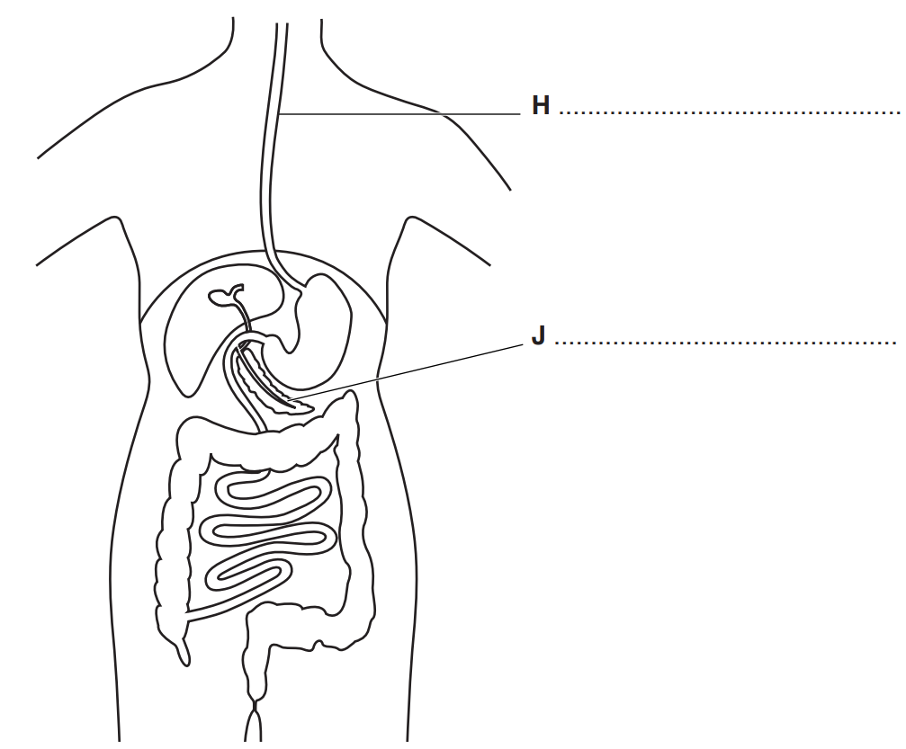

**Fig. 1**

(i)

State the names of the structures labelled **H **and **J**.

Write your answers on Fig. 1.

[2]

(ii)

On Fig. 1 draw label lines with letters to show:

**N** where faeces are stored.

**P** where most water is absorbed.

**R** where digested food is absorbed.

[3]

*Source: 2018 0610/32 Q5A*

**Q22** [2 marks]

(i)

State the name of the process that is defined as the movement of digested food molecules into the cells of the body where they are used, becoming part of the cells.

[1]

(ii)

State the name of the process that removes faeces from the body.

[1]

*Source: 2018 0610/32 Q5B*

**Q22** [3 marks]

Fig. 2 shows how the rate of reaction of a digestive enzyme changes with pH.

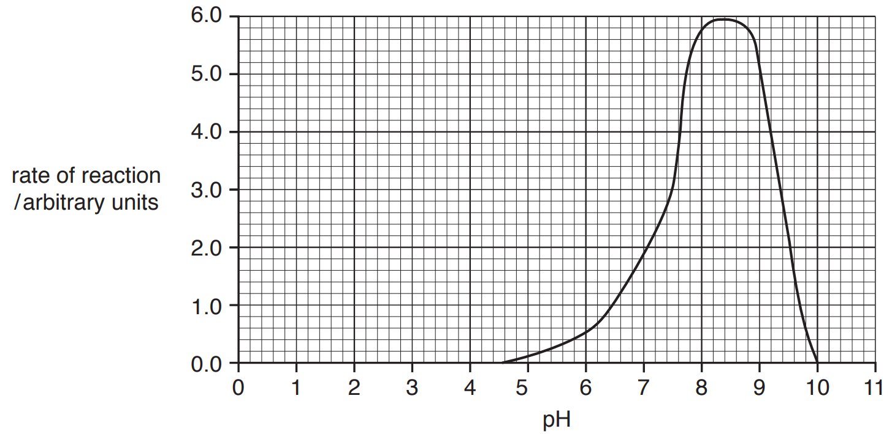

**Fig. 2**

(i)

Describe the effect of the increase in pH on the rate of reaction shown in Fig. 2.

[2]

(ii)

State one factor other than pH that will affect enzyme activity.

[1]

*Source: 2018 0610/32 Q5C*

### Q23 — easy — 9 marks

**Q23** [4 marks]

Fig. 1 shows the marine iguana, *Amblyrhynchus cristatus*.

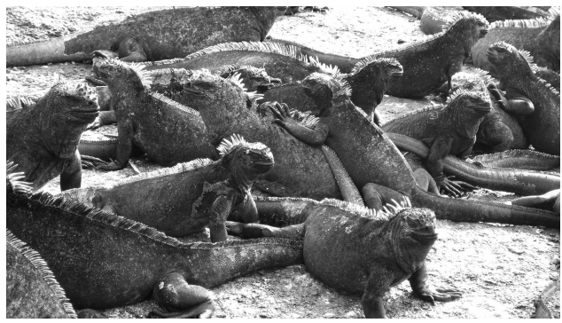

**Fig. 1**

(i)

Marine iguanas are reptiles.

State **two** features that are used to classify animals as reptiles.

[2]

(ii)

State **two** structures that are present in plant cells that are not present in the cells of reptiles.

[2]

*Source: 2023 970/04 Q5A*

**Q23** [5 marks]

#### Extended Only

Marine iguanas feed on seaweed. Seaweed contains starch.

(i)

State the names of **two** parts of the digestive system where starch is digested by enzymes.

[2]

(ii)

Explain why the shape of an enzyme is important for digestion.

[3]

*Source: 2023 970/04 Q5B*

### Q24 — hard — 13 marks

**Q24** [2 marks]

Define the term *chemical digestion.*

*Source: 2018 0610/42 Q6A*

**Q24** [8 marks]

#### Extended Only

A student investigated the activity of the digestive enzyme pepsin. Fig. 1 shows the apparatus used in the investigation.

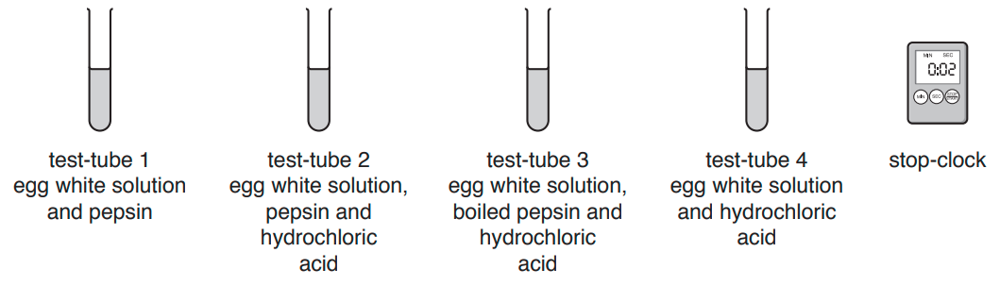

**Fig. 1**

The appearance of the four test-tubes was recorded at 0 and 5 minutes.

The protein in the egg white solution gives the solution a cloudy appearance.

The cloudy appearance clears when the protein in the egg white solution breaks down.

Table 1 shows the results.

**Table 1**

| **Test-tube** | **Contents** | **Appearance at 0 mins** | **Appearance after 5 mins** |
|---|---|---|---|
| **1** | Egg white solution, pepsin | Cloudy | Less cloudy |
| **2** | Egg white solution, pepsin, hydrochloric acid | Cloudy | Clear |
| **3** | Egg white solution, boiled pepsin, hydrochloric acid | Cloudy | Cloudy |
| **4** | Egg white solution, hydrochloric acid | Cloudy | Cloudy |

(i)

Explain the results shown for test-tubes **1**, **2** and **3** in Table 1.

[5]

(ii)

Explain the purpose of test-tube **4**.

[2]

(iii)

State the name of the organ in the body that produces pepsin.

[1]

*Source: 2018 0610/42 Q6B*

**Q24** [3 marks]

#### Extended Only

Maltase is another digestive enzyme.

Describe the action of maltase **and** state where it acts in the alimentary canal.

*Source: 2018 0610/42 Q6C*

### Q25 — medium — 6 marks

**Q25** [6 marks]

Fig. 1 shows some parts of the human body.

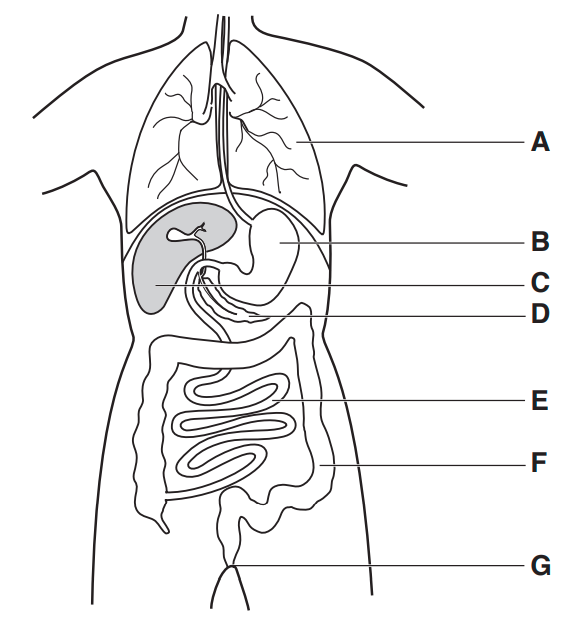

**Fig. 1**

(i)

Use Fig. 1 to complete Table 1.

State the letter and the name of the part responsible for each function.

**Table 1**

| **Function** | **Letter in Fig. 1** | **Name of the part** |
|---|---|---|
| Produces insulin |   |   |
| Produces hydrochloric acid |   |   |

[4]

(ii)

State the letter of the part of the body where egestion occurs.

[1]

(iii)

State the function of hydrochloric acid in the body.

[1]

*Source: 2018 0610/33 Q8A*

### Q26 — hard — 14 marks

**Q26** [3 marks]

#### Extended only

A group of students investigated the effect of pH on the activity of amylase.

Their results are shown in Fig. 1.

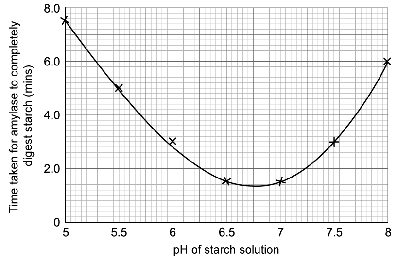

**Fig. 1**

(i)

Identify the optimum pH of amylase from Fig. 1.

[1]

(ii)

Explain your answer from part (i).

[2]

**Q26** [2 marks]

**Extract:**

Time taken for amylase to completely digest starch at pH 5 = 7.5 minutes. Time taken for amylase to completely digest starch at pH 7 = 1.5 minutes. Step 1: Calculate the difference = 7.5 - 1.5 = 6.0. Step 2: Difference ÷ time at pH 5 = 6.0 ÷ 7.5 = 0.8. Step 3: Convert to % = 0.8 × 100 = 80%.

#### Extended only

Calculate the percentage decrease in the time taken to digest starch between pH 5 and 7. Show your working.

**Q26** [4 marks]

**Extract:**

A group of students investigated the effect of pH on the activity of amylase. Their results are shown in Fig. 1. [Graph shows time taken for amylase to completely digest starch at different pH values, with specific data points such as time taken increases from 1.5 minutes at pH 7 to 6.0 minutes at pH 8.]

#### Extended only

Describe and explain the shape of the graph between pH 7 and 8.

**Q26** [5 marks]

#### Extended only

Outline the process of starch digestion in the human body.
