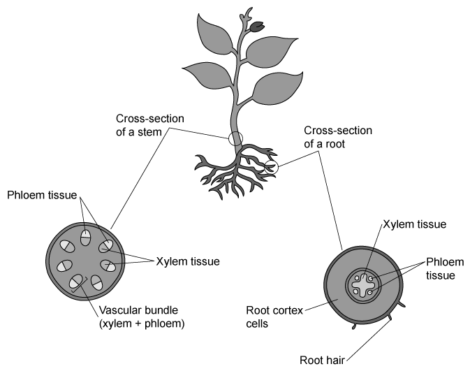

# Mark Schemes — Transport in Plants
**8. Transport in Plants** · Cambridge (CIE) IGCSE biology (0610 & 0970)

## Multiple Choice Questions (29 questions)

### Q1
**Final answer:** **The correct answer is D.**

- Transpiration is the loss of water vapour from leaves, which occurs by diffusion through the stomata

**A** is incorrect as this does not describe transpiration, which is the loss of water vapour from leaves. The movement of water upwards from the roots is known as the transpiration stream.

**B** is incorrect as increasing wind speed increases the rate of transpiration.

**C** is incorrect as water evaporates from the surfaces of the mesophyll cells, not directly from the stomata.

### Q2
**Final answer:** **The correct answer is C.**

- To calculate the rate of transpiration:

$\text{rate of transpiration} = \frac{\text{distance travelled by bubble}}{\text{time}}$

- Calculate the distance travelled by the bubble between 120 min and 30 min:

= 44 - 17

= 27 mm

- Calculate the time that passes between 120 and 30 mins:

= 120 - 30

= 90 min

- Calculate the rate of transpiration:

= 27 ÷ 90

=** 0.3 ****mm / min**

**A** is incorrect as it corresponds to dividing 44 mm by 120 mins, i.e. it is the rate of transpiration between 0 and 120 mins, not between 30 and 120 mins.

**C** is incorrect as this is what you get if you divide time by distance (90 ÷ 27) rather than distance by time.

**D** is incorrect as this is the correct calculation but the wrong unit.

> **[exam-tip]**
> Always remember to calculate the change in distance and the change in time rather than using the raw values from the table.
> 
> Ensure that you include the correct units in your final answer.

### Q3
**Final answer:** **The correct answer is ****A.**

- Transpiration is reduced by **low temperature** and **high humidity**
- **Low temperature** gives water molecules less kinetic energy, so evaporation from mesophyll cell surfaces is slower
- **High humidity** means the air already contains a lot of water vapour, so the diffusion gradient for water vapour leaving the leaf is smaller, reducing diffusion through the stomata

**B **is incorrect because high temperature and low humidity both increase transpiration.

**C** is incorrect because low humidity increases the diffusion gradient for water vapour.

**D** is incorrect because high temperature increases evaporation.

### Q4
**Final answer:** **The correct answer is ****B.**

- Water moves through the plant in this order:

**root hair cells → root cortex cells → xylem → mesophyll cells**

- **Root hair cells** absorb water from the soil because they are in direct contact and have a large surface area.
- The water then passes through the **root cortex cells** to reach the centre of the root
- Next, the water enters the **xylem**, which carries water up through the root and stem towards the leaves
- Finally, in the leaf water moves from the xylem into the **mesophyll cells**, where it can evaporate during transpiration and is also used in photosynthesis

### Q5
**Final answer:** **The correct answer is ****B****.**

- A source is an area of the plant which produces more glucose in photosynthesis than it uses in respiration.
- In stage 3, the bulb has photosynthesizing leaves and provides glucose which can be stored within the bulb.
- In stage 6, the bulb no longer has leaves and so becomes a source of glucose for the next stage of development.

**A **is incorrect because the bulb provides glucose in stage 6 and so is a source at this point rather than a sink.

**C **is incorrect because  in stage 3, the bulb is storing glucose and is therefore a sink and not a source and in stage 6, the bulb uses the stored glucose up and so becomes a source of glucose, rather than a sink.

**D **is incorrect because in stage 3, the bulb is storing glucose and is therefore a sink and not a source.

### Q6
**Final answer:** **The correct answer is ****B****.**

- In plants that are adapted to live in very dry conditions, the stomata close when the temperatures increase to reduce water loss by transpiration. As a result, more stomata are likely to be open when it is dark than when it is light during the day
- This is shown in the graph by the reduced uptake of carbon dioxide during the day compared to during the night and also by the decrease in transpiration rate in the daytime, between approximately 6:00 and 18:00

**A** is incorrect because the higher rate of CO2 uptake and transpiration during the night time (between 18:00 and 6:00) indicates that the stomata are open.

**C** is incorrect because CO2  uptake continues throughout the 24 hour period and is at its highest during the nighttime hours.

**D** is incorrect because, although transpiration is reduced during the light periods, the process does not stop completely and so water uptake will also continue.

### Q7
**Final answer:** **The correct answer is ****D****.**

- This is because spongy mesophyll cells have a large surface area and a lot of air spaces around them for the water to evaporate to
- They are also close to the stomata, which is where most water evaporates out of during transpiration

**A** is incorrect because the palisade mesophyll cells have a small surface area close to the air and so only have a small area for evaporation. They also use up water during photosynthesis and so take in a lot of water for that reason.

**B** is incorrect because the xylem carries water into the leaf but is not a cell. The “cells” of the xylem are not alive.

**C** is incorrect because the phloem takes in sugars and amino acids and carries them away from the leaf. Water is not carried in the phloem.

### Q8
**Final answer:** **The correct answer is ****D****.**

- This is because this is the xylem vessel, which is the vessel that water and minerals travel through in order to get from the roots to the leaves of the plant

**A** is incorrect because this is the outer part of the plant and has the function of protecting the plant from the entry of pathogens.

**B** is incorrect because this is the phloem that carries sucrose and amino acids through the plant, not water.

**C** is incorrect because the cells in this part of the plant support the plant with their turgor pressure but they are not vessels for the transport of water.

### Q9
**Final answer:** **The correct answer is ****C****.**

- The dye will move more slowly when transpiration is slowest
- More humid conditions will reduce transpiration due to a decrease in the concentration gradient between the air outside the leaf and the air spaces in the spongy mesophyll
- A low temperature will reduce transpiration as it decreases the rate of evaporation from the surface of the cells in the spongy mesophyll

**A **is incorrect because high temperature would increase the rate of transpiration whilst high humidity would reduce rates of transpiration and fluid movement in the plant.

**B** is incorrect because high temperature and low humidity would likely facilitate faster movement of the dye due to increased evaporation and transpiration rates.

**D** is incorrect because even though low humidity would increase transpiration, low temperature reduces the kinetic energy of molecules, leading to slower movement.

### Q10
**Final answer:** **The correct answer is**** B****.**

- The root hair cell is the most external cell of the root, the cortex cells are aligned between the root hair cell and the xylem in the centre of the root.

All other answers are incorrect combinations of cells.

### Q11
**Final answer:** **The correct answer is A.**

- This is because the new leaves require the sucrose and amino acids in order to grow
- The new leaves have not yet grown and started to photosynthesise in order to provide a source of new biological molecules

**B** is incorrect because the mature leaves are able to photosynthesise and provide a source of biological molecules like sucrose and amino acids

**C **and **D** are incorrect because there is very little new growth/metabolic activity happening at these times of year and so the source of amino acids and sucrose is not needed very much

### Q12
**Final answer:** **The correct answer is B because:**

- Shoot X will have carried out transpiration and lost water from the leaves; this will have caused a reduction in mass
- Shoot Y has no leaves and so will not have lost water by transpiration, meaning that the mass will have stayed the same

**A **is incorrect because shoot Y would not have gained mass for any reason

**C** is incorrect because shoot X should have lost mass due to transpiration and shoot Y would not have gained mass for any reason

**D** is incorrect because shoot X should have lost mass due to transpiration

18. The diagram shows a section through a human heart.

### Q13
**Final answer:** **The correct answer is D because:**

- Z shows a xylem vessel, which has the role of transporting water (and mineral ions) from the root to the rest of the plant
- Xylem vessels can be recognised by their thickened cell walls

**A** is incorrect because photosynthesis takes place in the cells of the leaves, not in the roots.

**B** is incorrect because xylem vessel cells are dead and therefore do not carry out respiration.

**C** is incorrect because phloem vessels transport sugars, not xylem vessels.

### Q14
**Final answer:** **The correct answer is ****C**** because:**

- The phloem carries sucrose (and amino acids) in all directions from sources (which depending on the time of year could be leaves or storage organs like roots) to sinks (other areas of the plant where the amino acids and sucrose will be used or stored)
- The xylem transports water (and mineral ions) in one direction up the plant, from the roots to the leaves, driven by the pulling force generated by transpiration in the leaves

**A** is incorrect because transport in the xylem is unidirectional.

**B** is incorrect because the direction of transport in the phloem and the xylem is the wrong way around.

**D** is incorrect because transport in the phloem occurs in both directions.

### Q15
**Final answer:** **The correct answer is ****C**** because:**

- After 48 hours the leaves have **wilted**, you can see them drooping in the image
- Wilting is a sign that a plant has **insufficient water** – it has lost more water by transpiration than it has taken up and therefore water has moved out of cells, causing them to become flaccid

**A** & **B** are incorrect because translocation is the term used to describe the movement of sucrose and amino acids in the phloem.

**D** is incorrect because water loss occurs by evaporation of water from mesophyll cells inside the leaf and then diffusion of this water vapour through the stomata. Osmosis describes the movement of water between solutions separated by partially permeable membranes.

### Q16
**Final answer:** **The correct answer is ****B**** because:**

- Sugars are synthesised in the leaf via photosynthesis and then converted into substances such as **sucrose **and **amino acids** (using nitrate ions). The leaf is therefore a **source **- a region of production
- Sucrose and amino acids are then transported to other regions of the plant through the phloem (through which movement can occur in **both **directions)
- Sucrose and amino acids are transported to regions of **storage**, or to regions where they can be used in **respiration **(sugars) or for **growth **(amino acids) - a **sink**

**A** is incorrect because translocation involves the movement of sugars and amino acids through the phloem.

**C** is incorrect because movement through the phloem is two-way (unlike movement in the xylem, which is one-way)

**D** is incorrect because movement through the phloem occurs from a source to a sink. Some parts of a plant may act as a source or a sink at different times during the lifecycle of a plant.

### Q17
**Final answer:** **The correct answer is ****D**** (1 and 4) because:**

Water molecules evaporate from mesophyll cells, forming water vapour (a gas) which diffuses from an area of higher concentration in the air spaces inside the leaf to a lower concentration in the air outside the leaf (unless it’s very humid and the air is saturated with water!)

**A** is incorrect because diffusion is involved in the loss of water from a leaf, but condensation (change in the stage of gas to a liquid) is not.

**B** is incorrect because diffusion is only one of the processes involved in water loss from the leaves of a plant.

**C** Is incorrect because evaporation is involved in the loss of water from a leaf, but diffusion is also involved.

### Q18
**Final answer:** **The correct (false) statement is ****B.**** (in a potometer, an air bubble moves away from the piece of plant tissue that is under investigation) because:**

The air bubble moves **towards** the plant. the transpiration stream pulls water into the xylem at the bottom of the piece of plant. The bubble moves with the water, therefore towards the plant.

**A**, **C** and **D** are all correct statements.

For **A**, the transpiration of water pulls water up from the potometer, provided there is a tight seal between the end of the cut stem of the plant and the water supply beneath.

For **C**, the rate of reaction (or any process) always requires a measurement of time so that, in this case, the speed of uptake of water per minute/hour can be measured and stated quantitatively.

For **D**, water on the leaves may block stomata and prevent water vapour from diffusing out, hence affecting the rate of transpiration.

### Q19
**Final answer:** **The correct answer is ****B**** because:**

- Xylem vessels are dead cells which contain no organelles or cytoplasm. They lose their end walls during development to form continuous tubes
- Both of these adaptations mean water can flow through them easily in a continuous stream, as a result of the upwards pull created by transpiration in the leaves

### Q20
**Final answer:** **The correct answer is ****B**** because:**

- Shoot **B** has leaves and so transpiration will occur
- The water level in the tube will decrease, leading to a loss in mass

Shoot **A** has no leaves, so no transpiration will occur and the water level in the tube will remain the same, so there will be no change in mass.

### Q21
**Final answer:** **The correct answer is ****B**** because:**

Root hairs are extensions of the cytoplasm of root cells, increasing the surface area to maximise the absorption of water by osmosis and ions by active transport.

**A** is incorrect because ions are transported into the roots by active transport. Osmosis only applies to the movement of water.

**C** Is incorrect because ions are transported into the roots by active transport, not diffusion.

**D** Is incorrect because there is no indication that surface area is increased in this explanation, and osmosis should be mentioned in relation to the movement of water.

### Q22
**Final answer:** **The correct answer is ****D**** because:**

2 is the xylem as seen in a cross-section of a root in a dicotyledonous plant, and 3 is the xylem in a cross-section taken of the stem. The dye molecules are dissolved in water which moves up the xylem through the plant.

**A** is incorrect because 1 is the phloem. The phloem tissue is located in the outer region of the vascular bundle.

**B** and **C** are incorrect because 4 is the phloem in the root, which is found in smaller bundles surrounding the larger xylem vessels.

### Q23
**Final answer:** **The correct answer is ****D**** because:**

Plants lose water through **transpiration**. Water vapour can diffuse out of the leaves through the **stomata**. This water vapour comes from the spongy cells within the leaf; water will **evaporate **from the surface of these cells.

**A** is incorrect because respiration produces water, but it is not the process by which water is lost from the plant.

**B** is incorrect because translocation is the movement of nutrients and amino acids through the phloem.

**C** is incorrect because photosynthesis requires water as a source of hydrogen to produce carbohydrates.

### Q24
**Final answer:** **The correct answer is ****A**** because:**

- Humidity is a measure of the concentration of water vapour in the air
- When humidity is low there is a steep water vapour concentration gradient between the inside of the leaf and the surrounding air, so transpiration rate is high
- When humidity is high the concentration gradient is very shallow so transpiration rate is much lower

**B** and **C** are incorrect because both graphs show the rate of transpiration increasing as humidity increases.

**D** is incorrect because graph **D** shows the rate of transpiration remaining constant as humidity increases, which would suggest no relationship between the two factors.

### Q25
**Final answer:** **The correct answer is ****A**** because:**

- Water moves into root hairs by osmosis and then moves across the root cortex into the xylem
- From here it is pulled up the stem by the transpiration stream to the mesophyll cells in the leaf before evaporating from the surface of these cells into the air spaces surrounding the spongy mesophyll cells
- It then diffuses out of the stomata into the air outside the leaf as water vapour (a gas)

### Q26
**Final answer:** **The correct answer is ****D ****because:**

The less humid (drier) the atmosphere, the higher the diffusion gradient between the inside of the leaf and the outside (through the stomatal pore).

**A** is incorrect because a decrease in stomatal density means less transpiration (as the leaves have fewer stomata).

**B** is incorrect because a reduction in light intensity causes stomata to close, reducing the rate of transpiration.

**C** is incorrect because a reduction in temperature means the water vapour molecules move more slowly, so they would diffuse out of the stomata at a lower rate.

### Q27
**Final answer:** **The correct answer is ****D**** because:**

- Transpiration takes place via stomata, so the plant that has the lowest stomatal density will have the lowest rate of transpiration
- **D** has the lowest total surface area (number of leaves × average surface area of one leaf) and also the lowest density of stomata per mm2, with each stoma being fairly small in diameter

### Q28
**Final answer:** **The correct answer is ****C**** because:**

Amino acids would be the only substance from the options given to move through the phloem (as well as sucrose).

**A** is incorrect because glucose is never transported through the phloem; however, sucrose (a disaccharide that contains one glucose molecule) is transported through the phloem.

**B** and **D** are incorrect because starch and cellulose are large biomolecules that are insoluble in water, therefore they cannot be moved around the plant.

### Q29
**Final answer:** **The correct answer is ****C**** because:**

If a plant does not get enough water, it becomes limp and wilts. This is because water has left the cells and they have become flaccid, providing less support to the overall structure of the leaf. If a cell does not contain enough water there is no pressure pushing outwards against the cell wall and the cells will all shrink a little.

**A** is incorrect because a decrease in light intensity would just reduce the rate of photosynthesis, not cause the plant to wilt.

**B** is incorrect because an increase in humidity would reduce transpiration from the plant, meaning it would retain more water.

**D** is incorrect because a decrease in wind speed would reduce transpiration from the plant, meaning it would retain more water.
